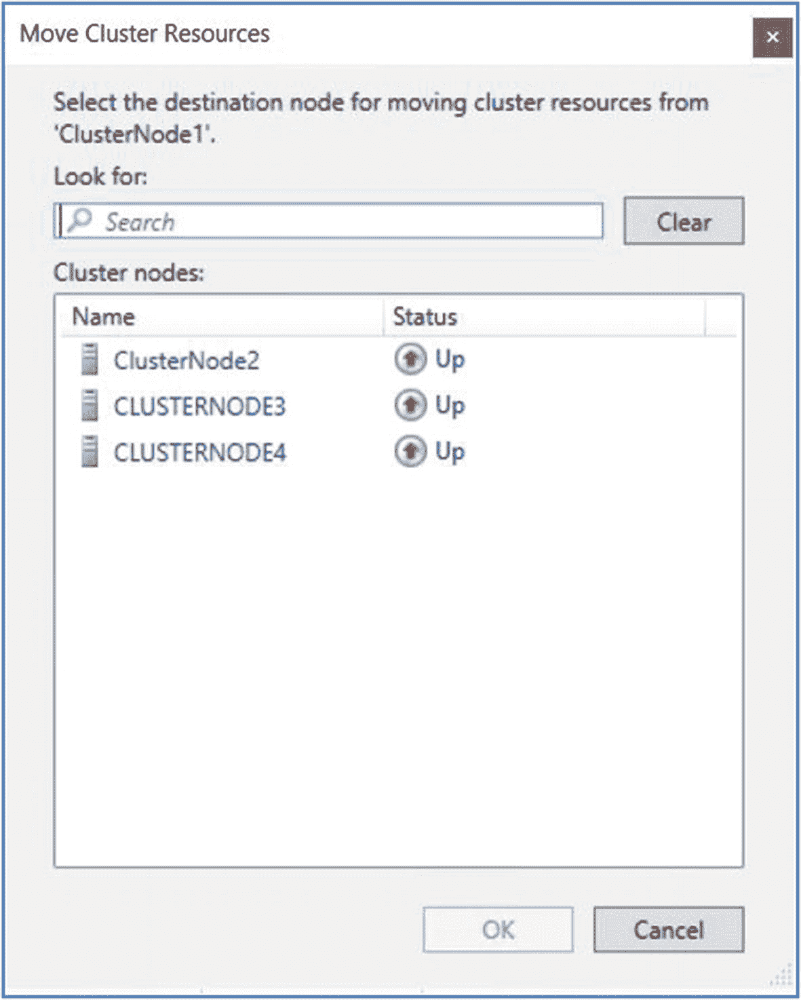
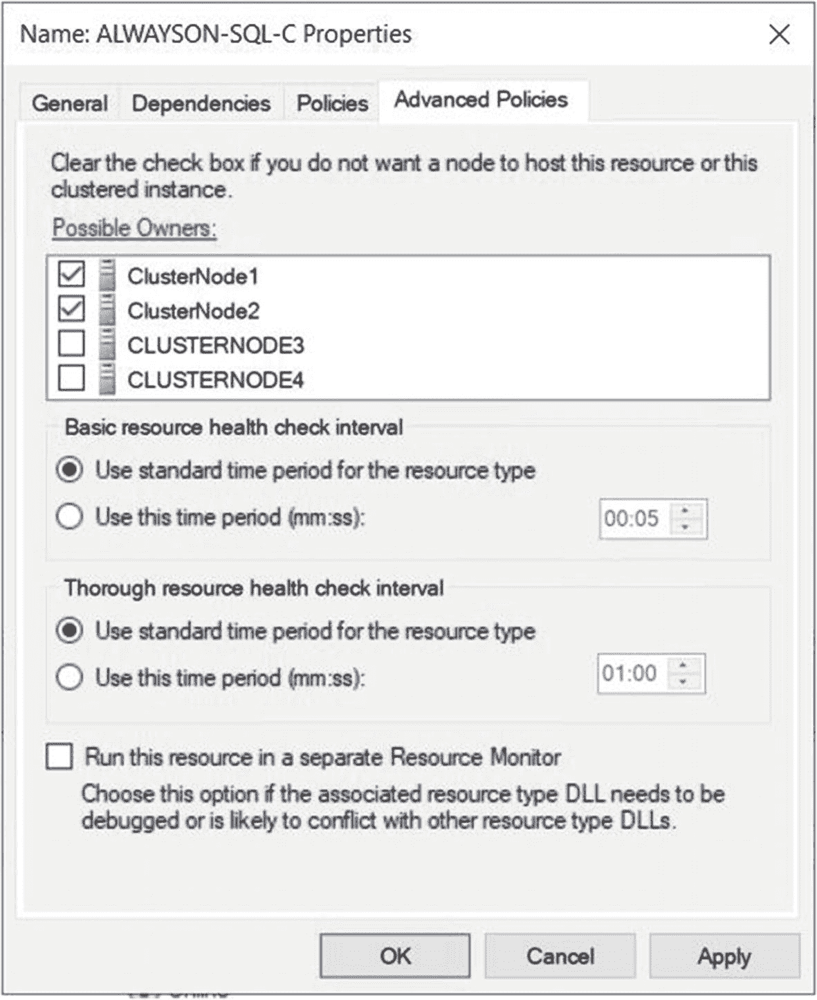
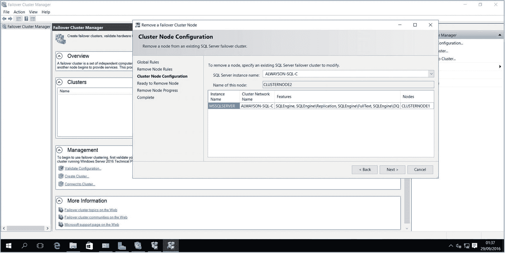
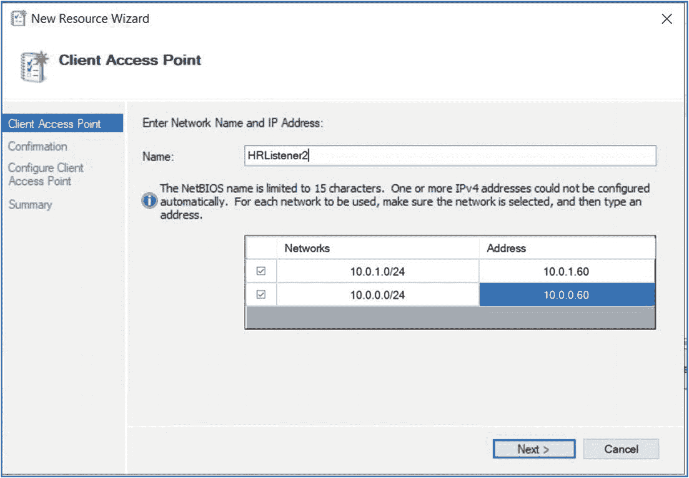
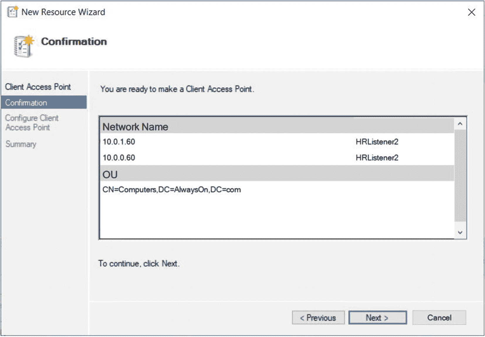
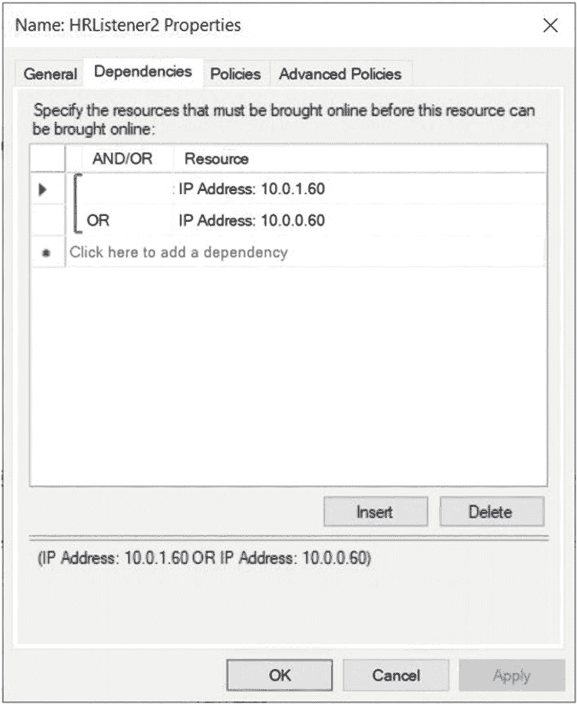

# 8. 管理 AlwaysOn

Peter A. Carter^(1 ) (1) Botley, UK 结束摘要 

本章将讨论如何管理 AlwaysOn 功能。我们首先将介绍集群维护，包括滚动修补程序升级和删除实例。然后我们将讨论可用性组的管理，包括如何同步和异步故障转移。我们还将研究如何对分布式可用性组进行故障转移。

还将讨论其他维护任务，例如同步实例级对象、对应用程序进行安全状态设置，以及向可用性组添加多个侦听器。本章最后将讨论如何暂停数据移动以及如何从可用性组中删除数据库。

## 管理集群

从管理角度来看，安装集群并不是终点。你仍需定期执行维护任务。以下各节描述了一些最常见的维护任务。

### 在节点之间移动实例

除了防止计划外中断之外，实现高可用性技术的一个好处是，它可显著减少维护任务（例如修补程序）的停机时间。这可以是操作系统级别或 SQL Server 级别。

如果您有一个双节点集群，请先将修补程序应用于被动节点。一旦您确信更新成功，请故障转移实例，然后将修补程序应用于另一个节点。此时，您可能希望或不希望故障转移回原始节点，这取决于环境的需要。例如，如果实例可用性的优先级高于一切，则可能不希望故障转移回来，因为这会造成另一次短暂中断。

要使用故障转移群集管理器将实例移动到不同的节点，请从包含实例的角色的上下文菜单中选择 Move ➤ Select Node。这将导致“移动群集角色”对话框显示。在此处，您可以选择要移动角色到的节点，如图 8-1 所示。 

图 8-1 ¶ 移动群集角色对话框

然后角色将被移动到新节点。如果您在故障转移群集管理器中查看角色的资源窗口，则会看到每个资源依次经过 Online ➤ Offline Pending ➤ Offline 状态。新节点现在显示为所有者，然后资源依次经过 Offline ➤ Online Pending ➤ Online 状态。资源将按照其依赖关系顺序离线并重新上线。

我们也可以使用 PowerShell 对角色进行故障转移。为此，我们需要使用 `Move-ClusterGroup` cmdlet。列表 8-1 通过使用 cmdlet 将 MSDTC 集群角色故障转移到 ClusterNode2 来演示这一点。我们使用 `-Name` 参数指定要移动的角色，使用 `-Node` 参数指定要移动到的节点。
```
Move-ClusterGroup -Name ALWAYSON-MSDTC-C -Node ClusterNode2
```
列表 8-1 

在节点之间移动角色

### 滚动修补程序升级

如果您有一个超过两个节点的集群，则在为 SQL Server 应用更新时，请考虑执行滚动修补程序升级。在此场景中，您可以降低不同节点（这些节点可能是角色的可能所有者）运行不同版本或修补程序级别的 SQL Server 的风险。

首先，您应该列出所有可能是该角色所有者的节点。然后，选择其中 50% 的节点并将其从“可能所有者”列表中移除。您可以通过从名称资源的上下文菜单中选择“属性”，然后在“高级策略”选项卡中取消选中可能所有者列表中的节点来实现，如图 8-2 所示。 

图 8-2 ¶ 删除可能所有者

要使用 PowerShell 实现相同的效果，我们可以使用 `Get-ClusterResource` cmdlet 导航到名称资源，然后管道输入 `Set-ClusterOwnerNode` 来配置可能所有者列表。这在列表 8-2 中进行了演示。如果您配置多个可能所有者，则可能所有者列表以逗号分隔。
```
Get-ClusterResource "SQL Network Name (ALWAYSON-SQL-C)" | Set-ClusterOwnerNode -Owners clusternode1
```
列表 8-2 

配置可能所有者

一旦 50% 的节点被移除为可能所有者，您应该将更新应用于这些节点。更新在此半数节点上验证后，您应重新配置它们以再次成为可能所有者。

下一步是将角色移动到您已升级的节点之一。故障转移成功完成后，在将更新应用于这些节点之前，从首选所有者列表中移除另一半节点。更新在此半数节点上验证后，您可以将它们返回到可能所有者列表。

提示 

只能在资源上设置可能所有者。如果您使用 `-Group` 参数针对角色运行 `Set-ClusterOwnerNode`，则您配置的是首选所有者而不是可能所有者。

### 从集群中删除节点

注意 

如果您希望遵循本书中的后续演示，请勿遵循本节中的演示。

如果您希望卸载 AlwaysOn 故障转移群集实例，则不能像卸载独立实例那样从控制面板执行此操作。相反，您必须在集群的每个节点上运行“删除节点”向导。您可以通过在 SQL Server 安装中心中的“维护”选项卡中选择“从 SQL Server 故障转移群集删除节点”选项来调用此向导。

向导首先运行全局规则检查，然后运行删除节点的规则检查。然后，在图 8-3 所示的“群集节点配置”页面上，您将被要求确认要删除节点的实例。如果群集托管多个实例，您可以从下拉框中选择适当的实例。 

图 8-3 ¶ 群集节点配置页

在“准备删除节点”页面上，您将获得将要执行的任务的摘要。确认详细信息后，实例将被删除。此过程应在所有被动节点上重复，然后最后在活动节点上执行。当实例从最后一个节点中删除时，群集角色也将被删除。

要使用 PowerShell 删除节点，我们需要运行 SQL Server 的 `setup.exe` 应用程序，并将 action 参数配置为 `RemoveNode`。当您使用 PowerShell 删除节点时，表 8-1 中的参数是强制性的。表 8-1


### 从集群中移除节点时所需的强制参数

| 参数 | 用法 |
|---|---|
| `/ACTION` | 必须配置为 `RemoveNode`。 |
| `/INSTANCENAME` | 你要添加额外节点以支持的实例。 |
| `/CONFIRMIPDEPENDENCYCHANGE` | 允许为多子网集群指定多个 IP 地址。传入 `1` 表示 True，`0` 表示 False。 |

清单 8-3 中的脚本在我们从 SQL Server 安装介质的根目录运行它时，会从我们的集群中移除一个节点。 `.\setup.exe /ACTION="RemoveNode" /INSTANCENAME="ALWAYSON-SQL-C" /CONFIRMIPDEPENDENCYCHANGE=0 /qs`

## 移除节点

## 管理 AlwaysOn 可用性组

一旦你的可用性组的初始设置完成，你仍需执行管理任务。这些包括故障转移可用性组、监控，以及在极少数情况下添加额外的侦听器。以下各节将讨论这些主题。

## 故障转移

如果副本处于同步提交模式并且配置为自动故障转移，则在主副本满足错误条件时，可用性组会自动切换到冗余副本。然而，有时你需要手动故障转移可用性组。这可能是由于 DR 测试、主动维护，或需要在主副本或主数据中心发生故障后启动异步副本。

### 同步故障转移

如果你希望故障转移处于同步提交模式的副本，请在对象资源管理器中右键单击可用性组，从上下文菜单中选择“故障转移”以启动“故障转移可用性组”向导。跳过“简介”页后，你会看到“选择新的主副本”页（见图 8-4）。在此页上，选中你想要故障转移到的副本的复选框。但在执行此操作之前，请查看“故障转移就绪状态”列，以确保副本已同步且不会发生数据丢失。

Figure 8-4 ¶ 选择新主副本页

在图 8-5 所示的“连接到副本”页上，使用“连接”按钮建立与新主副本的连接。

Figure 8-5 ¶ 连接到副本页

在“摘要”页上，你会看到要执行的任务详情，然后在“结果”页上显示进度指示器。故障转移完成后，请检查所有任务是否成功，并调查收到的任何错误或警告。

我们也可以使用 T-SQL 来故障转移可用性组。清单 8-4 中的命令可实现相同结果。请确保从将成为新主副本的副本运行此脚本。如果你从当前主副本运行，请使用 `SQLCMD` 模式并在脚本中连接到新主副本。

```
ALTER AVAILABILITY GROUP HR FAILOVER;
GO
```

故障转移可用性组

### 异步故障转移

如果你的可用性组处于异步提交模式，从技术角度来看，你可以以与同步提交模式副本类似的方式进行故障转移，只是需要强制故障转移，从而接受数据丢失的风险。你可以使用清单 8-5 中的命令强制故障转移。你应在将成为新主实例的实例上运行此脚本。为使其生效，集群必须拥有法定人数。如果没有，则需要在强制可用性组上线之前先强制集群上线。

```
ALTER AVAILABILITY GROUP HR FORCE_FAILOVER_ALLOW_DATA_LOSS;
```

强制故障转移

从流程角度来看，你只有在主站点完全不可用时才应这样做。如果不是这种情况，请先将应用程序置于安全状态。这可避免任何数据丢失的可能性。我在生产环境中通常通过执行以下步骤来实现：

1. 禁用登录。
2. 将副本模式更改为同步提交模式。
3. 故障转移。
4. 将副本改回异步提交模式。
5. 启用登录。

你可以使用清单 8-6 中的脚本执行这些步骤。从 DR 实例运行此脚本时，它会在故障转移前将 `HR` 中的数据库置于安全状态，然后重新配置应用程序以在正常操作下工作。

```
--DISABLE LOGINS
DECLARE @AOAGDBs TABLE ( DBName NVARCHAR(128) );
INSERT INTO @AOAGDBs SELECT database_name FROM sys.availability_groups AG INNER JOIN sys.availability_databases_cluster ADC ON AG.group_id = ADC.group_id WHERE AG.name = 'HR';
DECLARE @Mappings TABLE ( LoginName NVARCHAR(128), DBname NVARCHAR(128), UserName NVARCHAR(128), AliasName NVARCHAR(128) );
INSERT INTO @Mappings EXEC sp_msloginmappings;
DECLARE @SQL NVARCHAR(MAX)
SELECT DISTINCT @SQL = ( SELECT 'ALTER LOGIN [' + LoginName + '] DISABLE; ' AS [data()] FROM @Mappings M INNER JOIN @AOAGDBs A ON M.DBname = A.DBName WHERE LoginName <> SUSER_NAME() FOR XML PATH ('') )
EXEC(@SQL)
GO
--SWITCH TO SYNCHRONOUS COMMIT MODE
ALTER AVAILABILITY GROUP HR MODIFY REPLICA ON N'CLUSTERNODE3\ASYNCDR' WITH (AVAILABILITY_MODE = SYNCHRONOUS_COMMIT);
GO
--FAIL OVER
ALTER AVAILABILITY GROUP HR FAILOVER
GO
--SWITCH BACK TO ASYNCHRONOUS COMMIT MODE
ALTER AVAILABILITY GROUP HR MODIFY REPLICA ON N'CLUSTERNODE3\ASYNCDR' WITH (AVAILABILITY_MODE = ASYNCHRONOUS_COMMIT);
GO
--ENABLE LOGINS
DECLARE @AOAGDBs TABLE ( DBName NVARCHAR(128) );
INSERT INTO @AOAGDBs SELECT database_name FROM sys.availability_groups AG INNER JOIN sys.availability_databases_cluster ADC ON AG.group_id = ADC.group_id WHERE AG.name = 'HR';
DECLARE @Mappings TABLE ( LoginName NVARCHAR(128), DBname NVARCHAR(128), Username NVARCHAR(128), AliasName NVARCHAR(128) );
INSERT INTO @Mappings EXEC sp_msloginmappings
DECLARE @SQL NVARCHAR(MAX)
SELECT DISTINCT @SQL = ( SELECT 'ALTER LOGIN [' + LoginName + '] ENABLE; ' AS [data()] FROM @Mappings M INNER JOIN @AOAGDBs A ON M.DBname = A.DBName WHERE LoginName <> SUSER_NAME() FOR XML PATH ('') );
EXEC(@SQL)
```

将应用程序置于安全状态并进行故障转移

### 故障转移分布式可用性组

分布式可用性组不支持自动故障转移；仅支持手动故障转移。当你需要在分布式可用性组内故障转移到辅助可用性组时，应执行以下步骤：

* 将同步模式设置为同步提交。
* 等待辅助可用性组同步完成。
* 将主可用性组设置为承担辅助角色。
* 强制故障转移。


列表 8-7 中的脚本将强制对第 6 章中讨论的分布式可用性组进行故障转移。

```sql
--Set the secondary Availability Group to synchronous commit mode
ALTER AVAILABILITY GROUP DistributedAG MODIFY AVAILABILITY GROUP ON 'HR' WITH
(
    LISTENER_URL = 'tcp://HRListener.alwayson.com:1433',
    AVAILABILITY_MODE = ASYNCHRONOUS_COMMIT,
    FAILOVER_MODE = MANUAL,
    SEEDING_MODE = MANUAL
),
'Linux_AOAG' WITH
(
    LISTENER_URL = 'tcp://LinuxListener:5022',
    AVAILABILITY_MODE = SYNCHRONOUS_COMMIT,
    FAILOVER_MODE = MANUAL,
    SEEDING_MODE = MANUAL
);
--Wait until the Availability Groups are synchronized
WHILE (SELECT COUNT(DISTINCT synchronization_state_desc) FROM (
    SELECT
        ag.name
        , drs.database_id
        , drs.group_id
        , drs.replica_id
        , drs.synchronization_state_desc
        , drs.end_of_log_lsn
    FROM sys.dm_hadr_database_replica_states drs
    INNER JOIN sys.availability_groups ag
        ON drs.group_id = ag.group_id
    WHERE ag.name = 'HR'
        AND synchronization_state_desc = 'synchronized'
) a ) > 1
BEGIN
    WAITFOR DELAY '00:00:05';
END
--Assign the primary Availability Group, the secondary role
ALTER AVAILABILITY GROUP DistributedAG SET (ROLE = SECONDARY);
--Force the failover
ALTER AVAILABILITY GROUP DistributedAG FORCE_FAILOVER_ALLOW_DATA_LOSS;
```
列表 8-7

## 故障转移分布式可用性组

### 同步非包含对象

无论您使用何种方法进行故障转移，只要可用性组中的所有数据库都不是包含数据库，则需要确保实例级对象已同步。保持实例级对象同步的最简单方法是实现一个 `SSIS` 包，并按定期计划运行。

无论您选择按计划执行 `SSIS` 包，还是选择其他方法，例如在辅助服务器上编写脚本并重新创建对象的 `SQL Server Agent` 作业，以下是您应考虑同步的对象：
* 登录
* 凭据
* SQL Server Agent 作业
* 自定义错误消息
* 链接服务器
* 服务器级事件通知
* master 中的存储过程
* 服务器级触发器
* 加密密钥和证书

### 添加多个侦听器

通常，每个可用性组只有一个可用性组侦听器，但也有一些罕见的情况，您可能需要为同一个可用性组创建多个侦听器。如果您有使用硬编码连接字符串的旧版应用程序，则可能需要这样做。在这种情况下，您可以创建一个额外的侦听器，其客户端访问点与硬编码连接字符串的名称匹配。

如本章前面所述，不可能通过 SQL Server Management Studio、T-SQL 甚至 PowerShell 创建第二个可用性组侦听器。相反，我们必须使用 `Failover Cluster Manager`。在此，我们在 `HR` 角色内创建一个新的 `Client Access Point` 资源。为此，我们从 `HR` 角色的上下文菜单中选择 `Add Resource`，然后选择 `Client Access Point`。这将调用 `New Resource Wizard`。向导的客户端访问点页面在图 8-6 中说明。您可以看到我们已输入客户端访问点的 DNS 名称，并为每个子网指定了 IP 地址。

图 8-6 ¶ 客户端访问点页面

在“确认”页面上，我们会看到将要执行的配置摘要。在“配置客户端访问点”页面上，我们会看到进度指示器，然后在“摘要”页面上最终会看到完成摘要，如图 8-7 所示。

图 8-7 ¶ 确认页面

现在，我们需要将可用性组资源配置为依赖于新的客户端访问点。为此，我们从 `HR` 资源的上下文菜单中选择 `Properties`，然后导航到 `Dependencies` 选项卡。在此处，我们将新的客户端访问点添加为依赖项，并配置两个侦听器之间的 `OR` 约束，如图 8-8 所示。应用此更改后，客户端可以使用两个侦听器名称中的任何一个进行连接。

图 8-8 ¶ 依赖项选项卡

### 其他管理注意事项

当使用 AlwaysOn 可用性组使数据库高度可用时，会施加若干限制。其中最严格的一项限制是数据库不能置于 `single_user` 模式或设为 `read only`。这会在您需要为维护而将应用程序置于安全状态时产生影响。这就是为什么在本章“故障转移”部分中，我们禁用了已映射到数据库用户的登录。如果您必须将数据库置于 `single-user` 模式，则必须先将其从可用性组中移除。

可以通过运行列表 8-8 中的命令将数据库从可用性组中移除。此命令将 `Customers` 数据库从 `Sales` 可用性组中移除。
```sql
ALTER DATABASE Customers SET HADR OFF;
```
列表 8-8
从可用性组中移除数据库

也有可能您希望数据库保留在可用性组中，但希望暂停向其他副本的数据移动。这通常是因为可用性组处于 `Synchronous Commit` 模式，并且您有一个高利用率的时期，需要性能提升。您可以使用列表 8-9 中的命令暂停数据库的数据移动，该命令会暂停 `Sales` 数据库的数据移动然后恢复。

注意
如果您暂停数据移动，主副本上的事务日志会继续增长，直到数据移动恢复并且数据库同步后，您将无法截断它。
```sql
ALTER DATABASE Sales SET HADR SUSPEND;
GO
ALTER DATABASE Sales SET HADR RESUME;
GO
```
列表 8-9
暂停数据移动

另一个重要考虑因素是数据库和日志文件的放置位置。这些文件必须在每个副本上位于相同的位置。这意味着如果您使用命名实例，则必须更改数据和日志的默认文件位置，这是一个严格的技术要求，因为默认位置包含实例名称。当然，这假设您不会在每个节点上使用相同的实例名称，否则将违背使用命名实例的许多好处。

## 摘要

主副本发生故障时，故障转移到同步副本是自动的。然而，也有需要手动故障转移的情况。这可能是因为需要故障转移到灾难恢复站点的灾难，也可能是为了主动维护。虽然可以故障转移到异步副本并可能导致数据丢失，但良好的做法是先将数据库置于安全状态。由于如果数据库参与可用性组，则无法将其置于 `read-only` 或 `single_user` 模式，因此安全状态通常包括禁用登录，然后在故障转移前切换到 `Synchronous Commit` 模式。


为了在整个企业中监控可用性组，您需要使用监控工具，例如系统操作中心。 然而，如果您需要监控少量可用性组或排查特定问题，则可以使用 SQL Server 随附的工具之一，例如用于监控拓扑健康的仪表板，以及名为 AlwaysOn Health Trace 的扩展事件会话。

实现 SQL Server 高可用性的一个好处是，它可以最大限度地减少计划维护期间的停机时间。 在双节点群集中，您可以升级被动节点，进行故障转移，然后升级活动节点。 对于更大的群集，您可以执行滚动修补升级，这涉及从可能所有者列表中移除一半节点并对其进行升级。 然后将实例故障转移到其中一个已升级的节点，并对剩余节点重复该过程。 这降低了在可能所有者之间出现混合版本的风险。
