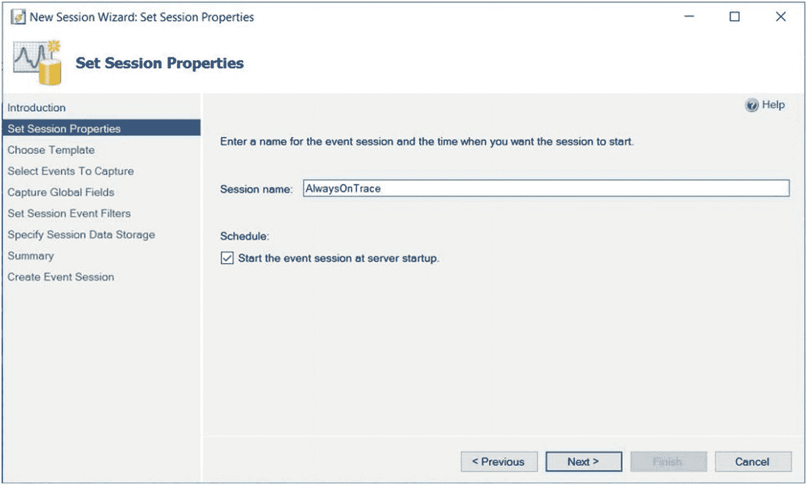
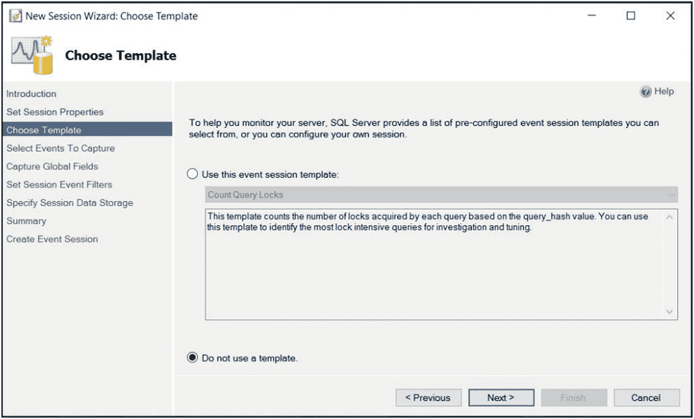
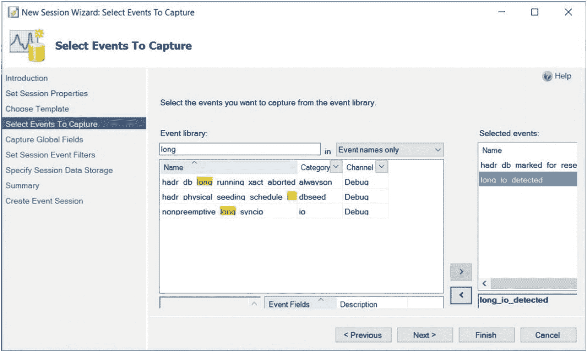
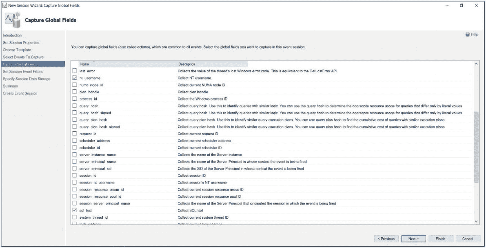
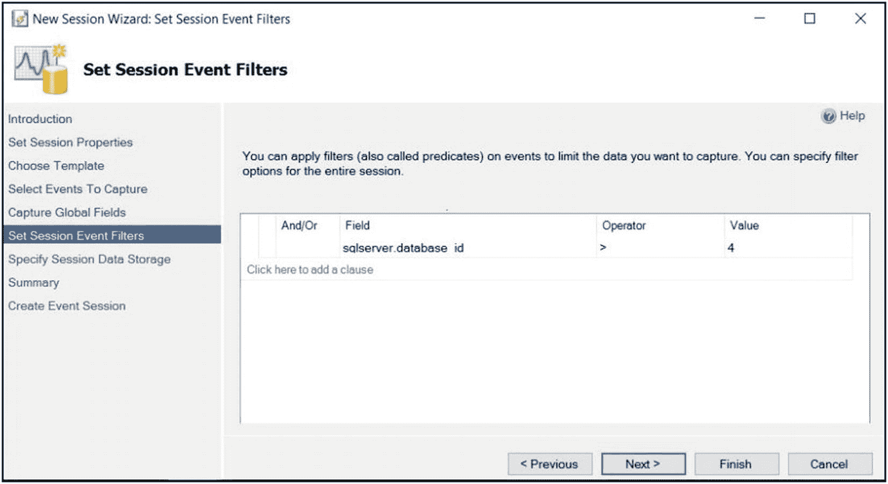
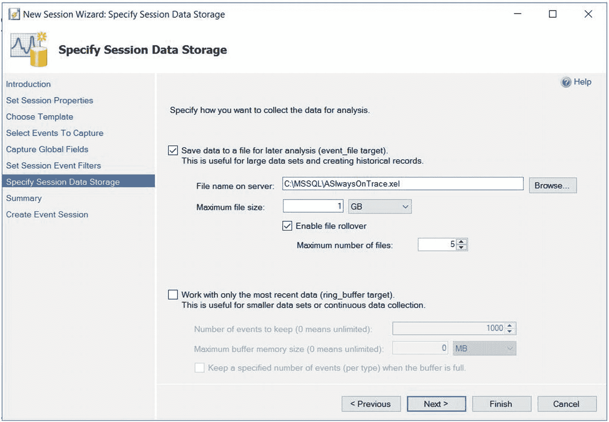

# 9. 监控 AlwaysOn 可用性组

Peter A. Carter (1) Botley, UK

一旦您实施了可用性组，就需要监控它们并响应可能影响您数据可用性的任何错误或警告。 如果您在整个企业中实施了许多可用性组，那么有效且全面地监控它们的唯一方法是使用企业监控工具，例如 SOC（系统操作中心）。 然而，如果您只有少量可用性组，或者您正在排查特定问题，则 SQL Server 提供了 AlwaysOn 仪表板和 AlwaysOn Health Trace。 您还可以创建自己的扩展事件会话来监控可用性组。 本章将讨论这些监控可能性。

## AlwaysOn 仪表板

AlwaysOn 仪表板是一个交互式报告，允许您查看 AlwaysOn 环境的健康状况并钻取或汇总拓扑中的元素。 您可以从对象资源管理器中可用性组文件夹的上下文菜单中调用该报告，或从可用性组本身的上下文菜单中调用。 图 9-1 显示了从 HR 可用性组的上下文菜单生成的报告。 您可以看到当前同步处于健康状态。 已使用添加/删除列按钮添加了估计恢复时间和估计数据丢失度量。 当您拥有异步副本时，估计数据丢失很有帮助，以便在发生事件时评估影响。

数据库可能处于的三种同步状态是 `SYNCHRONIZED`、`SYNCHRONIZING` 和 `NOT SYNCHRONIZING`。 同步副本应处于 `SYNCHRONIZED` 状态，任何其他状态都是不健康的。 然而，异步副本永远不会处于 `SYNCHRONIZED` 状态，而 `SYNCHRONIZING` 状态被认为健康。 无论模式如何，`NOT SYNCHRONIZING` 都表示副本未连接。

图 9-1 ¶ 可用性组仪表板

注意

除了同步状态外，副本还具有以下其中一种操作状态：`PENDING_FAILOVER`、`PENDING`、`ONLINE`、`OFFLINE`、`FAILED`、`FAILED_NO_QUORUM` 和 `NULL`（当副本断开连接时）。 副本的操作状态可以使用 `sys.dm_hadr_availability_replica_states` DMV 查看。

在报告的右上方，有指向故障转移向导的链接，我们在本章前面讨论过；我们将在下一节讨论的 AlwaysOn 健康事件；还有一个查看集群仲裁信息的链接。 通过此链接调用的集群仲裁信息屏幕显示在图 9-2 中。

图 9-2 ¶ 集群仲裁信息屏幕

添加/删除列链接将显示上下文菜单，您可以在其中动态添加或删除显示中的列。 图 9-3 显示已添加暂停和暂停原因。

图 9-3 ¶ 添加/删除列

您还可以钻取可用性副本窗口中的每个副本以查看副本特定详细信息。 分组依据按钮将允许您按副本、数据库、同步状态、故障转移就绪性或问题对可用性数据库进行分组。

## AlwaysOn Health Trace

AlwaysOn Health Trace 是一个扩展事件会话，当您创建第一个可用性组时创建。 它可以在 SQL Server Management Studio 中找到，位于扩展事件 ➤ 会话下，通过其上下文菜单，您可以查看正在捕获的实时数据，或进入会话的属性以更改捕获事件的配置。 它也可以通过 AlwaysOn 仪表板中的查看 AlwaysOn 健康事件链接访问。

钻取会话会公开会话的包，从包的上下文菜单中，您可以查看以前捕获的事件。 图 9-4 显示捕获的最新事件是数据库 5（在我们的例子中是 HR），它正在等待日志在同步副本上硬化。

图 9-4 ¶ 目标数据

在窗口顶部窗格中右键单击列标题将公开上下文菜单，该菜单允许您在特定列中搜索文本或值，按列中的值分组或按特定列对结果集进行排序。 您还可以使用上下文菜单添加或删除结果集中的列。

## 使用扩展事件监控 AlwaysOn

扩展事件是 SQL Server 中的轻量级监控系统，使用 `WMI` 捕获事件。 由于架构使用系统资源很少，因此它们扩展性非常好，允许您以最小的用户活动影响监控实例。 它们也高度可配置，为您提供了从非常细粒度的详细信息（如页面拆分）到较粗粒度信息（如 CPU 利用率）的广泛捕获选项。 您还可以将扩展事件与操作系统数据相关联，以在排查问题时提供整体视图。 扩展事件的前身是 SQL Trace 及其 GUI，称为 Profiler，现已弃用。

### 扩展事件概念

扩展事件具有丰富的架构，由事件、目标、操作、谓词、类型、映射和会话组成。 这些工件存储在包中，而包又存储在模块中，模块可以是 `.dll` 或可执行文件。 我们将在以下各节中讨论这些概念。

#### 包

包是扩展事件中使用的对象的容器。 以下是 SQL Server 包的四种类型：

* `Package0` – 默认包，用于扩展事件系统对象。
* `Sqlserver` – 用于 SQL Server 相关对象。
* `Sqlos` – 用于 SQLOS 相关对象。
* `SecAudit` – 由 SQL Audit 使用；然而，其对象未公开。

#### 事件


#### 事件分类

事件是你可以追踪的感兴趣的发生。它可能是 SQL 批处理完成、缓存未命中或页面拆分，或数据库引擎中几乎任何其他可能发生的事情，具体取决于你配置的跟踪的性质。每个事件都按通道和关键字（也称为类别）进行分类。通道是高层次的分类，所有 SQL Server 2016 中的事件都属于表 9-1 中描述的通道之一。

## 表 9-1 通道

| 通道 | 描述 |
|---|---|
| Admin | 众所周知的事件，具有众所周知的解决方案。例如，死锁、服务器启动、CPU 阈值被超过，以及使用已弃用的功能。 |
| Operational | 用于故障排除问题。例如，检测到损坏的内存、AlwaysOn 可用性组副本更改其状态，以及检测到长时间 IO，都是属于 Operational 通道的事件。 |
| Analytic | 用于故障排除性能等问题的海量事件。例如，事务开始、获取锁以及文件读取完成，都是属于 Analytic 通道的事件。 |
| Debug | 由开发人员使用，通过返回内部数据来诊断问题。Debug 通道中的事件在 SQL Server 的未来版本中可能会发生变化，因此在可能的情况下应避免使用它们。 |

关键字（或类别）更为精细。所有与 AlwaysOn 相关的事件都属于 `AlwaysOn` 和 `HADR` 类别。SQL Server 公开了 122 个与 AlwaysOn 相关的事件。这些事件列在表 9-2 中。

## 表 9-2 AlwaysOn 事件

| 事件 | 描述 |
|---|---|
| `hadr_ddl_failover_execution_state` | 当 DDL 命令更改可用性组故障转移状态时触发 |
| `hadr_transport_dump_message` | 在整个系统中跟踪 HADR 传输消息 |
| `hadr_transport_dump_config_message` | 跟踪 HADR 配置消息 |
| `hadr_transport_dump_failure_message` | 跟踪 HADR 失败消息 |
| `hadr_transport_dump_preconfig_message` | 跟踪 HADR 预配置消息 |
| `hadr_transport_dump_dropped_message` | 跟踪整个系统中被丢弃的 HADR 传输消息 |
| `hadr_transport_session_state` | 当 HADR 传输会话更改状态时触发 |
| `hadr_transport_configuration_state` | 当会话状态更改时触发 |
| `hadr_transport_ucs_registration` | 当 UCS 注册状态更改时触发 |
| `hadr_transport_ucs_connection_info` | 当与 AlwaysOn 传输副本关联的 USC 连接 ID 被注册或更改时触发 |
| `hadr_transport_flow_control_action` | 当针对特定副本发生流量控制操作时触发 |
| `hadr_database_flow_control_action` | 当针对特定副本发生流量控制操作时触发 |
| `hadr_db_manager_state` | 当 db_manager 的状态更改时触发 |
| `hadr_db_manager_lsn_sync_msg` | 跟踪日志序列号同步消息 |
| `hadr_db_manager_establish_db_msg` | 当建立 DB 消息时触发 |
| `hadr_db_manager_status_change` | 跟踪 DBReplicaStatusChange 消息 |
| `hadr_db_manager_redo` | 跟踪辅助服务器上的重做处理 |
| `hadr_db_manager_undo` | 跟踪辅助服务器上的撤销处理 |
| `hadr_db_manager_db_queue_restart` | 响应队列重启 hadron 数据库而触发 |
| `hadr_db_manager_db_startdb` | 响应启动 hadron 数据库而触发 |
| `hadr_db_manager_db_shutdown` | 响应关闭 hadron 数据库而触发 |
| `hadr_db_manager_user_control` | 响应 AlwaysOn 受控数据库的用户状态更改而触发 |
| `hadr_db_manager_redo_control` | 跟踪 AlwaysOn 受控数据库的更改日志扫描状态 |
| `hadr_db_manager_scan_control` | 跟踪 AlwaysOn 受控数据库的更改日志扫描状态 |
| `hadr_db_manager_suspend_resume` | 响应 AlwaysOn 受控数据库的挂起/恢复状态更改而触发 |
| `hadr_db_manager_db_restart` | 响应 AlwaysOn 受控数据库的重启而触发 |
| `hadr_worker_pool_thread` | 跟踪 AlwaysOn 工作程序池线程操作 |
| `hadr_worker_pool_task` | 跟踪 AlwaysOn 工作程序池任务操作 |
| `hadr_thread_pool_worker_start` | 跟踪 AlwaysOn 线程池工作线程启动操作 |
| `hadr_db_manager_page_request` | 跟踪服务器之间的页面请求/响应 |
| `hadr_db_commit_mgr_update_harden` | 响应 AlwaysOn 受控数据库的 hardened 日志序列号更新而触发 |
| `hadr_db_commit_mgr_harden_still_waiting` | 跟踪事务提交 hardened，仍在等待 AlwaysOn 提交管理 |
| `hadr_db_commit_mgr_harden` | 跟踪来自 AlwaysOn 提交管理的事务提交 hardened 结果 |
| `hadr_db_commit_mgr_set_policy` | 响应事务提交管理器策略更新而触发 |
| `hadr_db_partner_set_policy` | 响应 AlwaysOn 伙伴提交策略更新而触发 |
| `hadr_db_partner_set_sync_state` | 响应 AlwaysOn 伙伴的同步状态更改而触发 |
| `hadr_apr_added_corrupted_page` | 当自动页面修复添加了一个损坏的页面时触发 |
| `hadr_apr_repaired_page` | 当自动页面修复修复了一个损坏的页面时触发 |
| `hadr_apr_skipped_page_repair` | 当自动页面修复跳过页面修复时触发 |
| `hadr_apr_failed_page_repair` | 当自动页面修复添加了一个损坏的页面时触发 |
| `hadr_apr_sent_repair_request_for_page` | 当自动页面修复发送页面修复请求时触发 |
| `hadr_apr_received_page_repair_request` | 当自动页面修复收到页面修复请求时触发 |
| `hadr_apr_deffering_page_repair_request` | 当自动页面修复正在延迟页面修复请求时触发 |
| `hadr_apr_page_repair_failed` | 当自动页面修复未能修复页面时触发 |
| `hadr_undo_of_redo_log_scan` | 跟踪在 Redo 的 Undo 中扫描的日志量，以及需要扫描的总日志量 |
| `hadr_db_manager_filemetadata_request` | 响应服务器之间的文件元数据请求/响应而触发 |
| `hadr_capture_compressed_log_cache` | 跟踪压缩日志块缓存的命中/未命中比率 |
| `hadr_db_manager_backup_sync_msg` | 响应备份同步消息而触发 |
| `hadr_db_manager_backup_info_msg` | 响应备份信息消息而触发 |
| `hadr_db_manager_primary_replica_file_list_msg` | 响应主副本文件列表消息而触发 |
| `hadr_db_manager_seeding_request_msg` | 响应播种请求消息而触发 |
| `hadr_physical_seeding_backup_state_change` | 响应备份端物理播种状态更改而触发 |
| `hadr_physical_seeding_restore_state_change` | 响应还原端物理播种状态更改而触发 |
| `hadr_physical_seeding_forwarder_state_change` | 响应转发器端物理播种状态更改而触发 |
| `hadr_physical_seeding_forwarder_target_state_change` | 响应转发器目标端物理播种状态更改而触发 |
| `hadr_physical_seeding_submit_callback` | 响应物理播种提交回调而触发 |
| `hadr_physical_seeding_failure` | 响应物理播种失败而触发 |
| `hadr_physical_seeding_progress` | 响应物理播种进度而触发 |
| `hadr_physical_seeding_schedule_long_task_failure` | 响应物理播种计划长任务失败而触发 |


## HADR 扩展事件

| 事件 | 描述 |
|---|---|
| `hadr_automatic_seeding_start` | 当自动播种操作被提交时触发 |
| `hadr_automatic_seeding_state_transition` | 当自动播种操作状态发生变化时触发 |
| `hadr_automatic_seeding_success` | 当自动播种操作成功时触发 |
| `hadr_automatic_seeding_failure` | 当自动播种操作失败时触发 |
| `hadr_automatic_seeding_timeout` | 当自动播种操作超时时触发 |
| `hadr_filestream_file_open` | 当 AlwaysOn FileStream 传输打开文件时触发 |
| `hadr_filestream_file_close` | 当 AlwaysOn FileStream 传输关闭文件时触发 |
| `hadr_filestream_log_interpreter` | 当 AlwaysOn FileStream 传输在解释日志时找到相关日志记录时触发 |
| `hadr_filestream_processed_block` | 当 AlwaysOn FileStream 传输完成日志块处理时触发 |
| `hadr_filestream_directory_create` | 当 AlwaysOn FileStream 传输创建目录时触发 |
| `hadr_filestream_corrupt_message` | 当 AlwaysOn FileStream 传输检测到消息损坏时触发 |
| `hadr_filestream_message_block_end` | 当 AlwaysOn FileStream 传输跟踪块结束消息时触发 |
| `hadr_filestream_message_dir_create` | 当 AlwaysOn FileStream 传输跟踪目录创建消息时触发 |
| `hadr_filestream_message_file_write` | 当 AlwaysOn FileStream 传输跟踪文件写入消息时触发 |
| `hadr_filestream_file_flush` | 当 AlwaysOn FileStream 传输刷新文件时触发 |
| `hadr_filestream_file_set_eof` | 当 AlwaysOn FileStream 传输设置文件末尾时触发 |
| `hadr_filestream_undo_inplace_update` | 当 AlwaysOn FileStream 传输检测到需要撤销的原地更新时触发 |
| `hadr_filestream_message_file_request` | 当 HADR FileStream 传输跟踪文件写入消息时触发 |
| `hadr_wsfc_change_notifier_status` | 当 Windows Server 故障转移群集更改通知程序状态发生变化时触发 |
| `hadr_wsfc_change_notifier_start_ag_specific_notifications` | 当 Windows Server 故障转移群集更改通知程序开始接收特定于可用性组的通知时触发 |
| `hadr_wsfc_change_notifier_severe_error` | 当 Windows Server 故障转移群集更改通知程序遇到严重错误且将终止时触发 |
| `hadr_tds_synchronizer_payload_skip` | 当 AlwaysOn TDS 侦听器同步程序因自上次负载以来没有更改而跳过侦听器负载时触发 |
| `hadr_sql_instance_to_node_map_entry_deleted` | 在删除 SQL Server 实例到群集节点映射条目的 API 调用结束时触发 |
| `hadr_wsfc_change_notifier_node_not_online` | 当 Windows Server 故障转移群集更改通知程序检测到本地群集节点不在线时触发 |
| `hadr_online_availability_group_first_attempt_failure` | 如果将 AlwaysOn 可用性组资源联机的首次尝试失败则触发 |
| `hadr_online_availability_group_retry_end` | 当 SQL Server 已用尽所有重试尝试，或 Windows Server 故障转移群集已接受将 AlwaysOn 可用性组资源联机的命令时触发 |
| `hadr_ar_api_call` | 当对可用性副本进行 API 调用时触发 |
| `hadr_ar_manager_starting` | 当可用性组副本管理器启动时触发 |
| `hadr_ag_wsfc_resource_state` | 作为 Windows Server 故障转移群集中可用性组状态更改的响应而触发 |
| `hadr_ag_database_api_call` | 作为对可用性组数据库副本的 API 调用的响应而触发 |
| `hadr_ag_lease_renewal` | 作为可用性组租约续期的响应而触发 |
| `hadr_ar_manager_mutex_acquisition_state` | 作为用于同步可用性组管理器启动和关闭操作的可用性副本互斥锁获取状态的响应而触发 |
| `hadr_ar_critical_section_entry_state` | 作为可用性副本关键区进入状态的响应而触发 |
| `hadr_ag_config_data_mutex_acquisition_state` | 作为可用性组互斥锁获取状态的响应而触发 |
| `hadr_database_replica_disjoin_completion` | 当数据库副本已完全从可用性组中分离时触发 |
| `hadr_ar_controller_debug` | 当副本控制器输出调试消息时触发 |
| `hadr_apply_log_block` | 当辅助副本即将向日志管理器追加日志块时触发 |
| `hadr_capture_log_block` | 当主副本捕获日志块时触发 |
| `hadr_capture_vlfheader` | 当主副本捕获开始新虚拟文件的日志块时触发 |
| `hadr_apply_vlfheader` | 当辅助副本即将应用虚拟日志文件头时触发 |
| `hadr_scan_state` | 当主或辅助数据库副本正在更改状态时触发 |
| `hadr_dump_log_block` | 当主副本发送或辅助副本接收日志块消息时触发 |
| `hadr_log_block_send_complete` | 在日志块消息发送后触发 |
| `hadr_dump_vlf_header` | 当主副本发送或辅助副本接收 vlfheader 消息时触发 |
| `hadr_dump_log_progress` | 当辅助副本发送进度消息时触发 |
| `hadr_dump_primary_progress` | 当主副本发送进度消息时触发 |
| `hadr_dump_sync_primary_progress` | 当同步辅助副本发送进度消息时触发 |
| `hadr_send_harden_lsn_message` | 不应使用此事件。它用于 Microsoft 内部测试 |
| `hadr_evaluate_readonly_routing_info` | 在本地主数据库副本上评估只读路由信息时触发 |
| `hadr_db_log_throttle` | 当数据库日志生成节流发生变化时触发 |
| `hadr_db_log_throttle_input` | 当 Fabric 日志管理组件更新日志节流时触发 |
| `hadr_db_marked_for_reseed` | 当辅助数据库落后于主数据库太远并被标记为重新播种时触发 |
| `hadr_db_log_management_configuration_parameters` | 当读取自动日志管理配置时发生 |
| `hadr_db_long_running_xact_aborted` | 当系统强制终止长时间运行的事务以避免日志填满时触发 |
| `hadr_db_remote_harden_failure` | 当作为提交或准备的一部分的硬 ening 请求因远程故障而失败时触发 |
| `hadr_partner_log_send_transition` | 作为日志写入器与日志捕获之间日志发送转换的响应而触发 |
| `hadr_partner_restart_scan` | 当副本在重启时扫描其合作伙伴时触发 |
| `hadr_transport_sync_send_failure` | 当传输中的同步发送失败时触发 |
| `hadr_xrf_deleteAllXrf_beforeEntry` | 在所有扩展恢复分支被删除之前立即触发 |
| `hadr_xrf_deleteRecLsn_beforeEntry` | 在恢复日志序列号从元数据中删除之前立即触发 |
| `hadr_xrf_updateXrf_partialUpdate` | 在更新辅助副本的恢复分支堆栈期间触发。具体而言，在从辅助堆栈中删除额外条目后，但在从主副本复制新条目之前触发 |
| `hadr_xrf_updateXrf_before_recoveryLsn_update` | 在更新辅助副本的恢复分支堆栈期间触发。具体而言，在更新堆栈后，但在将恢复日志序列号保存到元数据之前触发 |
| `hadr_xrf_copyXrf_partialCopy` | 在删除辅助副本的堆栈条目后，但在复制主副本条目之前触发 |
| `alwayson_ddl_executed` | 当 AlwaysOn DDL 语句执行时触发 |
| `availability_replica_state` | 当可用性副本正在启动或关闭时触发 |
| `availability_replica_state_change` | 当可用性副本的状态发生变化时触发 |


## 事件

| `availability_replica_manager_state_change` || 当可用性副本管理器的状态发生变化时触发 |
| `availability_group_lease_expired` || 当集群与可用性组之间存在连接问题，导致续租失败时触发 |
| `availability_replica_automatic_failover_validation` || 当故障转移验证副本作为主副本的就绪状态时触发 |
| `availability_replica_database_fault_reporting` || 当数据库向可用性副本管理器报告故障时触发 |
| `before_redo_lsn_update` || 在 EOL 日志序列号更新之前立即触发 |
| `read_only_route_complete` || 当只读路由操作成功完成时触发 |
| `read_only_route_fail` || 当只读路由操作失败时触发 |

### 目标

一个目标是事件的消费者；本质上，它是跟踪数据将被写入的设备。SQL Server 2016 中可用的目标在表 9-3 中详细说明。表 9-3 
目标 
| 目标 || 同步/异步 || 描述 |
| --- | --- | --- |
| `Event counter` || 同步 || 统计会话期间发生的事件数量 |
| --- | --- | --- |
| `Event file` || 异步 || 将事件输出写入内存缓冲区，然后刷新到磁盘 |
| `Event pairing` || 异步 || 确定配对事件是否在其匹配事件缺失的情况下发生，例如语句已开始但从未完成 |
| `ETW` (Event Tracking for Windows) || 同步 || 用于将扩展事件与操作系统数据关联 |
| `Histogram` || 异步 || 根据操作或事件列统计会话期间发生的事件数量 |
| `Ring buffer`  || 异步 || 使用先进先出（FIFO）方法将数据存储在内存缓冲区中 |

### 操作

也称为全局字段，操作是允许在事件触发时捕获额外信息的命令。当事件发生时，操作会同步触发，而事件本身并不感知该操作。有 50 个操作可用，可让您捕获丰富的各类信息，包括导致事件触发的语句、语句运行的安全上下文、事务 ID、CPU ID 和调用堆栈。

### 谓词

谓词是在系统将事件发送到目标之前可以应用的筛选条件。可以创建简单的谓词，例如基于数据库 ID 筛选完成的语句，但也可以创建更复杂的谓词，例如仅在发生超过两次时才捕获 AlwaysOn 可用性组副本的角色更改。
谓词也完全支持短路求值。这意味着如果在谓词中使用多个条件，则谓词的顺序很重要，因为如果第一个谓词的求值失败，则不会求值第二个谓词。由于谓词是同步求值的，这可能会影响性能。因此，合理的做法是设计谓词，使最不可能求值为真的谓词放在最可能求值为真的谓词之前。
例如，假设您计划筛选特定数据库（数据库 ID 为 6），但该数据库占实例活动的很大比例。您还计划筛选特定用户 ID（UserA），该用户负责的活动比例很低。在此场景中，您将使用 `WHERE (([sqlserver].[username]='UserA') AND ([sqlserver].[database_id]=(6)))` 谓词先筛选出与 UserA 无关的活动，然后再筛选出与数据库 ID 6 无关的活动。

### 类型

包内的所有对象都被分配一个类型。此类型用于解释对象字节集合中存储的数据。对象被分配以下类型之一： 
* `Action`
* `Event`
* `Pred_compare` (从事件中检索数据)
* `Pred_source` (比较数据类型)
* `Target`
* `Type`

### 映射

一个映射是将内部 ID 值映射到 DBA 可以理解的字符串的字典。`Map` 键仅在其上下文中唯一，并在上下文之间重复。例如，在 `statement_recompile_cause` 上下文中，`map_key` 为 1 对应 `map_value` 为 `Schema Changed`。然而，在 `database_sql_statement` 类型的上下文中，`map_key` 为 1 对应 `map_value` 为 `CREATE DATABASE`。您可以使用 `sys.dm_xe_map_values` DMV 找到完整的映射列表。

### 会话

会话本质上是一个跟踪。它可以包含来自多个包的事件、操作、目标和谓词。当您启动或停止会话时，您是在打开或关闭跟踪。当会话启动时，事件会写入内存缓冲区，并在发送到目标之前应用谓词。因此，在创建会话时，您需要配置属性，例如会话可用于缓冲的内存量、如果会话遇到内存压力时可以丢弃哪些事件，以及在事件发送到目标之前的最大延迟。

## 创建事件会话以监视可用性组

您可以使用 `New Session Wizard`、`New Session Dialog Box` 或通过 `T-SQL` 创建事件会话。要使用 `New Session Wizard` 创建会话，请在 `Object Explorer` 中钻取 `Management ➤ Extended Events`，并从 `Sessions` 的上下文菜单中选择 `New Session Wizard`。这将显示 `New Session Wizard` 的介绍页。
通过介绍页后，您将找到设置会话属性页，如图 9-5 所示。在这里，您可以为会话配置名称，并指定会话是否应在创建时自动启动。
图 9-5 ¶ 设置属性页
在向导的选择模板页中，如图 9-6 所示，您可以选择预定义的模板，这将为您常用的会话提供起点，或者您可以从空白画布开始并手动定义整个会话。我们将选择后者选项。
图 9-6 ¶ 选择模板页
图 9-7 显示了选择要捕获的事件页。在这里，我们可以选择要包含在会话中的事件。为了本次演示的目的，假设我们经常看到辅助副本落后于主副本，并且我们正在尝试确定原因。具体来说，我们是否有 IO 瓶颈？因为我们试图回答一个非常具体的问题，所以要选择的事件很明确。我们需要 `hadr_db_marked_for_reseed` 事件来确定辅助副本何时落后，并且需要 `long_io_detected` 事件，以便将时间关联起来，看看是否存在模式。
图 9-7 ¶ 选择要捕获的事件页
捕获全局字段页将允许我们指定要捕获的任何操作。在我们的场景中，我们将捕获 `NT Username` 和 `SQLText` 操作。这将使我们能够追踪任何长时间 IO，看看它们是否由低效查询引起。捕获全局字段页如图 9-8 所示。
图 9-8 ¶ 捕获全局字段页


## 设置会话事件筛选器
设置会话事件筛选器页面，如图 9-9 所示，允许您在 `Session` 上配置 `Predicates`。我们将配置一个 `Predicate` 来筛选对系统数据库的操作。
图 9-9 ¶ 设置会话事件筛选器页面

## 指定会话数据存储
向导中的指定会话数据存储页面是配置 `Target` 的位置。向导提供文件或环形缓冲区目标的选择，以及指定大小和滚动选项的选项。我们将配置文件目标，如图 9-10 所示。
图 9-10 ¶ 指定会话数据存储

## 摘要页
向导的摘要页将确认向导将执行的操作。`Session` 创建后，完成页面将在退出时提供查看实时数据的选项。要使用 `T-SQL` 创建相同的 `Session`，您可以使用列表 9-1 中的脚本。

```sql
CREATE EVENT SESSION AlwaysOnTrace ON SERVER ADD EVENT sqlserver.hadr_db_marked_for_reseed(
    ACTION(sqlserver.nt_username,sqlserver.sql_text)
    WHERE (sqlserver.database_id>(4))), ADD EVENT sqlserver.long_io_detected(
    ACTION(sqlserver.nt_username,sqlserver.sql_text)
    WHERE (sqlserver.database_id>(4))) ADD TARGET package0.event_file(SET filename='C:\\MSSQL\\ASlwaysOnTrace.xel') WITH (MAX_MEMORY=4096 KB,EVENT_RETENTION_MODE=ALLOW_SINGLE_EVENT_LOSS,MAX_DISPATCH_LATENCY=30 SECONDS,MAX_EVENT_SIZE=0 KB,MEMORY_PARTITION_MODE=NONE,TRACK_CAUSALITY=OFF,STARTUP_STATE=ON) ;
```
列表 9-1 
创建事件会话

### CREATE EVENT SESSION 参数
`CREATE EVENT SESSION` DDL 语句接受表 9-4 中详细说明的参数。表 9-4 
CREATE EVENT SESSION 参数

| 参数 || 描述 |
| --- | --- |
| `event_session_name` || 指定您正在创建的事件会话的名称 |
| --- | --- |
| `ADD EVENT` | `SET` || 对添加到会话中的每个事件重复，后跟事件名称，格式为 `package.event`。您可以使用 `SET` 语句设置事件特定的自定义，例如包含非强制性事件字段 |
| `ACTION` || 如果有应为该事件捕获的全局字段，则在每个 `ADD EVENT` 参数之后指定 |
| `WHERE` || 如果事件应与其关联谓词，则在每个 `ADD EVENT` 参数之后指定 |
| `ADD TARGET` | `SET` || 为将添加到会话中的每个目标指定。您可以使用 `SET` 语句填充目标特定参数，例如 `event_file` 目标的 `filename` 参数 |

### CREATE EVENT SESSION WITH 选项
`CREATE EVENT SESSION` 语句还接受多个 `WITH` 选项，详细说明在表 9-5 中。表 9-5 
CREATE EVENT SESSION WITH 选项

| WITH 选项 || 描述 |
| --- | --- |
| `MAX_MEMORY` || 指定事件会话在将事件分派到目标之前用于缓冲事件的最大内存量 |
| --- | --- |
| `EVENT_RETENTION_MODE` || 指定缓冲区满时的行为。可接受的值为 `ALLOW_SINGLE_EVENT_LOSS`，表示如果所有缓冲区都已满，则可以丢弃单个事件；`ALLOW_MULTIPLE_EVENT_LOSS`，表示如果所有缓冲区都已满，则可以丢弃整个缓冲区；以及 `NO_EVENT_LOSS`，表示导致事件触发的任务需等待缓冲区有空间 |
| `MAX_DISPATCH_LATENCY` || 指定事件在刷新到目标之前可在会话缓冲区中驻留的最长时间，以秒为单位 |
| `MAX_EVENT_SIZE` || 指定任何单个事件的事件数据的最大可能大小。可以以千字节或兆字节为单位指定，并且应仅配置为允许大于 `MAX_MEMORY` 设置的事件 |
| `MEMORY_PARTITION_MODE` || 指定事件缓冲区创建的位置。可接受的值为• `NONE` – 表示缓冲区将在实例内创建• `PER_NODE` – 表示缓冲区将为每个 NUMA 节点创建• `PER_CPU` – 表示将为每个 CPU 创建缓冲区 |
| `TRACK_CAUSALITY`  || 指定将额外的 GUID 和序列号与每个事件一起存储，以便关联事件 |
| `STARTUP_STATE` || • 指定会话在实例启动时是否自动启动。`ON` 表示会• `OFF` 表示不会 |

提示
有关 Extended Events 的更深入讨论，我强烈推荐 Apress 出版的书籍 *Pro SQL Server 2019 Administration*，可从 [www.apress.com/gp/book/9781484250884](http://www.apress.com/gp/book/9781484250884) 购买。

## 摘要
SQL Server 提供了丰富的工具来监控 AlwaysOn 可用性组的运行状况。AlwaysOn 仪表板是 SQL Server Management Studio 中的交互式报表，可让您评估可用性组和副本的运行状况。它还提供链接以查看法定配置信息和实时运行状况数据。
实时运行状况数据由扩展事件会话捕获，该会话在实例上创建第一个可用性组时创建，并在后台运行，捕获预配置的事件。可以自定义此跟踪；我建议将其保留为默认配置，并在需要自定义捕获时创建新的事件会话。
创建事件会话允许您根据需要捕获非常细粒度的关注点或仅粗粒度的信息。扩展事件使用 WMI 实现，是一种非常轻量级的框架，这意味着您可以识别问题和趋势，而不会影响实例的性能。
© Peter A. Carter 2020 P. A. CarterSQL Server 2019 AlwaysOn[`doi.org/10.1007/978-1-4842-6479-9\_10`](https://doi.org/10.1007/978-1-4842-6479-9_10) Begin Abstract 