# 1 大依赖数据简介

如今，大数据无处不在。能够从这些数据中提取有用信息（包括机器学习和人工智能）的统计方法，近年来在研究人员和从业者中引起了广泛关注。大多数可用于分析大数据的统计方法都是在观测来自独立样本的假设下开发的。例如，Bühlmann and van de Geer (2011) 中讨论的大多数方法即是如此。然而，在许多应用中，大数据的观测是相依赖的。这种依赖可能发生在数据获取的顺序中（例如时间序列数据），或发生在抽样单位所在的空间中（例如空间数据）。美国50个州每月平民失业率（16岁及以上）就是一个例子。失业率随着时间的推移往往具有黏性，地理上相邻的州可能共享相似的产业，因而具有相似的失业模式。对于依赖数据，空间和/或时间依赖通常是统计分析的重点。因此，有必要研究大规模依赖数据的分析方法。

本书的主要焦点是为读者提供可用于分析大规模依赖数据的统计方法的全面介绍。我们从一些示例及其描述性分析的简单方法入手。更高级的方法将在后续章节中介绍。然而，请牢记，随着时间推移，大规模依赖数据的分析正在获得越来越多的关注。本书讨论的方法在很大程度上反映了我们的个人经验和偏好。我们希望本书能对不同科学领域的许多研究人员和从业者的数据分析有所帮助。此外，它还可能引起更多人对分析大规模依赖数据这一挑战性问题的关注，并激励进一步的研究。

## 1.1 依赖数据示例

在本节中，我们将介绍本书中考虑的一些大规模依赖数据示例，介绍描述此类数据的一些统计方法，并提供进行统计推断的框架。所介绍方法的细节将在后续章节中给出。我们的目标是展示我们打算分析的数据，并强调忽略其依赖性的后果。在可能的情况下，我们还将说明为独立观测开发的统计方法在应用于大规模依赖数据时所面临的困难。

所谓依赖数据，是指感兴趣变量的观测是在时间上或空间上（或两者同时）进行的。因此，在这些数据中，时间或空间的顺序很重要。所谓大数据，是指变量数 k 很大，或数据点数 T 很大，或两者皆大，并且可能存在 k > T 的情况。图 1.1 展示了一个包含三个时间序列的数据集，表示1910年至2014年欧洲、北美和南美11月的相对平均温度。这些数据位于本书网站的文件 Temperatures.csv 中。测量值是相对于20世纪11月的平均温度。这些数据是依赖的，因为相邻年份的观测值往往比相隔多年的观测值更接近。此外，南美的相对温度自1980年以来呈现出增长趋势，而这一趋势在欧洲仅从2000年开始出现，但在北美数据中未出现。

对这些每月温度序列的统计分析相对容易，因为序列数量只有3个且样本量较小。它属于统计学中的多元时间序列分析。例如，参见 Tsay (2014)。本书的主要关注点是当时间序列数量很大或观测之间的时间间隔很小时的统计分析，从而产生具有大样本量的高频数据。在许多应用中，对大规模温度数据进行建模非常重要。事实上，世界各地许多地点会定期进行每日（甚至每小时）温度测量。这些温度影响着电力和燃油的需求，与空气污染测量（如颗粒物 PM2.5 和臭氧浓度）高度相关，并在世界商品价格中发挥着重要作用。

图 1.2 展示了从2000年1月3日至2015年12月16日、共4163个观测值的世界99个最重要金融市场的标准化每日股票指数。这些数据位于文件 `Stock_indexes_99world.csv` 中。由于股票指数的幅度在不同市场之间差异显著，因此我们对图中的指数进行了标准化。具体来说，每个标准化指数序列的均值为零，方差为一。在应用中，我们通常分析股票指数的收益率。图 1.3 和 1.4 分别展示了前六个指数及其对数收益率的时间图。对数收益率是通过取股票指数对数的第一阶差分得到的。

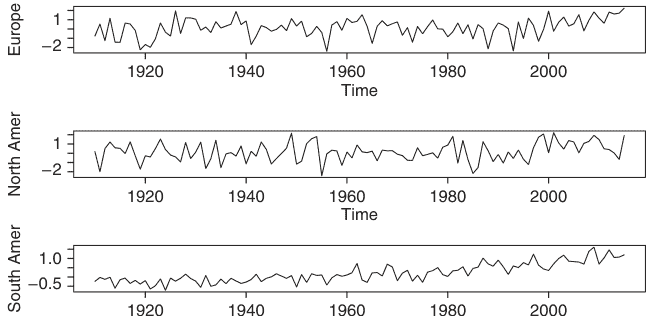

图 1.1 1910年至2014年欧洲、北美和南美11月的相对平均温度。测量值是相对于20世纪11月的平均温度。

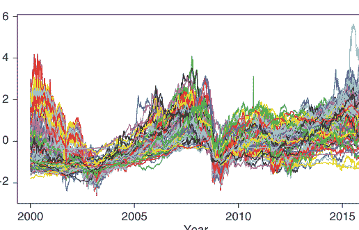

**图 1.2** 2000年1月3日至2015年12月16日世界99个最重要金融市场标准化每日股票市场指数的时间图。

这些时间图展示了多元时间序列的几个特征。首先，它们显示了金融市场的整体演变和交叉依赖。所有市场在2003年都出现了低谷，稳步上升并在2008年初达到高峰，然后因2008年金融危机出现急剧下跌。然而，一些市场在2009年后经历了逐步复苏。其次，当市场下跌时，世界金融市场的波动性似乎更高；见图 1.4。这并不奇怪，因为恐慌因素（即市场波动）在熊市中可能占主导地位。另一方面，在市场下跌时，特定时点的世界市场指数范围似乎更小；见图 1.2。

图 1.5 和 1.6 分别展示了同一时期内22个亚洲市场和47个欧洲市场的每日金融指数时间图，但x轴现在为时间索引。亚洲和欧洲金融市场之间的差异显而易见，这意味着在分析不同大陆间的相似时间序列时必须谨慎。

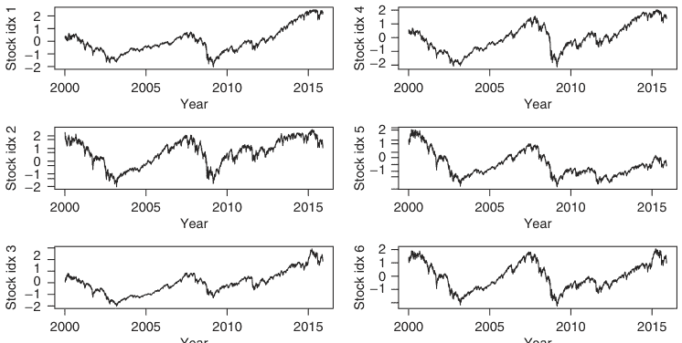

**图 1.3** 前六个标准化每日股票市场指数的时间图：2000年1月3日至2015年12月16日。

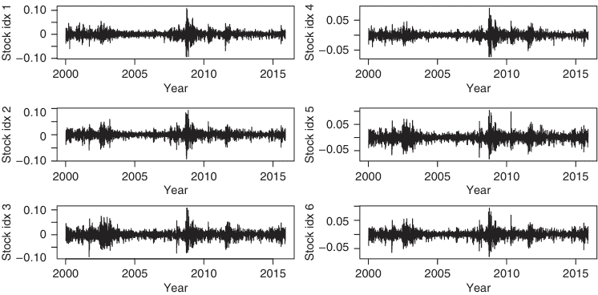

**图 1.4** 前六个每日股票市场指数的对数收益率时间图：2000年1月3日至2015年12月16日。

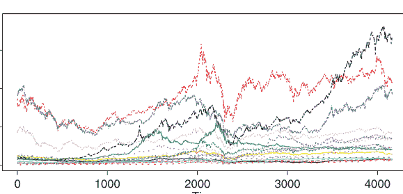

**图 1.5** 2000年1月3日至2015年12月16日22个亚洲金融市场每日股票市场指数的时间图。

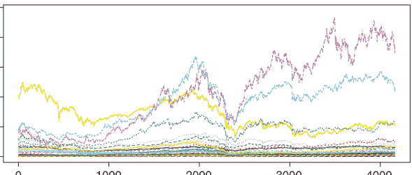

图 1.6 2000年1月3日至2015年12月16日47个欧洲金融市场每日股票市场指数的时间图。

作为第三个示例，图 1.7 显示了2000年1月至2015年10月欧洲国家的33个每月消费者价格指数。这些数据位于文件 CPIEurope2000-15.csv 中。在图中，这些序列已标准化为零均值和单位方差。正如预期，图表显示价格指数呈上升趋势，但也展示了序列之间足够的差异。例如，一些序列显示出清晰的季节性模式，而其他序列则没有。

在市场营销研究中有大量数据可用。作为一个示例，图 1.8 展示了2008年1月1日至2012年12月9日、共1805个观测值、中国25个省份某服装品牌的日销售额（自然对数）的时间图。这些数据来自 Chang et al. (2014)，并给定于文件 clothing.csv 中。这些图表展示了某种年度模式，即所谓的时间中的季节性行为

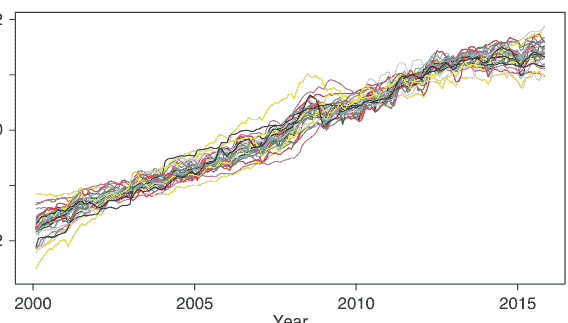

图 1.7 2000年1月至2015年10月欧洲国家33个每月价格指数的时间图。


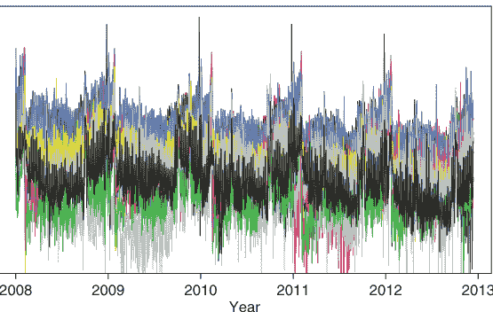

图 1.8 2008年1月1日至2012年12月9日，中国25个省份某服装品牌日销售额的自然对数时序图。

序列分析。为了获得更深入的了解，图 1.9 显示了前八个省份的相同时序图。它们分别是北京、福建、广东、广西、海南、河北、河南和湖北。图中各图的水平已做调整，以避免重叠。这些图的一个特点是，每年年初会不规则地出现局部峰值，随后销售额出现一定程度的下降。这是因为每年的春节假期日期不同所致。此外，并非所有省份都会出现峰值；请参见图 1.9 中从上往下数的第二个图。对这些序列进行联合分析，既需要建模共同特征，也需要建模各省份之间的差异。

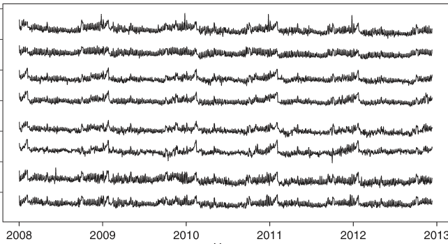

图 1.9 2008年1月1日至2012年12月9日，中国八个省份某服装品牌日销售额的自然对数时序图。

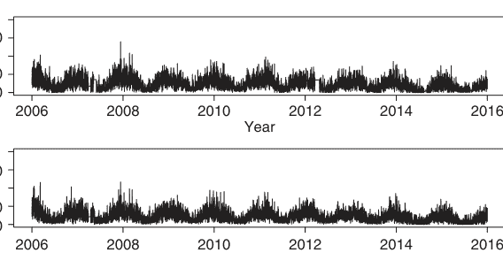

图 1.10 2006年1月1日至2015年12月31日，台湾南部两个监测站的颗粒物 PM$_{2.5}$ 逐时观测值时序图。

图 1.10 展示了2006年1月1日至2015年12月31日期间，台湾南部两个监测站的颗粒物 PM$_{2.5}$ 逐时观测值时序图。为简化起见，我们剔除了2月29日的数据，样本量为 87,600。数据存储在文件 `TaiwanPM25.csv` 中。这两个系列是岛上众多监测站的一部分。每个站点还提供温度、露点和其他空气污染指数的测量值。因此，这是大规模依赖数据的一个简单示例。时序图显示出明显的年度模式，似乎呈现出轻微的下降趋势。图 1.11 显示了第 1 号监测站 PM$_{2.5}$ 系列的前 30,000 个样本自相关系数。从自相关系数中可以清楚地看出，周期性 $s = 24 \times 365 = 8760$ 的年度周期。另一方面，图 1.12 显示了同一时间序列的前 120 个样本自相关系数。该图显示，该序列还存在每日循环模式，在

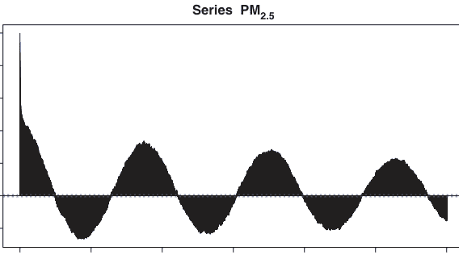

图 1.11 台湾南部第 1 号监测站 PM$_{2.5}$ 测量值的样本自相关系数。展示了前 30,000 个自相关系数。周期性为 8760 的年度周期清晰可见。

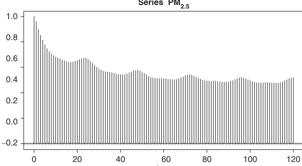

图 1.12 台湾南部第 1 号监测站 PM2.5 测量值的样本自相关系数。展示了前 120 个自相关系数。周期性为 24 的每日循环模式清晰可见。

PM2.5 系列中，周期性为 λ = 24。因此，分析此类大规模依赖数据不仅应考虑整体趋势，还应考虑不同频率的各种循环模式。

最后，图 1.13 绘制了1987年6月20日美国中西部州份的监测站（用圆圈表示）和臭氧水平（用颜色编码的方块表示）。该数据集可从 R 语言的 fields 包中获取。图中添加了州份，以便读者了解美国中西部地区臭氧水平的地理特征。显然，在这一天，伊利诺伊州西南部和印第安纳州南部出现了高臭氧读数。此外，相邻监测站的臭氧水平相似。这是第 9 章讨论的空间过程的一个示例。

这里介绍的六个数据集是多元时空序列的示例，我们在其中随时间和空间观察若干感兴趣变量的值。

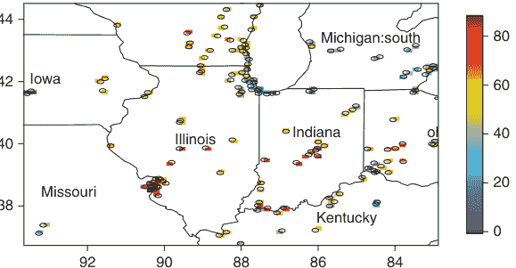

图 1.13 美国中西部州份各监测站的位置和臭氧水平。测量值为 1987年6月20日 上午9点至下午4点的8小时平均值。

时间序列在给定序列中引入了动态依赖，这种依赖可能随时间变化。数据还显示序列之间存在交叉依赖，而交叉依赖的强度又可能取决于地理位置或国家之间的经济关系。本书的一个主要焦点是研究多个时间序列之间的动态依赖和交叉依赖。

分析大规模依赖数据的目标包括：(a) 研究序列之间的关系；(b) 探索序列内部及序列之间的动态依赖；(c) 预测序列的未来值。对于空间过程，人们可能有兴趣预测没有观测值的地点上的感兴趣变量。前两个目标被称为数据分析与建模，而第三个目标涉及统计推断。建模和推断不仅需要处理数据的方法，还需要可以据此进行适当推断的理论。为此，我们需要一个框架来理解研究中时间序列的特征并做出可靠的预测。我们将通过在下一节中介绍随机过程来讨论这个框架。

## 1.2 随机过程

随机过程的理论与性质构成了依赖数据统计分析与推断的基础。

### 1.2.1 标量过程

标量随机过程是随机变量序列 {z_t}，其中下标 t 取值于某个集合 C。在大多数情况下，C 的元素是有序的，并且通常对应于某个日历时间（天、月、年等）。由此产生的随机过程 z_t 称为时间序列。除非特别说明，我们假设本书中的时间索引 t 是等间距的。对于空间过程，C 由某些地理区域的位置组成。这些位置可以表示观测站或城市的纬度和经度。对于 C 中的每个值 t（例如，每个时间点），z_t 是定义在共同可测空间上的实值随机变量。为简单起见，观测值也用 {z_t} 表示，构成随机过程的一个实现。我们将用 z_1^T = (z_1, ..., z_t, ..., z_T)' 表示实现，其中 T 是样本量，A' 表示矩阵或向量 A 的转置。样本量 T 表示时间序列的观测数量，或纯空间过程的位置数量。

随机过程 z_t 的统计特性由其概率分布表征。更具体地说，对于给定的 T（有限且固定），z_1^T 的性质由其元素 {z_t | t = 1, ..., T} 的联合概率分布决定。z_1^T 中任何非空子集的边缘分布可以通过从联合分布中积分掉不在子集中的元素来得到。特别是，单个元素 z_t 的概率分布称为 z_t 的边缘分布。因此，类似于一般有限维随机变量，当我们知道其联合概率分布时，我们就说 z_1^T 的概率结构已知。

在本书中，我们假设概率分布有明确定义的密度函数。令 f_t(z) 为 z_t 的边缘概率密度函数。定义

$z_t$ 的期望值或均值为

$$\mu_t = E(z_t) = \int_R z_t f_t(z) dz$$

前提是积分存在，其中 $R$ 表示实数直线。序列 $\mu_1^T = (\mu_1, \mu_2, \dots, \mu_T)$ 是 $\mathbf{z}_1^T$ 的均值函数。定义 $z_t$ 的方差为

$$\sigma_t^2 = E(z_t - \mu_t)^2 = \int_R (z - \mu_t)^2 f_t(z) dz$$

前提是积分存在。序列 $\{\sigma_1^2\}_1^T = (\sigma_1^2, \dots, \sigma_T^2)$ 是 $\mathbf{z}_1^T$ 的方差函数。高阶矩可以类似定义，假设它们存在。

一个感兴趣的特例是 $\mathbf{z}_1^T$ 的所有元素具有相同的均值。在这种情况下，$\mu_1^T$ 是一个常数函数。如果 $\mathbf{z}_1^T$ 的所有元素具有相同的方差，则 $\{\sigma_t^2\}_1^T$ 是一个常数函数。如果对于所有有限 $T$，$\mu_1^T$ 和 $\{\sigma_t^2\}_1^T$ 都是常数，则随机过程 $z_t$ 是稳定的，我们称其为齐次过程。在某些应用中，$\mu_1^T$ 或 $\{\sigma_t^2\}_1^T$ 可能不存在。

在下文中，我们假设所有 $t$ 的 $\sigma_t^2$ 都存在。随机过程 $z_t$ 的线性动态依赖由其自协方差或自相关系数函数（ACF）决定。对于 $z_t$ 和 $z_{t-j}$（其中 $j$ 是给定的整数），我们定义它们的自协方差为

$$\gamma(t, t-j) = \text{Cov}(z_t, z_{t-j}) = E[(z_t - \mu_t)(z_{t-j} - \mu_{t-j})]. \quad (1.1)$$

当 $j=0$ 时，$\gamma(t, t) = \text{Var}(z_t) = \sigma_t^2$。另外，从定义中可以清楚地看出 $\gamma(t, t-j) = \gamma(t-j, t)$。$z_t$ 与 $z_{t-j}$ 之间的自相关系数定义为

$$\rho(t, t-j) = \frac{\gamma(t, t-j)}{\sigma_t \sigma_{t-j}}. \quad (1.2)$$

在实际应用中，特别重要的情况是 $z_t$ 与 $z_{t-j}$ 之间的自协方差，因而也包括自相关系数，是滞后 $j$ 的函数，而不是 $t$ 的函数。在这种情况下，自协方差和自相关系数是时不变的，我们写作 $\gamma(t, t-j) = \gamma_j$ 和 $\rho(t, t-j) = \rho_j$。

#### 1.2.1.1 平稳性

如果随机过程 $z_t$ 的 $m$ 维随机向量 $(z_{t_1}, z_{t_2}, \dots, z_{t_m})$ 和 $(z_{t_1+h}, z_{t_2+h}, \dots, z_{t_m+h})$ 的联合分布相同，则称其为严格平稳，其中 $m$ 是任意正整数，$\{t_1, \dots, t_m\}$ 是任意 $m$ 个时间索引，$h$ 是任意整数。换句话说，任意 $m$ 个随机变量的联合分布是时不变的。特别是，严格平稳过程 $z_t$ 的边缘概率密度 $f_t(z)$ 不依赖于 $t$，我们简单地将其表示为 $f(z)$。如果随机过程 $z_t$ 的均值和自协方差函数存在且是时不变的，则称其为弱平稳。具体来说，过程 $z_t$ 是弱意义平稳的，当且仅当：(1) 对所有 $t$，$\mu_t = \mu$；(2) 对所有 $t$，$\sigma_t^2 = \sigma^2$；(3) 对所有 $t$，$\gamma(t, t-j) = \gamma_j$，其中 $j$ 是给定整数。前两个条件表示均值和方差是时不变的。第三个条件表明，两个变量之间的自协方差，因而也包括自相关系数，仅取决于它们的时间间隔 $j$。除非特别说明，我们


用平稳性表示随机过程的弱平稳性。对于该过程，自协方差和自相关函数仅取决于滞后的差值，特别是，我们有 \(\gamma_0 = \sigma^2, \gamma_j = \gamma_{-j}\) 和 \(\rho_j = \rho_{-j}\)，其中 \(j\) 是任意整数。

假设 \(z_t\) 是平稳的。对于给定的正整数 \(m\)，\((z_t, z_{t-1}, \dots, z_{t-m+1})'\) 的协方差矩阵定义为

\(\boldsymbol{M}_z(m) = E \left\{ \begin{bmatrix} z_t - \mu \\ z_{t-1} - \mu \\ \vdots \\ z_{t-m+1} - \mu \end{bmatrix} [(z_t - \mu), (z_{t-1} - \mu), \dots, (z_{t-m+1} - \mu)] \right\} = \begin{bmatrix} \gamma_0 & \gamma_1 & \cdots & \gamma_{m-1} \\ \gamma_1 & \gamma_0 & \cdots & \gamma_{m-2} \\ \vdots & \vdots & \ddots & \vdots \\ \gamma_{m-1} & \gamma_{m-2} & \cdots & \gamma_0 \end{bmatrix} \quad (1.3)\)

该协方差矩阵具有特殊模式：(a) 所有对角元素相同，(b) 主对角线上下的所有元素相同，以此类推。这样的矩阵称为 *托普利茨* 矩阵。相应的 *自相关矩阵* 是

\(\boldsymbol{R}_z(m) = \begin{bmatrix} 1 & \rho_1 & \cdots & \rho_{m-1} \\ \rho_1 & 1 & \cdots & \rho_{m-2} \\ \vdots & \vdots & \ddots & \vdots \\ \rho_{m-1} & \rho_{m-2} & \cdots & 1 \end{bmatrix} \quad (1.4)\)

它也是一个托普利茨矩阵。

平稳过程的一个重要性质是，其元素的任何非平凡有限线性组合仍然是平稳的。换句话说，通过平稳过程的任何非零线性组合（具有有限元素）得到的过程也是平稳的。例如，如果 \(z_t\) 是平稳的，则由 \(w_t = z_t - z_{t-1}\) 定义的过程 \(w_t\) 也是平稳的。该性质的一个推论是，\(z_t\) 的自协方差必须满足某些有助于研究随机过程的条件。特别是，我们可以考虑平稳过程 \(z_t\) 及其滞后值的非平凡线性组合，即

\(y_t = c_1 z_t + c_2 z_{t-1} + \cdots + c_m z_{t-m+1} = \boldsymbol{c}' \boldsymbol{z}_{t,m}\)

其中 \(\boldsymbol{c} = (c_1, \dots, c_m)' \neq \boldsymbol{0}\) 且 \(\boldsymbol{z}'_{t,m} = (z_t, z_{t-1}, \dots, z_{t-m+1})'\)。由于 \(y_t\) 是平稳的，其方差存在且由 \(\boldsymbol{c}' \boldsymbol{M}_z(m) \boldsymbol{c} \geq 0\) 给出，其中 \(\boldsymbol{M}_z(m)\) 在 Eq. (1.3) 中定义。因此，\(\boldsymbol{M}_z(m)\) 必须是半正定矩阵。同样，相关矩阵 \(\boldsymbol{R}_z(m)\) 也必须是半正定的。

严格平稳性蕴含弱平稳性，前提是过程的前两阶矩存在。但弱平稳性并不能保证随机过程的严格平稳性。考虑以下简单示例。设 \(\{z_t\}\) 为一组独立同分布的标准正态随机变量，即 \( z_t \sim iid N(0, 1) \)。通过以下方式定义随机过程 \( x_t \)

\[
x_t = \begin{cases} 0.5(z_t^2 - 1), & \text{if } t \text{ is odd} \\ z_t, & \text{if } t \text{ is even.} \end{cases}
\]

很容易证明 (a) \( E(x_t) = 0 \)，(b) \( Var(x_t) = 1 \)，且 (c) 对于 \( j \neq 0 \) 有 \( E(x_t x_{t-j}) = 0 \)。因此，\(\{x_t\}\) 是一个弱平稳过程。另一方面，当 \( t \) 为偶数时 \( x_t \) 服从高斯分布，而当 \( t \) 为奇数时它是具有一度自由度的平移 \(\chi^2\) 分布。过程 \(\{x_t\}\) 不是同分布的，因此不是严格平稳的。如果假设对所有 \( T \) 都有 \( z_1^T \) 服从多元正态分布，则弱平稳性等价于严格平稳性，因为正态（或高斯）分布由其前两阶矩决定。

#### 1.2.1.2 白噪声过程

一个重要的平稳过程是 *白噪声过程*。随机过程 \( z_t \) 是白噪声过程，当且仅当它满足以下条件：(1) \( E(z_t) = 0 \)；(2) \( Var(z_t) = \sigma^2 < \infty \)；且 (3) 对于所有 \( j \neq 0 \) 有 \( Cov(z_t, z_{t-j}) = 0 \)。换句话说，\( z_t \) 是白噪声序列当且仅当它具有零均值和有限方差，并且不存在序列相关性。因此，白噪声不一定是严格平稳的。如果施加额外条件，即 \( z_t \) 与 \( z_{t-j} \) 独立且服从同一分布，其中 \( j \neq 0 \)，则 \( z_t \) 是 *严格白噪声过程*。

#### 1.2.1.3 条件分布

除了边缘分布外，条件分布在研究随机过程中也起着重要作用。设 \( z_\ell^k = (z_\ell, z_{\ell+1}, \dots, z_k)' \)，其中 \( \ell \) 和 \( k \) 为正整数且 \( \ell \le k \)。在预测中，我们关注在给定 \( z_1^T \) 时 \( z_{T+1}^{T+h} \) 的条件分布，其中 \( h \ge 1 \) 被称为 *预测期*。在估计中，我们将 \( z_1^T \) 的联合概率密度函数表示为 \( z_{t+1} \) 在给定 \( z_1^t \) 时的条件密度函数的乘积，其中 \( t = T - 1, T - 2, \dots, 1 \)。更多细节将在后续章节中介绍。

如果随机过程 \( z_t \) 具有以下性质

\[
f(z_{t+1}|z_1^t) = f(z_{t+1}|z_t), \quad t = 1, 2, \dots,
\]

则 \( z_t \) 是一阶 *马可夫过程*。上述性质被称为马可夫过程的无记忆性，因为条件分布仅取决于前一期的变量。

### 1.2.2 向量过程

随机向量过程是随机向量的序列 \(\{z_t\}\)，其中索引 \( t \) 取自某个集合 \( C \) 的值，且 \( z_t = (z_{1t}, \dots, z_{kt})' \) 是一个 \( k \) 维向量。每个分量 \( z_{it} \) 遵循一个标量随机过程，而向量过程由随机变量 \( (z_1, \dots, z_T) \) 的联合概率分布来表征。与标量情况类似，我们定义 \( z_t \) 的均值向量为

\[
E(z_t) = [E(z_{1t}), E(z_{2t}), \dots, E(z_{kt})]' = (\mu_{1t}, \dots, \mu_{kt})' \equiv \mu_t,
\]

前提是期望存在，以及滞后-\(\ell\) 自协方差函数为

\[
\Gamma(t, t-\ell) = Cov(z_t, z_{t-\ell}) = E[(z_t - \mu_t)(z_{t-\ell} - \mu_{t-\ell})'] \quad (1.5)
\]

前提是涉及的所有协方差都存在，其中 \(\ell\) 是整数。我们说向量过程 \(\{z_t\}\) 是弱平稳的，如果 (a) \(\mu_t = \mu\)，一个常数向量，且 (b) \(\Gamma(t, t - \ell)\) 仅取决于 \(\ell\)。换句话说，\(k\) 维随机过程 \(z_t\) 若其前两阶矩与时间无关，则是弱平稳的。在此情况下，我们写 \(\Gamma(t, t - \ell) = E[(z_t - \mu)(z_{t-\ell} - \mu)'] = \Gamma(\ell) = [\gamma_{ij}(\ell)]\)，其中 \(1 \le i, j \le k\)。特别是，弱平稳 \(k\) 维随机过程 \(z_t\) 的滞后-0 自协方差矩阵由以下给出

\[
\Gamma(0) = \begin{bmatrix} \gamma_{11}(0) & \gamma_{12}(0) & \cdots & \gamma_{1k}(0) \\ \gamma_{21}(0) & \gamma_{22}(0) & \cdots & \gamma_{2k}(0) \\ \vdots & \vdots & \ddots & \vdots \\ \gamma_{k1}(0) & \gamma_{k2}(0) & \cdots & \gamma_{kk}(0) \end{bmatrix} \quad (1.6)
\]

它是对称的，因为 \(\gamma_{ij}(0) = \gamma_{ji}(0)\)。注意，对角元素 \(\gamma_{ii}(0) = \sigma_i^2 = \text{Var}(z_{it})\)。

对于平稳向量过程 \(z_t\)，其滞后-\(\ell\) 自协方差矩阵 \(\Gamma(\ell) = [\gamma_{ij}(\ell)]\) 度量了分量序列 \(z_{it}\) 及其滞后变量 \(z_{j,t-\ell}\) 之间的线性依赖关系。研究 \(\Gamma(\ell)\) 中各个元素 \(\gamma_{ij}(\ell)\) 的精确含义是有意义的。首先，对角元素 \(\gamma_{ii}(\ell)\) 是标量过程 \(z_{it}\) (\(i = 1, \dots, k\)) 的滞后-\(\ell\) 自协方差。其次，非对角元素 \(\gamma_{ij}(\ell)\) 是

\(\gamma_{ij}(\ell) = E[(z_{it} - \mu_i)(z_{j,t-\ell} - \mu_j)]\)

它度量了 \(z_{it}\) 对滞后值 \(z_{j,t-\ell}\) 的线性依赖（当 \(\ell > 0\) 时）。因此，\(\gamma_{ij}(\ell)\) 量化了 \(z_{it}\) 对 \(z_{jt}\) 的第 \(\ell\) 个过去值的线性依赖。第三，一般来说，如果 \(\ell > 0\)，\(\Gamma(\ell)\) 不是对称的。事实上，对于大多数随机过程 \(z_t\)，\(\gamma_{ij}(\ell) \neq \gamma_{ji}(\ell)\)，因为如前所述，\(\gamma_{ij}(\ell)\) 表示 \(z_{it}\) 对 \(z_{j,t-\ell}\) 的线性依赖，而 \(\gamma_{ji}(\ell)\) 量化 \(z_{jt}\) 对 \(z_{i,t-\ell}\) 的线性依赖。最后，我们有

\(\gamma_{ij}(-\ell) = E[(z_{it} - \mu_i)(z_{j,t+\ell} - \mu_j)]\)
\(= E[(z_{j,v} - \mu_j)(z_{i,v-\ell} - \mu_i)] \quad (v = \text{t} + \ell)\)
\(= \gamma_{ji}(\ell). \quad \text{(by stationarity)}\)

因此，对于所有 \(\ell\) 都有 \(\gamma_{ij}(-\ell) = \gamma_{ji}(\ell)\)。平稳向量过程 \(z_t\) 的自协方差矩阵满足

\(\Gamma(-\ell) = [\Gamma(\ell)]'\)

因此，在实践中只需考虑 \(\ell \ge 0\) 时的 \(\Gamma(\ell)\) 即可。如果需要 \(\Gamma(\ell)\) 的维度以避免任何混淆，我们写 \(\Gamma(\ell) \equiv \Gamma_k(\ell)\)，其中下标 \(k\) 表示基础随机过程 \(z_t\) 的维度。

过程 \(z_t\) 整体变异性的全局度量由其广义方差给出，即滞后-0 协方差矩阵 \(\Gamma(0)\) 的行列式，也就是 \(|\Gamma(0)|\)。按维度标准化的度量是有效方差，定义为

\(\text{EV}(\mathbf{z}_t) = |\Gamma(0)|^{1/k}.\) (1.7)

例如，如果 \(\mathbf{z}_t\) 是二维的，则 \(\text{EV}(\mathbf{z}_t) = [\gamma_{11}(0)\gamma_{22}(0)\{1 - \rho_{12}^2(0)\}]^{1/2}\)，其中 \(\rho_{12}(0)\) 是 \(z_{1t}\) 与 \(z_{2t}\) 之间的瞬时相关系数。


显然，当两个序列不相关时，EV($z_t$) 取得最大值，即 \(\rho_{12}(0) = 0\)。对于一个 \(k\)-维过程 $z_t$，由于方阵的行列式是其特征值的乘积，有效方差是 \(\Gamma(0)\) 特征值的几何平均值。

我们可以通过其分量的线性组合来总结平稳向量过程 $z_t$ 的性质。例如，考虑线性过程

$$y_t = c'z_t = \sum_{i=1}^k c_i z_{it}$$

其中 $c = (c_1, ..., c_k)' \neq 0$。该过程是平稳的，因为它是平稳分量 $z_{it}$ ($i = 1, ..., k$) 的有限线性组合。更具体地说，期望为 $E(y_t) = c_1 E(z_{1t}) + ... + c_k E(z_{kt}) = c'E(z_t) = c'\mu$，它是时间不变的。同样，$y_t$ 的方差由 $\text{Var}(y_t) = \text{Var}(c'z_t) = c'\text{Var}(z_t)c = c'\Gamma(0)c$ 给出，这也是时间不变的。一般来说，我们有 $\text{Cov}(y_t, y_{t-\ell}) = c'\Gamma(\ell)c$，它只依赖于 $\ell$。因此，$y_t$ 是平稳的。此外，由于 $\text{Var}(y_t)$ 是非负的且 $c$ 是任意非零向量，我们得出 $\Gamma(0)$ 是半正定的。

类似于标量情况，平稳向量过程 $z_t$ 在 Eq. (1.5) 中的自协方差矩阵必须满足某些条件。为了说明这一点，我们考虑 $z_t$ 及其 $m$ 个滞后值的非零线性组合，例如，

$$y_t = \sum_{i=1}^m b'_i z_{t-i+1} = b'_1 z_t + b'_2 z_{t-1} + \cdots + b'_m z_{t-m+1}$$

其中 $b_j = (b_{j1}, ..., b_{jk})'$ 为 $j = 1, ..., m$ 的 $k$-维实向量。定义 $b = (b'_1, b'_2, ..., b'_m)'$，即一个非零的 $km$-维常数向量，以及 $z_{t,m} = (z'_t, z'_{t-1}, ..., z'_{t-m+1})'$，则有 $\text{Var}(y_t) = b'\text{Var}(z_{t,m})b = b'M_z(m)b$，其中

$$M_z(m) = \begin{bmatrix} \Gamma(0) & \Gamma(1) & \cdots & \Gamma(m-1) \\ \Gamma(-1) & \Gamma(0) & \cdots & \Gamma(m-2) \\ \vdots & \vdots & \ddots & \vdots \\ \Gamma(-m+1) & \Gamma(-m+2) & \cdots & \Gamma(0) \end{bmatrix} \quad (1.8)$$

是一个非负分块 Toeplitz 矩阵。这个 $M_z(m)$ 矩阵是标量序列 $z_t$ 在 Eq. (1.3) 中的 $M_z(m)$ 的推广。

$z_t$ 的互相关矩阵（CCMs）定义为标准化过程 $x_t = D^{-1/2}(z_t - \mu)$ 的自协方差，其中矩阵 $D$ 定义为 $\text{diag}(\gamma_{11}(0), ..., \gamma_{kk}(0))$，由 $z_t$ 的分量方差组成。具体来说，$z_t$ 的滞后-\(\ell\) CCM 为

$$R_z(\ell) = \text{Cov}(x_t, x_{t-\ell}) = D^{-1/2} \text{Cov}(z_t, z_{t-\ell}) D^{-1/2}$$

$$= \begin{bmatrix} \rho_{11}(\ell) & \rho_{12}(\ell) & \cdots & \rho_{1k}(\ell) \\ \rho_{21}(\ell) & \rho_{22}(\ell) & \cdots & \rho_{2k}(\ell) \\ \vdots & \vdots & \ddots & \vdots \\ \rho_{k1}(\ell) & \rho_{k2}(\ell) & \cdots & \rho_{kk}(\ell) \end{bmatrix} \quad (1.9)$$

根据定义，我们有 \(\rho_{ii}(0) = 1\) 且

\(\rho_{ij}(\ell) = \frac{\gamma_{ij}(\ell)}{\sqrt{\gamma_{ii}(0)\gamma_{jj}(0)}}.\)

类似于自协方差矩阵，我们有 \(M_z(\ell) = [M_z(-\ell)]'\).

$z_t$ 的有效相关性由

\(\text{ER}_z = 1 - |\text{R}_z(0)|^{1/k}\) (1.10)

给出，其值在零和一之间。例如，当 \(k=2\) 时，\(\text{ER}_z = 1 - [1 - \rho_{12}(0)]^{1/2}\)。更多性质请参见 Peña and Rodriguez (2003)。

#### 1.2.2.1 向量白噪声

若 \(k\)-维向量过程 \(z_t\) 满足 (a) \(E(z_t) = 0\)，(b) \(\text{Var}(z_t) = \Gamma(0)\) 为正定，且 (c) 对所有 \(\ell \neq 0\) 有 \(\Gamma(\ell) = 0\)，则称其为白噪声过程。这是标量白噪声的直接推广。因此，向量白噪声过程由零均值、正定协方差且无滞后自相关或互相关的随机向量组成。

#### 1.2.2.2 可逆性

在许多应用中，我们使用线性回归类型的模型来描述向量过程的动态依赖性。该模型可写为

\(z_t = \pi_0 + \sum_{i=1}^{\infty} \pi_i z_{t-i} + a_t\) (1.11)

其中 \(\{a_t\}\) 是平稳向量白噪声过程，\(\pi_0\) 是常数 \(k\)-维向量，\(\pi_i\) 为 \(k \times k\) 实值矩阵。为了使 Eq. (1.11) 有意义，系数矩阵必须满足条件

\(\sum_{i=1}^{\infty} \|\pi_i\| < \infty\) (1.12)

其中 \(\|\mathbf{A}\|\) 表示矩阵 \(\mathbf{A}\) 的一个范数，例如 \(\|\mathbf{A}\| = \left( \sum_{i=1}^k \sum_{j=1}^k a_{ij}^2 \right)^{1/2}\)，即 \(Frobenius\) 范数。若向量过程 \(z_t\) 可以采用满足 Eq. (1.12) 条件的 (1.11) 模型，则称其为 \(invertible\)（可逆）。若 Eq. (1.11) 中的求和在有限整数 \(p\) 处截断，则 \(z_t\) 可逆，且该过程遵循向量自回归（VAR）模型。

可逆性是时间序列分析中的另一个重要概念。可逆模型的一个必要条件是当 \(i \to \infty\) 时 \(\|\pi_i\| \to 0\)。这意味着，在已知信息 \(\{z_{t-1}, z_{t-2}, \dots, z_{t-\ell+1}\}\) 的条件下，\(z_{t-\ell}\) 对 \(z_t\) 的附加贡献随着 \(\ell\) 增加而减小。考虑标量过程 \(z_t\)，任何有限 \(p\) 的 AR(\(p\)) 过程都是可逆的。另一方面，过程 \(z_t = a_t - a_{t-1}\)，其中 \(\{a_t\}\) 是白噪声，是平稳的，但不可逆。

## 1.3 平稳向量过程的样本矩

在实际应用中，我们通常观察到平稳向量过程 \(z_t\) 的一系列实现，例如 \(\{z_1, \dots, z_T\}\)。我们的目标是根据观察数据研究 \(z_t\) 的性能。为此，某些探索性数据分析很有用。特别是，通过研究其样本矩，可以了解许多关于 \(z_t\) 的信息。

### 1.3.1 样本均值

标量过程 \(z_{it}\) 总体均值的无偏估计量是样本均值

\(\bar{z}_{\cdot i} = \frac{1}{T} \sum_{t=1}^T z_{it}.\) (1.13)

将它们合在一起，向量过程 \(\boldsymbol{z}_t\) 的样本均值为

\(\bar{\boldsymbol{z}} = (\bar{z}_1, \dots, \bar{z}_k)' = \frac{1}{T} \sum_{t=1}^T \boldsymbol{z}_t.\) (1.14)

对于独立同分布的随机样本，容易看出 \(E(\bar{z}_i) = E(z_{it}) = \mu_i\)；且 \(\bar{z}_i\) 的方差为 \(\sigma_i^2 / T\)，其中 \(\sigma_i^2 = \text{Var}(z_{it})\)。因此，在这种情况下，当 \(T \to \infty\) 时，样本均值是总体均值 \(\mu_i\) 的一致估计量。

需要注意的是，对于平稳过程，样本均值的一致性不一定成立。例如，令 \(z_{11}\) 为来自均值为零、方差为 \(\sigma^2\) 的正态分布的随机样本。令 \(t = 2, \dots, T\) 时 \(z_{1t} = z_{11}\)。这个特殊过程 \(\{z_{1t}\}\) 是平稳的，因为 (1) \(E(z_{1t}) = 0\)，是时间不变的，(2) \(\text{Var}(z_{1t}) = \sigma^2\)，也是时间不变的，且 \(\text{Cov}(z_{1t}, z_{1t-j}) = \sigma^2\)，对所有 \(j\) 都是时间不变的。然而，在这个特定情况下，无论样本量 \(T\) 为多少，都有 \(\bar{z}_{\cdot 1} = z_{11}\) 和 \(\text{Var}(\bar{z}_{\cdot 1}) = \sigma_1^2\)。因此，当 \(T \to \infty\) 时，样本均值不是这个特殊过程的一致估计量。

样本均值 \(\bar{z}_{\cdot i}\) 作为总体均值 \(\mu_i\) 的一致估计量的条件，被称为随机过程的 *遍历* 条件。遍历理论关注的是长实现的时间平均（样本均值）收敛到动态系统空间平均（在给定时刻下许多随机样本的平均）的条件。对于标量弱平稳 \(z_t\)，\(\bar{z}\) 收敛到 \(\mu = E(z_t)\) 的遍历条件是 \(\sum_{i=0}^{\infty} |\gamma_i| < \infty\)。从本书起，我们假设此条件成立。

对于弱平稳向量过程 \(\boldsymbol{z}_t\)，样本均值 \(\bar{\boldsymbol{z}}\) 的协方差矩阵由

\(\begin{aligned} \text{Var}(\bar{\boldsymbol{z}}) &= E \left[ (\bar{\boldsymbol{z}} - \boldsymbol{\mu})(\bar{\boldsymbol{z}} - \boldsymbol{\mu})' \right] = E \left[ \left\{ \frac{1}{T} \sum_{t=1}^T (\boldsymbol{z}_t - \boldsymbol{\mu}) \right\} \left\{ \frac{1}{T} \sum_{j=1}^T (\boldsymbol{z}_j - \boldsymbol{\mu})' \right\} \right] \\ &= \frac{1}{T^2} \sum_{t=1}^T E \left[ (\boldsymbol{z}_t - \boldsymbol{\mu}) \left\{ \sum_{j=1}^T (\boldsymbol{z}_j - \boldsymbol{\mu})' \right\} \right] = \frac{1}{T^2} \left[ \sum_{|j-t| \le T-1} (T - |j|)\boldsymbol{\Gamma}(j) \right] . \end{aligned}\) (1.15)

这意味着标量样本均值 \(\bar{z}_{\cdot i}\) 的渐近方差为

\(T \times \text{Var}(\bar{z}_{\cdot i}) \to \gamma_{ii}(0) + 2 \sum_{\ell=1}^{\infty} \gamma_{ii}(\ell), \quad \text{as } T \to \infty.\) (1.16)

再次说明，\(\gamma_{ii}(\ell)\) 是 \(z_{it}\) 的滞后-\(\ell\) 自协方差。根据 Equation (1.2)，如果 \(\{z_{it}\}\) 是白噪声，则样本均值 \(\bar{z}_{\cdot i}\) 的方差为 \(\sigma_i^2 / T\)。一般来说，我们有

\(\text{Var}(\bar{z}_{\cdot i}) \approx \frac{1}{T} \left[ \gamma_{ii}(0) + 2 \sum_{l=1}^{T} \gamma_{ii}(l) \right] , \quad \text{as } T \to \infty.\)


因此，若 \(z_{it}\) 的自协方差之和较大，则 Var\((\bar{z}_t)\) 可能较大。\(z_{it}\) 的自协方差之和收敛的一个必要（但不充分）条件是

\(\lim_{l \to \infty} \gamma_{ii}(l) \to 0,\)

这意味着随着 \(l\) 增大，\(z_{it}\) 对其过去值 \(z_{i,t-l}\) 的依赖性消失。

### 1.3.2 样本协方差矩阵与相关系数矩阵

对于向量过程 \(\mathbf{z}_t\)，滞后-\(\ell\) 样本自协方差矩阵为

\(\hat{\mathbf{\Gamma}}(\ell) = \frac{1}{T} \sum_{t=\ell+1}^{T} (\mathbf{z}_t - \bar{\mathbf{z}})(\mathbf{z}_{t-\ell} - \bar{\mathbf{z}})' .\) (1.17)

特别是，样本协方差矩阵为

\(\hat{\mathbf{\Gamma}}(0) = \frac{1}{T} \sum_{t=1}^{T} (\mathbf{z}_t - \bar{\mathbf{z}})(\mathbf{z}_t - \bar{\mathbf{z}})' .\)

\(\mathbf{z}_t\) 的滞后-\(\ell\) 样本 CCM 为

\(\hat{\mathbf{R}}(\ell) = \hat{\mathbf{D}}^{-1/2} \hat{\mathbf{\Gamma}}(\ell) \hat{\mathbf{D}}^{-1/2} ,\) (1.18)

其中 \(\hat{\mathbf{D}} = \text{diag}\{\hat{\gamma}_{11}(0), ..., \hat{\gamma}_{kk}(0)\}\)。由公式 (1.18) 得

\(\hat{\mathbf{R}}(\ell) = [\hat{\rho}_{ij}(\ell)] \quad \text{with} \quad \hat{\rho}_{ij}(\ell) = \frac{\hat{\gamma}_{ij}(\ell)}{\sqrt{\hat{\gamma}_{ii}(0)\hat{\gamma}_{jj}(0)}} .\)

在某些温和条件下，对于弱平稳过程 \(\mathbf{z}_t\)，\(\hat{\mathbf{R}}(\ell)\) 是 \(\mathbf{R}(\ell)\) 的一致估计量。若 \(\mathbf{z}_t\) 是平稳高斯过程，则满足上述条件。然而，\(\hat{\mathbf{R}}(\ell)\) 的渐近性质相当复杂。它们取决于过程 \(\mathbf{z}_t\) 的动态依赖性。不过，某些特例的结果更容易理解。假设向量时间序列 \(\mathbf{z}_t\) 是白噪声过程，使得当 \(\ell \neq 0\) 时 \(\mathbf{R}(\ell) = \mathbf{0}\)。此时，我们有

\(\text{Var}[\hat{\rho}_{ij}(\ell)] \approx \frac{1}{T}, \quad \ell \neq 0.\)

并且，当 \(i \neq j\) 时，

\(\text{Var}[\hat{\rho}_{ij}(0)] \approx \frac{[1 - \rho_{ij}^2(0)]^2}{T} .\) (1.19)

更多细节见，例如，Reinsel (1993, section 4.1.2)。这些简单结果在向量时间序列的探索性数据分析中很有用。当维度 \(k\) 较大时尤其如此。分析时间序列数据的一个重要特征是探索观察时间序列的动态依赖性。对于一个 \(k\) 维序列，每个样本 CCM \(\hat{\mathbf{R}}(\ell)\) 都是一个 \(k \times k\) 矩阵。若 \(k=10\)，则每个 CCM 包含 100 个样本相关系数。要同时破译样本 CCM \(\hat{\mathbf{R}}(\ell)\) 中嵌入的模式（对 \(\ell = 1, ..., m\)，其中 \(m\) 是给定的正整数）并非易事。为辅助阅读样本 CCM，Tiao and Box (1981) 提出了一种简化方法来检查样本 CCM 的特征。具体地，考虑 \(\hat{\boldsymbol{\mathcal{R}}}(\ell)\) 对 \(\ell > 0\)。Tiao and Box 定义相应的简化矩阵 \(\boldsymbol{\mathcal{S}}(\ell) = [S_{ij}(\ell)]\)，其中

```
S_{ij}(\ell) = \begin{cases} + & \text{if } \hat{\rho}_{ij}(\ell) \ge 2/\sqrt{T}, \\ . & \text{if } |\hat{\rho}_{ij}(\ell)| < 2/\sqrt{T}, \\ - & \text{if } \hat{\rho}_{ij}(\ell) \le -2/\sqrt{T}, \end{cases}
```

其中可理解为，只要 \(z_t\) 是高斯白噪声，\(1/\sqrt{T}\) 就是 \(\hat{\boldsymbol{\mathcal{R}}}(\ell)\) 元素的样本标准误。通过检查简化 CCM \(\boldsymbol{\mathcal{S}}(\ell)\) 对 \(\ell = 1, ..., m\)，要更容易理解 \(z_t\) 的动态依赖性。我们通过一个例子演示简化 CCM 的有效性。

## 示例 1.1

考虑图 1.1 中的三个温度序列。三个序列的样本均值分别为 0.15、0.14 和 0.12，分别对应欧洲、北美和南美。样本标准差分别为 1.02、1.06 和 0.47。与欧洲和北美相比，南美 11 月的平均气温似乎较低且变动相对较小。转到样本 CCM。在此特定情况下，\(k=3\)，因此每个 CCM 包含 9 个实数。假设我们想使用样本 CCM 的前 12 个滞后来检查三个序列的动态依赖性。这将要求我们同时破译 108 个数字。另一方面，通过检查简化 CCM，动态依赖模式相对容易理解，如下所示。

```
Simplified matrix:
CCM at lag: 1
. . +
. . +
. . +
CCM at lag: 2
. . +
. . +
+ . +
CCM at lag: 3
. . +
. . +
. + +
CCM at lag: 4
. . .
. . .
. . +
CCM at lag: 5
. . .
. . +
. + +
CCM at lag: 6
. . +
. . .
. . +
CCM at lag: 7
. . +
. . +
CCM at lag: 8
. . .
. . +
CCM at lag: 9
. . +
. . +
CCM at lag: 10
. . .
. . +
CCM at lag: 11
. . +
. . +
CCM at lag: 12
. . .
. . +
```

根据简化 CCM，我们得出以下观察结果。首先，南美温度序列的动态依赖性似乎具有持续性，因为其所有样本 ACF 都很大（由 + 号表示）。这并不奇怪，因为图 1.1 中该序列的时间图显示出上升趋势。其次，欧洲和北美的温度序列与南美的温度序列在动态上相关，因为 CCM 的 (1,3) 和 (2,3) 元素存在多个 + 号。最后，欧洲和北美之间 11 月气温似乎没有强烈的动态依赖，因为 (1,2) 和 (2,1) 位置的大多数样本互相关系数都很小。

## 备注。以下是一些需要说明的事项。

- 示例 1.1 的演示由 R 中的 **MTS** 包完成。使用的命令是 `ccm`，采用默认选项。

```
da <- read.table("temperatures.txt", header=TRUE)
da <- da[,-1] # remove time index
require(MTS)
ccm(da)
```

- 如果维度 k 接近或大于样本量 T，则上述样本 CCM 的性质不再成立。我们将在后续章节（例如第 6 章）讨论这种情况。

- 当维度 k 较大时，即使是简化 CCM S(l) 也难以理解，必须使用一些汇总统计量。在本书中，我们提供三种汇总统计量来提取样本 CCM 中嵌入的有用信息。它们如下：

- P 值图：原假设 H0 : R(l) = 0 的 p 值与滞后 l 的散点图。在 z_t 对 l > 0 不存在串行或交叉相关性的原假设下，所使用的检验统计量渐近地服从 chi^2_{k^2} 分布。检验统计量的细节在第 3 章给出。

- 对角线元素图：R^(l) 的显著对角线元素比例与 l 的散点图。此处，若 R^(l) 的某元素绝对值大于 2/sqrt(T)，则称其为显著。

- 非对角线元素图：R^(l) 的显著非对角线元素比例与 l 的散点图。同样，R^(l) 元素的显著性是相对于 2/sqrt(T) 的。

这三个汇总图的 R 命令是 SLBDD 包中的 Summaryccm，该包与本书相关联。

## 示例 1.2

考虑图 1.2 中世界 99 个金融市场指数的日收益率。此处 k = 99，理解任何 99×99 交叉相关系数矩阵都会很困难。图 1.14 显示了日收益率的三种汇总统计量。上图是 p 值的散点图。从图中可以看出，所有 p 值都接近于零，表明滞后 1 到 12 时，99 维收益率中存在串行相关和交叉相关。中间图显示 R(l) 显著对角线元素的比例。该图显示，世界 99 个金融指数的日收益率中存在显著的串行相关。但是，正如预期的那样，串行相关衰减很快，因此随着 l 增大，比例趋近于零。底图显示 R(l) 对 l 的显著非对角线元素比例。该图表明，当 l 较小时，世界金融市场指数的日收益率之间存在显著的交叉依赖。正如预期的那样，随着 l 增大，交叉依赖也会很快衰减到零。

## 汇总 CCM 图所用的 R 命令：

```
require(SLBDD)
da <- read.csv2("Stock_indexes_99world.csv",header=FALSE)
da <- as.matrix(da[,-1]) # remove the time index
rt <- diff(log(da)) # log returns
Summaryccm(rt)
```


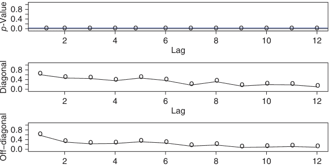

**图 1.14** 99 个世界金融市场指数日度对数收益率滞后 CCM 的三个汇总统计量的散点图。汇总统计量为 (a) 检验 \( R(\ell) = 0 \) 的 p 值，(b) \( \widehat{R}(\ell) \) 中显著对角元素的比例，以及 (c) \( \widehat{R}(\ell) \) 中显著非对角元素的比例。

## 1.4 非平稳过程

若向量过程 \( z_t \) 未能满足平稳性条件，则称其为非平稳过程。简单来说，若 \( z_t \) 的某些联合分布随时间变化，则 \( z_t \) 为非平稳过程。在此情况下，\( z_t \) 的矩可能依赖于时间。由于我们通常在给定时间索引 \( t \) 处只有一个观测值，因此需要进一步假设才能使非平稳过程的估计成为可能。最常用的非平稳过程是整合过程。此类过程通常被称为单位根非平稳序列。

标量时间序列 \( z_t \) 称为阶数为 1 的整合过程，若其增量 \( w_t = z_t - z_{t-1} \) 是平稳且可逆的过程。在计量经济学文献中，平稳且可逆的过程称为 \( I(0) \) 过程，阶数为 1 的整合过程称为 \( I(1) \) 过程。随机游走序列是 \( I(1) \) 过程的一个例子。令 \( B \) 表示后移算子，使得 \( Bz_t = z_{t-1} \)。那么，若 \( w_t = (1 - B)^d z_t \) 是 \( I(0) \) 过程，则 \( z_t \) 为 \( I(d) \) 过程。遵循惯例，我们也可在描述整合过程时使用记号 \( \nabla = (1 - B) \)。算子 \( (1 - B) \) 称为一阶差分算子，过程 \( w_t = (1 - B)z_t \) 为 \( z_t \) 的一阶差分序列。

类似地，若 \( w_t = (1 - B)^d z_t \) 是平稳且可逆的序列，则向量过程 \( z_t \) 称为 \( I(d) \) 过程，其中 \( (1 - B)^d \) 作用于 \( z_t \) 的每个分量。当然，并无特别理由期望 \( z_t \) 的所有分量都具有相同的整合阶数 \( d \)。因此，令 \( d = (d_1, ..., d_k)' \)，其中 \( d_i \) 为非负整数且 \( \max\{d_i\} > 0 \)。若 \( w_t = (w_{1t}, ..., w_{kt})' \)（其中 \( w_{it} = (1 - B)^{d_i} z_{it} \)）是平稳且可逆的过程，则称向量过程 \( z_t \) 为 \( I(d) \) 过程。在此情况下，我们可定义 \( D = \text{diag}[\nabla^{d_1}, ..., \nabla^{d_k}] \) 并写出 \( w_t = Dz_t \)。

整合向量过程 \( z_t \) 的一个重要概念是协整。假设分量 \( z_{it} \) 为 \( I(1) \) 过程。如果存在

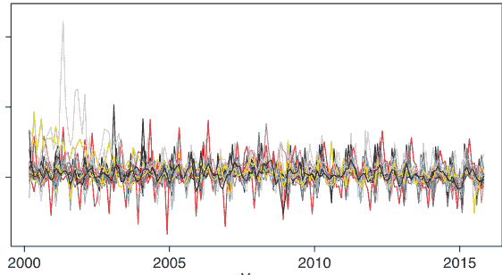

**图 1.15** 2000 年 1 月至 2015 年 10 月，33 个欧洲国家月度对数价格指数一阶差分序列的时间图。

一个 \( k \) 维向量 \(\boldsymbol{c} = (c_1, \dots, c_k)' \neq \boldsymbol{0}\)，使得 \( w_t = \boldsymbol{c}' \boldsymbol{z}_t \) 是 \( I(0) \) 过程，则称 \(\boldsymbol{z}_t\) 为协整过程，\(\boldsymbol{c}\) 为协整向量。\( I(0) \) 过程 \( w_t \) 是协整序列，它是平稳且可逆的。一般而言，对于 \( k \) 维单位根过程 \(\boldsymbol{z}_t\)，可以存在多个协整过程。我们将在后面讨论协整及其相关性质。

季节时间序列是非平稳过程的一个重要类别。对于季节时间序列，均值函数不是常数，而是随时间按照一定的周期性模式变化。该模式在给定年份的每个季节重复出现，例如每个季度、月或周。一年中的季节数称为 *周期性*。对于月度序列，该模式通常年复一年地重复，周期性为 \( s = 12 \)。对于季度数据，\( s = 4 \)。考虑图 1.7 中的 33 个月度价格指数。所有序列都呈上升趋势，因此不是平稳的。图 1.15 显示了对数价格指数一阶差分序列的时间图。从图中可以看出，如预期的那样，趋势消失，序列（即通货膨胀率）现在在零附近波动。因此，有证据表明对数价格指数是 \( I(1) \) 过程。图 1.15 中显示的循环模式表明，某些月份的值高于其他月份，因此这些过程属于季节时间序列类别。我们将在后面讨论季节时间序列。目前，介绍 *季节差分* 的概念即可。季节差分由 \( w_t = (1 - B^s)z_t = z_t - z_{t-s} \) 给出，表示年度增量。为方便起见，我们将 \( 1 - B \) 称为常规差分。

图 1.16 显示了图 1.7 中 40 个价格指数的常规差分和季节差分序列的时间图。具体而言，所示时间序列为 \( w_t = (1 - B)(1 - B^{12})z_t \)。从图中可以看出，季节模式在很大程度上被去除了。需要季节差分才能实现平稳性但仍保持可逆性的季节时间序列称为季节整合过程。协整的概念也推广到季节协整。具体细节见第 3 章。

另一种备受关注的非平稳性是局部平稳过程。随机过程若其均值和方差函数随时间缓慢演变，则称为局部平稳过程。此类过程的正式定义见 Dahlhaus (2012)。与传统时间序列分析不同，局部平稳过程的统计推断基于填充渐近性。为说明，考虑时变参数自回归过程

$$
z_t = \phi_t z_{t-1} + \sigma_t \epsilon_t, \quad (1.20)
$$

其中 \(\{\epsilon_t\}\) 是标准正态随机变量序列，\(\phi_t\) 和 \(\sigma_t\) 是重新缩放的平滑函数，满足 \(\phi_t \equiv \phi(t/T) : [0, 1] \to (-1, 1)\) 和 \(\sigma_t \equiv \sigma(t/T) : [0, 1] \to (0, \infty)\)，其中 \(T\) 为样本量。当 \(T\) 增加时，\(\phi(t/T)\) 和 \(\sigma(t/T)\) 的观测值在其域 \([0, 1]\) 上变得更加密集，从而可以更好地估计时变参数。图 1.17 显示了来自公式 (1.20) 时变参数 AR(1) 模型的 300 个观测值的一个实现的时间图，其中 \(\phi(t/T) = 0.2 + 0.4(t/T) - 0.2(t/T)^2\) 和 \(\sigma(t/T) = \exp(t/T)\)，\(T = 300\)。如预期，序列在零附近波动且波动性增加。该过程是局部平稳的，因为它可以在小时间间隔内由平稳序列近似。例如，在此特定示例中，图 1.17 的前 120 个观测值似乎是弱平稳的。

## 1.5 主成分分析

维度灾难是分析大规模依赖数据中广为人知的困难。这是因为很难从高维时间序列中解读出有用信息。某些探索性数据分析在这种情况下有所帮助。探索向量时间序列中动态依赖性的一种强大工具是主成分分析（PCA）。尽管 PCA 主要是为独立数据开发的，但已被证明在时间序列分析中也有用。例如，参见 Peña and Box (1987)、Tsay (2014, chapter 6) 及其参考文献。另参见 Taniguchi and Krishnaiah (1987) 和 Chang et al. (2014) 了解一些理论发展。然而，将 PCA 应用于独立数据与时间序列数据之间存在差异。主要区别在于 PCA 是

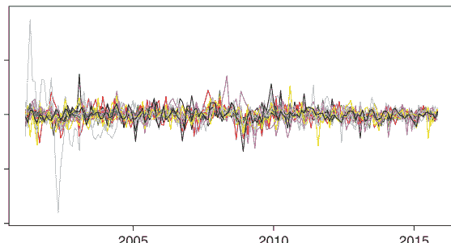

**图 1.16** 2000 年 1 月至 2015 年 10 月，30 个欧洲国家月度价格指数的一阶差分和季节差分序列的时间图。


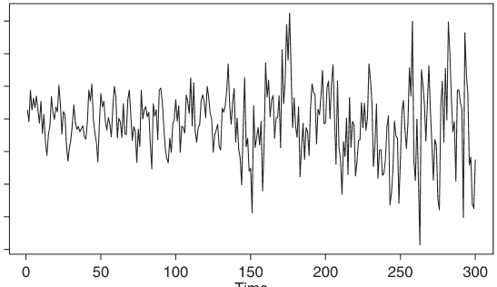

**图 1.17** 来自阶为 1 的时变参数自回归模型（公式 (1.20)）的 300 个实现的时序图，其中 $\phi(t/T) = 0.2 + 0.4(t/T) - 0.2(t/T)^2$ 且 $\sigma(t/T) = \exp(t/T)$。

主要关注协方差矩阵，而非滞后协方差矩阵，后者在时间序列分析中很重要。因此，PCA 的特征值和特征向量的极限性质对于时间序列数据有所不同。参见 Zhang 和 Tong (2020) 的最近论文以及第 1.6 节中的一些讨论。另外，我们在第 6 章介绍了一种更通用的程序，称为时间序列数据的动态主成分分析（DPCA），它考虑了向量时间序列的滞后依赖性。

引入 PCA 有两种主要方式。第一种方式是方差分解，第二种是最优重构或插值。我们从总体水平上独立数据的方差分解入手。设 $\boldsymbol{z} = (z_1, ..., z_k)'$ 为一个 $k$ 维随机向量，均值为零，协方差矩阵 $\mathbf{\Gamma}(0)$ 为正定。$\boldsymbol{z}$ 的第一个总体主成分（PC）是一个线性组合 $y_1 = \boldsymbol{c}'_1 \boldsymbol{z}$，满足 $\boldsymbol{c}'_1 \boldsymbol{c}_1 = 1$，使得 $\text{Var}(y_1)$ 在所有由单位长度向量构成的 $\boldsymbol{z}$ 的可能线性组合中达到最大。$\boldsymbol{z}$ 的第二个 PC 定义为 $\boldsymbol{z}$ 的一个线性组合，设 $y_2 = \boldsymbol{c}'_2 \boldsymbol{z}$，满足 (i) $\boldsymbol{c}'_2 \boldsymbol{c}_2 = 1$ 和 (ii) $\boldsymbol{c}'_2 \boldsymbol{c}_1 = 0$，使得 $\text{Var}(y_2)$ 在所有由单位长度向量构成的 $\boldsymbol{z}$ 的线性组合中具有最大方差，且第二个 PC 与第一个 PC 不相关。一般而言，$\boldsymbol{z}$ 的第 $i$ 个 PC 是 $\boldsymbol{z}$ 的一个非零线性组合，设 $y_i = \boldsymbol{c}'_i \boldsymbol{z}$，使用一个单位长度向量，该向量在所有 $\boldsymbol{z}$ 的线性组合中具有最大方差，并且与所有先前的 PC 不相关，即 $\boldsymbol{c}_i$ 满足 (iii) $\boldsymbol{c}'_i \boldsymbol{c}_i = 1$ 和 (iv) 对于 $j = i - 1, ..., 1$，有 $\boldsymbol{c}'_i \boldsymbol{c}_j = 0$。单位长度归一化 $\boldsymbol{c}'_i \boldsymbol{c}_i = 1$ 是控制缩放效应所必需的；否则最大值将没有意义。

利用附录中给出的正定矩阵性质，协方差矩阵 $\mathbf{\Gamma}(0)$ 为正定的平稳过程 $\boldsymbol{z}_t$ 的 PCA 可通过 $\mathbf{\Gamma}(0)$ 的谱分解获得。具体而言，设 $(\lambda_i, \boldsymbol{e}_i)$ 为 $\mathbf{\Gamma}(0)$ 的第 $i$ 个特征值-特征向量对，其中特征值满足 $\lambda_1 \ge \lambda_2 \ge \cdots \ge \lambda_k$。$\mathbf{\Gamma}(0)$ 的谱分解为

```
$\mathbf{\Gamma}(0) = \lambda_1 \boldsymbol{e}_1 \boldsymbol{e}'_1 + \cdots + \lambda_k \boldsymbol{e}_k \boldsymbol{e}'_k.$
```

那么，第 $i$ 个 PCA 为 $y_{it} = \boldsymbol{e}'_i \boldsymbol{z}_t$。从定义可知，$\text{Var}(y_{it}) = \text{Var}(\boldsymbol{e}'_i \boldsymbol{z}_t) = \boldsymbol{e}'_i \Gamma(0) \boldsymbol{e}_i = \lambda_i \boldsymbol{e}'_i \boldsymbol{e}_i = \lambda_i$。由于 $\text{tr}[\Gamma(0)] = \sum_{i=1}^k \sigma_{ii} = \sum_{i=1}^k \lambda_i$，$\boldsymbol{z}$ 的第 $i$ 个 PC 解释的变异比例为 $\lambda_i / (\sum_{j=1}^k \lambda_j)$。类似地，前 $m$ 个 PC 解释的 $\boldsymbol{z}_t$ 的变异比例为 $(\sum_{i=1}^m \lambda_i) / (\sum_{j=1}^k \lambda_j)$。如果能找到一个较小的 $m$，使得前 $m$ 个 PC 解释了 $\boldsymbol{z}$ 中较大比例的变异，那么可以将分析重点放在前 $m$ 个 PC 上。

假设现在，我们不是拥有独立变量，而是拥有一个平稳向量时间序列 $\boldsymbol{z}_t$ 的随机实现 $\{\boldsymbol{z}_1, \dots, \boldsymbol{z}_T\}$。为简化起见，我们假设该过程已进行均值调整，即 $\sum_{t=1}^T \boldsymbol{z}_t / T = \boldsymbol{0}$。定义 $T \times k$ 矩阵 $\boldsymbol{Z} = [\boldsymbol{z}_{(1)}, \dots, \boldsymbol{z}_{(k)}]$，其中 $\boldsymbol{z}_{(j)} = (z_{j1}, \dots, z_{jT})'$ 是第 $j$ 个分量 $z_{jt}$ 的观测值向量。那么，$\boldsymbol{z}_t$ 的协方差矩阵由样本协方差矩阵 $\widehat{\Gamma}(0) = \boldsymbol{Z}' \boldsymbol{Z} / T$ 估计，该矩阵的特征值-特征向量对 $(\lambda_i, \boldsymbol{c}_i)$ 可用于构建 PC。第一个 PC 由 $\boldsymbol{y}_1 = \boldsymbol{Z} \boldsymbol{c}_1$ 给出，其中

$$\frac{1}{T} \boldsymbol{Z}' \boldsymbol{Z} \boldsymbol{c}_1 = \lambda_1 \boldsymbol{c}_1, \quad \boldsymbol{c}'_1 \boldsymbol{c}_1 = 1.$$

对上述方程左侧乘以 $\boldsymbol{Z}$，得

$$\frac{1}{T} \boldsymbol{Z} \boldsymbol{Z}' \boldsymbol{y}_1 = \lambda_1 \boldsymbol{y}_1. \tag{1.21}$$

因此，$\boldsymbol{z}_t$ 的第一个 PC $\boldsymbol{y}_1$ 与矩阵 $\boldsymbol{Z} \boldsymbol{Z}'$ 最大特征值对应的特征向量成正比。其他 PC 可以通过类似方式获得。

引入 PCA 的另一种方法是基于数据的最优重构或插值。为简化起见，我们与之前一样考虑均值调整的平稳时间序列数据的样本版本，即 $\{\boldsymbol{z}_1, \dots, \boldsymbol{z}_T\}$。我们想要得到一个新的时间序列 $f_{1t}$，定义为 $\boldsymbol{z}_t$ 的一个线性组合，以最小化观测数据重构中的误差。更正式地说，令 $f_{1t} = \boldsymbol{z}'_t \boldsymbol{\beta}_1$ 和 $\boldsymbol{f}_1 = \boldsymbol{Z} \boldsymbol{\beta}_1$，其中 $\boldsymbol{\beta}_1 = (\beta_{11}, \dots, \beta_{k1})'$ 且 $\boldsymbol{f}_1 = (f_{11}, \dots, f_{1T})'$。系数 $\beta_{i1}$ 通过最小化目标函数获得

$$L(\boldsymbol{\beta}_1, \boldsymbol{f}_1) = \sum_{t=1}^T \sum_{i=1}^k (z_{it} - \beta_{i1} f_{1t})^2. \tag{1.22}$$

由于 $f_{1t}$ 和 $\boldsymbol{\beta}_1$ 都是未知的，公式 (1.22) 的解没有明确定义，因为 $\beta_{i1} f_{1t} = (\beta_{i1} / h) (h f_{1t}) = \beta^*_{i1} f^*_{1t}$，其中 $h$ 是任意非零实数。为克服非唯一性的难题，我们假设 $f_{1t}$ 满足 $\sum_{t=1}^T f_{1t}^2 = 1$。这样 $f_{1t}$ 的尺度即可确定，我们可以对 $\beta_{i1}$ 求 $L$ 的偏导数。将偏导数设为零，我们得到

$$\hat{\beta}_{i1} = \frac{\sum_{t=1}^T z_{it} f_{1t}}{\sum_{t=1}^T f_{1t}^2} = \sum_{t=1}^T z_{it} f_{1t}, \quad i=1, \dots, k, \tag{1.23}$$

或者，以向量形式，$\widehat{\boldsymbol{\beta}}_1 = \boldsymbol{Z}' \boldsymbol{f}_1$。使用 $\boldsymbol{f}_1 = \boldsymbol{Z} \boldsymbol{\beta}_1$，我们得到

$$\widehat{\boldsymbol{\beta}}_1 = \boldsymbol{Z}' \boldsymbol{Z} \widehat{\boldsymbol{\beta}}_1,$$
因此，\(\hat{\beta}_1\) 是矩阵 \(\mathbf{Z}'\mathbf{Z}\) 的一个未归一化特征向量。
类似地，我们可以对 \(f_{1t}\) 求 \(L\) 的偏导数并得到

\(f_{1t} = \frac{\sum_{i=1}^k z_{it} \beta_{1i}}{\sum_{i=1}^k \beta_{1i}^2}, \quad t = 1, \dots, T.\)

公式 (1.24) 的分子可以写为 \(\mathbf{z}'_t(\mathbf{Z}'\mathbf{f}_1)\)。令 \(c = \sum_{i=1}^k \beta_{1i}^2$，将公式 (1.23) 代入公式 (1.24)，并使用矩阵表示法，我们得到

\(\mathbf{ZZ}'\mathbf{f}_1 = c\mathbf{f}_1.\)

这意味着 \(\mathbf{f}_1\) 是与特征值 \(c\) 相关的矩阵 \(\mathbf{ZZ}'\) 的一个特征向量。
公式 (1.22) 中的函数是最小二乘估计的目标函数，拟合值由 \(\mathbf{ZZ}'\mathbf{f}_1\) 给出。因此，在估计值处计算的目标函数值为

\(\begin{aligned} \widehat{L} &= \sum_{t=1}^T \sum_{i=1}^k z_{it}^2 - [\mathbf{ZZ}'\mathbf{f}_1]'(\mathbf{ZZ}'\mathbf{f}_1) \\ &= \sum_{t=1}^T \sum_{i=1}^k z_{it}^2 - \mathbf{f}_1'\mathbf{ZZ}'(c\mathbf{f}_1) \\ &= \sum_{t=1}^T \sum_{i=1}^k z_{it}^2 - c^2, \end{aligned}\)

其中我们使用了 \(\mathbf{f}'_1\mathbf{f}_1 = \sum_{t=1}^T f_{1t}^2 = 1\)。因此，为使目标函数 \(\widehat{L}\) 达到最小值，我们选择 \(c\) 为矩阵 \(\mathbf{ZZ}'\) 的最大特征值。向量 \(\mathbf{f}_1\) 不等于第一个 PC \(\mathbf{y}_1\)，因为它的方差为 1，而 PC 的方差为 \(\lambda_1\)，但除此之外的缩放效应，它们是相同的，因为两者都与矩阵 \(\mathbf{ZZ}'\) 的特征向量成正比，如 (1.21) 和 (1.25) 所示。

对于第二个样本 PC，我们可以通过将观测数据 \(\mathbf{z}_t\) 替换为残差 \(\boldsymbol{\epsilon}_t = \mathbf{z}_t - \hat{\beta}_1 f_{1t}\) 来遵循类似程序。此过程可以重复，直到引入所有样本 PC。

总之，两种方法得到了相同的结果，只是尺度不同。在第一种方法中，最大方差的线性组合由协方差矩阵的特征向量的单位范数向量定义，PC 具有不同的方差。在第二种方法中，最优插值由与协方差矩阵特征值成正比的向量定义，线性组合被标准化为具有单位方差。

### 1.5.1 讨论

我们使用方差分解和重构方法都介绍了 PCA。然而，两个版本之间存在微妙差异。在第一种情况下，我们假设平稳性。另一方面，对于给定的数据集，重构方法可以应用于任何时间系列。


### 1.5.2 主成分的性质

从介绍可知，平稳向量过程 \(\mathbf{z}_t\) 的主成分 \(\mathbf{y}_t = (y_{1t}, \dots, y_{kt})'\) 是观测数据的线性变换，并按其变异性排序，使得 \(y_{1t}\) 具有最大方差。特别是，\(\text{Var}(y_{it}) = \lambda_i\)，这是 \(\mathbf{z}_t\) 协方差矩阵的第 \(i\) 大特征值。由于 \(\sum_{i=1}^k \text{Var}(z_{it}) = \sum_{i=1}^k y_{it}(0) = \text{tr}[\Gamma(0)]\)，其中 \(\text{tr}[\Gamma(0)]\) 表示矩阵 \(\Gamma(0)\) 的迹，且 \(\text{tr}[\Gamma(0)] = \sum_{i=1}^k \lambda_i\)，我们可以看出主成分保留了向量过程 \(\mathbf{z}_t\) 的总变异性。

接下来，令 \(\mathbf{e}_i\) 为 \(\Gamma(0)\) 与特征值 \(\lambda_i\) 相关联的特征向量，满足 \(\mathbf{e}'_i \mathbf{e}_i = 1\)。我们有 \(\mathbf{y}_t = \mathbf{P}' \mathbf{z}_t\)，其中 \(\mathbf{P} = [\mathbf{e}_1, \dots, \mathbf{e}_k]\) 是特征向量矩阵。该变换矩阵是正交矩阵，因此 \(\mathbf{P}\mathbf{P}' = \mathbf{P}'\mathbf{P} = \mathbf{I}\)。因而，\(1 = |\mathbf{P}\mathbf{P}'| = |\mathbf{P}||\mathbf{P}'|\)。由变换得，\(\text{Cov}(\mathbf{y}_t) = \mathbf{P}'\text{Cov}(\mathbf{z}_t)\mathbf{P}\)。利用 \(|\mathbf{P}||\mathbf{P}'| = 1\)，可得 \(|\text{Cov}(\mathbf{y}_t)| = |\text{Cov}(\mathbf{z}_t)|\)，这意味着 \(\mathbf{y}_t\) 的广义方差与 \(\mathbf{z}_t\) 相同。

PCA 的一项重要应用是降低向量过程的维度。若一标量随机过程的方差接近零，则其接近常数序列。因此，与特征值 \(\lambda_i \approx 0\) 相关联的主成分对底层过程 \(\mathbf{z}_t\) 所包含的信息很少。如前所述，前 \(m\) 个主成分对 \(\mathbf{z}_t\) 中变异性的解释比例为 \((\sum_{i=1}^m \lambda_i)/(\sum_{k=1}^k \lambda_k)\)。在实践中，可以选择一个 \(m\)，使得前 \(m\) 个主成分 \(\{y_{it} | i = 1, \dots, m\}\) 解释 \(\mathbf{z}_t\) 相当一部分的变异性。文献中已提出一些方法以辅助选择 \(m\)。一种常用但非正式的方法是 *碎石图（scree plot）*，即 \(\lambda_i\) 关于 \(i\) 的散点图。为选择 \(m\)，需在碎石图中寻找拐点（转折点）。

## 示例 1.3

为演示 PCA，我们再次考虑图 1.7 中所示的 33 个月度价格指数。在本示例中，我们采用价格指数的对数。令 \(\mathbf{z}_t\) 为 2000 年 1 月至 2015 年 10 月间 33 个月度价格指数的对数序列，共 190 个观测值。图 1.7 中所示价格序列的一个关键特征是上升趋势。这些趋势并非同步变化，因为不同的价格序列可能以不同速度上升。我们对 \(\mathbf{z}_t\) 应用 PCA 并得到表 1.1 中的结果。

由表 1.1 可见，（a）特征值 \(\lambda_i\) 随 \(i\) 增加而快速衰减，（b）第一个主成分单独即解释了数据中约 95.8% 的变异性，（c）第二个主成分解释了总变异性约 3.3%。事实上，前

### 表 1.1 对 33 个欧洲国家月度价格指数对数序列应用 PCA 的结果。仅显示前六个主成分的结果，其中 \(\lambda_i\) 为第 \(i\) 大特征值

| 成分 | 1 | 2 | 3 | 4 | 5 | 6 |
| :--- | :--- | :--- | :--- | :--- | :--- | :--- |
| \(\sqrt{\lambda_i}\) | 0.968 | 0.176 | 0.075 | 0.042 | 0.031 | 0.020 |
| 比例 | 0.958 | 0.033 | 0.006 | 0.002 | 0.001 | 0.001 |
| 累计 | 0.958 | 0.990 | 0.996 | 0.997 | 0.998 | 0.999 |

六个主成分解释了 \(z_t\) 中超过 99.9% 的样本变异性。图 1.18 显示了 \(z_t\) PCA 的碎石图，它证实了首个主成分是主导因素，且前几个主成分捕捉了对数价格指数中大部分的变异性。图 1.19 显示了前六个主成分的时间图。从图中可以看出，第一个主成分捕捉了对数价格指数的整体上升趋势。第二和第三个主成分也表现出某些趋势行为，但它们表明趋势不一定以单调方式变化。第四和第六个主成分显示价格指数的某些周期性模式，表明价格指数具有季节性行为。图 1.20 显示了第 7 至第 12 个主成分的时间图。尽管这些图显示某些变异性，但其规模小于图 1.19 中的图。

为证明 PCA 仅用于方差分解，我们还考虑一阶差分序列 \(x_t = (1 - B)z_t\)。序列 \(x_t\) 的分量 \(x_{it}\) 表示第 \(i\) 个价格指数的通胀率（相对于上月）。表 1.2 给出了对 \(x_t\) 应用 PCA 的结果。与表 1.1 相比，特征值小得多。这是可以理解的，因为趋势是月度价格指数的主导因素。另一方面，通胀率处于更小的规模。对于通胀率，前六个主成分解释

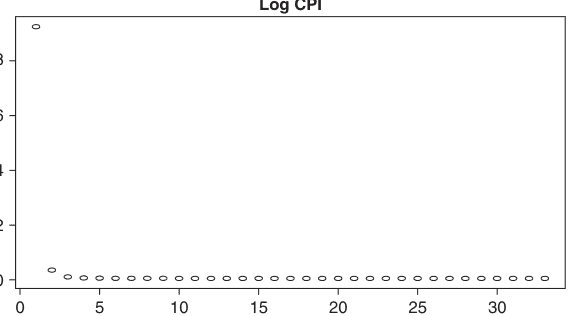

### 图 1.18 2000 年 1 月至 2015 年 10 月间 33 个欧洲国家月度价格指数对数序列的碎石图

### 表 1.2 对月度价格指数对数序列一阶差分应用 PCA 的结果。仅显示前六个主成分的结果，其中 \(\lambda_i\) 为第 \(i\) 大特征值

| 成分 | 1 | 2 | 3 | 4 | 5 | 6 |
|---|---|---|---|---|---|---|
| \(\sqrt{\lambda_i}\) | 0.0217 | 0.0165 | 0.0124 | 0.0120 | 0.0108 | 0.0075 |
| 比例 | 0.3011 | 0.1725 | 0.0975 | 0.0909 | 0.0736 | 0.0360 |
| 累计 | 0.3011 | 0.4736 | 0.5711 | 0.6620 | 0.7356 | 0.7716 |

大约 77.16% 的数据变异性。图 1.21 显示了相应的碎石图。从图中可以看出，前五个主成分似乎与其他主成分拉开距离，且对于 \(i \ge 6\)，特征值 \(\lambda_i\) 的衰减似乎较慢。最后，图 1.22 显示了 \(\mathbf{x}_t\) 前六个主成分的时间图。有趣的是，月度价格指数的季节性模式现在被第一个主成分清晰地捕捉到了。此外，正如预期，主成分中没有上升趋势。

这个简单的例子表明 PCA 可以应用于单位根非平稳时间序列。它也表明，作为方差分解的工具，PCA 的结果取决于规模。该方法对于捕捉给定数据集中变异性的主导因素很有用，但在解释 PCA 结果时必须谨慎。如果有人认为对数价格指数的前两个主成分（解释了约 99.0% 的变异性）对数据来说已经足够，那么她就会错过季节性的重要特征。

## 示例 1.3 中使用的主要 R 命令

```
da <- read.csv2("CPIEurope2000-15.csv",header=TRUE)
x <- log(as.matrix(da))
m1 <- princomp(x)
m1
names(m1)
#[1] "sdev" "loadings" "center" "scale" "n.obs" "scores" "call"
### sdev: the square-root of eigenvalues
### loadings: the eigenvectors
### scores: the principal components
plot(1:33,m1$sdev^2,xlab="component",ylab="variance", pch="o",
main="log CPI") # Figure 1.18.
```

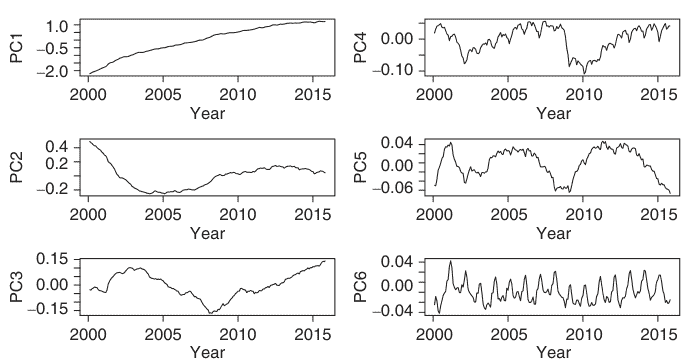

### 图 1.19 33 个欧洲国家月度价格指数对数序列前六个主成分的时间图

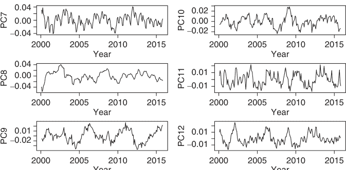

### 图 1.20 欧洲国家 33 个月度价格指数对数序列第 7 至第 12 个主成分的时间图

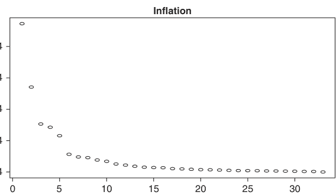

### 图 1.21 2000 年 1 月至 2015 年 10 月间 33 个欧洲国家月度价格指数一阶差分对数序列的碎石图


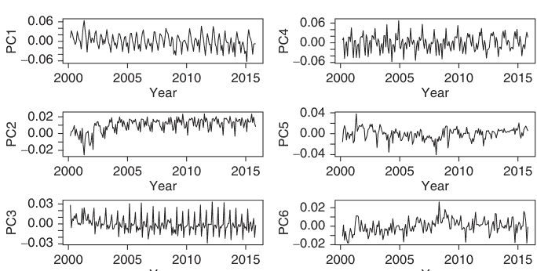

图 1.22 欧洲国家33个月度价格指数的一阶差分对数序列的前六个主成分的时间图。

## 1.6 序列依赖的影响

在前面的章节中，我们介绍了一些大型依赖数据的示例和随机过程的一些基本概念。在本节中，我们使用一些简单示例来说明，为独立数据分析开发的统计方法在应用于依赖数据时可能会遇到困难。

如前所述，PCA 最初是为独立数据提出的，PCA 的样本版本也适用于依赖数据。令 \( y_t = P'z_t \) 为向量过程 \( z_t \) 的主成分，其中 \( P \) 是由 \( z_t \) 的样本协方差矩阵的特征向量组成的正交正规变换矩阵。根据正交性，当 \( i \neq j \) 时，有 \( \text{Cov}(y_{it}, y_{jt}) = 0 \)。即，主成分在瞬时上不相关。对于独立数据，当 \( j \neq 0 \) 时，\( \text{Cov}(z_t, z_{t-j}) = 0 \)。因此，对于独立数据，主成分 \( y_t \) 在瞬时上和序列上都不相关。因此，在这种情况下，如果分析关注数据的前两个矩，我们可以分别分析每个分量 \( y_{it} \)。特别是，在高斯假设下，主成分是相互独立的。

转到依赖数据。诚然，主成分 \( y_t \) 在瞬时上不相关，但它们可能在动态上（或序列上）相关。为了演示，图 1.23 显示了图 1.7 中40个价格指数的增长率的 \( y_{2t} \) 和 \( y_{3t} \) 的自相关图和互相关图。这两个主成分在图 1.22 中所示。从相关图来看，\( y_{2t} \) 和 \( y_{3t} \) 在序列上相关，因此必须联合分析。因此，依赖数据的 PCA 与独立数据的 PCA 可能存在显著差异。事实上，Zhang 和 Tong (2020) 表明 (a) 静态且序列相关的向量时间序列的样本协方差矩阵的特征值是渐近相关的，(b) 这些特征值对所有特征向量渐近依赖。另一方面，对于独立数据，(a) 特征值和特征向量渐近独立，(b) 在某些条件下特征值渐近不相关。

转到为大型独立数据提出的统计方法。最常用的检验统计量之一是单样本 t 检验，用于检验标量随机变量的均值是否为零。对于观测数据集 \(\{z_1, \dots, z_T\}\)，计算检验统计量

```
\(t = \frac{\bar{z}}{\sqrt{s^2/T}},\) (1.26)
```

其中 \(\bar{z} = \sum_{t=1}^T z_t / T\) 是样本均值，\(s^2 = \sum_{t=1}^T (z_t - \bar{z})^2 / (T - 1)\) 是样本方差。对于 i.i.d. 样本，式 (1.26) 的 t 统计量渐近服从 \(N(0, 1)\) 分布，因此可以进行统计推断。另一方面，假设 \(z_t\) 服从 AR(1) 模型，即 \(z_t = \phi_0 + \phi_1 z_{t-1} + a_t\)，其中 \(\phi_0\) 为常数，\(\phi_1 \neq 0\)，\(\{a_t\}\) 为标量白噪声系列。那么，式 (1.26) 中的检验统计量不再渐近服从 \(N(0, 1)\) 分布，因为可以轻松验证 \(\text{Var}(\sqrt{T}\bar{z})\) 随 \(T \to \infty\) 收敛到 \(\text{Var}(z_t) \times \frac{1+\phi}{1-\phi}\)。因此，在这种情况下应使用的适当检验统计量是

```
\(t_{dep} = \frac{\bar{z}}{\sqrt{s^2(1+\phi)/[T(1-\phi)]}}.\) (1.27)
```

由式 (1.26) 和 (1.27) 得 \(t = t_{dep} \times \sqrt{(1+\phi)/(1-\phi)}\)，因此 t 和 t_dep 可能存在显著差异，表明忽略序列依赖可能导致单样本 t 检验的错误推断。例如，如果 \(\phi = 0.9\)，则 \(t = t_{dep} \times \sqrt{19}\)；若 \(\phi = -0.9\)，则 \(t = t_{dep} / \sqrt{19}\)。另一个例子是，近年来广泛用于分析大数据的统计方法是 Tibshirani (1996) 的 Lasso 回归。该方法强调稀疏性，即使在样本量小于变量数量时也适用。该方法及其扩展的详细内容将在第 7 章介绍。Lasso 最初是为独立数据开发的。这里我们使用一个简单的模拟示例来演示，当 Lasso 回归应用于序列依赖数据时可能会失效。

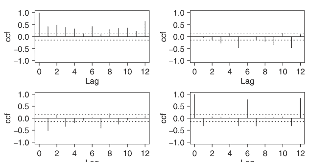

**图 1.23** 33个月度价格指数通胀率的第二和第三主成分的样本自相关和互相关。对角线图为样本自相关，非对角线图为样本互相关。

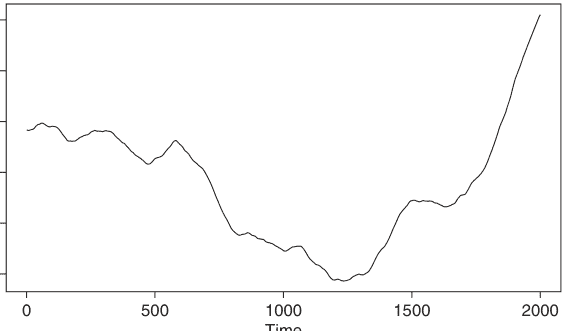

**图 1.24** 基于式 (1.28) 模型的含2000个观测值的模拟序列的时间图。

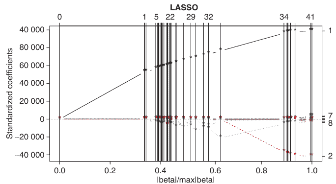

**图 1.25** 示例 1.4 数据的 Lasso 回归结果。该图由 R 的 `lars` 包生成。

## 示例 1.4

我们使用以下模型生成了2000个观测值

```
\(x_t = 1.9x_{t-1} - 0.8x_{t-2} - 0.1x_{t-3} + \epsilon_t, \quad t = 1, \dots, 2000, \quad (1.28)\)
```

其中 \(\epsilon_t\) 是来自标准正态分布的随机抽样，即 \(\epsilon_t \sim_{iid} N(0,1)\)。式 (1.28) 的模型是高斯 ARIMA(1,2,0) 模型。该序列如图 1.24 所示。然后我们考虑一个线性回归

```
\(y_t = \boldsymbol{x}'_t \boldsymbol{\beta} + e_t, \quad t = 11, \dots, 2000,\)
```

其中设计向量由

```
$x_t = (x_{t-1}, x_{t-2}, ..., x_{t-10}, z_{1t}, ..., z_{10t})'$,
```

给出，对所有 \(i\) 和 \(t\)，\(z_{it} \sim^{iid} N(0, 1)\)。因此，我们有一个具有 \(p = 20\) 和 \(T = 1990\) 的线性回归模型。数据生成模型是稀疏的，包含三个非零系数。我们的目标是估计回归模型并识别非零系数。在这种情况下，适当的统计方法应将 \(x_{t-1}\)、\(x_{t-2}\) 和 \(x_{t-3}\) 识别为唯一具有非零系数的预测变量。图 1.25 显示了 Lasso 估计的结果。该图称为系数剖面图，即标准化系数估计与系数估计适当缩放的范数的散点图。图上方的数字表示非零系数的数量。图右侧的数字标识关键预测变量。系数剖面图的详细信息和用法将在第 7 章介绍。目前只需注意，图中显示了较大的非零系数估计。从图中可以清楚地看出，Lasso 可以轻松识别 \(x_{t-1}\) 和 \(x_{t-2}\) 作为重要的解释变量，但无法确定 \(x_{t-3}\)。这并不奇怪，因为式 (1.28) 中的 AR(3) 模型是一个具有强序列依赖的 \(I(2)\) 过程，导致线性回归分析中多重共线性的问题。在这种情况下，解释变量 \(x_{t-1}\) 到 \(x_{t-10}\) 强烈相关，样本相关系数接近 1。此外，Lasso 回归估计通常需要对设计矩阵的每一列进行归一化。对于 \(I(2)\) 序列，样本标准差的增长阶数高于样本量。归一化可能导致只关注单位根依赖。反过来，这可能会忽略过程平稳部分的序列依赖。可以使用单位根过程理论来证明这一点。例如，参见 Tsay (2014) 及其参考文献。这里只需说明，当序列依赖很强时，Lasso 回归可能对依赖数据失效。我们将在第 7 章讨论克服此类困难的方法。因此，有必要开发用于分析大型依赖数据的统计方法。

## 附录 1.A：一些矩阵理论

在本附录中，我们介绍多元统计分析中有用的一些矩阵性质。设 \(A\) 为一个 \(k \times k\) 实值矩阵。行列式方程 \(|A - \lambda I| = 0\) 的解为 \(A\) 的特征值。若 \(k\) 维向量 \(x = (x_1, ..., x_k)'\) 满足 \(Ax = \lambda x\)，则称 \(x\) 为 \(A\) 与特征值 \(\lambda\) 关联的特征向量。通常，\(A\) 的特征值和特征向量可能取复数值。

矩阵 \(A\) 是正定的，如果 (a) \(A = A'\)，即 \(A\) 是对称的，且 (b) 对于任何非零 \(k\) 维向量 \(x = (x_1, ..., x_k)'\)，\(x'Ax > 0\)。正定矩阵在许多统计应用中起着重要作用，研究其性质很有价值。可以轻松看出，正定矩阵 \(A\) 的所有特征值都是正数。

**谱分解：** 假设 \(A\) 为一个 \(k \times k\) 实值正定矩阵。设 \(\lambda_1 \ge \lambda_2 \ge \cdots \ge \lambda_k\) 为 \(A\) 的特征值。设 \(e_i\) 为与特征值 \(\lambda_i\) 关联的 \(A\) 的特征向量，满足 \(e_i'e_1 = 1\)。即 \(e_i\) 的欧几里得范数为 1。设 \(P = [e_1, ..., e_k]\) 为由特征向量组成的 \(k \times k\) 矩阵。那么，有 (1)


$AP = P\Lambda$，其中 $\Lambda = \text{diag}\{\lambda_1, \dots, \lambda_k\}$; (2) $P'P = PP' = I$，即 \(k\) 维单位矩阵; (3)

$$A = P\Lambda P' = \sum_{i=1}^k \lambda_i e_i e_i'.$'

性质 (3) 被称为正定矩阵 \(\boldsymbol{A}\) 的谱分解。利用谱分解以及 \(\boldsymbol{A}\) 的特征值和特征向量的性质，我们有以下性质。

### 性质 I

假设 \(\boldsymbol{A}\) 是一个正定的 \(k \times k\) 实值矩阵，其谱分解由特征值-特征向量对 \((\lambda_i, \boldsymbol{e}_i)$ 给出。则：

$$\max_{\boldsymbol{x} \neq \boldsymbol{0}} \frac{\boldsymbol{x}' \boldsymbol{A} \boldsymbol{x}}{\boldsymbol{x}' \boldsymbol{x}} = \lambda_1$$

$$\min_{\boldsymbol{x} \neq \boldsymbol{0}} \frac{\boldsymbol{x}' \boldsymbol{A} \boldsymbol{x}}{\boldsymbol{x}' \boldsymbol{x}} = \lambda_k,$$

其中最大值和最小值分别在 \(\boldsymbol{x} = \boldsymbol{e}_1$ 和 \(\boldsymbol{x} = \boldsymbol{e}_k$ 时取得。此外，

$$\max_{\boldsymbol{x} \neq \boldsymbol{0}, \boldsymbol{x}' \boldsymbol{e}_j = 0, j=1, \dots, i} \frac{\boldsymbol{x}' \boldsymbol{A} \boldsymbol{x}}{\boldsymbol{x}' \boldsymbol{x}} = \lambda_{i+1}$$

其中最大值在 \(\boldsymbol{x} = \boldsymbol{e}_{i+1}$ 时取得，这里 \(i = 2, \dots, k$.

## 练习

- 1. 考虑 99 个世界金融市场指数。计算这些指数的对数收益率。绘制所有序列的时间图，并对对数收益率进行主成分分析（PCA）。总结 PCA 结果，包括碎石图和前六个主成分（PCs）的 PCA 图。[PCA 的 R 命令为 `princomp`]。

- 2. 考虑图 1.8 中的服装数据集。对销售数据进行 PCA 并总结结果。获取前 12 个主成分的时间图，每页 6 个序列。

- 3. 再次考虑服装数据集。获取滞后 1 到 21 的样本互相关性的三个汇总图。

- 4. 考虑图 1.1 中的温度数据。(a) 获取数据的样本均值和样本协方差矩阵。(b) 获取数据的滞后 1 到滞后 10 的样本互相关矩阵（CCM）。

- 5. 考虑台湾南部 15 个监测站的每小时 PM\(_{2.5}\) 测量值；文件 `TaiwanPM25.csv` 中的第 4 列到第 18 列。(a) 计算 15 个时间序列的样本均值和样本协方差矩阵。(b) 获取 15 个时间序列的时间图。

- 6. 证明公式 (1.16)，并讨论当序列具有非零的一阶自相关系数且所有高阶滞后的自相关为零时，样本均值方差相对于独立情况的增加量。即，该序列遵循 MA(1) 模型。

## 参考文献

Bühlmann, P. 和 van de Geer, S. (2011). 高维数据统计. Springer, 纽约, NY.

Chang, J., Guo, B., 和 Yao, Q. (2014). 基于同时线性变换的多元时间序列分割：时间序列的 PCA. 工作论文, 伦敦政治经济学院.

Dahlhaus, R. (2012). 局部平稳过程. 载于《统计手册》, 30: 351–413.

Peña, D. 和 Box, G. (1987). 时间序列中简化结构的识别. 美国统计学会杂志, 82: 836–843.

Peña, D. 和 Rodriguez, J. (2003). 多元离散和线性依赖的描述性度量. 多元分析杂志, 85: 361–374.

Reinsel, G. (1993). 多元时间序列分析基础. Springer-Verlag, 纽约, NY.

Taniguchi, M. 和 Krishnaiah, P. (1987). 多元时间序列中样本协方差矩阵和典型相关矩阵特征值函数的渐近分布. 多元分析杂志, 22: 156–176.

Tiao, G. C. 和 Box, G. E. P. (1981). 多元时间序列建模及其应用. 美国统计学会杂志, 72: 802–816.

Tibshirani, R. (1996). 基于 Lasso 的回归收缩与变量选择. 皇家统计学会杂志, B 系列, 58: 267–288.

Tsay, R. S. (2014). 多元时间序列分析：利用 R 及金融应用. John Wiley & Sons, 霍博肯, NJ.

Zhang, X. 和 Tong, H. (2020). 关于时间序列数据 PCA 的一些谨慎评论. 工作论文, 伦敦政治经济学院, 英国.
