# 2 线性单变量时间序列

本章研究单变量时间序列建模与预测的方法。我们的研究简要且侧重于大量时间序列的自动分析。有兴趣的读者可参考任一大量时间序列教科书以获取更多细节。例如，可参见 Peña et al. (2001)、Box et al. (2015)、Brockwell and Davis (2013)、Cryer and Chan (2008)、Shumway and Stoffer (2017) 以及 Tsay (2010, 2014) 等。

给定一组时间序列，分析的第一步是通过绘制序列图来可视化数据，以了解其基本特性。人们还会尝试检测粗大的测量误差，这类误差在自动记录的数据中非常普遍。这些误差可能发生在许多序列的某些特定时间点，也可能集中在少数几个序列中，使它们与其他序列不同。我们提出的图形表示旨在识别这两种测量误差情况。一旦时间序列集经过某些清洗，我们就介绍用于建模和预测序列的统计方法。最常用于平稳时间序列的模型是自回归移动平均（ARMA）模型，这些模型已被证明在许多科学领域非常有用。该家族的特殊成员是自回归（AR）模型，其中序列仅依赖于其前 p 个滞后值（p 为正整数）。AR 模型的特点是具有无限多个非零自相关系数，这些系数随滞后增加而指数衰减至零。因此，AR 过程具有相对较长的记忆，因为序列的当前值与许多先前值相关，尽管系数会衰减。具有有限记忆特性的标量过程是移动平均（MA）模型，它由有限数个过去创新项（或噪声）的加权平均值构成。将 AR 和 MA 结构结合起来，我们得到 ARMA 模型，它们提供了一个广泛且灵活的平稳随机过程家族，适用于表示许多经验时间序列。

某些平稳时间序列可被视为多个周期过程的混合。这是谱分析的动机，其中序列的变异性由具有不同频率和变异性的谐波过程来解释。平稳时间序列的谱是其所有滞后自协方差的线性组合，每个 ARMA 过程都隐含一个给定的谱，反之亦然。这种方法，即频域分析，为使用 ARMA 模型的时域分析提供了互补信息。

时间序列可能在均值、方差、自相关或其分布的其他特征方面是非平稳的。如第 1 章所述，最重要的非平稳过程是整合过程，尤其是 I(1) 过程。I(1) 过程的基本特征是其均值随时间变化，但其增量构成一个平稳过程。因此，通过差分，该序列可以变成平稳序列。自回归积分移动平均（ARIMA）模型家族适用于通过差分变成平稳 ARMA 过程的时间序列。区分整合过程和平稳过程的一个重要属性是序列依赖的行为方式。对于平稳过程，自相关系数随滞后增加而指数衰减至零，而整合时间序列的自相关系数则随滞后增加而不趋于零。

另一类重要的非平稳过程是季节过程，其中序列的均值不是常数，而是呈现周期性模式。例如，某地理位置的月度气温序列通常表现出强烈的季节性，夏季的均值较高。如果这种季节性模式是持久的，则需要季节性差分来将序列转换为平稳性。带有季节性差分的 ARIMA 模型称为季节性 ARIMA（SARIMA）模型。

建模非平稳时间序列的另一种方法是将其视为趋势、季节性和不规则分量的加法模型。这种方法称为结构时间序列建模。它是描述动态系统演化的一般程序（称为状态空间表示）的特例。状态空间模型（SSM）的一个优点是，它提供了一种有效的递归方法来估计模型参数并生成预测。此外，该模型可以简单地推广到多元时间序列，我们将在第 3 章中讨论。

本章的第二部分研究如何为大量时间序列构建 ARIMA 模型，重点在于自动程序。对每个时间序列拟合模型分三步进行。第一步，我们检查序列是否需要变换（幂家族），然后将得到的序列分类为以下类别之一：平稳、单位根非平稳或季节性序列。这一步可以视为分类步骤。第二步是模型选择，即估计多个模型并使用信息准则从候选模型中选择最佳模型。第三步进行诊断检查，并根据需要优化拟合模型。然后，每个序列选定的模型可用于预测。请记住，在某些应用中，多个模型可能对给定时间序列都拟合良好，此时可以使用模型平均值来生成组合预测。


## 2.1 可视化大量时间序列

对大量时间序列进行可视化对于检测粗大测量误差、识别与其他序列不同的序列、展示可能分组的存在以及理解所研究序列的整体结构至关重要。将 \( k \) 个含 \( T \) 个观测值的时间序列放入一个双向表中，每列包含一个单独的时间序列，每行包含某一时间点的所有序列，我们关注两类分别展示行和列属性的图表。具体来说，它们展示了：(1) 所有序列随时间共同演变的属性，即绘制每行随时间变化的某些属性；(2) 完整周期内每个序列的属性，即绘制每个序列（列）边缘分布的某些属性。

第一类图表称为动态图，因为它们展示了所有系列所选摘要随时间演变的情况。第二类图表称为静态图，因为它们展示了每个系列（列）在整个观测期内的行为摘要。当列（系列）的顺序没有信息量（这通常是情况）时，我们可以绘制系列所选摘要的散点图或列（系列）分布所选分位数的箱线图。如果能找到列的有意义顺序，例如第9章讨论的空间数据，那么我们也可以根据此顺序绘制行的一些所选摘要。接下来，我们将简要解释和演示这两类图表。

### 2.1.1 动态图

总结一组数据分布的有用方法是使用分位数。给定标量随机变量 \( X \) 的随机样本 \( \{x_i\}_{i=1}^k \) 及其实证累积分布函数（CDF）\( \widehat{F}_k(x) \)，实证 \( p \) 分位数 \( q^{*(p)} \) 定义为

```
q^{*(p)} = \inf_{x \in R} \{x | \widehat{F}_k(x) \ge p\}, \quad (2.1)
```

并且众所周知（参见 Ferguson (1967) 等），该分位数可以通过以下方式计算：

```
q^{*(p)} = \arg \min_{y \in R} \left[ p \sum_{x_i \ge y} |x_i - y| + (1-p) \sum_{x_i < y} |x_i - y| \right] . \quad (2.2)
```

考虑一个 \( k \) 维时间序列的大型数据集 \( \{z_t | t = 1, ..., T\} \)。如果 \( z_t \) 是严格平稳的，那么 \( z_t \) 的分布是时不变的。我们可以在每个时刻 \( t \) 计算该点观测值的一些选定实证分位数，并用这些值构建时间序列分位数（TWQ）时间序列。每个点 \( t = v \) 的分位数由 (2.2) 计算，其中 \( x_i \) 的值现在为 \( z_{i,v} \)。当系列平稳时，这些分位数随时间应当相似。

因此，通过绘制由选定时间序列分位数形成的时间序列，可以检验底层时间序列的平稳性。

为演示，请考虑第1章中使用的世界金融市场指数的每日对数价格。图 2.1 分别展示了概率为 0.025、0.5 和 0.975 的时间序列分位数的时间图。也就是说，该图显示了双向数据表每行的 2.5% 分位数、中位数和 97.5% 分位数系列。

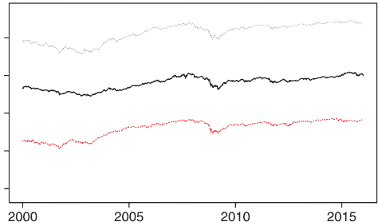

图 2.1 2000年1月4日至2015年12月16日期间，99个世界金融市场指数每日对数价格的时间序列分位数。分位数为每个交易日收益率的2.5、50和97.5%分位数。

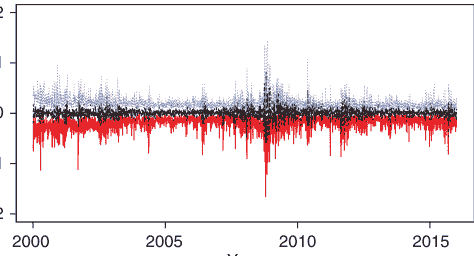

图 2.2 2000年1月4日至2015年12月16日期间，99个世界金融市场指数每日对数收益率的时间序列分位数。分位数为每个交易日收益率的2.5、50和97.5%分位数。

在图中，黑色（实线）为每日中位数对数收益率的时间序列图，红色（虚线）为2.5%分位数的时间图，蓝色（点线）为97.5%分位数的时间图。这些分位数表明，如预期，这些系列是非平稳的，因为三个分位数均呈上升趋势。图 2.2 显示了收益率系列对应分位数的时间图，即WSI系列的第一阶对数差分。从图中容易看出：(a) 2008年金融危机时期是世界金融市场波动性（volatility）最高的时期；(b) 世界金融市场的四分位距[97.5–2.5%]在2000年代初似乎大于近期，表明世界各国金融市场比以往任何时候都更加一体化。所有这些变化表明，收益率系列在所考虑的整个期间也是非平稳的，尽管在某些子期间它们似乎是平稳的。

这些时间序列分位数图表传达了关于数据平稳性的直观印象。然而，它们不能很好地表征数据的动态依赖性，因为其依赖关系不必与单个时间序列相同。

例如，一组平稳时间序列的分位数可能形成近乎平行的直线，尽管单个序列可能具有强自相关性。对于动态较弱的系列（例如仅具有几个滞后序列相关性的资产收益率系列），这并非局限；但对于具有显著自相关结构的系列，其动态可能无法由时间序列分位数展示。为缓解此问题，Peña et al. (2019) 提出了一种旨在保留系列动态依赖性的动态分位数图。

假设一组时间序列由多元随机过程生成，即我们有 k 个可能相互依赖且各不相同的标量随机过程。聚焦于给定时间点 t = v，我们有一个数据向量 zv = (z1v, ..., zkv)'，它来自 k 维随机向量 (Z1v, ..., Zkv)'，其分布 Fv(z) 代表来自依赖于两个索引的某个随机过程的样本。例如，它可能是一个时空过程，或者任何其他一个索引为时间、另一个索引为一组定义明确的元素的过程。可以证明（参见 Peña et al., 2019 及其中的参考文献），在某些一般条件下（例如平稳过程），随着 k 趋于无穷大，zv 的实证 CDF 收敛于一元极限分布。假设时间序列集合满足这些条件，则边缘分布函数 Fv(z) 随着 k 趋于无穷大，对每个时间点 v 收敛于一个定义明确的分布函数。

为方便引用，令 Ck = {zit | 1 <= i <= k, 1 <= t <= T} 为观测到的时间序列集合。基于上述关于 zt 的实证 CDF 的性质，我们将第 p 个实证动态分位数（EDQ）定义为 Ck 中满足优化问题的系列 {q_t^(p)}：

```
{q_t^(p)} = argmin_{(y_t) \in C_k} \left[ \sum_{t=1}^T \left( \sum_{z_{it} \ge y_t} p|z_{it} - y_t| + \sum_{z_{it} \le y_t} (1-p)|z_{it} - y_t| \right) \right] . (2.3)
```

请注意，此优化问题与用于求解时间序列分位数的 (2.2) 不同。TWQ 是通过在每个时间点求解优化问题计算得出的，而 EDQ 则是通过在整个期间内求解优化问题得到的。在 TWQ 中，每个时间点得到的解可以是任意实数，而在 EDQ 中，求解该问题的时间序列被限制为观测到的时间序列之一。EDQ 的直接计算需要 O(k^2) 次运算来计算两个系列之间的距离，以及 k log(k) 次排序运算。对于中等规模的 k（例如不超过 1000 个时间序列），使用当今的台式计算机可在几分钟内直接计算得出。然而，对于大规模的 k，直接估计可能会很慢。Peña et al. (2019) 提出了一种算法，以 O(k) 的计算量对动态分位数给出良好的近似。因此，该方法可以应用于高维时间序列集合。

为演示 EDQ，我们考虑2017年3月在台湾进行的每小时PM2.5测量数据集。这些测量值（单位：微克每立方米，µg/m³）由一种名为 AirBox^1 的新设备获取，该设备便携且广泛可用。该数据集包含516个系列，每个系列有744个观测值（即 k = 516 且 T = 744）。图 2.3 和图 2.4 显示了概率为 0.025、0.5 和 0.975 的 PM2.5 时间序列分位数和 EDQ。可以看出，结果有所不同。EDQ 显示了比 TWQ 中展示的更强的系列真实动态。


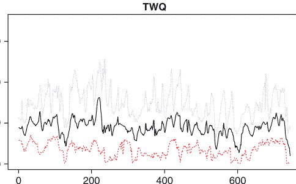

图 2.3 AirBox PM2.5 数据的时间分位数图。图中显示了 TWQ 0.025（红色）、0.5（黑色）和 0.975（蓝色）。

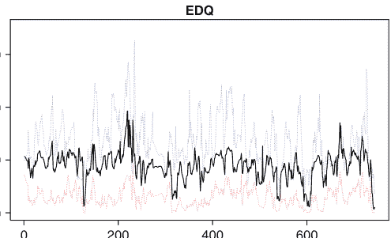

图 2.4 AirBox PM2.5 数据的 EDQ 图。图中显示了 EDQ 0.025（红色）、0.5（黑色）和 0.975（蓝色）。

与在每个时间点使用所有序列边缘分布的分位数不同，我们可以计算其他汇总统计量，如均值和标准差，并将它们绘制在双变量图中或随时间绘制。图 2.5 显示了每个交易日世界金融指数收益率序列的均值和方差的散点图。从图中可以清楚地看出，有三天的股票回报率方差非常高。这三天在图中标记出来，分别是 2001 年 1 月 1 日、1 月 3 日和 2008 年 10 月 15 日。图还表明，有一天金融指数的波动率较低，但股票下跌超过 6%（最左边的点）。结果发现，这发生在 2008 年 10 月 6 日，即世界金融危机的开始。考虑到 (a) 2000 年 12 月美国市场的下跌和 2001 年 1 月美国市场的反弹，以及 (b) 2008 年世界金融危机，这些发现似乎是合理的。总体而言，散点图表明，99 个金融指数的日对数收益率方差

并不大，但日对数收益率的均值范围可能很大，从 –0.06 到 0.06 不等。我们得出结论，行的汇总统计量图提供了关于所研究的 k 个时间序列随时间共同演变的有用信息。

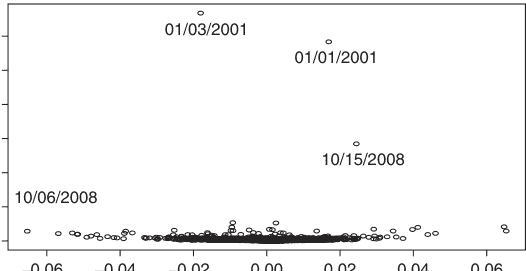

图 2.5 99 个世界金融市场指数日对数收益率的横截面方差与均值散点图。时间段为 2000 年 1 月 4 日至 2015 年 12 月 16 日。

### R 命令和使用的包：

```r
> require(MTS)
> stock <- read.csv2("Stock_indexes_99world.csv",header=FALSE)
> stock <- stock[,-1] # index observation index
> stock <- as.matrix(stock) # plot twq stock return
> rtn <- diffM(log(stock))
> q <- apply(rtn,1,quantile,c(0.025, 0.5,0.975))
> tdx <- c(1:4162)/260+2000
> plot(tdx,q[1,],type="l",xlab="year",ylab="log-return",
     ylim=c(-0.2,0.2),col="red")
> lines(tdx,q[2,],col="black",lty=2)
> lines(tdx,q[3,],col="blue",lty=3)
#plot twq logstock
>x=log(stock)
>tdx <- c(1:4163)/260+2000
>twq <- apply(x,1,quantile,c(0.025, 0.5, 0.975))
plot(tdx,twq[1,],main="TWQ",type="l",xlab="year",ylab="log-price",
     ylim=c(min(x),max(x)),col="red")
lines(tdx,twq[2,],col="black",lty=2)
lines(tdx,twq[3,],col="blue",lty=3)
#plot edq logstock
>q50=edqts (x,p=0.5,h=30)
>q025=edqts (x,p=0.025,h=30)
>q975=edqts (x,p=0.975,h=30)
>plot(tdx,x[,q50],main="EDQ",type="l",xlab="year",ylab="log-price",
     ylim=c(min(x),max(x)),col="black")
>lines(tdx,x[,q025],col="red",lty=3)
>lines(tdx,x[,q975],col="blue",lty=3)
> ave <- apply(rtn,1,mean)
> v <- apply(rtn,1,var)
> plot(ave,v,xlab="mean",ylab="variance")
> text(locator(1),"10/15/2008")
> text(locator(1),"01/03/2001")
> text(locator(1),"01/01/2001")
> text(locator(1),"10/06/2008")
```

### 2.1.2 静态图

静态图是用于总结研究中每个 k 个时间序列在样本期内行为的图形工具。在这些图中，我们检查每个列的边缘分布的一些属性（或汇总），并将所有序列的这些汇总绘制在一起。我们称这些图为静态图，因为它们显示了观察期内每个时间序列的汇总，因此未揭示时间动态。我们在此提出的第一个图是对每个列（序列）分布的选定分位数（包括每个序列的最小值和最大值）制作传统的箱线图。此图称为分位数-箱线图。

图 2.6 显示了 AirBox PM2.5 测量值的分位数-箱线图。选定的分位数为每个序列的最小值、25%、50%、75% 分位数和最大值。从图中可以清楚地看出，两个 PM2.5 测量序列的中位数接近零。事实上，在 25、50 和 75% 分位数处存在两个低点。由于 PM2.5 测量值不能为负值，此图立即识别出数据集中两个潜在的异常序列。图 2.7 显示了三个样本方差最小的序列的时间图。这些序列是第 29、70 和 348 个序列。从时间图中很容易看出，序列 29 和 70 有大量的零测量值，表明这两个序列有超过 50% 的缺失值，因此应从进一步建模中剔除。

每个观测时间序列的两个重要汇总是其中心位置和变异性，我们建议绘制每个序列的标准差（或方差）与均值的散点图。此图能够识别变异性更高或异常样本均值的序列。换句话说，该图可以发现数据集中的某些异质性。图 2.8 显示了 99 个世界金融市场指数日对数收益率的样本方差与样本均值的散点图。从

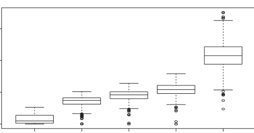

图 2.6 AirBox PM2.5 数据集的分位数-箱线图。选定的分位数为最小值、25、50、75% 分位数和最大值。

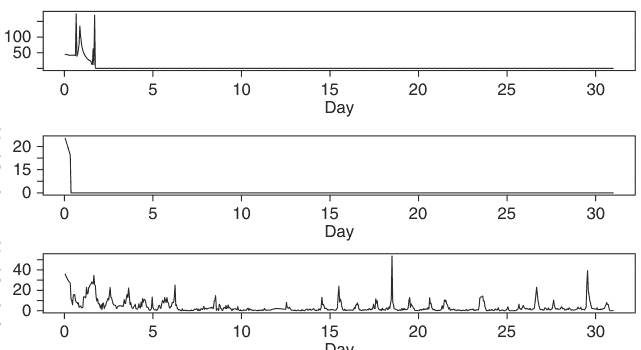

图 2.7 2017 年 3 月台湾每小时 AirBox PM2.5 测量值的三个极端序列的时间图。x 轴表示 3 月的日期。

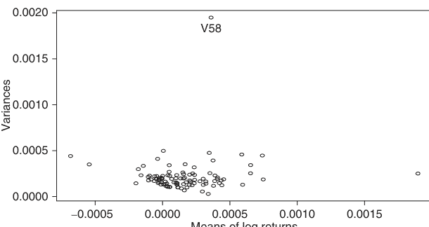

图 2.8 2000 年 1 月至 2015 年 12 月期间 99 个世界金融市场指数日对数收益率的样本方差与样本均值。

图中，一个具有相对较大方差的孤立点很容易看到。结果发现，这是序列 58（对应俄罗斯股票市场）。此外，还有一个序列具有非常大的平均回报（序列 85，委内瑞拉股票市场）和两个序列具有非常低的回报（56 和 79，荷兰和希腊股票市场）。图 2.9 显示了序列 58 和 85 的时间图。从图中可以清楚地看出，序列 58 包含两个巨大的异常值，日收益率绝对值超过 150 个百分点。这个例子表明，在分析大型时间序列数据集时需要清洗数据。序列 85 在 2008 年世界金融危机期间以及最近几年也显示出高变异性。

我们提出的第三个静态图是所有序列的滞后-1 样本自相关系数与滞后-2 样本自相关系数的散点图。这个

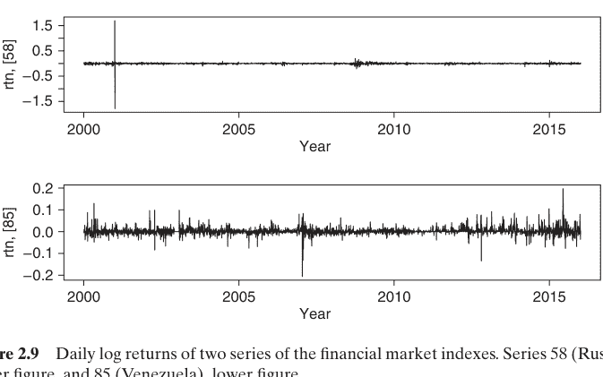

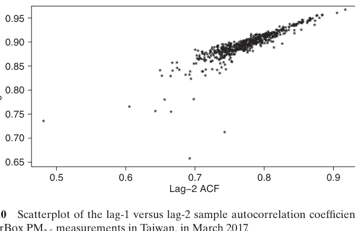

简单图可以提供有关单个序列动态依赖的信息。如果序列共享相似的动态依赖，则散点图应显示沿直线聚类的点，否则，将找到不同类型的依赖点聚类。图 2.10 显示了 AirBox 每小时 PM2.5 序列的滞后-1 ACF 与滞后-2 ACF 的散点图。从图中，我们做出以下观察。首先，如预期，存在沿直线的某些聚类行为。其次，存在 5 个点的聚类，滞后-1 ACF 约为 0.78，滞后-2 ACF 约为 0.68。最后，该图还指出了 3 个具有不同动态依赖模式的孤立点。结果发现，最小滞后-1 ACF 出现在序列 29，而两个最小滞后-2 ACF 出现在序列 19 和 213。这些孤立序列的识别在附带的 R 输出中给出。

有趣的是，序列 70 只有八个非零观测值，在图 2.10 中未显示为孤立点。这很可能是因为这八个观测值与其他序列共享相似的动态依赖。当然，如果我们考虑滞后-1 ACF 与滞后-ℓ ACF（其中 ℓ > 7）的散点图，序列 70 将成为孤立点。

### 截面图的 R 演示：

```r
#### Cross section plots
air <- read.csv('TaiwanAirBox032017.csv',header=FALSE)
air <- as.matrix(air)[,-1]
x <- air
#### Quantile Box plot
require(SLBDD)
quantileBox(air)
q50 <- apply(air,2,quantile,0.5)
s1 <- sort(q50,index.return=TRUE)
s1$ix[1:3]

stock <- read.csv2('Stock_indexes_99world.csv')
stock <- stock[,-1]
stock <- as.matrix(stock)
rtn <- diffM(log(stock))
ave <- apply(rtn,2,mean)
vl <- apply(rtn,2,var)
plot(ave,vl,xlab='Sample means',ylab='Sample variance')
which.max(vl)
tdx <- c(1:4163)/260+2000
plot(tdx[-1],rtn[,58],xlab='year',ylab='log-return',
     main='Series 58',type='l')

## scatterplot of ACFs
scatterACF(air)
```

### 示例 2.1

我们分析文件 PElectricity1344.csv 中的电力价格数据，该文件包含 2004 年 1 月至 2016 年 12 月期间 ISO 新英格兰电力市场的每小时电力价格。数据是 T = 678 周期间，新英格兰八个地区每天每小时的电力价格周序列。我们有 k = 1344 个序列，分别对应八个地区、一天中的 24 小时之一和一周中的 7 天之一（8 × 24 × 7 = 1344）。第一个序列对应 2004 年 1 月 1 日星期四东部时间凌晨 1 点第一个地区的价格，第二个序列对应同一天同一地区凌晨 2 点的价格，依此类推。因此，前 192 个序列（8 个地区 × 24 小时）是八个地区星期四所有小时的电力价格，接下来的 192 个序列是星期五的价格，依此类推。这些时间序列在 Alonso and Peña (2019) 中进行了分析，并针对夏令时日期的缺失值进行了修正。我们使用修正


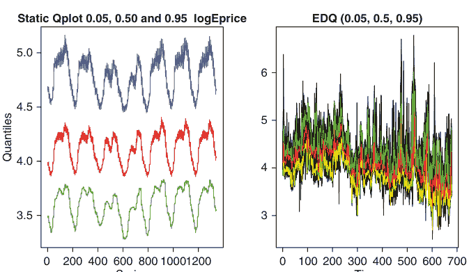

图 2.11 各时间序列的静态分位数（左面板）和概率为 0.05、0.5 和 0.95 的 EDQ（右面板），针对新英格兰地区的每小时电价。

本例中的数据。该系列中仍有一些值为负数，我们在所有系列中加上 15 以进行对数变换。图表显示的是变换后的数据。

图 2.11 左侧图表显示了每个时间序列相对于序列编号的静态分位数。由于这些数据中的序列按相同星期几的块排序，图表显示了七个周期，表明每小时和每个地区电价分位数的演变。右侧图表显示了 678 周内价格的三个 EDQ。它们呈下降趋势，且变异性似乎随时间增加。该图的 R 命令如下。

```
x0 <- read.csv("PElectricity1344.csv", header=FALSE)
x=as.matrix(x0)
> x = log(x+15)
> sq = apply(x,2,quantile,c(0.05,0.50,0.95))
## sq is a 3-by-1344 matrix. The first row is the 0.05 quantile
## of the first time series. The second row is the 0.5 quantile
## of the second time series, etc.
> par(mfcol=c(1,2))
#Plot of sq in the original order of the data
> q05=sq[1,]
> q50=sq[2,]
> q95=sq[3,]
> Ma=max(q05,q50,q95)
> Mi=min(q05,q50,q95)
> ts.plot(q50,col=2,main="Static Qplot .05,.50 and .95 logEprice",
ylim=c(Mi,Ma),xlab="series",ylab="Quantiles")
> lines(q05,col=3)
> lines(q95,col=4)
```

```
> #Dynamic Plots of the series
> sal=edqplot(x,prob=c(0.05,0.5,0.95),h=30,loc=NULL,
> color=c("yellow","red","green","blue"))
```

## 2.2 平稳 ARMA 模型

平稳时间序列在实践中有用且广泛使用，许多非平稳时间序列可以通过差分转换为平稳序列。Wold (1938) 得到了平稳过程的一般表示。他证明，任何不含确定性成分且具有有限均值的弱平稳随机过程 \(z_t\)，都可以写成不相关随机变量 \(\{a_t\}\) 的线性函数。即，

\(z_t = \mu + a_t + \psi_1 a_{t-1} + \psi_2 a_{t-2} + \cdots = \mu + \sum_{i=0}^\infty \psi_i a_{t-i} \quad (\psi_0 = 1), \quad (2.4)\)

其中 \(E(z_t) = \mu, E(a_t) = 0, \text{Var}(a_t) = \sigma^2\)，且当 \(h > 0\) 时 \(E(a_t a_{t-h}) = 0\)。令 \(\tilde{z}_t = z_t - \mu\)，并使用滞后算子 \(B\)（定义为 \(B z_t \equiv z_{t-1}\)，因此 \(B^h z_t = z_{t-h}\)），我们可以将等式 (2.4) 写为

\(\tilde{z}_t = \psi(B)a_t, \quad (2.5)\)

其中 \(\psi(B) = 1 + \psi_1 B + \psi_2 B^2 + \cdots\) 是滞后算子 \(B\) 的一个无穷多项式，且满足 \(\sum_{i=0}^\infty \psi_i^2 < \infty\)。我们将等式 (2.5) 称为非确定性平稳过程的一般线性表示。它通常被称为平稳随机过程的 _Wold 分解_。该表示很重要，因为它保证任何平稳过程都可以用某个白噪声过程 \(a_t\) 及其所有滞后项的线性函数来近似。在本章中，我们寻求该一般表示的适当近似，但使用少量未知参数。在某些特定情况下，过程 \(z_t\) 可以写成正态独立变量 \(\{a_t\}\) 的线性函数。此时变量 \(\tilde{z}_t\) 服从正态分布，弱平稳性和严格平稳性重合。

等式 (2.5) 的表示存在需要无穷多个系数的问题。在接下来的章节中，我们将研究具有有限参数个数的特例，即 AR 模型和 MA 模型。

等式 (2.4) 中 \(z_t\) 的方差为

\(\text{Var}(z_t) = \gamma_0 = \sigma^2 \sum_{i=0}^\infty \psi_i^2, \quad (2.6)\)

且该过程具有有限方差，因为我们假设序列 \(\{ \psi_i^2 \}\) 是收敛的。\(z_t\) 的自协方差由以下公式给出

\(\gamma_h = E(\tilde{z}_t \tilde{z}_{t-h}) = \sigma^2 \sum_{i=0}^\infty \psi_i \psi_{i+h},\)

自相关系数由以下公式给出

\(\rho_h = \frac{\sum_{i=0}^{\infty} \psi_i \psi_{i+h}}{\sum_{i=0}^{\infty} \psi_i^2}.\) (2.7)

\(z_t\) 的该自相关系数仅取决于 \(h\)。事实上，平稳过程的性质由其自相关函数（ACF）描述。我们将在后面讨论一些选定过程的 ACF 特征。

Koopmans (1974) 证明，任何平稳过程只要可逆，也承认无限阶自回归表示。该条件是通用的，稍后将加以说明。AR 表示是 Wold 分解的逆，由以下公式给出

\(\widetilde{z}_t = \pi_1 \widetilde{z}_{t-1} + \pi_2 \widetilde{z}_{t-2} + \cdots + a_t,\)

使用后移算子 \(B\)，可化简为

\(\pi(B)\widetilde{z}_t = a_t,\) (2.8)

其中 \(\pi(B) = 1 - \pi_1 B - \pi_2 B^2 - \cdots\)。这是等式 (2.5) 的对偶表示。将上述公式代入 (2.5)，得到

\(\pi(B)\psi(B)a_t = a_t,\)

这意味着

\(\pi(B)\psi(B) = 1,\) (2.9)

且算子 \(\psi(B)\) 是 \(\pi(B)\) 的逆，反之亦然。因此，我们写 \(\pi^{-1}(B) = \psi(B)\)。一般来说，通过将等式 (2.9) 的乘积中 \(B\) 的幂的系数设为零，我们可以从一种表示的系数中得到另一种表示的系数。在接下来的章节中，我们将介绍等式 (2.5) 和 (2.8) 中一般表示的一些特例。

### 2.2.1 自回归过程

假设 \(z_t\) 是表示给定日期 \(t\) 水库中水量的时间序列。希望维持的水量稳定目标为 \(\mu\)，当 \(z_t > \mu\) 时，会释放 \(\mu\) 偏差（即 \(\widetilde{z}_t = z_t - \mu\)）的某个比例 \(1 - \phi_1\)，并保留偏差 \(\phi_1 \widetilde{z}_{t-1}\) 的某个比例，其中 \(|\phi_1| < 1\)。另一方面，当 \(z_t < \mu\) 时，会从其他连接的水库中加入偏差 \(\widetilde{z}_t = z_t - \mu\) 的某个比例 \(1 - \phi_1\)。此外，每天可能会因降雨向水库中加入一些额外的水，或因水分蒸发而损失一些水。将随机水量记为 \(a_t\)，并假设其期望值为零，即长期平均效果为零，则水库中每天的水量将遵循以下方程

\(\widetilde{z}_t = \phi_1 \widetilde{z}_{t-1} + a_t.\) (2.10)

在此情况下，\(z_t\) 遵循阶数为 1 的平稳 AR 模型，即 AR(1)，均值为 \(\mu\)，参数为 \(|\phi_1| < 1\)，创新项 \(a_t\) 遵循均值为零且方差为有限 \(\sigma^2\) 的白噪声过程。使用滞后算子 \(B\)，AR(1) 模型的方程为

\((1 - \phi_1 B)\tilde{z}_t = a_t.\)

通过反复代入或利用

\((1 - \phi_1 B)^{-1} = 1 + \phi_1 B + \phi_1^2 B^2 + \cdots , \quad (2.11)\)

对算子 \((1 - \phi_1 B)\) 求逆，该过程可以写成

\(\tilde{z}_t = a_t + \sum_{i=1}^{\infty} \phi_1^i a_{t-i}. \quad (2.12)\)

在水库示例中，如果水量由取决于前 \(p\) 期偏差的政策决定，则我们得到一个带有通用方程的 AR(\(p\)) 模型

\(\tilde{z}_t = \phi_1 \tilde{z}_{t-1} + \cdots + \phi_p \tilde{z}_{t-p} + a_t. \quad (2.13)\)

系数 \(\phi_i\) 必须满足接下来将解释的某些条件，以使过程平稳。使用滞后算子 \(B\)，AR(\(p\)) 模型的方程为

\((1 - \phi_1 B - \cdots - \phi_p B^p)\tilde{z}_t = a_t, \quad (2.14)\)

并令 \(\phi_p(B) = 1 - \phi_1 B - \cdots - \phi_p B^p\) 为滞后算子中的 \(p\) 次多项式，则有

\(\phi_p(B)\tilde{z}_t = a_t, \quad (2.15)\)

这是自回归过程的一般表达式。等式 (2.8) 中的表示称为线性平稳过程的 AR(\(\infty\)) 形式。

AR(\(p\)) 过程的 *特征方程* 定义为

\(\phi_p(B) = 0, \quad (2.16)\)

作为 \(B\) 的函数来考虑。这个特征方程有 \(p\) 个根 \(G_1^{-1}, \dots, G_p^{-1}\)，它们可以是复数，在实践中通常互不相同（参见附录 2.A），并且有

\(\phi_p(B) = \prod_{i=1}^p (1 - G_i B),\)

其中分量 \((1 - G_i B)\) 是特征方程的因子。可以证明，如果对所有 \(i\) 均有 \(|G_i| < 1$，则过程是平稳的。特别是，对于 AR(1) 模型，如果 \(|G_1| = |\phi_1| < 1$，则过程是平稳的。

#### 2.2.1.1 自相关函数

考虑一个 AR(\(p\)) 过程。将 (2.13) 乘以 \(\tilde{z}_{t-h}\)（\(h > 0\)），取期望，并将结果除以过程的方差，我们发现 AR(\(p\)) 的自相关系数满足以下差分方程：

\(\rho_h = \phi_1 \rho_{h-1} + \cdots + \phi_p \rho_{h-p}, \quad h > 0.\)


因此，AR\((p)\) 过程的自相关函数（ACF）满足与该过程自身相同的差分方程，

\(\phi_p(B)\rho_h = 0 \qquad h > 0.\) (2.17)

该差分方程的通解为（参见附录 2.A）

\(\rho_h = \sum_{i=1}^p A_i G_i^h,\) (2.18)

其中 \(A_i\) 是由初始条件确定的常数，\(G_i\) 是特征方程根的倒数。为了使 \(z_t\) 平稳，\(G_i\) 的模必须小于 1，这意味着特征方程 (2.16) 的根的模必须大于 1。要证明这一点，我们注意到条件 \(|\rho_h| < 1\) 要求 Eq. (2.18) 中不能有任何 \(|G_i|\) 大于 1，否则当 \(h\) 增加时，\(|G_i^h|\) 将无限增加。此外，为了使过程平稳，不能有一个根 \(G_i^{-1}\) 等于 1，因为在此情况下，其分量 \(G_i^h\) 将随着 \(h\) 的增加而不减小，且系数 \(\rho_h\) 对任何滞后都不会趋于零。

附录中表明，AR\((p)\) 过程的 ACF 是实根项引起的指数项与共轭复数引起的正弦项的混合物。因此，它们的结构可能很复杂。因此，通过检查其 ACF 来确定 AR 过程的阶数可能比较困难。然而，假设我们拟合一系列阶数递增的连续自回归：

\(\begin{aligned} \widetilde{z}_t = \alpha_{11}\widetilde{z}_{t-1} + \eta_{1t}, \\ \widetilde{z}_t = \alpha_{21}\widetilde{z}_{t-1} + \alpha_{22}\widetilde{z}_{t-2} + \eta_{2t}, \\ \quad \vdots \\ \widetilde{z}_t = \alpha_{k1}\widetilde{z}_{t-1} + \cdots + \alpha_{kk}\widetilde{z}_{t-k} + \eta_{kt}, \end{aligned}\)

并将系数序列 \(\alpha_{ii}\) 称为 \(z_t\) 的 *偏自相关函数*（PACF）。那么，从定义可以清楚看出，对于 AR\((p)\) 过程，滞后-\(p\) 的 PACF \(\alpha_{pp}\) 应该非零。因此，使每个 \(\alpha_{pp}\) 非零的最大 \(p\) 可用于确定 AR\((p)\) 过程的阶数。此 PACF 性质的样本版本在实践中被广泛用于识别 AR 过程的阶数。

考虑联立 Eq. (2.17) 中的 AR 矩方程，对 \(h=1, \dots, p\)。我们有 \(p\) 个关于 AR 系数 \(\phi_i\) 的方程，\(i=1, \dots, p\)。这个线性方程组被称为 AR\((p)\) 模型的 *Yule-Walker 方程*，一旦给定 ACF，就可以用它来求解 \(\phi_i\)。

### 2.2.2 移动平均过程

为简化起见，此处使用 \(\theta_1\) 的负号，以便与 AR(1) 过程具有相同的多项式算子。如果愿意，可以使用 \((1 + \theta B)\)；例如，参见 R 中 `arima` 命令使用的模型形式。MA(1) 过程总是平稳的，但当 \(|\theta_1| < 1\) 时被称为可逆的。在这种情况下，MA(1) 算子可以像在 (2.11) 中一样被反演，从而得到

\(\tilde{z}_t = - \sum_{i=1}^{\infty} \theta_1^i \tilde{z}_{t-i} + a_t,\quad (2.19)\)

这是一个 AR(\(\infty\)) 模型，但系数呈指数衰减至零。注意，如果 \(|\theta_1| \ge 1\)，则 \(|\theta_1^i|\) 随 \(i\) 增加而不会收敛到零，这意味着 \(\tilde{z}_t\) 将取决于其遥远过去的值，这不现实。一般的 MA(q) 过程形式为

\(\tilde{z}_t = a_t - \theta_1 a_{t-1} - \theta_2 a_{t-2} - \cdots - \theta_q a_{t-q}.\quad (2.20)\)

使用 B 算子，我们可以将模型写为

\(\tilde{z}_t = (1 - \theta_1 B - \theta_2 B^2 - \cdots - \theta_q B^q)a_t = \theta_q(B)a_t.\)

具有 \(q < \infty\) 的 MA(q) 过程总是平稳的，因为它是平稳过程的线性组合。我们称该过程为可逆的，如果算子 \(\theta_q(B) = 0\) 的根的模大于 1。

可以通过将 Eq. (2.20) 乘以 \(\tilde{z}_{t-h}\)（对 \(h \ge 0\)）并取期望来获得 MA(q) 过程的自协方差和自相关。那么，我们有

\(\gamma_0 = (1 + \theta_1^2 + \cdots + \theta_q^2)\sigma^2,\)
\(\gamma_h = (-\theta_h + \theta_1 \theta_{h+1} + \cdots + \theta_{q-h} \theta_q)\sigma^2, \quad h=1, \dots, q,\)
\(\gamma_h = 0, \quad h > q.\)

特别是，此结果表明滞后-q 的自协方差 \(\gamma_q = -\theta_q \sigma^2\) 不为零，但如果滞后大于 q，则所有自协方差均为零。将协方差除以 \(\gamma_0\) 并采用更紧凑的记号，MA(q) 模型的 ACF 为

\(\rho_h = \frac{\sum_{i=0}^{i=q} \theta_i \theta_{h+i}}{\sum_{i=0}^{i=q} \theta_i^2}, \quad h=1, \dots, q,\quad (2.21)\)
\(\rho_h = 0, \quad h > q,\)

其中 \(\theta_0 = -1\)，且对 \(h > q\) 有 \(\theta_h = 0\)。请注意，MA(1) 过程只有滞后-1 的自相关系数非零，其值为 \(\rho_1 = -\theta_1 / (1 + \theta_1^2)\)。当 \(|\theta_1| < 1\) 时，有 \(|\rho_1| < 0.5\)。

因此，对于 MA(1)，一阶自相关系数的绝对值必须小于 0.5，而对于 AR(1)，则具有通常小于 1 的上限。从 MA 模型的 ACF 性质来看，可以使用样本 ACF 来识别其阶数。最后，正如我们在 Eq. (2.19) 中所示，MA(q) 过程可以写成 AR(\(\infty\)) 过程。因此很明显，MA 模型的 PACF 不为零。因此，AR 模型和 MA 模型的性质之间存在对偶性。

### 2.2.3 ARMA 过程

结合 AR 和 MA 过程的性质，我们得到一个已被证明在实际应用中广泛适用且有用的 ARMA 过程。最简单的 ARMA 过程是给定的 ARMA(1,1) 模型

$(1 - \phi_1 B)\widetilde{z}_t = (1 - \theta_1 B)a_t,$

其中，再次，\(\widetilde{z}_t = z_t - E(z_t)\) 是 \(z_t\) 关于其均值的偏差，\(\{a_t\}\) 是均值为零且方差 \(\sigma^2 < \infty\) 的白噪声过程。ARMA(1,1) 过程在 \(|\phi_1| < 1\) 时平稳，在 \(|\theta_1| < 1\) 时可逆。此外，我们假设 \(\phi_1 \neq \theta_1\) 以避免 AR 和 MA 多项式的抵消。

一般来说，ARMA(p,q) 过程定义为

\((1 - \phi_1 B - \cdots - \phi_p B^p)\widetilde{z}_t = (1 - \theta_1 B - \cdots - \theta_q B^q)a_t, \quad (2.22)\)

或者，使用后移算子的紧凑记号，

\(\phi_p(B)\widetilde{z}_t = \theta_q(B)a_t,\)

其中我们假设 AR 算子 \(\phi(B)\) 和 MA 算子 \(\theta(B)\) 之间不存在共同根。如果 \(\phi_p(B) = 0\) 的所有根都在单位圆之外，则过程 \(z_t\) 平稳；如果 \(\theta_q(B) = 0\) 的所有根都在单位圆之外，则过程 \(z_t\) 可逆。

\(z_t\) 的 MA 表示可以使用以下方式获得

\(\widetilde{z}_t = \phi_p(B)^{-1}\theta_q(B)a_t = \psi(B)a_t,\)

其中 \(\psi_t\) 可以通过在恒等式 \(\psi(B)\phi_p(B) = \theta_q(B)\) 中对 \(B^i\) 的系数进行等量来得到。例如，ARMA(1,1) 具有 \(\psi(B) = 1 + (\phi_1 - \theta_1)B + \phi_1(\phi_1 - \theta_1)B^2 + \phi_1^2(\phi_1 - \theta_1)B^3 + \cdots\) 。类似地，我们可以通过以下方式获得 ARMA(p,q) 过程的 AR 表示

\(\pi(B)\widetilde{z}_t = \theta_q^{-1}(B)\phi_p(B)\widetilde{z}_t = a_t,\)

其中 \(\pi(B) = 1 - \sum_{i=1}^\infty \pi_i B^i\)，\(\pi_i\) 通过在恒等式 \(\phi_p(B) = \theta_q(B)\pi(B)\) 中对 \(B^i\) 的系数进行等量来获得。

为了计算 \(z_t\) 的自协方差，我们将 (2.22) 乘以 \(\widetilde{z}_{t-h}\) 并取期望，得到

\(\gamma_h - \phi_1 \gamma_{h-1} - \cdots - \phi_p \gamma_{h-p} = E[a_t\widetilde{z}_{t-h}] - \sum_{i=1}^q \theta_i E[a_{t-i}\widetilde{z}_{t-h}]. \quad (2.23)\)

对于 \(h=q\)，我们有 \(\gamma_q - \phi_1 \gamma_{q-1} - \cdots - \phi_p \gamma_{q-p} = -\theta_q \sigma^2 \neq 0\)，但是，对于 \(h > q\)，Eq. (2.23) 右侧的所有期望均为零，且 \(\gamma_h - \phi_1 \gamma_{h-1} - \cdots - \phi_p \gamma_{h-p} = 0\)。除以 \(\gamma_0\)，我们得到

\(\rho_h - \phi_1 \rho_{h-1} - \cdots - \phi_p \rho_{h-p} = 0, \quad h > q. \quad (2.24)\)


这是平稳 ARMA 模型的矩方程。特别是，联合考虑 h = q + 1, ..., q + p 时的公式 (2.24)，我们得到关于 AR 参数 \(\phi_i\) 的 p 个线性方程组。这个方程组被称为平稳 ARMA 模型的 *广义 Yule-Walker 方程*。

利用后移算子，公式 (2.23) 可改写为

\(\phi_p(B)\rho_h = 0 \quad h > q,\tag{2.25}\)

由此可得，当 h > q 时，z_t 的自相关函数（ACF）表现与 AR(p) 模型相似。因此，ARMA 模型的 ACF 衰减仅由模型的自回归部分 \(\phi(B)\) 决定。不过，z_t 的前 q 个 ACF 同时取决于 AR 和 MA 参数。对于平稳 ARMA(p, q) 模型，根据公式 (2.25)，ACF 最终会衰减到零，但 ACF 取决于某些初始值。当 p \(\le\) q 时，ACF \(\rho_i\)（i = q - p + 1, ..., q）提供初始值；而当 p > q 时，ACF \(\rho_i\)（i = p - 1, ..., 0）提供必要的初始值。

### 2.2.4 ARMA 过程的线性组合

在实际中，ARMA 过程很常见，因为纯 AR 过程的非零线性组合会得到一个 ARMA 模型。事实上，ARMA 模型类在线性组合下是封闭的。特别是，将有限个 ARMA 过程相加会得到一个新的 ARMA 过程。为举例说明，我们从将白噪声加到零均值 AR(1) 过程这一最简单情况开始，即

z_t = y_t + v_t,\tag{2.26}

其中 y_t = \(\phi y_{t-1} + a_t\)，v_t 是与 a_t（因而也与 y_t）独立的白噪声。过程 z_t 可被解释为带有测量误差的 AR(1) 过程的观测结果。z_t 的方差为

\(\gamma_z(0) = E(z_t^2) = E[(y_t^2 + v_t^2 + 2y_t v_t)] = \gamma_y(0) + \sigma_v^2.\tag{2.27}\)

由于 y_t 的自协方差满足 \(\gamma_y(h) = \phi^h \gamma_y(0)\)，而 v_t 在 h \(\ge\) 1 时的自协方差为零，因此有

\(\gamma_z(h) = E(z_t z_{t-h}) = E[(y_t + v_t)(y_{t-h} + v_{t-h})] = \gamma_y(h) = \phi^h \gamma_y(0).\)

特别是，当 h = 1 时，公式 (2.27) 意味着

\(\gamma_z(1) = \phi \gamma_y(0) = \phi \gamma_z(0) - \phi \sigma_v^2,\tag{2.28}\)

而当 h \(\ge\) 2 时，

\(\gamma_z(h) = \phi \gamma_z(h-1).\tag{2.29}\)

我们得出结论：过程 z_t 遵循一个 AR 参数等于 \(\phi\) 的 ARMA(1,1) 模型。得到的 ARMA(1,1) 过程的 MA 参数和创新项方差取决于 y_t 和 v_t 的参数。

上述结果可推广到任何 AR(p) 过程。可以证明（见 Granger and Morris, 1976），在相当宽松的条件下，

AR(p) + AR(q) = ARMA(p + q, max(p, q)),

以及

MA(q1) + MA(q2) = MA(max(q1, q2)).

对于 ARMA 过程，在相同的宽松条件下，也可以证明，

ARMA(p1, q1) + ARMA(p2, q2) = ARMA(a, b),

其中

a <= p1 + p2, b <= max(p1 + q1, p2 + q2).

这些结果表明，每当我们观察到一个由多个过程组成的求和过程，其中一些过程遵循 AR 模型时，我们就期望得到一个 ARMA 过程。所使用的宽松条件包括：单个时间序列的创新项要么相互独立，要么不存在滞后交叉相关。

上述结果的一个实际含义是，ARMA(p, q) 模型在实际应用中经常被使用，因为观察到的时间序列可能是多个底层过程的线性组合。例如，一个经济体的国内生产总值通常由衡量该经济体产出的若干组成部分构成。另一个实际含义是，ARMA(p,p) 模型有时也出现在实际应用中。如上述 AR(1) 模型的例子所示，这种现象可能是由测量误差引起的。

### 示例 2.2

R 命令 arima.sim 生成平稳 ARMA 过程。一些时间序列是按照低阶 ARMA 模型模拟得到的，并计算了它们的样本 ACF。

```
#simulates ARMA models and plot the ACF
> y1=arima.sim(n=100,list(ar=c(.8)))
> y2=arima.sim(n=100,list(ar=c(-.7)))
> y3=arima.sim(n=100,list(ar=c(1.2,-.9)))
> y4=arima.sim(n=100,list(ma=c(.6)))
> y5=arima.sim(n=100,list(ma=c(-.7)))
> y6=arima.sim(n=100,list(ar=c(.8),ma=c(-.4)))
> par (mfrow=c(3,2))
> ts.plot(y1)
......
> ts.plot(y6)
> par (mfrow=c(3,2))
......
> acf(y6,lag.max=15)
```

图 2.12 展示了一些模拟的时间序列，图 2.13 展示了相应的样本 ACF。注意，具有复根的 AR(2) 模型会产生类周期性行为。

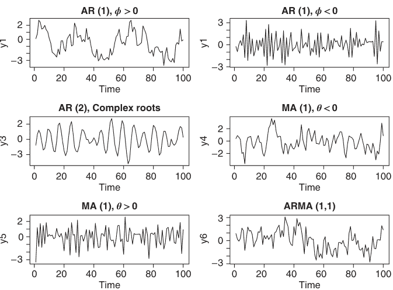

图 2.12 一些简单 ARMA 模型的图。

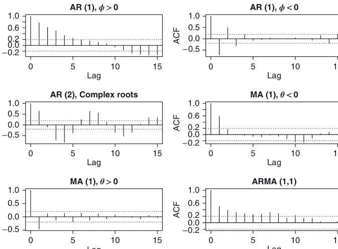

图 2.13 一些简单 ARMA 模型的 ACF。

## 2.3 平稳过程的谱分析

### 2.3.1 将调和函数拟合到时间序列

分析平稳时间序列的另一种方法是探索数据的周期性特征。法国数学家傅立叶在十九世纪初证明，任何周期函数都可以表示为不同振幅和频率的正弦函数之和。后来，该方法被扩展用于表示区间内任何连续函数。我们在此处使用的时间调和或正弦函数是正弦和余弦，即对于 \(t = 1, ..., P\)，分别为 \(\sin(2\pi t/P)\) 和 \(\cos(2\pi t/P)\)，其中 \(P\) 称为周期，并定义调和函数的性质。正弦和余弦函数每 \(P\) 个周期完成一个周期，因为 \(\sin(2\pi(t+P)/P) = \sin(2\pi t/P + 2\pi) = \sin(2\pi t/P)\)。定义这些调和函数的等效方法是使用相应的频率，即周期的倒数 \(f = 1/P\)。这个频率表示在两个连续时间单位之间观察到的完整周期的分数。例如，对于月度季节系列（\(P=12\)），频率为 \(1/12 = 0.0833\)，表示一个月代表 12 个月季节周期的 8.33%。除了频率，我们还可以使用角频率，\(w = 2\pi f = 2\pi/P\)，它表示在单位时间内覆盖的弧度角度。请注意，在周期 \(P\) 内覆盖完整的 \(2\pi\) 弧度周期。例如，对于 \(P=4\) 的季度系列，其角频率为 \(w = 2\pi/4 = \pi/2\)，表示在一次观测（季度）内，相对于完整的 \(2\pi\) 周期覆盖了 \(\pi/2\) 角度。

假设我们对在 \(t = 1, ..., T\) 时刻观测到的平稳时间序列拟合一个给定角频率 \(w\) 的正弦函数。也就是说，我们考虑模型

z_t = \mu + R \sin(wt + \theta) + a_t, \quad (2.30)

其中 \(\mu\) 表示 \(z_t\) 的均值，\(R\) 是正弦波的振幅，\(\theta\) 是正弦函数在 \(t=0\) 时的相位或相对于原点的距离。引入相位 \(\theta\) 后，我们不需要在正弦函数和余弦函数之间做抉择。事实上，我们同时使用两者。具体来说，利用 \(\sin(a+b) = \sin(a)\sin(b) + \cos(a)\cos(b)\)，我们可以将 (2.30) 写为

z_t = \mu + R \sin(wt) \sin(\theta) + R \cos(wt) \cos(\theta) + a_t,

并令 \(A = R \sin \theta\) 且 \(B = R \cos \theta\)，则有

z_t = \mu + A \sin(wt) + B \cos(wt) + a_t. \quad (2.31)

与公式 (2.30) 相比，这种表达式更适合估计，因为它将序列表示为两个具有相同角频率但不同系数 \(A\) 和 \(B\) 的正弦函数之和。正弦波在公式 (2.30) 中的原始未知参数 \(\theta\) 和 \(R\) 已转换为系数 \(A\) 和 \(B\)，这些系数可以轻松从数据中估计：公式 (2.31) 关于三个未知参数 \(\mu\)、\(A\) 和 \(B\) 是线性的，并可以通过 *最小二乘法*（LS）拟合。由于解释变量 \(\sin(wt)\) 和 \(\cos(wt)\) 具有零均值、方差 \(1/2\) 且正交，它们的 LS 估计量为 \(\hat{\mu} = \sum_{t=1}^T z_t / T\) 和

\(\hat{A} = \frac{2}{T} \sum_{t=1}^T z_t \sin(wt), \quad (2.32)\)


\(\widehat{B} = \frac{2}{T} \sum_{t=1}^T z_t \cos(wt).\) (2.33)

原始幅值 \(R\) 的估计如下

\(\widehat{R}^2 = \widehat{A}^2 + \widehat{B}^2.\) (2.34)

拟合模型的残差使用以下公式计算

\(\widehat{a}_t = z_t - \widehat{\mu} - \widehat{A} \sin(wt) - \widehat{B} \cos(wt),\)

并且，按构造，它们的均值为零，方差为 \(\widehat{\sigma}^2 = \sum_{t=1}^T \widehat{a}_t^2 / T\)。拟合模型将数据的变异性分解为两部分；第一部分由正弦解释变量解释，第二部分由残差引起。由于两个正弦分量的方差为 1/2 且它们不相关，因此很容易得到

\(s_z^2 = \frac{1}{T} \sum_{t=1}^T (z_t - \widehat{\mu})^2 = \frac{\widehat{A}^2}{2} + \frac{\widehat{B}^2}{2} + \widehat{\sigma}^2 = \frac{\widehat{R}^2}{2} + \widehat{\sigma}^2,\) (2.35)

其中 \(s_z^2\) 是 \(z_t\) 的方差。方程 (2.35) 将序列的方差分解为两个正交分量，即信号（由波的幅值的平方除以二表示）和噪声的方差。

### 2.3.2 周期图

给定一个实值时间序列，提供最佳拟合的角频率 \(w\) 的值是未知的，我们可以尝试不同的值，以查看哪个值最能拟合数据。在实践中，估计周期 \(P\) 大于样本量 \(T\) 或周期 \(P\) 小于 2 的任何周期都会很困难。因此，在实践中考虑的正弦波的角频率 \(w\) 满足 \(2\pi/T \le w \le \pi\)。此外，与使用单波函数相比，更好的方法是假设该序列是由不同幅值和频率的波之和生成的，并估计每个波在解释数据变异性方面的相对重要性。在有 \(T\) 个观测值时，为了简化本节的阐述，我们假设 \(T\) 为偶数，我们需要为每个波估计两个幅值以及 \(z_t\) 的均值，因此可拟合的角频率数量 \(n_f\) 必须满足 \(2n_f + 1 \le T\)。因此，可考虑的角频率最大数量为 \(n_f = T/2\)。

我们将 *基础* 或 *傅里叶* 周期定义为样本量的精确分数，即 \(P_j = T/j\)，其中 \(j\) 为正整数。基础周期的最大值为 \(P_{\max} = T\)，即样本量，此时 \(j = 1\)，在此周期内我们只观察一次正弦函数。周期的最小值为 \(P_{\min} = 2\)，因为我们无法观察到持续时间少于两个观测值的周期，因此 \(j = T/2\)。傅里叶频率定义为这些基础周期的倒数，\(w_j = 2\pi j/T\)，其中 \(j = 1, 2, \dots, T/2\)，我们可以观察到的频率为 \(2\pi/T \le w \le \pi\)，如之前所述。通过这种方式，我们可以将平稳时间序列表示为与所有基础频率相关的波之和：

\(z_t = \mu + \sum_{j=1}^{T/2} A_j \sin(w_j t) + \sum_{j=1}^{T/2} B_j \cos(w_j t).\) (2.36)

方程 (2.36) 使我们能够将观察到的时间序列精确分解为谐波分量之和，因为我们有 \(T\) 个观测值和 \(T\) 个参数。请注意，系数 \(A_{T/2}\) 被设置为零，因为它对应于波 \(\sin(w_{T/2}t) = \sin(\pi t) = 0\)。

根据等式 (2.35)，每个波对序列方差的贡献是其幅值的平方除以 2。由于波的重要性取决于其幅值，我们通过计算所有基础频率（\(A_{T/2}\) 除外，该值设置为零）的参数 \(A_j\) 和 \(B_j\) 来选择重要的波。这些计算很容易进行，因为解释变量 \(\sin(w_j t)\) 和 \(\cos(w_j t)\) 是正交的，系数 \(A_j\) 和 \(B_j\) 由等式 (2.32) 和 (2.33) 计算得出，其中 \(w_j = 2\pi j/T\)。给定每个频率 \(w_j\) 的估计系数 \(\widehat{A}_j\) 和 \(\widehat{B}_j\)，我们计算 \(\widehat{R}_j = \widehat{A}_j^2 + \widehat{B}_j^2\)。通过等式 (2.35)，我们将时间序列的方差分解为与每个谐波函数相关的分量。令 \(s_z^2\) 为序列的样本方差，我们写出

\(Ts_z^2 = \sum_{t=1}^T (z_t - \mu)^2 = \sum_{j=1}^{T/2} \frac{T}{2} \widehat{R}_j^2.\) (2.37)

周期图表示每个频率对数据方差的贡献 \(T\widehat{R}_j^2 / 2\)，作为角频率 \(w_j = 2\pi j / T\) 的函数。具体来说，平稳时间序列 \(z_t\) 在频率 \(w_j\) 处的周期图定义为

\(I(w_j) = \frac{T\widehat{R}_j^2}{2}, \quad \text{with } 2\pi/T \le w_j \le \pi.\) (2.38)

我们观察到，根据上述表示，周期图纵坐标之和由等式 (2.37) 等于序列的总变异性 \(Ts_z^2\)，周期图纵坐标的平均值是序列的方差。

上述分析假设我们只对基础频率感兴趣。如果样本量足够大，使得基础频率数量众多，则这一假设并不太限制。在这种情况下，总存在某个接近我们在应用中感兴趣的频率的基础频率。例如，假设我们有 \(T = 140\) 个月度数据点，并希望估计周期为 12 的幅值。在这种情况下，\(j = 11\) 的基础周期为 \(P_{11} = 140/11 = 12.7\)，\(j = 12\) 的基础周期为 \(P_{12} = 140/12 = 11.66\)。因此，我们可以从 \(j = 11\) 和 12 计算出的幅值中得到周期为 12 的波的幅值的近似估计。当然，我们可以为任何周期拟合模型，但随后，由于失去对称性，所示估计量的公式只是近似的，尽管我们可以始终通过多元回归精确计算系数。

周期图可以被视为检测时间序列中确定性周期或更一般地重要周期的工具。例如，在月度季节性序列中，我们预期在角频率 \( w = 2\pi/12 \) 处发现高周期图，但也可以在 \( w = 2\pi j/12 \) 处发现高值，其中 \( j = 1, 2, \dots \)，这些是季节频率的谐波。另一方面，序列可能有其他周期，这些周期不一定与季节周期相关，周期图是检测这些额外分量的有用工具。当我们注意到，对于给定频率，估计波的幅值实际上就是计算所有与被估计频率接近的频率的可能周期的平均幅值时，周期图的实用性会增加。由于基础频率之间的距离为 \( 2\pi(j+1)/T - 2\pi j/T = 2\pi/T \)，我们可以将频率 \( w_j \) 处计算出的幅值视为间隔 \( w_j \pm 2\pi/2T \) 内存在的频率的幅值的平均值。因此，我们不再以高度 \( I(w_j) \) 在基础频率处表示柱状图，而是可以使用面积与周期图成正比的矩形来构建平滑周期图，就像在直方图中所做的那样。因此，我们构建底边位于 \( w_j \pm 2\pi/2T \)（中心为 \( w_j \)，边长为 \( 2\pi/T \)）且高度为 \( I(w_j) = T \widehat{R}_j^2 / 2 \) 的矩形，使其面积等于 \( \widehat{R}_j^2 / 2 \)。通过这种方式，我们将估计的变异性分布在整个频率范围内。此平滑周期图现在定义于区间 \( \pi \ge w_j \ge 0 \) 内的所有频率，该函数所围总面积为序列的方差。我们可以更进一步，不再表示阶梯函数（如刚才描述的那样），而是将其视为连续函数。为此，我们以平滑直方图以获得密度函数估计的同样的方式，对相邻估计量进行加权来平滑上述幅值估计。所得到的平滑周期图（通常称为样本谱）在每个点上的纵坐标由以下公式计算：

\( I(w) = \sum_{w_i-a}^{w_i+a} p_i I(w_i), \quad \text{with } 0 \le w \le \pi, \quad (2.39) \)

其中 \( a \) 表示使用的窗口宽度，\( p_i \) 为和为 1 的对称权重。

### 2.3.3 谱密度函数及其估计

前面的分析可以应用于任何平稳过程。考虑一个零均值平稳过程 \(\{z_t | t = 1, \dots, T\}\)。可以证明（例如，见 Box et al., 2015 第 2 章）周期图与估计协方差函数通过以下关系相关：

\( I(w_j) = 2 \left[ \widehat{\gamma}_z(0) + 2 \sum_{k=1}^{T-1} \widehat{\gamma}_z(k) \cos(w_j k) \right], \quad 0 \le w_j \le \pi. \)

归一化周期图定义为

\( NI(w_j) = I(w_j) / \widehat{\gamma}_z(0) = 2 \left[ 1 + 2 \sum_{k=1}^{T-1} \widehat{\rho}_z(k) \cos(w_j k) \right]. \quad 0 \le w_j \le \pi.\)


由于估计自协方差在 \( T \to \infty \) 时收敛于理论自协方差，我们得到周期图收敛于 \( z_t \) 的功率谱，其定义为

\[ p(w) = 2 \left[ \gamma_z(0) + 2 \sum_{k=1}^{\infty} \gamma_z(k) \cos(w k) \right] , \qquad 0 \le w \le \pi . \qquad (2.40) \]

时间序列的谱显示了其方差如何在频率中分布，因为

\[ \gamma_z(0) = \int_0^\pi p(w)dw . \]

谱可以标准化，使其面积积分为1，类似于密度函数。标准化后的谱称为_光谱密度函数_，它是归一化周期图的渐近极限。具体地，\( z_t \) 的光谱密度函数由下式给出

\[ g(w) = p(w)/\gamma_z(0) = 2 \left[ 1 + 2 \sum_{j=1}^{\infty} \rho_z(j) \cos(w j) \right] , \qquad 0 \le w \le \pi . \qquad (2.41) \]

光谱密度可以通过标准化样本谱来估计。或者，我们可以将ARMA模型拟合到平稳时间序列上，并使用估计参数来估计光谱密度。可以证明，（例如，见Box et al., 2015的第3章）ARMA\( (p, q) \)模型 \( \phi(B)z_t = \theta(B)a_t \) 的光谱密度由下式给出

\[ g(w) = 2 \frac{|\theta_q(e^{-iw})|^2}{|\phi_p(e^{-iw})|^2} = 2 \frac{|1 - \theta_1 e^{-iw} - \dots - \theta_q e^{-iqw}|^2}{|1 - \phi_1 e^{-iw} - \dots - \phi_p e^{-ipw}|^2} , \qquad (2.42) \]

将估计参数代入，我们得到光谱密度函数的估计值。

将时间序列表示为不同频率的正交谐波函数之和对平稳系列很有用，但对于没有周期性行为的不规则时间序列则不那么有用。这种使用正交（傅立叶）函数的分解已通过使用小波进行推广，小波旨在使用比正弦和余弦更灵活的一组正交函数来近似短时间内的局部连续函数。小波是以此目标引入的，对于某些非平稳和非线性时间序列可能很有用。有兴趣的读者可参阅Tsay and Chen (2018)以获取简介，参阅Percival and Walden (2000)以获取更广泛的讨论。

### 示例 2.3

在图2.14中，显示了示例2.2中模拟的ARMA时间序列的平滑周期图（即样本谱）。AR(1)模型的正自相关使功率在低频（大周期）处更集中，当AR(1)模型具有负参数时则相反。还展示了具有复数根的AR(2)模型的伪周期性行为。图2.15显示了AR(1)过程及其与周期 \( P = 4 \) 的周期时间序列之和的图。两个系列的平滑周期图为

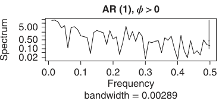

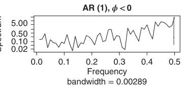

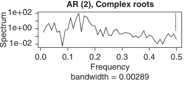

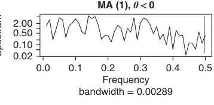

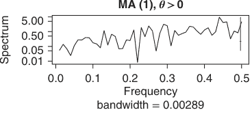

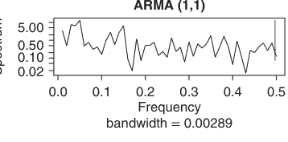

图2.14 示例2.2中模拟的ARMA时间序列的样本谱。

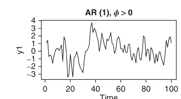

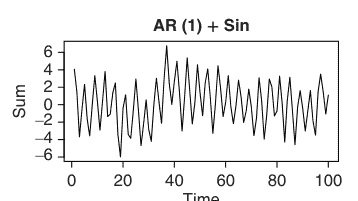

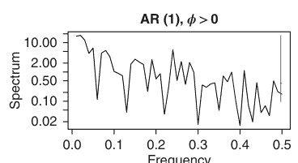

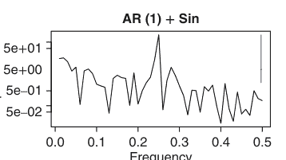

图2.15 上部为时间序列图，下部为AR(1)过程及其与频率0.25的正弦波之和的样本谱。

并且，在添加了该周期的第二个序列中可以清晰地看到频率0.25（即周期 P = 4）处的峰值。生成这两个序列所使用的R命令如下。

```
> y1=arima.sim(n=100,list(ar=c(0.6)))
> par(mfrow=c(2,2))
> ts=seq(1,100,1)
> z=3*sin(2*pi*t/4)
> s=y1+z
> plot(y1,main="AR(1) , φ>0")
> plot(s, main="AR(1)+Sin")
> spectrum(y1,main="AR(1) , φ>0")
> spectrum(s,main="AR(1)+Sin")
```

## 2.4 整合过程

实践中观察到的大多数时间序列都是非平稳的，并且随时间呈现某些趋势。然而，序列的变化（或增量），\( y_t = z_t - z_{t-1} = \nabla z_t \)，或增量的变化，\( c_t = y_t - y_{t-1} = z_t - 2z_{t-1} + z_{t-2} = \nabla^2 z_t \)，通常是平稳的。此类在差分后变得平稳的过程称为*整合过程*。在这里，*整合*一词表示差分的逆运算，意味着时间序列 \( z_t = y_t + y_{t-1} + \cdots \) 是平稳系列 \( y_t \) 过去值的总和。请注意，如果时间是连续的，则总和变为积分，差分变为微分。接下来我们将讨论一些整合过程。

### 2.4.1 随机游走过程

我们已经看到，有限阶MA过程始终是平稳的，而AR过程的平稳性要求AR多项式方程 \( \phi(B) = 0 \) 的所有根都位于单位圆外。例如，考虑AR(1)模型 \( z_t = c + \phi z_{t-1} + a_t \)。如果 \( |\phi| < 1 \)，该过程是平稳的。另一方面，如果 \( |\phi| > 1 \)，则随着 \( t \) 的增加，过程呈爆炸性，因为 \( |z_t| \to \infty \)。一个有趣的例子是当 \( |\phi| = 1 \) 时，该过程不是平稳的，并且属于一阶整合过程类。事实上，其一阶差分变为

\[ w_t = \nabla z_t = z_t - z_{t-1} = c + a_t, \quad (2.43) \]

这是一个平稳过程。这样的 \( z_t \) 过程称为带漂移 \( c \) 的*随机游走*。区分平稳过程与非平稳过程的一个重要特征是常数 \( c \) 所起的作用。在平稳过程中，常数与 \( z_t \) 的期望值相关，可以通过样本均值轻松估计。然后可以从 \( z_t \) 中减去均值并分析均值调整后的过程。从统计学上讲，平稳时间序列的高阶属性（如矩方程）不依赖于其均值。反之，对于非平稳过程，如果存在常数，则起着重要作用。例如，考虑带漂移的随机游走，(2.43)。通过对 \( 1 \le j \le t \) 的 \( z_j = c + z_{j-1} + a_j \) 进行反复代换，我们得到

\[ z_t = ct + \sum_{i=1}^t a_i. \qquad (2.44) \]

其中 \( z_0 \) 是过程的初始值，假设为零。如果 \( c \neq 0 \)，我们可以看到，根据公式 (2.44)，\( E(z_t) = ct \)，这表明 \( z_t \) 的均值随斜率 \( c \) 变化而随时间变化。此外，

\[ \text{Var}(z_t) = E(a_t + a_{t-1} + a_{t-2} + \cdots + a_1)^2 = \sigma^2 t, \]

当 \( t \) 增加时，这趋于无穷大，表明 \( z_t \) 的不确定性随 \( \sqrt{t} \) 增加，且是无界的。最后，使用

\[ z_{t+h} = c(t+h) + a_{t+h} + a_{t+h-1} + \cdots + a_1, \]

并且对于 \( h > 0 \) 有 \( \text{Cov}(t, t+h)=\text{Cov}(z_t, z_{t+h}) \)，我们得到

\[ \text{Cov}(t, t+h) = E[(z_t - ct)(z_{t+h} - c(t+h))] = \sigma^2 t, \]

这也是随时间变化的。事实上，可以轻易地看到

\[ \text{Cov}(t, s) = \text{Cov}(z_t, z_s) = E \left[ \left( \sum_{i=1}^t a_i \right) \left( \sum_{j=1}^s a_j \right) \right] = \sigma^2 \min(t, s), \]

其中 \( \min(t,s) = \min\{t,s\} \)。因此，对于 \( h > 0 \)，我们有

\[ \text{Cov}(t, t-h) = \sigma^2 (t-h) \neq \text{Cov}(t, t+h). \]

上述属性表明随机游走过程 \( z_t \) 是非平稳的。此外，\( z_t \) 的自相关系数为，\( h > 0 \)，

\[ \rho(t, t-h) = \frac{t-h}{\sqrt{t(t-h)}} = \sqrt{1 - \frac{h}{t}}. \]

上述表达式表明，对于较大的 \( t \)，\( z_t \) 的自相关系数将趋近于1，并且随着 \( h \) 的增加，它们大约以线性方式衰减。确实，如果我们假设该过程从遥远的过去开始，使得 \( h/t \) 很小，那么可以使用一阶泰勒展开将函数 \( (1 - h/t)^{1/2} \) 近似为

\[ \rho(t, t-h) \approx 1 - \frac{h}{2t}. \qquad (2.47) \]

这表明，在固定 \( t \) 的假设下，自相关系数是 \( h \) 的函数，并且大约沿着斜率 \( (-1/2t) \) 的直线分布。公式 (2.47) 所示的性质对于整合过程也继续成立，尽管推导稍微复杂一些。我们将在下一部分提供更多细节。

### 2.4.2 ARIMA模型

通过差分将非平稳系列转换为平稳系列的这一思想可以推广到任何ARMA过程，从而导致ARIMA\((p, d, q)\)过程，


其中ARIMA代表自回归积分移动平均。这里，$p$是AR部分的阶数，$d$是单位根的数量（或积分阶数，或平稳性所需的差分次数），$q$是MA阶数。例如，ARIMA(0,1,1)过程没有AR部分，需要一阶差分，并具有一个MA(1)分量。其模型形式为

$$(1 - B)z_t = (1 - \theta B)a_t, \quad (2.48),$$

其中$|\theta| < 1$是为了使该过程可逆。对MA算子求逆后，该过程可写为

$$z_t = (1 - \theta)[z_{t-1} + \theta z_{t-2} + \theta^2 z_{t-3} + \cdots ] + a_t, \quad (2.49),$$

因此，每个值$z_t$都是之前值的加权平均加上一个随机噪声。注意，权重之和为1，并且随着滞后增加指数衰减至零。表达式(2.49)的另一种方式如下：在预测起点$t-1$，$z_t$的1步先行预测为

$$\widehat{z}_{t-1}(1) = (1 - \theta) \sum_{i=1}^{\infty} \theta^{i-1} z_{t-i}.$$

这里$\theta > 0$称为折现率，这种预测方法称为*简单指数平滑*，在实践中被广泛使用，尤其用于销售或库存预测。

一般的ARIMA$(p, d, q)$过程由下式给出

$$(1 - \phi_1 B - \cdots - \phi_p B^p)(1 - B)^d z_t = c + (1 - \theta_1 B - \cdots - \theta_q B^q)a_t,$$

或

$$\phi_p(B)\nabla^d z_t = c + \theta_q(B)a_t. \quad (2.50)$$

令$\omega_t = \nabla^d z_t$为平稳过程。观察到的过程$z_t$由平稳过程$\omega_t$的求和（积分）得到。如果$d = 1$，则$z_t = z_{t-1} + \omega_t$，通过反复代入，我们有

$$z_t = \sum_{j=0}^t \omega_t,$$

为简化起见，我们假设过程从$t = 0$开始，且$z_0 = 0$。如果$\omega_t = a_t$为白噪声，则$z_t$是一个随机游走过程，等价于ARIMA(0,1,0)过程。我们在上一节中已经表明，随机游走的自相关系数接近于1，并且随着滞后增加缓慢衰减。这里我们简要证明，同样的性质对所有非平稳ARIMA$(p, d, q)$过程（其中$d > 0$）继续成立。回顾，ARMA$(p, q)$过程的相关系数对$h > q$满足差分方程

$$\phi_p(B)\rho_h = 0, \quad h > q,$$

其解可写为

$$\rho_h = \sum_{i=1}^{p} A_i G_i^h,$$

其中\( G_i^{-1} \)是\( \phi_p(B) = 0 \)的根，且\( |G_i| < 1 \)。如果这些根中的某一个\( G_i \)非常接近1，比如\( G_i = 1 - \varepsilon \)（带有一个很小的偏差\(\varepsilon\)），且所有其他根都远离1，那么对于较大的\( h \)，项\( A_j G_j^h (j \neq i) \)会快速收敛到零，我们有

$$ \rho_h \approx A_i(1 - \varepsilon)^h \approx A_i(1 - h\varepsilon), $$

对于较大的\( h \)。因此，$z_t$的自相关函数（ACF）将接近$A_i$的值，并与滞后$h$缓慢地线性衰减。当样本量$T$较大时，人们预期会看到这种整合过程的特征。注意，$A_i$的值取决于AR系数$\phi_j$，但缓慢衰减的ACF的特征表明存在单位根非平稳性。

### 2.4.3 季节性ARIMA模型

我们说，一个系列\( z_t \)是季节性的，如果其期望值遵循非恒定的周期性模式。具体来说，如果\( E(z_t) = E(z_{t+s}) \)，其中\( s > 1 \)是最小的正整数，那么\( z_t \)是具有*季节性* \( s \)个周期的季节性系列。例如，考虑一个月度时间系列\( z_t \)，如果其期望值取决于年内月份，但每年同一月份相同，那么\( z_t \)是季节性为12的季节性时间系列。数学上，记时间索引为\( t = m \times 12 + j \)，其中\( m \)是年份数，\( j = 1, ..., 12 \)，如果\( E(z_t) = E(z_{t+12}) = \mu_j \)且对于某些\( i \neq j \)有\( \mu_j \neq \mu_i \)，那么\( z_t \)是季节性为12的季节性系列。因此，季节性系列是非平稳的。季节性\( s \)表示季节周期内的观测值数量。通常，月度时间系列有\( s = 12 \)，季度系列有\( s = 4 \)。这里我们假设\( s \)是固定且已知的。一个时间系列可能具有多个季节周期。例如，如第1章所示，监测站的每小时PM\(_{2.5}\)测量可能同时表现出年度和日循环模式。此外，在应用中，季节周期\( s \)也可能只近似成立。例如，考虑监测站的日平均气温。该系列将表现出强烈的季节性模式，因为世界上大部分地区的温度都具有季节性。然而，在这个特定情况下，季节周期既不精确是365也不精确是366，这是由于闰年。同样，该系列可能表现出某种月度模式，但每个月的长度不同。在时间序列文献中，有方法可以解决这个问题。例如，对于商业和经济数据，可以调整一个月内的工作日数量，以更好地表示季节性。

对季节性时间序列建模有几种可用的方法。选择通常取决于季节性\( s \)和样本量\( T \)。为简化讨论，我们假设\( T = ns \)并写\( t = ms + j \)，其中\( m = 0, ..., n - 1 \)且\( j = 1, ..., s \)。观测数据随后可以按下述双向表排列：

| | 1 | 2 | 3 | \(\cdots\) | \(s-2\) | \(s-1\) | \(s\) |
|---|---|---|---|---|---|---|---|
| 1 | \(z_1\) | \(z_2\) | \(z_3\) | \(\cdots\) | \(z_{s-2}\) | \(z_{s-1}\) | \(z_s\) |
| 2 | \(z_{s+1}\) | \(z_{s+2}\) | \(z_{s+3}\) | \(\cdots\) | \(z_{2s-2}\) | \(z_{2s-1}\) | \(z_{2s}\) |
| 3 | \(z_{2s+1}\) | \(z_{2s+2}\) | \(z_{2s+3}\) | \(\cdots\) | \(z_{3s-2}\) | \(z_{3s-1}\) | \(z_{3s}\) |
| \(\vdots\) | \(\vdots\) | \(\vdots\) | \(\vdots\) | \(\cdots\) | \(\vdots\) | \(\vdots\) | \(\vdots\) |
| \(n-1\) | \(z_{(n-1)s+1}\) | \(z_{(n-1)s+2}\) | \(z_{(n-1)s+3}\) | \(\cdots\) | \(z_{ns-2}\) | \(z_{ns-1}\) | \(z_{ns}\) |

如果$ s $不大，例如月度时间系列$ s = 12 $，那么可以将上述双向表中的每一列视为单独的时间序列，并为每个包含$ n $个观测值的序列考虑一个ARIMA模型，即

$$\Phi_j(B^s)(1 - B^s)^{d_j} z_{ms+j} = \Theta_j(B^s) b_{ms+j}, \quad j = 1, \dots, s, \quad (2.51)$$

其中$\Phi_j(B^s)$和$\Theta_j(B^s)$分别是$ z_{ms+j} $的AR和MA多项式；$ d_j $是非负整数，而$ \{b_{ms+j} | m = 0, \dots, n - 1\} $是列$ j $的创新项，均值为零，方差为$ \sigma_j^2 $。这里我们使用后移算子$ B^s $，因为$ B^s z_{ms+j} = z_{(m-1)s+j} $给出了双向表中同一列的前一个值。这种季节性时间序列建模方法相对简单，但存在几个弱点。例如，它无法考虑连续观测值之间的相互依赖，例如列之间的依赖。它还可能导致为所研究的数据使用过多参数，尤其是当$ n $不大且$ s $较大时。

另一种方法是假设Eq. (2.51)中的列式模型对所有列都相同，从而得到一个精简模型

$$\Phi(B^s)(1 - B^s)^D z_t = \Theta(B^s) b_t, \quad t = 1, \dots, T, \quad (2.52)$$

其中$\Phi(B^s)$和$\Theta(B^s)$的阶数分别为$ P $和$ Q $，$ D $是非负整数，表示季节性差分。与之前一样，我们假设$\Phi(B^s)$和$\Theta(B^s)$之间没有公因子。

虽然模型(2.52)是精简的，但它仍然未能考虑上述双向表中的列依赖。一种可能的修改是假设列之间的序列依赖是同质的，即相同的依赖适用于双向表中的每一行。这种修改可以通过为Eq. (2.52)中的$ b_t $系列假设一个ARIMA($ p, d, q $)模型来实现，即

$$\phi(B)(1 - B)^d b_t = \theta(B) a_t, \quad (2.53)$$

其中$\phi(B) = 1 - \phi_1 B - \cdots - \phi_p B^p$和$\theta(B) = 1 - \theta_1 B - \cdots - \theta_q B^q$分别是AR和MA多项式，$ d $是非负整数，表示常规差分的阶数。这个模型考虑了系列中连续数据点之间的序列依赖，就像普通情况一样。

将Eqs. (2.52)和(2.53)结合起来，得到著名的乘法季节性ARIMA($ p, d, q )($ P, D, Q )_s 模型，

$$\Phi_P(B^s)\phi_p(B)\nabla_s^D \nabla^d z_t = \theta_q(B)\Theta_Q(B^s) a_t, \quad (2.54)$$

其中$\Phi_P(B^s) = (1 - \Phi_1 B^s - \cdots - \Phi_P B^{sP})$是阶数$ P $的季节性AR算子，$\phi_p = (1 - \phi_1 B - \cdots - \phi_p B^p)$是阶数$ p $的常规AR算子，$\nabla_s^D = (1 - B^s)^D$表示季节性差分，$\nabla^d = (1 - B)^d$表示常规差分，$\Theta_Q(B^s) = (1 - \Theta_1 B^s - \cdots - \Theta_Q B^{sQ})$是阶数$ Q $的季节性移动平均算子，$\theta_q(B) = (1 - \theta_1 B - \cdots - \theta_q B^q)$是阶数$ q $的常规MA算子，$ a_t $是白噪声过程。这类模型由Box和Jenkins (1976)引入，对许多实证时间序列提供了良好的表示。注意，Eq. (2.54)中模型的乘法性质表明，上述双向表所示数据的行依赖和列依赖是正交的。


基于乘法季节性ARIMA模型的讨论，可以清楚地看出，这些模型是在某些相对强的假设下推导出来的。例如，双向表中每一列的序列相关性对所有列都相同，每一行的序列相关性对所有行也都相同。此外，行和列的依赖性是正交的。虽然该模型在参数化上简洁，且在许多应用中已被证明有用，但应牢记，存在这样的情况：此类高度结构化的模型可能不够充分。在分析季节性时间序列时，需要谨慎行事。

### 2.4.3.1 航空公司模型

最简单的乘法季节性ARIMA模型是 ARIMA(0, 1, 1)\(_s \times (0, 1, 1)\)，其形式为

```
\(\nabla_s \nabla z_t = (1 - \theta_1 B)(1 - \Theta_1 B^s)a_t, \quad (2.55)\)
```

其中 \(-1 < \theta_1, \Theta_1 < 1\)。该模型被称为 *航空公司模型*，因为它最初由 Box 和 Jenkins 提出，用于建模每月航空公司乘客数量。参见 Box et al. (2015)。已发现该模型在建模和预测季节性时间序列方面具有广泛适用性。一种可能的解释是，该模型实际上同时由常规指数平滑和季节性指数平滑组成。为简单起见，假设月度序列，\(s = 12\)。在这种情况下，Eq. (2.55) 中模型的季节性部分可以写成

```
\((1 - B^{12})u_t = (1 - \Theta_1 B^{12})a_t, \quad (2.56)\)
```

其中 \(u_t = [(1 - B)/(1 - \theta_1 B)]z_t\)。通过反复代入 Eq. (2.56)，可以看出

```
\(u_t = (1 - \Theta_1)(u_{t-12} + \Theta_1 u_{t-24} + \Theta_1^2 u_{t-36} + \cdots) + a_t,\)
```

由此可得，在预测原点 \(t-1\) 处 \(u_t\) 的 1 步先验预测为

```
\(\hat{u}_{t-1}(1) = (1 - \Theta_1) \sum_{i=1}^{\infty} \Theta_1^{i-1} u_{t-12i},\)
```

这表明 \(u_t\) 是其过去滞后值（滞后 \(t-12, t-24, \dots\)）的加权平均。因此，\(u_t\) 遵循折现率为 \(\Theta_1\) 的季节性指数平滑模型。接下来，由 \(u_t = [(1 - B)/(1 - \theta_1 B)]z_t\)，可得 \((1 - B)z_t = (1 - \theta_1 B)u_t\)，这表明 \(z_t\) 遵循折现率为 \(\theta_1\) 且创新项为 \(u_t\) 的指数平滑模型。因此，Eq. (2.55) 中的航空公司模型可以看作是在折现率为 \(\Theta_1\) 的季节性指数平滑模型之上应用折现率为 \(\theta_1\) 的常规指数平滑模型。该模型是双指数平滑模型。

研究航空公司模型平稳部分的 ACF 也是有意义的。设 \(w_t = (1 - B^s)(1 - B)z_t\) 为差分系列。那么，\(w_t = (1 - \theta_1 B)(1 - \Theta_1 B^s)a_t\)。可以轻松看出 \(w_t\) 的 ACFs 由以下给出

```
\(\rho_\ell = \begin{cases} \frac{-\theta_1^2}{1 + \theta_1^2}, & \text{if } \ell = 1, \\ \frac{-\Theta_1}{1 + \Theta_1^2}, & \text{if } \ell = s, \\ \rho_1 \rho_s, & \text{if } \ell = s - 1 \text{ or } s + 1, \\ 0, & \text{otherwise.} \end{cases}\)
```

因此，滞后 1 的 ACF 由模型的常规部分决定，滞后 s 的 ACF 由模型的季节性部分决定，而滞后 s − 1 和 s + 1 处的 ACFs 可以看作是模型常规部分与季节性部分之间的交互作用。ACFs 还表明了航空公司模型的简洁参数化，因为它只使用两个系数 \(\theta_1\) 和 \(\Theta_1\)，却拥有四个非零 ACF。

### 示例 2.4

我们使用文件 CPIEurope2000-15.csv 中欧洲消费者价格指数的数据来阐释季节性模型。其中一个季节性时间序列是第九个系列，对应西班牙，图 2.16 展示了该系列的一些图表，说明需要对该系列应用常规差分和季节性差分以将其转换为平稳性。程序 sarimaSpec 指示该系列具有季节性，并可以很好地用航空公司模型建模。接下来给出了 R 命令。

```
> x0 <- read.csv2("CPIEurope2000-15.csv")
> x1=log(x0[, 9])
> y1=diff(x1)
> par(mfrow=c(3,2))
> ts.plot(x1, main="log CPI in Spain")
> ts.plot(y1, main="first difference of log CPI Spain")
> acf(x1, main="ACF log CPI in Spain")
> acf(y1, main="ACF first difference of log CPI Spain")
```

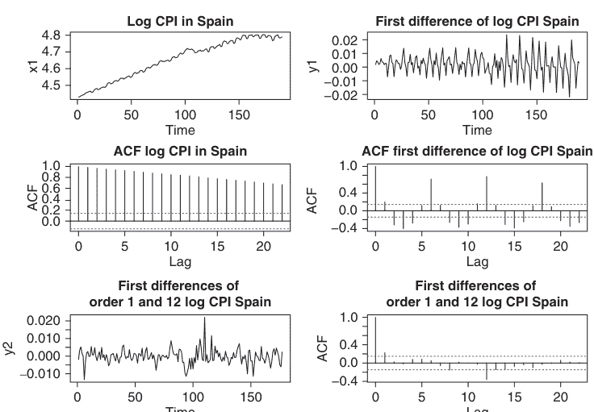

图 2.16 西班牙消费者价格指数系列不同变换的图表和 ACF。

```
> y2=diff(y1,lag=12)
> ts.plot(y2, main="first differences of order 1 and 12 log CPI Spain")
> acf(y2, main="first differences of order 1 and 12 log CPI Spain")
> sarimaSpec(x1)
Selected differencing order (d,D): 1 1
Selected order (p,d,q,P,D,Q): 0 1 1 0 1 1
minimum criterion: -1457.766
```

## 2.5 结构和状态空间模型

### 2.5.1 结构时间序列模型

建模非平稳线性时间序列的另一种方法是假设该系列是确定性成分、周期性成分和不规则成分之和。确定性成分可能包含时间趋势，通常假设为线性。周期性成分由一些谐波函数或哑变量组成，不规则成分采用 ARMA 模型的形式。这种方法被称为 *结构方法*，所考虑的模型称为 *结构模型*。参见 Harrison and Stevens (1976)、West and Harrison (2006) 和 Harvey (1990) 等。结构时间序列模型采用以下形式

```
$$z_t = \mu_t + S_t + I_t,$$ (2.57)
```

其中 \(\mu_t\) 表示 \(z_t\) 的趋势，\(S_t\) 是周期性（或季节性）成分，\(I_t\) 是不规则成分，可能是白噪声。Eq. (2.57) 中 \(z_t\) 各成分的函数形式取决于应用，但有一些通用函数可用。趋势的典型表述为

```
$$\mu_t = \mu_{t-1} + \beta_{t-1} + v_t,$$ (2.58)

$$\beta_t = \beta_{t-1} + u_t,$$
```

其中 \(\mu_t\) 是趋势水平，\(\beta_t\) 表示趋势增长率，\(u_t\) 和 \(v_t\) 是两个白噪声系列，通常假设相互独立。如果 \(u_t\) 和 \(v_t\) 的方差为零，则趋势具有恒定增长率，因为 \(\beta_t\) 此时是常数。一般来说，Eq. (2.58) 中的模型表示随机二次趋势，在大多数应用中足够灵活。例如，如果对所有 \(t\) 都有 \(\beta_t = 0\) 且 \(v_t\) 的方差为正，则 \(z_t\) 的趋势遵循随机游走。

周期性或季节性成分通常使用随机季节性求和函数进行建模。设 \(S_t\) 为时间索引 \(t\) 处的季节性成分，并假设季节性为 \(s\)，则 \(S_t\) 遵循以下模型

```
$$\sum_{j=0}^{s-1} S_{t-j} = S_s(B)S_t = \epsilon_t,$$ (2.59)
```

其中

```
$$S_s(B) = 1 + B + \cdots + B^{s-1},$$
```

是阶数为 \(s\) 的季节性求和算子。噪声 \(\epsilon_t\) 的方差 \(\sigma_\epsilon^2\) 控制季节性系数的变异性，如果 \(\sigma_\epsilon^2 = 0\)，则季节性模式是确定性的。不规则成分 \(I_t\) 遵循具有创新项 \(a_t\) 的常规 ARMA 模型，

```
\(\phi(B)I_t = \theta(B)a_t.\)
(2.60)
```

创新项 \(v_t, u_t, \epsilon_t,\) 和 \(a_t\) 是独立的白噪声过程。Eqs. (2.57)-(2.60) 共同构成结构时间序列表示。在特殊情况下 \(I_t = a_t\)，结构模型仅包含四个参数，即四个创新项的方差。

可以轻松看出，任何结构时间序列模型都有隐含的 ARIMA 表示。例如，为简单起见，假设 \(I_t = a_t\)。对 (2.57) 取二阶差分并使用 Eqs. (2.58)-(2.60)，可得

```
\(\nabla^2 z_t = u_t + \nabla v_t + \nabla^2 S_t + \nabla^2 a_t.\)
(2.61)
```

注意到

```
\(\nabla_s \equiv 1 - B^s = (1-B)(1 + B + \cdots + B^{s-1}) = (1-B)S_s(B),\)
```

并将 \(S_s(B)\) 应用于 Eq. (2.61)，进一步可得

```
\(\nabla \nabla_s z_t = S_s(B)u_t + \nabla_s v_t + \nabla^2 \epsilon_t + \nabla \nabla_s a_t,\)
```

这表明 \(\nabla \nabla_s z_t\) 是四个最大阶数为 \(s+1\) 的有限阶 MA 过程之和，因此可以写成 MA(\(s+1\)) 模型。事实上，在某些条件下，结构模型系列 \(z_t\) 将遵循航空公司模型，即 ARIMA(\(0, 1, 1\))_s \times (0, 1, 1)_1\) 模型。有关季节性结构模式与季节性 ARIMA 模型之间关系的分析，请参见 Proietti (2000)。

### 2.5.2 状态空间模型

线性时间序列模型的一个通用框架是状态空间模型（SSM）。确实，结构时间序列模型是 SSM 的特例，ARMA 模型也可以转换为 SSM。假设我们观察到一个时间序列向量 \(z_t\)，可以通过观测方程表示：

```
\(z_t = H_t \alpha_t + \epsilon_t,\)
(2.62)
```

其中 \(z_t\) 是 \(k \times 1\) 观测向量，\(H_t\) 是对所有 \(t\) 都假设已知的 \(k \times p\) 矩阵，\(\alpha_t\) 是未观测的 \(p \times 1\) 状态向量，\(\epsilon_t\) 是白噪声过程，为简单起见，遵循多元分布 \(N(\mathbf{0}, V_t)\)，其中 \(V_t\) 表示协方差矩阵。状态向量 \(\alpha_t\) 被假设随时间根据以下状态转移方程演变

```
\(\alpha_t = \Omega_t \alpha_{t-1} + u_t,\)
(2.63)
```

其中 \(\Omega_t\) 是已知的 \(p \times p\) 转移矩阵，\(u_t\) 是另一个分布为 \(N_p(\mathbf{0}, \mathbf{R}_t)\) 且与 \(\epsilon_t\) 独立的白噪声过程。联合 Eqs. (2.62) 和 (2.63) 被称为 SSM。状态概念乍一看可能令人困惑，但一旦我们

稍后将看到一些具体示例。暂且可以说，状态向量 \(\boldsymbol{\alpha}_t\) 包含在预测原点 \(t\) 处预测 \(\boldsymbol{z}_{t+1}\) 所需的信息。考虑一个简单的零均值 AR(2) 模型，

\(z_t = \phi_1 z_{t-1} + \phi_2 z_{t-2} + a_t.\)

在预测原点 \(t\) 处对 \(z_{t+1}\) 的一步先行预测是 \(\widehat{z}_t(1) = \phi_1 z_t + \phi_2 z_{t-1}\)。该量可以在预测原点处计算，因为我们知道模型并且拥有 \(z_t\) 和 \(z_{t-1}\)。因此，给定模型，要在预测原点 \(t\) 处计算 AR(2) 模型的一步先行预测，我们需要两个量 \(z_t\) 和 \(z_{t-1}\)。因此，我们可以定义状态向量为 \(\boldsymbol{\alpha}_t = (z_t, z_{t-1})'\)。由于 \(z_t\) 是 \(\boldsymbol{\alpha}_t\) 的第一个元素，观测方程简单为

\(z_t = [1, 0]\boldsymbol{\alpha}_t,\)

这意味着 \(\boldsymbol{\varepsilon}_t\) 的方差为零。AR(2) 模型的状态方程也易于构造为

\(\boldsymbol{\alpha}_t = \begin{bmatrix} z_t \\ z_{t-1} \end{bmatrix} = \begin{bmatrix} \phi_1 & \phi_2 \\ 1 & 0 \end{bmatrix} \begin{bmatrix} z_{t-1} \\ z_{t-2} \end{bmatrix} + \begin{bmatrix} a_t \\ 0 \end{bmatrix} .\)

对于公式 (2.62) 和 (2.63) 中的 SSM，我们假设对于所有 \(t\)，矩阵 \(\boldsymbol{H}_t\) 和 \(\boldsymbol{\Omega}_t\) 是已知的。在实际应用中，在某些条件下，它们的参数可以从数据中一致地估计。我们稍后讨论估计问题。目前，我们提供有关 SSM 一般性的进一步信息。假设我们在每个时间 \(t\) 通过测量变量 \(\boldsymbol{z}_t\) 观测空间中卫星的位置，\(\boldsymbol{z}_t\) 是一个三维向量（例如经度、纬度和高度），可能包含一些观测误差，这些误差被假定与卫星的实际位置无关。我们还假设卫星的位置取决于一组状态变量 \(\boldsymbol{\alpha}_t\)，这些变量不可观测，例如地球引力以及卫星的速度和加速度。我们的观测数据 \(\boldsymbol{z}_t\) 通过由 \(\boldsymbol{H}_t\) 近似的某些空气动力学力与 \(\boldsymbol{\alpha}_t\) 相关，即

\(\boldsymbol{z}_t = \boldsymbol{H}_t \boldsymbol{\alpha}_t + \boldsymbol{\varepsilon}_t,\)

其中 \(\boldsymbol{\varepsilon}_t\) 表示观测误差。由于卫星将以某种平滑的方式运动，状态变量 \(\boldsymbol{\alpha}_t\) 应该取决于时间 \(t-1\) 时的过去值以及时间 \(t\) 的某些额外扰动。因此，可以合理地假设 \(\boldsymbol{\alpha}_t\) 可以由公式 (2.63) 中的状态转移方程建模。因此，公式 (2.62) 和 (2.63) 中的 SSM 可用于研究过程 \(\boldsymbol{z}_t\)。在这个特定示例中，我们没有对状态向量 \(\boldsymbol{\alpha}_t\) 提供精确的定义。在这个过程中，我们通常寻找一个状态向量 \(\boldsymbol{\alpha}_t\)，使其达到最小维度，即任何维度小于 \(p\) 的状态向量都不能充分表示所研究的系统。上述简单的 AR(2) 示例作为一个例子，因为没有维度为 1 的状态向量能充分表示 \(z_t\) 过程。

结构时间序列模型可以表示为状态空间形式。例如，考虑一个周期性为 \(s = 12\) 且不规则分量 \(I_t = a_t\) 的月度时间序列，我们可以定义状态变量为

\(\boldsymbol{\alpha}_t = (\mu_t, \beta_t, S_t, S_{t-1}, \dots, S_{t-10})'\)

其中包含 \(\mu_t, \beta_t\) 和 11 个季节系数。然后，状态转移方程变为

\(\left[\begin{array}{ c }
\mu_t \\
\beta_t \\
S_t \\
S_{t-1} \\
\vdots \\
S_{t-10}
\end{array}\right] = \left[\begin{array}{ c c c c c c }
1 & 1 & 0 & \cdots & 0 & 0 \\
0 & 1 & 0 & \cdots & 0 & 0 \\
0 & 0 & -1 & \cdots & -1 & -1 \\
0 & 0 & 1 & \cdots & 0 & 0 \\
\vdots & \vdots & \vdots & \ddots & \vdots & \vdots \\
0 & 0 & 0 & \cdots & 1 & 0
\end{array}\right] \left[\begin{array}{ c }
\mu_{t-1} \\
\beta_{t-1} \\
S_{t-1} \\
S_{t-2} \\
\vdots \\
S_{t-11}
\end{array}\right] + \left[\begin{array}{ c }
v_t \\
u_t \\
e_t \\
0 \\
\vdots \\
0
\end{array}\right],\)

或

\(\boldsymbol{\alpha}_t = \mathbf{\Omega} \boldsymbol{\alpha}_{t-1} + \boldsymbol{u}_t,\) (2.64)

其中，在这种情况下，矩阵 \(\mathbf{\Omega}_t = \mathbf{\Omega}\) 是一个常数矩阵，向量 \(\boldsymbol{u}_t\) 只有三个非零分量。观测方程可以写为

\(z_t = \mathbf{h}' \boldsymbol{\alpha}_t + a_t,\) (2.65)

其中 \(\mathbf{h}' = (1, 0, 1, 0, \dots, 0)\) 是一个与状态向量 \(\boldsymbol{\alpha}_t\) 具有相同维度的常数向量。

ARMA\((p, q)\) 模型可以根据数据分析的目标写成多种形式的 SSM。假设我们有兴趣对 AR\((p)\) 过程进行在线估计。那么，我们可以将观测方程写为

\(z_t = \mathbf{h}'_t \boldsymbol{\alpha}_t + a_t,\)

其中 \(\mathbf{h}_t = (z_{t-1}, \dots, z_{t-p})'\) 和 \(\boldsymbol{\alpha}_t = (\phi_1, \dots, \phi_p)'\)，这是一个常数向量。状态转移方程简单为 \(\boldsymbol{\alpha}_t = \boldsymbol{\alpha}_{t-1}\)。如下一节将看到的，由 AR 参数组成的状态向量可以通过卡尔曼滤波算法在新观测可用时进行更新。

一般来说，我们可以通过以下过程将 ARMA\((p, q)\) 模型表示为状态空间形式。令 \(m = \max(p, q+1)\) 并定义状态向量为 \(\boldsymbol{\alpha}_t = (\alpha_{1t}, \alpha_{2t}, \dots, \alpha_{mt})'\)，其中 \(\alpha_{1t} = z_t\)，而 \(j > 1\) 时的 \(\alpha_{jt}\) 将很快定义。根据 \(\boldsymbol{\alpha}_t\) 的定义，观测方程简单为

\(z_t = \mathbf{h}' \boldsymbol{\alpha}_t,\)

其中 \(\mathbf{h}' = (1, 0, \dots, 0)\)。没有观测误差。

为方便起见，理解为 \(i > p\) 时 \(\phi_i = 0\) 且 \(j > q\) 时 \(\theta_j = 0\)。为了推导状态向量 \(\boldsymbol{\alpha}_t\) 的其他元素和状态转移方程，我们从 \(\alpha_{1t} = z_t\) 开始，并将模型改写为

\(\alpha_{1t} = \phi_1 z_{t-1} + \sum_{i=2}^m \phi_i z_{t-i} - \sum_{j=1}^m \theta_j a_{t-j} + a_t\)
\(= \phi_1 \alpha_{1,t-1} + \alpha_{2,t-1} + a_t,\) (2.66)

其中 \(\alpha_{2,t-1} = \sum_{i=2}^m \phi_i z_{t-i} - \sum_{j=1}^m \theta_j a_{t-j}.\)

接下来，考虑

\(\alpha_{2t} = \sum_{i=2}^m \phi_i z_{t+1-i} - \sum_{j=1}^m \theta_j a_{t+1-j}\)
\(= \phi_2 z_{t-1} + \sum_{i=3}^m \phi_i z_{t+1-i} - \sum_{j=2}^m \theta_j a_{t+1-j} - \theta_1 a_t\)
\(= \phi_2 \alpha_{1, t-1} + \alpha_{3, t-1} - \theta_1 a_t,\) (2.67)

其中 \(\alpha_{3, t-1} = \sum_{i=3}^m \phi_i z_{t+1-i} - \sum_{j=2}^m \theta_j a_{t+1-j}\)。可以重复相同的过程来定义 \(\alpha_{4, t-1}\) 并找到方程 \(\alpha_{3t} = \phi_3 \alpha_{1, t-1} + \alpha_{4, t-1} - \theta_2 a_t\)。由于 \(m\) 是有限的，上述过程最终以 \(\alpha_{mt} = \phi_m \alpha_{1, t-1} - \theta_m a_t\) 结束。将 \(\alpha_{it}\) 的递归定义及其关联方程结合起来，我们得到以下状态转移方程

\(\begin{bmatrix} \alpha_{1,t} \\ \alpha_{2,t} \\ \alpha_{3,t} \\ \vdots \\ \alpha_{m,t} \end{bmatrix} = \begin{bmatrix} \phi_1 & 1 & 0 & \cdots & 0 \\ \phi_2 & 0 & 1 & \cdots & 0 \\ \phi_3 & 0 & 0 & \cdots & 0 \\ \vdots & \vdots & \vdots & \ddots & 1 \\ \phi_m & 0 & 0 & \cdots & 0 \end{bmatrix} \begin{bmatrix} \alpha_{1, t-1} \\ \alpha_{2, t-1} \\ \alpha_{3, t-1} \\ \vdots \\ \alpha_{m, t-1} \end{bmatrix} + \begin{bmatrix} 1 \\ -\theta_1 \\ -\theta_2 \\ \vdots \\ -\theta_m \end{bmatrix} a_t\)

定义常数状态空间矩阵 \(\Omega_t\) 为

\(\Omega_t = \begin{bmatrix} \phi_{m-1} & \mathbf{I} \\ \phi_m & \mathbf{0}' \end{bmatrix},\)

其中 \(\phi_{m-1}\) 是一个 \((m-1)\) 维列向量，\(\mathbf{I}\) 是 \((m-1) \times (m-1)\) 单位矩阵，\(\mathbf{0}'\) 是一个 \((m-1)\) 维零向量。还定义创新向量为

\(\mathbf{u}_t = \theta a_t,\)

其中 \(\theta = (1, -\theta_1, \dots, -\theta_m)'\)，并将 \(\mathbf{u}_t\) 的协方差矩阵表示为

\(\mathbf{R}_t = \theta \theta' \sigma^2.\)

我们可以看到，ARMA 模型的状态转移方程为

\(\alpha_t = \Omega \alpha_{t-1} + \mathbf{u}_t,\)

其中随机向量 \(\mathbf{u}_t\) 的均值为零，协方差矩阵为 \(\mathbf{R}_t\)，在这种情况下该矩阵是一个常数矩阵。

还有其他方法将 ARMA\((p, q)\) 模型表示为 SSM。有兴趣的读者可参考 Durbin and Koopman (2001)、Brockwell and Davies (2013)、Shumway and Stoffer (2017) 以及 Tsay (2010) 等文献。一般来说，对于 ARMA\((p, q)\) 模型，状态向量 \(\alpha_t\) 的维度为 \(\max\{p, q+1\}\)。

基于公式 (2.62) 和 (2.63) 中的 SSM，有三种可用的统计推断类型。第一种推断类型是预测，它利用观测数据 \(F_t = \{..., z_{t-2}, z_t\}\) 来预测 \(z_{t+1}\)。第二种推断类型称为滤波，它利用可用信息 \(F_t\) 来估计 \(\alpha_t\)，该状态可能无法直接

可观测。第三种推断类型是 *平滑*，它利用 $F_T$ 中可用的信息来估计 $\alpha_t$，其中 $T > t$。下文讨论的卡尔曼滤波器算法是进行这些统计推断的有用工具。该算法还可以用于在参数估计中高效地评估对数似然函数。

### 2.5.3 卡尔曼滤波器

卡尔曼滤波器是一种用于状态空间模型（SSM）中线性系统预测和参数估计的快速递归算法。该滤波器具有直观的贝叶斯解释，并可通过多元正态分布的性质轻易推导。该算法分三步运行。首先，利用关于当前状态的可用信息预测未来状态。其次，利用观测方程预测新的数据点。第三，一旦观测到新数据，便利用新数据中包含的信息更新状态向量。这三步被迭代以构成卡尔曼滤波器算法。

假设我们已观测到数据 $F_{t-1} = \{z_1, \dots, z_{t-1}\}$，并从中计算出状态向量的估计值 $\widehat{\alpha}_{t-1}$。我们希望利用 $F_{t-1}$ 中的可用信息来预测下一状态向量，记为 $\widehat{\alpha}_{t|t-1}$。在均方误差损失下，该预测是给定 $F_{t-1}$ 时 $\alpha_t$ 在 (2.63) 中的条件期望。即，

$\widehat{\alpha}_{t|t-1} = \Omega_t \widehat{\alpha}_{t-1},$ (2.68)

其中默认 $\widehat{\alpha}_{t-1|t-1} = \widehat{\alpha}_{t-1}$。令 $S_{t|t-1}$ 表示 $\widehat{\alpha}_{t|t-1}$ 在给定 $F_{t-1}$ 下的条件协方差矩阵，由

$S_{t|t-1} = E[(\alpha_t - \widehat{\alpha}_{t|t-1})(\alpha_t - \widehat{\alpha}_{t|t-1})' | F_{t-1}].$

根据 (2.68) 和 (2.63)，

$\alpha_t - \widehat{\alpha}_{t|t-1} = \Omega_t(\alpha_{t-1} - \widehat{\alpha}_{t-1}) + u_t.$

将上述表达式代入 $S_{t|t-1}$ 的定义，并利用 $S_{t-1} = S_{t-1|t-1}$，得到

$S_{t|t-1} = \Omega_t S_{t-1} \Omega_t' + R_t.$ (2.69)

该方程具有清晰的直观解释：利用可用信息 $F_{t-1}$ 预测新状态的不确定性，等于利用相同信息对前一状态所具有的不确定性（由 $S_{t-1}$ 衡量）与状态方程噪声的不确定性 $R_t$ 之和。矩阵 $\Omega_t$ 出现是为了关联时刻 $t-1$ 和时刻 $t$ 的状态向量分量。若该矩阵为单位矩阵，即 $\Omega_t = I$，则状态向量将像随机游走一样演变，状态估计的不确定性将通过矩阵 $R_t$ 的累加持续增加。由于 $\Omega_t$ 通常不是单位矩阵，不确定性的增加取决于其结构。例如，若假设 AR(1) 模型，则状态向量为标量，且 $\Omega_t = \phi < 1$。估计的方差遵循过程 $s_{t|t-1} = \phi^2 s_{t-1} + \sigma^2$，且仅有 $t-1$ 时刻的一部分不确定性传递到时刻 $t$。

卡尔曼滤波器的第二步是在给定 $F_{t-1}$ 的情况下预测新的观测值 $z_t$。该预测再次利用给定 $F_{t-1}$ 的条件期望计算，根据观测方程，我们得到

$\widehat{z}_{t|t-1} = E(z_t | F_{t-1}) = H_t' \widehat{\alpha}_{t|t-1}.$ (2.70)

该预测的不确定性取决于预测误差的协方差矩阵，即，
\( e_t = z_t - \hat{z}_{t|t-1} \)。

定义
\( P_{t|t-1} = E[e_t e_t'],\) (2.71)

其可按以下方式得到。将观测方程 (2.62) 减去预测 (2.70)，得
\( e_t = z_t - \hat{z}_{t|t-1} = H_t(\alpha_t - \hat{\alpha}_{t|t-1}) + \epsilon_t.\) (2.72)

将此表达式代入 \( P_{t|t-1} \) 的定义，得到
\( P_{t|t-1} = H_t S_{t|t-1} H_t' + V_t.\) (2.73)

方程 (2.73) 表明，预测 \( \hat{z}_{t|t-1} \) 的不确定性是状态向量的不确定性与测量误差之和。来自状态估计的预测误差根据矩阵 \( H_t \) 进行调制。若 \( H_t \) 是单位矩阵，意味着观测 $z_t$ 是状态向量的测量值加上随机误差，则观测的测量误差被加到状态变量的误差上。

滤波器的第三步也是最后一步是利用新信息更新状态估计。假设 $z_t$ 已被观测，可用信息变为 \( F_t = (F_{t-1}, z_t) \)。新的状态估计 \( \hat{\alpha}_t = \hat{\alpha}_{t|t} = E(\alpha_t|F_t) \) 通过回归（或利用多元正态分布的性质）计算，如下

\( E(\alpha_t|F_{t-1}, z_t) = E(\alpha_t|F_{t-1})\)
\( + \text{Cov}(\alpha_t, z_t|F_{t-1})\text{Var}(z_t|F_{t-1})^{-1}(z_t - E(z_t|F_{t-1})).\) (2.74)

在上述方程中，期望 \( E(\alpha_t|F_{t-1}) = \hat{\alpha}_{t|t-1} \) 和 \( E(z_t|F_{t-1}) = \hat{z}_{t|t-1} \) 已知，矩阵 \( \text{Var}(z_t|F_{t-1}) = P_{t|t-1} \) 亦然。剩下需要计算的是状态与新观测之间的协方差，其由

\( \text{Cov}(\alpha_t, z_t|F_{t-1}) = E[(\alpha_t - \hat{\alpha}_{t|t-1})(z_t - \hat{z}_{t|t-1})'] = E[(\alpha_t - \hat{\alpha}_{t|t-1})e_t'],\)

以及根据公式 (2.72)

\( \text{Cov}(\alpha_t, z_t|F_{t-1}) = E[(\alpha_t - \hat{\alpha}_{t|t-1})((\alpha_t - \hat{\alpha}_{t|t-1})'H_t' + e_t')] = S_{t|t-1}H_t'.\) (2.75)

方程 (2.75) 成立是因为观测误差 \( e_t' \) 是白噪声且与 \( \alpha_t - \hat{\alpha}_{t|t-1} \) 独立。将此协方差代入 (2.74)，可写为：
\( \hat{\alpha}_t = \hat{\alpha}_{t|t-1} + K_t(z_t - \hat{z}_{t|t-1}),\) (2.76)

其中 \( K_t \) 是回归系数矩阵，称为滤波器的 *卡尔曼增益*，由
\( K_t = S_{t|t-1}H_t'P_{t|t-1}^{-1}.\) 给出

方程 (2.76) 表明，我们对先前状态估计所做的修订取决于预测误差，\( e_t = z_t - \hat{z}_{t|t-1} \)。若此误差为零，则不修改估计，因为没有新信息可用。否则，我们对状态估计进行修订，其取决于状态估计的不确定性 \( S_{t|t-1} \) 与预测误差的精度 \( P_{t|t-1}^{-1} \) 之比。矩阵 \( H_t' \) 使我们能够比较这两个矩阵。方程 (2.76) 的等价写法为

\(\hat{\alpha}_t = (I - K_t H_t)\hat{\alpha}_{t|t-1} + K_t z_t,\)

这表明状态估计是我们可用的两种信息来源的线性组合。一方面是先验估计 \( \hat{\alpha}_{t|t-1} \)，另一方面是观测值 \( z_t \)。可以证明，两种信息来源的权重等于它们的相对精度。该估计的条件协方差矩阵为

\( S_t = E[(\alpha_t - \hat{\alpha}_t)(\alpha_t - \hat{\alpha}_t)'|F_t]. \)

将 \( \hat{\alpha}_t \) 替换为方程 (2.76) 中的表达式，得

\( S_t = E[(\alpha_t - \hat{\alpha}_{t|t-1} - K_t e_t)(\alpha_t - \hat{\alpha}_{t|t-1} - K_t e_t)'|F_t], \)

利用 (2.71) 和 (2.75)，最终得到

\( S_t = S_{t|t-1} - S_{t|t-1}H_t'P_{t|t-1}^{-1}H_tS_{t|t-1} = (I - K_t H_t)S_{t|t-1}. \quad (2.77) \)

由方程 (2.68)-(2.70)、(2.76) 和 (2.77) 组成的系统称为卡尔曼滤波器算法。为启动算法，必须为状态变量 \( \alpha_0 \) 和协方差矩阵 \( S_0 \) 赋予初始值。这些初始值并不关键，因为滤波器对初始条件不高度依赖。有兴趣了解算法实现的读者可参考 Young (1984)、Harvey (1990) 以及 Gómez 和 Maravall (1994)。与卡尔曼滤波器算法对应，还有用于滤波和平滑的递归算法。有兴趣的读者可参阅 Tsay (2010, 第11章) 以及其他有关状态空间模型的教材。

## 2.6 利用线性模型进行预测

### 2.6.1 计算最优预测器

给定一个等间距观测值 \( z_T = (z_1, \dots, z_T) \) 的标量时间序列 \( z_t \) 的实现，我们的目标是预测 \( z_{T+h} \)，其中 \( h \) 是正整数，称为 *预测期限*，\( T \) 称为 *预测起点*。在本节中，我们关注线性预测器，即可用数据的线性组合，并采用最小平方预测误差（MSPE）准则。即，我们使用平方损失函数。这主要是为了简便，且在文献中也常用。用 \( \hat{z}_T(h) \) 表示最优点预测。不难看出，在 MSPE 准则下，有 \( \hat{z}_T(h) = E(z_{T+h}|z_T) \)，预测误差 \( e_T(h) \) 由

\( e_T(h) = z_{T+h} - \hat{z}_T(h). \quad (2.78) \)

假设数据由 ARIMA(\( p, d, q \)) 过程生成，\( \phi_p(B)\nabla^d z_t = c + \theta_q(B)a_t \)，参数已知，包括 \( a_t \) 的方差。令 \( \varphi_m(B) = \phi_p(B)\nabla^d \) 为通过相乘得到的阶数 \( m = p + d \) 的 AR 算子


平稳 AR(p) 算符和差分算符 $(1-B)^d$。则，

$$z_{T+h} = c + \sum_{i=1}^m \varphi_i z_{t+h-i} + a_{T+h} - \sum_{j=1}^q \theta_j a_{T+h-j}. \quad (2.79)$$

对 Eq. (2.79) 在给定 $z_T$ 下取条件期望，并记 $\hat{a}_T(j) = E(a_{t+j}|z_T)$，可得

$$\hat{z}_T(h) = c + \sum_{i=1}^m \varphi_i \hat{z}_T(h-i) - \sum_{j=1}^q \theta_j \hat{a}_T(h-j), \quad h > 0, \quad (2.80)$$

其中约定 $\hat{z}_T(j) = z_{T+j}$ 当 $j \le 0$，$\hat{a}_T(j) = 0$ 当 $j > 0$ 且 $\hat{a}_T(j) = a_{t+j}$ 当 $j \le 0$。在实践中，$a_t$ 表示对于 $t = 1, ..., T$ 可用的残差，使用估计参数和某些初始值。$a_t$ 的初始值假设为零，即 $j \le 0$ 时 $a_j = 0$，而 $z_t$ 的初始值可设为零或 $z_t$ 的样本均值，前提是该序列平稳。对于足够大的预测原点 $T$，初始值的影响不显著。对于 $j > 0$ 的预测 $\hat{z}_T(j)$ 可通过 Eq. (2.80) 递�计算。

为了说明，考虑一个平稳 ARMA(1,1) 模型。创新项 $a_2, ..., a_T$ 通过以下方式递�计算

$$a_t = z_t - c - \phi z_{t-1} + \theta a_{t-1}, \quad t=2, ..., T$$

且对于 $t=1$ 我们有

$$a_1 = z_1 - c - \phi z_0 + \theta a_0,$$

其中 $z_0$ 和 $a_0$ 均未知。为了求得 $a_1$，我们可以将 $z_0$ 和 $a_0$ 均设为它们的无条件期望。具体地，我们设 $a_0 = 0$，因为 $E(a_0) = E(a_t) = 0$，并设 $z_0 = c/(1-\phi)$，因为在平稳性下 $E(z_0) = E(z_t) = c/(1-\phi)$。

总之，给定一个 ARIMA 模型和 $a_t$ 与 $z_t$ 的某些初始值，我们可以递�计算创新项 $a_2, ..., a_T$。因此，对于 $j = 1, ..., h$ 的点预测 $\hat{z}_T(j)$ 也可以通过 Eq. (2.80) 递�计算。此外，我们还可以相应地通过 Eq. (2.78) 计算对应的预测误差。特别是，我们有

$$e_T(1) = z_{T+1} - \hat{z}_T(1) = a_{T+1},$$

这意味着，在模型参数已知的情况下，创新项 $a_{T+1}$ 可以解释为一步先验预测误差。此时 $z_t$ 的一步先验预测的方差为 $\sigma^2$。

Eq. (2.80) 指出，对于 $h > q$，点预测 $\hat{z}_T(h)$ 并不显式依赖于 ARIMA 模型的 MA 部分。点预测将完全由模型的 AR 部分确定。确实，对于 $h > q$，点预测 $\hat{z}_T(h)$ 满足差分方程

$$\hat{z}_T(h) = c + \varphi_1 \hat{z}_T(h-1) + \cdots + \varphi_m \hat{z}_T(h-m). \quad (2.81)$$

由于在应用中预测原点 $T$ 是固定的，我们可以将后推算符应用于预测期。具体地，定义

$$B\hat{z}_T(h) = \hat{z}_T(h-1),$$

此时，Eq. (2.81) 写为

\(\phi(B)\nabla^d \hat{z}_T(h) = c, \quad h > q.\) (2.82)

此方程被称为 *最终预测方程*，因为它支配着当 $h$ 增加且大于 $q$ 时点预测 \(\hat{z}_T(h)$ 的行为。此差分方程的解呈现形式（参见附录 2.A），

\(\hat{z}_T(h) = A_0^{(T)} + A_1^{(T)} h + \cdots + A_{d-1}^{(T)} h^{d-1} + \sum_{i=1}^p B_i^{(T)} G_i^h,\)

其中 \(A_{d-1}^{(T)} = c$，\(i = 0, \dots, d-2\) 时的 \(A_i^{(T)}$ 是依赖于预测原点 \(T$ 的常数，且 \(B_i^{(T)}\) 和 \(G_i^h\) 是先前讨论过的差分方程 \(\phi(B) = 0\) 的解。具体地，解包含两部分；第一部分由差分算符 \(\nabla^d\) 生成，第二部分由 \(\phi(B)\) 生成，表示指数衰减（对于实根）和正弦函数（对于复共轭根）的混合。特别是，若 \(d = 2\)，长期预测将包含固定斜率 \(c$ 的线性时间趋势。对于季节性模型，最终预测方程为

\(\Phi(B^s)\phi(B)\nabla_s\nabla^d \hat{z}_T(h) = c, \quad h > M,\)

其中 \(M = q + Qs$ 是 MA 多项式的阶。请注意，\(\nabla_s x_t = 0$ 的解满足 \(x_t = x_{t-s}$，这些是每 \(s$ 个周期重复一次的季节性系数。因此，长期预测可写为

\(\hat{z}_T(h) = T_T(h) + S_T(h) + N_T(h),\)

其中 \(T_T(h) = A_0^{(T)} + A_1^{(T)} h + \cdots + c h^{d-1}$ 是多项式趋势，\(S_T(h)$ 包含与时期 \(T+h$ 对应的季节性分量，而不规则分量 \(N_T(h)$ 是随着 \(h$ 增加衰减至零的指数衰减和正弦函数的混合。模型结构将决定季节性系数如何随时间变化。

### 2.6.2 预测的方差

对于 ARIMA 模型，预测的方差易于计算。设 \(z_t = c + \psi(B)a_t\) 为模型的 MA(\(\infty\)) 表示，其中若 \(z_t\) 平稳则 \(c$ 表示均值，否则 \(c$ 为常数。则，

\(z_{T+h} = c + a_{T+h} + \psi_1 a_{T+h-1} + \cdots + \psi_{h-1} a_{T+1} + \sum_{i=0}^\infty \psi_{h+i} a_{T-i}.\) (2.83)

对 Eq. (2.83) 在给定 \(z_T\) 下取条件期望，可见

\(\hat{z}_T(h) = c + \sum_{i=h}^\infty \psi_i a_{T+h-i}.\) (2.84)

因为当 \(j > 0$ 时 \(E(a_{T+j}) = 0$。因此，预测误差为

\(e_T(h) = z_{T+h} - \hat{z}_T(h) = a_{T+h} + \psi_1 a_{T+h-1} + \cdots + \psi_{h-1} a_{T+1},\)

且预测误差的方差为

\(\text{Var}[e_T(h)] = \sigma^2(1 + \psi_1^2 + \cdots + \psi_{h-1}^2). \tag{2.85}\)

由 Eq. (2.85) 可见，点预测 \(\widehat{z}_T(h)$ 的不确定性是 \(h$ 的非递减函数。对于线性模型，这是合理的，因为我们对遥远的未来比对近期的未来更不确定。该方程还表明，平稳模型与非平稳模型之间预测的不确定性有显著差异。对于平稳模型，当 \(h \to \infty$ 时 \(\psi_h \to 0$，预测的长期方差收敛于一个常数，即过程的边缘方差。回顾，对于平稳序列 \(z_t$，\(\text{Var}(z_t) = \sigma^2 \sum_{i=0}^{\infty} \psi_i^2$，其中 \(\psi_0 = 1$。

此外，由 Eq. (2.84) 可见，对于平稳过程，当 \(h \to \infty$ 时 \(\widehat{z}_T(h) \to c$，其中 \(c = E(z_t)$ 为序列的均值。在金融文献中，这种现象被称为平稳序列的 *均值回归*。

最后，若进一步假设过程 \(z_t$ 服从正态分布，则我们可以利用 Eqs. (2.84) 和 (2.85) 在预测原点 \(T$ 处构建 \(z_{T+h}$ 的区间预测。具体地，一个 \(100(1 - \alpha)$ 百分比区间预测为

\(\widehat{z}_T(h) \pm \lambda_{1-\alpha/2} \sqrt{\text{Var}[e_T(h)]},\)

其中 \(\lambda_\gamma$ 表示标准正态分布的 \(100(1 - \gamma)$ 分位数。

### 2.6.3 可预测性度量

一个平稳 ARMA 过程 \(z_t$ 可分解为

\(z_t = \widehat{z}_{t-1}(1) + a_t,\)

其中 \(\widehat{z}_{t-1}(1)$ 是在已知序列过去值和模型参数情况下的一步先验预测，而 \(a_t$ 是与序列过去值独立的创新项。因此，我们有

\(\sigma_z^2 = \sigma_{\widehat{z}}^2 + \sigma^2,\)

这将序列的方差 \(\sigma_z^2$ 分解为两个独立的变异源：(1) 可预测部分的方差 \(\sigma_{\widehat{z}}^2$，以及 (2) 不可预测部分的方差 \(\sigma^2$。Box 和 Tiao (1977) 提出使用可预测部分方差与总方差的商来度量平稳序列的可预测性，即

\(P = \frac{\sigma_{\widehat{z}}^2}{\sigma_z^2} = 1 - \frac{\sigma^2}{\sigma_z^2}. \tag{2.86}\)

显然，\(0 \le P \le 1$，它类似于线性回归分析中的决定系数。确实，它指示了序列方差中可由其历史解释的比例。对于 ARMA 过程，\(\sigma_{\widehat{z}}^2 = \sigma^2 \sum \psi_i^2$，系数 \(P$ 可写为

\(P = 1 - \left( \sum \psi_i^2 \right)^{-1}.\)


例如，对于AR(1)过程，由于 \(\sigma_z^2 = \sigma^2/(1 - \phi^2)\)，我们有
\(P = 1 - (1 - \phi^2) = \phi^2\)。

如果参数 \(\phi\) 接近零，则该过程接近白噪声，其可预测性应接近零。如果 \(\phi\) 接近一，则该过程接近随机游走，且系数 \(P\) 接近1。

度量 \(P\) 对于非平稳ARIMA过程无帮助，因为此时边际方差趋于无穷大，且 \(P\) 的值始终为1。为了推广可预测性度量，可以仔细检查公式 (2.86) 中使用的量。考虑方差比 \(\sigma^2/\sigma_z^2\)。分子是1步先验预测误差的方差，而分母是无限预测步距的预测误差方差。因此，\(P\) 也可以解释为从长期预测（无限预测步距）到短期预测（1步先验预测）时预测变异性的相对减少。因此，可预测性度量的一种可能推广是延长分子的预测步距，同时缩短分母的预测步距。

Diebold and Kilian (2001) 定义了具有预测步距 \(h\) 的时间序列的可预测性，如下所示：
\(P_h(a) = 1 - \frac{\text{Var}[e_t(h)]}{\text{Var}[e_t(h + a)]}\)

其中 \(h\) 和 \(a\) 均为正整数。公式 (2.86) 的可预测性是 \(h = 1\) 且 \(a \rightarrow \infty\) 的极限情况。统计量 \(P_h(a)\) 衡量当预测步距从 \(h\) 增加到 \(h + a\) 时预测误差变异性的增加。

只要 \(a\) 和 \(h\) 是有限的，度量 \(P_h(a)\) 对 ARIMA 模型就有定义良好。考虑公式 (2.85) 给出的 \(h\)-步先验预测误差的方差。很容易看出，
\(P_h(a) = 1 - \frac{\sum_{i=0}^h \psi_i^2}{\sum_{i=0}^{h+a} \psi_i^2} = \frac{\sum_{i=h+1}^{h+a} \psi_i^2}{\sum_{i=0}^{h+a} \psi_i^2}\),

其中 \(\psi_0 = 1\)。

## 2.7 一组时间序列的建模

考虑一组 \(k\) 个标量时间序列 \(\{z_{it}|i=1, \dots, k; t=1, \dots T\}\)。本节的目标是探索数据的基本特征，对各个系列建模，并总结结果。在实际应用中，这 \(k\) 个系列可能具有不同的样本量，或者在不同时间跨度内观察。在这种情况下，需要进行一些预筛选，将这 \(k\) 个系列分成子组，使得每个子组包含在相同时间跨度内观察并具有大致相同样本量的系列。

所提分析的第一步是使用第2.1节讨论的图形可视化这一组系列。如前所述，这些图形可以揭示存在粗大测量误差和其他异质性来源的系列。如果某些系列包含小比例的随机缺失值或异常数据点，例如 <10%，则建议应用插值来清理这些异常数据。对于缺失值 \(z_\nu\)，最简单的插值是使用平均值 \((z_{\nu-1} + z_{\nu+1})/2\)，前提是 \(\nu \neq 1\) 或 \(T\)。将在第4章中看出，如果时间序列 $z_t$ 遵循随机游走，则此解是最优的。在某些情况下，插值可能需要几次迭代才能妥善处理一批缺失值。如果缺失值或异常观测的比例较高，例如 > 25%，则需要特别小心地处理异常数据。有关可以处理缺失值和异常值的统计方法，请参见第4章。

如果时间序列 \(k\) 的数量不大，可以对每个单独的系列进行详细分析，并相应地总结所得模型。另一方面，当 \(k\) 很大时，手动对各个系列建模不可行，或者太耗时，需要自动建模程序。已提出了几种自动ARIMA建模程序，例如由Gómez和Maravall (1994)开发的TRAMO程序，这是一种先驱方法，广泛用于分析经济时间序列。下一节中提出的自动建模程序基于此及其他先前的方法。它专注于处理包含许多时间序列的大数据集，并包含三个步骤。第一步称为识别或分类，探索各个系列对数据变换的需求。它还研究为了实现弱平稳性所需的差分程度。该步骤还包括为正在研究的系列指定一组有限的ARIMA模型。指定的集合通常是通过选择ARIMA模型的 \(p\)、\(d\) 和 \(q\) 的最大值来完成的。

第二步称为估计和模型选择。对所有指定模型的参数进行估计，并选择最佳模型。估计是使用具有高斯似然函数的准最大似然（ML）方法进行的，最佳模型是通过信息准则选择的。第三步是诊断检查或验证。使用多个检验统计量检查每个系列所选模型的充分性。目标是验证所选模型满足基本假设且没有严重不足。如果发现所选模型存在一些缺陷，则相应地改进模型。最后，所选的最佳模型或一组模型用于预测。接下来，我们将更详细地描述此程序的三个步骤。

然而，请记住，不存在适用于所有应用的最佳自动建模程序。事实上，使用自动程序可能需要付出代价，因为真实数据的复杂性可能会超过给定自动建模程序的能力。例如，大多数自动程序（包括接下来介绍的程序）只允许一个季节周期，但实际上季节性时间序列可以有多个季节周期。考虑第1章讨论的PM2.5每小时测量值。经验表明，这种时间序列可能同时具有昼夜和年度周期，季节周期分别为24和8760（365 x 24）。

### 2.7.1 数据变换

为所提自动程序做出的第一个决定是是否对观察到的系列进行变换，目标是使用一个随时间保持方差不变的系列。对于许多经验时间序列，变异性往往随系列水平而增加，以至于在某一时刻系列的标准差 \(\sigma_t\) 是均值 \(\mu_t\) 的函数。即，

\(\sigma_t \propto \mu_t^{\alpha},\)
(2.87)

其中 \(\alpha\) 是实数。在这种情况下，可以证明（Box和Cox，1964），以下幂变换

\(y_t = \frac{x_t^{1-\alpha} - 1}{1 - \alpha},\)
(2.88)

可以使 \(y_t\) 具有大致恒定的变异性。由公式 (2.88) 定义的Box-Cox变换家族 \(y_t\) 包含变量的幂，并且当 \(\alpha \to 1\) 时，\(y_t = \ln(z_t)\)，为简单起见，我们假设 \(z_t > 0\)。参数 \(\alpha\) 可以通过对观测值进行连续同质分组，计算每组的标准差（记为 \(s_i\)）和均值（记为 \(\bar{x}_i\)），并拟合线性回归

\(\log s_i = \beta_0 + \widehat{\beta}_1 \log \bar{x}_i, \quad i = 1, \dots, g,\)
(2.89)

其中 \(g\) 是组数，使用普通最小二乘（LS）方法。然后可以用公式 (2.89) 的 \(\widehat{\beta}_1\) 来估计公式 (2.87) 中的 \(\alpha\)。

关于变换的一些说明。首先，如果有人担心异常值或测量误差对变换决策的影响，他/她可以使用一些稳健估计量来估计每组的尺度和位置，而不是使用标准差和均值。例如，可以使用组MAD，定义为

\(\text{MAD}(x_1, \dots, x_n) = \text{median}\{|x_i - \text{median}_j(x_j)|\},\)

并将缩放参数选择为0.6745×MAD，将组中位数作为位置参数。其次，如果系列 \(k\) 的数量较大，对所有系列运行回归 (2.89) 可能太耗时。为了简化计算，在所提程序中我们只考虑 \(\alpha\) 的四个可能值。它们是 \(\alpha = 0\)（无变换）、\(\alpha = 0.5\)（平方根）、\(\alpha = 1\)（对数）和 \(\alpha = 2\)（逆变换）。这四种变换在实践中更容易解释。第三，有了 \(\alpha\) 的四个可能值，我们使用以下程序来确定变换。考虑假设 \(H_{10} : \beta_1 = 0\)；\(H_{20} : \beta_1 = 1\)；\(H_{30} : \beta_1 < 1\)；和 \(H_{40} : \beta_1 > 1\)。从 \(H_{10}\) 开始。如果假设未被拒绝，则我们不进行变换并停止程序。如果 \(H_{10}\) 被拒绝，我们考虑 \(H_{20}\)。如果该假设未被拒绝，我们采用对数变换并终止程序。如果 \(H_{20}\) 被拒绝，我们考虑 \(H_{30}\)。如果假设未被拒绝，我们采用平方根变换；否则，我们采用逆变换。第四，建议对数据进行分组，使每组尽可能同质。对于周期性为 \(s\) 的季节性系列，每组的大小应该是 \(s\) 的倍数，以便至少包含一个完整季节。此外，组数 \(g\) 应至少为7，以便有足够的数据点来估计公式 (2.89) 中的回归。对于非季节性系列，我们取 \(n_g \ge 6\) 个相邻观测值来形成一组，并要求 \(g \ge 7\)，因此我们假设样本量 \(T\) 至少为42，以考虑检查数据变换。


### 2.7.2 检验白噪声

在所提程序中，第二个需要做出的决定是检验给定时间序列是否为白噪声。为此，我们应用基于秩的Ljung–Box统计量\(Q(m)\)，若\(Q(m) > \chi_m(0.05)\)则拒绝白噪声假设，其中\(\chi_m(0.05)\)表示自由度为\(m\)的卡方分布的95%分位数。对于给定的时间序列\(\{z_t | t = 1, ..., T\}\)，基于秩的ACF是其对应秩时间序列的ACF，通过用\(z_t\)在样本中的秩替换\(z_t\)得到。已发现基于秩的ACF对异常值具有鲁棒性，因而得到的Ljung–Box统计量不要求\(z_t\)的任何矩存在。参见Dufour and Roy (1985)、Tsay (2010)及其中的参考文献。在程序中，我们使用\(m = 12\)。此步骤很重要，因为对于检测到的白噪声序列不需要进一步建模。

### 2.7.3 差分阶数的确定

对于非白噪声序列，第三个需要做出的决定是确定差分阶数以实现弱平稳性。即，对于非季节性序列，选择ARIMA模型中的\(d\)；对于具有单一周期性\(s\)的季节性序列，选择\(d\)和\(D\)。为此，我们对非季节性时间序列采用广为人知的扩展Dickey–Fuller单位根检验。参见Dickey and Fuller (1979)。具体地，考虑模型

\(\nabla z_t = c + \alpha z_{t-1} + \sum_{j=1}^{\ell} \phi_j \nabla z_{t-j} + a_t,\)

其中\(\ell\)为非负整数，并检验原假设\(H_0 : \alpha = 0\)对立假设\(H_a : \alpha < 0\)。使用的检验统计量是\(\alpha\)的最小二乘估计量的t比值，即\(t = \hat{\alpha} / s(\hat{\alpha})\)。在\(H_0\)下，t比值渐近地遵循标准布朗运动（或维纳过程）的一个函数，其临界值已在文献中列出。再次参见Dickey and Fuller (1979)。原假设\(H_0\)在t比值较大时被拒绝。在所提程序中，若\(t < -3.43\)则拒绝\(H_0\)。这大致相当于使用1%的I类错误。这种I类错误的选择基于以下考虑：对于标量时间序列预测而言，过度差分通常优于差分不足。I类错误0.05和0.025也可用。由于\(\ell\)未知，我们使用自动AR误差选择来确定其值。另一种方法是预先固定\(\ell\)，例如\(\ell = 2\)，从而得到模型

\(\nabla z_t = c + \alpha z_{t-1} + \beta_1 \nabla z_{t-1} + \beta_2 \nabla z_{t-2} + a_t, \quad (2.90)\)

以便在选择\(d\)时进行推断。若原假设\(H_0\)被拒绝，则无需差分，即\(d = 0\)。另一方面，若\(H_0\)未被拒绝，则\(d \ge 1\)，我们重复检验过程，以\(\nabla z_t\)作为观测序列。单位根检验的第二阶段使我们能够确定\(d = 1\)或\(d = 2\)。经验表明，\(d = 1\)在商业和经济序列中很常见，但\(d \ge 2\)很少见。在大多数应用中，可以省略第二阶段检验。

对于季节性时间序列\(z_t\)，季节期\(s > 1\)，令\(\nabla z_t = (1-B)z_t, \nabla_s z_t = (1-B^s)z_t\)，和 \(y_t = \nabla_s \nabla z_t = (1-B)(1-B^s)z_t\)。我们采用模型

\(y_t = c + \alpha_s \nabla z_{t-s} + \alpha_r z_{t-1} + \sum_{j=1}^{\ell} \phi_j y_{t-j} + a_t, \quad \ell \ge 0, \quad (2.91)\)

并考虑\(\alpha_1\)和\(\alpha_2\)的最小二乘估计量的t比值作为单位根检验统计量。具体地，令\(t_s = \hat{\alpha}_s/\text{std}(\hat{\alpha}_s)\)和 \(t_r = \hat{\alpha}_r/\text{std}(\hat{\alpha}_r)\)。若\(t_s \ge -3.43\)，则需要季节差分，即\(D = 1\)，否则，\(D = 0\)。同样，若\(t_r \ge -3.43\)，则\(d = 1\)，否则\(d = 0\)。若\(d = 1\)和 \(D = 0\)，则我们使用\((1 - B)z_t\)作为观测序列来检验是否需要第二阶常规差分。若\(d = D = 1\)，则不检验第二阶常规差分，因为序列已包含差分因子\((1 - B)^2\)。

### 示例 2.5

为了说明所提的数据变换与差分方法，我们考虑文件`Stock_indexes_99world.csv`中由每日世界股票指数组成的99个系列的数据集。有关数据的更多信息，参见第1章。这些99个系列的时序图可在那里找到。该书开发的R程序中用于检查可能变换的程序称为`chktrans`。所用命令的详细信息及结果如下：

```
>WStock <- read.csv2("Stock_indexes_99world.csv", header=FALSE)
>x=WStock
>x=x[,-1] ## Remove the time index
> out=chktrans(x, output=F)
Transformed series are in the output.
> names(out)
> out$Summary
[1] 47 12 40
> out$lnTran ## Series that require log-transformation
[1] 3 9 10 11 14 21 25 26 29 32 33 34 35 36 40 42 45 47 53 54
55 57 58 59 60 62 64 65 67 69 73 75 81 83 84 85 86 87 89 90
92 93 94 95 97 98 99
> length(out$lnTran)
[1] 47
> out$sqrtTran ## Series that require square-root transformation
[1] 20 41 48 49 56 61 66 70 71 79 80 96
> out$noTran ## Series that require no transformation.
[1] 1 2 4 5 6 7 8 12 13 15 16 17 18 19 22 23 24 27 28 30
31 37 38 39 43 44 46 50 51 52 63 68 72 74 76 77 78 82 88 91
> length(out$noTran)
[1] 40
```

摘要显示，47个系列需要对数变换，12个系列需要平方根变换，40个系列不需要任何变换。程序输出还标识了每个组中的系列。该书开发的R程序中用于分类平稳或单位根非平稳系列的R命令称为`SummaryModel`。事实上，该命令还识别每个单独系列的ARIMA模型。这里我们仅将其用于分类目的。考虑99个股票指数系列的差分阶数。为简化起见，我们对每个股票指数系列进行对数变换，因为收益率系列通常用于金融研究。命令的输出如前述。由此可见，所有系列都需要一阶差分才能平稳。

```
>lx=log(x)
>out1=SummaryModel(lx) All series are nonstationary
Number of first-differenced series: 99
```

### 2.7.4 模型识别

这是所提自动建模程序的一个重要步骤。其目标是为非季节性系列指定阶数(p, q)，并为季节性系列指定阶数(p, q)和 (P, Q)。理想情况下，我们希望尝试尽可能多的候选模型，但由于过拟合困难和计算时间限制等各种问题，需要一些限制来缩小考虑的模型范围。为此，我们指定p和q的最大值，分别记为p_max和q_max，并估计所有可能的模型，其中0 <= p <= p_max和0 <= q <= q_max。然后，我们使用诸如贝叶斯信息准则（BIC）之类的信息准则来进行模型选择。为了便于计算，尤其是当k较大时，我们设置(p_max, q_max) = (5,3)。对于季节性时间序列，我们也指定P和Q的最大值。更具体地，在我们的程序中，对于季节性时间序列，我们设置(p_max, d, q_max) = (2, 1, 3)和 (P_max, D, Q_max) = (1, 1, 1)。这些最大阶数为默认值，如有需要可更改。

## 2.8 估计与信息准则

### 2.8.1 条件似然

在正态性假设下，指定ARIMA模型的估计通常通过条件最大似然法进行。对于AR模型，可以使用最小二乘法且速度更快。这里我们简要概述似然函数方法。为简化起见，我们定义z'_t = (z_s, z_{s+1}, ..., z_n)'为时间序列z_t从时间索引s到n的数据收集向量。假设我们想要为平稳高斯系列omega'_1 = (omega_1, ..., omega_T)'估计一个零均值AR(p)模型。在实践中，omega_t可能是z_t的差分系列，即omega_t = \nabla^d z_t。对于AR(p)模型，当t > p时，条件密度函数f(omega_t|omega'_{t-1})服从均值为phi'_p omega^{t-p}_{t-1}且方差为sigma^2的正态分布，其中phi_p = (phi_1, ..., phi_p)'。因此，

$$f(\omega^T_1) = f(\omega_1, ..., \omega_p) \prod_{t=p+1}^T f(\omega_t | \omega^{t-p}_{t-1}).$$

由于p是固定的，当T较大时，似然函数将由上述方程的第二项主导。然后可以专注于条件似然函数，即f(\omega^T_{p+1} | \omega^p_1)来进行估计。对数似然函数则变为

$$L_C(\phi_p, \sigma^2) = -\frac{(T-p)}{2} \ln \sigma^2 - \frac{1}{2} \sum_{t=p+1}^T \frac{(\omega_t - \phi'_p \omega^{t-p}_{t-1})^2}{\sigma^2}.$$

定义W = [\omega^T_{p+1}, ..., \omega^T_T]。我们可以将条件对数似然函数表示为矩阵形式

$$L_C(\phi_p, \sigma^2) = -\frac{(T-p)}{2} \ln \sigma^2 - \frac{1}{2\sigma^2}(\omega^T_{p+1} - W\phi_p)'(\omega^T_{p+1} - W\phi_p).$$


对 $\boldsymbol{\phi}_p$ 求导并令其为零，我们得到

$$
\frac{\partial L_C(\boldsymbol{\phi}_p, \sigma^2)}{\partial \boldsymbol{\phi}_p} = 0 = -\boldsymbol{W}'\boldsymbol{\omega}_{p+1}^T + \boldsymbol{W}'\boldsymbol{W}\hat{\boldsymbol{\phi}}_p, \tag{2.92}
$$

因此，

$$
\hat{\boldsymbol{\phi}}_p = (\boldsymbol{W}'\boldsymbol{W})^{-1}\boldsymbol{W}'\boldsymbol{\omega}_{p+1}^T, \tag{2.93}
$$

这是 AR($p$) 模型中 $\boldsymbol{\phi}_p$ 的最小二乘（LS）估计，可以轻松高效地计算。该估计的协方差矩阵由

$$
\text{Cov}(\hat{\boldsymbol{\phi}}_p) = (\boldsymbol{W}'\boldsymbol{W})^{-1}\widehat{\sigma}_a^2, \tag{2.94}
$$

其中

$$
\widehat{\sigma}_a^2 = \frac{1}{T-p} \sum_{t=p+1}^T (\omega_t - \hat{\boldsymbol{\phi}}'_p \boldsymbol{\omega}_{t-1})^2. \tag{2.95}
$$

估计量 $\hat{\boldsymbol{\phi}}_p$ 和 $\widehat{\sigma}_a^2$ 是一致的，且当 $p/T$ 较小时，它们与精确似然估计值接近。

对于 ARMA($p$, $q$) 模型，似然函数关于 MA 参数是非线性的，但 Hannan and Rissanen (1982) 提出了一种快速 LS 估计方法。这是一种近似方法，包含两个步骤。第一步，拟合高阶 AR($p_o$) 模型以获得残差。理想情况下，$p_o > p + q$ 且残差不应具有序列相关性。将残差表示为 $\hat{b}_t$，它用作创新项 $a_t$ 的代理。第二步，考虑模型

$$
w_t = \phi_1 w_{t-1} + \cdots + \phi_p w_{t-p} + \alpha_1 \hat{b}_{t-1} + \cdots + \alpha_q \hat{b}_{t-q} + a_t, \tag{2.96}
$$

并应用 LS 估计。系数 $\hat{\phi}_i$ 和 $-\hat{\alpha}_i$ 分别作为 $\phi_i$ 和 $\theta_i$ 参数的估计量。随着 $p_o$ 随样本量 $T$ 增加，人们期望该方法能产生平稳 ARMA($p$, $q$) 模型的良好估计。在实践中，该方法可用于为 ML 估计提供良好的初始参数估计，尤其是对于向量 ARMA 模型。参见 Tsay (2014)。

在实践中，高阶 $p_o$ 可通过信息准则选择。随后可以使用 AR($p_o$) 残差作为创新项 $a_t$ 的代理，并利用 Eq. (2.96) 估计低阶 ARMA($p$, $q$) 模型。然后可利用估计结果计算 ARMA 模型选择的信息准则。当时间序列数量 $k$ 较大时，这种近似方法可能很有用。

### 2.8.2 在线估计

一旦 ARMA 模型已被估计，当有新观测值可用时，我们可以通过条件似然方法进行快速更新估计。这种在线估计在实践中很有用。假设我们已使用样本 $\omega_t^T$ 估计了参数，并观察到新数据 $\omega_{T+1}$。我们不是重新估计模型，而是可以使用卡尔曼滤波器更新参数。我们先介绍 AR($p$) 模型的情况。使用第 2.4.3 节的方程，观测方程现在为 $\omega_t = \boldsymbol{h}'_t\boldsymbol{\alpha}_t + a_t$，其中 $\boldsymbol{h}'_t = (\omega_{t-1}, \dots, \omega_{t-p})$ 且 $\boldsymbol{\alpha}_t = (\phi_{1,t}, \dots, \phi_{p,t})'$，状态转移方程为 $\boldsymbol{\alpha}_t = \boldsymbol{\alpha}_{t-1}$。在第 2.4.2 节的一般状态表示中，我们有 \(\Omega_t = I\)，\(R_t = 0\)，\(H_t = h'_t\) 和 \(V_t = \sigma^2\)。时刻 \(T\) 的参数（或状态向量）估计由 Eq. (2.93) 给出。换句话说，我们有

$$
\alpha_T = \widehat{\phi}_{p,T} = (W'_T W_T)^{-1} W'_T \omega^T_{p+1},
$$

其中下标 \(T\) 用于表示数据 \(\omega^T_1$，相关的协方差矩阵为

$$
S_{T+1|T} = S_T = \text{Cov}(\widehat{\phi}_{p,T}) = (W'_T W_T)^{-1} \sigma^2_{a,T}.
$$

在预测原点 \(T\) 处，新观测值 \(\omega_{T+1}$ 的预测误差为

$$
e_{T+1} = \widehat{a}_{T+1|T} = \omega_{T+1} - \widehat{\phi}_{p,T} \omega^T_{T-p+1}, \tag{2.97}
$$

方差为（参见 Eq. (2.73)）

$$
\begin{aligned}
p_{T+1|T} &= E(e^2_{T+1}) = [(\omega^T_{T-p+1})'(W'_T W_T)^{-1}(\omega^T_{T-p+1}) + 1]\widehat{\sigma}^2_{a,T} \\
&= (1 + h_{T+1|T})\widehat{\sigma}^2_{a,T},
\end{aligned} \tag{2.98}
$$

其中

$$
h_{T+1|T} = (\omega^T_{T-p+1})'(W'_T W_T)^{-1}(\omega^T_{T-p+1}),
$$

且给定 $\omega_{T+1}$ 时，参数的新估计为

$$
\alpha_{T+1} = \widehat{\phi}_{p,T+1} = \widehat{\phi}_{p,T} + (W'_T W_T)^{-1} \omega^T_{T-p+1} e_{T+1} / (1 + h_{T+1|T}). \tag{2.99}
$$

需要注意的是，参数的变化与预测误差 \(e_{T+1}$ 成正比，如果预测误差为零，则参数不更新。否则，参数更新取决于回归变量向量 \(\omega^T_{T-p+1}$。参数的新协方差矩阵由

$$
S_{T+1} = (W'_{T+1} W_{T+1})^{-1} \widehat{\sigma}^2_{a,T+1}, \tag{2.100}
$$

可以写为

$$
S_{T+1} = (W'_T W_T)^{-1} \widehat{\sigma}^2_{a,T} [I - \omega^T_{T-p+1} (\omega^T_{T-p+1})'(W'_T W_T)^{-1} / (1 + h_{T+1|T})]. \tag{2.101}
$$

由于 \(\widehat{\sigma}^2_a(T) = \sum^T_{t=p+1} (\omega_t - \widehat{\phi}'_p(T) \omega^{t-p}_{t-1})^2 / (T - p)\) 和 \(\widehat{\sigma}^2_a(T+1) = \sum^{T+1}_{t=p+1} (\omega_t - \widehat{\phi}'_p(T+1) \omega^{t-p}_{t-1})^2 / (T + 1 - p)\) 已知，我们可以通过 Eqs. (2.100) 和 (2.101) 计算 \((W'_{T+1} W_{T+1})^{-1}$，而无需直接计算逆矩阵。

对于 ARMA 模型，也可以通过使用线性模型表示 Eq. (2.96) 推导近似更新方案。事实上，Eqs. (2.97) 到 (2.99) 给出的更新算法由 Plackett (1950) 对任何形式为 \(y_t = x'_t \beta_t + u_t$ 的线性模型得到。令 \(e_{T+1} = y_{T+1} - x'_{T+1} \widehat{\beta}_T$，更新为

$$
\widehat{\beta}_{T+1} = \widehat{\beta}_T + (X'_T X_T)^{-1} x_{T+1} e_{T+1} / (1 + h_{T+1|T}), \tag{2.102}
$$

其中 \( h_{T+1|T} = \boldsymbol{x}'_{T+1}(\boldsymbol{X}'_T \boldsymbol{X}_T)^{-1} \boldsymbol{x}_{T+1} $，且

$$
(\boldsymbol{X}'_{T+1} \boldsymbol{X}_{T+1})^{-1} = (\boldsymbol{X}'_T \boldsymbol{X}_T)^{-1} [\boldsymbol{I} - \boldsymbol{x}_{T+1} \boldsymbol{x}'_{T+1} (\boldsymbol{X}'_T \boldsymbol{X}_T)^{-1} / (1 + h_{T+1|T})] \frac{\hat{\sigma}^2_{a,T}}{\hat{\sigma}^2_{a,T+1}}, \tag{2.103}
$$

这些与 Eqs. (2.99) 和 (2.101) 相似。

### 2.8.3 最大似然（ML）估计

对于平稳序列 \(\omega_t$ 的 ARMA 模型，ML 估计通过将数据的联合概率密度函数分解为条件和边缘密度函数的乘积，并对参数进行最大化来进行。数据被视为固定。\(\boldsymbol{\omega}^T_1$ 的联合密度函数为

$$
f(\boldsymbol{\omega}^T_1) = f(\omega_1)f(\omega_2|\omega_1)f(\omega_3|\omega_2,\omega_1) \cdots f(\omega_T|\omega_{T-1}, \dots, \omega_1).
$$

并且，在联合正态性下，所有涉及的条件分布都是正态分布，其期望为 1 步先验预测

$$
E(\omega_t|\omega_{t-1}, \dots, \omega_1) = \widehat{\omega}_{t|t-1}(1) = \omega_{t|t-1}.
$$

令 \( e_{t|t-1} \) 为利用 \(\boldsymbol{\omega}^{t-1}_1$ 的信息并给定过程参数时 \(\omega_t$ 的 1 步先验预测误差。因此，

$$
e_{t|t-1} = \omega_t - \omega_{t|t-1}.
$$

这些预测误差与过程的创新项 \( a_t \) 高度相关，但它们不相同，因为它们取决于初始值。将 \(\sigma^2 v_{t|t-1}$ 称为这些预测误差的方差，ARMA 过程数据的联合密度函数可以写为

$$
f(\boldsymbol{\omega}^T_1) = \prod_{t=1}^T \sigma^{-1} v^{-1/2}_{t|t-1} (2\pi)^{-1/2} \exp \left\{ - \frac{1}{2\sigma^2} \sum_{t=1}^T \frac{(\omega_t - \omega_{t|t-1})^2}{v_{t|t-1}} \right\},
$$

其中 \( v_{1|0} \) 和 \( \omega_{1|0} \) 是初始值。取自然对数并令 \( \boldsymbol{\beta} = (\mu, \sigma^2, \phi_1, \dots, \phi_p, \theta_1, \dots, \theta_q) $ 为待估计参数向量，待最大化的 ARMA 模型对数似然函数为

$$
L(\boldsymbol{\beta}) = -\frac{1}{2} T \ln \sigma^2 - \frac{1}{2} \sum_{t=1}^T \ln v_{t|t-1} - \frac{1}{2} \sum_{t=1}^T \frac{e^2_{t|t-1}}{\sigma^2 v_{t|t-1}}. \tag{2.104}
$$

在实践中，通过将模型置于状态空间形式并使用卡尔曼滤波器，可以对给定参数值高效计算似然函数。读者可参阅第 2.4 节讨论的算法，该算法提供了一种快速递归方法来计算 \(\omega_{t|t-1}$ 和 \(\sigma^2 v_{t|t-1}$。精确似然函数的最大化使用非线性优化算法进行（参见 Box et al., 2015; Shumway and Stoffer, 2017）。


### 2.8.4 模型选择

假设我们已通过 ML 方法估计了一组 ARMA(p, q) 模型，其中 $0 \le p \le p_{\max}$ 且 $0 \le q \le q_{\max}$。将估计的模型记为 $M_1, ..., M_m$，我们希望选择对观测序列解释最好或提供最佳预测的模型。请记住，样本内拟合最好或似然最大的模型不一定能产生最佳的样本外预测，因为参数更多的模型往往具有更小的平方误差和。为选择合适的模型，我们可以使用模型选择准则或样本外预测。模型选择可以从经典或贝叶斯观点进行。从经典方法开始，我们可以选择具有更好预期样本外预测性能的模型。该方法导出赤池信息准则 (AIC)。从贝叶斯方法，我们可以在估计的模型上赋予前验概率，例如 $i = 1, ..., m$ 的 $P(M_i)$，并选择在给定数据下后验概率最大的模型。即，我们为 $i = 1, ..., m$ 计算，

$$P(M_i|\omega_T) = \frac{P(\omega_1^T|M_i)P(M_i)}{\sum_{i=1}^m P(\omega_1^T|M_j)P(M_j)}$$

并选择在数据视角下概率最大的模型。该方法不要求序列平稳，因此可以视为比较具有不同差分阶数的模型的方法，因而可作为单位根检验的替代方法。如果假设所有模型的前验概率相等，该方法导出 BIC。详情如下。选择最佳模型的另一种方法是基于样本外预测性能，这类似于交叉验证。我们将在下文介绍三种模型选择方法。

最后，与其选择单一模型，不如使用模型混合并利用所有涉及的模型生成预测。这种预测方法称为模型平均，在应用中已被证明很有用。

#### 2.8.4.1 赤池信息准则 (AIC)

可以证明，如果通过 ML 方法估计模型参数，然后计算关于未来观测的似然期望，则得到

$$AIC(h) = \frac{1}{T}E(-2L(B)) = \ln \hat{\sigma}_{MV}^2 + \frac{2h}{T}, \quad (2.105)$$

其中 $T$ 是用于估计模型的样本量，$\hat{\sigma}_{MV}^2$ 是创新项方差的 ML 估计量，$h$ 是计算一步前瞻预测时的估计参数个数。因此，选择期望似然最大的模型等同于选择使 AIC 最小的模型。该准则源于 Akaike (1973)，在某些条件下是渐进有效的，因为它选择预测误差更小的模型。然而，如果存在真模型，则 AIC 不是渐进一致的，因为当样本量增长时，它不能以概率 1 选择正确模型。

在式 (2.105) 中，第一项 $\ln \hat{\sigma}_{MV}^2$ 衡量模型的拟合优度，第二项 $2h/T$ 称为惩罚项。该准则寻求对数据拟合良好的模型，但偏好参数化简洁的模型。所有信息准则都共享这种分解，但不同准则使用不同的惩罚项。请注意，如果 $h$ 固定，则惩罚项随样本量趋于零；当 $h$ 和 $T$ 均增长，但 $h/T$ 趋于 $c$ 时，惩罚项趋于 $2c$。

若按 AIC 比较模型，重要的是 $T$（用于估计模型的有效观测值数量）在所有模型中应相同。平稳数据点的数量等于原始数据减去 $d+sD$，其中 $d$ 表示常差阶数，$s$ 是季节周期，$D$ 是季节差分阶数。如果通过精确 ML 估计模型，则可以计算所有数据点的残差，因此有效数据点数为 $T-d-sD$。如果考虑差分阶数不同的模型，并令 $d_{\max}$ 和 $D_{\max}$ 表示所涉模型的最高差分阶数，则有效数据点数为

\( T_0 = T - d_{\max} - sD_{\max}. \) (2.106)

#### 2.8.4.2 贝叶斯信息准则 (BIC)

Schwarz (1978) 使用贝叶斯方法提出了另一种准则。该准则旨在最大化模型的后验概率 \( P(M_i|\omega_1^T) \)，假设所有模型的前验概率相同。由于 \( P(M_i|\omega_1^T) \) 与 \( P(\omega_1^T|M_i)P(M_i) \) 成正比，若前验概率相同，则模型的后验概率与 \( P(\omega_1^T|M_i) \) 成正比。选择最大化该概率的模型等同于选择最小化 \( -\frac{2}{T} \ln P(\omega_1^T|M_i) \) 的模型。可以证明，用参数的 ML 估计量替换参数后，渐进最小化该量的模型即最小化下列准则的模型

\( \text{BIC}(h) = \ln \hat{\sigma}^2_{\text{MV}} + \frac{h \ln T}{T}, \) (2.107)

其中，如前所述，$T$ 是样本量，$\hat{\sigma}^2_{\text{MV}}$ 是创新项方差的 ML 估计量，$h$ 是参数个数。该准则是渐进一致的，当 $T \rightarrow \infty$ 时，以概率 1 选择真模型（如果存在）。

若比较式 (2.107) 和 (2.105)，可看出 BIC 对引入新参数的惩罚比 AIC 更重；因此，它倾向于选择更简洁的模型。在两种准则中，若 $h$ 固定，惩罚项会随样本量趋于零。然而，当 $h$ 和 $T$ 均增长但 $h/T$ 趋于 $c$ 时，AIC 惩罚趋于 $2c$，而 BIC 趋于 $c \ln(T)$，当 $\ln(T) > 2$ 时，BIC 惩罚大于 AIC 惩罚。如同比较 AIC 一样，要比较拟合时间序列的各模型的 BIC，$T$ 的大小必须使用式 (2.106) 计算。模拟表明，BIC 准则在选择 ARIMA 模型的正确阶数方面似乎表现更好（例如见 Lütkepohl, 1985）。请记住，在实际应用中不存在真模型，因此一致性可能不是比较 AIC 和 BIC 时使用的良好属性。

#### 2.8.4.3 其他准则

文献中提出了若干其他信息准则。其中一些是现有准则的修改。例如，当样本量较小时 AIC 效果不佳，因此 Hurvich and Tsai (1989) 提出了一种修改方法以改进其在小样本下的性能。所得准则称为 AIC\(_c\)。另见 Bengtsson and Cavanaugh (2006)。

Hannan and Quinn (1979) 提出了一种惩罚项大于 AIC 但小于 BIC 的准则。Hannan–Quinn (HQ) 准则为

\( \text{HQ}(h) = \ln \hat{\sigma}^2_{\text{MV}} + \frac{2h \ln(\ln T)}{T} . \)

当 \( T > 15 \) 时，其惩罚项大于 AIC，但当 $T$ 较大时，远小于 BIC。该准则是渐进一致的且效率很高。事实上，惩罚项 $\ln(\ln T)$ 是信息准则保持一致性所需的最小惩罚速率。

#### 2.8.4.4 交叉验证

模型选择的另一种方法是将数据分为两部分，在第一部分中估计模型，在第二部分中计算预测误差。假设我们从一个估计或训练子样本 \(\{\omega_1, \dots, \omega_{T_1}\}\) 和一个验证/测试部分 \(\{\omega_{T_1+1}, \dots, \omega_T\}\) 开始。从预测起点 \(T_1\) 开始，使用训练样本中的前 \(T_1\) 个观测值估计每个模型，并计算多个预测期限 \(h\) 的预测误差，记为 \(e_{T_1}^{M_i}(\ell)\)，其中 \(M_i\) 表示所用模型，\(\ell\) 为预测期限，\(\ell = 1, \dots, h\)。接着，将预测起点增加 1，即 \(T_1 + 1\)，并使用前 \(T_1 + 1\) 个观测值重新估计模型，计算 \(\ell\)-步前瞻预测误差，\(\ell = 1, \dots, h\)。将预测误差记为 \(\ell = 1, \dots, h\) 的 \(e_{T_1+1}^{M_i}(\ell)\)。重复此估计-预测过程，直到到达最后可用的预测起点 \(T - 1\)，并计算最后一个观测值的 1-步前瞻预测误差 \(e_{T-1}^{M_i}(1)\)。

一般而言，对于给定的预测期限 \(h\)，我们有 \(j = 0, 1, \dots, T - T_1 - h\) 的样本外预测误差 \(\{e_{T_1+j}^{M_i}(h)\}\)。\(h\)-步平均平方预测误差 (MSFE) 可按下式计算

\(\text{Var}[e^{M_i}(h)] = \frac{1}{(T - T_1 - h + 1)} \sum_{j=1}^{T-T_1-h} [e_{T_1+j}^{M_i}(h)]^2. \quad (2.108)\)

若关注 \(h\)-步前瞻预测，则可选择 \(\text{Var}[e^{M_i}(h)]\) 最小的模型。请注意，通常使用 \(h=1\)，但视目标而定也可选择其他值。如果数据确实由底层真模型生成，则预测误差应表现一致，即在所有预测期限下均在相同模型上提供最小 MSFE。尽管如此，在实际应用中，若不存在真模型，预测误差可能针对不同期限选择不同模型（见 Tiao and Xu, 1993）。显然，MSFE 可能取决于预测起点 \(T_1\) 的选择。没有明显的选择适用于所有情况。在实践中，\(T_1\) 通常满足 \(T/2 \le T_1 \le 3T/4\)，其中 \(T_1 = 2T/3\) 常被使用。可以证明，在大样本下，交叉验证方法与模型选择准则等价。

### 示例 2.6

我们使用一组世界股票指数时间序列来说明模型选择。这使用本书开发的三个 R 命令中的一个来完成。第一个命令是 `arimaspec`，它为一组非季节性时间序列中的每个单独序列自动指定模型。该命令实现了前几节讨论的建模程序。第二个命令是 `sarimaspec`，它使用本书讨论的程序对季节性时间序列进行模型选择。第三个命令是 `arimaID`，它检查给定时间序列是否具有给定的季节性。最后，为本书开发的命令 `Summary-Model` 用于提供模型规范摘要


对所有 99 个时间序列。此命令汇总了命令 arimaSpec 的结果。

这三个命令使用 R 的内置命令 `arima` 进行时间序列估计，它为给定的时间序列估计指定的 ARIMA 模型。因此，我们简要说明 R 的 `arima` 命令。该命令执行 ARIMA 模型的 ML 估计。必须给出模型的阶数。对于常规 ARIMA 模型，阶数由子命令 `order=c (p, d, q)` 指定。对于季节性 ARIMA 模型，还需要使用以下子命令指定模型的季节部分：

```
seasonal=list(order=c(P,D,Q),period=s) .
```

关于 `arima` 命令需要提及三个重要问题。首先，该命令使用略有不同的模型公式。例如，ARIMA(1,0,1) 模型写作

(1 - \phi_1 B)(z_t - \mu) = (1 + \theta_1 B)a_t.

因此，该命令的 MA 参数输出是书中使用的 MA 系数的负值。也就是说，MA 系数涉及符号变化。其次，均值 \(\mu\) 在 `arima` 命令的输出中称为 *截距*。第三，如果 d = 1 或 D = 1，`arima` 命令自动将 \(\mu\) = 0。因此，当数据中存在漂移时，使用 `arima` 命令必须小心。

接下来，我们使用示例 2.5 中世界股票指数的第一系列来演示所提议的自动建模过程。R 命令如下：

```
> lx=log(x)
> out1=arimaSpec(lx[,1])
include.mean: FALSE
Selected order: (p,d,q):  1 1 1
minimum criterion:  -24707.47
> out2=arima(lx[,1],order=c(1,1,1)) ## R estimation
> out2
Call: arima(x = lx[, 1], order = c(1, 1, 1))
Coefficients:
          ar1      ma1
      0.4847  -0.5686
s.e.  0.1430   0.1352

sigma^2 estimated as 0.0001534: log likelihood=12370.39,aic=-24734.78
```

```
> out3=arima(lx[,1],order=c(3,1,2)) ## Try another model
> out3
Call:
arima(x = lx[, 1], order = c(3, 1, 2))

Coefficients:
          ar1      ar2      ar3      ma1      ma2
      0.3428   0.2127   0.0291  -0.4277  -0.2305
s.e.   0.3831   0.2038   0.0217   0.3831   0.2255

sigma^2 estimated as 0.0001533: log likelihood=12371.53,aic=-24731.06
> p1 = c(1,-c(out3$coef[1:3])) ## AR polynomial
> q1 = c(1,-c(out3$coef[4:5])) ## MA polynomial
> polyroot(p1)
[1] 1.420945+0.000000i -4.359908+2.268511i -4.359908-2.268511i
> polyroot(q1)
[1] -0.927846+1.865029i -0.927846-1.865029i
```

```
#The best model selected by arimaSpec is ARIMA(1,1,1). The fitted model is
### (1-0.48B) (1-B) z(t) = (1-0.57B)a(t). Also, a more complicated
### ARIMA(3,1,1) is estimated, the coefficients are not significant at
### the 5% level, indicating over fitting. The roots of the AR and MA
### polynomials are shown. Next, the output of the program SummaryModel is
### presented
#> out1=SummaryModel(lx)
```

所有序列均为非平稳
经过一阶差分的序列数量：99
d=1

| | q=0 | q=1 | q=2 | q=3 |
|---|---|---|---|---|
| p=0 | 18 | 4 | 0 | 0 |
| p=1 | 18 | 3 | 2 | 0 |
| p=2 | 14 | 2 | 3 | 0 |
| p=3 | 6 | 0 | 2 | 0 |
| p=4 | 1 | 0 | 2 | 0 |
| p=5 | 19 | 1 | 3 | 1 |

结果表明，所有对数股票指数系列均需要一阶差分，且大多数差分后的系列要么是白噪声（18/99=18%），要么采用低阶模型。每个时间序列的模型具体信息作为命令 SummaryModel 的矩阵 M2 的输出给出。此信息未打印，但我们可以使用 SelectedSeries 找出遵循各模型的系列，SelectedSeries 获取 SummaryModel 输出中矩阵 M2 的信息，并为每个模型给出系列，如下所示。

```
> SelectedSeries(out1$M2,c(1,1,0))
There are 18 of order: 1 1 0
Names of the series:
[1] "x21" "x33" "x41" "x47" "x49" "x50" "x51" "x52" "x59" "x60"
"x62" "x64" "x67" "x71" "x79" "x89" "x93" "x98"
```

```
> SelectedSeries(out1$M2,c(0,1,1))
There are 4 of order: 0 1 1
Names of the series:
[1] "x56" "x87" "x92" "x99"
```

```
> SelectedSeries(out1$M2,c(5,1,2))
There are 3 of order: 5 1 2
Names of the series:
[1] "x23" "x38" "x77"
```

## 2.9 诊断检验

诊断检验是对拟合时间序列模型进行某些残差分析。其目的是验证建模过程中的假设没有出错的迹象。如果发现任何缺陷，它还提供了模型改进或完善的机会。检验不仅关注估计参数，还关注拟合模型的残差。理想情况下，参数估计应具有统计显著性，残差应形成白噪声系列，且拟合模型对于研究的案例应具有意义。对于拟合的 ARIMA 模型，AR 和 MA 多项式之间不应有公因式。此外，AR 和 MA 多项式不应包含单位圆内的根。我们将讨论诊断检验中常用的一些有用工具。

### 2.9.1 残差图

标准化残差 \(\hat{a}_t/\hat{\sigma}_a^2\) 的时间图在模型检验中非常重要。该图可用于 (a) 识别异常观测值，如幅值大于 3.5 的标准化残差，(b) 检查结构性断点，(c) 验证方差齐性，以及 (d) 检验序列相关性。理想情况下，标准化残差应呈随机分布，均值为零且方差恒定。它们还应大体介于 -3.5 和 3.5 之间。在第 4 章中，我们将学习如何分析残差以识别异常值和结构性断点，并修正模型以消除其影响。

### 2.9.2 残差序列相关性的箱-皮尔森检验

指定良好的 ARIMA 模型的残差应形成白噪声系列。为此，最广泛使用的模型检验统计量是使用残差自相关函数（ACF）的箱-皮尔森检验。设 h 为正整数，感兴趣的原假设是 \(H_0 : \rho_1 = \cdots = \rho_h = 0\) 与备择假设 \(H_a : \rho_i \neq 0\) 对某些 \(i \in \{1, ..., h\}\) 相对立，其中 \(\rho_i\) 是残差的滞后-i ACF。设 \(\hat{r}_j\) 为残差的滞后-j 样本 ACF。如果残差没有序列相关性，则 \(\hat{r}_j\) 渐近正态分布，均值为零，方差为 \((T-j)/T(T+2)\)，其中 T 是样本量。因此，\(H_0\) 的箱-皮尔森检验统计量为

```
Q(h) = T(T + 2) \sum_{j=1}^h \frac{\hat{r}_j^2}{T - j}, \quad (2.109)
```

在 \(H_0\) 下，它渐近服从自由度为 \(h-m\) 的 \(\chi^2_{h-m}\) 分布，其中 m 是模型中使用的参数个数。因此，如果 \(Q(h) > \chi^2_{h-m}(\alpha)\)，则拒绝原假设 \(H_0\)，其中 \(\chi^2_{h-m}(\alpha)\) 是自由度为 \(h-m\) 的卡方分布的 \(100(1-\alpha)\) 分位数。通常使用 \(\alpha = 0.05\) 或 0.01。箱-皮尔森检验统计量的稳健版本是将 \(\hat{r}_j\) 替换为基于秩的对应量。参见 Tsay (2010) 及其参考文献。

式 (2.109) 中的检验统计量存在将所有残差 ACF 视为等同的缺点。在实践中，有人可能会认为某些滞后阶的 ACF 比其他阶更重要。例如，在季节性模型中，如果 \(s > 2\)，则 \(\hat{r}_s\) 可能比 \(\hat{r}_2\) 更重要。Peña 和 Rodriguez (2002, 2006) 提出了一个更强大的检验统计量来缓解这一缺点。该检验统计量基于残差的自相关矩阵：

```
\(R_m = \begin{bmatrix} 1 & \hat{r}_1 & \cdots & \hat{r}_{m-1} \\ \hat{r}_1 & 1 & \cdots & \hat{r}_{m-2} \\ \vdots & \vdots & \ddots & \vdots \\ \hat{r}_{m-1} & \hat{r}_{m-2} & \cdots & 1 \end{bmatrix}\)
```

并定义为

$$D_m = -\frac{T}{m+1} \ln |\hat{\mathbf{R}}_m|,$$

其渐近服从参数为

$$\alpha = \frac{3(m+1)\{m-2(p+q)\}^2}{2\{2m(2m+1) - 12(m+1)(p+q)\}},

\beta = \frac{3(m+1)\{m-2(p+q)\}}{2m(2m+1) - 12(m+1)(p+q)}.$$

的伽马分布。该分布的均值为 $\alpha/\beta = (m+1)/2 - (p+q)$，方差为：

$$\alpha/\beta^2 = (m+1)(2m+1)/3m - 2(p+q).$$

检验统计量 $D_m$ 的百分位数可通过使用上述公式计算伽马分布的参数轻松获得。或者，变量

$$ND_m^* = (\alpha/\beta)^{-1/4}(4/\sqrt{\alpha}) \left[ (D_m)^{1/4} - (\alpha/\beta)^{1/4} \left( 1 - \frac{1}{6\alpha} \right) \right], \quad (2.110)$$

近似服从标准正态分布。

可以证明，$D_m$ 统计量可写为

$$D_m = T \sum_{i=1}^m \frac{(m+1-i)}{(m+1)} \hat{\kappa}_i^2, \quad (2.111)$$

其中 $\hat{\kappa}_i$ 是残差的滞后-$i$ 偏自相关系数。因此，该检验可视为修正的 Ljung-Box 检验，其中我们不使用残差的样本 ACF，而是使用带有权重 $\frac{(m+1-i)}{m}$ 的残差 PACF。这些权重随滞后阶数线性递减，使得 $\hat{\kappa}_1^2$ 的权重为 1，$\hat{\kappa}_m^2$ 的权重为 $1/m$。

### 2.9.3 方差齐性检验

为检验方差齐性，可以将残差分为两部分，并对得到的两个方差应用传统的 $F$-检验。具体地，

$$F = \frac{\sum_{t=1}^{n_1} \hat{a}_t^2 / n_1}{\sum_{t=n_1+1}^T \hat{a}_t^2 / (T-n_1)} = \frac{s_1^2}{s_2^2},$$

其中 $n_1$ 约为 $T/2$。在方差齐性的原假设下，$F$ 统计量渐近服从自由度为 $n_1$ 和 $T - n_1$ 的 $F$ 分布。类似地，可以将残差分为 $h$ 个子样本，大小分别为 $n_1, \dots, n_h$，并计算检验统计量

$$\lambda = T \log \hat{\sigma}^2 - \sum_{i=1}^h n_i \log s_i^2,$$

其中 $\hat{\sigma}^2$ 是整个样本的残差方差，$s_i^2$ 是包含 $n_i$ 个观测值的第 $i$ 个子样本的方差。在所有子样本方差相同的假设下，检验统计量 $\lambda$ 渐近服从自由度为 $h-1$ 的卡方分布。有几种可用于检验条件异方差性的检验。例如，参见 Tsay (2010, chapter 3)。


### 2.9.4 正态性检验

A normality test for the residuals can be made by computing the coefficients of skewness and kurtosis to construct the test statistic

```
\( X = \frac{T\alpha_1^2}{6} + \frac{T(\alpha_2 - 3)^2}{24} ,\)
```

where \(\alpha_1\) and \(\alpha_2\) are the third and fourth sample moments of the residuals, respectively. Under the normality assumption, \(X\) is asymptotically a chi-square random variable with 2 degrees of freedom. This test statistic is commonly known as the Jarque–Bera test in the financial econometrics literature. See, Jarque and Bera (1987).

### 2.9.5 检查确定性成分

If an estimated model contains some difference operators and some MA polynomials, it is advisable to check the unit roots of the MA polynomial. This is particularly so for a seasonal model. The fact that the MA polynomial contains a factor that is near cancellation with the difference operator is indicative that the time series under study may contain some deterministic components. For example, the model

```
\(\nabla z_t = \beta_1 + (1 - \theta B)a_t \text{ with } \theta \simeq 1\)
```

is approximately equivalent to

```
\( z_t = \beta_0 + \beta_1 t + a_t ,\)
```

which contains a deterministic linear trend. In general, the model

```
\(\nabla^d z_t = a_t ,\)
```

is equivalent to the following model with a deterministic polynomial trend

```
\( z_t = \beta_0 + \beta_1 t + \cdots + \beta_d t^{d-1} + a_t .\)
```

Canceling a seasonal MA operator with \((1 - B^s)\) produces a deterministic seasonal component. For instance, the model

```
\( (1 - B^s)z_t = (1 - \Theta B^s)a_t \text{ with } \Theta \simeq 1\)
```

is approximately equivalent to

```
\( z_t = S_t^{(s)} + a_t ,\)
```

where \(S_t^{(s)} = S_{t-s}^{(s)}\) is a periodic function. If a fitted model contains regular and seasonal differences and the MA terms of both types that are close to \((1 - B)(1 - B^s)\), then the underlying series contains certain time trends and deterministic seasonality. For example, the airline passenger model with MA coefficients near 1, say,

```
\(\nabla\nabla_{12} z_t = (1 - \theta B)(1 - \Theta B)a_t, \quad \theta \approx \Theta \approx 1 \quad \text{(2.112)}\)
```

is equivalent to the model

```
\( z_t = \beta_0 + \beta_1 t + S_t^{(12)} + a_t , \quad \text{(2.113)}\)
```

which contains a deterministic linear trend and a seasonality that is also deterministic.

### Example 2.7

The R script tsdiag provides diagnostic checking of a fitted ARIMA model. The R command and its output are as follows:

```
>out1=arima(lx[,23],order=c(5,1,3))
>out2=tsdiag(out1)
> t.test(out1$residuals)
One Sample t-test
data: m1$residuals
t = -0.51816, df = 4161, p-value = 0.6044
alternative hypothesis: true mean is not equal to 0
95 percent confidence interval:
-0.0005044595 0.0002935480
```

Figure 2.17 provides model checking of the fitted ARIMA(5,1,3) model for the logarithm of the 23rd world stock index. From the middle and bottom plots, there are no significant serial correlations in the residuals, indicating that the model is adequate in describing the serial dependence of the data. But the plot of standardized residual indicates that the assumption of constant variance is questionable. Indeed, most financial time series show certain degree of conditional heteroscedasticity.

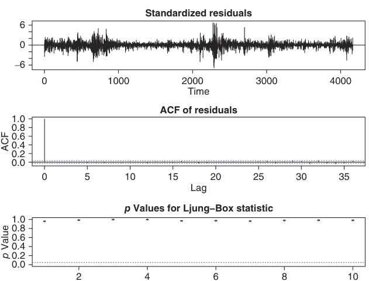

Figure 2.17 Model checking of a fitted ARIMA(5,1,3) model to the log series of a world stock index (series 23). The top figure is the time plot of standardized residuals, the middle plot is the residual sample autocorrelations with blue line showing approximate 95% pointwise interval, and the bottom plot shows the p-values of Ljung–Box Q statistics for the residual autocorrelations.

Finally, as mentioned before, the arima command of R automatically drops the intercept of a model when a difference operator is used, it is then important to check that the mean of residuals is zero. This can easily be done using the conventional one-sample t-test, i.e. t.test in R. For the stock index series used, the test statistic is -0.518 with p-value 0.60 so that one cannot reject the null hypothesis that the mean of residuals is zero.

## 2.10 预测

### 2.10.1 样本外预测

Out-of-sample forecasts can be used for model comparison and for model checking. Suppose that we are interested in forecasts with horizon $h$. If the fitted model is adequate, we can apply the results of Section 2.5 to compute the forecasts and expect that the variance of 1-step ahead forecast errors would equal to the residual variance, \(\widehat{\sigma}^2_a\), and the variance of \(h\)-step ahead forecasts is equal to \(\widehat{\sigma}^2_a \sum_{i=0}^h \psi_i^2\) with \(\widehat{\psi}_0 = 1$. These properties serve as additional tools for model checking. One way to check these properties is to use a procedure similar to that of cross-validation discussed before. Specifically, one divides the data into an estimation (or training) subsample and a testing (or validation) subsample. Details of cross-validation is given in Section 2.8.4.4. The MSFE of Eq. (2.108) can be used to compute the out-of-sample forecast variances. For model checking, we can consider the test statistics

$p_h = \frac{1}{n_h} \sum_{j=1}^{n_h} \frac{e^2_{T_1+j}(h)}{\widehat{\sigma}^2_{T_1}(h)},$

where $\widehat{\sigma}^2_{T_1}$ is the residual variance of the training subsample and $e^2_{T_1+j}(h)$ is h-step ahead forecast error at forecast origin $T_1 + j$. Assuming that the model is correct and for large sample size $T$, the statistic $p_h$ follows asymptotically a chi-square distribution divided by its degrees of freedom ($\chi^2_g/g$). In particular, for $h=1$, the statistic $p_1$ follows asymptotically a $\chi^2_{n_h}/n_h$ distribution.

We remark that there is substantial literature on using rolling forecasts for checking a fitted time series model or for model comparison. See, for instance, Diebold and Mariano (2002), Clark and McCracken (2009), and Rossi and Inoue (2012). For a discussion on the Box-Cox transformation in forecasting time series, see Proietti and Lütkepohl (2013).

### 2.10.2 模型平均预测

Instead of selecting the best model and disregarding the others, we can generate forecasts by using all the fitted models with different weights. This could be useful when we have several models that fit the data well. Assume that \(m\) models have been estimated for a time series. Recall that the BIC of model \(M_i\) can be written as

\(\text{BIC}_i = -\frac{2}{T} \ln P(M_i|z_1^T) + c,\)

where \(c\) is a constant, and this value is related to the posterior probabilities of model \(M_i\) by

\(P(M_i|z_1^T) = c_1 e^{-\frac{T}{2}\text{BIC}_i},\)

where \(c_1 = \exp(c)$. To calculate this constant, \(c_1$, we make use of the fact that sum of the probabilities of all the models is 1. Therefore,

\(\sum_{i=1}^m P(M_i|z_1^T) = 1 = c_1 \sum_{i=1}^m e^{-\frac{T}{2}\text{BIC}_i}.\)

With these results, we can transform BIC values into posterior probabilities of different models by means of

\(P(M_i|z_1^T) = \frac{e^{-\frac{T}{2}\text{BIC}_i}}{\sum_{j=1}^k e^{-\frac{T}{2}\text{BIC}_j}}.\)

Therefore, we may conclude that the probability distribution \(f(z_f)\) of a new future observation \(z_f\) would follow the mixed distribution

\(f(z_f) = \sum_{i=1}^m f(z_f|M_i)P(M_i|z_1^T), \quad (2.114)\)

where \(f(z_f|M_i)\) is the density function of the new observation in accordance with model \(M_i$. This distribution has a mean value that is the prediction generated by the model and a variance equal to that of the corresponding prediction error. For example, suppose that we generate 1-step ahead predictions with each model and let \(\hat{z}_T^{(M_i)}(1)\) be the prediction for the period \(T+1$ with model \(M_i$. The expectation of the distribution (2.114), denoted by \(\hat{z}_T(1)$, is

\(\hat{z}_T(1) = \sum_{i=1}^m \hat{z}_T^{(M_i)}(1)P(M_i|z_1^T),\)

which is a combination of all the predictions weighted by their probabilities. This approach of calculating predictions is known as Bayesian Model Averaging. In general, the combined prediction is more accurate than that generated by a single model. Moreover, as it has a better assessment of the uncertainty, it allows us to construct more realistic prediction intervals than those obtained by ignoring the model uncertainty. Letting \(\hat{\sigma}_i^2\) denote the variance of the innovations of model \(M_i$, which coincides with the variance of 1-step ahead prediction error of the model, the variance of the combination of forecast is

\(Var[\hat{z}_T(1)] = E[(z_{T+1} - \hat{z}_T(1))^2],$


其中期望是相对于混合分布 Eq. (2.114) 计算的。可以证明混合分布的方差为

\[
\text{Var}[\hat{z}_T(1)] = \sum_{i=1}^k \hat{\sigma}_i^2 P(M_i | \mathbf{z}_1^T) + \sum_{i=1}^k [\hat{z}_T^{(M_i)}(1) - \hat{z}_T(1)]^2 P(M_i | \mathbf{z}_1^T),
\]

这使得可以构建更现实的区间预测。该结果可推广到任何预测区间。

### 2.10.3 使用缩减估计量进行预测

在某些应用中，我们有兴趣预测许多具有某些共同特征的时间序列，例如给定类别的月产品销售额。在这种情况下，有经验证据（例如 Garcia-Ferrer et al. (1987)）表明，通过结合整个数据的汇总序列信息，可以改进单个序列（例如 \(\hat{z}_{i,T}(h)\)）的预测。具体来说，设 \(y_t\) 为所有研究时间序列的简单平均序列（或加权平均序列），\(\hat{y}_T(h)\) 为预测原点 \(T\) 处汇总序列的 \(h\) 步先行预测。第 \(i\) 个序列的缩减预测定义为

\[
\hat{z}^{S}_{i,T}(h) = (1 - \alpha)\hat{z}_{i,T}(h) + \alpha\hat{y}_T(h),
\]

其中 \(0 \le \alpha \le 1\)，通常优于 \(\hat{z}_{i,T}(h)\)。如果研究的序列高度相关且具有强相关性，这并不令人惊讶，因为汇总序列汇集了信息，使得缩减预测使用的信息比单个预测更多。第 6 章将表明，当序列具有共同因子时，这种预测是合理的。

### 示例 2.8

在本示例中，我们使用第 23 个世界金融指数的时间序列来比较通过 AIC 进行模型选择与滚动样本外预测。样本量为 \(T = 4162\)。滚动预测由 R 程序包 **MTS** 的命令 `backtest` 计算。我们的目标是展示 AIC 选择的高阶最佳模型与简单 ARIMA(1,1,0) 模型之间的比较。为此，我们以两种方式计算样本外 1 步先行预测。在第一种情况下，起始预测原点为 \(t = 4000\)，而在第二种情况下，起始预测原点为 \(t = 3000\)。另外，我们在比较中使用均方根预测误差（RMSE）作为标准。使用的 R 命令如下所示。

```R
>out1=arima(lx[,23],order=c(5,1,3))
>out2=arima(lx[,23],order=c(1,1,0))
##computes the residual MSE of c(5,1,3) model
>sqrt(out1$sigma2)
[1] 0.01314981
##computes the residual MSE of c(1,1,0) model
>sqrt(out2$sigma2)
[1] 0.01326138
### The difference in residual variances is rather small.
>vv=backtest(out1,lx[,23],4000,h=1)
[1] "RMSE of out-of-sample forecasts"
[1] 0.01606062
##The out-of-sample RMSE is about 23% larger than in sample
>vv=backtest(out2,lx[,23],4000,h=1) #1-step ahead forecasts
[1] "RMSE of out-of-sample forecasts"
[1] 0.01609272
>vv=backtest(out1,lx[,23],3000,h=1)
[1] "RMSE of out-of-sample forecasts"
[1] 0.01246
>vv=backtest(out2,lx[,23],3000,h=1)
[1] "RMSE of out-of-sample forecasts"
[1] 0.01244233
##By enlarging the number of out of sample forecasts,
### the difference in RMSE remains small, indicating there
### is no big difference between the two models.
```

从输出中可以看出，两个模型对数据的拟合相似，残差标准误差分别为 0.01315 和 0.01326，略偏向 ARIMA(5,1,3) 模型。对于滚动样本外预测，两个模型之间没有显著差异。对于预测原点 t = 4000，RMSE 分别为 0.01606 和 0.01609；对于预测原点 t = 3000，RMSE 分别为 0.01246 和 0.01244。

## APPENDIX 2.A: DIFFERENCE EQUATIONS

差分方程一词是指形式为下式的方程

\[
x_t - \phi_1 x_{t-1} - \phi_2 x_{t-2} - \cdots - \phi_h x_{t-h} = c, \quad \phi_h \neq 0,
\]

其中系数 \(\phi_i\) 为常数。该方程的阶数为 h，即方程中变量的最大滞后阶数。若 c = 0，则称该差分方程为齐次方程。该方程的解是一个序列 \(x_t\)，对所有 t 都满足该方程。通过引入滞后算子并写成

\[
\phi(B)x_t = c.
\]

我们称多项式 \(\phi(B)\) 为差分方程的特征多项式，而将方程 \(\phi(B) = 0\) 视为变量 B 的函数，即特征方程。例如，一阶差分方程的特征方程为

\[
1 - \phi B = 0,
\]

其解为 \(B = 1/\phi\)。在本附录中，我们证明差分方程解的以下性质：

- 1. 一阶齐次方程的解为 \(A G^t\)，其中 \(A\) 是取决于初始条件的常数，\(G^{-1}\) 是特征方程的解。
- 2. 特征多项式可写成不同根的一次多项式乘积的齐次方程的解，是各多项式的一阶特征方程对应解的和。
- 3. 具有复共轭根的二次齐次方程的解是一个正弦函数。
- 4. 具有重根 \( G^{-1} \) 的二次齐次方程的解为 \( (A_1 + A_2 t)G^t \)。
- 5. 差分方程的通解是齐次方程解与方程的某个特解之和。

我们现在证明这五个性质。第一个性质是通过考虑一阶差分方程得到的：\( x_t - \phi x_{t-1} = (1 - \phi B)x_t = 0 \)。

该方程从初始值 \( x_0 \) 开始，产生值序列 \( x_1 = \phi x_0 \)、\( x_2 = \phi^2 x_0 \)，一般地：\( x_t = \phi^t x_0 \)。

这证明了第一个性质：解是一个常数（即初始值）乘以特征方程解的倒数（在此例中为 \( \phi^{-1} \)）的 \( t\) 次幂。请注意，如果 \( \phi = 1 \)，则解为 \( x_t = x_0 \)，即一个常数。

为了证明第二个性质，我们将考虑一个二次方程 \( x_t - \phi_1 x_{t-1} - \phi_2 x_{t-2} = 0 \)，将其写成：

\[
(1 - \phi_1 B - \phi_2 B^2)x_t = 0, \quad (2.115)
\]

若 \( G_1^{-1} \) 和 \( G_2^{-1} \) 是特征方程的根，则可将该方程表示为：

\[
(1 - G_1 B)(1 - G_2 B)x_t = 0. \quad (2.116)
\]

假设 \( G_1 \neq G_2 \)，我们将证明该方程的解形式为

\[
x_t = S_{1t} + S_{2t}, \quad (2.117)
\]

其中 \( S_{1t} \) 满足 \( (1 - G_1 B)S_{1t} = 0 \)，\( S_{2t} \) 满足 \( (1 - G_2 B)S_{2t} = 0 \)。事实上，将 Eq. (2.117) 代入 Eq. (2.116)，得到

\[
(1 - G_1 B)(1 - G_2 B)S_{1t} + (1 - G_1 B)(1 - G_2 B)S_{2t} = 0.
\]

由于 \( (1 - G_i B)S_{it} = 0 \) 的解必须形式为 \( S_{it} = A_i G_i^t\)，其中 \( A_i \) 是取决于初始条件的常数，因此发现 Eq. (2.116) 的通解必须形式为：

\[
x_t = A_1 G_1^t + A_2 G_2^t. \quad (2.118)
\]

例如，假设我们有一个 AR(2) 的自相关系数序列，其中 \( \rho_0 = 1 \) 且 \( \rho_1 = \phi_1 / (1 - \phi_2) \)。因此，根据 (2.118)，通解为：

\[
\rho_h = A_1 G_1^h + A_2 G_2^h, \quad (2.119)
\]

其中，因为 \( G_1 \) 和 \( G_2 \) 是方程的因子，可以验证 \( \phi_1 = G_1 + G_2\) 且 \( \phi_2 = -G_1 G_2 \)。为了求得常数 \( A_1, A_2 \)，当 \( h = 0 \) 时有 \( \rho_0 = A_1 + A_2 = 1\)，当 \( h = 1 \) 时得 \( \rho_1 = A_1 G_1 + A_2 G_2\)。从这两个方程中得到

\[
A_1 = \frac{\rho_0 G_1 - \rho_1}{(G_2 - G_1)}; \quad A_2 = \frac{\rho_1 - \rho_0 G_1}{(G_2 - G_1)}. \quad (2.120)
\]

若 Eq. (2.116) 的两个根为实数，则解为两个几何衰减之和。

对一般多项式的这第二个性质的证明为

\[
(1 - \phi_1 B - \phi_2 B^2 - \cdots - \phi_h B^h)x_t = (1 - G_1 B)(1 - G_2 B) \cdots (1 - G_h B)x_t = 0,
\]

假设根 \( G_i\) 互不相同，是两因子情况的直接推广，通解为

\[
x_t = A_1 G_1^t + \cdots + A_h G_h^t, \quad (2.121)
\]

其中 \( A_1, \dots, A_h \) 是取决于初始条件的常数，\( G_1^{-1}, \dots, G_h^{-1} \) 是特征方程的根。此外，我们注意到当 \( t \to \infty \) 时若 \( x_t \) 趋于零，则 \( G_i^t \) 必须趋于零，这要求所有解的模小于 1。

现在证明性质 3：当两个根为复数时，由这两个根所暗示的解具有正弦行为。再次考虑 Eqs. (2.115) 和 (2.116)。当 \( G_1 \) 和 \( G_2 \) 为复共轭数时，可将其写为 \( G_1 = R \exp(i\omega) \) 和 \( G_2 = R \exp(-i\omega)\)，且

\[
G_1 G_2 = R^2 = -\phi_2,
\]

\[
R = \sqrt{-\phi_2}, \quad (2.122)
\]

并且可以看出，若解为复数，则 \( \phi_2 \) 必须为负数。另外，

\[
G_1 + G_2 = \phi_1 = R(\exp(i\omega) + \exp(-i\omega)) = 2R \cos \omega,
\]

根据 Eq. (2.122)，\(\omega\) 可由以下式得出

\[
\cos \omega = \frac{\phi_1}{2\sqrt{-\phi_2}}. \quad (2.123)
\]

\( A_1, A_2 \) 的值由 Eq. (2.120) 给出，其中 \( \rho_0 = x_0 \) 和 \( \rho_1 = x_1 \) 作为初始值。然后将这些值以及 \( G_1 \) 和 \( G_2 \) 的值代入 Eq. (2.119)，得到

\[
x_t = R^t \frac{x_1(e^{i\omega t} - e^{-i\omega t}) - x_0(e^{i\omega(t-1)} - e^{-i\omega(t-1)})}{(e^{i\omega} - e^{-i\omega})},
\]

该式可写为

\[
x_t = \frac{R^t}{\sin \omega}(x_1 \sin \omega t - x_0 \sin \omega(t - 1))
\]

解是一个正弦函数。


我们接下来证明关于特征方程中多重根的第四个性质。首先，我们表明当两个根相等时，对应的两个项 \(A_t G_t^t\) 可以写成 \((A_1 + A_2 t)G^t\)。让我们假设 Eq. (2.115)，其特征方程为

\((1 - \phi_1 B - \phi_2 B^2) = 0.\) (2.124)

如果此方程存在一个双重根 \(G_0^{-1}\)，则有：

\((1 - G_0 B)^2 = (1 - \phi_1 B - \phi_2 B^2),\)

这意味着 \(\phi_2 = -G_0^2\) 且 \(\phi_1 = 2G_0\)，因此

\(\phi_1 G_0 + 2\phi_2 = 0.\) (2.125)

我们验证如果 \(G_0^t\) 是 Eq. (2.124) 的解，则 \(t G_0^t\) 也是解。代入

\((1 - \phi_1 B - \phi_2 B^2)t G_0^t = t G_0^t - \phi_1 (t - 1) G_0^{t-1} - \phi_2 (t - 2) G_0^{t-2},\)

并提取公因式，我们有：

\(t G_0^{t-2}(G_0^2 - \phi_1 G_0 - \phi_2) + G_0^{t-2}(\phi_1 G_0 + 2\phi_2) = 0.\)

第一项为零，因为 \(G_0\) 是解，第二项也是，根据 Eq. (2.125)。因此，我们得出通解为

\(x_t = (A_1 + A_2 t)G_0^t.\)

这些结果可以推广到任何阶的方程，以及根相等或不相等的情况。我们假设一个齐次线性差分方程

\((1 - \phi_1 B - \phi_2 B^2 - \cdots - \phi_h B^h)x_t = 0.\) (2.126)

如果存在重复 \(r\) 次的根，即存在形式为 \((1 - G_0 B)^r\) 的项，则如同在 \(r = 2\) 的情况中那样，可以很容易地证明，与此项相关的解为

\(x_t = (A_1 + A_2 t + \cdots + A_r t^{r-1})G_0^t.\) (2.127)

因此，Eq. (2.126) 的通解包含：(1) 对于每个不重复的实根，一个类型为 \(A_t G_t^t\) 的项；(2) 对于每个重复 \(r\) 次的实根，一个阶数为 \((r - 1)\) 且乘以 \(G_0^t\) 的多项式项；(3) 对于每一对共轭复根，一个正弦项。

最后，我们证明第五个性质。假设方程 \(\phi(B)x_t = c\)。我们将证明如果 \(y_t\) 是解，那么 \(y_t + q_t\) 也是解，其中 \(q_t\) 是齐次方程 \(\phi(B)q_t = 0\) 的解。这很容易表明，因为

\(\phi(B)(y_t + q_t) = \phi(B)y_t = c.\)

### 解的有效性及初始值

变量可以从某个定义的时间点开始验证差分方程。因此，方程的解提供的变量值不仅从这个定义点开始验证方程，还适用于计算解所需的早些时候。也就是说，如果方程对 $t \ge t_0$ 有效，并且需要 $h$ 个初始值来求解，则该解对 $t \ge t_0 - h$ 的值有效，即从方程的起点减去计算解所需的初始值个数。

为了说明这一结果，我们从一阶方程开始：

$$x_t - \phi x_{t-1} = 0, \quad t \ge t_0.$$

如果方程对 $t = t_0$ 有效，则有 $x_{t_0} = \phi x_{t_0-1}, x_{t_0+1} = \phi x_{t_0} = \phi^2 x_{t_0-1}$，并且，一般来说，

$$x_t = \phi^{t-t_0+1} x_{t_0-1}.$$

请注意，此解对 $t \ge t_0 - 1$ 有效。确实，对于 $t = t_0 - 1$，它给出 $x_{t_0-1} = x_{t_0-1}$，这显然是正确的。因此，我们得出结论，该解对方程定义区间减去启动序列所需的初始值个数有效。

我们在二次方程中验证此规则：

$$x_t - \phi_1 x_{t-1} - \phi_2 x_{t-2} = 0, \quad t \ge 1.$$

根据上述结果，我们知道解为：

$$x_t = A_1 G_1^t + A_2 G_2^t,$$

其中 $G_1^{-1}$ 和 $G_2^{-1}$ 是特征方程的根。让我们检查该解对 $t \ge -1$ 是否有效。对于 $t = 0$，我们得到

$$x_0 = A_1 + A_2,$$

对于 $t = -1$，我们有

$$x_{-1} = A_1 G_1^{-1} + A_2 G_2^{-1}.$$

我们现在证明三个值 $x_1, x_0$ 和 $x_{-1}$ 验证该方程。在二次方程中代入

$$x_1 = A_1 G_1 + A_2 G_2 = \phi_1 x_0 + \phi_2 x_{-1}$$
$$= \phi_1(A_1 + A_2) + \phi_2(A_1 G_1^{-1} + A_2 G_2^{-1}),$$

并合并同类项

$$A_1 G_1 + A_2 G_2 = A_1(\phi_1 + \phi_2 G_1^{-1}) + A_2(\phi_1 + \phi_2 G_2^{-1}),$$

这始终成立，正如通过使用参数与根之间的关系 $\phi_1 = G_1 + G_2$ 和 $\phi_2 = -G_1 G_2$ 所证明的那样，该关系是通过求解二次方程得到的。

推广来说，如果我们有一个阶数为 $h$ 且对 $t \ge t_0$ 有效的差分方程，我们需要 $h$ 个初始值来开始序列。由于这些初始值是用提供解的方程得到的，因此该解为 $t \ge t_0 - h$ 提供序列的有效值。

## 练习题

- 1. 计算以下 ARMA 模型的方差和 ACF（滞后 1 至滞后 4），其中 Var(a_t) = 1：(a) z_t = 0.7z_{t-1} + a_t；(b) z_t = 0.4a_{t-1} + a_t；(c) z_t = 0.7z_{t-1} + 0.4a_{t-1} + a_t。
- 2. 使用命令 arima.sim 模拟练习 1 中的三个 ARIMA 模型，并比较理论 ACF 与样本 ACF。
- 3. 比较文件 CPIEurope2000-15.csv 中 CPI 系列对数在概率 (0.05,0.5,0.95) 下的 EDQ 和 TWQ。在水平值和一阶差分中计算这些分位数。注意系列 30 和 34 的极端行为，它们分别对应本期的冰岛和土耳其。使用命令 chksea 找出哪些系列是季节性的，哪些不是。
- 4. 计算过程 z_t = y_t + v_t 的 ACF，其中 y_t = 0.4a_{t-1} + a_t，且 Var(a_t) = 4，v_t 为 Var(v_t) = 2.0 的白噪声过程。使用命令 arima.sim 模拟该系列，并比较理论 ACF 与样本 ACF（前四个滞后）。
- 5. 找出以下 ARMA 模型特征方程的根：(a) (1 - 6B)z_t = a_t；(b) (1 - 1.4B + 0.8B^2)z_t = a_t；(c) (1 - 0.6B + 1.2B^2)z_t = (1 - 0.5B)a_t。
- 6. 使用变换 V log(CPI_t) 计算练习 2 中识别出的前三个季节性系列（第 4、5 和 9 系列）的周期图，并比较这些系列的 ACF（前 4 个滞后）。注意频谱在频率 1/12 和 1/6 处的峰值。然后查看变换 VV_{12} log(CPI_t) 的频谱和 ACF。这三个系列中哪一个的季节性更强？
- 7. 写出以状态空间形式表示的 AR(1) 过程的卡尔曼滤波器方程，其中 H_t = 1，a_t = z_t，V_t = 0，\Omega_t = \phi，R_t = \sigma_a^2。证明在这种情况下卡尔曼增益为一。
- 8. 比较练习 1 中 ARMA 模型的 1 步先行和 2 步先行预测误差方差。

## 参考文献

- Akaike, H. (1973). 信息论与最大似然原理的扩展。载于 Hirotugu Akaike 精选集。Springer, New York, NY.
- Alonso, A. M. 和 Peña, D. (2019). 基于线性依赖的时间序列聚类。Statistics and Computing, 29: 655–676.
- Bengtsson, T. 和 Cavanaugh, J. E. (2006). 用于状态空间模型选择的改进赤池信息准则。Computational Statistics & Data Analysis, 50: 2635–2654.
- Box, G. E. P. 和 Cox, D. R. (1964). 变换分析。皇家统计学会杂志, B 系列, 26: 211–243.
- Box, G. E. P. 和 Jenkins, G. M. (1976). 时间序列分析：预测与控制。Holden Day-Inc., San Francisco, CA.
- Box, G. E. P., Jenkins, G. M., Reinsel, G. C., 和 Ljung, G. M. (2015). 时间序列分析：预测与控制，第 5 版。John Wiley & Sons, Hoboken, NJ.
- Box, G. E. P. 和 Tiao, G. C. (1977). 多元时间序列的规范分析。Biometrika, 64: 355–365.
- Brockwell, P. J. 和 Davis, R. A. (2013). 时间序列：理论与方法。Springer Science & Business Media, New York, NY.
- Clark, T. E. 和 McCracken, M. W. (2009). 通过结合递归和滚动预测提高预测准确性。International Economic Review, 50: 363–395.
- Cryer, J. D. 和 Chan, K. S. (2008). 具有 R 应用的时间序列分析，第 2 版。Springer, New York, NY.
- Dickey, D. A. 和 Fuller, W. A. (1979). 带单位根的自回归时间序列估计量的分布。Journal of the American Statistical Association, 74: 427–431.
- Diebold, F. X. 和 Kilian, L. (2001). 测量可预测性：理论与宏观经济应用。Journal of Applied Econometrics, 16: 657–669.
- Diebold, F. X. 和 Mariano, R. S. (2002). 比较预测准确性。Journal of Business and Economic Statistics, 20: 134–144.
- Dufour, J. M. 和 Roy, R. (1985). 关于样本自相关和随机性检验的一些稳健精确结果。Journal of Econometrics, 29: 257–273.
- Durbin, J. 和 Koopman, S. K. (2001). 由状态空间模型进行的时间序列分析。Oxford University Press, Oxford.
- Ferguson, T. S. (1967). 数理统计：决策论方法。Academic Press, New York, NY.
- Garcia-Ferrer, A., Highfield, R. A., Palm, F., 和 Zellner, A. (1987). 使用汇总国际数据的宏观经济预测。Journal of Business and Economic Statistics, 5: 53–67.
- Gómez, V. 和 Maravall, A. (1994). 使用卡尔曼滤波器对非平稳序列进行估计、预测和插值。Journal of the American Statistical Association, 89: 611–624.
- Gómez, V. 和 Maravall, A. (2001). 一元序列的自动建模方法。载于 D. Peña, G. C. Tiao, 和 R. S. Tsay (编). 时间序列分析教程。John Wiley & Sons, Hoboken, NJ.
- Granger, C. W. J. 和 Morris, M. J. (1976). 时间序列建模与解释。皇家统计学会杂志: A 系列, 139: 246–257.
- Hannan, E. J. 和 Rissanen, J. (1982). 混合自回归-移动平均阶的递归估计。Biometrika, 69: 81–94.
- Hannan, E. J. 和 Quinn, B. G. (1979). 自回归阶的确定。皇家统计学会杂志 B, 41: 190–195.
- Harrison, P. J. 和 Stevens, C. F. (1976). 贝叶斯预测。皇家统计学会杂志 B, 38: 205–228.
- Harvey, A. C. (1990). 预测、结构时间序列模型与卡尔曼滤波器。Cambridge University Press, Cambridge, UK.
- Hurvich, C. M. 和 Tsai, C. L. (1989). 小样本中的回归与时间序列模型选择。Biometrika, 76: 297–307.
- Jarque, C. M. 和 Bera, A. K. (1987). 观测值和残差正态性检验。International Statistical Review, 55: 163–172.
- Koopmans, L. H. (1974). 时间序列谱分析。Academic Press, New York, NY.
- Lütkepohl, H. (1985). 向量自回归过程阶数估计准则的比较。Journal of Time Series Analysis, 6: 35–52.
- Peña, D. 和 Rodriguez, J. (2002). 时间序列拟合优度的强有力港口组合检验。Journal of the American Statistical Association, 97: 601–610.


Peña, D. and Rodríguez, J. (2006). 时间序列中拟合优度检验的自相关矩阵行列式对数. 统计计划与推断期刊, 136: 2706–2718.

Peña, D., Tiao, G. C., and Tsay, R. S. (2001). 时间序列分析教程. John Wiley & Sons, 霍博肯, 新泽西州.

Peña, D., Tsay, R. S. and Zamar, R. (2019). 高维时间序列可视化的经验动态分位数. Technometrics, 61: 429–444.

Percival, D. B. and Walden, A. T. (2000). 时间序列分析的小波方法. 剑桥大学出版社, 剑桥, 英国.

Plackett, R. L. (1950). 关于最小二乘法的若干定理. Biometrika, 37: 149–157.

Proietti, T. (2000). 结构时间序列模型中季节成分的比较. 国际预测杂志, 16: 247–260.

Proietti, T. and Lütkepohl, H. (2013). Box–Cox变换对宏观经济时间序列预测是否有帮助？国际预测杂志, 29: 88–99.

Rossi, B. and Inoue, A. (2012). 对窗口大小选择具有鲁棒性的样本外预测检验. 商业与经济统计杂志, 30: 432–453.

Shumway, R. H. and Stoffer, D. S. (2017). 时间序列分析及其应用：带R示例. Springer, 纽约, 纽约州.

Schwarz, G. (1978). 模型维数估计. 统计学年鉴, 6: 461–464.

Tiao, G. C. and Xu, D. (1993). 多步预测最大似然估计的稳健性：指数平滑情况. Biometrika, 80: 623–641.

Tsay, R. S. (2010). 金融时间序列分析，第2版. John Wiley & Sons, 霍博肯, 新泽西州.

Tsay, R. S. (2014). 多元时间序列分析：带R和金融应用. John Wiley & Sons, 霍博肯, 新泽西州.

Tsay, R. S. (2020). 基于极值理论的高维时间序列串行相关性检验. 计量经济学杂志, 216: 106–117.

Tsay, R. S. and Chen, R. (2018). 非线性时间序列分析. John Wiley & Sons, 霍博肯, 新泽西州.

West, M. and Harrison, J. (2006). 贝叶斯预测与动态模型. Springer Science and Business Media, 纽约, 纽约州.

Young, P. (1984). 递归估计与时间序列分析. Springer-Verlag, 柏林, 德国.
