# 3 多元时间序列分析

本章中，我们共同考虑多个时间序列，目的是寻找它们之间的线性动态关系，并探索提高预测准确性的方法。我们关注低维时间序列。高维情况的扩展将在后面讨论。参见第 6 章和第 7 章。在文献中，多个时间序列的分析也称为多元时间序列分析，并已得到广泛研究。参见，例如，Hannan and Deistler (1988)、Tiao and Box (1981)、Reinsel (1993)、Lütkepohl (2005)、Tsay (2014)及其中的参考文献。我们在此的讨论简要，并强调应用。

Let \(\mathbf{z}_t = (z_{1t}, \dots, z_{kt})'\) be a \(k\)-dimensional time series. A general class of linear models for \(\mathbf{z}_t\) is the autoregressive moving-average (VARMA) model

\[
\phi(B)\mathbf{z}_t = \mathbf{c}_0 + \theta(B)\mathbf{a}_t, \quad (3.1)
\]

where \(\phi(B) = \mathbf{I} - \sum_{i=1}^p \phi_i B^i\) and \(\theta(B) = \mathbf{I} - \sum_{i=1}^q \theta_i B^i\) are matrix polynomials of degrees \(p\) and \(q\), respectively, \(B\) is the back-shift operator such that \(B\mathbf{z}_t = \mathbf{z}_{t-1}\), \(\mathbf{c}_0\) is a \(k\)-dimensional constant, and \(\{\mathbf{a}_t\}\) is a sequence of independent and identically distributed random vectors with mean zero and positive-definite covariance matrix \(\Sigma_a\). We assume that the absolute values of the solutions of \(|\phi(B)| = 0\) are greater than or equal to 1 and those of \(|\theta(B)| = 0\) are greater than 1. In other words, we focus on the case that \(\mathbf{z}_t\) is a causal time series. Furthermore, for identifiability, we assume that (a) the rank of \([\phi_p, \theta_q]\) is \(k\) and (b) \(\phi(B)\) and \(\theta(B)\) are left coprime, i.e. if \(\phi(B) = \mathbf{U}(B)\phi_*(B)\) and \(\theta(B) = \mathbf{U}(B)\theta_*(B)\), then \(|\mathbf{U}(B)|\) is a non-zero constant. Assumption (b) is easy to understand as there should be no non-trivial left common factor between \(\phi(B)\) and \(\theta(B)\). Assumption (a) is more involved and has been discussed in Dunsmuir and Hannan (1976), Hannan and Deistler (1998, section 2.7), and Tsay (2014). These two assumptions are referred to as the *block identifiability* conditions.

If the absolute values of the solutions of \(|\phi(B)| = 0\) are all greater than 1, then \(z_t\) is a weakly stationary time series; otherwise, \(z_t\) is a unit-root nonstationary series. Analysis of unit-root nonstationary multivariate time series is harder in the sense that there exists the possibility of co-integration. By co-integration, we mean that if some linear combinations of unit-root nonstationary series become stationary, then the nonstationary series are co-integrated. See Box and Tiao (1977) and Engle and Granger (1987). We discuss analysis of co-integrated series later. In what follows, we consider some commonly used multivariate time series models and discuss their properties and applications.

## 3.1 传递函数模型

传递函数模型（TFMs），在计量经济学文献中也称为分布滞后模型，在控制工程和预测中很有用。参见 Box and Jenkins (1976)。它们是通过将 \(z_t = (x'_t, y'_t)'\) 划分为输入（或外生）变量 \(x_t\) 和输出（或内生）变量 \(y_t\) 得到的 VARMA 模型 Eq. (3.1) 的特例。输入变量在动态上不依赖于输出变量，但输出变量依赖于输入变量。这种关系称为单向关系。在计量经济学文献中，该关系与格兰杰因果性相关，参见第 3.2.2 节，因为 \(x_t\) 导致 \(y_t\)，但 \(y_t\) 不导致 \(x_t\)。

### 3.1.1 单输入单输出

为简化起见，我们从单输入 \(x_t\) 和单输出 \(y_t\) 的情况开始。TFM 则变为

\(\phi_x(B)x_t = c_x + \theta_x(B)b_t,\) (3.2)

\(y_t = c_y + \frac{\omega(B)}{\delta(B)}x_t + n_t\) (3.3)

where \(c_x\) and \(c_y\) are constants, \(\phi_x(B) = 1 - \sum_{i=1}^{p_x} \phi_{x,i}B^i\) and \(\theta_x(B) = 1 - \sum_{i=1}^{q_x} \theta_{x,i}B^i\) are autoregressive (AR) and moving-average (MA) polynomials of \(x_t\) with degrees \(p_x\) and \(q_x\), which are nonnegative integers, \(b_t\) is a sequence of independent and identically distributed random variables with mean zero and variance \(\sigma_b^2 > 0\), \(\omega(B) = B^b(\omega_0 + \cdots + \omega_s B^s)\) and \(\delta(B) = 1 - \delta_1 B - \cdots - \delta_r B^r\), \(b\) is a nonnegative integer and the absolute values of the solutions of \(\delta(B) = 0\) are greater than or equal to 1, and \(n_t\) is a disturbance term which follows a scalar ARMA model and is independent of \(x_t\). In Eq. (3.2), \(\phi_x(B)\) and \(\theta_x(B)\) have no common factors. Similarly, in Eq. (3.3), \(\omega(B)\) and \(\delta(B)\) have no common factors. Since the scale of \(\omega(B)\) is not fixed, we can start \(\delta(B)\) with 1 without causing any problem. The parameter \(b\) of operator \(\omega(B)\) in Eq. (3.3) is called the *dead time* or *delay* of the model and it plays an important role in the application of TF models. It denotes the time periods needed for the effect of the input \(x_t\) to appear in the output \(y_t\).

Let \(v(B) = \frac{\omega(B)}{\delta(B)} = v_0 + v_1 B + v_2 B^2 + \cdots\). The coefficients \(v_i\) are called the *impulse response function* of the TFM. They are the main subject of interest in transfer function (TF) modeling. Specifically, \(v_i\) is the effect on \(y_{t+i}\) when there is a unit change in \(x_t\) and \(\sum_{j=0}^i v_j\) is the cumulative effect on \(y_t, \dots, y_{t+i}\) when there is a unit change in \(x_t\). In particular, \(g = \sum_{j=0}^\infty v_j = v(1)\) is the *steady-state gain* of the TFM provided that it exists. Under the assumptions of the model in Eq. (3.3), \(g\) is finite if no solutions of \(\delta(B) = 0\) lie on the unit circle.

The impulse response function \(v_i\) can be obtained by equating the coefficients of \(B^i\) in the following equation

\((1 - \delta_1 B - \cdots - \delta_r B^r)(v_0 + v_1 B + v_2 B^2 + \cdots) = \omega_0 B^b + \omega_1 B^{b+1} + \cdots + \omega_s B^{b+s}\).

Specifically, we have

\(v_i = \begin{cases} 0, & i < b, \\ \omega_0, & i = b, \\ \delta_1 v_{i-1} + \delta_2 v_{i-2} + \cdots + \delta_r v_{i-r} + \omega_{i-b}, & i = b+1, \dots, b+s, \\ \delta_1 v_{i-1} + \delta_2 v_{i-2} + \cdots + \delta_r v_{i-r}, & i > b+s. \end{cases} \quad (3.4)\)

In general, the coefficients \(v_i\) consist of

- 1. $b$ zero values $v_0, v_1, \dots, v_{b-1}$ provided that $b > 0$.
- 2. A further $s-r+1$ values $v_b, v_{b+1}, \dots, v_{b+s-r}$ following no fixed pattern provided that $s \ge r$.
- 3. Values $v_i$ with $i \ge b+s-r+1$ satisfying the $r$th order difference equation \(\delta(B)v_i = 0\) with starting values $v_{b+s}, v_{b+s-1}, \dots, v_{b+s-r+1}$.

It pays to study the relationships between $v_i, \omega_j$, and $\delta_\ell$ as they are useful in specifying $b, r$, and $s$ in practice.

The polynomial ratio $\frac{B^b \omega(B)}{\delta(B)}$ of Eq. (3.3) is sufficiently flexible for handling the impulse response function $v_i$ in most applications, even with lower orders $r$ and $s$. For instance, Figure 3.1 shows the impulse response functions and cumulative impulse response functions of (a) $v(B) = \frac{(0.4+0.48B)B^2}{1-0.5B}$ (left panel) and (b) $v(B) = \frac{0.5B^2}{1-1.3B+0.4B^2}$ (right panel). The steady-state gain of Example (a) is $g = 1.6$, whereas that for Example (b) is $g = 5$.

Given the observations $\{x_t, y_t | t = 1, \dots, T\}$, TF modeling is concerned with identifying a suitable model in Eqs. (3.2) and (3.3). The model for the input variable $x_t$ can be obtained by applying the methods of scalar series discussed in Chapter 2. Thus, we focus on identifying the model in Eq. (3.3). For simplicity, assume $c_y = c_x = 0$ and rewrite the model as

$$y_t = v(B)x_t + n_t = v_0 x_t + v_1 x_{t-1} + v_2 x_{t-2} + \cdots + n_t. \quad (3.5)$$

Since $n_t$ and $x_t$ are independent, one can multiply Eq. (3.5) by $x_{t-j} (j \ge 0)$ and take expectation to obtain

$$\gamma_{yx}(j) = v_0 \gamma_{xx}(j) + v_1 \gamma_{xx}(j-1) + v_2 \gamma_{xx}(j-2) + \cdots ,$$

where $\gamma_{yx}(j) = \text{cov}(y_t, x_{t-j})$ and $\gamma_{xx}(j) = \text{cov}(x_t, x_{t-j})$. The prior equation, however, is not particularly useful because $x_t$ is typically serially dependent with many non-zero


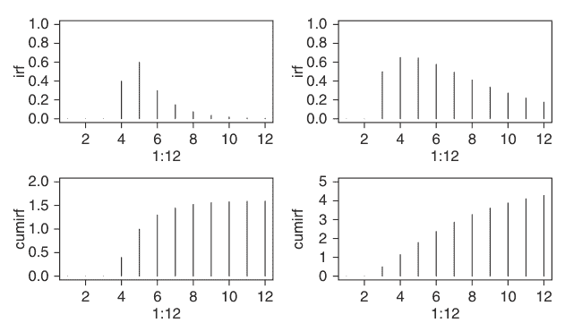

图 3.1 两个传递函数示例的冲激响应与累积冲激响应函数。左侧面板：\(v(B) = \frac{0.4+0.4B+0.3B^2}{1-0.5B}\) 和右侧面板：\(v(B) = \frac{0.5B^2}{1-1.3B+0.4B^2}\)。

\(\gamma_{xx}(j)\)。缓解 \(x_t\) 中序列相关性影响的一种方法是预白化法，我们将在下一节介绍。有关预白化的更多细节可参见 Box et al. (2015)。

### 预白化

将等式 (3.5) 两边乘以 \(\frac{\phi_x(B)}{\theta_x(B)}\)，得

\(\frac{\phi_x(B)}{\theta_x(B)}y_t = v(B)\frac{\phi_x(B)}{\theta_x(B)}x_t + \frac{\phi_x(B)}{\theta_x(B)}n_t.\)

令 \(\eta_t = \frac{\phi_x(B)}{\theta_x(B)}y_t\) 且 \(\tilde{n}_t = \frac{\phi_x(B)}{\theta_x(B)}n_t\)。则前一等式变为

\(\eta_t = v(B)b_t + \tilde{n}_t = v_0 b_t + v_1 b_{t-1} + v_2 b_{t-2} + \cdots + \tilde{n}_t, \quad (3.6)\)

其中，\(b_t\) 是白噪声序列且与 \(\tilde{n}_t\) 独立，\(\eta_t\) 被称为 \(y_t\) 的预白化序列。将等式 (3.6) 两边乘以 \(b_{t-j} (j \ge 0)\) 并取期望，得

\(\gamma_{\eta b}(j) = v_j \gamma_{bb}(0), \quad j \ge 0, \quad (3.7)\)

再次说明，\(\gamma_{\eta b}(j) = \text{cov}(\eta_t, b_{t-j})\) 且 \(\gamma_{bb}(j) = \text{cov}(b_t, b_{t-j})\)。等式 (3.7) 提供了冲激响应权重 \(v_j\) 的一个一致估计量。具体地，有

\(\rho_{\eta b}(j) = v_j \sqrt{\frac{\gamma_{bb}(0)}{\gamma_{\eta\eta}(0)}}, \quad j = 0, 1, 2, \dots, \quad (3.8)\)

其中 \(\rho_{\eta b}(j)\) 是 \(\eta_t\) 与 \(b_{t-j}\) 之间的相关性。换句话说，

\(v_j = c \times \rho_{\eta b}(j), \quad j \ge 0, \quad (3.9)\)

其中 \(c\) 表示 \(\eta_t\) 与 \(b_t\) 的标准误之比。在实际中，\(b_t\) 由 \(x_t\) 的残差序列估计，\(\eta_t\) 是通过 \(x_t\) 的模型得到的输出变量 \(y_t\) 的预白化序列。

为指定阶数 \(r, s\) 和 \(b\)，可以利用等式 (3.4) 中所示的 \(v_i\) 模式，特别是对于 \(i > b+s\) 的差分方程 \(v_i - \sum_{j=1}^r \delta_j v_{i-j} = 0\) 以及对于 \(i < b\) 的 \(v_i = 0\)。这可以通过 _角形法_ 完成，如下所示。

### 角形法

角形法旨在展示传递函数模型（TFM）冲激响应权重 \(v_j\) 的模式。构建一个双向表，行编号为 \(0, 1, 2, \dots\)，列编号为 \(1, 2, 3, \dots\)。表中的每个元素都是标准化冲激函数值 \(u(B) = v(B)/v_{\max}\) 组成的矩阵的行列式，其中 \(v_{\max} = \max_j \{|v_j|\}\)。双向表的第 \((i, j)\) 个元素是 \(j \times j\) 矩阵的行列式

\( M(i, j) = \left[ \begin{array}{cccc} u_i & u_{i-1} & \cdots & u_{i-j+1} \\ u_{i+1} & u_i & \cdots & u_{i-j+2} \\ \vdots & \vdots & \ddots & \vdots \\ u_{i+j-1} & u_{i+j-2} & \cdots & u_i \end{array} \right], \)

其中，若 \(i < 0\)，则 \(u_i = 0\)。根据等式 (3.4) 中 \(v_i\) 的模式，我们看到 (a) 对于 \(i \le b - 1\)，\(|M(i, j)| = 0\)，因为当 \(i \le b - 1\) 时 \(M(i, j)\) 第一行的所有元素均为零；(b) 对于 \(j > r\) 且 \(i > b + s\)，\(|M(i, j)| = 0\)，因为 \(M(i, j)\) 的行由 \(v_i\) 的差分方程引入线性相关；(c) 对于 \(i = b, \dots, b + s\)，\(|M(i, j)| \neq 0\)，因为存在 \(w_{i-b}\)。因此，角形法表应呈现图 3.1 所示的模式，从中可以识别出 \((r, s, b)\) 的值。

具体地，从表 3.1 中，我们可以按如下方式识别 \(b, r, s\)：

- \(b\) 表示表中包含一些非零项的第一行。
- 存在一个左上角位于 \((s + b + 1, r + 1)\) 的零矩形，从中可以识别出 \(r\) 和 \(s\)。

为演示，表 3.2 显示了图 3.1 左侧面板的传递函数 \(v(B) = \frac{(0.4+0.4B)B^3}{1-0.5B}\) 的角形法。从表中可以清楚地看出 \(b = 3\)，\(r + 1 = 2\) 且 \(s + b + 1 = 5\)。因此，如预期，\((r, s, b) = (1, 1, 3)\)。

### 表 3.1 传递函数模型冲激响应权重的理论模式

| (i,j) | 1 | 2 | \(\cdots\) | \(r - 1\) | \(r\) | \(r + 1\) | \(r + 2\) | \(\cdots\) |
| :--- | :--- | :--- | :--- | :--- | :--- | :--- | :--- | :--- |
| 0 | 0 | 0 | \(\cdots\) | 0 | 0 | 0 | 0 | \(\cdots\) |
| 1 | 0 | 0 | \(\cdots\) | 0 | 0 | 0 | 0 | \(\cdots\) |
| \(\vdots\) | \(\vdots\) | \(\vdots\) | \(\vdots\) | \(\vdots\) | \(\vdots\) | \(\vdots\) | \(\vdots\) | \(\vdots\) |
| \(b - 1\) | 0 | 0 | \(\cdots\) | 0 | 0 | 0 | 0 | \(\cdots\) |
| \(b\) | X | X | \(\cdots\) | X | X | X | X | \(\cdots\) |
| \(\vdots\) | \(\vdots\) | \(\vdots\) | \(\vdots\) | \(\vdots\) | \(\vdots\) | \(\vdots\) | \(\vdots\) | \(\vdots\) |
| \(s + b\) | X | X | \(\cdots\) | X | X | X | X | \(\cdots\) |
| \(s + b + 1\) | * | * | \(\cdots\) | * | X | 0 | 0 | \(\cdots\) |
| \(s + b + 2\) | * | * | \(\cdots\) | * | X | 0 | 0 | \(\cdots\) |
| \(\vdots\) | \(\vdots\) | \(\vdots\) | \(\vdots\) | \(\vdots\) | \(\vdots\) | \(\vdots\) | \(\vdots\) | \(\vdots\) |

* 表示任意实数。

### 表 3.2 图 3.1 中传递函数模型 v(B) = (0.4 + 0.4B)B³/(1 – 0.5B) 的角形法表

|   | r    | 1         | 2         | 3         | 4         | 5         | 6         | 7         |
|---|------|-----------|-----------|-----------|-----------|-----------|-----------|-----------|
| 0 |      | 0.0000 00 | 0.0000 00 | 0.0000 00 | 0.0000 00 | 0.0000 00 | 0.0000 00 | 0.0000 00 |
| 1 |      | 0.0000 00 | 0.0000 00 | 0.0000 00 | 0.0000 00 | 0.0000 00 | 0.0000 00 | 0.0000 00 |
| 2 |      | 0.0000 00 | 0.0000 00 | 0.0000 00 | 0.0000 00 | 0.0000 00 | 0.0000 00 | 0.0000 00 |
| 3 |      | 0.6666 67 | 0.4444 44 | 0.2960 30 | 0.1975 53 | 0.1313 69 | 0.0877 79 | 0.0585 53 |
| 4 |      | 1.0000 00 | 0.6666 67 | 0.4444 44 | 0.2960 30 | 0.1975 53 | 0.1313 69 | 0.0877 79 |
| 5 |      | 0.5000 00 | 0.0000 00 | 0.0000 00 | 0.0000 00 | 0.0000 00 | 0.0000 00 | 0.0000 00 |
| 6 |      | 0.2500 00 | 0.0000 00 | 0.0000 00 | 0.0000 00 | 0.0000 00 | 0.0000 00 | 0.0000 00 |
| 7 |      | 0.1250 00 | 0.0000 00 | 0.0000 00 | 0.0000 00 | 0.0000 00 | 0.0000 00 | 0.0000 00 |

### 信息准则

指定 TFM 阶数的一种替代方法是使用信息准则。时滞 b 相对容易识别。对于给定的 b，阶数 (r, s) 可以通过任意信息准则（如赤池信息准则（AIC）或贝叶斯信息准则（BIC））在某些预设的上界 (r_max, s_max) 下选择，参见第 2.8.4 节。

### 示例 3.1

为演示 TF 建模，我们考虑一个玩具示例。数据包括一家公司 36 个月的销售和广告支出观测值；参见 Abraham and Ledolter (1983) 和 Blattberg and Jeuland (1981)。数据存储在文件 advertising-and-sales-data.csv 中。图 3.2 显示了数据的时间图，从中可以看出销售大致遵循广告支出。

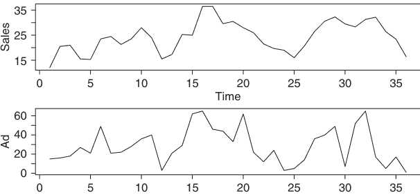

图 3.2 一家公司 36 个月的销售和广告支出（单位：千）的时间图。

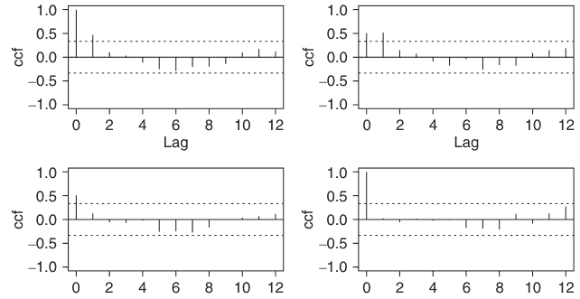

对样本偏自相关函数的简单检查表明，AR(1) 模型足以描述广告支出。拟合模型为

\( (1 - 0.3417B)(x_t - 27.95) = b_t, \quad \sigma_b^2 = 303.7, \quad (3.10) \)

其中，$x_t$ 表示每月广告支出。遵循传递函数模型（TFM）的建模程序，我们计算预白化销售序列

\( \tilde{y}_t \equiv= (1 - 0.3417B)y_t, \quad (3.11) \)

其中，$y_t$ 是每月销售。令 $z_t = (\tilde{y}_t, b_t)'$ 为数据的预白化双变量序列。图 3.3 显示了 $z_t$ 的交叉相关矩阵图。特别感兴趣的是图 3.3 的右上图和左下图。右上图显示 $\tilde{y}_t$ 对 $b_t$ 滞后值的依赖，而左下图显示 $b_t$ 对 $\tilde{y}_t$ 滞后值的依赖。从图中可以放心地看到，销售依赖于广告支出的滞后值，但广告支出不依赖于销售的滞后值。这证实了两个时间序列之间的 TF 关系。利用预白化的特性，右上图还显示前两个冲激响应权重在统计上显著，但所有更高阶权重不显著。因此，图表明 \(b=0, r=0\) 和 \(s=1\)。

表 3.3 提供了预白化序列的角形法。使用 \(2/\sqrt{36} \approx 0.33\) 作为粗略阈值，表表明第 3 行及以后的所有条目均不显著，确认了 \((b, r, s) = (0, 0, 1)\) 的选择。拟合 TFM 为

\( y_t = 16.91 + 0.12x_t + 0.14x_{t-1} + \frac{1}{1 - 0.497B}e_t, \quad (3.12) \)

其中，所有估计值在 5% 水平上均显著，$e_t$ 是残差序列。由于残差中不存在序列相关性（Ljung-Box 统计量 \(Q(12) = 5.57\)），该模型拟合数据良好。


### TABLE 3.3 示例 3.1 中销售和广告支出预白化序列的角法表

| | 1 | 2 | 3 | 4 | 5 | 6 | 7 |
|---|---|---|---|---|---|---|---|
| 0 | 0.98312 | 0.96652 | 0.95020 | 0.93416 | 0.91838 | 0.90288 | 0.88763 |
| 1 | 1.00000 | 0.71545 | 0.57078 | 0.67398 | 0.45587 | 0.21740 | -0.33550 |
| 2 | 0.28944 | -0.06095 | -0.16461 | 0.20773 | 0.06674 | 0.22174 | 0.25438 |
| 3 | 0.14473 | 0.07179 | 0.06966 | 0.08033 | -0.09127 | 0.14808 | -0.20047 |
| 4 | -0.17565 | 0.08085 | 0.00555 | 0.06167 | -0.05340 | 0.01638 | 0.15058 |
| 5 | -0.34542 | 0.10464 | -0.07113 | 0.05103 | -0.02018 | 0.05611 | -0.10278 |
| 6 | -0.08355 | -0.16847 | -0.05055 | 0.01896 | 0.04600 | 0.06561 | 0.04985 |

近似的 2-标准误限为 0.36

#### 3.1.2 多输入和多输出

在 TFM 的一些应用中，输入变量、输出变量或两者皆可为多变量。在这种情况下，预白化过程变得繁琐。一种更直接和简单的方法是应用多变量时间序列分析。实际上，TFM 可以被视为 VARMA 模型的特例。详情如下。

## 3.2 向量 AR 模型

向量 AR（VAR）模型可以说是实践中应用最广泛的多变量时间序列模型。对于 _k_ 维时间系列 **_z_**_<sub>t</sub>_，VAR(_p_) 模型为

```
\(z_t = \phi_0 + \sum_{i=1}^p \phi_i z_{t-i} + a_t,\) (3.13)
```

其中 \(\phi_0\) 是一个 _k_ 维向量，\(\phi_i\) 是 \(k \times k\) 实矩阵，而 **_a_**_<sub>t</sub>_ 是均值为零且协方差矩阵 \(\Sigma_a > 0\) 为正定的白噪声序列。显然，我们假设阶数 _p_ 为非负，且若 _p_ > 0 则 \(\phi_p \neq \mathbf{0}\)。设 \(\phi(B) = I - \sum_{i=1}^p \phi_i B^i\) 为 AR 矩阵多项式。若行列式方程 \(|\phi(B)| = 0\) 的所有零点绝对值均大于 1，则系列 **_z_**_<sub>t</sub>_ 为弱平稳。考虑一个平稳系列。对 Eq. (3.13) 取期望，得

```
\(E(z_t) \equiv \mu = [\phi(1)]^{-1} \phi_0.\)
```

其中 \(\phi(1) = I - \sum_{i=1}^p \phi_i\)，该矩阵可逆。利用上述方程，平稳的 VAR(_p_) 模型可重写为

```
\(\phi(B)(z_t - \mu) = a_t.\) (3.14)
```

该模型在金融中常被使用，因为 \(z_t - \mu\) 是均值偏差，且平稳系列 **_z_**_<sub>t</sub>_ 具有均值回归特性。将 Eq. (3.14) 右乘以 \((z_{t-j} - \mu)'\) 并取期望，得

```
\(\Gamma_z(j) = \left\{ \begin{array}{ll} \sum_{i=1}^p \phi_i \Gamma_z(j-i) + \Sigma_a & \text{if } j = 0, \\ \sum_{i=1}^p \phi_i \Gamma_z(j-i) & \text{if } j > 0, \end{array} \right.\)
```

如前所述，\(\Gamma_z(j)\) 是 \(z_t\) 的滞后-\(j\) 自协方差矩阵。Eq. (3.15) 是平稳 VAR(_p_) 模型的矩方程。特别地，联合考虑 \(j = 1, \dots, p\) 的方程，得

```
[\Gamma_z(1), \dots, \Gamma_z(p)] = [\phi_1, \dots, \phi_p] \left[ \begin{array}{cccc} \Gamma_z(0) & \Gamma_z(1) & \cdots & \Gamma_z(p-1) \\ \Gamma_z(-1) & \Gamma_z(0) & \cdots & \Gamma_z(p-2) \\ \vdots & \vdots & \ddots & \vdots \\ \Gamma_z(1-p) & \Gamma_z(2-p) & \cdots & \Gamma_z(0) \end{array} \right]
```

这被称为多变量 Yule-Walker 方程，可根据自协方差矩阵 \(\Gamma_z(j)\) 求得 AR 系数矩阵 \(\phi_j\)。例如，对 AR(1) 可得

```
\(\phi_1 = \Gamma_z(1)[\Gamma_z(0)]^{-1}.\)
```

另一方面，给定平稳 VAR(_p_) 模型，可通过 (3.15) 中的矩方程递归计算自协方差矩阵 \(\Gamma_z(j)\)。递归的初始值可通过求解一组线性方程组得到。为举例说明，考虑平稳（零均值）VAR(1) 模型，\(z_t = \phi_1 z_{t-1} + a_t\)。对模型两边取协方差，并注意 \(a_t\) 与 \(z_{t-1}\) 不相关，得

```
\(\Gamma_z(0) = \phi_1 \Gamma_z(0) \phi_1' + \Sigma_a.\)
```

因而，

```
\(\text{vec}[\Gamma_z(0)] = (\phi_1 \otimes \phi_1)\text{vec}[\Gamma_z(0)] + \text{vec}(\Sigma_a),\)
```

且

```
\(\text{vec}[\Gamma_z(0)] = [I - \phi_1 \otimes \phi_1]^{-1} \text{vec}(\Sigma_a),\)
```

其中 \(I\) 是 \(k^2 \times k^2\) 单位矩阵，\(\otimes\) 表示克罗内克积。这是标量情况的推广，标量情况下 \(\text{var}(z_t) = \sigma_a^2 / (1 - \phi_1^2)\)。给定 \(\Gamma_z(0)\) 后，可通过 (3.15) 中的矩方程递归计算 VAR(1) 模型的 \(\Gamma_z(j)\)。

由于 _k_ 维 VAR(_p_) 模型总可重写为 \(kp\) 维 VAR(1) 模型，前述讨论适用于所有平稳 VAR(_p_) 模型。具体地，令 \(Z_t = (z_t', z_{t-1}', \dots, z_{t-p+1}')'\) 为一个 \(kp\) 维错开时间序列。则容易看出

```
Z_t = \left[ \begin{array}{ccccc} \phi_1 & \phi_2 & \cdots & \phi_{p-1} & \phi_p \\ I & 0 & \cdots & 0 & 0 \\ 0 & I & \cdots & 0 & 0 \\ \vdots & \vdots & \ddots & \vdots & \vdots \\ 0 & 0 & \cdots & I & 0 \end{array} \right] Z_{t-1} + \left[ \begin{array}{c} a_t \\ 0 \\ \vdots \\ 0 \\ 0 \end{array} \right],
```

这是一个 $kp$ 维 VAR(1) 模型的形式。Eq. (3.18) 中 $Z_{t-1}$ 的系数矩阵称为 AR 矩阵多项式 \(\phi(B)\) 的伴随矩阵。可证，伴随矩阵的特征值为方程 \(|\phi(B)| = 0\) 解的倒数。这提供了描述 VAR(_p_) 模型弱平稳条件的另一种方式，即 \(\phi(B)\) 的伴随矩阵所有特征值的绝对值均小于 1。

### 3.2.1 冲激响应函数

平稳 VAR(_p_) 模型具有 MA 表示，

```
$z_t = \mu + \sum_{i=0}^{\infty} \psi_i a_{t-i} \equiv \mu + \psi(B)a_t, \quad (3.19)$
```

其中 \(\psi(B) = \sum_{i=0}^{\infty} \psi_i B^i\)，且 \(\phi(B)\psi(B) = I\)。系数矩阵 \(\psi_i\) 是 \(a_t\) 对 \(z_{t+i}\) 的影响，可视为冲激响应矩阵。对于给定的 VAR 模型，\(\psi_i\) 矩阵可通过令 \(\phi(B)\psi(B) = I\) 中 \(B^i\) 的系数矩阵相等来求得。另外，根据 Eq. (3.19)，有

```
$\Gamma_z(j) = \sum_{i=0}^{\infty} \psi_{i+j} \Sigma_a \psi'_i, \quad j \ge 0.$
```

Eq. (3.19) 的冲激响应矩阵 \(\psi_i\) 可能难以解释，因为创新项 \(a_{it}\) 通常是相关的。为缓解这一难题，可以进行变换，例如

```
$b_t = P'a_t,$
```

使得 \(\text{var}(b_t)\) 为对角矩阵。实现此目的的方法有很多，一种可能是考虑 \(\Sigma_a\) 的特征值-特征向量分析，即

```
$\Sigma_a P = P \Lambda,$
```

其中 \(\Lambda = \text{diag}\{\lambda_1, \dots, \lambda_k\}\)，\(\lambda_i\) 为 \(\Sigma_a\) 的第 \(i\) 个有序特征值，\(P\) 为相应特征向量组成的矩阵。由于 \(\Sigma_a\) 为正定，\(P\) 为正交矩阵，例如 \(PP' = P'P = I\)。令 \(\psi_i^* = P\psi\)（\(i \ge 0\)），则有

```
$z_t = \mu + \sum_{i=0}^{\infty} \psi_i^* b_{t-i}. \quad (3.20)$
```

系数矩阵 \(\psi_i^*\) 称为正交创新项 \(b_t\) 的冲激响应矩阵。这是因为容易看出 \(\partial z_{ut} / \partial b_{v,t-i} = \psi_{i,uv}^*\)，其中 \(\psi_{i,uv}^*\) 表示矩阵 \(\psi_i^*\) 的 \((u, v)\) 元素，这意味着 \(b_{v,t-i}\) 的一个单位变化将使 \(z_{ut}\) 受到 \(\psi_{i,uv}^*\) 的影响。部分和矩阵

```
$\Psi_v = \sum_{i=0}^v \psi_i^*, \quad (3.21)$
```

是累积冲激响应矩阵。注意，\(\Psi_v\) 的 \((i,j)\) 元素是 \(b_{j,t-v}\) 对 \(z_{it}\) 的影响和累积影响。矩阵 \(\Psi_\infty\) 表示 VAR 模型的总乘数。在许多应用中，研究者关注拟合 VAR 模型的冲激响应函数。


### 3.2.2 一些特殊情况

VAR(\(p\)) 模型的系数矩阵 \(\phi_i\) 的结构可能传达关于底层时间序列的有用信息。本节将考虑一些特殊情况。

**情况 1：TFM。** 在这种情况下，不失一般性，我们假设 \(z_t\) 可以分为 \(z_{1t}\) 和 \(z_{2t}\)，使得模型变为

\(\begin{bmatrix} \phi_{11}(B) & \mathbf{0} \\ \phi_{21}(B) & \phi_{22}(B) \end{bmatrix} \begin{bmatrix} z_{1t} \\ z_{2t} \end{bmatrix} = \begin{bmatrix} a_{1t} \\ a_{2t} \end{bmatrix} . \quad (3.22)\)

这里 \(z_{1t}\) 是输入向量，遵循 VAR 模型 \(\phi_{11}(B)z_{1t} = a_{1t}\)。输出向量是 \(z_{2t}\)，并满足方程

\(\phi_{22}(B)z_{2t} = -\phi_{21}(B)z_{1t} + a_{2t} = -\phi_{21}(B)[\phi_{11}(B)]^{-1}a_{1t} + a_{2t}. \quad (3.23)\)

不过，方程 (3.23) 不是 TF 形式，因为 \(a_{2t}\) 和 \(a_{1t}\) 可能相关。为了将模型置于 TF 形式，我们需要进行一些正交化。具体来说，考虑多元多元线性回归

\(a_{2t} = \beta a_{1t} + e_t, \quad (3.24)\)

并求得 \(\beta\) 的最小二乘估计，记为 \(\hat{\beta}\)。残差序列 \(\hat{e}_t = a_{2t} - \hat{\beta}a_{1t}\) 与 \(a_{1t}\) 正交。因此，我们得到一个 TFM

\(z_{2t} = [\phi_{22}(B)]^{-1}[-\phi_{21}(B) + \hat{\beta}\phi_{11}(B)]z_{1t} + [\phi_{22}(B)]^{-1}\hat{e}_t. \quad (3.25)\)

在实践中，人们可能有兴趣检验原假设 \(H_0 : \phi_{12}(B) = \mathbf{0}\) 对备择假设 \(H_a : \phi_{12}(B) \neq \mathbf{0}\)。如果 \(a_t\) 的分布已知，例如多元高斯分布，则可以使用似然比检验。在文献中，这被称为 *格兰杰因果性* 检验。对于该检验，全模型是 \(k\) 维 VAR(\(p\)) 模型，缩减模型在方程 (3.22) 中。得到的似然比统计量渐近地服从 \(\chi^2_{df}\) 分布，其中自由度 \(d = pk_1k_2\)，\(k_i\) 为 \(z_{it}\) 的维度。更多信息请参见，例如，Tsay (2014)。

直接使用 VAR 模型处理 TFM 有多个优势。首先，\(z_{1t}\) 和 \(z_{2t}\) 都是随机向量，因此该方法可以在不需要预白化的要求下处理多输入和多输出。其次，在数据分析中不需要识别哪个变量是输入、哪个是输出。第三，可以进行格兰杰因果性检验以确认从 \(z_{1t}\) 到 \(z_{2t}\) 的单向关系。另一方面，方程 (3.25) 中的模型对于真正的底层 TFM 可能不够精简。

**情况 2：** 块结构：如果方程 (3.22) 中的 \(\phi_{21}(B)\) 也为零，则 \(z_{1t}\) 和 \(z_{2t}\) 分别遵循两个独立的 VAR 模型，尽管这两个向量序列可能具有同时相关性。所谓同时相关，是指 \(a_t\) 元素之间的相关性。在 \(\phi(B)\) 为对角矩阵的特殊情况下，\(z_t\) 由 \(k\) 个不相互动态依赖的标量 AR 时间序列组成。

#### 情况 3：分层 TF：如果 $z_t = (z'_{1t}, z'_{2t}, z'_{3t})'$ 并满足模型

\(\begin{bmatrix} \phi_{11}(B) & 0 & 0 \\ \phi_{21}(B) & \phi_{22}(B) & 0 \\ \phi_{31}(B) & \phi_{32}(B) & \phi_{33}(B) \end{bmatrix} \begin{bmatrix} z_{1t} \\ z_{2t} \\ z_{3t} \end{bmatrix} = \begin{bmatrix} a_{1t} \\ a_{2t} \\ a_{3t} \end{bmatrix} . \quad (3.26)\)

那么，$z_{1t}$ 是 \(z_{2t}\) 的输入向量，且 \(z_{1t}\) 和 \(z_{2t}\) 都是 \(z_{3t}\) 的输入向量。隐含的 TFM 可以使用情况 1 中提到的相同技术获得。

#### 情况 4：假设 VAR 模型可以分解为：

\(z_t = \Phi_*(B)z_{t-1} + \mathbf{a}_t = A(B)C(B)z_{t-1} + \mathbf{a}_t \quad (3.27)\)

其中 \(\Phi_*(B) = \sum_{i=1}^p \Phi_i B^{i-1}\)，\(A(B) = \sum_{i=0}^{p_1} A_i B^i\) 和 \(C(B) = \sum_{i=0}^{p_2} C_i B^i$ 是分别为 $k \times r$ 和 $r \times k$ 维、次数为 $p_1$ 和 $p_2$ 的矩阵多项式算子，且 $p = p_1 + p_2 + 1$。令 $y_t = C(B)z_t$ 为一个 $r$ 维时间序列，则可将 $z_t$ 的模型写为
\(z_t = A(B)y_{t-1} + \mathbf{a}_t\)。

这是 Velu 等人 (1986) 提出的低秩 AR 模型，当 $r$ 远小于 $k$ 时非常有用。另请参见 Ahn 和 Reinsel (1988)。它与第 6 章中研究的因子模型相关。

### 3.2.3 估计

给定实现 \(\{z_1, \dots, z_T\}$，可以使用普通最小二乘（OLS）法、广义最小二乘（GLS）法或最大似然（ML）法来估计 VAR(\(p\)) 模型。结果表明，OLS 估计量与 VAR 模型的 GLS 估计量相同，并且在正态性假设下，OLS 估计量与 ML 估计量渐近等价。例如，请参见 Tsay (2014, chapter 2) 及其参考文献。因此，此处我们只考虑 OLS 估计。

方程 (3.13) 中的 VAR(\(p\)) 模型可以写为

\(z'_t = x'_t \beta + a'_t, \quad (3.28)\)

其中 $x_t = (1, z'_{t-1}, \dots, z'_{t-p})'$ 和 $\beta' = [\phi_0, \phi_1, \dots, \phi_p]$ 是一个 \((kp + 1) \times p$ 系数矩阵。对于 \(t = p + 1, \dots, T$ 使用方程 (3.28)，我们得到以下数据矩阵方程

\(Z = X\beta + A, \quad (3.29)\)

其中 \(Z, X\) 和 \(A$ 的第 \(i$ 行分别为 \(z'_{p+i}, x'_{p+i}\) 和 \(a'_{p+i}\)。\(Z\) 和 \(A$ 的维度为 \((T - p) \times k\)，而 \(X$ 的维度为 \((T - p) \times (kp + 1)\)。该模型的 OLS 估计目标函数为

\(S(\beta) = \text{tr}[(Z - X\beta)(Z - X\beta)'],\)

其中 tr(\(C\)) 是方阵 \(C$ 的迹。对 \(\beta\) 对 \(S(\beta)$ 求偏导，我们可以获得一阶条件的线性方程组，从中得到 OLS 估计量为

\(\hat{\beta} = (X'X)^{-1}(X'Z) = \left( \sum_{t=p+1}^T x_t x'_t \right)^{-1} \left( \sum_{t=p+1}^T x_t z'_t \right). \quad (3.30)\)

\(\Sigma_a$ 的 OLS 估计为

$$\hat{\Sigma}_a = \frac{1}{T-(k+1)p-1} \sum_{t=p+1}^T \hat{a}_t \hat{a}'_t \quad (3.31)$$

其中 \(\hat{a}_t = z_t - \hat{\phi}_0 - \sum_{i=1}^p \hat{\Phi}_i z_{t-i}$ 是残差序列。如果使用 ML 估计，则 \(\Sigma_a$ 的 ML 估计为

$$\hat{\Sigma}_a = \frac{1}{T-p} \sum_{t=p+1}^T \hat{a}_t \hat{a}'_t. \quad (3.32)$$

**定理 3.1** 假设 VAR(\(p\)) 模型的 \(a_t$ 是一组独立同分布的随机向量序列，均值为零，协方差矩阵 \(\Sigma_a$ 为正定。那么，OLS 估计给出 (a) \(E(\hat{\beta}) = \beta$，(b) \(E(\hat{\Sigma}_a) = \Sigma_a$，(c) 残差 \(\hat{A}$ 与 \(\hat{\beta}$ 不相关，以及 (d) 参数估计量的协方差矩阵为

$$Cov[vec(\hat{\beta})] = \tilde{\Sigma}_a \otimes (X'X)^{-1}.$$

为了建立估计量 \(\hat{\beta}$ 的渐近正态分布，我们进一步假设

$$E|a_{it}a_{ju}a_{ru}a_{vt}| < \infty, \quad \text{for all } 1 \le i, j, u, v \le k \text{ and } t, \quad (3.33)$$

这意味着 \(a_t$ 的所有四阶矩都是有限的。

**定理 3.2** 假设定理 3.1 和方程 (3.33) 的条件成立。那么，当 \(T \to \infty$ 时，

- (i) \(\hat{\beta} \to_p \beta,\)
- (ii) \(\sqrt{T-p}[vec(\hat{\beta}) - vec(\beta)] \to_d N(0, \Sigma_a \otimes G^{-1}),\)

其中 \(\to_p$ 和 \(\to_d$ 分别表示概率收敛和分布收敛，并且

$$G = \begin{bmatrix} 1 & 0' \\ 0 & \Gamma_0^* \end{bmatrix} + \begin{bmatrix} 0 \\ u \end{bmatrix} [0, u']$$

其中 0 是一个 \(kp$ 维零向量，\(u = 1_p \otimes \mu\)，其中 \(1_p$ 是 \(p$ 维全一向量，并且

$$\Gamma_0^* = \begin{bmatrix} \Gamma_z(0) & \Gamma_z(1) & \cdots & \Gamma_z(p-1) \\ \Gamma_z(-1) & \Gamma_z(0) & \cdots & \Gamma_z(p-2) \\ \vdots & \vdots & \ddots & \vdots \\ \Gamma_z(1-p) & \Gamma_z(2-p) & \cdots & \Gamma_z(0) \end{bmatrix}.$$

### 3.2.4 模型构建

**阶次选择：** 构建时间序列 \(z_t$ 的 VAR 模型的第一步是选择阶次 \(p$。文献中有多种方法可用。例如，请参见 Tsay (2014, chapter 2)。最常用的方法是使用以下准则函数之一：


AIC(p) = ln |\hat{\Sigma}_a| + \frac{2pk^2}{T},
BIC(p) = ln |\hat{\Sigma}_a| + \frac{ln(T)pk^2}{T},
Hannan and Quinn (HQ)(p) = ln |\hat{\Sigma}_a| + \frac{2ln(ln(T))pk^2}{T},

where \(\hat{\Sigma}_a\) is the ML estimate of \(\Sigma\) in Eq. (3.32), \(T\) is the sample size, and \(k\) is the dimension. These criteria are the multivariate generalizations of those studied in Section 2.8.4. See Akaike (1973), Schwarz (1978), and Hannan and Quinn (1979). In practice, with a prespecified maximum order \(P\), one selects the order that gives rise to the minimum value of a criterion function. For instance, the order selected by AIC is

\(\hat{p} = \arg \min_{0 \le p \le P} \text{AIC}(p),\)

where \(p=0\) corresponding to fitting a model with constant term only. Under the assumption that \(\mathbf{z}_t\) follows a finite-order VAR model, both BIC and HQ criteria are shown to be consistent, but AIC has some small probability to specify an order greater than the true order \(p\). However, AIC is often used because there exists no true VAR model in any real application. For further discussion of properties of AIC, see Shibata (1980).

#### 模型检验

设 \(\mathbf{R}_j\) 为 VAR(\(p\)) 模型（Eq. (3.13)）中创新序列 \(\mathbf{a}_t\) 的滞后-\(j\) 交叉相关系数矩阵。就模型检验而言，感兴趣的原假设为 \(H_0 : \mathbf{R}_1 = \cdots = \mathbf{R}_m = \mathbf{0}\)，与备择假设 \(H_a : \mathbf{R}_i \neq \mathbf{0}\) 对某些 \(1 \le i \le m\) 相对立，其中 \(m\) 为预设的正整数。设 \(\hat{\mathbf{a}}_t\) 为模型的残差序列，例如最小二乘残差。\(\mathbf{R}_j\) 的自然估计量为

\(\hat{\mathbf{R}}_j = \hat{\mathbf{D}}^{-1/2} \hat{\mathbf{C}}_j \hat{\mathbf{D}}^{-1/2},\)

其中 \(\hat{\mathbf{C}}_v\) 是由以下公式给出的滞后-\(v\) 残差协方差矩阵

\(\hat{\mathbf{C}}_v = \frac{1}{T-p} \sum_{t=p+v+1}^T \hat{\mathbf{a}}_t \hat{\mathbf{a}}_{t-v}, \quad v = 0, 1, \dots,\)

且 \(\hat{\mathbf{D}} = \text{diag}\{\hat{\mathbf{C}}_{0,11}, \dots, \hat{\mathbf{C}}_{0,kk}\}\)，由 \(\hat{\mathbf{C}}_0\) 的对角元素组成。常用的检验统计量是多元 portmanteau 统计量，定义为

\(Q_k(m) = T^2 \sum_{\ell=1}^m \frac{1}{T-\ell} \text{tr}(\hat{\mathbf{R}}'_\ell \hat{\mathbf{R}}_0^{-1} \hat{\mathbf{R}}_\ell \hat{\mathbf{R}}_0^{-1})\)
\(= T^2 \sum_{\ell=1}^m \frac{1}{T-\ell} \text{tr}(\hat{\mathbf{R}}'_\ell \hat{\mathbf{R}}_0^{-1} \hat{\mathbf{R}}_\ell \hat{\mathbf{R}}_0^{-1} \hat{\mathbf{D}}^{-1} \hat{\mathbf{D}})\)
\(= T^2 \sum_{\ell=1}^m \frac{1}{T-\ell} \text{tr}(\hat{\mathbf{D}}\hat{\mathbf{R}}'_\ell \hat{\mathbf{D}}\hat{\mathbf{D}}^{-1} \hat{\mathbf{R}}_0^{-1} \hat{\mathbf{R}}_0^{-1} \hat{\mathbf{D}} \hat{\mathbf{D}}\hat{\mathbf{R}}_\ell \hat{\mathbf{D}}\hat{\mathbf{D}}^{-1} \hat{\mathbf{R}}_0^{-1} \hat{\mathbf{D}}^{-1})\)
\(= T^2 \sum_{\ell=1}^m \frac{1}{T-\ell} \text{tr}(\hat{\mathbf{C}}'_\ell \hat{\mathbf{C}}_0^{-1} \hat{\mathbf{C}}_\ell \hat{\mathbf{C}}_0^{-1}).\)

在定理 3.2 的假设下，可以证明检验统计量 $Q_k(m)$ 渐近服从自由度为 \(d = (m-p)k^2\) 的 \(\chi_d^2\) 分布，前提是 \(m > p\)。有关更多信息，请参见 Li and McLeod (1981) 和 Hosking (1981)。

#### 模型简化

多元时间序列建模的一个难点在于，拟合模型通常包含许多高度相关但在通常 5% 水平下边缘不显著的参数。模型简化已成为必要。然而，逐个删除不显著的参数会过于繁琐。有几种方法可以克服这一困难。一种方法是使用正则化，例如 \(\ell_1\) 惩罚估计。我们将在第7章的高维时间序列分析中讨论这种方法。第二种方法是 *thresholding*，即同时将所有 \(t\)-比率小于给定阈值的参数设为零。Tsay (2014) 采用这种方法，并在 R 的 **MTS** 包中提供。实施 thresholding 时，选择合适的阈值必须谨慎。过大的阈值很容易使拟合模型失效，而过小的阈值往往会导致简化不足。遵循 Tsay (2014)，我们检查在给定阈值下重新拟合模型后的信息准则。如果信息准则（如 AIC）增加，则阈值过高。另一方面，如果所选信息准则下降，则可以提高阈值。有限的经验表明，这种 thresholding 方法在许多应用中效果良好。

### 3.2.5 预测

考虑 Eq. (3.13) 中的 VAR(\(p\)) 模型。假设有人有兴趣在预测原点 \(t = n\) 时预测 \(z_{n+h}\)。即，给定时间 \(t = n\) 时可用的信息（记为 \(F_t\)），希望了解 \(P(z_{n+h}|F_t)\)，其中 \(h\) 是正整数，文献中称为预测步长。为简单起见，通常关注 \(E(z_{n+h}|F_t)\) 和 \(\text{Var}(z_{n+h}|F_t)\)，而非条件分布 \(P(z_{n+h}|F_t)\)。为此，我们采用最小化预测误差均方（MSFE）的准则，并考虑两种情况。其他预测准则也可使用，但会带来一些复杂性，且无法得到封闭式解来生成预测。

#### 情况 1

假设模型已知，即将 VAR(\(p\)) 模型的估计参数视为真实参数。根据模型，我们有

\(z_{n+h} = \phi_0 + \sum_{i=1}^p \phi_i z_{n+h-i} + a_{n+h}.\) (3.35)

当 \(h = 1\) 时，Eq. (3.35) 变为

\(z_{n+1} = \phi_0 + \phi_1 z_n + \cdots + \phi_p z_{n+1-p} + a_{n+1}.\)

在 MSFE 准则下，1步先验点预测简单为

\(z_n(1) = E(z_{n+1}|F_t) = \phi_0 + \phi_1 z_n + \cdots + \phi_p z_{n+1-p},\) (3.36)

相关的预测误差及其方差为

\(e_n(1) = z_{n+1} - z_n(1) = a_{n+1}, \quad V[e_n(1)] = \Sigma_a.\) (3.37)

根据 Eqs. (3.36) 和 (3.37)，我们有

\(z_{n+1} = z_n(1) + a_{n+1}.\) (3.38)

对于 \(h = 2\)，使用 Eqs. (3.35) 和 (3.38)，我们有

\(z_{n+2} = \phi_0 + \phi_1 z_{n+1} + \phi_2 z_n + \cdots + \phi_p z_{n+2-p} + a_{n+2}\)
\(= \phi_0 + \phi_1[z_n(1) + a_{n+1}] + \phi_2 z_n + \cdots + \phi_p z_{n+2-p} + a_{n+2}\)
\(= \phi_0 + \phi_1 z_n(1) + \phi_2 z_n + \cdots + \phi_p z_{n+2-p} + a_{n+2} + \phi_1 a_{n+1}.\)

由此清楚，2步先验预测及其相关误差为

\(z_n(2) = E(z_{n+2}|F_n) = \phi_0 + \phi_1 z_n(1) + \phi_2 z_n + \cdots + \phi_p z_{n+2-p}\) (3.39)
\(e_n(2) = z_{n+2} - z_n(2) = a_{n+2} + \phi_1 a_{n+1}\) (3.40)
\(V[e_n(2)] = \Sigma_a + \phi_1 \Sigma_a \phi_1'.\)

一般来说，可以重复该过程，得出 \(h\) 步先验预测为

\(z_n(h) = \phi_0 + \sum_{i=1}^p \phi_i z_n(h-i)\) (3.41)
\(e_n(h) = a_{n+h} + \sum_{j=1}^{h-1} \psi_j a_{n+h-j}\) (3.42)
\(V[e_n(h)] = \Sigma_a + \sum_{j=1}^{h-1} \psi_j \Sigma_a \psi_j',\) (3.43)

其中 \(\psi_i\) 是 \(z_t\) 的第 \(i\) 个 \(\psi\)-权重系数矩阵；参见 Eq. (3.19)。在 Eq. (3.41) 中，理解为当 \(\ell \le 0\) 时 \(z_n(\ell) = z_{n+\ell}\)，即 \(z_n(0) = z_n\) 和 \(z_n(-1) = z_{n-1}\)。Eqs. (3.41) 和 (3.43) 意味着，VAR(\(p\)) 模型的预测及其相关协方差矩阵可以递归计算。

使用 \(\phi_0 = (\mathbf{I} - \sum_{i=1}^p \phi_i)\mu\)，Eq. (3.41) 可重写为

\(z_n(h) - \mu = \sum_{i=1}^p [z_n(h-i) - \mu].\)

然后，通过使用 Eq. (3.18) 中的 \(kp\) 维模型表示，可以很容易地推导出，如果 \(z_t\) 是平稳时间序列，则当 \(h \to \infty\) 时有 \(z_n(h) - \mu \to \mathbf{0}\)。即，当 \(h \to \infty\) 时 \(z_n(h) \to \mu\)。这被称为平稳向量自回归过程的 *mean reverting*。此外，根据 Eq. (3.43)，当 \(h \to \infty\) 时有 \(\text{V}[e_n(h)] \to \text{V}(z_t)\)。

#### 情况 2：参数不确定性

在实践中，系数矩阵 \(\phi_i\) 未知，人们可能在预测中考虑参数不确定性。对于 VAR 模型，结果相对简单。注意，给定 \(F_n\) 时，估计量 \(\hat{\phi}_i\) 和 \(\hat{\Sigma}_a\) 可用，因此模型可写成

\(z_{n+h} = \hat{\phi}_0 + \sum_{i=1}^p \hat{\phi}_i z_{n+h-i} + [\phi_0 - \hat{\phi}_0] + \sum_{i=1}^p [\phi_i - \hat{\phi}_i] z_{n+h-i} + a_{n+h}.\) (3.44)


对于 \( j = 1, \dots, h \)，递归定义

\[
\hat{z}_n(j) = \hat{\Phi}_0 + \sum_{i=1}^p \hat{\Phi}_i \hat{z}_n(j-i), \tag{3.45}
\]

其中约定 \(\hat{z}_n(\ell) = z_{n+\ell}\) 对 \(\ell \le 0\) 成立。另外，令

\[
\hat{e}_n(j) = z_{n+j} - \hat{z}_n(j), \quad j=1, \dots, h \tag{3.46}
\]

为参数不确定性下的 \( j \) 步先行预报误差。根据 Eq. (3.46)，有

\[
\hat{e}_n(j) = z_{n+j} - z_n(j) + z_n(j) - \hat{z}_n(j) = e_n(j) + [z_n(j) - \hat{z}_n(j)]. \tag{3.47}
\]

由于 \( e_n(j) = a_{n+j} + \sum_{i=1}^{j-1} \Psi_v a_{n+v} \) 且 \( z_n(j) \) 和 \(\hat{z}_n(j)\) 均为 \( F_n \) 的函数，当 \( j \ge 1 \) 时，Eq. (3.47) 右侧两项不相关，故有

\[
\begin{aligned}
\text{V}[\hat{e}_n(j)] &= \text{V}[e_n(j)] + E\{[z_n(j) - \hat{z}_n(j)][z_n(j) - \hat{z}_n(j)]'\} \\
&\equiv \text{V}[e_n(j)] + \text{MSE}[z_n(j) - \hat{z}_n(j)], \tag{3.48}
\end{aligned}
\]

其中 \(\equiv\) 表示等价。尚需推导 MSE 项。对于 VAR 模型，可以推导出 MSE 的封闭式解。参见，例如，Tsay (2014, section 2.9.2) 及其中的参考文献。对于 VAR(\( p \)) 模型和 1 步先行预测，有 MSE[\( z_n(1) - \hat{z}_n(1) \)] = \( (kp+1)\Sigma_a/(T - p) \)。因此，得到

\[
\text{V}[\hat{e}_n(1)] = \frac{(T - p) + kp + 1}{T - p} \Sigma. \tag{3.49}
\]

由于 \( kp + 1 \) 是拟合 VAR(\( p \)) 模型中分量 \( z_{it} \) 的参数个数，Eq. (3.49) 意味着，对于 VAR(\( p \)) 模型的每个估计参数，都会以 \( 1/(T - p) \) 的因子增加 1 步先行预测的不确定性，其中 \( T - p \) 是拟合 VAR(\( p \)) 模型时使用的有效观测数。在实践中，该结果表明，在预测中使用适当且精简的 VAR 模型是有益的。

### 3.2.6 预报误差方差分解

考虑 Eq. (3.42) 中的 \( h \) 步先行预报误差。此外，令 \( \eta_t = \Sigma_a^{-1/2} a_t \)，其中 \(\Sigma_a^{1/2}\) 表示 \(\Sigma_a\) 的平方根矩阵。则有 V(\( \eta_t \)) = \( I_k \)，即 \( k \times k \) 单位矩阵。预报误差可写为

\[
e_n(h) = \Psi_0 \eta_{n+h} + \sum_{j=1}^{h-1} \Psi_j \eta_{n+h-j}, \tag{3.50}
\]

其中 \( \Psi_0 = \Sigma_a^{1/2} \) 和 \( \Psi_j = \Psi_j \Sigma_a^{1/2} \)。根据 Eq. (3.50)，有

\[
\text{V}[e_n(h)] = \sum_{j=0}^{h-1} \Psi_j \Psi_j'. \tag{3.51}
\]

因此，对于第 \( i \) 个分量 \( e_{n,t}(h) \)，有

\[
Var[e_{n,t}(h)] = \sum_{j=0}^{h-1} \sum_{v=1}^k \Psi_{j,iv}^2 = \sum_{v=1}^k \left[ \sum_{j=0}^{h-1} \Psi_{j,iv}^2 \right], \tag{3.52}
\]

其中 \(\Psi_{j,iv}\) 是 \(\Psi_j\) 的第 \( (i, v) \) 个元素。令 \( w_{iv}(h) = \sum_{j=0}^{h-1} \Psi_{j,iv}^2 \)，则有

\[
Var[e_{n,t}(h)] = \sum_{v=1}^k w_{iv}(h), \tag{3.53}
\]

这被称为预报误差方差分解，因为 \( w_{iv}(h) \) 是第 \( v \) 个分量对 \( z_{i,n+h} \) 预报误差方差的影响。在文献中，比值 \( w_{iv}(h)/Var[e_{n,t}(h)] \) 是预测 \( z_{i,n+h} \) 时归因于第 \( v \) 个分量的不确定性比例。

#### 示例 3.2

为说明利用 VAR 模型分析多元时间序列的方法，我们考虑 1980 年第一季度至 2018 年第一季度六个国家的不变价季度支出国内生产总值（GDP）。原始数据可从圣路易斯联邦储备银行的 FRED 网站获取。所考虑的国家为 (i) 美国 (US)、(ii) 英国 (UK)、(iii) 法国 (FR)、(iv) 澳大利亚 (AU)、(v) 德国 (GE) 和 (vi) 加拿大 (CA)。令 \( z_t = (z_{1t}, \dots, z_{6t})' \) 为上一季度的增长率序列，即 \( z_{it} = 100(Z_{it} - Z_{i,t-1})/Z_{i,t-1} \)，其中 \( Z_{it} \) 是以 2010 年为基期且经季节调整的 GDP 指数。图 3.4 显示了 \( z_t \) 的时间图，左侧面板包含 US、UK 和 FR（从上到下），右侧面板包含 AU、GE 和 CA。从图中可清楚地看到 2008 年金融危机导致的 GDP 下降（2008 年最后一季度）。唯一例外是 AU。

接下来，我们使用 R 的 **MTS** 包进行分析。分析详情见附带的 R 输出。首先，我们使用信息准则来选择 \( z_t \) 的 VAR 阶数。在此例中，AIC、BIC 和 HQ 选取的阶数分别为 13、1 和 1。为简单起见，我们考虑 VAR(1) 模型。采用最小二乘法，得到拟合模型

\[
z_t = \begin{bmatrix} 0.32 \\ 0.28 \\ 0.13 \\ 0.54 \\ 0.12 \\ 0.07 \end{bmatrix} + \begin{bmatrix} 0.16 & 0.44 & -0.18 & -0.02 & -0.02 & 0.17 \\ 0.15 & 0.50 & -0.00 & -0.14 & -0.05 & 0.06 \\ 0.08 & 0.16 & 0.43 & -0.02 & -0.05 & 0.04 \\ 0.04 & 0.19 & -0.34 & 0.10 & 0.03 & 0.29 \\ 0.21 & 0.08 & 0.64 & -0.16 & -0.13 & 0.03 \\ 0.31 & 0.30 & -0.24 & 0.10 & 0.09 & 0.24 \end{bmatrix} z_{t-1} + a_t,
\]

其中某些估计量在 5% 水平下不显著。该拟合模型的信息准则分别为 AIC、BIC 和 HQ 的 \(-6.87, -6.16, \text{和} -6.59\)。模型检验表明，该拟合模型的残差不具有

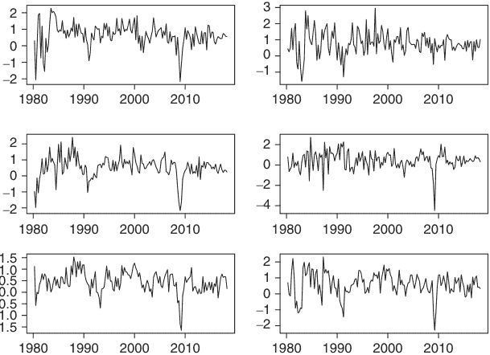

有显著的序列相关性。然而，该模型包含若干个不显著的参数估计量。遵循建议的模型简化方法，我们使用阈值法来改进拟合的 VAR(1) 模型。

我们从 t 比率的阈值 1 开始，得到的信息准则均下降。详情见 R 输出。我们将阈值提高到 1.3，相关模型为

\[
z_t = \begin{bmatrix} 0.31 \\ 0.27 \\ 0.13 \\ 0.54 \\ - \\ - \end{bmatrix} + \begin{bmatrix} 0.15 & 0.43 & -0.20 & - & - & 0.17 \\ 0.17 & 0.49 & - & -0.13 & - & - \\ 0.08 & 0.16 & 0.39 & - & - & - \\ - & 0.20 & -0.31 & 0.11 & - & 0.31 \\ 0.19 & - & 0.61 & - & - & - \\ 0.32 & 0.31 & -0.21 & 0.13 & 0.09 & 0.25 \end{bmatrix} z_{t-1} + a_t. \tag{3.54}
\]

改进模型的信息准则分别为 AIC、BIC 和 HQ 的 \(-7.00, -6.57, \text{和} -6.83\)。阈值法从 VAR(1) 模型中移除了 16 个不显著参数。图 3.5 显示了 Eq. (3.54) 模型残差的 Ljung-Box 统计量的 p 值。这些 p 值表明该模型拟合合理。图 3.6 显示了 Eq. (3.54) 中 VAR(1) 模型残差的时间图。

为了解六国 GDP 增长率之间的关系，我们可以研究 Eq. (3.54) 中拟合模型的脉冲响应函数。

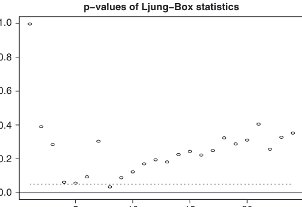

图 3.5 Eq. (3.54) 模型残差的 Ljung-Box 统计量 p 值。横轴表示滞后阶数。

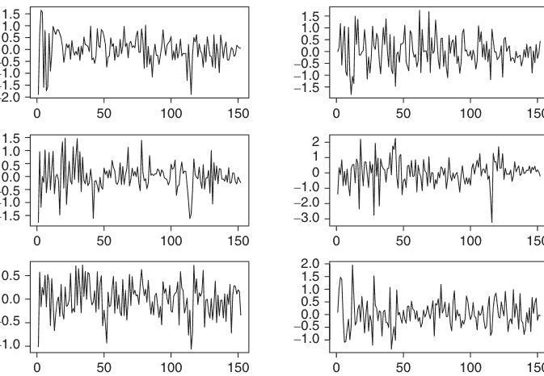

图 3.6 模型 (3.54) 残差的时间图。横轴表示时间序列。

图 3.7 和图 3.8 分别显示了模型的脉冲响应函数和累积脉冲响应函数。这些函数采用正交创新计算。从图中可以看出，美国季度 GDP 增长率几乎不依赖于澳大利亚和德国的增长率，但受英国、加拿大和法国增长率的影响。此外，如预期，GDP 增长率在很大程度上依赖于其自身过去值。最后，可以使用拟合模型

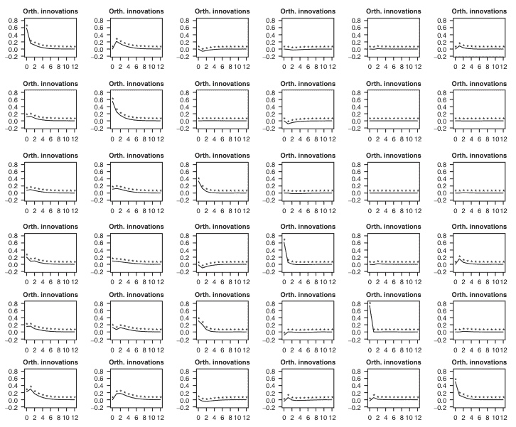

图 3.7 Eq. (3.54) 模型的脉冲响应函数。采用正交创新。

用于生成预报。1 步至 4 步先行预报及其相关误差的详情见 R 输出。预报误差方差分解也已给出。

### GDP 数据的 R 输出：为节省空间，输出已编辑。

```
> gdp <- read.table("gdpsimple6c8018.txt",header=T)
> dim(gdp)
[1] 153  6
> tdx <- c(1:153)/4 + 1980 ## Define calendar time (quarters)
> MTSplot(gdp,tdx)   ### Time series plots
> VARorder(gdp) ## Order selection
selected order: aic =  13
selected order: bic =  1
selected order: hq =  1
```

| p   | AIC    | BIC    | HQ     | M(p)   | p 值   |
|-----|--------|--------|--------|--------|--------|
| 0   | -6.8887| -6.8887| -6.8887| 0.0000 | 0.0000 |
| 1   | -7.7959| -7.0829| -7.5063| 182.5630| 0.0000 |
| 2   | -7.7156| -6.2895| -7.1362| 49.3614 | 0.0681 |
| 3   | -7.5512| -5.4121| -6.6823| 36.9038 | 0.4269 |
| 4   | -7.5679| -4.7157| -6.4093| 55.7927 | 0.0187 |
| 5   | -7.4977| -3.9324| -6.0494| 43.4377 | 0.1841 |
| 6   | -7.3380| -3.0598| -5.6001| 31.8750 | 0.6652 |
| 7   | -7.1339| -2.1425| -5.1063| 25.7069 | 0.8983 |
| 8   | -7.3742| -1.6699| -5.0570| 64.3401 | 0.0025 |


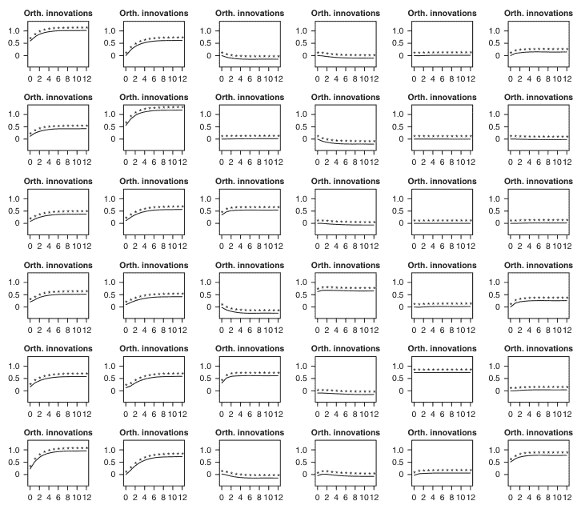

图 3.8 模型在 Eq. (3.54) 中的累积冲击响应函数。使用正交创新。

```
[[10,]] 9 -7.5061 -1.0887 -4.8993 50.9105 0.0509
[[11,]] 10 -7.4301 -0.2997 -4.5336 30.9780 0.7062
[[12,]] 11 -7.6115 0.2320 -4.4253 47.2625 0.0991
[[13,]] 12 -7.8454 0.7112 -4.3696 46.8496 0.1064
[[14,]] 13 -8.1084 1.1612 -4.3429 44.3816 0.1593
> m1 <- VAR(gdp,1) ## Estimation
Constant term:
Estimates: 0.3163104 0.2756356 0.1320467 0.5399103 0.1174305 0.0735754
Std. Error: 0.0830115 0.0790354 0.0511402 0.0931643 0.1156071 0.0781213
AR coefficient matrix
AR(1)-matrix
[,1] [,2] [,3] [,4] [,5] [,6]
[1,] 0.1641 0.437 -0.17598 -0.0212 -0.0245 0.1708
[2,] 0.1517 0.497 -0.00266 -0.1428 -0.0455 0.0564
[3,] 0.0764 0.160 -0.42812 -0.0230 -0.0513 0.0384
[4,] 0.0369 0.189 -0.34466 0.1027 0.0278 0.2910
[5,] 0.2095 0.083 0.63957 -0.1587 -0.1284 0.0287
[6,] 0.3096 0.303 -0.24379 0.1031 0.0936 0.2437
standard error
[,1] [,2] [,3] [,4] [,5] [,6]
[1,] 0.0956 0.0852 0.1391 0.0762 0.0660 0.0828
[2,] 0.0910 0.0812 0.1324 0.0725 0.0628 0.0788
[3,] 0.0589 0.0525 0.0857 0.0469 0.0407 0.0510
[4,] 0.1073 0.0957 0.1561 0.0855 0.0741 0.0929
[5,] 0.1332 0.1187 0.1937 0.1061 0.0919 0.1153
[6,] 0.0900 0.0802 0.1309 0.0717 0.0621 0.0779
```

残差协方差矩阵:

| | [,1] | [,2] | [,3] | [,4] | [,5] | [,6] |
|---|---|---|---|---|---|---|
| [1,] | 0.34833145 | 0.06573605 | 0.04571734 | 0.12044573 | 0.08966860 | 0.13046158 |
| [2,] | 0.06573605 | 0.31576212 | 0.06765773 | 0.07606172 | 0.08271335 | 0.02379309 |
| [3,] | 0.04571734 | 0.06765773 | 0.13220287 | 0.02157057 | 0.12784988 | 0.02467035 |
| [4,] | 0.12044573 | 0.07606172 | 0.02157057 | 0.43874844 | -0.01641509 | 0.01504688 |
| [5,] | 0.08966860 | 0.08271335 | 0.12784988 | -0.01641509 | 0.67559359 | 0.01948580 |
| [6,] | 0.13046158 | 0.02379309 | 0.02467035 | 0.01504688 | 0.01948580 | 0.30850029 |

det (SSE) = 0.0006456201
AIC = -6.874711
BIC = -6.161667
HQ = -6.585061

```
> m1 <- refVAR(m1,thr=1) ## Model refinement
Constant term:
Estimates: 0.3081411 0.2735526 0.1258255 0.5426269 0.124787 0
Std. Error: 0.07492052 0.07314373 0.04599156 0.09241243 0.1142533 0
AR coefficient matrix
AR(1)-matrix
[,1] [,2] [,3] [,4] [,5] [,6]
[1,] 0.1528 0.433 -0.198 0.000 0.0000 0.173
[2,] 0.1698 0.490 0.000 -0.133 0.0000 0.000
[3,] 0.0883 0.158 0.438 0.000 -0.0508 0.000
[4,] 0.0000 0.197 -0.310 0.108 0.0000 0.306
[5,] 0.2441 0.000 0.688 -0.147 -0.1275 0.000
[6,] 0.3152 0.306 -0.208 0.131 0.0940 0.251
standard error
[,1] [,2] [,3] [,4] [,5] [,6]
[1,] 0.0898 0.0837 0.1223 0.0000 0.0000 0.0820
[2,] 0.0771 0.0752 0.0000 0.0713 0.0000 0.0000
[3,] 0.0483 0.0516 0.0842 0.0000 0.0400 0.0000
[4,] 0.0000 0.0934 0.1363 0.0803 0.0000 0.0815
[5,] 0.1138 0.0000 0.1815 0.1043 0.0912 0.0000
[6,] 0.0898 0.0801 0.1252 0.0652 0.0621 0.0775
```

det (SSE) = 0.0006646203
AIC = -6.989497
BIC = -6.494328
HQ = -6.788351

```
> mlb <- refVAR(mla,thr=1.3) ## Model refinement
Constant term:
Estimates: 0.3081411 0.2735526 0.1295658 0.5426269 0 0
Std. Error: 0.07492052 0.07314373 0.04598706 0.09241243 0 0
AR coefficient matrix
AR(1)-matrix
[,1] [,2] [,3] [,4] [,5] [,6]
[1,] 0.153 0.433 -0.198 0.000 0.000 0.173
[2,] 0.170 0.490 0.000 -0.133 0.000 0.000
[3,] 0.084 0.157 0.389 0.000 0.000 0.000
[4,] 0.000 0.197 -0.310 0.108 0.000 0.306
[5,] 0.193 0.000 0.606 0.000 0.000 0.000
[6,] 0.315 0.306 -0.208 0.131 0.094 0.251
standard error
[,1] [,2] [,3] [,4] [,5] [,6]
[1,] 0.0898 0.0837 0.1223 0.0000 0.0000 0.0820
[2,] 0.0771 0.0752 0.0000 0.0713 0.0000 0.0000
[3,] 0.0482 0.0517 0.0748 0.0000 0.0000 0.0000
[4,] 0.0000 0.0934 0.1363 0.0803 0.0000 0.0815
[5,] 0.0953 0.0000 0.1420 0.0000 0.0000 0.0000
[6,] 0.0898 0.0801 0.1252 0.0652 0.0621 0.0775
```

残差协方差矩阵:

| | [,1] | [,2] | [,3] | [,4] | [,5] | [,6] |
|---|---|---|---|---|---|---|
| [1,] | 0.34878812 | 0.06636693 | 0.04651763 | 0.12014493 | 0.09241242 | 0.13067112 |
| [2,] | 0.06636693 | 0.31837874 | 0.06986894 | 0.07505788 | 0.08724666 | 0.02384652 |
| [3,] | 0.04651763 | 0.06986894 | 0.13438894 | 0.02058539 | 0.13290600 | 0.02473165 |
| [4,] | 0.12014493 | 0.07505788 | 0.02058539 | 0.43965478 | -0.01848134 | 0.01497720 |
| [5,] | 0.09241242 | 0.08724666 | 0.13290600 | -0.01848134 | 0.69600443 | 0.02249785 |
| [6,] | 0.13067112 | 0.02384652 | 0.02473165 | 0.01497720 | 0.02249785 | 0.31038747 |

det (SSE) = 0.0006813695
AIC = -7.003824
BIC = -6.568075
HQ = -6.826815

> MTSdiag(mlb) ### 模型检查

[1] "协方差矩阵:"

| | US | UK | FR | AU | GE | CA |
|---|---|---|---|---|---|---|
| US | 0.3511 | 0.0668 | 0.0468 | 0.1209 | 0.0930 | 0.1315 |
| UK | 0.0668 | 0.3205 | 0.0703 | 0.0756 | 0.0878 | 0.0240 |
| FR | 0.0468 | 0.0703 | 0.1353 | 0.0207 | 0.1338 | 0.0249 |
| AU | 0.1209 | 0.0756 | 0.0207 | 0.4426 | -0.0186 | 0.0151 |
| GE | 0.0930 | 0.0878 | 0.1338 | -0.0186 | 0.6998 | 0.0219 |
| CA | 0.1315 | 0.0240 | 0.0249 | 0.0151 | 0.0219 | 0.3118 |

滞后: 0 时的 CCM

| | [,1] | [,2] | [,3] | [,4] | [,5] | [,6] |
|---|---|---|---|---|---|---|
| [1,] | 1.000 | 0.1992 | 0.2149 | 0.3068 | 0.1877 | 0.3976 |
| [2,] | 0.199 | 1.0000 | 0.3378 | 0.2006 | 0.1854 | 0.0759 |
| [3,] | 0.215 | 0.3378 | 1.0000 | 0.0847 | 0.4348 | 0.1212 |
| [4,] | 0.307 | 0.2006 | 0.0847 | 1.0000 | -0.0334 | 0.0406 |
| [5,] | 0.188 | 0.1854 | 0.4348 | -0.0334 | 1.0000 | 0.0470 |
| [6,] | 0.398 | 0.0759 | 0.1212 | 0.0406 | 0.0470 | 1.0000 |

按 Enter 键查看更多图形:
按 Enter 键查看更多图形:
按 Enter 键查看单个 ccm 的 p 值图:
按 Enter 键计算 MQ 统计量:

Ljung-Box 统计量:

| m | Q(m) | df | p-value |
|---|---|---|---|
| 1.0 | 17.2 | 36.0 | 1.00 |
| 2.0 | 74.7 | 72.0 | 0.39 |
| 3.0 | 115.9 | 108.0 | 0.28 |
| 4.0 | 171.0 | 144.0 | 0.06 |
| .... | .... | .... | .... |
| 23.0 | 845.6 | 828.0 | 0.33 |
| 24.0 | 879.2 | 864.0 | 0.35 |

按 Enter 键获取残差图:

```
> Phi <- mlb$Phi
> Sig <- mlb$Sigma
> VARirf(Phi,Sig)
Press return to continue
> VARpred(mlb,4)
orig 153
Forecasts at origin: 153
```

| | US | UK | FR | AU | GE | CA |
|---|---|---|---|---|---|---|
| [1,] | 0.5209 | 0.3444 | 0.2724 | 0.7550 | 0.1993 | 0.4602 |
| [2,] | 0.5622 | 0.4299 | 0.3332 | 0.7486 | 0.2655 | 0.4464 |
| [3,] | 0.5911 | 0.4796 | 0.3738 | 0.7417 | 0.3103 | 0.4748 |
| [4,] | 0.6139 | 0.5098 | 0.3997 | 0.7468 | 0.3404 | 0.5012 |

### 预测标准误差:

| | [,1] | [,2] | [,3] | [,4] | [,5] | [,6] |
|---|---|---|---|---|---|---|
| [1,] | 0.5906 | 0.5643 | 0.3666 | 0.6631 | 0.8343 | 0.5571 |
| [2,] | 0.6586 | 0.6390 | 0.4222 | 0.7011 | 0.8770 | 0.6748 |
| [3,] | 0.6873 | 0.6634 | 0.4446 | 0.7166 | 0.8926 | 0.7258 |
| [4,] | 0.6984 | 0.6716 | 0.4548 | 0.7227 | 0.9004 | 0.7487 |

### 预测均方根误差:

| | [,1] | [,2] | [,3] | [,4] | [,5] | [,6] |
|---|---|---|---|---|---|---|
| [1,] | 0.6039 | 0.5770 | 0.3749 | 0.6781 | 0.8531 | 0.5697 |
| [2,] | 0.6864 | 0.6692 | 0.4444 | 0.7172 | 0.8951 | 0.7204 |
| [3,] | 0.6995 | 0.6738 | 0.4541 | 0.7233 | 0.8993 | 0.7470 |
| [4,] | 0.7032 | 0.6752 | 0.4592 | 0.7254 | 0.9037 | 0.7585 |

```
> fevl1 <- FEVdec(Phi,Theta = NULL,Sig) ## Decomposition
```

维度: 6
ARMA 模型阶数:
[1] 1 0

### 预测误差标准差:

| | [,1] | [,2] | [,3] | [,4] | [,5] | [,6] | [,7] | [,8] |
|---|---|---|---|---|---|---|---|---|
| [1,] | 0.5905829 | 0.6586473 | 0.6872954 | 0.6983882 | 0.7025126 | 0.7039905 | 0.7045060 | 0.7046824 |
| [2,] | 0.5642506 | 0.6390180 | 0.6633696 | 0.6716175 | 0.6744252 | 0.6753770 | 0.6756982 | 0.6758062 |
| [3,] | 0.3665910 | 0.4222175 | 0.4446271 | 0.4547874 | 0.4591659 | 0.4609381 | 0.4616191 | 0.4618706 |
| [4,] | 0.6630647 | 0.7011405 | 0.7166383 | 0.7227332 | 0.7250744 | 0.7259287 | 0.7262292 | 0.7263321 |
| [5,] | 0.8342688 | 0.8770128 | 0.8925819 | 0.9003501 | 0.9039646 | 0.9054998 | 0.9061076 | 0.9063364 |
| [6,] | 0.5571243 | 0.6747937 | 0.7257590 | 0.7486805 | 0.7580397 | 0.7616258 | 0.7629370 | 0.7634007 |

| | [9,] | [10,] | [11,] | [12,] | [13,] |
|---|---|---|---|---|---|
| [1,] | 0.7047419 | 0.7047618 | 0.7047684 | 0.7047706 | 0.7047714 |
| [2,] | 0.6758424 | 0.6758545 | 0.6758586 | 0.6758600 | 0.6758604 |
| [3,] | 0.4619608 | 0.4619924 | 0.4620034 | 0.4620071 | 0.4620084 |
| [4,] | 0.7263667 | 0.7263782 | 0.7263820 | 0.7263832 | 0.7263836 |
| [5,] | 0.9064194 | 0.9064487 | 0.9064589 | 0.9064624 | 0.9064636 |
| [6,] | 0.7636509 | 0.7636154 | 0.7636337 | 0.7636399 | 0.7636419 |

### 预测误差方差分解

### 预测步长: 1

| | [,1] | [,2] | [,3] | [,4] | [,5] | [,6] |
|---|---|---|---|---|---|---|
| [1,] | 1.00000000 | 0.000000e+00 | 0.0000000000 | 0.0000000000 | 0.0000000000 | 0.0000000 |
| [2,] | 0.03966412 | 9.603359e-01 | 0.0000000000 | 0.0000000000 | 0.0000000000 | 0.0000000 |
| [3,] | 0.04616469 | 9.061078e-02 | 0.8632245291 | 0.0000000000 | 0.0000000000 | 0.0000000 |
| [4,] | 0.09413203 | 2.026795e-02 | 0.0006721359 | 0.884927881 | 0.000000000 | 0.0000000 |
| [5,] | 0.03517928 | 2.280445e-02 | 0.1409470776 | 0.011923650 | 0.789145544 | 0.0000000 |
| [6,] | 0.15772239 | 1.090734e-05 | 0.0015651704 | 0.007197495 | 0.003130395 | 0.8303736 |

### 预测步长: 2

| | [,1] | [,2] | [,3] | [,4] | [,5] | [,6] |
|---|---|---|---|---|---|---|
| [1,] | 0.86408805 | 0.10861660 | 9.364737e-03 | 0.0001535092 | 6.676552e-05 | 0.01771033 |
| [2,] | 0.07113831 | 0.91190366 | 1.287049e-05 | 0.0169451645 | 0.000000e+00 | 0.00000000 |
| [3,] | 0.08847041 | 0.16246642 | 7.490632e-01 | 0.0000000000 | 0.000000e+00 | 0.00000000 |
| [4,] | 0.09973589 | 0.03263652 | 2.125301e-02 | 0.7971758411 | 1.847759e-04 | 0.04901396 |
| [5,] | 0.06583187 | 0.02644026 | 1.828411e-01 | 0.0107896993 | 7.140970e-01 | 0.00000000 |
| [6,] | 0.30672433 | 0.06351395 | 4.263206e-03 | 0.0131768793 | 1.052668e-02 | 0.60179496 |

## 3.3 向量移动平均模型

当 p = 0 时，Eq. (3.1) 中的模型简化为

```
z_t = c_0 + θ(B)a_t, (3.55)
```

这是一个阶数为 q 的向量移动平均 (VMA) 模型。
VMA 模型可出现在许多情形中。
例如，对独立的时间平滑


数据会引入短期序列相关性。考虑一个白噪声过程 \(\boldsymbol{a}_t\)。对两个连续观测值求平均，例如 \(\boldsymbol{z}_t = (\boldsymbol{a}_t + \boldsymbol{a}_{t-1})/2\)，会引入滞后-1 序列相关性，从而得到一个 VMA(1) 模型。另一个例子是带有测量误差的随机游走，常见于资产价格建模。假设 \(z_t = z_{t-1} + a_t\)，其中 \(a_t\) 是白噪声序列，但我们观测 \(y_t = z_t + \epsilon_t\)，其中 \(\epsilon_t\) 表示一个独立的测量误差。那么，\(w_t \equiv y_t - y_{t-1} = a_t + \epsilon_t - \epsilon_{t-1}\)，它遵循一个 MA(1) 模型。

### 3.3.1 VMA 模型的性质

公式 (3.55) 中 VMA($q$) 模型的性质易于推导和理解。首先，过程 \(\boldsymbol{z}_t\) 是平稳的，且 \(E(\boldsymbol{z}_t) = \boldsymbol{c}_0\)。其次，\(\boldsymbol{z}_t\) 的自协方差矩阵为

\[
\begin{aligned}
\boldsymbol{\Gamma}_z(0) &= \boldsymbol{\Sigma}_a + \sum_{i=1}^q \boldsymbol{\theta}_i \boldsymbol{\Sigma}_a \boldsymbol{\theta}'_i \\
\boldsymbol{\Gamma}_z(\ell) &= \sum_{i=\ell}^q \boldsymbol{\theta}_i \boldsymbol{\Sigma}_a \boldsymbol{\theta}'_{i-\ell}, \quad \text{where } \boldsymbol{\theta}_0 = -\boldsymbol{I}, \quad \ell = 1, \dots, q, \tag{3.56} \\
\boldsymbol{\Gamma}_z(\ell) &= \boldsymbol{0}, \quad \ell > q. \tag{3.57}
\end{aligned}
\]

由公式 (3.56) 和 (3.57) 可知，VMA($q$) 模型最多有 $q$ 个非零自相关矩阵，在文献中该模型被称为有限记忆模型。

如果行列式方程 \(|\boldsymbol{\theta}(B)| = 0\) 的所有零点的绝对值均大于 1，则 \(\boldsymbol{z}_t\) 具有 VAR 表示式

\[
\boldsymbol{z}_t = \boldsymbol{\phi}_0 + \boldsymbol{a}_t + \sum_{i=1}^\infty \boldsymbol{\pi}_i \boldsymbol{z}_{t-i}, \tag{3.58}
\]

其中 \(\boldsymbol{\phi}_0\) 是由 \([\boldsymbol{\theta}(1)]^{-1} \boldsymbol{c}_0\) 给出的常数向量，系数矩阵 \(\boldsymbol{\pi}_i\) 由 \(\boldsymbol{\pi}(B) = \boldsymbol{I} - \sum_{i=1}^\infty \boldsymbol{\pi}_i \boldsymbol{B}^i\) 确定，使得 \([\boldsymbol{\pi}(B)]^{-1} = \boldsymbol{\theta}(B)\)。更具体地说，

\[
\boldsymbol{\pi}_i = \sum_{j=1}^{\min(i,q)} \boldsymbol{\theta}_j \boldsymbol{\pi}_{i-j}, \quad i > 0.
\]

不难看出，当 \(i \to \infty\) 时，\(\boldsymbol{\pi}_i \to \boldsymbol{0}\)。任何在公式 (3.58) 中具有有意义 VAR 表示式的 VMA 模型被称为 *可逆的*。

最后，对于一个 $k$ 维 VMA($q$) 模型和任何满秩矩阵 \(\boldsymbol{C}_{g \times k}\)，\(\boldsymbol{w}_t = \boldsymbol{C}\boldsymbol{z}_t\) 是一个 $g$ 维 VMA($q$) 过程。特别是，\(\boldsymbol{z}_t\) 的任何分量 $z_{it}$ 都是一个标量 MA($q$) 过程。

### 3.3.2 VMA 建模

对于给定的 VMA 过程实现 \(\{\boldsymbol{z}_t | t = 1, \dots, T\}\)，可以通过检查样本自相关矩阵并借助某些序列相关性 Portmanteau 检验来确定阶数 $q$。此外，人们通常采用 ML 方法来估计指定的 VMA 模型。估计通常比较耗时，因为它涉及非线性优化。

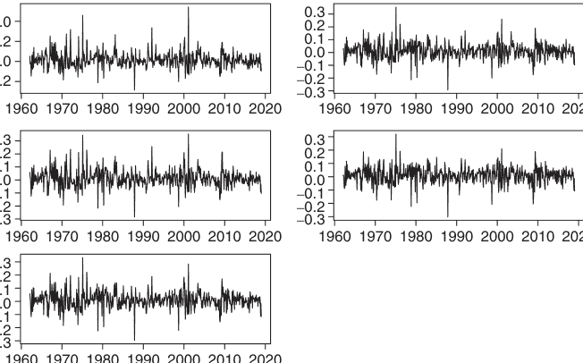

图 3.9 1962 年 1 月至 2018 年 12 月五个市场指数简单收益率的时间图。

为了演示 VMA 模型，我们考虑了 1962 年 1 月至 2018 年 12 月间某些美国市场指数的月度简单收益率，共 684 个观测值。所考虑的市场指数是 NYSE/AMEX/NASDAQ 的市值 1 至 5 组合投资组合，数据由证券价格研究中心（CRSP）获得。图 3.9 显示了所用五个市场指数收益率的时间图。如预期，除了少数异常观测值外，这些序列都是弱平稳的。在以下内容中，我们使用 R 的 MTS 包进行分析。

令 \( z_t = (z_{1t}, ..., z_{5t})' \) 为月度收益率序列。阶数选择选出一个 VMA(12) 模型，但 \( z_t \) 的样本交叉相关矩阵显示在滞后 1 和 12 处存在强烈的序列相关性。这一点从图 3.10 中五个收益率序列的样本自相关性可以清楚看出。因此，我们考虑以下 VMA 模型

\[
z_t = \mu + a_t + \theta_1 a_{t-1} + \theta_{12} a_{t-12}, \tag{3.59}
\]

下面我们改变 \( \theta_i \) 的符号以节省空间。模型 (3.59) 的参数估计值在附带的 R 输出中给出。由于 \( \theta_1 \) 和 \( \theta_{12} \) 的估计值都包含一些不显著的参数，我们进行模型精炼以简化拟合模型。估计值为

\[
\hat{\mu} = \begin{bmatrix} 0.02 \\ 0.01 \\ 0.01 \\ 0.01 \\ 0.01 \end{bmatrix}, \quad \hat{\theta}_1 = \begin{bmatrix} 0 & 0 & 0 & 0 & 0.41 \\ 0 & 0.05 & 0 & 0 & 0.30 \\ 0 & 0 & 0 & 0 & 0.29 \\ 0 & 0 & 0 & 0 & 0.25 \\ 0 & 0 & 0 & 0 & 0.21 \end{bmatrix}, \quad \hat{\theta}_{12} = \begin{bmatrix} 0.56 & 0 & -0.52 & 0 & 0 \\ 0.39 & 0 & -0.35 & 0 & 0 \\ 0.36 & 0 & -0.46 & 0 & 0.14 \\ 0.29 & 0 & -0.45 & 0 & 0.19 \\ 0.26 & 0 & -0.47 & 0 & 0.23 \end{bmatrix}
\]

并且 \( \hat{\Sigma}_a \) 在 R 输出中给出。未显示的拟合模型模型检验表明，该模型对数据拟合得相当好。

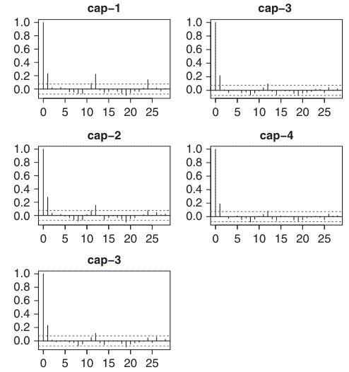

图 3.10 五个美国市场指数简单收益率的样本自相关函数。

**备注。** 有必要作一些说明。熟悉季节性时间序列模型的读者可能希望对五个收益率序列考虑一个乘法季节性模型。我们没有考虑任何乘法模型，因为在滞后 13 处不存在显著的序列相关性。此外，在 R 输出中，我们使用相同的阈值 1.5 进行了三次精炼。这是因为模型在每次精炼后都会发生变化，系数估计的 *t* 比率也随之变化。

### R 演示：VMA 建模。

```
> VMAorder(rtn)
```

Q(j,m) 统计量：

| j | Q(j,m) | p 值 |
|---|--------|---------|
| 1.0 | 780.8 | 0.00 |
| 2.0 | 642.8 | 0.00 |
| 3.0 | 609.0 | 0.00 |
| 4.0 | 580.4 | 0.00 |
| 5.0 | 565.4 | 0.00 |
| 6.0 | 539.3 | 0.00 |
| 7.0 | 510.6 | 0.00 |
| 8.0 | 466.3 | 0.00 |
| 9.0 | 446.6 | 0.00 |
| 10.0 | 420.8 | 0.00 |
| 11.0 | 375.9 | 0.00 |
| 12.0 | 340.0 | 0.00 |
| 13.0 | 213.6 | 0.24 |
| 14.0 | 183.5 | 0.31 |
| 15.0 | 161.7 | 0.24 |
| 16.0 | 135.6 | 0.24 |
| 17.0 | 106.4 | 0.31 |
| 18.0 | 90.2 | 0.11 |
| 19.0 | 40.4 | 0.83 |
| 20.0 | 14.5 | 0.95 |

```
> par(mfcol=c(3,2))
> acf(rtn[,1],main="cap-1")
> acf(rtn[,2],main="cap-2")
> acf(rtn[,3],main="cap-3")
> acf(rtn[,4],main="cap-4")
> acf(rtn[,5],main="cap-5")
```

#### 估计

```
> m3 <- VMAs(tran,malags=c(1,12))
> m3$secoef[is.na(m3$secoef)] <- 1
> m3a <- refVMAs(m3,thr=1.5) ## We use threshold 1.5 three times,
> m3b <- refVMAs(m3a,thr=1.5) ## because the t-ratios change after
> m3c <- refVMAs(m3b,thr=1.5) ## each refinement.
```

#### 系数：

| | 估计值 | 标准误 | t 值 | Pr(>|t|) |
|---|---|---|---|---|
| CAP1RET | 0.015306 | 0.003795 | 4.033 | 5.50e-05 *** |
| CAP2RET | 0.011547 | 0.003274 | 3.527 | 0.000421 *** |
| CAP3RET | 0.010202 | 0.003001 | 3.400 | 0.000674 *** |
| CAP4RET | 0.010423 | 0.002858 | 3.647 | 0.000265 *** |
| CAP5RET | 0.009976 | 0.002733 | 3.650 | 0.000262 *** |
| | -0.408258 | 0.041311 | -9.883 | < 2e-16 *** |
| | -0.557096 | 0.091418 | -6.094 | 1.10e-09 *** |
| | 0.517168 | 0.111725 | 4.629 | 3.68e-06 *** |
| | -0.049634 | 0.021062 | -2.357 | 0.018443 * |
| | -0.302076 | 0.042213 | -7.156 | 8.30e-13 *** |
| | -0.386759 | 0.083062 | -4.656 | 3.22e-06 *** |
| | 0.347225 | 0.099952 | 3.474 | 0.000513 *** |
| | -0.292933 | 0.035620 | -8.224 | 2.22e-16 *** |
| | -0.356795 | 0.080206 | -4.448 | 8.65e-06 *** |
| | 0.457800 | 0.101440 | 4.513 | 6.39e-06 *** |
| | -0.137197 | 0.037085 | -3.700 | 0.000216 *** |
| | -0.246584 | 0.035070 | -7.031 | 2.05e-12 *** |
| | -0.294384 | 0.079091 | -3.722 | 0.000198 *** |
| | 0.452605 | 0.104004 | 4.352 | 1.35e-05 *** |
| | -0.188642 | 0.045144 | -4.179 | 2.93e-05 *** |
| | -0.206023 | 0.035654 | -5.778 | 7.54e-09 *** |
| | -0.258952 | 0.078335 | -3.306 | 0.000947 *** |
| | 0.466077 | 0.108915 | 4.279 | 1.88e-05 *** |
| | -0.228562 | 0.054749 | -4.175 | 2.98e-05 *** |

--- 
显著性代码：0 '***' 0.001 '**' 0.01 '*' 0.05 '.' 0.1 ' ' 1 
--- 
矩阵形式的估计值： 
常数项： 
估计值： 0.01530554 0.01154678 0.01020212 0.0104232 0.009975902
MA 系数矩阵
MA (1)-矩阵

| | [,1] | [,2] | [,3] | [,4] | [,5] |
|---|---|---|---|---|---|
| [1,] | 0 | 0.0000 | 0 | 0 | -0.408 |
| [2,] | 0 | -0.0496 | 0 | 0 | -0.302 |
| [3,] | 0 | 0.0000 | 0 | 0 | -0.293 |


| | | | | |
|---|---|---|---|---|---|
| [4,] | 0 | 0.0000 | 0 | 0 | -0.247 |
| [5,] | 0 | 0.0000 | 0 | 0 | -0.206 |

MA(12)矩阵

| | [,1] | [,2] | [,3] | [,4] | [,5] |
|---|---|---|---|---|---|
| [1,] | -0.557 | 0 | 0.517 | 0 | 0.000 |
| [2,] | -0.387 | 0 | 0.347 | 0 | 0.000 |
| [3,] | -0.357 | 0 | 0.458 | 0 | -0.137 |
| [4,] | -0.294 | 0 | 0.453 | 0 | -0.189 |
| [5,] | -0.259 | 0 | 0.466 | 0 | -0.229 |

残差协方差矩阵：

| | [,1] | [,2] | [,3] | [,4] | [,5] |
|---|---|---|---|---|---|
| [1,] | 0.004724746 | 0.003946767 | 0.003694343 | 0.003546549 | 0.003372278 |
| [2,] | 0.003946767 | 0.003700418 | 0.003438245 | 0.003334797 | 0.003221117 |
| [3,] | 0.003694343 | 0.003438245 | 0.003408408 | 0.003289334 | 0.003213296 |
| [4,] | 0.003546549 | 0.003334797 | 0.003289334 | 0.003327253 | 0.003235831 |
| [5,] | 0.003372278 | 0.003221117 | 0.003213296 | 0.003235831 | 0.003276711 |

---

aic = -39.42939
bic = -39.27051

## 3.4 平稳 VARMA 模型

### 3.4.1 VAR 模型是否足够？

VAR 模型在多元时间序列分析中被广泛使用，原因多种多样。首先，它相对简单。该模型可以通过 OLS 方法估计，因此并不严重依赖正态性假设。其次，它避免了 VARMA 模型（公式 3.1）所遇到的可识别性困难。另一方面，VAR 模型也存在一些弱点。首先，如第 2.2.4 节中标量情况所示，AR 模型类并不封闭，因为两个 AR 过程的线性组合通常不是 AR 过程。相同结果适用于向量情况。其次，VAR 模型可能无法产生简洁的参数化。当维度 $k$ 较大时尤其如此。为了说明，请考虑一个二维 VMA 过程

$z_t = (I - \theta B)a_t, \quad \theta = \left[ \begin{matrix} 0.2 & 0.3 \\ -0.6 & 1.1 \end{matrix} \right], \quad \Sigma_a = I_2.$

很容易看出 $\theta$ 的两个特征值为 0.8 和 0.5，因此 $z_t$ 是一个可逆时间序列。$z_t$ 的 VAR 表达式为

$z_t = a_t + \theta_1 z_{t-1} + \theta^2 z_{t-2} + \theta^3 z_{t-3} + \cdots .$

还可以轻松计算得出

$\theta^6 \approx \left[ \begin{matrix} -0.23 & 0.25 \\ -0.49 & 0.51 \end{matrix} \right], \quad \theta^7 \approx \left[ \begin{matrix} -0.19 & 0.20 \\ -0.40 & 0.41 \end{matrix} \right] .$

因此，建模 $z_t$ 时需要一个 VAR($p$) 模型且 \( p \ge 7 \) 才能提供良好的近似。所使用的 AR 系数数量将超过 28 个，而数据生成过程的系数数量仅为 4 个。

在实际应用中，使用 VAR 模型还是 VARMA 模型取决于所研究问题的维度和样本量。如果维度 \( k \) 不大，例如 \( k \le 10 \)，则可以使用 VARMA 模型。对于其他情况，通常偏好 VAR 模型，因为其在理解数据动态结构和估计方面都很简单。我们将在后面讨论高维时间序列的 VARMA 模型。

### 3.4.2 VARMA 模型的性质

以下总结了公式 (3.1) 中 VARMA 模型的关键属性：

- 稳定性条件：行列式方程 \( |\phi(B)| = 0 \) 的所有零点的绝对值均大于 1。
  平稳 VARMA 模型的 VMA 表达式为
  \[
  z_t = \mu + a_t + \sum_{i=1}^{\infty} \psi_i a_{t-i},
  \]
  (3.60)
  其中 \(\mu = E(z_t)\) 且 \(\psi\)-权重系数 \(\psi_i\) 由 \([\phi(B)]^{-1}\theta(B) = \psi(B) = I + \sum_{i=1}^{\infty} \psi_i B^i\) 给出。

- 可逆性条件：行列式方程 \( |\theta(B)| = 0 \) 的所有零点的绝对值均大于 1。
  可逆 VARMA 模型的 VAR 表达式为
  \[
  z_t = c + \sum_{i=1}^{\infty} \pi_i z_{t-i} + a_t,
  \]
  (3.61)
  其中 \(c = [\theta(1)]^{-1}c_0\) 且 \(\pi\)-权重系数矩阵 \(\pi_i\) 由 \(\pi(B) = I - \sum_{i=1}^{\infty} \pi_i B^i = [\theta(B)]^{-1}\phi(B)\) 给出。

- 矩条件：对于公式 (3.1) 的平稳 VARMA 过程 \( z_t \)，我们有
  - \( E(z_t) = \mu \) 使得 \( \phi(1)\mu = c_0 \)。即，\( \mu = [\phi(1)]^{-1}c_0 \)。
  - \( \Gamma_z(\ell) = \sum_{i=1}^p \phi_i \Gamma_z(\ell-i) - \sum_{j=\ell}^q \theta_j \Sigma_a \psi'_{\ell-j} \)，对于 \( \ell = 1, \dots, q \)，其中 \( \psi_0 = I \)。
  - \( \Gamma_z(\ell) = \sum_{i=1}^p \phi_i \Gamma(\ell-i) \) 对于 \( \ell > q \)。

如果将第 3 个矩条件针对 \( \ell = q + 1, \dots, q + p \) 联合考虑，则我们将得到 \( p \) 个矩条件组成的系统，这被称为 VARMA(\( p, q \)) 模型的 *广义 Yule-Walker 方程*。

### 3.4.3 VARMA 过程建模

VARMA 过程建模的文献中有多种可用方法。Tiao 和 Tsay (1983) 提出的一种方法是拟合一个大型 VAR，以提供残差的一致估计，并利用这些估计残差来确定 MA 阶数。他们提出使用扩展交叉相关系数表来获取 ARMA 过程的阶数。第二种方法基于由研究过程过去和未来组成的两个长时间序列向量的协方差矩阵结构（称为汉克尔矩阵），并利用汉克尔矩阵及其相关 Kronecker 指数的性质来确定模型。参见 Akaike (1976)、Hannan and Deistler (1988) 和 Tsay (1991)。第三种方法是 Tiao 和 Tsay (1989) 提出的标量分量模型 (SCMs)，它们是具有特定结构的时间序列的线性组合。例如，SCMs 的一个重要概念是白噪声序列。设 \(\boldsymbol{v}\) 为一个 \(k\) 维非零实向量。线性组合 \(w_t = \boldsymbol{v}' \boldsymbol{z}_t\) 称为阶数 \((0,0)\) 的 SCM，记为 \(\text{SCM}(0,0)\)，如果 \(w_t\) 与 \(\boldsymbol{z}_t\) 的所有滞后值不相关，因此是一个白噪声过程。换句话说，对于 \(j \ge 1\)，\(\text{corr}(w_t, \boldsymbol{z}_{t-j}) = \boldsymbol{0}\)。因此，\(\text{SCM}(0,0) w_t\) 的存在意味着 \(\boldsymbol{z}_t\) 的线性组合与 \(F_{t-1}\)（即 \(t-1\) 时刻可用的信息）不相关。\(\text{SCM}(0,0) w_t\) 可用于简化模型说明。事实证明，\(\text{SCM}(0,0)\) 在时间序列数据的因子模型中也很有用，有关讨论见第 6 章。VARMA 建模的一个有用工具是典型相关分析。Tiao 和 Tsay (1989) 使用此工具来搜索 \(\text{SCM}(0,0)\) 的数量及其相关线性向量。有关这些方法的介绍，请参见 Tsay (2014)。

### 3.4.4 VARMA 模型的应用

一旦为向量时间序列构建了 VARMA 模型，即可使用该模型进行统计推断。如果对各分量序列之间的关系感兴趣，则可以使用 VMA 表达式中的 \(\boldsymbol{\psi}\)-权重系数矩阵来获得 *脉冲响应函数*，这与 VAR 模型中讨论的类似。在计量经济学文献中，这类研究被称为 *乘数研究*。它在政策决策和模拟中发挥着重要作用。

VARMA 模型的另一个应用是预测。所涉及的思想和计算与第 2 章讨论的单变量时间序列类似。假设预测起点为 \(t = n\)。设 \(F_n\) 表示 \(t = n\) 时可用的信息，\(h\) 为预测起点，则

\(\hat{z}_n(h) = E(z_{n+h}|F_n) = c_0 + \sum_{i=1}^p \Phi_i \hat{z}_n(h-i) - \sum_{j=1}^q \theta_j \hat{a}_n(h-j), \quad (3.62)\)

其中

\(\hat{z}_n(\ell) = \begin{cases} \hat{z}_n(\ell) & \text{如果 } \ell > 0, \\ z_{n-\ell} & \text{如果 } \ell \le 0, \end{cases} \quad \hat{a}_n(\ell) = \begin{cases} \mathbf{0} & \text{如果 } \ell > 0, \\ a_{n-\ell} & \text{如果 } \ell \le 0. \end{cases}\)

相关的预测误差为

\(e_n(h) = z_{n+h} - \hat{z}_n(h) = a_{n+h} + \sum_{i=1}^{h-1} \psi_i a_{n+h-i},\)

因此，预测误差的协方差矩阵为

\(\text{Cov}[e_n(h)] = \Sigma_a + \sum_{i=1}^{h-1} \psi_i \Sigma_a \psi_i',\)


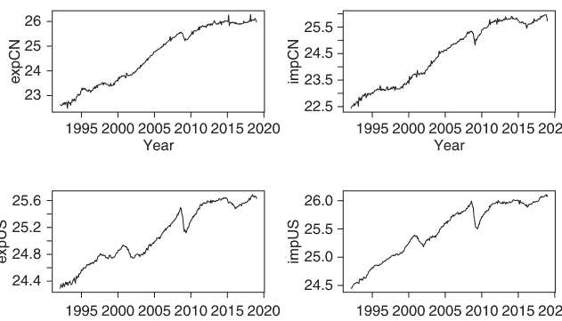

图 3.11 1992 年 1 月至 2018 年 12 月中国和美国月度出口和进口对数系列的时间图。原始数据来自 FRED，单位为美元。左侧面板显示出口系列，上部图表为中国。来源：联邦储备经济数据（FRED）。

这里默认我们将模型视为已知，\(\psi_t\) 是方程 (3.60) 的 \(\psi\)-权重系数矩阵。在实践中，预测值和预测误差的协方差矩阵可以递归计算。

### 示例 3.3

考虑 1992 年 1 月至 2018 年 12 月中国和美国的月度出口和进口。数据从 FRED 下载，单位为美元且已季节调整。我们取自然对数变换，变换后的数据存储在文件 m-expimpcnus.csv 中。图 3.11 显示了四个对数时间序列的时间图，其中左侧面板显示出口，上部图表为中国。正如预期，这些图表证实了两国国际贸易的上升趋势。因此，我们进行一阶差分。设 \(z_t = (\text{exp-CN}_t, \text{exp-US}_t, \text{imp-CN}_t, \text{imp-US}_t)'\) 为月度国际贸易的增长系列。\(z_t\) 系列如图 3.12 所示。从图中可以看出存在一些异常观测值，但为简化起见，我们不考虑对这些离群值进行任何处理。

遵循 Tsay (2014, 第 3 章) 的建模方法，我们使用 Tiao 和 Tsay (1983) 的扩展互相关矩阵来确定 VARMA 阶数。输出细节见附带的 R 输出。对于本例，指定了 VARMA(1,2) 模型。最大似然估计（MLE）表明，拟合的 VARMA(1,2) 模型中存在许多不显著的估计值，因此我们通过同时移除所有绝对 t 值小于 0.8 的估计值来精炼模型。得到的模型是

```
z_t = \begin{bmatrix} 0.01 \\ 0 \\ 0.01 \\ 0 \end{bmatrix} + \begin{bmatrix} -0.18 & 0 & 0 & 0.45 \\ 0.28 & -0.27 & 0 & 0.28 \\ 0 & 0.27 & -0.53 & 0 \\ 0.14 & 0.07 & 0.29 & 0 \end{bmatrix} z_{t-1} + a_t \\ - \begin{bmatrix} 0.49 & 0 & -0.02 & 0 \\ 0.27 & 0 & 0 & 0 \\ 0 & 0 & 0 & -0.37 \\ 0.13 & 0 & 0.23 & 0 \end{bmatrix} a_{t-1} + \begin{bmatrix} 0 & 0.22 & -0.06 & 0.63 \\ 0.20 & -0.22 & 0 & 0.32 \\ 0 & 0.36 & -0.28 & 0.57 \\ 0.06 & 0 & 0.18 & 0 \end{bmatrix} a_{t-2}
```

且 \(a_t\) 的协方差矩阵为

```
\hat{\Sigma}_a = 10^{-3} \begin{bmatrix} 2.987 & 0.182 & 1.325 & 0.108 \\ 0.182 & 0.447 & 0.346 & 0.205 \\ 1.325 & 0.346 & 3.448 & 0.253 \\ 0.108 & 0.205 & 0.253 & 0.424 \end{bmatrix}
```

模型检验表明，残差系列在季节性滞后 12 处存在一些互相关，表明仍有一些季节性。然而，前 10 个滞后没有显著的序列相关。

从拟合模型来看，四个国际贸易系列是相互关联的。这由模型的脉冲响应函数证实；见图 3.13。然而，脉冲响应函数显示，中国进口对其他系列的依赖性相当弱。模型还显示，中国的出口和进口系列具有显著的常数项，支持了这样的普遍看法：过去二十年中国经济的强劲增长大大增加了其国际贸易。两个中国系列的波动性也大于美国的系列。

最后，拟合模型可用于生成预测。在本例中，四个系列的 1 步先行预测值分别为 0.063(0.055)、−0.001(0.021)、0.091(0.059) 和 −0.021(0.021)，其中括号内的数字表示预测标准误。尽管近似 95% 预测区间包含零，但预测表明，尽管与美国存在贸易战，中国的出口和进口仍将继续增长。事实上，CNBC 于 2019 年 2 月 13 日报道，1 月份中国出口较去年同期增长 9.1%，而进口下降 1.5%。在本例中，拟合模型似乎能够提供合理的预测。

### **R 演示**：中国和美国的国际贸易

```
> da <- read.csv("m-eximpcnus.csv") ## logged data
> da <- da[,-1] ## remove observation sequence
> require(MTS)
> xt <- diffM(da) ## May use diff(da) provided that "da" is a matrix.
> tdx <- c(2:325)/12+1992 ## Create calendar time
> MTSplot(da,tdx)

> Eccm(xt)
```

#### 扩展互相关矩阵的 p 值表：
列：MA 阶
行：AR 阶

| | 0 | 1 | 2 | 3 | 4 | 5 | 6 |
|---|---|---|---|---|---|---|---|
| 0 | 0.0000 | 0.0000 | 0.0007 | 0.6472 | 0.5537 | 0.8951 | 0.6524 |
| 1 | 0.0000 | 0.0000 | 0.026 | 0.8999 | 0.7330 | 0.9054 | 0.9040 |
| 2 | 0.1933 | 0.9199 | 0.5442 | 0.9776 | 0.8144 | 1.0000 | 0.9995 |
| 3 | 1.0000 | 0.9994 | 1.0000 | 1.0000 | 0.9995 | 0.9999 | 0.9999 |
| 4 | 1.0000 | 1.0000 | 1.0000 | 1.0000 | 1.0000 | 1.0000 | 0.8856 |
| 5 | 1.0000 | 1.0000 | 1.0000 | 1.0000 | 1.0000 | 0.9998 | 0.9929 |

```
> ml <- VARMA(xt,p=1,q=2) ## Output omitted.
> mla <- refVARMA(ml,thr=0.8)
```

矩阵形式的估计值：
常数项：
估计值：0.009814692 0 0.0135986 0

#### AR 系数矩阵

AR(1) 矩阵

| | [,1] | [,2] | [,3] | [,4] |
|---|---|---|---|---|
| [1,] | -0.177 | 0.0000 | 0.000 | 0.449 |
| [2,] | 0.277 | -0.2673 | 0.000 | 0.280 |
| [3,] | 0.000 | 0.2675 | -0.532 | 0.000 |
| [4,] | 0.136 | 0.0724 | 0.288 | 0.000 |

#### MA 系数矩阵

MA(1) 矩阵

| | [,1] | [,2] | [,3] | [,4] |
|---|---|---|---|---|
| [1,] | 0.486 | 0 | -0.0224 | 0.000 |
| [2,] | 0.272 | 0 | 0.0000 | 0.000 |
| [3,] | 0.000 | 0 | 0.0000 | -0.374 |
| [4,] | 0.130 | 0 | 0.2332 | 0.000 |

#### MA(2) 矩阵

| | [,1] | [,2] | [,3] | [,4] |
|---|---|---|---|---|
| [1,] | 0.0000 | -0.224 | 0.0648 | -0.632 |
| [2,] | -0.1951 | 0.219 | 0.0000 | -0.316 |
| [3,] | 0.0000 | -0.360 | 0.2812 | -0.570 |
| [4,] | -0.0621 | 0.000 | -0.1811 | 0.000 |

#### 残差协方差矩阵：

| | [,1] | [,2] | [,3] | [,4] |
|---|---|---|---|---|
| [1,] | 0.0029774472 | 0.0001818597 | 0.0013214291 | 0.0001074424 |
| [2,] | 0.0001818597 | 0.0004460318 | 0.0003451413 | 0.0002049293 |
| [3,] | 0.0013214291 | 0.0003451413 | 0.0034373700 | 0.0002521699 |
| [4,] | 0.0001074424 | 0.0002049293 | 0.0002521699 | 0.0004224317 |

--
aic= -27.32588
bic= -26.98671

```
> MTSdiag(mla)
```

#### Ljung-Box 统计量：

| | m | Q(m) | 自由度 | p 值 |
|---|---|---|---|---|
| [1,] | 1.0 | 15.7 | 16.0 | 0.47 |
| [2,] | 2.0 | 20.2 | 32.0 | 0.95 |
| [3,] | 3.0 | 44.1 | 48.0 | 0.63 |
| [4,] | 4.0 | 64.6 | 64.0 | 0.46 |
| [5,] | 5.0 | 83.5 | 80.0 | 0.37 |
| [6,] | 6.0 | 94.6 | 96.0 | 0.52 |
| [7,] | 7.0 | 108.6 | 112.0 | 0.57 |
| [8,] | 8.0 | 121.6 | 128.0 | 0.64 |
| [9,] | 9.0 | 156.7 | 144.0 | 0.22 |
| [10,] | 10.0 | 185.1 | 160.0 | 0.09 |
| [11,] | 11.0 | 219.8 | 176.0 | 0.01 |
| [12,] | 12.0 | 289.1 | 192.0 | 0.00 |

```
> VARMApred(mla,4)
Predictions at origin 323
[,1]   [,2]   [,3]   [,4]
[1,] 0.063025 -0.001014 0.091208 -0.020800
[2,] 0.011863 0.004853 0.021111 -0.004543
[3,] 0.005677 0.000716 0.003671 0.008047
[4,] 0.012422 0.003634 0.011838 0.001880
Standard errors of predictions
[,1]   [,2]   [,3]   [,4]
[1,] 0.05457 0.02112 0.05863 0.02055
[2,] 0.06537 0.02191 0.06590 0.02095
[3,] 0.06731 0.02302 0.06681 0.02159
[4,] 0.06733 0.02342 0.06696 0.02232
```

## 3.5 单位根与协整

如在第 2 章中所讨论，如果 \(w_t = (1 - B)z_t\) 是一个平稳且可逆过程，则标量时间序列 \(z_t\) 是阶数为 1 的单位根过程。在经济学文献中，\(z_t\) 被称为 I(1) 过程，意味着它是阶数为 1 的整合过程。一般来说，如果 \(w_t = (1 - B)^d z_t\) 是平稳且可逆的，则 \(z_t\) 是一个 I(d) 过程。I(1) 过程在分析商业和经济时间序列方面起着重要作用。例如，一个经济体的季度 GDP 通常构成一个 I(1) 过程。同样，大多数股票价格（或对数价格）也是 I(1) 过程。在本节中，我们考虑多变量整合过程，重点关注伪关系和协整的问题。

如果方程 (3.1) 的多变量时间序列 \(\mathbf{z}_t\) 满足 \(|\phi(1)| = 0\) 但 \(|\theta(1)| \neq 0\)，则它是一个整合过程。换句话说，"1" 是行列式方程 \(|\phi(B)| = 0\) 的一个解，但不是 \(|\theta(B)| = 0\) 的解。整合过程在许多实际应用中存在，尤其是 I(1) 过程，其性质在文献中已得到广泛研究。例如，参见 Phillips (1987)、Chan 和 Wei (1988)，以及 Tsay 和 Tiao (1990) 等众多文献。


### 3.5.1 伪回归

假设 $z_{1t}$ 和 $z_{2t}$ 是两个标量 I(1) 过程，我们关注它们的线性关系。为此，常用简单线性回归，即

$z_{2t} = \alpha + \beta z_{1t} + \epsilon_t, \quad (3.63)$

其中 $\epsilon_t$ 表示误差项。直观上，如果 $\beta \neq 0$，则两个过程线性相关。因此，常用 $H_0 : \beta = 0$ 与 $H_a : \beta \neq 0$ 的假设检验来进行推断。然而，因为 $z_{1t}$ 和 $z_{2t}$ 均为 I(1) 过程，$\beta$ 的最小二乘估计的 t-比率的常规参考分布不适用。使用常规参考分布常常会导致误发现，意味着在 $H_0$ 为真时过于频繁地拒绝 $H_0$。为了演示，我们生成如下两个独立随机游走序列：

$z_{1t} = z_{1,t-1} + a_{1t}, \quad z_{1,0} = 0, \qquad z_{2t} = z_{2,t-1} + a_{2t}, \quad z_{2,0} = 0, \quad t = 1, \dots, 100,$

其中 $\{a_{1t}\}$ 和 $\{a_{2t}\}$ 是两个独立标准高斯过程。然后，我们拟合 Eq. (3.63) 的线性回归。使用常规临界值 1.96，我们列出拒绝原假设 $\beta = 0$ 的频率。经过 1000 次复制，拒绝 $\beta = 0$ 的经验频率约为 77%，远高于 5% 的 I 类错误。这个简单的模拟清楚地表明，在使用涉及整合过程的线性回归时必须小心。常规检验容易误识别 I(1) 过程之间的线性关系，这种现象称为 *伪线性回归*。为了避免伪回归，应始终检查 Eq. (3.63) 线性回归的残差。如果残差序列本身是整合的，则该线性关系是伪的。例如，参见 Tsay (2014, chapter 5)。

### 3.5.2 向量过程的线性组合

形式 $y_t = b'z_t$ 的向量时间序列的线性组合可能导致一些具有重要应用的有趣标量过程。我们在第 1 章中看到，通过将 $b$ 选择为 $z_t$ 协方差矩阵的特征向量之一，我们得到一个主成分。主成分分析 (PCA) 将 $k$ 维的 $z_t$ 分解为一组按方差大小排序的同期不相关序列。我们也可以根据可预测性将 $z_t$ 分解为一组线性组合。这是 Box 和 Tiao (1977) 提出的方法。假设我们想根据 $z_t$ 的 1 步先行可预测性找到线性组合。如前所述，我们可以将向量时间序列写成

$z_t = z_{t-1}(1) + a_t, \quad (3.64)$

其中 $z_{t-1}(1)$ 是在预测起点 $t-1$ 对 $z_t$ 的 1 步先行预测。对 Eq. (3.64) 取方差，得到 $\Gamma_z(0) = \Gamma_p(1) + \Sigma_a$，其中 $\Gamma_p(1)$ 是 $z_{t-1}(1)$ 的协方差矩阵，$a_t$ 不相关。将 Eq. (3.64) 左乘 $b'$，得到

$y_t = y_{t-1}(1) + u_t \quad (3.65)$

其中 \( y_{t-1}(1) \) 是在预测起点 \( t-1 \) 对 \( y_t \) 的 1 步先行预测，\( u_t = b'a_t \)。由 Eq. (3.65) 得 \( \sigma_y^2 = p_y^2 + \sigma_u^2 \)，其中 \( \sigma_y^2 = b'\Gamma_z(0)b \) 是标量系列 \( y_t \) 的方差，\( \sigma_u^2 \) 是其创新过程的方差，\( p_y^2 = b'\Gamma_p(1)b \) 是解释方差。标量系列 \( y_t = b'z_t \) 的可预测性在第 2 章中定义为

\[ \lambda = \frac{p_y^2}{\sigma_y^2} = \frac{b'\Gamma_p(1)b}{b'\Gamma_z(0)b} \]

而最大可预测性的线性组合可通过求解

\[ \frac{\partial \lambda}{\partial b} = \frac{2\Gamma_p(1)b\sigma_y^2 - 2\Gamma_z(0)bp_y^2}{(b'\Gamma_z(0)b)^2} = 0, \]

得到，这意味着

\[ \Gamma_z^{-1}(0)\Gamma_p(1)b = \lambda b \]

且向量 \( b \) 必须是矩阵 \( \mathbf{M} = \Gamma_z^{-1}(0)\Gamma_p(1) \) 的特征向量，由于特征值衡量可预测性，我们必须选择对应于最大特征值的特征向量。最不可预测的线性组合是由对应于最小特征值的特征向量形成的。该分析可应用于任何预测水平 \( h \)。例如，对于 VAR(1) 模型 \( \hat{z}_{t-1}(1) = \phi z_{t-1} \, \Gamma_p(1) = \phi \Gamma_z(0)\phi' \)，且 \( b \) 是矩阵

\[ \mathbf{M} = \Gamma_z^{-1}(0)\phi\Gamma_z(0)\phi' \]

的最大特征值。由于 \( \phi = \Gamma_z(1)\Gamma_z^{-1}(0) \)，前置矩阵可写为

\[ \mathbf{M} = \Gamma_z^{-1}(0)\Gamma_z(1)\Gamma_z^{-1}(0)\Gamma_z(1)' \]

这是 \( z_t \) 与 \( z_{t-1} \) 之间的典型相关矩阵。因此，最大可预测性的线性组合等价于 \( z_t \) 与其过去之间最大典型相关对应的典型变量。有关该结果的一般证明，参见 Velu et al. (1987)。典型相关分析和具有有趣特性的线性组合是构建 VARMA 模型的一些有用方法（如 SCMs）背后的关键思想。Box 和 Tiao (1977) 举例说明的一个有趣情况是，当向量序列是整合的，但其某些线性组合是平稳的。这就是下一节将讨论的共整合的思想。

### 3.5.3 协整

整合过程的一个重要问题是共整合。考虑两个单变量 I(1) 过程 \( z_{1t} \) 和 \( z_{2t} \)。如果存在一个非零线性组合 \( y_t = \beta_1 z_{1t} + \beta_2 z_{2t} \)，它是平稳的，则 \( z_{1t} \) 和 \( z_{2t} \) 是共整合的。线性组合 \( \beta = (\beta_1, \beta_2)' \) 称为共整合向量。一般而言，考虑一个 \( k \) 维整合过程 \( z_t \)。如果存在非零 \( k \) 维向量 \( \beta \) 使得 \( y_t = \beta'z_t \) 是平稳的，则 \( z_t \) 是具有共整合向量 \( \beta \) 的共整合过程。如果存在秩为 \( m \) 的 \( k \times m \) 矩阵 \( \beta \)，使得 \( m \) 维过程 \( y_t = \beta'z_t \) 是平稳的，则 \( z_t \) 是具有共整合秩 \( m \) 的共整合过程，且 \( \beta \) 是共整合矩阵。换句话说，\( m \) 是共整合向量的数量。显然，\( m \le k \)。

共整合在经济学和金融学中特别感兴趣，因为它们与经济学中的长期均衡概念以及金融学中的配对交易观念相关。粗略地说，整合过程是不可预测的，但平稳过程是可预测的。共整合意味着，虽然 \( z_t \) 的个别组成部分不可预测，但它们的线性组合 \( y_t = \beta' z_t \) 是可预测的。长期均衡和配对交易利用了整合过程的这种可预测性。有关配对交易的演示，参见 Tsay (2010)。

### 3.5.4 过度差分

时间序列分析中处理单位根非平稳性的常规方法是取差分。按定义，如果标量系列 \(z_t\) 是 I(1) 过程，则 \(w_t = (1 - B)z_t\) 是平稳且可逆的。因此，可以分析 \(w_t\) 并产生 1 步先行预测 \(\hat{z}_T(1) = E(z_{T+1} | F_T) = z_T + \hat{w}_T(1)\)。对于多元情况，情况更为复杂。如果 \(z_t\) 是共整合秩为 \(m\) 且 \(m < k\) 的共整合过程，则 \(k\) 维过程 \(z_t\) 中只有 \(k - m\) 个单位根。如果考虑 \(\boldsymbol{w}_t = (1 - B)\boldsymbol{z}_t\)，即 \(w_{it} = z_{it} - z_{i,t-1}\)，则 \(\boldsymbol{w}_t\) 将是不可逆的。为了演示，考虑双变量 ARMA(1,1) 模型

\(\boldsymbol{z}_t - \left[ \begin{array}{rr} 1.05 & -0.05 \\ 0.45 & 0.55 \end{array} \right] \boldsymbol{z}_{t-1} = \boldsymbol{a}_t - \left[ \begin{array}{rr} -0.05 & 0.45 \\ 0.45 & -0.05 \end{array} \right] \boldsymbol{a}_{t-1}\) (3.66)

其中 \(\boldsymbol{a}_t\) 是均值为零且协方差矩阵 \(\Sigma_a\) 为正定的二维白噪声系列。很容易验证，对于 Eq. (3.66) 中的模型，

\(|\boldsymbol{\phi}(B)| = (1 - B)(1 - 0.6B), \quad |\boldsymbol{\theta}(B)| = (1 - 0.4B)(1 + 0.5B),\)

因此 \(|\boldsymbol{\phi}(1)| = 0\)，但 \(|\boldsymbol{\theta}(1)| \neq 0\)。因此，\(\boldsymbol{z}_t\) 是单位根非平稳的，但可逆的。此外，从 Eq. (3.66) 还可以很容易地验证，

\(z_{1t} - z_{2t} = 0.6(z_{1,t-1} - z_{2,t-1}) + (a_{1t} - a_{2t}) + 0.5(a_{1,t-1} - a_{2,t-1}).\)

令 \(x_t = z_{1t} - z_{2t}\) 和 \(b_t = a_{1t} - a_{2t}\)，则有

\(x_t = 0.6x_{t-1} + b_t + 0.5b_{t-1},\)

这是一个平稳且可逆的时间序列。因此，\(z_{1t}\) 和 \(z_{2t}\) 是共整合的，共整合向量为 \((1, -1)'\)。

接下来，令 \(\boldsymbol{w}_t = (1 - B)\boldsymbol{z}_t\)，即对每个序列取一阶差分。将 Eq. (3.66) 左乘

\(\left[ \begin{array}{rr} 1 - 0.55B & -0.05B \\ 0.45B & 1 - 1.05B \end{array} \right],\)

我们得到

\((1 - 0.6B)\boldsymbol{w}_t = \left[ \begin{array}{rr} 1 - 0.5B - 0.005B^2 & -0.5B + 0.245B^2 \\ 0.495B^2 & 1 - B - 0.255B^2 \end{array} \right] \boldsymbol{a}_t.\) (3.67)


因此，\(\boldsymbol{w}_t\) 遵循平稳 VARMA(1,2) 模型。然而，由式 (3.67) 可知，若将 \(\boldsymbol{w}_t\) 的 MA 矩阵多项式记为 \(\theta^*(B)\)，则可见

\(|\theta^*(1)| = \begin{vmatrix} 1 - 0.5 - 0.005 & -0.5 + 0.245 \\ 0.495 & 1 - 1 - 0.255 \end{vmatrix} = \begin{vmatrix} 0.495 & -0.255 \\ 0.495 & -0.255 \end{vmatrix} = 0.\)

这意味着 1 是行列式方程 \(|\theta^*(B)| = 0\) 的一个解。因此，\(\boldsymbol{w}_t\) 的 VARMA(1,2) 模型是不可逆的。

对协整向量过程的各个分量进行差分，若其协整秩小于维度，会导致不可逆的 VARMA 模型，在时间序列文献中这被称为 *过度差分*。*过度差分* 会导致对协整过程建模时出现复杂情况。例如，由于 \(\boldsymbol{w}_t\) 不可逆，它没有有限阶 VAR 近似。因此，在实践中对 \(\boldsymbol{w}_t\) 进行建模以获得良好近似，通常需要高阶 VAR 模型。另一个复杂之处在于，不可逆模型的似然函数解位于参数空间的边界上，因此常规的 MLE 渐进理论不适用。有兴趣的读者可参阅 Tanaka (2017, 第 7 章) 及其中的参考文献。

为避免 *过度差分*，Engle and Granger (1987) 提出了误差修正的思想。详情见下一节。

## 3.6 误差修正模型

考虑式 (3.1) 中的 VARMA 模型，但假设 1 可能是行列式方程 \(|\phi(B)| = 0\) 的一个解。换句话说，我们假设 \(\boldsymbol{z}_t\) 可以是 1 阶整合过程。记 \(\nabla \boldsymbol{z}_t = \boldsymbol{z}_t - \boldsymbol{z}_{t-1} = (I - B)\boldsymbol{z}_t\) 为 \(\boldsymbol{z}_t\) 的一阶差分系列。通过直接的代数运算，例如 Tsay (2014, 第 5 章)，可得

\(\nabla \boldsymbol{z}_t = \Pi \boldsymbol{z}_{t-1} + \sum_{i=1}^{p-1} \Phi_i^* \nabla \boldsymbol{z}_{t-i} + \boldsymbol{c}_0 + \theta(B)\boldsymbol{a}_t, \quad (3.68)\)

其中 \(\Pi = \sum_{i=1}^p \Phi_i - I = -\phi(1)\)，且对 \(i = 1, \dots, p-1\)，\(\Phi_i^* = -(\phi_{i+1} + \cdots + \phi_p)\)。式 (3.68) 称为整合过程 \(\boldsymbol{z}_t\) 的 *误差修正模型* (ECM)。注意，该模型是可逆的，因为我们没有改变 MA 矩阵多项式。然而，若 \(|\phi(1)| = 0\)，则系数矩阵 \(\Pi\) 为奇异矩阵。一般来说，有以下几种情况：

- 若 rank(\(\Pi\)) = 0，则 \(\Pi = \mathbf{0}\) 且 \(\boldsymbol{z}_t\) 有 \(k\) 个单位根。它不是协整的。
- 若 rank(\(\Pi\)) = \(k\)，则 \(\Pi\) 非奇异且 \(\boldsymbol{z}_t\) 是平稳过程。
- 若 rank(\(\Pi\)) = \(m\) 且 \(1 \le m < k\)，则 \(\boldsymbol{z}_t\) 有 \(\nu = k - m\) 个单位根且存在 \(m\) 个协整向量。在这种情况下，可以写 \(\Pi = \boldsymbol{\alpha}\boldsymbol{\beta}'\)，其中 \(\boldsymbol{\alpha}\) 和 \(\boldsymbol{\beta}\) 均为秩为 \(m\) 的 \(k \times m\) 实值矩阵。令 \(\boldsymbol{w}_t = \boldsymbol{\beta}'\boldsymbol{z}_t\)，它是一个 \(m\) 维平稳过程。换句话说，\(\boldsymbol{\beta}\) 的列是 \(\boldsymbol{z}_t\) 的协整向量。注意，对任意 \(m \times m\) 正交矩阵 \(\boldsymbol{P}\)，均有 \(\boldsymbol{\alpha}\boldsymbol{\beta}' = (\boldsymbol{\alpha}\boldsymbol{P})(\boldsymbol{P}\boldsymbol{\beta})'\)。因此，若 \(m > 1\)，协整向量不是唯一确定的。不过，\(\boldsymbol{\beta}\) 的列空间是唯一的。

对于协整过程 \(\boldsymbol{z}_t\)，\(\boldsymbol{w}_t\) 的平稳性通过将模型改写为以下形式即可容易看出
\(\nabla z_t = \alpha w_{t-1} + \sum_{i=1}^{p-1} \phi_i^* \nabla z_{t-i} + c_0 + \theta(B) a_t. \tag{3.69}\)

这里 \(\alpha\) 是满秩且 \(\nabla z_t\) 是平稳的，因此 \(\boldsymbol{w}_t\) 必须是平稳的，因为平稳过程不能依赖于任何单位根过程。

式 (3.68) 的误差修正模型被称为 *过渡形式* 的 ECM，因为系数矩阵 \(\phi_i^*\) 表示过渡效应。ECM 的另一种形式如下
\(\nabla z_t = \Pi z_{t-p} + \sum_{i=1}^{p-1} \phi_i^* \nabla z_{t-i} + c_0 + \theta(B) a_t, \tag{3.70}\)

其中 \(\Pi\) 保持不变，即 \(\Pi = -\phi(1)\)，但对 \(i=1, \dots, p-1\)，\(\phi_i^* = -(\mathbf{I} - \phi_1 - \cdots - \phi_i)\)。这些新的 \(\phi_i^*\) 矩阵包含长期累积效应，式 (3.70) 中的 ECM 被称为 *长期形式* 的 ECM。

### 3.6.1 协整检验

检验多元过程中协整向量的存在性（及其数量）在计量经济学文献中被称为 *协整* 检验。文献中有多种可用于协整检验的方法。对于 VAR 模型，最常用的协整检验是 Johansen 检验 (Johansen, 1991; Johansen and Juselius, 1990)。该检验可以使用 (3.68) 或 (3.70) 的 ECM 进行。在我们的讨论中采用过渡形式，并将式 (3.68) 的 ECM 扩展以包含可能的时间趋势。即，

\(\nabla z_t = \Pi z_{t-1} + \sum_{i=1}^{p-1} \phi_i^* \nabla z_{t-i} + d_t + a_t, \tag{3.71}\)

其中 \(d_t = c_0 + c_1 t\)，\(c_0\) 和 \(c_1\) 为 \(k\) 维实向量，其余系数与式 (3.68) 相同。协整检验随后关注矩阵 \(\Pi\) 的秩，该秩与 \(z_{t-1}\) 和 \(\nabla z_t\) 之间的相关矩阵有关。假设多元正态性，Johansen (1991, 1995) 使用 ML 检验来检测 \(\Pi\) 的秩。这本质上基于典型相关分析。具体地，为减轻平稳部分对协整检验的影响，考虑两个初步的多元线性回归

\(\nabla z_t = \sum_{i=1}^{p-1} \gamma_i \nabla z_{t-i} + d_t + u_t \tag{3.72}\)
\(z_{t-1} = \sum_{i=1}^{p-1} \gamma_i^* \nabla z_{t-i} + d_t^* + v_t \tag{3.73}\)

其中上标“*”用于 Eq. (3.73) 的系数矩阵，确定性趋势是预先指定的，\(u_t\) 和 \(v_t\) 分别表示误差项。令 \(\hat{u}_t\) 和 \(\hat{v}_t\) 分别为 Eqs. (3.72) 和 (3.73) 的 OLS 估计残差。然后，考虑多元线性回归

\(\hat{u}_t = \Pi \hat{v}_t + \epsilon_t, \quad (3.74)\)

其中 \(\epsilon_t\) 是误差项。对于 Eqs. (3.71) 和 (3.74)，\(\Pi\) 的最小二乘估计是等价的。因此，在多元正态性假设下，可以通过检验 \(\hat{u}_t\) 和 \(\hat{v}_t\) 之间的典型相关系数来检查 \(\Pi\) 的秩。令 \(\lambda_1^2 \ge \lambda_2 \ge \cdots \ge \lambda_k^2\) 为 \(\hat{u}_t\) 和 \(\hat{v}_t\) 之间按顺序排列的平方典型相关系数。Johansen (1991) 考虑了用于识别 rank(\(\Pi\)) 的两种检验统计量。

对 \(m = 0, \dots, k-1\)，考虑原假设 \(H(m): \text{Rank}(\Pi) = m\) 与备择假设 \(H_a : \text{rank}(\Pi) > m\)。检验统计量为

\(L_{tr}(m) = -(T - kp) \sum_{i=m+1}^k \ln(1 - \lambda_i^2), \quad (3.75)\)

其中 \(T\) 为样本量，\(p\) 为 VAR 阶数，\(k\) 为维度。该检验的思想是，在原假设 \(H(m)\) 下，\(\text{rank}(\Pi) = m\)，因此 \(\hat{u}_t\) 和 \(\hat{v}_t\) 之间最大的 \(m\) 个典型相关系数为正，而其余 \(k - m\) 个典型相关系数为零。该检验统计量被称为迹检验。与平稳情况不同，\(L_{tr}(m)\) 在 \(H(m)\) 下的极限分布不是卡方分布。它是标准布朗运动的函数。详情见 Johansen (1991) 和 Tsay (2014, 第 5 章) 及其中的参考文献。在实践中，\(L_{tr}(m)\) 的渐进临界值通过模拟获得。

Johansen (1991) 考虑的第二个检验统计量涉及以下检验

\(H_0 : \text{Rank}(\Pi) = m \quad \text{vs} \quad \text{Rank}(\Pi) = m + 1.\)

在这种情况下，检验统计量为

\(L_{\max}(m) = -(T - kp) \ln(1 - \lambda_{m+1}^2). \quad (3.76)\)

该检验统计量称为最大检验。类似地，\(L_{\max}(m)\) 的极限分布也不是卡方分布，而是标准布朗运动的函数。

一旦协整向量的数量 \(m\) 确定，\(\hat{u}_t\) 和 \(\hat{v}_t\) 之间典型相关分析中与最大的 \(m\) 个特征值 \(\{\lambda_i^2 | i = 1, \dots, m\}\) 相关的特征向量可用于估计协整向量。

### 示例 3.4

考虑 1952 年 5 月至 2019 年 6 月的月度 Moody's 老牌 Aaa 和 Baa 债券收益率。数据可从圣路易斯联邦储备银行的 FRED 获取，如图 3.14 所示。从图中看，两种债券收益率大致同步波动，偶尔有偏离。

为演示协整检验，我们从标量单位根检验开始。对于 Aaa 债券收益率，选用 AR(3) 模型，增广 Dickey-Fuller 检验值为 \(-0.45\)。与 1% 或 5% 的临界值相比，不能拒绝单位根原假设。对于 Baa 债券收益率，选用 AR(2) 模型，增广 Dickey-Fuller 检验统计量为 \(-0.40\)，同样，这未能拒绝单位根


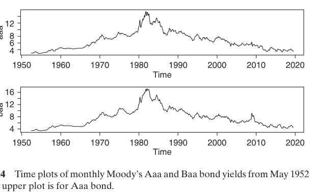

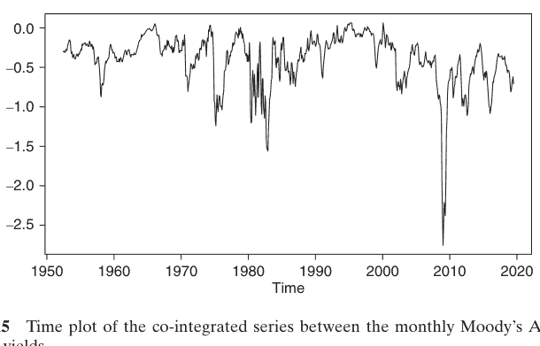

零假设。因此，这两个债券收益率序列中的每一个似乎都是单位根非平稳的。

联合考虑这两个序列。AIC 为这两个序列选定了 VAR(8) 模型。Johansen 检验统计量显示 \( L_{max}(0) = 27.19 \) 和 \( L_{max}(1) = 2.01 \)。与其临界值相比，检验统计量显示 Rank(\(\Pi\)) = 1，这意味着两个债券收益率序列是协整的。这并不奇怪，因为两个债券收益率之间任何显著且持续的偏离都会导致套利机会。如果使用跟踪统计量，检验统计量为 \( L_{tr}(0) = 29.20 \) 和 \( L_{tr}(1) = 2.01 \)，同样得出协整的相同结论。协整向量为 \( (1, -0.926)' \)。图 3.15 显示了两个债券收益率协整序列的时间图。该序列的平稳性很明显，除了 2008 年金融危机期间的大幅下跌。

### R 输出：协整分析。输出已编辑以节省空间。分析中使用了 R 包 urca 和 MTS。

```
> da <- read.csv("m-usbnd.csv")
> bond <- da[,2:3]
> ar(bond[,1])
Call: ar(x = bond[, 1])
Coefficients:
      1       2       3
1.1940 -0.2906  0.0913
Order selected 3  sigma^2 estimated as  0.07097
> ar(bond[,2])
Call: ar(x = bond[, 2])
Coefficients:
     1      2
1.2100 -0.2151
Order selected 2  sigma^2 estimated as  0.07096
```

```
> require(urca)
> nn1 <- ur.df(bond[,1],lags=3,type="none")
> summary(nn1)
##########################################
### Augmented Dickey-Fuller Test Unit Root Test ###
##########################################
Test regression none
Call:
lm(formula = z.diff ~ z.lag.1 - 1 + z.diff.lag)

Coefficients:
              Estimate Std. Error t value Pr(>|t|)
z.lag.1      -0.0004245  0.0009386  -0.452   0.651
z.diff.lag1  0.4208651  0.0353942  11.891  < 2e-16 ***
z.diff.lag2 -0.2535622  0.0373338  -6.792 2.16e-11 ***
z.diff.lag3  0.0503625  0.0354006   1.423   0.155
---
Value of test-statistic is: -0.4523

Critical values for test statistics:
         1pct  5pct 10pct
tau1 -2.58 -1.95 -1.62
```

```
> nn2 <- ur.df(bond[,2],lags=2,type="none")
> summary(nn2)
##########################################
### Augmented Dickey-Fuller Test Unit Root Test ###
##########################################
Test regression none
Call:
lm(formula = z.diff ~ z.lag.1 - 1 + z.diff.lag)

Coefficients:
              Estimate Std. Error t value Pr(>|t|)
z.lag.1      -0.0003144  0.0007815  -0.402   0.688
z.diff.lag1  0.4718882  0.0349516  13.501  < 2e-16 ***
z.diff.lag2 -0.1522756  0.0349617  -4.355 1.5e-05 ***
---
Value of test-statistic is: -0.4022

Critical values for test statistics:
         1pct  5pct 10pct
tau1 -2.58 -1.95 -1.62
```

```
> VARorder(bond)
selected order: aic =  8
selected order: bic =  3
selected order: hq =  3
Summary table:
           P      AIC      BIC      HQ      M(p) p-value
[1,]   0 -0.00011 -0.0011 -0.0011  0.0000 0.0000
[2,]   1 -7.7485 -7.7252 -7.7396 6124.4128 0.0000
[3,]   2 -8.0868 -8.0402 -8.0689 274.1698 0.0000
[4,]   3 -8.1345 -8.0647 -8.1077 45.3339 0.0000
........
[14,]  13 -8.1381 -7.8354 -8.0219  1.9572 0.7436
```

```
> nl <- ca.jo(bond, ecdet="const", K=8)
> summary(nl)
######################
### Johansen-Procedure ###
######################

Test type: maximal eigenvalue statistic (lambda max), without
linear trend and constant in cointegration

Eigenvalues (lambda):
[1] 3.349441e-02 2.516686e-03 5.160725e-19

Values of teststatistic and critical values of test:

          test 10pct 5pct 1pct
r <= 1 |  2.01  7.52  9.24 12.97
r = 0  | 27.19 13.75 15.67 20.20

Eigenvectors, normalized to the first column:
(These are the cointegration relations)

              AAA.18      BAA.18     constant
AAA.18  1.0000000  1.0000000  1.0000000
BAA.18 -0.9259745 -0.3516517 -0.9459504
constant  0.4098622 -4.0114581 -13.0158264

Weights W:
(This is the loading matrix)

              AAA.18      BAA.18     constant
AAA.d 0.03582889 -0.005378767 -3.068444e-18
BAA.d 0.08131706 -0.003636711 -8.823027e-18
```

```
> n2 <- ca.jo(bond,type="trace",ecdet=c("const"),K=8,spec=c("transitory"))
> summary(n2)
######################
### Johansen-Procedure ###
######################

Test type: trace statistic, without linear trend and constant in
cointegration

Eigenvalues (lambda):
[1] 3.349441e-02 2.516686e-03 1.360635e-19
```

检验统计量及其临界值：

| | 检验统计量 | 10pct | 5pct | 1pct |
|---|---|---|---|---|
| r <= 1 | 2.01 | 7.52 | 9.24 | 12.97 |
| r = 0 | 29.20 | 17.85 | 19.96 | 24.60 |

最后，一旦确定了协整系列的数量，就可以通过最大似然法或最小二乘法估计指定的 ECM。例如，详情见 Tsay (2014, 第 5 章)。

## 练习

- 1. 考虑文件 m-eximpncus.csv 中美国月度出口和进口数据的对数序列。(a) 两个对数序列是否为单位根非平稳？执行单位根检验以得出结论。(b) 两个序列是否协整？执行协整检验以验证答案。

- 2. 再次考虑问题 1 中的美国月度出口和进口系列。(a) 为这两个序列构建一个双变量时间序列模型。执行模型简化和模型检查以证明所用模型的合理性。(b) 获取使用正交创新构建的模型的脉冲响应函数。(c) 使用在预测原点 t = 324（即最后一个数据点，或 2018 年 12 月）构建的模型，获得 1 步到 4 步先导预测。

- 3. 考虑 TaiwanAirBox032017.csv 中的台湾 AirBox 数据。该文件包含 514 个系列，共有 744 个观测值。关注系列 2、3 和 4。为三维时间序列构建多变量时间序列。执行模型检查，并在预测原点 T=744 处为该系列获得 1 步到 3 步先导预测。

- 4. 考虑第 1 章中讨论的欧洲、北美和南美的 11 月气温。参见文件 temperatures.txt。(a) 单个时间序列中是否存在单位根？为什么？(b) 三个系列是否协整？为什么？

- 5. 再次考虑欧洲、北美和南美的三个气温系列。为这三个系列构建一个向量 ARMA 模型（允许 AR 或 MA 模型）。执行模型检查。基于获得的模型，获取带有正交创新的脉冲响应函数。

## 参考文献

- Abraham, B. 和 Ledolter, J. (1983). 预测统计方法. Wiley, New York, NY.

- Ahn, S. K. 和 Reinsel, G. C. (1988). 多元时间序列的嵌套降阶自回归模型. Journal of the American Statistical Association, 83: 849–856.

- Ahn, S. K. 和 Reinsel, G. C. (1990). 部分非平稳多元自回归模型的估计. Journal of the American Statistical Association, 85: 849–856.

- Akaike, H. (1973). 信息论及最大似然原理的扩展. In B. N. Petrov 和 F. Csaki (eds.). 第 2 届信息理论国际研讨会, pp. 267–281. Akademia Kiado, Budapest.

- Akaike, H. (1976). 时间序列的典型相关分析及信息准则的应用. In R. K. Mehra 和 D. G. Lainiotis (eds.). 系统辨识：进展与案例研究, pp. 27–96. Academic Press, New York, NY.

- Blattberg, R. C. 和 Jeuland, A. P. (1981). 广告销售关系的微观建模方法. Management Science, 27: 988–1005.

- Box, G. E. P. 和 Jenkins, G. M. (1976). 时间序列分析：预测与控制，修订版. Holden-Day, San Francisco, CA.

- Box, G. E. P., Jenkins, G. M., Reinsel, G. C., 和 Ljung, G. M. (2015). 时间序列分析：预测与控制，第 5 版. Wiley, Hoboken, NJ.

- Box, G. E. P. 和 Tiao, G. C. (1977). 多元时间序列的典型分析. Biometrika, 64: 355–366.

- Chan, N. H. 和 Wei, C. Z. (1988). 不稳定自回归过程最小二乘估计的极限分布. Annals of Statistics, 16: 367–401.

- Dunsmuir, W. 和 Hannan, E. J. (1976). 向量线性时间序列模型. Advanced Applied Probability, 8: 339–364.

- Engle, R. F. 和 Granger, C. W. J. (1987). 协整与误差修正：表示、估计与检验. Econometrica, 55: 251–276.

- Hannan, E. J. 和 Deistler, M. (1988). 线性系统统计理论. Wiley, New York, NY.

- Hannan, E. J. 和 Quinn, B. G. (1979). 自回归阶数的确定. Journal of the Royal Statistical Society, Series B, 41: 190–195.

- Hosking, J. R. M. (1981). 多元时间序列模型的拉格朗日乘数检验. Journal of the Royal Statistical Society, Series B, 43: 219–230.

- Johansen, S. (1991). 高斯向量自回归模型中协整向量的估计与假设检验. Econometrica, 59: 1551–1580.

- Johansen, S. (1995). 协整向量误差修正模型中的似然推断. Oxford University Press, Oxford, UK.

- Johansen, S. 和 Juselius, K. (1990). 协整的最大似然估计与推断——以货币需求为例的应用. Oxford Bulletin of Economics and Statistics, 52: 169–210.

- Li, W. K. 和 McLeod, A. I. (1981). 多元时间序列模型中残差自相关的分布. Journal of the Royal Statistical Society, Series B, 43: 231–239.

- Lütkepohl, H. (2005). 多元时间序列分析新导. Springer, New York, NY.

- Phillips, P. C. B. (1987). 带单位根的时间序列回归. Econometrica, 55: 277–301.

- Reinsel, G. (1993). 多元时间序列分析要素. Springer-Verlag, New York, NY.

- Schwarz, G. (1978). 模型维数估计. Annals of Statistics, 6: 461–464.

- Shibata, R. (1980). 线性过程参数估计模型阶数的渐近有效选择. Annals of Statistics, 8: 147–164.

- Tanaka, K. (2017). 时间序列分析：非平稳与非可逆分布理论，第 2 版. Wiley, Hoboken, NJ.

- Tiao, G. C. 和 Box, G. E. P. (1981). 多元时间序列建模及其应用. Journal of American Statistical Association, 72: 802–816.


Tiao, G. C. and Tsay, R. S. (1983). 多元时间序列建模与扩展样本交叉相关. *商业与经济统计杂志*, **1**: 43–56.

Tiao, G. C. and Tsay, R. S. (1989). 多元时间序列中的模型规范（附讨论）. *皇家统计学会杂志，B系列*, **51**: 157–213.

Tsay, R. S. (1991). 向量ARMA过程的两种规范形式. *统计学正刊*, **1**: 247–269.

Tsay, R. S. (2010). *金融时间序列分析*, 第3版. Wiley, Hoboken, NJ.

Tsay, R. S. (2014). *基于R与金融应用的多元时间序列分析*. Wiley, Hoboken, NJ.

Tsay, R. S. and Tiao, G. C. (1990). 多元非平稳过程的渐近特性及其对自回归的应用. *统计学年鉴*, **18**: 220–250.

Velu, R. P., Reinsel, G. C., and Wichern, D. W. (1986). 多元时间序列的低秩模型. *生物计量学*, **73**: 105–118.

Velu, R. P., Wichern, D. W., and Reinsel, G. C. (1987). 关于多元时间序列模型非平稳性与规范分析的简述. *时间序列分析杂志*, **8**: 479–487.
