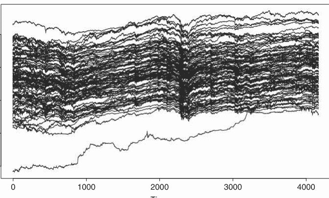
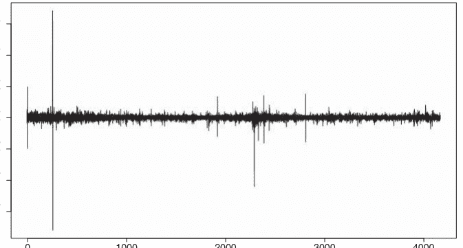
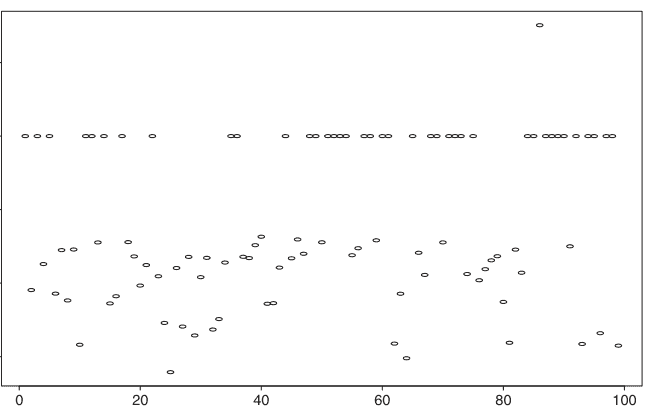
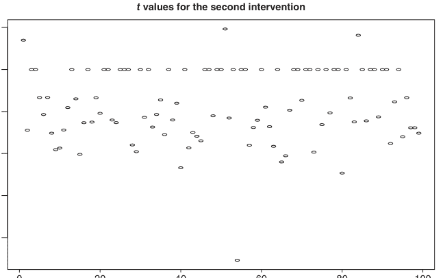
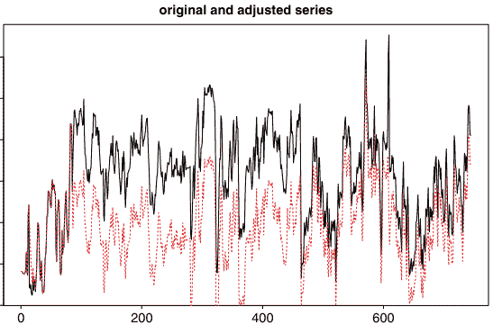
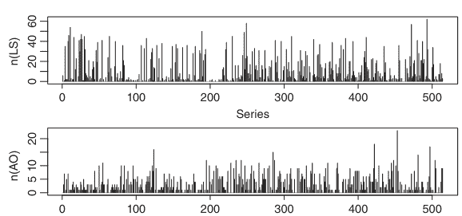

# 4 处理许多时间序列中的异质性

经验时间序列常受多种偶发事件影响，这些事件产生异质性的不同原因。在建模过程中应考虑这些事件的影响，因为它们可能导致参数估计有偏和/或模型误设定，进而导致预测性能差。我们考虑的第一类事件包括具有已知原因的情况，例如一组生产系列上的罢工、月度销售系列上的闰年、进出口系列上的关税变化，或空气污染指数上的极端气候事件。第二类事件涉及由仪器故障或人为错误引起的时间序列中的缺失值。此处我们假设缺失值是随机发生的，且对于向量系列，整个数据点或向量的某些元素可能缺失。对于这两类事件，我们知道其发生时间，并希望从研究中的时间序列集合中移除其影响。如何进行此类调整是本章第一部分的重点。

还存在其他情况，我们不知道是否发生过任何非典型事件，也不知道其发生时间（如果有的话）。然而，从数据的离群观测中，我们可以推断在抽样期间确实发生过一些意外事件。那些离群数据点通常被称为 *离群点* 并最早由 Fox (1972) 在时间序列中进行研究。它们在实际时间序列中经常发生。例如，Maravall et al. (2016) 分析了许多国家的超过15,000个月度经济和社会时间序列，发现超过60%的系列至少有一个明显的离群点，且时间序列中离群点的预期数量约为数据点的2%。离群点可能呈孤立状出现，也可能成组出现形成离群点区块。某些事件可能导致系列水平的永久变化，它们被称为 *水平移位* 或结构断点。另一方面，其他事件只会对底层时间序列造成暂时性变化。本章第二部分的重点是向量时间序列中的离群点检测。遵循文献，我们将离群点分为水平移位、暂时性变化、加性离群点、创新离群点和方差变化，并讨论检测这些离群点并调整其影响的方法。所讨论的方法包括时间序列文献中可用的传统方法以及高维数据分析中的一些最新进展。对于一组独立时间序列，我们可以逐个清洗系列。然而，对于一组相关时间序列，关于可能影响所有系列的事件的信息分布在各系列中。因此，开发联合利用系列中信息的检测程序更为有利。在本章中，我们首先定义一元离群点和多元离群点，并提出一种在每个系列中或在由向量自回归移动平均（VARMA）模型建模的时间序列向量中调整其影响的程序。然后，我们提出一种基于投影的方法，以清洗大量时间序列，而无需估计多元模型。

处理离群点或结构变化的另一种方法是使用对非典型事件不敏感的稳健估计方法。可以通过检查使用某些稳健参数估计计算得出的残差来检测离群点。关于一元时间序列稳健估计有大量文献，但只有少数文章涉及多元系列。本章对这些结果进行了简要总结。异质性也可能由于模型的一些参数随时间变化，或在特定时间点发生变化而出现。同样，这是一个重要且研究广泛的主题，本章最后一部分介绍了一些关于多元时间序列的可用结果。最后，另一种异质性是由时间序列中的某些非线性效应引入的，但本章不考虑此主题，我们将读者参考 Tsay 和 Chen (2018) 的著作。

## 4.1 干预分析

时间序列中外部事件的固定效应可被视为模型中某些解释变量的影响。Box 和 Tiao (1975) 将这种方法称为 *干预分析*（intervention analysis），其中各种虚拟变量或指示变量作为时间序列模型的外生变量。外生变量的参数量化干预的影响。在经济学文献中，干预分析被称为 *事件研究*（event study）。为说明这一点，假设我们有一个月度生产系列 \(z_t\)，该系列在月份 \(t=h\) 的一个工作日受到罢工的影响。由于罢工仅发生在一个工作日，我们预期其对系列的影响（如有）仅会发生在月份 \(t=h\)。因此，引入一个虚拟（或指示）变量是合理的

\[
I_t^{(h)} = \begin{cases} 1, & \text{if } t = h, \\ 0, & \text{otherwise}, \end{cases} \tag{4.1}
\]

并假设观测数据 \(z_t\) 为 \(z_t = y_t + \omega I_t^{(h)}\)，其中 \(\omega\) 表示罢工的影响，\(y_t\) 是底层的无离群时间序列。显然，当 \(t \neq h\) 时，我们观测到 \(z_t = y_t\)，但当 \(t = h\) 时，有 \(z_h = y_h + \omega\)，表明我们观测到的内容在时间 \(t = h\) 处受到罢工污染。第二个例子，考虑一国的月度出口额 \(z_t\)。假设该国的一个主要贸易伙伴从月份 \(t=h\) 开始实施永久性的重大关税上调，我们有兴趣评估关税对出口系列 \(z_t\) 的影响。此处我们可以定义一个阶跃函数为

\[
S_t^{(h)} = \begin{cases} 1, & \text{if } t \ge h, \\ 0, & \text{otherwise,} \end{cases} \tag{4.2}
\]

并假设观测到的月度出口数据为 \(z_t = y_t + \omega S_t^{(h)}\)，其中 \(\omega\) 表示新关税的影响。显然，当 \(t < h\) 时，有 \(z_t = y_t\)，但当 \(t \ge h\) 时，有 \(z_t = y_t + \omega\)。这里预期新的重大关税一旦发生，其影响将持续存在。读者可立即看到，第二个例子也可以描述为 \(z_t = y_t + \omega \frac{1}{(1-B)} I_t^{(h)}\)，其中 \(B\) 是后移算子。这是因为 \((1-B)S_t^{(h)} = I_t^{(h)}\)。函数 \(\frac{1}{1-B}\) 表示 \(B\) 中两个多项式的比值，在干预分析或离群点检测中被广泛使用。

通过结合指示变量和阶跃函数，并使用多项式比值来描述干预的影响，我们获得了一种灵活的干预分析方法。详情见下一节及 Box 和 Tiao (1975)。事实上，干预分析中的外生变量不一定是虚拟变量或阶跃函数。其他确定性变量也可以使用。例如，在许多月度经济或生产时间序列中，每月的工作日天数是一个重要考虑因素。我们可以通过将观测值除以每月的工作日天数来考虑此类工作日效应，从而得到用于分析的月平均日产量系列。更好的解决方案是将每月的星期几作为解释变量引入并纳入模型。这是因为一周中的不同日子可能具有不同的活动水平，例如，超市销售在周一和周五并不相同。我们可以通过包含七个解释变量来衡量每日效应，这些变量显示每月周一、周二等的天数。此外，许多月度系列受到不规则节假日的影响，这些节假日每年不同，例如欧洲的复活节和中国的农历新年。我们可以通过引入一个外生变量来衡量此类效应，该变量在节假日所在月份取值为一，一年中的其他月份取值为零。

为了更好地理解处理时间序列中异质性的方法，有必要考虑观测时间序列 \(z_t\) 受到某些外生效应污染。因此，我们说与观测到的 \(z_t\) 相对应，存在一个无污染（或无离群）系列 \(y_t\)。在实践中，我们只观测到 \(z_t\)，但本章的目标是尽可能准确地恢复 \(y_t\)。向量情况也适用类似的记法。

### 4.1.1 带指示变量的干预

我们从一个观测到的标量时间序列 \(z_t\) 开始，并假设相应的无污染系列 \(y_t\) 遵循 ARIMA\((p,d,q)\) 模型，即 \(\phi(B)(1-B)^d y_t = \theta(B)a_t\)。如果 \(d > 0\)，则为简化起见，我们假设系列从 \(t=1\) 开始，带有一些零初始值。因此，我们可以使用自回归


(AR) 表示中的时间序列 \(\pi(B)y_t = a_t\) 或移动平均 (MA) 表示中的时间序列 \(y_t = \psi(B)a_t\)，其中理解为 \(\pi(B) = \phi(B)(1-B)^d/\theta(B)\) 和 \(\psi(B) = \theta(B)/[\phi(B)(1-B)^d]\) 且 \(\pi(B)\psi(B) = 1\)。在实践中，\(\pi_i\) 和 \(\psi_j\) 均可通过对 \(B\) 中的两个多项式进行长除法得到。

我们假设在时间 \(t = h\) 发生了大小为 \(w_0\) 的异常事件。在此情况下，通过使用公式 (4.1) 中的指示变量，我们可以将观测时间序列写为

\(z_t = w_0 I_t^{(h)} + y_t = w_0 I_t^{(h)} + \psi(B)a_t. \quad (4.3)\)

换言之，我们有

\(z_t = \left\{ \begin{array}{ll} y_t, & \text{if } t \neq h, \\ y_h + w_0, & \text{if } t = h. \end{array} \right.\)

表示 (4.3) 是第 3 章中以输入变量 \(I_t^{(h)}\) 介绍的传递函数的特例。同样，在时间 \(t = h\) 发生的异常事件也可能在多个时间段内影响正在研究的时间序列。例如，芝加哥的一场大冬季暴风雪可能会导致奥黑尔国际机场的航空交通中断数天。在此情况下，我们可以将观测时间序列写为

\(z_t = \sum_{i=0}^m w_i I_t^{(h+i)} + \psi(B)a_t, \quad (4.4)\)

其中 \(m\) 是有限正整数，\(w_i\) 是该事件对时间段 \(t = h + i\)（\(i = 0, ..., m\)）的影响。此处我们使用参数 \(w_i\) 来表示该事件在 \(t = h + i\) 时对序列的影响。在实践中，可能很难 *事先* 知道 \(m\) 的值。此外，影响可能会随时间流逝而平滑衰减。因此，为 \(z_t\) 假设以下模型是合理的：

\(z_t = \frac{w_0}{1 - \delta B} I_t^{(h)} + \psi(B)a_t = \frac{w_0}{1 - \delta B} I_t^{(h)} + y_t, \quad (4.5)\)

其中 \(w_0\) 是异常事件的初始影响，\(0 < \delta < 1\) 表示影响的折现率。这是因为 \(w_0/(1 - \delta B) = w_0(1 + \delta B + \delta^2 B^2 + \cdots)\)。更具体地说，公式 (4.5) 显示

\(z_t = \left\{ \begin{array}{ll} y_t, & \text{if } t < h, \\ y_h + w_0, & \text{if } t = h, \\ y_{h+1} + w_0\delta, & \text{if } t = h+1, \\ y_{h+2} + w_0\delta^2, & \text{if } t = h+2, \\ \vdots & \vdots \end{array} \right.\)

其中 \(y_t\) 是未观测到的未受污染的时间序列。

通常，用于描述在时间索引 \(t = h\) 处异常事件对时间序列影响的灵活模型是

\(z_t = \frac{w(B)}{\delta(B)} I_t^{(h)} + y_t, \quad (4.6)\)

其中 \(w(B) = w_0 + w_1 B + \cdots + w_m B^m\) 和 \(\delta(B) = 1 - \delta_1 B - \cdots - \delta_r B^r\) 是 \(B\) 中的两个多项式，阶数分别为有限的 \(m\) 和 \(r\)，且 \(y_t = \psi(B)a_t\) 是未受污染的时间序列。\(w(B)/\delta(B)\) 的灵活性可见 Box and Tiao (1975) 和第 3 章。显然，我们要求 \(w(B)\) 和 \(\delta(B)\) 在公式 (4.6) 中没有公因式。

在实际应用中，时间序列可能会受到发生在时间 \(t = h_i\)（\(i = 1, \dots, g\)）的多个异常事件的影响，其中 \(g\) 是非负整数。在此情况下，我们为 \(z_t\) 假设以下模型：

\( z_t = \sum_{i=1}^g \frac{w_i(B)}{\delta_i(B)} I_t^{(h_i)} + \psi(B)a_t, \tag{4.7} \)

其中 \( w_i(B) = w_{i,0} + w_{i,1}B + \cdots + w_{i,m_i}B^{m_i} \) 和 \( \delta_i(B) = 1 - \delta_{i,1}B - \cdots - \delta_{i,r_i}B^{r_i} \)，且 \(m_i\) 和 \(r_i\) 为非负整数。

标量时间序列上异常事件影响建模的前面讨论可以轻易推广到向量情况。例如，对于观测到的向量系列，公式 (4.3) 中的模型将变为

\( z_t = \boldsymbol{w}_0 I_t^{(h)} + \boldsymbol{y}_t = \boldsymbol{w}_0 I_t^{(h)} + \boldsymbol{\psi}(\boldsymbol{B})\boldsymbol{a}_t, \)

其中 \( \boldsymbol{w}_0 = (w_{01}, \dots, w_{0k})' \) 是事件影响的向量，\( w_{0i} \) 是对第 \(i\) 个分量 \(z_{it}\) 的影响，\( \boldsymbol{y}_t \) 是相应的未受污染向量时间序列，而 \( \boldsymbol{\psi}(\boldsymbol{B}) = [\boldsymbol{\Phi}(\boldsymbol{B})]^{-1}\theta(\boldsymbol{B}) \) 表示 \( \boldsymbol{y}_t \) 的 \(\psi\)-权重矩阵，其遵循 VARMA 模型 \( \boldsymbol{\Phi}(\boldsymbol{B})\boldsymbol{y}_t = \theta(\boldsymbol{B})\boldsymbol{a}_t \)。关于 \(\psi\)-权重矩阵的进一步讨论见第 3 章。同样，公式 (4.6) 中的模型可以推广为

\( \boldsymbol{z}_t = [\boldsymbol{\delta}(\boldsymbol{B})]^{-1} \boldsymbol{w}(\boldsymbol{B}) I_t^{(h)} + \boldsymbol{y}_t, \tag{4.8} \)

其中 \( \boldsymbol{w}(\boldsymbol{B}) = \boldsymbol{w}_0 + \boldsymbol{w}_1 \boldsymbol{B} + \cdots + \boldsymbol{w}_m \boldsymbol{B}^m \) 和 \( \boldsymbol{\delta}(\boldsymbol{B}) = \boldsymbol{I} - \boldsymbol{\delta}_1 \boldsymbol{B} - \cdots - \boldsymbol{\delta}_r \boldsymbol{B}^r \) 分别是阶数为有限的 \(m\) 和 \(r\) 的两个矩阵多项式，且 \( \boldsymbol{w}_i \) 和 \( \boldsymbol{\delta}_i \) 是 \(k \times k\) 实矩阵，\(k\) 为 \( \boldsymbol{z}_t \) 的维度。此处我们要求 \( \boldsymbol{w}(\boldsymbol{B}) \) 和 \( \boldsymbol{\delta}(\boldsymbol{B}) \) 左互素。公式 (4.8) 在应用中有用的一个特例是

\( \boldsymbol{z}_t = (1 - \delta \boldsymbol{B})^{-1} \boldsymbol{w}_0 I_t^{(h)} + \boldsymbol{y}_t, \)

在此例中，异常事件对 \( \boldsymbol{z}_t \) 每个分量的影响以相同的速率衰减。

### 4.1.2 阶跃函数干预

在某些应用中，异常事件可能会永久影响正在研究的时间序列。例如，考虑某产品 A 品牌的市场份额，以及其制造商在时间索引 \(t = h\) 处进行的大型促销活动。如果促销在促销生效时间之前就已宣布，消费者可能会预期价格下降而推迟购买。随后，他们在促销期间购买了大量 A 品牌产品，导致促销结束后销售额立即下降。理论上，这种大型促销可能会永久改变 A 品牌的市场份额。为了描述这种复杂的市场反应，使用指示变量 \( I_t^{(h)} \) 会变得更加困难。相反，可以使用公式 (4.2) 中的阶跃函数来简化模型。此类干预的一个候选模型是

\( z_t = (w_{-1}F + w_0 + w_1 B) S_t^{(h)} + y_t, \)

其中 \(F = B^{-1}\) 是前移算子，\(y_t\) 是没有促销时的基础市场份额，\(w_i\) 是用于量化促销效果的参数。在这种情况下，人们会期望 \(w_{-1} < 0\)、\(w_0 > 0\) 和 \(w_1 < 0\)，而促销的永久效应由 \(w_{-1} + w_0 + w_1\) 给出。

转向向量时间序列的情况。始于 \(t = h\) 的异常事件的影响可以建模为

$$z_t = w_0 S_t^{(h)} + \Psi(B) a_t,$$

与之前一样，\(w_0 = (w_{0,1}, \dots, w_{0,k})'\)，其中 \(k\) 为 \(z_t\) 的维度。此处容易看出，当 \(t < h\) 时有 \(z_t = y_t\)，当 \(t \ge h\) 时有 \(z_t = w_0 + y_t\)，其中 \(y_t\) 是未受污染的向量时间序列。显然，我们可以将模型推广到包含多个干预的情况，每个干预对基础时间序列都有复杂的影响。

因为

$$I_t^{(h)} = S_t^{(h)} - S_{t-1}^h = \nabla S_t^{(h)},$$ (4.9)

在实际应用中，为给定干预选择使用指示变量还是阶跃函数可能并不关键。可以让数据选择要使用的适当变量。例如，如果我们估计模型

$$z_t = (w_0 - w_1 B) S_t^{(h)} + \Psi(B) a_t,$$ 并发现 \(\hat{w}_0 \simeq \hat{w}_1\)，那么可以将模型简化为

$$z_t = \hat{w}_0 \nabla S_t^{(h)} + \Psi(B) a = \hat{w}_0 I_t^{(h)} + \Psi(B) a_t,$$

表明干预效应仅发生在 \(t = h\)。如果在使用指示变量和阶跃函数之间存在疑问，始终可以使用模型选择方法（如信息准则）来选择合适的模型。

### 4.1.3 一般外生变量干预

干预分析不仅限于使用指示变量或阶跃函数。事实上，只要变量在时间 \(t\) 已知，就可以使用任何外生变量进行干预分析。例如，设 \(x_t\) 为公司在其产品上的月度广告支出，\(z_t\) 为公司的月度总销售额。那么，广告对销售的影响可以建模为

$$z_t = v(B)x_t + y_t,$$

其中 \(y_t\) 是没有任何广告时的月度销售额，而 \(v(B) = v_0 + v_1 B + v_2 B^2 + \cdots\) 是传递函数。在实践中，\(v(B)\) 通常可以用两个多项式的比值很好地近似，例如 \(v(B) = w(B)B^b/\delta(B)\)，其中 \(w(B) = w_0 + w_1 B + \cdots + w_m B^m\) 和 \(\delta(B) = 1 - \delta_1 B - \cdots - \delta_r B^r\)，\(m\) 和 \(r\) 为非负整数，而 \(b\) 是一个通常被称为干预 *滞后* 的整数。这属于第 3 章讨论的传递函数模型。

### 4.1.4 构建干预模型

再次，我们从在时间 \(t = h\) 处发生单次干预的标量情况开始，并考虑模型

$$z_t = v(B) I_t^{(h)} + \psi(B) a_t. \quad (4.10)


如果 $h$ 足够大，可以使用数据 $\{y_1, \dots, y_{h-1}\}$（等价于 $\{z_1, \dots, z_{h-1}\}$）为不受污染的序列 $y_t$ 建立模型。换句话说，我们使用干预前的数据来推断 $\psi(B)$。然后利用该模型预测 $\ell = 1, \dots, T-h+1$ 的 $\hat{z}_{h-1}(\ell)$，其中 $T$ 为样本量。预测误差 $e_{h-1-\ell}(\ell) = z_{h-1-\ell} - \hat{z}_{h-1-\ell}(\ell)$ 显示干预的影响，并提供关于 $\upsilon(B)$ 函数形式的信息，进而可用于指定 $w(B)$ 和 $\delta(B)$。Eq. (4.10) 中指定的模型随后通过条件最大似然法进行估计，包括 $\psi(B)$ 的参数。

另一方面，如果 $h$ 不够大，无法用于指定 $\psi(B)$，则通常使用包含以下三个步骤的迭代过程。

#### 建模过程：

- 1. 首先对传递函数进行初始估计 \(\hat{\nu}^{(0)}(B)\)，以通过 \(\hat{y}_t = z_t - \hat{\nu}^{(0)}(B)I_t^{(h)}\) 获得 $y_t$ 的估计。

- 2. 使用序列 \(\hat{y}_t\) 估计 ARIMA 模型的参数 \(\hat{\Psi}(B)\)，并计算残差

\(\hat{e}_t = \hat{y}_t - \sum_{i=1}^{t-1} \hat{\Psi}_i \hat{e}_{t-i} = \hat{\Psi}^{-1}(B)\hat{y}_t = \hat{\pi}(B)\hat{y}_t.\)

- 3. 利用这些残差与传递函数参数之间的关系，通过 (4.10) 并假设 \(\hat{\Psi}(B) \approx \psi(B)$ 来估计干预传递函数的参数。具体地，使用回归方程：

\(\hat{e}_t = \upsilon(B)\hat{\pi}(B)I_t^{(h)} + a_t,\)

其中参数为 $v_i$，回归变量为 \(x_t = \hat{\pi}(B)I_t^{(h)}\)。得到新的估计 \(\hat{v}_i$ 后，转至步骤 1。

这个三步过程重复进行直到收敛。在实践中，我们可以从 \(\hat{\nu}^{(0)}(B) = 0\) 和 $\hat{y}_t = z_t$ 开始。

上述建模过程也适用于带干预的多元时间序列。然而，与使用 VARMA 模型相比，通常采用 VAR 模型来处理不受污染的序列 $y_t$ 以简化估计，尤其是当 $z_t$ 的维度 $k$ 较大时。此外，还使用 $\upsilon(B) \approx \boldsymbol{w}(B) = \boldsymbol{w}_0 + \boldsymbol{w}_1 B + \cdots + \boldsymbol{w}_m B^m$ 来进一步简化估计。在这些简化假设下，多元干预模型的估计可以通过迭代普通最小二乘法进行。

### 示例 4.1

我们使用 R 语言 MTS 包中的 VARX 命令来说明干预分析。所用数据是世界上 99 个最重要股市的股票指数系列，我们将两个由阶梯函数表示的外部事件视为干预。第一个干预发生在 2007 年 11 月 21 日（$h = 2058$），标志着 2008 年金融危机的开端，当时美国财政部设立了一个超级基金来处理次级抵押贷款市场。第二个干预发生在 2008 年 9 月 16 日（\( h = 2273 \)），标志着投资银行雷曼兄弟于 2008 年 9 月 15 日倒闭后的第一个交易日。

图 4.1 和 4.2 分别显示了对数股票指数和收益率的时间图。如前所述，如第 2 章中所述，数据包含一些离群的收益率。另见图 4.2。但是，为简单起见，这里不处理离群值。由于每日指数收益率的自相关和互相关都很小，我们假设收益率序列为白噪声。请注意，指数系列的阶梯函数对应于收益率系列的指示变量。因此，我们采用了



图 4.1 世界 99 个市场股票指数对数序列的时间图。



图 4.2 世界 99 个市场股票指数收益率序列的时间图。

以下是 99 个收益率系列 \( z_t$ 的干预模型：

\( z_t = w_1 f_t^{(2057)} + w_2 f_t^{(2272)} + \mu + a_t \) 。

图 4.3 和 4.4 分别绘制了估计值 \( \widehat{w}_1$ 和 \( \widehat{w}_2$ 的 t 比值。从图中可以看出，正如预期，两个干预对



**图 4.3** \( t \)-ratios for the coefficient estimates of the intervention variable on 21 November 2007 for the 99 log return series of the world stock indexes.



**图 4.4** \( t \)-ratios of the coefficient estimates of the intervention variable on 16 September 2008 for the 99 log return series of the world stock indexes.

收益率系列。这一点对第二个干预（雷曼兄弟倒闭）尤其明显，因为图 4.4 包含许多 _t_-比值 小于 -2.0。

### 干预分析中使用的 R 命令：

```
> require(MTS)
>da=read.csv2("Stock_indexes_99world.csv", header=FALSE)
>x=da[,-1] # remove time index
>lx=as.matrix(log(x))
>T=dim(lx) [1]
>k=dim(lx) [2]
>y=diff(lx) # log returns
>sx=matrix(0,T,1)
>sx1=sx
>sx2=sx
>sx1[2058:T,1]=1 ## first step function
>sx2[2273:T,1]=1 ## 2nd step function
>iy1=diff (sx1) ## Indicator
>iy2=diff (sx2)
>iy=cbind(iy1,iy2)
#Estimation of the intervention model for y, the return series,
#with 2 indicators.
#The model is refined to eliminate coefficients with t-ratio
#smaller than 1.3
>r=VARX(y,0,iy,0)
>rl=refVARX(r, thres=1.3)
#The variable coef of Object r1 (rl$coef) contains the coefficient
#Estimate. It is a 99-by-2 matrix.
#The variable se.coef of Object rl (rl$se.coef) contains the standard
### errors of all parameter estimates, including the constant in row 1.
### It is a 3-by-99 matrix.
>s=rl$se.coef[-1,] # remove standard errors of the constant terms.
>M=rl$coef/t(s)
>#tt1=which(abs(M)>=3, arr.ind=T)
>plot(M[,1], main="t ratios for the 1st intervention ", ylab="t-value",
xlab="series number")
>plot(M[,2], main="t ratios for the 2nd intervention ", ylab="t-value",
xlab="series number")
```

## 4.2 缺失值估计

### 4.2.1 一元插值

时间序列的缺失值可能发生在单个时间点或某个区间内。用于收集数据的仪器故障就是一个例子。在本章中，我们假设缺失值在样本中随机发生。也就是说，没有系统性模式来决定缺失值的出现或其大小。在此假设下，我们讨论估计缺失值的方法，以便可以应用为完整数据集开发的传统统计方法。在某些情况下，可以将缺失值视为统计模型的附加参数，并与其他模型参数一起估计缺失值。

我们从零均值平稳时间序列 \(z_t\) 中的单个缺失值开始。假设 \(z_h\) 缺失。显然，\(h$ 不能是第一个或最后一个时间点。

否则，可以减少样本量以避免缺失值。我们使用符号 $z_{(-h)} = \{z_1, ..., z_{h-1}, z_{h+1}, ..., z_T\}$ 表示可用数据。下标 $(-h)$ 表示 $z_h$ 缺失。要估计 $z_h$，可以在给定数据和模型的情况下最小化其平方估计误差。设 $M$ 表示 $z_t$ 的模型，$z_h$ 的估计值（记为 $\hat{z}_h$）通过对 $z^*$ 最小化 $E[(z_h - z^*)^2 | M, z_{(-h)}]$ 得到。结果表明，该解仅为给定模型和可用数据下 $z_h$ 的条件期望。即，$\hat{z}_h = E(z_h | M, z_{(-h)})$。如果模型 $M$ 已知，则该条件期望易于获得。例如，对于 ARMA 模型

$$E(z_h|z_{(-h)}) = -\sum_{j=1}^\infty \rho_j^i(z_{h+j} + z_{h-j}),$$ (4.11)

其中系数 $\rho_j^i$ 是逆自相关系数，即逆 ARMA 模型的 ACF。也就是说，给定 ARMA$(p, q)$ 模型 $\phi(B)z_t = \theta(B)a_t$，逆自相关函数是对偶或逆过程 $\theta(B)z_t = \phi(B)a_t$ 的常规自相关函数。这些系数衡量在消除所有其余观测值的影响后，相隔 $j$ 个周期的序列观测值之间的相关性（见 Ledolter, 1984）。式 (4.11) 表示一个对称滤波器。

如果模型 $M$ 的参数未知，或者序列是非平稳的，我们可以通过第 4.1 节讨论的干预分析来共同估计缺失值和模型参数。估计算法如下：

### 标量滤波算法：

- 1. 为 $z_h$ 插入一个任意值 $z_h^*$，例如 $z_h^* = 0$，以获得完整的数据集 $z^* = (z_1, ..., z_{h-1}, z_h^*, z_{h+1}, ..., z_T)$。

- 2. 对于完成的系列 $z^*$，估计包含式 (4.1) 的指示变量 $I_t^{(h)}$ 的干预模型。设 $\hat{w}_0$ 为干预效应的估计值。

- 3. 通过以下公式估计缺失值：

$$\hat{z}_h = E(z_h|z_{(-h)}) = z_h^* - \hat{w}_0.$$ (4.12)

在上述算法中，我们考虑模型

$$z_t^* = w_0 I_t^{(h)} + \psi(B)a_t = w_0 I_t^{(h)} + z_t.$$ (4.13)

在 $t = h$ 时，条件于 $z_{(-h)}$ 的取值取期望，得到

$$z_h^* = w_0 + E(z_h|z_{(-h)}),$$

即式 (4.12)。

有趣的是，缺失值的估计不依赖于任意初始值 $z_h^*$。为了说明这一点，假设 $z_t$ 遵循随机游走。干预模型为

$$z_t^* = w_0 I_t^{(h)} + y_t,$


其中 $z_t^*$ 用于表示完整数据集，且在随机游走模型下 $(1-B)y_t = a_t$。对前文等式两边求一阶差分，得

$$
\nabla z_t^* = w_0 x_t + a_t,
$$

其中 $x_t = (1-B)I_t^{(h)}$，因此 $x_h = 1$，$x_{h+1} = -1$，其余情况下 $x_t = 0$。该回归方程中 $w_0$ 的最小二乘估计量为

$$
\hat{w}_0 = \frac{\sum_t x_t \nabla z_t^*}{\sum (x_t)^2} = \frac{\nabla z_h^* - \nabla z_{h+1}^*}{2} = \frac{z_h^* - z_{h-1} - z_{h+1} + z_h^*}{2} = z_h^* - \frac{z_{h-1} + z_{h+1}}{2},
$$

而缺失值的估计量（通过公式 (4.12)）为

$$
\hat{z}_h = \frac{z_{h-1} + z_{h+1}}{2},
$$

该估计量不依赖于 $z_h^*$。注意，该等式是 (4.11) 的一个特例，因为随机游走的逆过程是一个单位参数的 MA(1) 过程，因此其一阶自相关系数明确定义且等于 $-0.5$。于是，缺失值仅由观测值 $z_{h-1}$ 和 $z_{h+1}$ 的平均值估计。当模型参数使用前述标量滤波算法同时估计时，$\hat{z}_h$ 不依赖于 $z_h^*$ 的事实依然成立。

若缺失一组共 $g$ 个观测值，该滤波方法可轻易推广，例如从 $h$ 到 $h+g-1$。设可用数据为 $\mathbf{z}_{1[-h:(h+g-1)]} = (z_1, \dots, z_{h-1}, z_{h+g}, \dots, z_T)'$。将这 $g$ 个缺失值填零以构造完整数据集 $\mathbf{z}^*$，并为 $i=1, \dots, g$ 定义 $g$ 个指示变量 $I_t^{(h+i-1)}$，我们估计干预模型

$$
z_t^* = \sum_{i=1}^g w_i I_t^{(h+i-1)} + z_t, \quad (4.14)
$$

缺失值则由以下公式求得

$$
\hat{z}_{h+i} = z^*_{h+i} - \hat{w}_i, \quad i=0, \dots, g-1.
$$

该思路可推广到任意组合的缺失值。当然，该算法的有效性取决于缺失值的随机模式和数量。注意，若序列为具有非零均值的平稳序列，则该平均值应从所有观测值中减去，如前所述得到的插值结果再加回样本均值以获得原始值。对于整合时间序列，干预分析方法始终可用。

### 4.2.2 多元插值

给定一组相关时间序列 $\mathbf{z}_t$，缺失值可能出现在 $\mathbf{z}_h$ 中的整个向量或其部分分量上。可以将上一节的标量滤波算法分别应用于各个单独的时间序列，但这种方法未能利用序列之间的相互依赖性。更好的做法是在共同估计缺失值时利用序列间的所有信息。与标量情形类似，可以将所有缺失值替换为零以获得完整数据集，记为 $z^*$。有了完整数据后，可以应用干预分析来估计模型参数和缺失值。此处干预模型将涉及基于缺失值位置构造的某些指示变量。

考虑 $z_h$ 完全缺失的情况。此时 $z_h^*$ 为零向量，干预模型为

$$
z_t^* = w'I_t^{(h)} + z_t,
$$

其中 $z_t$ 遵循向量 ARMA 模型。若 $z_t$ 的模型已知，则可轻易估计 $w$。缺失值的估计与公式 (4.12) 类似，由以下公式给出

$$
\hat{z}_h = z_h^* - \hat{w} = -\hat{w}.
$$

接下来，考虑 $z_h$ 仅部分缺失的情况。为简化，假设 $z_t$ 遵循 VAR(1) 模型且 $z_h$ 的前 $k_0$ 个分量缺失。将向量 $z_t = (z'_{1t}, z'_{2t})'$ 分块，其中 $z_{1t}$ 为 $k_0 \times 1$，$z_{2t}$ 为 $(k - k_0) \times 1$，对创新项 $a_t = (a'_{1t}, a'_{2t})'$ 采用同样的处理。将 AR(1) 系数矩阵记为 $\phi_1 = [\phi_{ij}]$。则有

$$
\begin{aligned}
z_{1h} &= \phi_{11}z_{1,h-1} + \phi_{12}z_{2,h-1} + a_{1h},\\
z_{1,h+1} &= \phi_{11}z_{1h} + \phi_{12}z_{2h} + a_{1,h+1}.
\end{aligned}
$$

因此，缺失值通过以下方式与观测数据相关

$$
\begin{bmatrix}
\phi_{11}z_{1,h-1} + \phi_{12}z_{2,h-1} \\
z_{1,h+1} - \phi_{12}z_{2h}
\end{bmatrix}
=
\begin{bmatrix}
z_{1h} \\
-\phi_{11}z_{1h}
\end{bmatrix}
+
\begin{bmatrix}
-a_{1h} \\
a_{1,h+1}
\end{bmatrix}. \tag{4.15}
$$

公式 (4.15) 具有多元多元线性回归的形式，其中响应变量已知，解释变量为矩阵 $[I, -\phi'_{11}]'$，未知参数位于 $z_{1h}$ 中。注意 $-a_{1h}$ 与 $a_{1h}$ 具有相同的分布。因此，只要 $\phi_1$ 已知，$z_{1h}$ 即可通过最小二乘法估计。具体地，若将公式 (4.15) 改写为

$$
Y = Xz_{1h} + e,
$$

则有

$$
\hat{z}_{1h} = (X'X)^{-1}(X'Y).
$$

在实际中，$\phi_1$ 未知，因此可以使用迭代算法共同估计 $z_{1h}$ 和 $\phi_1$。由此，缺失值的插值方法考虑了序列之间的所有关系。

在文献中，缺失值问题已被广泛研究。时间序列分析也不例外。一般而言，处理缺失值有两种方法。一种是 Dempster et al. (1977) 的期望最大化 (EM) 算法，另一种是马尔可夫链蒙特卡罗 (MCMC) 方法。本节讨论的插值方法属于 EM 算法。读者可参阅 Tsay (2014, chapter 6) 以了解向量时间序列中缺失值的进一步讨论。

### Example 4.2

我们利用美国和中国的进出口序列来说明缺失值的估计；见第 3 章。我们关注一阶差分序列 $z_t$，并假设为了说明目的，$z_{125}$ 缺失。观测值为 $z_{125} = (0.04149, 0.0101, 0.01314, 0.01496)'$。首先，我们考虑第一个分量 $z_{1t}$，并应用标量滤波算法，利用 ARMA(3,1) 模型估计缺失值。在此标量情形下，缺失值的估计为 0.00495。

接下来，我们联合使用四个序列，并应用带有 VAR(3) 模型的多元滤波算法来估计 $z_{125}$。$z_{1,125}$ 的估计缺失值为 0.0384，这与观测值要接近得多。这个简单的例子表明，当时间序列相关时，使用多元插值是有益的。

### R analysis for missing values:

```
> require(MTS)
> da <- read.csv("m-eximpcnus.csv") # data in natural log
### Missing value estimation example 4.2
> da=da[,-1] # remove the time index
> da=as.ts(da)
> xt=diff(da)
> T=dim(xt)[1]
# Missing value is estimated at position tm for the first series
# using an arma(3,1) model.
> tm=125
> iv=matrix(0,T,1)
> iv[tm]=1
> xmis=xt
> xmis[tm,1]=0
> ols=arima(xmis[,1],order=c(3,0,1),xreg=iv)
> ols$coef
   ar1      ar2      ar3      ma1   intercept       iv
0.2569381 0.2881239 0.2053035 -0.807763  0.010267 -0.00495
> xt[tm,1]
expcn
0.04148874
 # The true value, 0.04148874, is estimated as 0.004949534.
 # A multivariate estimation with a VAR(3) model is used.
 > xmis[tm,]=c(0,0,0,0)
 > rr=VAR(xmis,3,iv,output=F) # output not shown
 > rr$beta
       [,1]
expcn -0.03837700
expus -0.01457980
impcn -0.02445329
impus -0.01323786
 > xt[tm,]
   expcn   expus   impcn   impus
0.04148874 0.01008952 0.01317370 0.01496092
```

## 4.3 向量时间序列中的异常值

异常观测值或离群点在时间序列应用中很常见。它们出现的原因各不相同，包括未预料到的外部事件，如仪器故障、罢工和病毒爆发。这些异常数据点会在未知的时间点随机出现，若被忽视，可能导致模型误设定、参数估计有偏以及预测次优。因此，在时间序列分析中，检测并处理由此类异常观测引起的异质性非常重要。

在时间序列分析中检测异常值具有多重目的。首先，t = h 时存在异常值可能导致发现此前被忽视的相关异常事件。其次，通过研究检测到的异常值的影响，可以改进模型估计和预测。然而，异常值检测较为复杂，因为异常值的数量、位置和类型事先均未知，此外模型本身也是未知的。

在本节中，我们通过考察异常事件在数据中留下的痕迹来识别其发生情况。我们主要关注两种类型的异常值，即加性异常值 (AO) 和水平移位。加性异常值代表由外部事件（如测量或记录错误）引起的异常观测。水平移位由对研究时间序列具有永久影响的事件引起。

我们还考虑其他类型的异常值，包括创新性异常值、暂时性变化和斜坡移位。与加性异常值和水平移位相比，这三种类型的异常值对时间序列分析的影响往往相对较小。暂时性变化指其对时间序列的影响仅持续几个时期的异常值，而创新性异常值表示异常创新，即 $a_t$ 序列中的异常值。异常值可能出现在平稳或非平稳序列中，但斜坡移位仅在建模整合序列时有用。

### 4.3.1 多元加性异常值

我们说，若在 t = h 时，向量时间序列在该时间点上的值受到某些外部事件污染，则该向量时间序列存在多元加性异常值 (MAO)。与前所述类似，设 $z_t$ 为观测向量时间序列，$y_t$ 为未受污染的序列。那么，t = h 时的 MAO 可定义为

$$
z_t = \begin{cases}
y_t, & t \neq h, \\
y_t + \omega_A, & t = h,
\end{cases}
$$

其中 $\omega_A = (\omega_{1A}, \dots, \omega_{kA})'$ 表示异常值的大小。若 $k = 1$，则为标量时间序列，该异常值即为加性异常值 (AO)。为简化，假设 $E(y_t) = 0$ 且 $y_t$ 遵循 VAR(p) 模型

$$
\Phi(B)y_t = a_t, \qquad (4.16)
$$

具有 MA 表示式 $y_t = \Psi(B)a_t$。然后，利用指示变量 $I_t^{(h)}$，我们有以下模型

$$
z_t = \omega_A I_t^{(h)} + \Psi(B)a_t = \omega_A I_t^{(h)} + y_t. \qquad (4.17)
$$

该等式呈干预模型的形式，但此处时间索引 h 未知。对公式 (4.17) 两边作用 AR 算子，得到

$$
\Phi(B)z_t = \Phi(B)\omega_A I_t^{(h)} + a_t. \qquad (4.18)
$$

公式 (4.17) 和 (4.18) 可相互替换：任一均可用于定义 MAO。


#### 4.3.1.1 对残差和估计的影响

MAO在\(z_t\)的残差序列中留下了某些痕迹，可用于检测异常值。为简化讨论，假设VAR模型的真实参数已知。然后，根据Eq. (4.18)，有

```
\(e_t = X_t^A \omega_A + a_t,\) \tag{4.19}
```

其中\(e_t = \Phi(B)z_t\)是观测时间序列的残差，\(X_t^A\)是由\(X_t^A = \Phi(B)I_t^{(h)}\)给出的方阵。利用\(B^j I_t^{(h)} = I_{t-j}^{(h)} = I_t^{(h+j)}\)，很容易看出

```
\(X_t^A = \begin{cases} \mathbf{0}, & \text{if } t < h, \\ I_k, & \text{if } t = h, \\ -\Phi_j, & \text{if } t = h + j, \text{ with } j = 1, \dots, p, \\ \mathbf{0}, & \text{if } t > h + p, \end{cases}\)
```

其中\(I_k\)是\(k \times k\)单位矩阵。因此，Eq. (4.19)表明，\(t = h\)处的MAO会影响从\(t = h\)开始的\(z_t\)的\(p + 1\)个残差。具体而言，

```
\(e_{h+j} = -\Phi_j \omega_A + a_{h+j}, \quad j = 0, \dots, p\) \tag{4.20}
```

其中\(\Phi_0 = -I_k\)。方程(4.20)表明，\(t = h\)处的AO对序列\(z_t\)的残差\(e_t\)有复杂的影响。理论上，MAO影响\(t = h, \dots, h + p\)时的\(e_t\)。但是，对于某些\(j\)，可能存在\(\Phi_j \omega_A = \mathbf{0}\)的情况。在这种情况下，MAO不影响\(e_{h+j}\)。另外，如果\(\omega_A\)是第\(i\)个单位向量，即若\(j = i\)则\(\omega_{jA} = 1\)，否则\(\omega_{jA} = 0\)，则乘积\(-\Phi_j \omega_A\)是\(-\Phi_j\)的第\(i\)列，这表明仅发生在单个序列中的MAO可能影响所有其他时间序列。

这些结果可以通过其AR表示轻松推广到VARMA过程。对于\(\pi(B)y_t = a_t\)，只要已知\(\pi(B)\)，观测残差即为\(e_t = \pi(B)z_t\)，且Eq. (4.20)变为

```
\(e_{h+j} = -\pi_j \omega_A + a_{h+j}, \quad j = 0, 1, \dots,\)
```

其中\(\pi_0 = -I_k\)。因此，理论上，向量时间序列\(z_t\)中\(t = h\)处的MAO可能影响其所有\(t \ge h\)时的残差\(e_t\)。在存在多个MAO的情况下，观测向量时间序列\(z_t\)残差上的影响可能变得复杂。

时间序列中AO或MAO的全局效应是将其样本ACF偏向零，并且取决于\(\omega_A\)的分量，也可能将交叉相关偏向零。因此，该序列模型的参数估计也有偏差。我们利用标量零均值AR(1)过程在时间\(h\)处具有大小为\(\omega_A\)的AO的简单情况来说明这种影响。AR参数的最小二乘估计为\(\hat{\phi} = \sum (z_t - \bar{z})(z_{t-1} - \bar{z}) / \sum (z_t - \bar{z})^2\)，其中\(\bar{z}\)表示样本均值。由于\(z_h = y_h + \omega_A\)，且\(z_t = y_t, t \neq h\)，则\(\bar{z} = \bar{y} + \frac{1}{T} \omega_A\)，并假设\(T\)较大，使得\(\omega_A / T \simeq 0\)且\(\bar{z} \simeq 0$，则有

```
\(\hat{\phi} = \frac{\sum y_t y_{t-1} + \omega_A(y_{h-1} + y_{h+1})}{\sum y_t^2 + \omega_A^2 + 2\omega_A y_h}.\)
```

因此，异常值的大小在分子中呈线性出现，在分母中呈二次出现，这表明当\(\omega_A\)非常大时，\(\hat{\phi}\)的值会很小。该结果可以推广到向量情况，取决于\(\Phi_j \omega_A\)的值。一般来说，AO的影响随样本量和异常值幅度的增加而减小。

### 4.3.2 多变量水平移位或结构性断裂

水平移位（LS），也称为结构性断裂，是另一种可能显著影响时间序列的扰动类型。我们说，向量时间序列在时间$t = h$处发生了水平移位，如果它遵循模型：

```
$z_t = \omega_L S_t^{(h)} + \psi(B)\boldsymbol{a}_t = \omega_L S_t^{(h)} + \boldsymbol{y}_t, \quad (4.21)$
```

其中\(S_t^{(h)}\)是Eq. (4.2)中定义的阶跃函数，\(\boldsymbol{\omega}_L = (\omega_{1L}, ..., \omega_{kL})'\)是移位大小。观测向量系列的值与未污染系列的值通过以下方式相关：

```
$\boldsymbol{z}_t = \begin{cases} \boldsymbol{y}_t, & t < h, \\ \boldsymbol{y}_t + \boldsymbol{\omega}_L, & t \ge h. \end{cases}$
```

如果向量过程是均值为\(\boldsymbol{\mu}\)的平稳过程，则水平移位会使序列非平稳，因为\(t < h$时每个观测值的期望为\(\boldsymbol{\mu}$，而\(t \ge h$时为\(\boldsymbol{\mu} + \boldsymbol{\omega}_L$。

#### 4.3.2.1 对残差和估计的影响

时间序列$\boldsymbol{z}_t$在时间$h$处的LS可以写为

```
$\boldsymbol{\pi}(B)\boldsymbol{z}_t = \boldsymbol{\pi}(B)\boldsymbol{\omega}_L S_t^{(h)} + \boldsymbol{a}_t.$
```

因此，残差$\boldsymbol{e}_t = \boldsymbol{\pi}(B)\boldsymbol{z}_t$变为

```
$\boldsymbol{e}_t = \boldsymbol{X}_t^{LS} \boldsymbol{\omega}_L + \boldsymbol{a}_t, \quad (4.22)$
```

其中方阵$\boldsymbol{X}_t^{LS}$现在由以下给出

```
$\boldsymbol{X}_t^{LS} = \begin{cases} \mathbf{0}, & t < h, \\ \boldsymbol{\pi}(B)S_t^{(h)} = [\mathbf{I}_k - \sum_{i=1}^j \pi_i], & t = h + j, \quad j \ge 0 \end{cases} \quad (4.23)$
```

该表达式表明，LS之后的所有残差都会受到影响，但影响量取决于模型以及时间索引$h$和$T$（即样本量）之间的距离。事实上，如果$h = T$，LS与AO之间没有区别。

LS对标量时间序列的一个显著影响是将序列推向单位根过程。为了说明，我们考虑标量平稳时间序列$z_t$在$h$处发生LS，该序列遵循均值为零的AR(1)模型。可以证明，AR参数的估计可以写为

```
$\hat{\phi} = \frac{\hat{\phi}_0 + T^{-1}S_3 + T^{-1}\tilde{\omega}_L^2(T-h)}{1 + T^{-1}2S_4 + T^{-1}\tilde{\omega}_L^2(T-h+1)},$
```

其中$\tilde{\omega}_L = \omega_L/s_y$和$\tilde{y}_t = y_t/s_y$，其中$s_y$是$y_t$的样本标准误差，$\hat{\phi}_0 = \sum y_t y_{t-1} / \sum y_t^2$是从未污染序列$y_t$获得的估计，$S_3 = \tilde{\omega}_L(\tilde{y}_{h-1} + \tilde{y}_h + 2\tilde{y}_{h+1} + \cdots + 2\tilde{y}_T)$，且$S_4 = \tilde{\omega}_L \sum_{j=0} \tilde{y}_{h+j}$。如果$T - h$不是很小，则有

```
$\hat{\phi} \to 1 \quad \text{as} \quad \tilde{\omega}_L \to \infty.$
```

该结果表明，只要LS发生得不太靠近样本末尾，如果移位大小较大，则观测序列$z_t$的滞后-1样本ACF将趋近于1。该结果对其他样本ACF也继续成立。因此，发生在系列末尾足够远处的LS倾向于将样本ACF偏向单位根过程的ACF。

对于向量时间序列，发生在系列末尾足够远处的大型多变量水平移位（MLS）不仅会使序列趋向于单位根平稳性，还会趋向于协整系统。为了看到这一点，令u为与w_L正交的向量，使得u'w_L = 0。然后，根据Eq. (4.21)，有

```
w_t \equiv u' z_t = u' y_t,
```

这是一个平稳时间系列。一般来说，对于给定的w_L，存在k - 1个这样的正交向量，这意味着发生在样本末尾远处的大型水平移位将导致z_t表现为具有k - 1个协整向量的协整系统。总之，MLS可能对平稳向量时间系列产生深远影响。

### 4.3.3 其他类型的异常值

接下来，我们考虑另外三种类型的异常值。它们是多变量创新性异常值、多变量暂时性变化（MTC）和多变量斜坡变化。

#### 4.3.3.1 多变量创新性异常值

向量序列中的多变量创新性异常值（MIO）表示在时间t = h时创新a_t受到某个未知事件的影响。由于创新代表时间序列的一步先验预测误差，我们可以说MIO是在时间索引h时系列预测误差中的异常增量。时间h处大小为w_I的MIO的模型为

```
z_t = \Psi(B)[\omega_I I_t^{(h)} + a_t], \quad (4.24)
```

或在VAR(\infty)表示中

```
\pi(B)z_t = \omega_I I_t^{(h)} + a_t.
```

与之前一样，令e_t = \pi(B)z_t为观测数据的残差，则有

```
e_t = \omega_I I_t^{(h)} + a_t = X_t^I \omega_I + a_t, \quad (4.25)
```

其中

```
X_t^I = I_k I_t^{(h)}.
```

因此，e_h = \omega_I + a_h，且若t \neq h，则e_t = a_t。这意味着MIO仅在发生时影响单个残差。注意，如果z_t是白噪声序列，则MIO等效于MAO。

利用未污染序列y_t的\Psi(B)y_t = a_t，我们可以将Eq. (4.24)改写为

```
z_t = y_t + \Psi(B)\omega_I I_t^{(h)}. \quad (4.26)
```

因此，z_t和y_t之间的关系是

```
z_t = \begin{cases} y_t, & t < h, \\ y_t + \Psi_j \omega_I, & t = h + j, \ j \ge 0, \end{cases} \quad (4.27)
```


where $\Psi_0 = I_k$. 因此，MIO 影响所有 $t \ge h$ 的观测序列 $z_t$。具体而言，我们观察到：(1) 对于 $t = h$，观测值受异常值大小污染；(2) 对于平稳向量序列，MIO 对观测值的影响会随 $t$ 远离 $h$ 而减小，因为当 $i \to \infty$ 时 $\Psi_i \to 0$；(3) 对于单位根非平稳序列，MIO 的影响可能很复杂，取决于序列的协整阶数。MIO 可以为各个组成部分的边缘模型引入不同的配置。其影响取决于向量模型、异常值大小以及两者之间的交互作用（参见 Tsay et al., 2000）。在某些情况下，它会导致边缘分量模型中出现一片异常值，该片段长度由各种因素决定。这一结果有助于解释实证发现，即单变量异常值检测常识别出连续异常值。这些结果展示了在多变量框架内研究异常值的优势。

为说明，考虑 MIO 对向量 MA(1) 模型 $y_t = (I - \Theta_1 B)a_t$ 的影响，其中 $|\Theta_1| = 0$。该向量 MA(1) 模型在实践中可能出现，尤其是当维度 $k$ 较大且 $\Theta_1$ 中许多元素为零时。如果在时间 $h$ 发生大小为 $\omega_t$ 的 MIO，且 $\omega_t$ 属于 $\Theta_1$ 的右零空间，则因为 $\Theta_1 \omega = 0$（零向量），异常值仅影响时间 $h$ 的单个观测，因此等同于 MAO。对于高阶模型，多变量与单变量情况之间的差异可能更为显著。

#### 4.3.3.2 瞬态变化

向量时间序列分析中另一种有趣的异常值类型是 MTC，定义为

$z_t = \frac{\omega_{TC}}{1 - \delta B} I_t^{(h)} + \Psi(B)a_t, \quad (4.28)$

其中 $0 \le \delta \le 1$ 表示异常值影响的折现率。如果 $\delta = 1$，则有 $\nabla^{-1} I_t^{(h)} = S_t^{(h)}$，因此异常值变为 MLS；如果 $\delta = 0$，则得到 MAO。在实践中，这种异常值通过固定 $\delta$ 的值（通常为 $\delta = 0.7$）来使用，以避免与 MAO 或 MLS 混淆。尽管这种异常值在单变量时间序列分析中很有用，但在多变量情况中则不那么有用。这是因为常见的 $\delta$ 值可能不适合 $z_t$ 的所有组成部分。

#### 4.3.3.3 斜坡移

在非平稳时间序列分析中（特别是 I(2) 序列）值得关注的一种异常值是斜坡移，定义为

$z_t = \omega_R R_t^{(h)} + \Psi(B)a_t,$

其中斜坡变量 $R_t^{(h)}$ 由以下给出

$R_t^{(h)} = \begin{cases} 0, & t < h, \\ t + 1 - h, & t \ge h. \end{cases}$

斜坡变量从时间 $h$ 开始向向量时间序列中引入斜率为 $\omega_R$ 的确定性趋势。该变量与阶跃函数和指示变量的关系为 $\nabla R_t^{(h)} = S_t^{(h)}$ 且 $\nabla^2 R_t^{(h)} = I_t^{(h)}$。斜坡效应仅预期出现在非平稳序列中，并且很容易与需要二阶差分的序列中的 MIO 混淆。

### 4.3.4 掩蔽与淹没

当由于其他异常值存在引入的参数估计偏差，导致某个异常值或异常值群未被识别时，就会出现掩蔽。淹没则是相反的效应，即异常值产生的偏差导致某些良好观测被识别为异常值。这些效应在异常值群中尤其严重，但也可能发生在孤立异常值上。例如，考虑一个均值为零、方差为单位且参数为 \(\phi\) 的标量 AR(1) 过程。假设在时间 \(t = h$ 处有一个大小为 \(w_h\) 的 AO，并设 \(\hat{\phi}\) 为使用受污染数据 \(z_t$ 估计得到的参数。此时的估计残差为

$$\hat{e}_h = z_h - \hat{\phi}z_{h-1} = a_h + w_h + (\phi - \hat{\phi})y_{h-1}.$$

由于存在异常值，通常有 \(\phi > \hat{\phi}\)。如果 \(y_{h-1} < 0$，则异常值的影响 \(w_h$ 可能会被参数估计中的偏差所掩蔽（减小）。对于下一个观测，有

$$\hat{e}_{h+1} = z_{h+1} - \hat{\phi}z_h = a_{h+1} - \hat{\phi}w_h + (\phi - \hat{\phi})y_h.$$

因此，即使观测 \(z_{h+1}\) 未受污染，如果异常值大小 \(\hat{\phi}w_h$ 显著，其残差也可能很大。在这种情况下，良好观测 \(z_{h+1}$ 将被异常值淹没。

当存在一组连续异常值时，这些效应会更加显著。假设在时间 \(t = h$ 和 \(t = h+1$ 处分别存在大小为 \(w_h$ 和 \(w_{h+1}$ 的异常值，则

$$\hat{e}_{h+1} = z_{h+1} - \hat{\phi}z_h = a_{h+1} + w_{h+1} - \hat{\phi}w_h + (\phi - \hat{\phi})y_h,$$

以及

$$\hat{e}_{h+2} = z_{h+2} - \hat{\phi}z_{h+1} = a_{h+2} - \hat{\phi}w_{h+1} + (\phi - \hat{\phi})y_{h+1}.$$

如果 \(w_{h+1} \simeq \hat{\phi}w_h$，则时间 \(t = h + 1$ 处异常值的影响被完全掩蔽。如果 \(-\hat{\phi}w_{h+1}$ 较大，则观测 \(z_{h+2}$ 被淹没。同样的现象也可能出现在多变量情况中，其中不同参数矩阵和异常值影响向量配置下这两种效应发生的可能性会增加。

## 4.4 单变量异常值检测

已有许多单变量异常值检测程序被提出。它们也可通过投影用于搜索多变量异常值，将在后面讨论。最常用的程序由 Chang et al. (1988)、Tsay (1986) 和 Chen and Liu (1993) 提出。该程序进一步由 Bianco et al. (2001)、Sánchez and Peña (2003) 和 Galeano et al. (2006) 等人改进，使其更加稳健并能够处理多个异常值，避免掩蔽和淹没。此处介绍的程序包含了这些改进。

给定一个观测到的单变量时间序列，可能异常值的检测分为四个步骤：(1) 获取参数的稳健估计并计算残差；(2) 识别水平移位（LS）的位置（如有），并清除检测到的效应；(3) 识别其他异常值的位置和大小；(4) 联合估计序列及所有检测到的异常值效应的模型参数。为简单起见，检测程序中仅考虑 LS、AO 和 IO。如果需要，可以轻松纳入其他类型的异常值。

该程序基于使用残差来估计异常值大小。我们已经证明（参见等式 (4.19)、(4.25) 和 (4.22)），受异常值影响的单变量时间序列的残差可表示为

\(e_t = x_t^C \omega_C + a_t,\) (4.29)

其中 \(C\) 表示异常值类型，\(C \in (LS, AO, IO)\)，\(\omega_C\) 是异常值大小，且如我们所展示，对于 LS，\(x_t^{LS} = \pi(B)S_t^{(h)}\)，对于 AO，\(x_t^{AO} = \pi(B)I_t^{(h)}\)，对于 IO，\(x_t^I = I_t^{(h)}\)。因此，估计异常值大小为 \(\hat{\omega}_C = \sum \hat{e}_t x_t^C / \sum (x_t^C)^2\)，其标准差为 \(s(\hat{\omega}) = \hat{\sigma}_e / \sqrt{\sum (x_t^C)^2}\)，而 \(H_0 : \omega = 0\) 的似然比（LR）检验统计量为 \(\lambda_h = \hat{\omega}_C / s(\hat{\omega}_C)\)，其中下标 \(h\) 用于表示该检验统计量对应时间索引 \(h\)。检测程序的详情如下。

- 1. **初始参数与残差稳健估计**：识别序列的初始模型并估计其参数，\(\hat{\pi}^{(0)}(B)z_t = \hat{e}_t^{(0)}\)。该首个模型的残差方差由归一化的 \(mad\) 估计，\(\hat{\sigma}_e^{(0)} = 1.4815 * \text{Median}(\hat{e}_t^{(0)})\)，且所有满足 \(|\hat{e}_t^{(0)}| > 2.5\hat{\sigma}_e\) 的残差都被识别为潜在异常值。设 \(\Omega\) 表示这些可疑残差的时间索引集合。然后估计以下初始稳健模型

\(z_t = \sum_{i \in \Omega} w_i I_t^{(h_i)} + \pi(B)^{-1} a_t.\) (4.30)

设 \(\hat{\pi}_R(B)\) 为具有等式 (4.30) 参数估计值的 AR 表示。残差通过 \(\hat{a}_t = \hat{\pi}_R(B)z_t\) 重新计算，其 mad \(\hat{\sigma}_e\) 也得到更新。

- 2. **搜索水平移位**。异常值搜索从水平移位开始，因为它们会影响时间索引 \(h\) 之后的所有残差。在每个时间索引 \(h\) 处，使用等式 (4.29) 估计水平移位的可能影响。设 \(h_1\) 为 \(|\lambda_h|\) 达到最大值的时间索引。如果 \(|\lambda_{h_1}| > c_1\)，其中 \(c_1\) 是给定的临界值，则检测到 \(h_1\) 处的潜在水平移位。\(h_1\) 处 LS 的大小与模型参数联合估计，通过

\(z_t = w_L S_t^{(h_1)} + \pi(B)^{-1} a_t.\) (4.31)

随后可以再次检验 \(w_L\) 的显著性。如果估计值 \(\hat{w}_L\) 确实具有统计显著性，则确认 \(h_1\) 处存在 LS，系列通过 \(z_t^c = z_t - \hat{w}_L S_t^{(h_1)}\) 进行调整，并使用等式 (4.31) 中的新参数估计值重新计算残差。使用新调整后的系列 \(z_t^{(c)}\) 重复 LS 搜索。如果新水平移位的大小显著，则通过 \(z_t^c = z_t - \sum \hat{w}_i S_t^{(h_i)}\) 得到新的调整系列，并相应重新计算残差。检测过程重复进行，直至不再检测到显著的 LS。

- 3. **搜索 AO 或 IO**。在每个时间索引 \(h\) 处，使用等式 (4.29) 估计这两种可能异常值（A 和 I）的大小。AO 的相应效应估计值为 \(\hat{\omega}_A = (\hat{e}_h - \pi_1 \hat{e}_{h+1} - \cdots - \pi_{T-h} \hat{e}_T) / \rho_A^2\)，其中


\(\rho_A^2 = (1 + \pi_1^2 + \cdots + \pi_{T-h}^2)\)，且 \(\hat{\omega}_I = \hat{\varepsilon}_h\) 对于 IO。在每个时间 \(h\)，似然比检验（LRT）统计量 \(\lambda_h^C = \hat{\omega}_h / s(\hat{\omega}_h)\) 对于 \(C = AO, IO\)，其中标准误是按照线性回归模型计算的。令 \(g\) 为满足 \(|\lambda_g^A| = \max_h |\lambda_h^A|\) 的时间点，令 \(m\) 为满足 \(|\lambda_m^I| = \max_h |\lambda_h^I|\) 的时间点。令 \(\lambda_{Max} = \max\{|\lambda_g^{AO}|, |\lambda_m^{IO}|\}\)。如果 \(\lambda_{Max} > c_2\)，其中 \(c_2\) 是预设的临界值，我们得出结论：该序列检测到离群点。否则，序列中不存在离群点。检测到的离群点的影响在序列中被校正，对于 AO 为 \(\hat{\varepsilon}_g = z_g - \hat{\omega}_A\)，对于 IO 残差通过 \(\hat{\varepsilon}_m = \hat{\varepsilon}_m - \hat{\omega}_I\) 校正。对 AO 或 IO 的搜索将持续进行，直到不再检测到离群点。

### 4. 离群点影响和参数的最终联合估计。

当检测程序结束时，所有检测到的离群点影响和模型参数将被联合估计。假设在时间 \(t_1, t_2, ..., t_u\) 检测到了水平变移，在时间 \(t_1^*, t_2^*, ..., t_v^*\) 检测到了离群点。最终模型变为

```
\(z_t = \sum_{j=1}^u \omega_j s_t^{(i)} + \sum_{j=1}^v \omega_j v_{t_j^*}(B) l_t^{(t_j^*)} + \psi(B) a_t,\)
```

其中，如果离群点为 AO，则 \(v_{t^*}(B) = 1\)；如果为 IO，则 \(v_{t_i^*}(B) = \psi(B)\)。统计上不显著的影响将被逐一消除，并重新估计模型，直到所有影响和估计系数均显著。

临界值 \(c_1\) 和 \(c_2\) 通常取在区间 [3, 3.5] 内，并通过 Chang et al. (1988) 的模拟得到。这些截断值必须取决于样本量，因为所使用的检验统计量是每个时间索引上的最大值。如果统计量 \(\lambda_h\) 相互独立，则

```
\(Pr(\lambda_1 \le a, ..., \lambda_T \le a) = Pr(\lambda_1 \le a)^T = 1 - \alpha,\)
```

其中 \(\alpha\) 是第一类错误。例如，如果我们希望不发生错误离群点检测的概率为 0.95，即 \(\alpha = 0.05\)，则必须选择临界值 \(a = z_{0.95^{1/T}}\)，其中 \(z_v\) 是标准高斯分布的 \(100v\) 分位数。然而，所使用的检验统计量 \(\lambda_i\) 是相关的，先前的值 \(a\) 变成了保守的选择。检验统计量之间的依赖关系使得确定 \(c_1\) 和 \(c_2\) 的适当临界值变得困难，甚至不可能。从理论上讲，可以使用错误发现率（FDR）的概念来选择它们；例如，参见 Efron and Hastie (2016) 第 15 章。然而，蒙特卡洛模拟表明，这种方法并不比使用最大值的分布提供更好的结果。

应用此检测程序时，重要的是逐一进行水平变移的校正，并联合估计其影响。例如，假设一个序列有两个大小为 5 和 10 的 LS。如果先检测到第二个变移，则由于第一个变移的存在，其大小估计将不准确。然而，当两个水平变移被识别并联合估计其影响时，偏差问题就不会出现。类似的偏差问题也可能出现在其余离群点中，虽然通常不如水平变移严重。为避免偏差和错误检测，建议逐一校正离群点，并始终将检测到的离群点纳入联合估计中。请注意，如果序列是非平稳的，IO 可能会与其他离群效应混淆，例如 I(1) 序列中的水平变移和 I(2) 过程中的斜坡效应。在接受整合时间序列中的 IO 之前，应始终检查以确保它没有掩盖另一种类型的离群点。

### 4.4.1 单变量离群点检测的其他程序

存在一些离群点检测的替代方法。我们将在下面简要提及其中一些。首先，有大量证据表明，对所有检验统计量使用相同的临界值可能会将水平变移误识别为创新离群点；参见 Balke (1993) 和 Sánchez and Peña (2003)。后者作者表明，检测水平变移的检验统计量的临界值与检验加性离群点或创新离群点的临界值不同。因此，在检查其他类型的离群点之前，识别序列中的水平变移很重要。Bai (1994) 没有使用干预模型来检验水平变移，而是提出了一个累积和（cusum）统计量，相对于 LRT 干预模型具有多种优势。首先，不需要指定 ARMA 模型的阶数，在存在水平变移时这可能很困难。其次，该统计量似乎对其他离群点的存在具有鲁棒性，而 LRT 统计量则不然。Galeano et al. (2006) 在一项蒙特卡洛研究中表明，这种方法优于 LRT。该方法在附录中解释。

其次，如果序列有多个离群点，参数估计可能会遇到显著偏差，进而影响检验统计量的效力。Luceño (1998) 和 Justel et al. (2000) 研究了前一节初始清洗程序的一些替代方法。Hendry et al. (2008) 提出了一种使用高度饱和干预模型快速检测 AO 和水平变移的方法。为简化展示，假设我们有兴趣检测 AR(p) 过程中的 AO。这些作者建议通过以下方式估计模型：

```
z_t = \sum_{i=1}^p \phi_i z_{t-i} + \sum_{j=h_1}^{h_2} w_j I_t^{(j)} + u_t, \quad t = 1, \dots, T, \quad (4.32)
```

其中 \(I_t^{(j)}\) 是时间索引 \(j\) 的指示变量，\(h_1\) 和 \(h_2\) 是两个正整数。该程序的工作方式如下：

- 在观测值的前半部分引入指示变量，并使用 \(h_1 = 1\) 和 \(h_2 = [n/2]\)（即 \(n/2\) 的整数部分）估计模型 (4.32)。识别具有显著 \(\hat{w}_j\) 估计的观测值，并将这些数据点视为潜在离群点集合；
- 在样本的后半部分，使用 \(h_1 = [n/2] + 1\) 和 \(h_2 = T\) 估计模型 (4.32)。通过包括具有显著估计 \(\hat{w}_j\) 的数据点来扩充潜在离群点集合；
- 为潜在离群点集合中的观测值估计带有指示变量的模型，并检查新估计 \(\hat{w}_i\) 的显著性。

为控制该程序中进行的大量检验，\(H_0 : w = 0\) 的 \(t\) 检验显著性水平选择为 \(\alpha = 1/T\)，因此我们期望在样本中发现 \(T\alpha = 1\) 个错误离群点。该方法的一个优点是它同时兼顾了鲁棒参数估计和离群点检测，因为可疑观测值的影响已被处理。然而，一个缺点是它可能无法正确识别离群点的数量。假设在 \(t = h\) 处发生一个 AO。关于其大小的信息包含在 \(p\) 个残差 \(\hat{e}_h, \dots, \hat{e}_{h+p}\) 中，因此，我们可能会在时间点 \(h + j\) 发现几个由 \(t = h\) 处单个离群点引起的离群点。尽管如此，该程序为许多时间序列的 AO 提供了一种快速进行鲁棒估计的方法。对于 LS，效率较低，因为所有阶跃变量高度相关，使得分离它们的影响以识别水平变移变得更加困难。

### 示例 4.3

我们使用 tsoutliers 包来检测单变量时间序列中的离群点。该包基于 Chen and Liu (1993) 的检测程序，与第 4.4 节中描述的程序类似。我们使用了 2017 年 3 月台湾 AirBox 每小时 PM2.5 测量的前两个系列。程序为第一个系列选择的模型是 ARIMA(1,0,1)，为第二个系列选择的是 ARIMA(2,0,0)。

```
> require(tsoutliers)
>x= read.csv("TaiwanAirBox032017.csv")
>x=as.matrix(x)
>x=x[,-1]   # Remove the row number
>y1=as.ts(x[,1])
>y2=as.ts(x[,2])
>M1=tso(y1)
>M1$outliers
```

| 类型 | 索引 | 时间 | 系数估计   | t统计量     |
|------|-----|------|-----------|-----------|
| TC   | 14  | 14   | -16.71296 | -4.207933 |
| LS   | 86  | 86   | 17.30870  | 6.124887  |
| LS   | 464 | 464  | -10.35496 | -4.818682 |
| TC   | 608 | 608  | 21.41543  | 5.225062  |
| AO   | 609 | 609  | 20.87007  | 7.108145  |

```
>ylad=M1$yadj
>ts.plot(y1,main="original and adjusted series", ylab="PM2.5",
      xlab="First series Taiwan AirBox data",pch=0,  lty=1)
>lines (ylad,col="red")
>M2=tso(y2)
>M2$outliers
Eight outliers were detected
```

因此，AirBox 数据的第一个系列中发现了五个离群点，第二个系列中发现了八个离群点。第一个系列中检测到的离群点包括两个水平变移、两个临时水平变化和一个 AO。图 4.5 展示了原始序列和离群点调整后序列的时间图。

### 4.4.2 离群点检测的新方法

随着高维统计分析的进步，可以使用惩罚线性回归方法以更直接的方式检测离群点，使新方法在处理许多时间序列的集合时在计算上更高效。本研究中使用的方法是 Lasso 回归，在第 1 章中简要提及，在第 7 章中详细讨论。这里我们使用带有阶跃函数的 Lasso 来检测水平变移，并使用指示变量来检测 AO。Lasso 线性回归的一个优点是预测变量的数量可以大于样本量。因此，我们可以同时考虑时间序列中所有可能的水平变移或所有 AO。




**图 4.5** AirBox 数据集第一系列的时间序列图。原始系列显示为黑色，去除两个水平移位和三个其他异常值影响后的调整系列显示为虚线红色。

接下来，我们介绍 Lasso 回归的基本概念，用于检测水平移位和 AOs。为简化计算，我们假设研究系列为 AR 模型，并使用交叉验证来选择 Lasso 惩罚参数。如方程 (4.23) 所示，在时间 t = h 存在水平移位的 AR(p) 过程的残差可写为

$$
\begin{bmatrix} e_1 \ \vdots \ e_{h-1} \ e_h \ e_{h+1} \ \vdots \ e_T \end{bmatrix} = \omega_h \begin{bmatrix} 0 \ \vdots \ 0 \ 1 \ 1 - \phi_1 \ \vdots \ 1 - \sum_{j=1}^{T-h} \phi_j \end{bmatrix} + \begin{bmatrix} a_1 \ \vdots \ a_{h-1} \ a_h \ a_{h+1} \ \vdots \ a_T \end{bmatrix}.
$$

或者，以向量形式，我们有

$$
\boldsymbol{e} = \omega_h \mathbf{x}_h + \mathbf{a}.
$$

因此，如前所述，我们创建预测器 x_h 并通过最小二乘法（LS）估计 \omega_h。由于在实际中 h 是未知的，我们可以创建许多预测器 {x_h | h = j_0, ..., T - j_0}，其中 j_0 是一个小的正整数。使用 j_0 的原因显而易见。例如，我们不能在 t = 1 或 t = T 处有水平移位。在文献中，可以对每个 h 进行此类估计。然而，使用 Lasso 等惩罚估计时，可以通过线性回归模型同时估计所有 \omega_h

$$
\boldsymbol{e} = \sum_{h=j_0}^{T-j_0} \omega_h \mathbf{x}_h + \mathbf{a}, \qquad (4.33)
$$

并使用惩罚 \(\lambda \sum_{h=j_0}^{T-j_0} |\omega_h|\) 进行惩罚估计，其中 \(\lambda\) 是惩罚参数，其值通过交叉验证选择。\(^1\) 由于预测器高度相关且我们遇到强多重共线性，我们提出一个两步程序。我们假设，如同通常的 Lasso 回归一样，预测器已标准化，两步程序如下：

- 1. 第 1 步。设 \(\hat{\omega}_h\) 为模型 (4.33) 中参数的 Lasso 估计值。选择那些 \(|\hat{\omega}_{h_i}|\) 大于所有 \(|\hat{\omega}_h|\) 的 90% 分位数的值作为水平移位的可能候选项。用 \(\{h_1, ..., h_m\}\) 表示所选时间点，其中 \(m \approx [T/10]\)，\(T\) 为样本量。
- 2. 第 2 步。执行线性回归

\(\boldsymbol{e} = \sum_{i=1}^m \omega_{h_i} \mathbf{x}_{h_i} + \boldsymbol{a}.\) (4.34)

设 \(t_{h_i}\) 为 Eq. (4.34) 中 \(\omega_{h_i}\) 最小二乘估计的 t 比值。那么，当且仅当 \(|t_{h_i}| > c_1\) 时，\(z_t\) 在 \(t = h_i\) 处具有大小为 \(\widehat{\omega}_{h_i}\) 的水平移位，其中 \(c_1\) 是临界值。基于时间序列分析异常值检测文献中使用的临界值，我们采用 \(c_1 = 3.5\)。如果所有 \(t_{h_i}\) 的大小均小于 \(c_1$，则系列 \(z_t\) 没有水平移位。

最后，可以通过以下方式获得水平移位调整后的创新系列

\(\tilde{\boldsymbol{e}} = \boldsymbol{e} - \sum_{i \in S} \widehat{\omega}_{h_i} \mathbf{x}_{h_i},\)

其中 \(S = \{h_i | |t_{h_i}| > c_1\}\)，\(\widehat{\omega}_{h_i}\) 是 Eq. (4.34) 中的最小二乘估计值。然后可以通过用 AR 多项式 \(\phi(B)\) 滤波 \(\tilde{\boldsymbol{e}}\) 来获得水平移位调整后的时间序列 \(\tilde{z}_t\)。在实践中，\(\phi(B)\) 是未知的，但我们使用对 \(z_t\) 拟合 AR(\(p\)) 模型的估计值。如果需要，可以使用 AR(\(p\)) 模型的稳健估计来减轻 \(z_t\) 中水平移位和其他异常值的影响，或使用基于检测到的水平移位的迭代方法。

还应注意，也可以使用惩罚线性回归方法来检测时间序列中的 AOs、暂时性变化或创新异常值。例如，考虑时间点 \(t = h\) 处的 AO，那么 \(\mathbf{x}_h\) 将变为 \((0, ..., 0, 1, -\phi_1, ..., -\phi_p, 0, ..., 0)'\)，其中 1 位于 \(t = h\)。在这种情况下，多重共线性问题不那么严重，我们可以应用上述两步程序来检测 AOs。

### 示例 4.4

为演示使用 Lasso 检测水平移位和 AOs，我们采用台湾 AirBox PM\(_{2.5}\) 系列。由于第 2 章所示系列的特殊性，我们从本研究中移除了系列 29 和 70，因为这些系列仅有少量观测到的 PM\(_{2.5}\) 测量值。



图 4.6 AirBox 数据集：通过 Lasso 进行异常值检测。上图为水平移位的数量，下图为 AOs 的数量。

我们首先对前两个系列应用所提议的水平移位程序，如同示例 4.3 所示，然后对所有系列应用。为了使用相似模型来比较结果，前两个系列的 AR 阶数为 p = 2。检测到的异常值数量保持为 5。在第一个系列中，所有异常值均被识别为水平移位，而在示例 4.3 中，两个为水平移位，两个为暂时性变化，一个为加性异常值。由于此处未考虑暂时性变化，这两个暂时性变化被识别为水平移位。在第二个系列中，仅发现三个加性异常值。

为了检测所有时间序列的异常值，我们设置 p = 5 以涵盖数据的不同动态行为。如果某个系列包含检测到的水平移位，我们根据所提议的程序移除水平移位的影响。然后，我们使用水平移位调整后的系列来检测 AOs。结果汇总于图 4.6。上图显示每个系列的水平移位数量，而下图显示加性异常值的数量。在我们研究的 514 个时间序列中，检测到 5014 个水平移位和 1524 个 AOs。水平移位和 AOs 的百分比分别为 1.31% 和 0.40%。从图中可以看出，检测到的水平移位最大数量出现在系列 495，有 62 个水平移位。这一现象可能受到以下事实的影响：由于我们仅关注水平移位和 AOs，因此某些离谱观测被归类为水平移位。总体而言，水平移位或 AOs 的百分比约为 1.71%，这似乎是合理的。最后，所使用的 R 命令如下所示。命令 outlierLasso 可随书关联的包 SLBDD 获得。

#### 用于异常值检测的 Lasso 方法：

```
>air <- read.csv("TaiwanAirBox032017.csv")
>air <- as.matrix(air)
>air <- air[,-1]
>air <- air[, -c(29,70)] # remove series 29 and 70.
>set.seed(11)
>m1 <- outlierLasso(air[,1:2],p=2,crit=3.5)
>m1$nLS
[1] 5 0
>m1$nAO
[1] 0 3
>m2 <- outlierLasso(air, p=5, crit=3.5)
>sum(m2$nLS)
[1] 4600
>sum(m2$nAO)
[1] 1676
> 1676/(514*744)
[1] 0.004382662
> 4600/(514*744)
[1] 0.01202879
```

### 示例 4.5

接下来，我们使用美国和中国的进出口系列，将 **tsoutliers** 中的迭代检测过程与 Lasso 方法进行比较；有关数据的详细信息见第 3 章。我们关注的是一阶差分系列。在此示例中，迭代过程总共发现 12 个异常值，许多位于时间索引 11 到 15 以及 200 到 205 之间。所使用的模型从简单的 AR(1) 到复杂的 ARIMA(1,0,2) 模型不等。使用 AR(5) 模型的 Lasso 方法对第一个系列检测到一个水平移位和一个加性异常值，对数据的第三个系列检测到一个水平移位。所使用的命令如下所示。

```
>da<- read.csv("m-expimpcnus.csv")
>da=da[,-1]
>require(MTS)
>require(tsoutliers)
>require(glmnet)
>da=as.ts(da)
>xt=diff(da)
>r1=tso(xt[,1])
>r2=tso(xt[,2])
>r3=tso(xt[,3])
>r4=tso(xt[,4])
>r1$outliers
```

| 类型 | 索引 | 时间 | 系数估计 | t 统计量 |
|------|-----|------|---------|-------|
| TC | 11 | 12 | -0.1420 | -4.308 |
| AO | 13 | 14 | 0.2963 | 5.255 |
| AO | 278 | 279 | -0.3341 | -6.720 |
| AO | 314 | 315 | -0.1906 | -3.852 |

>r2$outliers

| 类型 | 索引 | 时间 | 系数估计 | t 统计量 |
|------|-----|------|---------|-------|
| AO | 26 | 27 | 0.08224 | 4.103 |
| TC | 113 | 114 | -0.04902 | -3.930 |
| TC | 200 | 201 | -0.08349 | -6.371 |
| AO | 203 | 204 | -0.10017 | -4.742 |

>r3$outliers

| 类型 | 索引 | 时间 | 系数估计 | t 统计量 |
|------|-----|------|---------|-------|
| TC | 201 | 202 | -0.1963 | -8.194 |
| TC | 205 | 206 | 0.1019 | 4.265 |


| | type | ind | time | coefhat | tstat |
|---|---|---|---|---|---|
| 1 | AO | 14 | 15 | 0.07118 | 4.043 |
| 2 | TC | 202 | 203 | -0.12295 | -8.917 |

```
>set.seed(100)
>m3 <- outlierLasso(xt,p=5,crit=3.5)
> names(m3)
[1] "nAO" "nLS"
> m3$nAO
[1] 1 0 0 0
> m3$nLS
[1] 0 0 0 0
```

## 4.5 多变量异常值检测

### 4.5.1 VARMA 异常值检测

多变量异常值可以通过与 Tsay et al (2000) 提出的单变量情况类似的迭代过程来检测。首先，在假设无异常值的情况下，为待研究序列构建一个初始 VARIMA 模型。该初始模型的参数通过使用经过单变量时间序列初始清洗程序调整的系列来估计，以获得稳健的参数估计。令 \(\hat{e}_t\) 为估计残差，\(\hat{\Pi}_i\) 为 AR 表示的估计系数。然后，在每个时间点，可以按以下方式估计每种异常值类型的影响。对于时间索引 \(h\) 处的 MIO，关于异常值的所有信息都包含在 \(\hat{e}_h\) 中，我们使用 \(\hat{\omega}_{I,h} = \hat{e}_h\) 来估计异常值大小，其中下标 \(I\) 表示 MIO。对于其他类型的异常值，采用相同的估计思路，我们仅详细介绍 MAO 情况。在此情况下，根据 (4.20)，有

\(\hat{e}_t = \left[ I - \sum_{i=1}^{\infty} \hat{\Pi}_i B^i \right] I_t^{(h)} \omega_{A,h} + a_t = \left[ I_t^{(h)} - \sum_{i=1}^{\infty} \hat{\Pi}_i I_{t-i}^{(h)} \right] \omega_{A,h} + a_t.\)

由于 \(a_t\) 通常具有完整的协方差矩阵 \(\Sigma_a\)，我们使用广义最小二乘法（GLS）来估计 \(\omega_{A,h}\)：

\(\hat{\omega}_{A,h} = \left[ \sum_{i=0}^{T-h} \hat{\Pi}_i \Sigma_a^{-1} \hat{\Pi}_i \right]^{-1} \sum_{i=0}^{T-h} \hat{\Pi}_i \Sigma_a^{-1} \hat{e}_{t+i}, \quad (\hat{\Pi}_0 = -I).\)

估计量的协方差矩阵为 \(\Sigma_{A,h} = \left[ \sum_{i=0}^{T-h} \hat{\Pi}_i \Sigma_a^{-1} \hat{\Pi}_i \right]^{-1}\)。

为了检验时间索引 \(h\) 处多变量异常值的显著性，我们考虑原假设 \(H_0: \omega_h = 0\) 与备择假设 \(H_a: \omega_h \neq 0\)。使用了两个检验统计量。第一个检验统计量是

\(J_{t,h} = \hat{\omega}'_{t,h} \Sigma_{t,h}^{-1} \hat{\omega}_{t,h},\)

其中 \(i = AO, IO, LS\) 取决于异常值类型。该统计量将所有组件联合处理。在固定 \(h\) 且假设模型已知的情况下，在原假设下，\(J_{i,h}\) 服从自由度为 \(k\) 的卡方随机变量。第二个检验统计量是在 \(\Sigma_{i,h}\) 已知时，\(\widehat{\boldsymbol{\omega}}_{i,h}\) 组件的绝对值最大值。即，

\(C_{i,h} = \max_{1 \le j \le k} |\hat{\omega}_{j,i,h}| / \sqrt{\sigma_{j,i,h}},\)

其中 \(\hat{\omega}_{j,i,h}\) 和 \(\sigma_{j,i,h}\) 分别是 \(\widehat{\boldsymbol{\omega}}_{i,h}\) 的第 \(j\) 个元素和 \(\Sigma_{i,h}\) 的第 \((j, j)\) 个元素。

我们定义总体检验统计量为

\(J_{\max}(i, h_i) = \max_h J_{i,h}, \quad C_{\max}(i, h_i^*) = \max_h C_{i,h}, \quad i = AO, IO, LS, \quad (4.35)\)

这里需要理解的是，\(h_i\) 表示检验统计量 \(J_{i,h}\) 取得最大值的时间索引，\(h_i^*\) 表示 \(C_{i,h}\) 取得最大值的时间索引。在样本中无异常值的原假设下，并假设 \(\mathbf{z}_t\) 的模型已知，\(J_{\max}(I, h_i)\) 是来自自由度为 \(k\) 的卡方分布的容量为 \(T\) 的随机样本的最大值，其渐近分布可以使用极值分布得到。(4.35) 中的其他三个联合检验统计量中的每一个都是来自自由度为 \(k\) 的卡方分布的依赖样本的最大值，因此它们的渐近分布更为复杂。在实践中，需要通过模拟来生成两个检验统计量的有限样本临界值。

与单变量情况类似，如果单个联合统计量 \(J_{\max}(i, h_o)\) 在时间索引 \(h_o\) 处显著，则我们在 \(h_o\) 处识别出类型 \(i\) 的多变量异常值，其中 \(i = AO, IO, LS\)。在存在多个显著联合检验统计量的情况下，我们根据具有最小经验 \(p\) 值的检验统计量来识别异常值类型。例如，如果 \(J_{\max}(A, h_A)\) 在时间索引 \(h_o\) 处具有最小的 \(p\) 值，且该 \(p\) 值小于 0.05，则我们在 5% 的显著性水平下在时间索引 \(h_o\) 处识别出一个 AO。当给定显著性水平下所有四个联合统计量均不显著时，我们使用组件统计量 \(C_{\max}(i, h_i^*)\) 来检查是否存在其他异常值。此步骤确保不会遗漏任何组件异常值。

一旦识别出异常值，就会将其对底层时间序列的影响移除。调整后的序列被视为一个新数据集，检测过程被迭代进行。当未检测到显著异常值时，终止检测过程。最后，我们建议对模型参数和所有检测出的异常值进行联合估计。如果在此联合估计中发现某些异常值参数不显著，则将其删除。联合估计将重复进行，直到所有检测出的异常值在给定显著性水平下均显著。

### 4.5.2 通过投影进行异常值检测

对于大量时间系列，在进行任何建模练习之前，我们需要一种快速清洗数据的方法。为此，我们将缺失观测值占 30% 或以上的任何系列归类为异常系列，并将其从数据集中移除以供进一步考虑。同样，如果数据集中的任何系列包含占 30% 或以上的相同值观测，我们也将其移除。当系列是自动收集时（某些仪器可能故障），可能会出现缺失值或相同值数据比例较高的系列。一旦移除了异常系列，我们就使用单个系列的简单线性插值来填充数据集中剩余的任何缺失值。考虑一个标量时间系列 \(z_t\)，其中有一段缺失值，例如 \(z_{h+1}, \dots, z_{h+g}\)，其中 \(g\) 为缺失值的数量。这里两个邻近的非缺失值是 \(z_h\) 和 \(z_{h+g+1}\)，我们使用 \(z_{h+j} = z_h + j(z_{h+g+1} - z_h)/(g+1)\)（\(j = 1, \dots, g\)）来填充缺失值。

接下来，我们希望考虑一种不需要指定多变量模型、因此可以应用于大量时间系列集合的异常值检测程序。该程序利用单变量异常值检测程序和多变量时间系列的投影。该程序的基本思想由 Galeano et al. (2006) 提出，他们表明多变量异常值在几乎每个投影系列中至少产生一个单变量异常值，通过检测单变量异常值我们可以识别多变量异常值。此外，在某些情况下，将单变量检验统计量应用于最优投影来寻找多变量异常值，比在原始系列上使用多变量统计量更好。使用投影来搜索多变量异常值的第一个优势是简单性。通过使用投影的单变量系列，我们不需要为底层系列预先指定多变量模型。第二，可以证明，合适的投影方向将产生比多变量统计量更强大的检验统计量。

首先，我们分析通过投影 VARMA 系列 \(\Phi(B)y_t = c + \Theta(B)a_t\) 得到的单变量系列的性质。众所周知，VARMA 模型各分量的非零线性组合遵循单变量 ARMA 模型；例如，参见 Lütkepohl (1993) 和 Tsay (2014)。考虑一个非平凡的 \(k\) 维向量 \(v\)。令 \(y_t = v'y_t\)。

如果 \(y_t\) 遵循 VARMA\((p, q)\) 过程，则 \(y_t\) 遵循 ARMA\((p^*, q^*)\) 模型，其中 \(p^* \leqslant kp\) 且 \(q^* \leqslant (k-1)p + q\)。特别是，如果 \(y_t\) 是 VMA\((q)\) 系列，则 \(y_t\) 是 MA\((q^*)\) 且 \(q^* \leqslant q\)，如果它是 VAR\((p)\) 过程，则 \(y_t\) 是 ARMA\((p^*, q^*)\) 且 \(p^* \leqslant kp\) 且 \(q^* \leqslant (k-1)p\)。\(y_t\) 的模型一般形式为 \(\phi(B)y_t = c + \theta(B)e_t\)，其中 \(\phi(B) = |\Phi(B)|\)，\(c = v'\Phi(1)^*c\)，\(\theta(B)e_t = v'\Phi(B)^*\Theta(B)a_t\)，其中 \(\Phi(B)^*\) 是 \(\Phi(B)\) 的伴随矩阵，\(e_t\) 是均值为零且方差 \(\sigma_e^2 > 0\) 的标量白噪声过程。

当观测系列 \(z_t\) 受大小为 \(w\) 的异常值影响时，我们从等式 (4.17) 和 (4.26) 看出，模型可以写成
\(z_t = y_t + \alpha(B)w I_t^{(h)},\)

其中，对于 MAO，\(\alpha(B) = I\)，对于 MLS，\(\alpha(B) = I/(1-B)\)。投影观测系列是 \(z_t = v'z_t\)，它满足 \(z_t = y_t + v'\alpha(B)w I_t^{(h)}\)。如果 \(z_t\) 具有 MAO，则投影观测系列是 \(z_t = y_t + \beta I_t^{(h)}\)，其中 \(\beta = v'w\)。如果 \(z_t\) 具有 MLS，则投影系列 \(z_t\) 在时间 \(t = h\) 处具有大小为 \(\beta = v'w\) 的水平移位。因此，多变量异常值的两种基本类型 MAO 和 MLS 将在投影系列中表现为相同类型的单变量异常值，即 AO 和 LS。

MIO 在投影中产生更复杂的影响。它导致从时间索引 \(t = h\) 开始的一段连续异常值，大小为 \(v'w, v'\Psi_1 w, \dots, v'\Psi_{T-h}w\)。假设 \(h\) 不接近 \(T\)，并且因为 \(\Psi_j \to 0\) 当 \(j \to \infty\)，该片段中异常值的大小趋近于零。在特殊情况下 \(v'\Psi_i w = \psi_i v'w\)，对于


当 $i = 1, ..., T - h$ 时，$z_t$ 在 $t = h$ 处存在大小为 $\beta = v'w$ 的创新性离群点。然而，若对 $i = 1, ..., T - h$ 满足 $v'\Psi_i w = 0$，则 $z_t$ 在 $t = h$ 处有一个大小为 $\beta = v'w$ 的 AO；若对 $i = 0, ..., T - h$ 满足 $v'\Psi_i w = v'w$，则 $z_t$ 在 $t = h$ 处具有一个大小为 $\beta = v'w$ 的水平位移。因此，通过投影得到的一元序列 $z_t$ 可能受到 AO、离群点簇或水平位移的影响。出于此原因，本节不考虑 MIO。

Peña 和 Prieto (2001) 提出了一种基于投影的多元离群点检测程序，该投影最大化或最小化投影数据的峰度系数。这一结果可以推广到多元时间序列，方法是将最大鉴别方向定义为相对于投影系列的方差，最大化一元离群点大小 $v'w$ 的方向。Galeano et al. (2006) 表明，对于 MAO 和 MLS，最大鉴别方向是由离群点大小 $w$ 定义的方向，并且该方向可以通过寻找投影系列峰度系数的极值来获得。

正如我们在 4.3.4 节中所见，多个离群点可能产生遮蔽效应和 swamping 效应。例如，某个投影可能有效揭示一个离群点，但遮蔽其他离群点的影响。为克服这一困难，在发现离群点并从向量序列中调整其影响后，我们对搜索过程进行迭代。此外，Peña 和 Prieto (2007) 证明，除极端峰度方向外，若加入经稍作修改的 StahelDonoho 方法计算的一些随机方向，则多元离群点搜索可以得到改进。因此，在移除检测到的离群点影响后，我们提议使用新方向迭代搜索程序，直至不再发现离群点。因此，如果一组离群点在某一方向上被遮蔽，则在移除检测到的离群点后，它们可能在后续迭代中被揭示。Swamping 意味着一个离群点以这样的方式影响序列，使得其他“好”数据点看起来像离群点。下一节提议的程序包含迭代以避免 swamping 效应，这种效应可能出现在使用投影统计量进行的一元搜索中。其思想是在对参数和检测到的离群点进行联合估计后，删除不显著的离群点。这将在下一节中进一步阐明。

### 4.5.3 用于离群点检测的投影算法

此处提议的程序基于 Galeano et al. (2006, 2020) 的方法，用于识别多元和一元 LS 及 AO，而无需为向量时间序列指定多元模型。如前一节所述，未包含 MIO，因为其影响取决于指定的多元模型。该算法包含两个部分。在第一部分中，对一组时间序列进行初步清洗，而不假设任何多元模型。在第二部分中，使用第一步获得的干净序列估计指定模型（可以是 VARMA 或动态因子模型 (DFM，见第 6 章）），并用于检测离群点。当然，当假设的模型正确时，在离群点搜索中使用它将导致更强大的程序。接下来，我们描述不使用模型清洗序列中离群点的算法。

- 1. 给定 $z_1, ..., z_T$，找到最大化或最小化投影时间序列峰度系数的两个方向。然后，将观察到的向量系列投影到这些方向，并在投影时间序列中搜索离群点。为此，我们使用前面提到的一元时间序列分析算法。

- 2. 如果在步骤 1 中未发现离群点，则转到步骤 4。否则，令 \( T_o = (t_1, \dots, t_o)' \) 为步骤 1(a) 中发现的离群点位置集合，\( C_o = (c_1, \dots, c_o)' \) 为检测到的离群点类型（LS 或 AO）的标签。假设 \( k \) 个时间序列中每一个在时间索引 \( t_i \in T_o \) 处都有一个类型为 \( c_i \in C_o \) 的离群点，并移除它们对每个 \( k \) 个时间序列的影响。然后，对清洗后的向量时间系列重复步骤 1 和 2，直到投影时间系列中不再发现离群点。

- 3. 令 \( d_o \) 为在步骤 1 和 2 中得到的、投影时间系列包含检测到的离群点的方向数量。按照 Peña 和 Prieto (2007) 的说明计算 \( d_o \) 个随机方向，投影步骤 2 后得到的向量时间系列，并像步骤 1 那样在投影时间系列中搜索离群点。按步骤 2 的方式，在检测到的离群点位置移除每个 \( k \) 个时间系列中的离群点影响（如有）。

- 4. 在步骤 2 后已清洗掉多元离群点的 \( k \) 个一元时间系列中搜索一元离群点。

以下是对提议程序的一些说明。首先，在步骤 1 和 3 中分别计算最大峰度方向和随机方向时，假设 \( T > k \)。因此，如果 \( k \ge T \)，则这些方向是使用时间系列的主要主成分作为数据来计算的。其次，对于大量时间系列，可以不使用 2 和 4 来修正检测到的离群点影响，而是对所有 \( k \) 个时间系列应用快速插值。对 MAO 进行此操作的快速方法是，将在投影中发现的 MAO 发生时间索引处的向量观测值替换为使用移动平均窗口宽度为 4 的指数加权移动平均 (EWMA) 平滑得到的插值。当时间系列维度较高时，此方法可减少清洗的沉重计算负担。第三，在步骤 1 中，对所有系列发现的 MAO 离群点进行插值可能导致一定的效率损失，因为我们可能会丢弃好的数据点。但是，当多元离群点的数量仅占样本量的一小部分时，此影响可以忽略不计。第四，提议的算法取决于确定时间系列观测值是否被标记为离群点的截止值的选择，该值应取为标准正态分布的 \( (1 - \alpha/2)^{1/(Tm)} \) 分位数，记为 \( z_{(1-\alpha/2)^{1/(Tm)}} \)。

当我们希望为向量时间系列拟合模型时，例如 DFM（见第 6 章），使用初步清洗中找到的离群点位置集合，模型会拟合到原始向量时间系列上，同时估计离群点影响和模型参数。如有必要，拟合模型会被细化，例如移除不显著的离群点（如有）。对于中等维度 \( k \)，也可以使用 VAR(\( p \)) 模型。如果在某个给定水平发现某个影响不显著，我们移除最不显著的那个，并重复联合估计，直到所有影响都显著。

### 4.5.4 非平稳情况

假设 \( y_t \sim I(d_1, \dots, d_k) \)，其中 \( d_i \) 为表示成分差分阶数的非负整数。令 \( d = \max(d_1, \dots, d_k) \)，先考虑 \( d = 1 \) 的情况，我们将其简记为 \( y_t \sim I(1) \)。对于这样的系列，除两个基本离群点 MAO 和 MLS 外，我们还考虑多元斜坡位移 (MRS)，它意味着多元系列中的斜率变化，并且可能出现在 \( I(1) \) 系列中。

因此，对于 MRS，我们假设它仅适用于 \(y_t\) 中 \(d_j = 1\) 的成分，即离群点大小 \(w = (w_1, ..., w_k)'\) 满足 \(w_j = 0\)（如果 \(d_j = 0\)）。观察到的系列 \(z_t\) 可以通过差分转换为平稳。这种差分对现有离群点的影响如下。在 MIO 情况下，\(\nabla z_t = \nabla y_t + \bar{\Psi}(B)w_t^{(h)}\)，其中 \(\bar{\Psi}(B) = \nabla \Psi(B)\)，因此 MIO 在差分系列中产生 MIO。在 MAO 情况下，\(\nabla z_t = \nabla y_t + w(I_t - I_{t-1}^{(h)})\)，产生两个大小相同但符号相反的连续 MAO。在 MLS 情况下，\(\nabla z_t = \nabla y_t + w_t^{(h)}\)，结果是一个大小相同的 MAO。在 MTC 情况下，\(\nabla z_t = \nabla y_t + \zeta(B)w_t^{(h)}\)，其中 \(\zeta(B) = 1 + \zeta_1 B + \zeta_2 B^2 + \cdots\)，使得 \(\zeta_j = \delta^{j-1}(1 - \delta)\)。因此，MTC 产生一个系数 \(\zeta_j\) 递减的 MTC。在 MRS 情况下，\(\nabla z_t = \nabla y_t + w S_t^{(h)}\)，这产生一个大小等于 MRS 的 MLS。

因此，在 \(I(1)\) 情况下，我们提出一种与平稳情况下步骤 1 类似的程序，但现在应用于一阶差分系列。该程序对 \(z_t\) 进行一阶差分，并像在平稳情况下一样检查 MLS。但是，现在在差分系列中检测到的 MLS 被作为斜坡位移并入原始系列，并与模型参数联合估计。如果任何斜坡位移不显著，则将其从模型中移除，并重复检测过程，直到所有斜坡位移都显著。最后，我们得到一个系列 \(z_t^* = z_t - \sum_{i=1}^{r^R} w_i R_t^{(h)}\)，该系列不含斜坡位移。然后，我们对 \(z_t^*\) 取一阶差分，并继续检测孤立 MAO（对应 LS）和两个连续 MAO（对应原始系列中的一个 MAO）。在差分系列中检测到的所有离群点均通过原始系列中的相应影响并入，并与模型参数联合估计。如果任何离群点变得不显著，则将其从模型中移除。我们重复该过程，直到所有离群点都具有统计显著性。

该程序也可应用于协整系列。在这种情况下，\(\nabla z_t\) 是过度差分，意味着其移动平均分量包含单位根。尽管如此，这并不是提议程序的问题，因为离群点的方向通常与协整方向不同。换句话说，如果 \(v\) 是通过最大化或最小化峰度系数获得的向量，那么它不太可能是协整向量，且 \(v'\nabla z_t = \nabla(v'z_t)\) 是平稳且可逆的，因为 \(v'z_t\) 是一个非平稳系列。但是，如果系列是协整的，则最终估计应使用第 3 章解释的误差修正模型进行。注意，如果 \(v\) 是协整向量，那么 \(v'z_t\) 是平稳的，而 \(\nabla v'z_t\) 是过度差分的。

### 示例 4.6

为进行说明，我们在进出口系列（美国和中国）中搜索多元离群点。有关数据的更多信息见第 3 章。我们使用程序 `outliers.hdts`，该程序在提议的投影程序的第一步中无模型检测多元 AOs。该程序的第二步将在第 6 章中解释。

在此特定实例中，程序检测到了七个多元离群点和六个一元离群点。这七个 MAO 和六个 AO 产生的离群点影响多于在示例 4.5 的一元情况中发现的六个 AO 和六个 TC。请注意，离群点的时间索引大致与示例 4.5 中发现的时间索引一致。


总而言之，单变量异常值再次被检测出来，但一些检测到的多变量异常值（如 $h = 109$）在单变量搜索中未被识别。

### 多变量异常值检测的 R 命令：

```
>da<- read.csv("m-eximpcnus.csv")
>da=da[,1]
>da=as.ts(da)
>xt=diff(da)
### The inputs of outliers.hdts are (Yt,r.maxn,ind).
### Yt is the T-by-k data matrix,
### r.max is the number of factors and ind is an indicator.
### Here r.max = 1. We set ind=1 for taking no difference.
### If ind=2, the first difference is taken.
>out=outliers.hdts(xt,1,1)
[1] "First step - Running the first substep:
projections of maximum kurtosis"
Maximum kurtosis: Direction number = 1 Number of outliers = 4
[1] "First step - Running the second substep: random projections"
Random projections: Number = 1 Number of outliers = 3
[1] "First step - Running the third substep: univariate cleaning"
Univariate cleaning: Number = 1 Number of outliers = 0
Univariate cleaning: Number = 2 Number of outliers = 3
Univariate cleaning: Number = 3 Number of outliers = 1
Univariate cleaning: Number = 4 Number of outliers = 2
>out$times.kurt
[1] 277 278 313 314
out$times.rand
[1] 12 13 109
out$times.uni
[1] 26 200 203 203 14 202
#Note that this number may be different in another run because
### the random directions used are different.
```

### 示例 4.7

作为第二个示例，我们使用欧洲国家的消费者价格指数（CPI）数据。参见第 1 章。我们使用程序 outliers.hdts 搜索多变量和单变量异常值，该程序通过投影搜索 MAO，随后搜索各个系列中的 AO。我们专注于在不使用任何多变量模型的情况下对异常值进行初步清洗。所分析的系列是差分数据 $VV_{12} \log \zeta_t$。所使用的命令如下所示：

```
>x=read.csv2("CPIEurope2000-15.csv")
>x=as.ts(x)
>lx=log(x)
>x1=diff(lx,lag=12)
>xl2=diff(x1)
>out=outliers.hdts(xl2,1,1)
```

首先获得的输出如下

```
[1] "First step - Running the first substep: projections of maximum kurtosis"
Maximum kurtosis: Direction number = 1 Number of outliers = 3
-------------------------------------------------------------
[1] "First step - Running the second substep: random projections"
Random projections: Number = 1 Number of outliers = 0
-------------------------------------------------------------
Random projections: Number = 3 Number of outliers = 0
-------------------------------------------------------------
#The number of MAO identified by kurtosis and random projection
is obtained
> out$times.kurt
[1] 24 48 120 1 3 14 15 108
> out$times.rand
[1] 114
### and for the univariate outliers
out$times.uni
[1] 96 110 144 6 126 173 13 69 72 94
```

单变量搜索的输出表明有 18 个异常值。出现次数最多的是第 23 系列（罗马尼亚），然后是第 25 系列（斯洛伐克）和第 3 系列（捷克共和国）。

## 4.6 鲁棒估计

处理异常值的另一种方法是使用对异常数据点不敏感的估计方法。该方法称为*鲁棒估计*，是处理数据异质性的一种与异常值检测互补的方法。异常值检测侧重于搜索和估计可能异常值的影响，而鲁棒估计则研究减轻其在统计推断中影响的方法。因此，这两种方法相互补充。

众所周知，在正态性下最小二乘（LS）估计是最优的，但当观测值来自重尾分布时，可能会变得低效，而重尾分布倾向于产生异常数据点。估计量的*破裂点*定义为样本中使估计值变为任意值的异常值的最小比例。例如，AR(1) 过程的 LS 估计的破裂点为 1/T，因为单个异常值可能将 \(\phi\) 改变为任意值。如果我们不使用 LS 方法，而是使用具有高破裂点的鲁棒估计 \(b/T\) 并且异常值的比例小于这个破裂点 \(b/T$，则可以将异常值识别为鲁棒模型的大残差。通常，鲁棒估计最小化残差的一个函数，该函数的增长速度慢于平方，或者更好的是，是有界的，从而限制了异常值的最大影响。考虑一个标量 AR(\(p$) 模型，并让 \(\phi_p\) 为参数向量。由 Huber (1981) 引入的一类一般鲁棒估计是 M-估计量，其最小化

\(M = \sum_{t=1}^{T} \gamma \left[ \frac{e_t(\phi_p)}{\hat{\sigma}} \right] ,\) (4.36)

其中 \(\gamma\) 是一个非递减有界函数，满足 \(\gamma(0) = 0$ 和 \(\gamma(\infty) = 1$，因此每个残差 \(e_t(\phi_p) = z_t - \phi'_p z_{t-1,p}$ 的影响是有界的，其中 \(z_{t-1,p} = (z_{t-1}, ..., z_{t-p})'$，且 \(\hat{\sigma}\) 是 \(\sigma$ 的一个初始估计，它使 M-估计独立于观测值的尺度。请注意，在 Eq. (4.36) 中，当 \(\gamma(x) = x^2$ 时得到 LS 估计，当 \(\gamma(x) = |x|$ 时得到 \(L_1$ 估计，这两种估计不需要 \(\hat{\sigma}$ 的初始值，而 M-估计则需要。这种变异性的初始值可以通过例如以简单的方式插值所有可疑观测值，并利用这些残差的稳健尺度度量（如绝对值中位数 mad）计算初始估计 \(\hat{\sigma}$ 来获得：

\(\hat{\sigma} = \frac{1}{0.675} \text{Med}(|e_i|, e_i \neq 0).\)

函数 (4.36) 由以下迭代算法最小化。对 (4.36) 中的 \(M$ 关于 \(\boldsymbol{\phi}_p$ 求导，并舍去常数项后，估计量必须验证

\(\sum_{t=p+1}^{T} \gamma' \left( \frac{z_t - \boldsymbol{\phi}'_p \boldsymbol{z}_{t-1,p}}{\hat{\sigma}} \right) \boldsymbol{z}_{t-1,p} = 0, \quad (4.37)\)

其中 \(\gamma'(x) = d\gamma(x)/dx$。接下来，定义权重函数

\(\omega(x) = \gamma'(x)/x \quad \text{if } x \neq 0; \quad \omega(0) = 0,\)

和 Eq. (4.37) 的解可以写成

\(\sum_{i=1}^{n} \omega_i \boldsymbol{z}_{t-1,p}(z_t - \boldsymbol{z}'_{t-1,p} \boldsymbol{\phi}_p) = 0,\)

其中 \(\omega_i = \omega(e_i(\boldsymbol{\phi}_p)/\widehat{\sigma})$。估计量为

\(\hat{\boldsymbol{\phi}}_p = \left[ \sum_{i=1}^{T} \omega_i \boldsymbol{z}_{t-1,p} \boldsymbol{z}'_{t-1,p} \right]^{-1} \left( \sum_{i=1}^{T} \omega_i \boldsymbol{z}_{t-1,p} z_t \right), \quad (4.38)$

这是一种加权 LS 估计，其权重取决于标准化残差 \(e_i(\boldsymbol{\phi}_p)/\widehat{\sigma}$，因此在估计中，残差较大的观测值权重会较小。函数 (4.36) 通过使用某个初始估计 \(\boldsymbol{\phi}_p^{(0)}$ 来获得残差，然后根据 (4.38) 计算估计的新值来最小化。该估计将产生新的残差和新的权重，过程一直迭代直到收敛。

当样本仅存在低杠杆异常值时，M-估计量很有用。所谓低杠杆，是指异常观测值不会显著影响参数估计。在一般情况下，更好的替代方案是使用 MM-估计量，其中估计分为两步进行：(1) 计算一个具有高破裂点的初始一致估计 \(\hat{\boldsymbol{\phi}}_p^{(0)}$；虽然它可能不高效，并且使用此估计获得一个稳健尺度；(2) 从 \(\hat{\boldsymbol{\phi}}_p^{(0)}$ 开始，通过前面的迭代程序最小化 Eq. (4.36)。

鲁棒估计中的一个关键问题是在计算残差时避免异常值的传播。例如，如前所述，AR(p) 中在 \(t=h$ 处的 AO 会污染从 \(t=h$ 开始的所有 p 个连续残差，因为 \(e_t(\boldsymbol{\phi}_p) = z_t - \boldsymbol{\phi}'_p \boldsymbol{z}_{t-1,p}$。因此，已提出了鲁棒滤波器来避免这种影响，例如，Muler et al. (2009) 在单变量情况下以及 Muler (2013) 针对


向量情况，以及其中的参考文献。关于时间序列分析的稳健方法的良好介绍可以在 Maronna et al. (2019) 中找到。

### 示例 4.8

在这里，我们使用稳健估计 R 包 **robustarima** 来搜索异常值。其命令 `arima.rob` 可以在异常值检测下估计指定的时间序列模型。我们还将结果与示例 4.5 中的 `tsoutliers` 进行比较。再次，我们使用的数据是美国和中国的进出口系列。使用的命令是：

```
> da <- read.csv("m-eximpcnus.csv")
> da=da[,-1]
> da=as.ts(da)
> xt=diff(da)
> T=dim(xt)[1]
> k=dim(xt)[2]
> require(robustarima)
>Otable <- matrix(0,k,4)
>for (i in 1:k){
> z <-as.ts(xt[,i])
> mm <- arima.rob(z^1,p=3)
> mm1 <- mm$outliers
> mm1 <- mm$outliers
>Otable[i,1] <- i
>for (j in 1:3){
> jdx <- c(1:mm1$nout)[mm1$outlier.type==j]
>Otable[i,(j+1)]=length(jdx) }
> colnames(Otable) <- c("Series","IO","AO","LS")
> print (Otable)
```

| 系列 | IO | AO | LS |
|------|----|----|----|
| 1 | 0 | 9 | 0 |
| 2 | 0 | 4 | 0 |
| 3 | 0 | 6 | 0 |
| 4 | 0 | 5 | 0 |

将结果与示例 4.5 的结果进行比较，我们看到两种方法产生相似的结果。主要区别在于稳健方法识别了几个连续的 AO 异常值，而 `tsoutliers` 将这些 AO 视为暂时性变化。例如，请参见下面第四系列的结果：

```
> z <-as.ts(xt[,4])
> mm <- arima.rob(z^1,p=3)
> mm$outliers
Number of outliers detected:  5
Outlier index
[1] 14 200 202 203 204
Outlier type
[1] "AO" "AO" "AO" "AO" "AO"
Outlier impact
[1] 0.0718 -0.0699 -0.1195 -0.0579 -0.0910
Outlier t-statistics
[1] 4.3659 4.2716 7.1753 3.5323 5.4793
```

结果显示有五个 AO，其中从 t = 202 到 204 有三个连续的。另一方面，示例 4.5 中的 tsoutliers 程序检测到了 t = 14 处的 AO，但 t = 202 处是 TC。

## 4.7 参数变化的异质性

时间序列分析中另一种形式的异质性是由模型参数的变化引起的。其影响可以在整个抽样期逐渐观察到。关于单变量时间序列模型中参数变化监控的文献很多。首先，McCulloch and Tsay (1993) 从贝叶斯角度研究了 AR 过程中的均值和方差转移。Lee et al. (2003)、Gambay and Serban (2009) 和 Chan et al. (2014) 等许多学者也考虑了 AR 参数的变化。其次，Inclán and Tiao (1994) 研究了边际方差的变化，他们提出了一种基于累积平方和统计量的迭代程序，Bai (1994) 和 Bai and Perron (1998) 也研究了此问题。对于多变量时间序列分析，相关工作较少。Galeano and Peña (2007) 使用 LR 和累积和（cusum）方法研究了 VARMA 模型中各组成部分方差和相关结构阶跃变化的检测。在接下来的内容中，我们将介绍检测单变量时间序列中参数变化和多变量时间序列中协方差变化的程序。

### 4.7.1 单变量时间序列中的参数变化

考虑一个遵循模型 \(z_t = \boldsymbol{\phi}' \mathbf{Z}_{t-1} + a_t\) 的单变量 AR(p) 时间序列，其中 \(1 \le t \le T\)，\(\boldsymbol{\phi} = (\phi_0, \phi_1, \dots, \phi_p)'\) 且 \(\mathbf{Z}_{t-1} = (1, z_{t-1}, \dots, z_{t-p})'\)。假设该序列在时间索引 \(\tau_1 < \tau_2 < \dots < \tau_m\) 处发生 m 个参数变化，且 \(\tau_1 > 1\) 与 \(\tau_m < T\)。变化可能同时出现在 AR 系数和噪声方差中。为简化起见，我们设 \(\mathrm{Var}(a_t) = 1\) 以避免方差参数化的任何混淆。因此，当 \(1 \le t < \tau_1\) 时，序列遵循 AR(p) 模型 \(z_t = \boldsymbol{\phi}'_1 \mathbf{Z}_{t-1} + \sigma_1 a_t\)，但当 \(t = \tau_1\) 时，模型变为 \(z_t = \boldsymbol{\phi}'_2 \mathbf{Z}_{t-1} + \sigma_2 a_t\)。第二个模型适用于区间 \(\tau_1 \le t < \tau_2\) 中的数据。同样，在时间 \(t = \tau_2\) 时，AR 参数转移到 \(\boldsymbol{\phi}'_3\)，噪声方差转移到 \(\sigma_3\)，以此类推。定义 \(\tau_0 = 1\) 和 \(\tau_{m+1} = T\)，该模型可写为

\(z_t = \sum_{i=1}^{m+1} (\boldsymbol{\phi}'_i \mathbf{Z}_{t-1} + \sigma_i a_t) I_{[\tau_{i-1} \le t < \tau_i]},\) (4.39)

其中，若 A 成立则 I(A) = 1，否则 I(A) = 0。Chan et al. (2014) 提出用参数变化向量作为新参数，以更紧凑的形式写出该模型。定义时刻 t 的参数变化向量 \(\boldsymbol{\beta}_t\)，并取 \(\boldsymbol{\beta}_1 = \boldsymbol{\phi}_1\)。

然后，当 \( t < \tau_1 \) 时，参数不变，因此 \( \beta_t = \mathbf{0} \)。然而，在 \( t = \tau_1 \) 处，参数变为 \( \phi_2 \)，因此 \( \beta_{\tau_1} = \phi_2 - \phi_1 \)。一般来说，若 \( t \) 不属于变点集合 \( (\tau_1, \tau_2, \dots, \tau_m) \)，则 \( \beta_t = \mathbf{0} \)；若 \( t = \tau_i \)，则 \( \beta_t = \phi_{i+1} - \phi_i \)。因此，我们可以将 Eq. (4.39) 写成

\( Y = XB + U, \) (4.40)

其中，\(\mathbf{Y} = (z_1, \dots, z_T)'\)，\( X \) 是滞后值变量的 \( T \times T(p+1) \) 矩阵，定义为

\( X = \left[ \begin{array}{ccccc} Y_0' & 0' & 0' & \dots & 0' \\ Y_1' & Y_1' & 0' & \dots & 0' \\ Y_2' & Y_2' & Y_2' & \dots & 0' \\ \vdots & \vdots & \vdots & \ddots & \vdots \\ Y_{T-1}' & Y_{T-1}' & Y_{T-1}' & \dots & Y_{T-1}' \end{array} \right], \)

与 \(\mathbf{Y}_i = (1, z_i, z_{i-1}, \dots, z_{i-p+1})'\) 和 \(\mathbf{0}\) 是一个 \( p+1 \) 维零向量，\( B = (\beta_1', \dots, \beta_T') \) 是参数变化的 \( T(p+1) \) 维向量，\( U = (\sigma_1 a_1, \dots, \sigma_T a_T) \)。

Chan et al. (2014) 提出通过群 Lasso 估计来估计该模型，该模型中只有 \( m+1 \) 个系数 \(\beta_t'\) 不为零，群 Lasso 估计将在第 7 章中详细说明。在此情况下，模型参数具有群结构，即我们关注的是 \( T \) 个向量 \(\beta_t\)，而不是 \( T(p+1) \) 个参数 \(\beta_{ij}\) 的个别值，其中 \(\beta_t = (\beta_{t0}, \beta_{t1}, \dots, \beta_{tp})\)。标准 Lasso 最小化试图使许多 \(\beta_{ij}\) 等于零，而在此我们关注的是使群 \(\beta_t\) 中的所有系数均等于零。为此，Yuan and Lin (2006) 提出了群 Lasso，其估计方程为

\( \hat{B} = \arg \min \frac{1}{T} \| \mathbf{Y} - \mathbf{XB} \|^2 + \lambda_T \sum_{t=1}^T \| \beta_t \|, \)

其中 \(\lambda_T\) 是惩罚参数，\(\| . \|\) 是欧几里得或 \(\ell_2\) 范数。注意，如果在惩罚中使用 \(\ell_1\) 范数，我们将回到标准 Lasso。然而，通过使用 \(\ell_2\) 范数，时刻 t 的所有系数被一起考虑。因此，若 \(\hat{\beta}_t \neq \mathbf{0}\)，则在时间索引 t 处检测到一个参数变化，且估计的变化数量 \(\hat{m}\) 等于非零元素 \(\hat{\beta}_t\) 的数量减一。令 \((\hat{\tau}_1, \hat{\tau}_2, \dots, \hat{\tau}_{\hat{m}})\) 为这些变化的时间索引。AR 参数估计为

\(\hat{\phi}_1 = \hat{\beta}_1 \quad \text{and} \quad \hat{\phi}_j = \sum_{t=1}^{\hat{j}} \hat{\beta}_t, \quad j = 2, \dots, \hat{m} + 1.\)

Chan et al. (2014) 证明了该程序在预测误差方面是一致的，但会高估变点的数量。他们还建议应用模型选择准则，从群 Lasso 估计找到的 \(\hat{m}\) 个变点中选择最佳变点集合。最后，有一些工作专注于多变量数据变点检测的非参数方法。例如，参见 Matteson and James (2014)。

### 4.7.2 多变量时间序列中的协方差变化

假设我们观察到的不是遵循 VARMA 模型 \(\Phi(B)y_t = \Theta(B)a_t\)、且 \(a_t \sim N_k(0, \Sigma)\) 的时间序列 \(y_t = (y_{1t}, \dots, y_{kt})'\)，而是观察到由下式给出的 \(z_t\)：

\(\Phi(B)z_t = \Theta(B)e_t,\)


其中，

$$e_t = a_t + W S_t^{(h)} a_t,$$

其中，$S_t^{(h)}$ 是阶跃函数，$W$ 是大小为 $k \times k$ 的下三角矩阵，表示协方差变化的影响。该方程表明，观测时间序列的创新项 $e_t$ 的协方差在时点 $t = h$ 由 $\Sigma$ 变为 $\Omega = (I + W)\Sigma(I + W)'$。观测序列 $z_t$ 与未观测向量 ARMA 时间序列 $y_t$ 之间的关系由下式给出：

$$z_t = y_t + \Psi(B) W S_t^{(h)} a_t, \tag{4.41}$$

其中，$\Psi(B) = \Phi^{-1}(B)\Theta(B)$。

不失一般性，我们假设 $(I + W)$ 是正定矩阵，从而矩阵 $W$ 得到良好识别。设 $\Sigma = L_{\Sigma} L_{\Sigma}'$ 和 $\Omega = L_{\Omega} L_{\Omega}'$ 为两个协方差矩阵的 Cholesky 分解。则

$$\Omega = L_{\Omega} L'_{\Omega} = (I + W)L_{\Sigma} L'_{\Sigma} (I + W)'$$

和

$$L_{\Omega} = (I + W)L_{\Sigma},$$

这意味着

$$W = L_{\Omega} L_{\Sigma}^{-1} - I. \tag{4.42}$$

因此，通过 (4.42) 估计 $W$ 得到一个定义明确的矩阵。

为检验时点 $t = h$ 处协方差变化的显著性，假设向量 ARMA 模型的参数已知，并通过下式计算残差：

$$e_t = z_t - \sum_{i=1}^p \Phi_i z_{t-i} + \sum_{j=1}^q \Theta_j e_{t-j}. \tag{4.43}$$

我们想检验原假设 $H_0 : W = 0$，这意味着这些残差是独立同分布且同方差的，与备择假设 $H_1 : W \neq 0$ 相对，后者意味着残差是异方差的。我们提出两种统计量：LR 检验（渐近最强检验）和 CUSUM 检验。我们定义三个矩阵 $S = \sum_{i=1}^T (e_i e_i') / T$、$S_1 = \sum_{i=1}^{h-1} (e_i e_i') / (h-1)$ 和 $S_2 = \sum_{i=h}^T (e_i e_i') / (T - h + 1)$。在时点 $t = h$ 及之后发生方差变化的 LR 统计量由下式给出：

$$\text{LR}_h = \log \frac{|S|^T}{|S_1|^{h-1} |S_2|^{T-h+1}}, \tag{4.44}$$

并且，在无协方差变化且模型已知的原假设下，$\text{LR}_h$ 统计量具有渐近卡方分布，自由度为 $\frac{1}{2}k(k+1)$。

替代的 CUSUM 检验统计量可构建如下。设 $A_h = \sum_{i=1}^h e_i' \Sigma^{-1} e_t$ 为残差的多元累积平方和，其中 $h$ 是任意给定值 $1 \le h \le T$。设，

$$C_h = \frac{h}{\sqrt{2kT}} \left( \frac{A_h}{h} - \frac{A_T}{T} \right), \tag{4.45}$$
为序列 \( e_t \) 的中心化和标准化累积平方和。
在无协方差矩阵变化假设下，该统计量的渐近分布是 $v = h/T$ 处的布朗桥，其服务于均值为零、方差为 $v(1 - v)$ 的正态分布。因此，为检验时点 $h$ 处是否存在协方差变化，统计量 $C_h$ 的值将与均值为零、方差为 $v(1 - v)$ 的正态分布的百分位数进行比较。协方差变化的影响通过计算矩阵 $S_1$ 和 $S_2$ 的 Cholesky 分解并使用 Eq. (4.42) 来估计

\(\widehat{W} = L_{S_2} L_{S_1}^{-1} - I.\) (4.46)

#### 4.7.2.1 检测多个协方差变化

向量时间序列中可能发生多个协方差变化。当存在 $r$ 个变化时，观测时间序列由下式给出

\( z_t = y_t + \Psi(B)(I + W_r S_t^{(h_r)}) \cdots (I + W_1 S_t^{(h_1)}) a_t,\)

其中，$\{h_1, \dots, h_r\}$ 是 $r$ 个变化点的时间索引，$W_1, \dots, W_r$ 是 $k \times k$ 的下三角矩阵，表示 $r$ 个变化的影响。假设参数已知，残差的过滤序列由下式给出

\( e_t = (I + W_r S_t^{(h_r)}) \cdots (I + W_1 S_t^{(h_1)}) a_t,\)

并且，$e_t$ 的残差协方差矩阵在 $t = h_1$ 处从 $\Sigma$ 变为 $(I + W_1) \Sigma (I + W_1)'$，在 $t = h_2$ 处变为 $(I + W_2)(I + W_1) \Sigma (I + W_1)' (I + W_2)'$，以此类推。在实际中，VARMA 模型的参数、方差变化的数量、位置和大小均未知。设 $\widehat{\text{LR}}_t$ 和 $\widehat{C}_t$ 分别为通过 (4.43) 得到的估计残差计算出的统计量 (4.44) 和 (4.45)。我们将该系列中这些统计量的最大值定义为，

\(\Lambda_{\max}(h_{\max}^{LR}) = \max\{ |\widehat{\text{LR}}_t|, 1 \le t \le T \}, \, \Gamma_{\max}(h_{\max}^C) = \max\{ |\widehat{C}_t|, 1 \le t \le T \},\) (4.47)

其中，$h_{\max}^{LR}$ 和 $h_{\max}^C + 1$ 分别是使用 LR 检验和 CUSUM 统计量估计的变化时点。Eq. (4.47) 中 $\Lambda_{\max}$ 的分布难以处理，临界值通过仿真得到。Eq. (4.47) 中 $\Gamma_{\max}$ 的分布渐近地为 $\sup\{ |M_r^0| : 0 \le r \le 1 \}$ 的分布，由下式给出（参见 Billingsley, 2013）：

\( P\{ \sup |M_r^0| \le a : 0 \le r \le 1 \} = 1 + 2 \sum_{i=1}^\infty (-1)^i \exp(-2 i^2 a^2),\)

临界值可从此分布中得到。如果系列中发生了多个变化，我们提出两种基于统计量 $\Lambda_{\max}$ 和 $\Gamma_{\max}$ 的迭代程序来检测它们并估计其影响。

#### 4.7.2.2 LR 检验

以下程序是 Tsay (1988) 提出方法的推广。该算法基于在发现方差变化后清洗序列，步骤如下：

- 1. 假设无方差变化，为观测序列 $z_t$ 指定一个向量 ARMA 模型。得到模型的最大似然估计以及由 $\widehat{e}_t$ 表示的残差过滤序列。定义 $z_t^* = z_t$。

- 2. 对给定的正整数 $d$，使用步骤 1 得到的残差计算统计量 $\text{LR}_h$，其中 $h = d + 1, \dots, T - d$。数量 $d$ 表示估计协方差矩阵所需的最小残差数，我们将 $d$ 取为待估计参数数加一，

\[ d = k + k(p + q) + \frac{k(k+1)}{2} + 1. \]

利用统计量 $\text{LR}_h$，得到 Eq. (4.47) 中的统计量 $\Lambda_{\max}(h_{\max}^{LR})$。

- 3. 对于给定的显著性水平，将 $\Lambda_{\max}(h_{\max}^{LR})$ 与指定临界值 $C$ 进行比较。如果 $\Lambda_{\max}(h_{\max}^{LR}) < C$，则结论为不存在协方差变化，程序结束。如果 $\Lambda_{\max}(h_{\max}^{LR}) \ge C$，则假设在时点 $t = h_{\max}^{LR}$ 处存在显著协方差变化。

- 4. 矩阵 $\widehat{W}$ 使用 Eq. (4.46) 估计，并按如下方式计算修正后的残差系列：

\[ e_t^* = \begin{cases} \widehat{e_t}, & t < h_{\max}^{LR}, \\ (I + \widehat{W})^{-1} \widehat{e_t}, & t \ge h_{\max}^{LR}, \end{cases} \]

并且，利用该残差系列，定义校正后的时间序列为

\[ z_t^* = \begin{cases} z_t, & t < h_{\max}^{LR} \\ \widehat{\Phi}_1 z_{t-1} + \dots + \widehat{\Phi}_p z_{t-p} + e_t^* - \widehat{\Theta}_1 e_{t-1}^* - \dots - \widehat{\Theta}_q e_{t-q}^*, & t \ge h_{\max}^{LR} \end{cases} \]

其中，多项式矩阵 $\widehat{\Phi}(B)$ 和 $\widehat{\Theta}(B)$ 是参数的最大似然估计。然后，返回步骤 1，将 $z_t^*$ 视为观测过程。

- 5. 当不再发现协方差变化时，使用下述模型对模型参数以及之前步骤中检测到的所有协方差变化进行联合估计：

\[ \Phi(B)z_t = \Theta(B)(I + W_r S_t^{(h_t)}) \cdots (I + W_1 S_t^{(h_1)}) a_t. \quad (4.48) \]

该联合估计分两步进行。首先，假设无方差变化来估计参数，然后估计矩阵 $W_r$。之后，校正序列，并重复这两步直到收敛。

CUSUM 程序是 Inclán 和 Tiao (1994) 提出方法的推广。该算法基于在检测到变化时将序列连续分为两段，并在附录中说明。对这些算法有以下几点说明。首先，LR 统计量的临界值必须通过仿真得到，而 CUSUM 程序的临界值是布朗桥绝对值最大值的渐近临界值。其次，在两种算法中，我们都要求方差变化之间的最小距离大于 $d$，以便可以估计协方差矩阵。如果在小于 $d$ 的区间内发现了多个变化，这些变化将被视为多元离群点，并由之前讨论的程序进行估计。第三，LR 程序的最后一步是为了避免估计协方差变化大小的偏差。请注意，在步骤 4 中，协方差变化的大小是在检测之后估计的。因此，如果存在两个协方差变化，则第一个检测到的变化的影响在未考虑第二个变化的情况下进行估计。因此，需要联合估计来减少偏差。


## APPENDIX 4.A: CUSUM ALGORITHMS

### 4.A.1 Detecting Univariate LS

Bai (1994) proposed to identify LS by the cusum statistic,

$$ C_t = \frac{t}{\sqrt{T \psi(1)\sigma_e}} \left( \frac{1}{t} \sum_{i=1}^t z_i - \bar{z} \right), \quad (4.49) $$

to test for a level shift at $t = h + 1$ in a linear process, and showed that the statistic converges weakly to a standard Brownian Bridge on $[0, 1]$. In practice, the quantity $\psi(1)\sigma_e$ is replaced by a consistent estimator,

$$ \widehat{\psi(1)}\sigma_e = \left[ \widehat{\gamma(0)} + 2 \sum_{i=1}^K \left( 1 - \frac{|i|}{K} \right) \widehat{\gamma(i)} \right]^{\frac{1}{2}}, $$

where $\widehat{\gamma(i)} = \text{Cov}(y_t, y_{t-i})$ and $K$ is a quantity such that $K \to \infty$ and $K/T \to 0$ as $T \to \infty$. Under the assumption of no level shifts in the sample, the statistic $\max_{1 \le t \le T} |C_t|$ is asymptotically distributed as the supremum of the absolute value of a Brownian Bridge with cumulative distribution function, $F(x) = 1 + 2 \sum_{i=1}^\infty (-1)^i e^{-2i^2 x^2}$, for $x > 0$. The main advantages of the cusum statistic (4.49) over the LRT statistic for detecting level shifts include that (1) the ARMA model is not needed, (2) the cusum statistic has been shown to be more powerful than the LRT in several Monte Carlo studies, and (3) the statistic (4.49) seems to be robust to the presence of other outliers whereas the LRT statistic is not.

### 4.A.2 Detecting Multivariate Level Shift

Galeano et al. (2006) proposed an iterative procedure to identify multivariate level shifts based on the algorithm proposed in Inclán and Tiao (1994) for detecting several variance changes. For a vector of $k$ series compute projected univariate series, $z_{it} = v_i' z_t$, for $i = 1, ..., N$, where $N \ge k$, and let $H$ be the prespecified minimum distance between two level shifts. The proposed algorithm divides the series into pieces after detecting a level shift and proceeds as follows:

- 1. Let $t_1 = 1$ and $t_2 = T$. Obtain

$$ D_L = \max_{1 \le i \le N} \max_{t_1 \le t \le t_2} |C_t^i|, \quad (4.50) $$

where $C_t^i$ is the cusum statistic (4.49) applied to the $i$th projected series for $i = 1, ..., k$. Let

$$ (i_{\max}, t_{\max}) = \arg \max_{1 \le i \le N} \arg \max_{t_1 \le t \le t_2} |C_t^i|. \quad (4.51) $$

If $D_L > D_{L,\alpha}$, where $D_{L,\alpha}$ is the critical value for the significance level $\alpha$, then there is a possible level shift at $t = t_{\max} + 1$, and we go to 2a. If $D_L < D_{L,\alpha}$, then there is no level shift in the series and the algorithm stops.

- 2a. Define $t_2 = t_{\max}$ of step 1, and obtain new values of $D_L$ and $(i_{\max}, t_{\max})$ of (4.50) and (4.51), respectively. If $D_L > D_{L,\alpha}$, and $t_2 - t_{\max} > H$, then we redefine $t_2 = t_{\max}$ and repeat step 2a until $D_L < D_{L,\alpha}$ or $t_2 - t_{\max} \le H$. Define $t_{\text{first}} = t_2$ where $t_2$ is the last time index that attains the maximum of the cusum statistic that is larger than $D_{L,\alpha}$ and satisfies $t_2 - t_{\max} > H$. The point $t_{\text{first}} + 1$ is the first time point with a possible level shift.

- 2b. Define $t_1 = t_{\max}$ of step 1 and $t_2 = T$, and obtain new values of $D_L$ and $(i_{\max}, t_{\max})$ of (4.50) and (4.51). If $D_L > D_{L,\alpha}$, and $t_{\max} - t_1 > H$, then we redefine $t_1 = t_{\max}$ and repeat step 2b until $D_L < D_{L,\alpha}$ or $t_{\max} - t_1 \le H$. Define $t_{\text{last}} = t_1$ where $t_1$ is the last time index that attains the maximum of the cusum statistics which is larger than $D_{L,\alpha}$ and satisfies $t_{\max} - t_1 > H$. The point $t_{\text{last}} + 1$ is the last time point with a possible level shift.

- 2c. If $t_{\text{last}} - t_{\text{first}} < H$, there is just a level shift and the algorithm stops. If not, keep both values as possible change points and repeat steps 2a and 2b for $t_1 = t_{\text{first}}$ and $t_2 = t_{\text{last}}$ until no more possible change points are detected. Then, go to step 3.

- 3. Define a vector $h^L = (h^L_0, \dots, h^L_{r_L+1})$, where $h^L_0 = 1, h^L_{r_L+1} = T$ and $h^L_1 < \cdots < h^L_{r_L}$ are the change points detected in step 2. Obtain the statistic $D_L$ in each sub-intervals $(h^L_i, h^L_{i+2})$ and check its statistical significance. If it is not significant, eliminate the corresponding possible change point. Repeat step 3 until the number of possible change points remains unchanged and the time indexes of change points are the same between iterations. Removing $h^L_0 = 1$ and $h^L_{r_L+1} = T$ from the final vector of time indexes, we obtain $r_L$ level shifts in the series at time indexes $h^L_i + 1$ for $i = 1, \dots, r_L$.

- 4. Let $\{h^L_1, \dots, h^L_{r_L}\}$ be the time indexes of $r_L$ detected level shifts. To remove the impacts of level shifts, fit the model:

\((\mathbf{I} - \Pi_1 B - \cdots - \Pi_{\hat{p}} B^{\hat{p}}) z^*_t = \mathbf{a}^*_t, \quad (4.52)\)

where \(z^*_t = z_t - \sum_{i=1}^{r_L} w_i S_t^{(h^L_i)}\), and the order \(\hat{p}\) is chosen such that

\(\hat{p} = \arg \min_{0 \le p \le p_{\max}} AIC(p) = \arg \min_{0 \le p \le p_{\max}} \left\{ \log |\hat{\Sigma}_p| + 2 \frac{k^2 p}{T} \right\},\)

where \(\hat{\Sigma}_p = \frac{1}{T - 2p - 1} \sum_{t=p+1}^T \mathbf{a}^*_t \mathbf{a}^{*\prime}_t\) and \(p_{\max}\) is a prespecified upper bound. If some of the effects of level shifts are not significant, the least significant one is removed from the model in (4.52) and the effects of the remaining \(r_L - 1\) level shifts are re-estimated. This process is repeated until all the level shifts are significant.

Critical values of the statistic $D_L$, which is the maximum of dependent random variables, can be obtained by simulation (see Galeano et al., 2006). Note that the test statistics (4.49) are highly correlated for close observations and consecutive large values of $C_t$ might be caused by a single level shift. To avoid over detection two level shifts should not be closer than the number $H$ in steps 2 and 3; $H = 10$ seems to work well in practice.

### 4.A.3 Detecting Multiple Covariance Changes

The algorithm is a generalization of Inclán and Tiao (1994) and proceeds as follows:

- 1. Assuming no covariance changes, a vector ARMA model is specified for the observed series \(\boldsymbol{z}_t\). The maximum likelihood estimates of the model are obtained as well as the residual series that we denote by \(\widehat{\boldsymbol{e}}_t\). Let \(t_1 = 1\).

- 2. Obtain \(\Gamma_{\max}(h_{\max}^C)\) in (4.47) for \(t = 1, \dots, T\). If \(\Gamma_{\max}(h_{\max}^C) > C\), where \(C\) is a specified critical value for a given critical level, go to step 3. If \(\Gamma_{\max}(h_{\max}^C) < C$, it is assumed that there is no covariance change in the series and the procedure ends.

- 3. Step 3 contains three substeps:
  - a. Obtain \(\Gamma_{\max}(h_{\max}^C)\) for \(t = 1, \dots, t_2$, where \(t_2 = h_{\max}^C$. If \(\Gamma_{\max}(h_{\max}^C) > C$, redefine \(t_2 = h_{\max}^C$ and repeat step 3(a) until \(\Gamma_{\max}(h_{\max}^C) < C$. When this happens, define \(h_{\text{first}} = t_2\), where \(t_2\) is the last value such that \(\Gamma_{\max}(h_{\max}^C) > C$.
  - b. Repeat a similar search in the interval \(t_2 \le t \le T$, where \(t_2\) is the point \(h_{\max}^C$ obtained in step 2. For that, define \(t_1 = h_{\max}^C + 1$, where \(h_{\max}^C = \arg \max \{ C_t : t = t_1, \dots, T \}$ and repeat it until \(\Gamma_{\max}(h_{\max}^C) < C$. Define \(h_{\text{last}} = t_1 - 1$, where \(t_1\) is the last value such that \(\Gamma_{\max}(h_{\max}^C) > C$.
  - c. If \(|h_{\text{last}} - h_{\text{first}}| < d$, there is just one change point and the algorithm ends. Otherwise, keep both values as possible change points and repeat steps 2 and 3 for \(t_1 = h_{\text{first}}\) and \(T = h_{\text{last}}$, until no more possible change points are detected. Then, go to step 4.

- 4. Define a vector \(\boldsymbol{\ell} = (\ell_1, \dots, \ell_s)$, where \(\ell_1 = 1$, \(\ell_s = T$ and \(\ell_2, \dots, \ell_{s-1}$ are the points detected in steps 2 and 3 in increasing order. Obtain the statistic \(C_t$ in each one of the intervals \((\ell_i, \ell_{i+2})\) and check if its maximum is still significant. If it is not, eliminate the corresponding point. Repeat step 4 until the number of possible change points does not change, and the points found in previous iterations do not differ from those in the last one. The vector \((\ell_2 + 1, \dots, \ell_{s-1} + 1)$ are the points of covariance change.

- 5. Finally, estimate the parameters of the model and the covariance changes detected in the previous steps jointly by using (4.48).

## EXERCISES

- 1. Compute the optimal interpolation for the univariate ARMA process \((1 - 0.6B - 0.3B^2)z_t = 5 + a_t\) at time \(h\) as a function of the observations before and after \(t = h\). How many values are used? How are they weighted?

- 2. Prove that the optimal interpolation of the vector process \((\boldsymbol{I} - \boldsymbol{\Phi}B)\boldsymbol{z}_t = \boldsymbol{a}_t\) at time \(t = h\) is given by \(\widehat{\boldsymbol{z}}_h = (\boldsymbol{I} + \boldsymbol{\Phi}'\boldsymbol{\Phi})^{-1}\boldsymbol{\Phi}(\boldsymbol{z}_{h-1} + \boldsymbol{z}_{h+1})\).

- 3. Use the package **tsoutliers** to detect outliers in the 9th and 10th series of the data set `TaiwanAirBox032017.csv`. Then, use the Lasso approach to detect level shifts and AOs in the same two time series. Compare the detection results.

- 4. Compare the results of Exercise 3 with those obtained via the program **arima.rob**.

- 5. With the three series of world temperature (`Temperatures.csv`) find outliers using the programs **tso**, **arima.rob** and **outlierLasso**.


- 6. 如示例 2.2 所示，模拟三个遵循 ARMA 模型的时间序列，各取 100 个值。例如，AR(2) 或 ARMA(1,1)。在三个时间序列中引入大小为 3 的离群点，并比较使用程序 tso、arima.rob 和 outlierLasso 进行单变量检测的结果与使用程序 outliers.hdts 进行多变量检测的结果。验证多变量检测比单变量检测更强大。

- 7. 在方差为 \(\sigma^2\) 的白噪声序列 \(a_t\) 中，大小为 \(\omega\) 的离群点由比率 \(\omega/\sigma\) 识别。在具有相同方差 \(\sigma^2\) 的 \(k\) 个时间序列组成的向量白噪声 \(a_t\) 及多变量离群点 \(\boldsymbol{\omega}\) 中，通过将 \(a_t\) 在方向 \(\boldsymbol{\omega}\) 上投影得到的单变量时间序列 \(y_t = \boldsymbol{\omega}'a_t\) 具有一个大小为 \(\boldsymbol{\omega}'\boldsymbol{\omega}\)、方差为 \(\boldsymbol{\omega}'\boldsymbol{\omega}\sigma^2\) 的离群点，识别离群点的比率为 \(\sqrt{\boldsymbol{\omega}'\boldsymbol{\omega}}/\sigma = \sqrt{k\bar{\omega}}/\sigma\)，其中 \(\bar{\omega} = \sqrt{\boldsymbol{\omega}'\boldsymbol{\omega}/k}\)。解释为什么这些结果证明，如果离群点的方向被准确识别，则通过投影进行的多变量离群点检测可能比单变量检测更强大。

- 8. 假设 \(k\) 很大，且该系列遵循参数矩阵稀疏（许多系数等于零且秩为 \(r \ll k\)）的 VAR(1) 模型。如果时间序列向量在时刻 \(h\) 和 \(h+1\) 受到两个 MAO 的影响。证明只有时间序列向量的一小部分随机投影能够显示 MAOs 的存在。

## REFERENCES

Abraham, B. and Ledolter, J. (1984). 关于逆自相关的简述. *Biometrika*, **71**: 609–614.

Bai, J. (1994). 线性过程中阶跃的最小二乘估计. *Journal of Time Series Analysis*, **15**: 453–472.

Bai, J. and Perron, P. (1998). 带有多个结构突变的线性模型的估计与检验. *Econometrica*, **66**: 47–78.

Balke, N. S. (1993). 时间序列中水平转移的检测. *Journal of Business and Economic Statistics*, **11**: 81–92.

Bianco, A. M., García Ben, M., Martínez, E. J., and Yohai, V. J. (2001). 使用稳健估计量在带有 ARIMA 误差的回归模型中进行离群点检测. *Journal of Forecasting*, **20**: 565–579.

Billingsley, P. (2013). *概率测度的收敛*. John Wiley & Sons, Hoboken, NJ.

Box, G. E. P. and Tiao, G. C. (1975). 干预分析及其在经济和环境问题中的应用. *Journal of the American Statistical Association*, **70**: 70–79.

Chan, N. H., Yau, C. Y., and Zhang, R. M. (2014). 结构突变时间序列的组 LASSO. *Journal of the American Statistical Association*, **109**: 590–599.

Chang, I., Tiao, G. C., and Chen, C. (1988). 存在离群点时的时间序列参数估计. *Technometrics*, **30**: 193–204.

Chen, C. and Liu, L. M. (1993). 时间序列中模型参数与离群点效应的联合估计. *Journal of the American Statistical Association*, **88**: 284–297.

Dempster, A. P., Laird, N. M., and Rubin, D. B. (1977). 通过 EM 算法从不完整数据中进行最大似然估计（附讨论）. *Journal of the Royal Statistical Society, Series B*, **39**: 1–38.

Galeano, P. and Peña, D. (2007). 多变量时间序列中协方差变化的检测. *Journal of Statistical Planning and Inference*, **137**: 194–211.

Galeano, P., Peña, D., and Tsay, R. S. (2006). 通过投影追踪进行多变量时间序列离群点检测. Journal of the American Statistical Association, 101: 654–669.

Galeano, P., Peña, D., and Tsay, R. S. (2020). 高维时间序列中的离群点检测. 工作论文. Universidad Carlos III de Madrid.

Gombay, E. and Serban, D. (2009). AR(p) 时间序列模型中参数变化的监测. Journal of Multivariate Analysis, 100: 715–725.

Efron, B. and Hastie, T. (2016). 计算机时代的统计推断. Cambridge University Press, Cambridge, UK.

Fox, A. J. (1972). 时间序列中的离群点. Journal of the Royal Statistical Society B, 34: 350–363.

Hendry, D. F., Johansen, S., and Santos, C. (2008). 完全饱和回归中指标的自动选择. Computational Statistics, 33: 317–335, 勘误, 337–339.

Huber, P. J. (1981). 稳健统计学. John Wiley & Sons, New York, NY.

Inclán, C. and Tiao, G. C. (1994). 使用平方累积和进行方差变化的回顾性检测. Journal of the American Statistical Association, 89: 913–923.

Justel, A., Peña, D., and Tsay, R. S. (2000). 自回归时间序列中离群点补片的检测. Statistica Sinica, 11: 651–673.

Lee, S., Ha, J., Na, O., and Na, S. (2003). 时间序列模型中参数变化的 CUSUM 检验. Scandinavian Journal of Statistics, 30: 781–796.

Luceño, A. (1998). 工业时间序列中可能非连续离群点的检测. Journal of the Royal Statistical Society, Series B, 60: 295–310.

Lütkepohl, H. (1993). 多元时间序列分析导论（第 2 版）. Springer-Verlag, New York, NY.

Maravall, A., Pavón, R. L., and Cañete, D. P. (2016). Reg-ARIMA 模型识别：实证证据. Statistica Sinica, 26: 1365–1388.

Maronna, R. A., Martin, R. D., Yohai, V.J., and Salibián-Barrera, M. (2019). 稳健统计学：理论与方法（附 R）. John Wiley & Sons, Hoboken, NJ.

Matteson, D. S. and James, N. A. (2014). 多变量数据多重变点分析的非参数方法. Journal of the American Statistical Association, 109: 334–345.

McCulloch, R. E. and Tsay, R. S. (1993). 自回归时间序列中均值和方差转移的贝叶斯推断与预测. Journal of the American Statistical Association, 88: 968–978.

Muler, N. (2013). 向量自回归模型的稳健估计. Computational Statistics & Data Analysis, 65: 68–79.

Muler, N., Peña, D., and Yohai, V. J. (2009). ARMA 模型的稳健估计. The Annals of Statistics, 37: 816–840.

Peña, D. and Prieto, F. J. (2007). 高维多变量数据中离群点检测和稳健估计的随机方向与特定方向结合. Journal of Computational and Graphical Statistics, 16(1): 228–254.

Peña, D. and Prieto, F. J. (2001). 多变量离群点检测和稳健协方差矩阵估计（附讨论）. Technometrics, 43: 286–310.

Sánchez, M. J. and Peña, D. (2003). ARIMA 模型中多个离群点的识别. Communications in Statistics: Theory and Methods, 32: 1265–1287.

Tsay, R. S. (1986). 存在离群点时的时间序列模型确定. Journal of the American Statistical Association, 81: 132–141.

Tsay, R. S. (1988). 时间序列中的离群点、水平转移和方差变化. Journal of Forecasting, 7: 1–20.

Tsay, R. S. (2014). 使用 R 进行多元时间序列分析及金融应用. John Wiley & Sons, Hoboken, NJ.

Tsay, R. S. and Chen, R. (2018). *非线性时间序列分析*. John Wiley & Sons, Hoboken, NJ.

Tsay, R. S., Peña, D., and Pankratz, A. E. (2000). 多元时间序列中的离群点. *Biometrika*, **87**: 789–804.

Yuan, M. and Lin, Y. (2006). 分组变量回归中的模型选择与估计. *Journal of the Royal Statistical Society, Series B*, **68**: 49–67.
