# 时间序列的聚类与分类

在本章中，我们研究如何将一组时间序列划分为具有相似属性的同质时间序列组，以及如何将一个时间序列分类到若干可能簇中的某一个。实现这些目标的程序称为分类方法。当在没有参考集的情况下进行分类时，在该参考集中，相似序列被组织为已知数量的组，该程序称为聚类方法。这种分类也称为无监督分类或无监督模式识别。当我们有已按标签分类到各组的序列，且目标是对新观测到的序列进行分类时，该程序称为判别方法。此时，分类称为有监督分类或有监督模式识别。

在时间序列聚类中，我们有一组 k 个时间序列 \((z_{i1}, \dots, z_{iT})\)，其中 \(i = 1, \dots, k\)，希望将这 k 个时间序列划分为若干组（或簇），使得（1）所有时间序列都被分类，（2）每个时间序列仅属于一个组，（3）每个组在内部尽可能同质。聚类是数据分析中的重要方法，并在许多科学领域有应用。聚类程序（i）选择两个时间序列之间的近似度量（距离或不相似度）并利用这些近似度来形成组，或（ii）为第 \(i\) 个时间序列定义一组特征或变量 \(x_i\)，其中 \(x_i \in \mathbb{R}^p\)，总结其属性，并利用这 k 个变量向量进行分组。然后，通过以下方式构建簇：（a）使用层次聚类方法等基于序列间某些近似度的数据聚合；（b）如 k-means 等按相似度将数据划分为组；（c）如基于模型的聚类等估计若干数据生成模型的混合物（包括混合概率）；以及（d）将数据投影到更小的空间以寻找簇。


分类或歧视如下所示。假设研究的系统属于 c 个可能状态中的一个，记作 \(S = (s_1, \dots, s_c)\)，并且每个观测时间序列是由且仅由其中一个状态生成的。对于每个状态，都有可用的观测时间序列的一些特征，因此我们可以推断给定状态下系统的预期输出。接下来，观察到一个新的时间序列，但其系统状态未知。其目标是对生成观测时间序列的系统状态做出决策，或者将时间序列归类为 \(c\) 个可能状态中的一个。具有两个状态（\(c = 2\)）的分类的一些经典应用包括：利用地震数据区分核爆炸和地震；利用心电图（ECG）区分受神经系统疾病影响或未受影响的个体；利用一组经济时间序列区分经济的扩张或收缩时期；利用一组量化公司信用度的时间序列区分公司的成功或破产。

分类所使用的程序也取决于关于每个状态输出的可用信息。存在三种可能情况。第一种情况是：我们知道每个状态用于生成数据的时间序列模型。问题在于将输出归类为生成观测序列概率最高的状态。在第二种情况下，我们不知道模型，但给定状态下时间序列的一组特征（变量）的分布可以得到。然后，我们可以计算观测时间序列的特征，并利用其分布进行分类。这种情况类似于多元分析中的标准判别分析。在第三种情况下，我们拥有由每个状态生成的一系列样本，这些样本汇总为具有未知联合分布的特征，并应用一些非参数方法来进行分类。

## 5.1 距离与不相似度

寻找彼此相似的序列是一个具有许多应用的常见问题。事实上，序列之间的相似性是所有分类问题中的关键概念。在本节中，我们讨论时间序列之间的一些距离或不相似性度量。给定一个距离度量后，可以通过将距离接近的序列组合在一起来形成序列组。使用的合适距离度量的选择取决于分类的目标。此外，序列对之间的所有距离或不相似性通常汇总在一个近似矩阵中，分析该矩阵的特征对于表征时间序列集非常重要。

### 5.1.1 一元时间序列之间的距离

假设我们想要定义两个平稳时间序列 \(x_t\) 和 \(y_t\) 之间的距离度量。我们假设，不失一般性，序列已被标准化，因此具有零均值和单位方差。两个向量 \(x_t\) 和 \(y_t\) 之间的距离是一个函数 \(d(x_t, y_t)\)，具有以下三个性质：(1) 该函数是非负的，\(d(x_t, y_t) \ge 0\)，并且当且仅当 \(x_t = y_t\) 时取值为 0；(2) 该函数是对称的，\(d(x_t, y_t) = d(y_t, x_t)\)；(3) 该函数满足三角不等式，\(d(x_t, y_t) \le d(x_t, z_t) + d(z_t, y_t)\)。两个时间序列之间的一个简单距离度量可以通过直接比较其观测值来构建。当然，这只有在序列被标准化（如本节所假设）时才有用，这样它们的值就不依赖于尺度。然后，给定 \(\boldsymbol{x}_t = (x_1, \dots, x_T)'\) 和 \(\boldsymbol{y}_t = (y_1, \dots, y_T)'\)，两个序列之间的欧氏距离（或欧氏度量）为

\(d_E(\boldsymbol{x}_t, \boldsymbol{y}_t) = \sqrt{(\boldsymbol{x}_t - \boldsymbol{y}_t)'(\boldsymbol{x}_t - \boldsymbol{y}_t)} = \sqrt{2T(1 - \widehat{\rho}_{xy}(0))}.\) (5.1)

该距离仅依赖于序列间滞后零自相关 \(\widehat{\rho}_{xy}(0)\)，因此不考虑序列间任何可能的滞后关系。

定义距离的一个有用程序是将时间序列 \(\boldsymbol{x}_t\) 汇总为一个特征向量 \(\boldsymbol{\theta}_x = (\theta_{x1}, \dots, \theta_{xp})'\)，并使用所得到的向量定义距离。构建两个标准化数据向量之间距离的常见方法是使用明科夫斯基族

\(d_m(\boldsymbol{\theta}_x, \boldsymbol{\theta}_y) = \left( \sum_{i=1}^p |\theta_{xi} - \theta_{yi}|^m \right)^{1/m}.\) (5.2)

其中 \(m > 0\)。例如，当 \(m = 1\) 时，我们有 \(L_1\) 或“街区”距离。当 \(m = 2\) 时，是欧氏或 \(L_2\) 距离，而当 \(m \to \infty\) 时，\(d_\infty(\boldsymbol{\theta}_x, \boldsymbol{\theta}_y) \rightarrow \sup \{ |\theta_{xi} - \theta_{yi}|, 1 \le i \le p \}\)。可以证明，如果 \(a \ge b\) 且 \(b \ge 1\)，则 \(d_a(\boldsymbol{\theta}_x, \boldsymbol{\theta}_y) \le d_b(\boldsymbol{\theta}_x, \boldsymbol{\theta}_y)\)。

平稳一元时间序列的线性动态依赖由其自相关结构表征。因此，我们可以通过比较两个序列的理论或估计自相关来构建一个距离度量。我们通常比较自相关系数函数（ACF），但也可以使用偏自相关或逆自相关，或这些系数的组合（如周期图）。令 \(\widehat{\boldsymbol{\rho}}_x = (\widehat{\rho}_x(1), \dots, \widehat{\rho}_x(h))'\) 为样本 ACF 的前 \(h\) 个滞后向量，两个序列 \(x_t\) 和 \(y_t\) 之间的距离可定义为

\(d(x_t, y_t, h) = \sqrt{\sum_{j=1}^h [\widehat{\rho}_x(j) - \widehat{\rho}_y(j)]^2}.\) (5.3)

即向量 \(\widehat{\boldsymbol{\rho}}_x\) 和 \(\widehat{\boldsymbol{\rho}}_y\) 之间的欧氏距离，称为 ACF 距离。在等式 (5.3) 中，所有 ACF 具有相同的权重。这可以通过引入一个权重矩阵来修改，该矩阵是 ACF 阶次的递减函数。例如，权重可能呈线性下降。对于样本 ACF，权重可能取决于其渐近方差，使得高阶系数具有较低的权重，因为它们往往具有更高的变异性。第三种更复杂的替代方案是考虑样本 ACF 是相关的，并使用两个样本 ACF 向量之间的马氏距离。因此，ACF 之间的一般距离度量为

\(d_W(x_t, y_t, h) = \sqrt{(\widehat{\boldsymbol{\rho}}_x - \widehat{\boldsymbol{\rho}}_y)' \boldsymbol{W} (\widehat{\boldsymbol{\rho}}_x - \widehat{\boldsymbol{\rho}}_y)}.\)

其中，如果所有系数具有相同权重（如等式 (5.3) 中），矩阵 \(\boldsymbol{W}\) 为单位矩阵；如果权重随滞后递减，则为对角矩阵；如果它是样本 ACF 的逆协方差矩阵，则为满秩矩阵。

汇总时间序列的另一种方法是将 AR(h) 模型拟合到序列，并使用估计自回归（AR）系数向量 \(\hat{\phi}_x = [\hat{\phi}_x(1), \dots, \hat{\phi}_x(h)]'\)。然后，计算 AR 系数向量之间的欧氏距离。该度量由 Piccolo (1990) 提出。另参见 Corduas 和 Piccolo (2008)。其形式为

\(d_\phi(x_t, y_t, h) = \sqrt{\sum_{j=1}^h [\hat{\phi}_x(j) - \hat{\phi}_y(j)]^2}.\) (5.4)

基于 ACF 或 AR 系数向量的距离是非参数的，因为 ACF 或 AR 拟合并未隐含假设底层时间序列的参数模型。在实践中，使用的滞后或阶数 h 必须足够大，以恰当描述数据的线性动态依赖。

参数方法是比较为两个时间序列指定的给定模型的参数向量。不过必须谨慎。例如，将 AR 和 MA 参数合并在一起以形成 ARIMA 模型的参数向量不是个好主意，因为相似的 ARIMA 模型可能具有相当不同的参数值。例如，系数为 0.4 的 MA(1) 模型与系数为 (-0.4, -0.16, -0.064) 的 AR(3) 模型很接近。Peña (1990) 提出使用两个 ARIMA 模型的 AR 表示来定义它们之间的距离，即

\(d_\pi(x_t, y_t, h) = \sqrt{(\pi_x - \pi_y)' V^{-1} (\pi_x - \pi_y)},\) (5.5)

其中 \(V^{-1}\) 是两个 \(\pi\) 权重向量的平均精度矩阵的一种度量。汇总时间序列动态依赖的另一种方法是使用其归一化周期图，在第 2 章中为平稳过程定义为

\(\text{NI}(w_j) = 2 \left[ 1 + 2 \sum_{h=1}^{T-1} \hat{\rho}_z(h) \cos(w_j h) \right], \quad 0 \le w_j \le \pi.\)

Caiado et al. (2006) 提出了基于归一化周期图对数的两个周期图之间的距离

\(d_\text{NP}(x_t, y_t) = \sqrt{\sum_{j=1}^{[T/2]} [\log \text{NI}_x(2\pi j/T) - \log \text{NI}_y(2\pi j/T)]^2}.\) (5.6)

很容易证明，所有先前的距离度量都满足距离的三个性质。

对于非平稳时间序列，我们不能使用它们的 ACF。要聚类整合时间序列，可以使用等式 (5.5) 比较参数，或者进行适当差分并比较所得平稳序列的 ACF。在其他情况下，人们可能对趋势或季节系数等特征向量感兴趣，并使用这些特征之间的距离来聚类时间序列。还可以使用


进行一系列预测以执行聚类，例如比较预测密度（Alonso et al., 2006）或一组样本外预测向量。此外，由于数据可能包含异常值，清理序列或使用某些稳健方法来计算 ACF 或 AR 系数非常重要。对于 ACF，可以使用 Spearman 秩相关，即使用相应的秩序列来计算 ACF；例如，参见 Tsay (2020)。所有距离都可以汇总在一个对称的距离矩阵中，该矩阵在对角线上为零，在非对角线元素上为正值。

前面的距离基于时间序列的线性性质。进一步分析见 Maharaj et al. (2019)。一些作者提出了基于非线性特征的距离度量（参见 Montero 和 Vilar, 2014），或者旨在比较两个可能具有不同数据点数量的时间序列的形状。例如，在语音识别中，我们希望识别以不同语速录制的单词。在这种情况下，我们寻找两个序列之间的最佳对齐，这就是动态时间变换（dynamic time warping）度量的目标，它最小化按顺序取取的序列值之间的某些距离。

### 5.1.2 单变量序列之间的不相似度

距离的一个问题是它们依赖于变量的尺度，并且在单调变换下不不变。例如，欧几里得度量的平方 $d_2^2$ 不满足三角不等式，因此不是一个度量。要验证这一事实，请考虑三个点 $A = (0, 0)$、$B = (5, 5)$ 和 $C = (2, 0)$。使用欧氏距离 $d_2(AB) = 5\sqrt{2} \le d_2(AC) + d_2(CB) = 2 + \sqrt{34}$，但使用平方时 $d_2^2(AB) = 50 > d_2^2(AC) + d_2^2(CB) = 4 + 34$，因此它不是一个度量。出于这个原因，通常使用基于观测值排序的近性度量，这些度量不受单调变换的影响。

两个时间序列的函数是一个不相似度，如果它满足：
- (1) $D(x_t, y_t) \ge 0$ 且 $D(x_t, y_t) = 0$ 当且仅当 $x_t = ay_t + c$，其中 $a$ 和 $c$ 为某些常数；
- (2) $D(x_t, y_t) = D(y_t, x_t)$。

请注意，$D(x_t, y_t)$ 不需要满足三角不等式。此外，对于标准化时间序列，$D(x_t, y_t) = 0$ 意味着 $x_t = y_t$。给定一个不相似度，我们可以按如下方式构建相似度度量：设 $M$ 为集合中两个时间序列之间的最大不相似度，函数

```
$S(x_t, y_t) = M - D(x_t, y_t),$
```

始终为正且对称，被称为相似度度量。通常不相似度满足 $0 \le D(x_t, y_t) \le 1$，其中 0 表示相同，1 表示独立，因此相似度也在 0 和 1 之间。

基于序列相关系数向量（普通、偏相关或逆相关）的距离是滞后逐个滞后地比较系数，而两个来自过去相同可预测性但分布在不同滞后的序列可能看起来非常不同。如果我们对序列从其过去的全局依赖性感兴趣，对于标准化高斯变量，似然函数仅取决于相关矩阵的行列式。这表明将所有 ACF 汇总在观测值的相关矩阵中，如下所示：

\(\boldsymbol{R}_T = \begin{bmatrix} 1 & \rho(1) & \cdots & \rho(T-2) & \rho(T-1) \\ \rho(1) & 1 & \cdots & \rho(T-3) & \rho(T-2) \\ \vdots & \vdots & \ddots & \vdots & \vdots \\ \rho(T-2) & \rho(T-3) & \cdots & 1 & \rho(1) \\ \rho(T-1) & \rho(T-2) & \cdots & \rho(1) & 1 \end{bmatrix} \equiv \begin{bmatrix} 1 & \boldsymbol{\rho}'_{(1:T-1)} \\ \boldsymbol{\rho}_{(1:T-1)} & \boldsymbol{R}_{T-1} \end{bmatrix} . \quad (5.7)\)

如果我们想表示底层时间序列，这个 Toeplitz 矩阵也表示为 \(\boldsymbol{R}_{z,T}$。根据分块矩阵行列式的性质，我们有

\(|\boldsymbol{R}_T| = |\boldsymbol{R}_{T-1}|(1 - R^2_{T-1}), \quad (5.8)\)

其中 \(R^2_{T-1} = \rho'_{(1:T-1)} \boldsymbol{R}^{-1}_{T-1} \rho_{(1:T-1)}$ 是序列 \(z_t$ 通过所有可能滞后进行的 AR(T - 1) 拟合的多元相关系数的平方，\(z_t = \sum_{j=1}^{T-1} b_j z_{t-j} + a_t$。通过递归使用此表达式，我们有

\(|\boldsymbol{R}_T| = \left[ \prod_{i=1}^{T-1} (1 - R^2_i) \right] . \quad (5.9)\)

假设所有时间序列都可以由一个 AR(h) 模型很好地近似，其中 h 远小于 T。那么，\(R^2_{T-1} = R^2_{T-2} = \cdots = R^2_h$ 且

\(\| \boldsymbol{R}_T \| = (1 - R^2_h)^{T-h+1} \left[ \prod_{i=1}^{h-1} (1 - R^2_i) \right] .\)

例如，假设 \(h = 1$。那么 \(\rho(j) = \rho_1^j$ 可以通过归纳法很容易地看出 \(|\boldsymbol{R}_T| = (1 - \rho_1^2)^{T-1}$。因此，如果我们知道向量 \(\boldsymbol{Z}_{t,h} = (z_t, z_{t-1}, \dots, z_{t-h})'$ 的较小 \((h + 1) \times (h + 1)$ 相关矩阵的行列式，就可以计算所有观测值的大型 \(T \times T$ 矩阵 \(\boldsymbol{R}_T$ 的行列式。这个矩阵 \(\boldsymbol{R}_h$ 在等式 (5.7) 中给出，只需用 h 代替 T。这个较小矩阵的行列式具有所有自相关的全局度量的有趣解释，如同等式 (5.8)，我们有

\(|\boldsymbol{R}_h| = |\boldsymbol{R}_{h-1}|(1 - R^2_h),\)

其中 \(R^2_h$ 是 \(z_t$ 的 AR(h) 拟合的多元相关系数的平方，并且

\(|\boldsymbol{R}_h|^{1/h} = \left[ \prod_{i=1}^h (1 - R^2_i) \right]^{1/h} . \quad (5.10)\)

请注意，$1 - R^2_i$ 是序列从其过去（从 \(z_{t-1}$ 到 \(z_{t-i}$）的线性依赖性的度量，而 \(|\boldsymbol{R}_h|^{1/h}$ 是这些依赖度量的几何平均值。因此，$1 - |\boldsymbol{R}_h|^{1/h}$ 可以解释为平均平方相关系数，当对序列拟合阶数递增的 AR 模型时得到。我们有 $0 \le |\boldsymbol{R}_h| \le 1$，当且仅当 \(\boldsymbol{R}_h$ 为对角矩阵且所有滞后 ACF 都为零时等于一，并且当且仅当存在一个线性组合 \(\boldsymbol{a}'\boldsymbol{Z}_{t,h} = c$（一个常数）时等于零，这使得序列是确定性的且所有未来值都由过去值确定。

基于这些性质，Peña 和 Rodriguez (2002) 定义了平稳时间序列 \(x_t\) 的 *总相关性* 为

\(TC_{x,h} = 1 - |\boldsymbol{R}_h|^{1/(h+1)},\) \quad \((5.11)\)

它是序列与单变量白噪声过程之间距离的度量，后者具有 TC = 0。我们可以通过两个序列总相关性之差的绝对值来构建两个序列之间的不相似度度量，即，

\(D_U(x_t, y_t, h) = |TC_{x,h} - TC_{y,h}| = \left| |\boldsymbol{R}_{x,h}|^{1/(h+1)} - |\boldsymbol{R}_{y,h}|^{1/(h+1)} \right|,\) \quad \((5.12)\)

并使用这些不相似度的近接矩阵进行聚类。

近接矩阵构建如下。设 \(d(i, j)$ 为定义序列 \(i$ 和序列 \(j$ 之间近性所选用的度量。然后构建一个平方对称矩阵，对角线元素为零，第 \(i$ 行和第 \(j$ 列的非对角线元素等于 \(d(i, j)$。

### 示例 5.1

为了说明距离和不相似度的计算，我们使用文件 `TaiwanAirBox032017.csv` 中的台湾 AirBox 数据，该文件包含 2017 年 3 月 Air-Box 设备的每小时 PM\(_{2.5}$ 测量值。共有 744 个观测值和不同位置的 516 个序列。数据被加载到一个不包含第一列的矩阵中。序列的时间图如图 5.1 所示，包含三个经验动态分位数（EDQs）。图的详细信息见第 2 章。

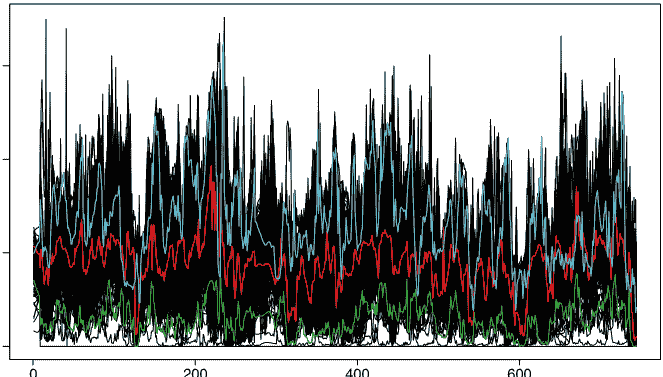

**图 5.1** 台湾 AirBox 数据及概率为 0.05、0.5 和 0.95 的经验动态分位数。

由于大多数序列是非平稳的，应用了一阶差分，并使用序列 $z_t = \nabla x_t$ 来计算距离。计算了四个距离。h = 5 的 ACF 和偏自相关系数（PACF）距离、默认阶数的 Piccolo 距离（PIC）以及周期图距离（PER）。这是使用 R 包 TSclust 中的 diss 命令完成的。详细信息如下：

#### 时间序列距离的 R 命令：

```
>x=as.matrix(TaiwanAirBox032017)
>x=x[,-1]
>ts.plot(x)
>T=dim(x)[1]
>k=dim(x)[2]
>z=diff(x)
> h=5
> aa=acf(z,lag.max=h,plot=FALSE)
#a matrix with columns the acf of each series is formed
>H <- c(2:6)
>nl<-h
>ACM=matrix(0,nl,k)
>for (i in 1:k){
 ACM[,i]=aa$acf[H,i,i]
}
####All distances can be computed via the package TSclust
> library(TSclust)
>Macf=diss(t(z),METHOD ="ACF", lag.max=h)
>Macf=as.matrix(Macf)
####Similarity matrices based on PACF, Piccolo measure.
#### and normalized periodogram are computed
#### with the package TSclust
>Mpacf=diss(t(z),METHOD ="PACF", lag.max=h)
>Mpacf=as.matrix(Mpacf)
>Mpic=diss(t(z), METHOD ="AR.PIC")
>Mpic=as.matrix(Mpic)
>MPer=diss(t(z),METHOD ="PER", logarithm=TRUE, normalize=TRUE)
>MPer=as.matrix(MPer)
####Histogram of the distances dropping the zeros
#### for each of the four methods and find
#### the maximum distance between two series
> par(mfcol=c(2,2))
> hist(Macf[Macf>0])
> max(Macf)
[1] 0.9031959
> arrayInd(which.max(Macf),dim(Macf))
 [,1] [,2]
[1,] 510 29
> hist(Mpacf[Mpacf>0])
```


```R
> max(Macf)
[1] 0.9031959
> arrayInd(which.max(Mpacf),dim(Mpacf))
     [,1] [,2]
[1,] 378 29
> hist(Mpic[Mpic>0])
> max(Mpic)
[1] 1.440145
> arrayInd(which.max(Mpic),dim(Mpic))
     [,1] [,2]
[1,] 232 29
> hist(MPer[MPer>0])
> max(MPer)
[1] 0.3543029
> arrayInd(which.max(MPer),dim(MPer))
     [,1] [,2]
[1,] 140 70
```

```R
> # The average distances of each method are computed
> md1=apply(Macf,1,mean)
> md2=apply(Mpacf,1,mean)
> md3=apply(Mpic,1,mean)
> md4=apply(MPer,1,mean)
> plot(md1, main="Average acf distances")
> plot(md2, main="Average pacf distances")
> plot(md3, main="Average pic distances")
> plot(md4, main="Average per distances")
> # identification of extreme series
> which(md1>.5)
[1] 29
> which(md2>.5)
[1] 29
> which(md3>.8)
[1] 29
> which(md4>.12)
[1] 29 70
```

图 5.2 显示了四个距离的直方图。ACF、PACF 和 PIC 距离给出了相似的结果，大多数距离遵循似乎向右偏斜（长距离）的非对称分布，表明存在多个组。另一方面，PER 的直方图显示距离集中，只有少量大距离，表明存在一个大组和一个小组。ACF、PACF 和 PIC 产生的最大距离出现在序列 29。请注意，序列 29 和 70 在第 2 章中被发现为离群时间序列，因为它们的大多数值为零。我们还计算了

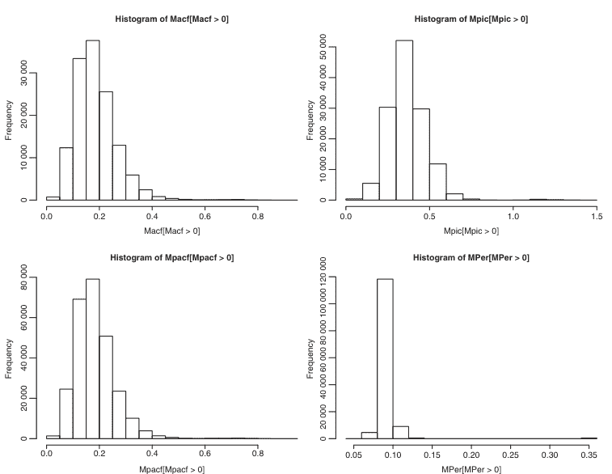

图 5.2 台湾 AirBox 数据四个距离的直方图。自相关系数（Macf）和偏自相关系数（Mpacf）、Piccolo 距离（Mpic）及周期图距离（MPer）。

每个时间序列与其他所有序列的平均距离，其值如图 5.3 所示。在所有四种方法中，最大值均出现在序列 29。序列 70 的距离也较大，但程度稍小。但是，PER 是唯一能清楚地将这两个离群序列与其他序列分开的指标。

我们还使用 h = 5 的公式 (5.12) 计算了相关系数行列式之间的不相异性。请参见图 5.4 和 5.5。结论与通过自相关向量之间的距离所得结论相似。使用的 R 命令如下：

#### 不相异性的 R 命令：

```R
#### Continue with Example 5.1.
#### We compute the autocorrelation matrices for each series
#### to compute the difference between the determinants
>nR=h+1
>R=array(0,dim=c(k,nR,nR))
>for (i in 1:k){
 > for (j in 1:nR){
  > for (s in 1:nR){
   > d=abs(j-s)
```

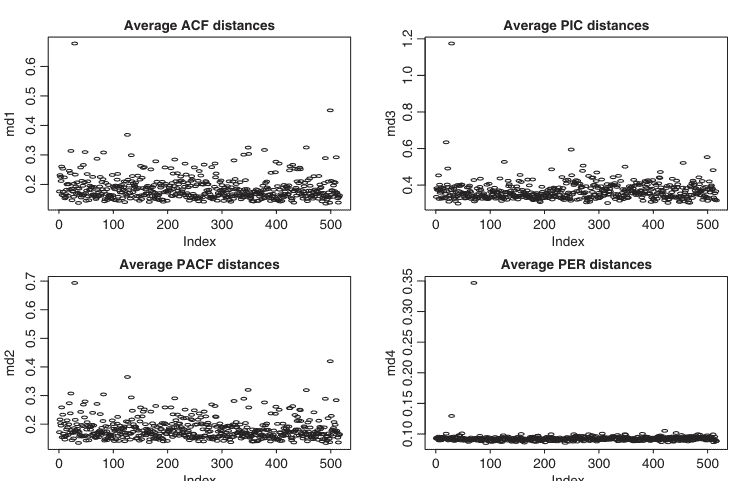

**图 5.3** 台湾 AirBox 数据的平均距离。

```R
> if(d==0) R[i,j,s]=1 else R[i,j,s] <-ACM[d,i]       }       }
>DetR=matrix(0,k,1)
>for (i in 1:k){
>     DetR[i]=det( R[i,] ))
>Mdis=matrix(0,k,k)
>for (i in 1:k){
>   for (j in 1:k){
>    Mdis[i,j]=abs (DetR[i] ^ (1/nR) -DetR[j] ^ (1/nR)) }}
>Md=Mdis [Mdis>0]
>hist(Md)
>max(Md)
>arrayInd (which.max(Mdis) ,dim(Mdis))
>mD=apply (Mdis,1,mean)
>plot (mD, main="Average distances determinant")
```

作为第二个示例，我们使用文件 Pelectricity1344.csv 中的电价数据。数据涵盖美国新英格兰（NE）八个地区在 678 周内每天每小时的每周电价系列，共有 1344 个系列。请注意，此处 k > T。系列对应于一周中的每一天、每天中的每个小时以及 NE 中的八个地区之一。即，7 × 24 × 8 = 1344。使用相同的 R 命令，得到图 5.6 和 5.7。两组数据的图表相似，但其尺度表明电价似乎比 PM2.5 测量值更具同质性。

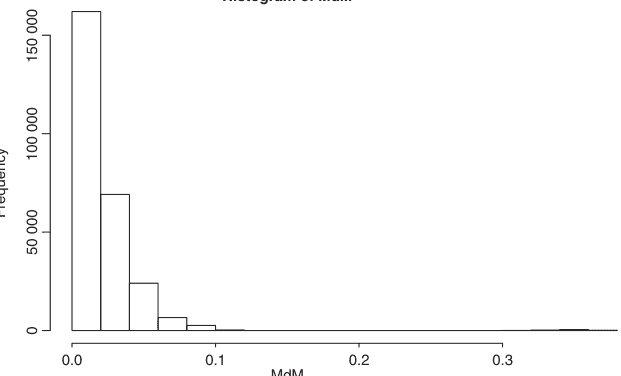

图 5.4 台湾 AirBox 数据相关系数行列式之间距离的直方图。

### 相关系数行列式的平均距离

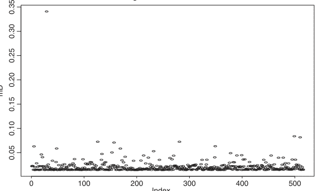

图 5.5 台湾 AirBox 数据相关系数行列式之间的平均距离。

### 5.1.3 基于交叉线性依赖的不相异性

前面的措施比较了一些刻画单个时间序列序列依赖的特征，但它们不考虑任何两个系列之间的依赖。我们已经看到，两个时间序列值之间的欧氏距离仅取决于滞后为零的自相关。比较两个系列线性依赖的替代方法是使用不相异性 D(xr, yi)，它们是

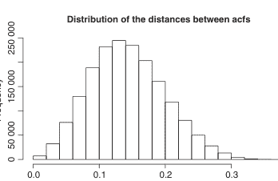

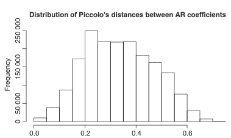

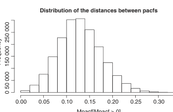

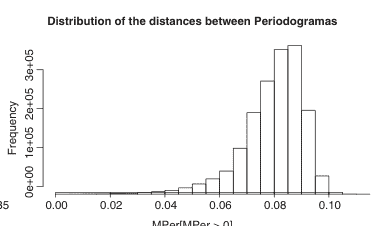

图 5.6 电价数据单变量系列之间四个距离措施的直方图。

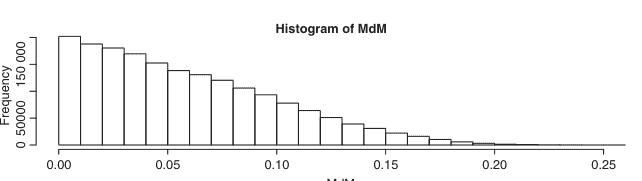

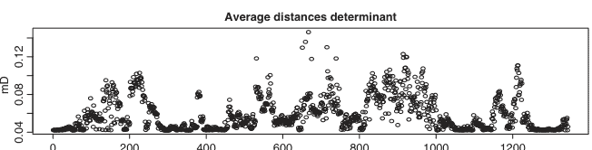

图 5.7 电价数据行列式之间的直方图和距离。

为正且对称。此外，我们希望 0 ≤ D(xt, yt) ≤ 1，当两个系列相同时值为 0，且当且仅当两个时间序列之间所有交叉相关系数均为零时值为 1。因此，D(xt, yt) 的极端值意味着完全线性依赖或完全缺乏线性依赖。最后，我们通常关心两个系列之间依赖的强度而非符号。这些考虑导致了以下措施。

考虑交叉相关向量

$\rho_{xy} = [\rho_{xy}(-h), \dots, \rho_{xy}(-1), \rho_{xy}(0), \rho_{xy}(1), \dots, \rho_{xy}(h)]'$,
(5.13)

其中 \(h\) 是正整数且 \(\rho_{xy}(-h) = \rho_{yx}(h)\)。作为两个系列之间线性依赖的措施，我们可以使用欧几里得范数

\(\|\rho_{xy}\| = \sqrt{\rho'_{xy}\rho_{xy}} = \sqrt{\sum_{j=-h}^{h} \rho_{xy}^2(j)}\)。

但是 \(\|\rho_{xy}\|\) 不是 \(x_t\) 和 \(y_t\) 之间的距离，因为它不满足三角不等式 \(\|\rho_{xy}\| \le \|\rho_{xz}\| + \|\rho_{yz}\|\)。例如，假设 \(x_t\) 和 \(y_t\) 相关，使得 \(\|\rho_{xy}\| > 0\)，但 \(z_t\) 与这两个系列都不相关，使得 \(\|\rho_{xz}\| = \|\rho_{yz}\| = 0\)。另一方面，如果 \(x_t\) 和 \(y_t\) 独立，则 \(\|\rho_{xy}\| = 0\)。另外，如果 \(x_t = ay_t + b\)，其中 \(a\) 和 \(b\) 是实数且 \(a \neq 0\)，则 \(\|\rho_{xy}\| = \|\rho_{xx}\| = \|\rho_{yy}\|\)，其中根据 (5.13)

\(\rho_{yy} = [\rho_y(-h), \dots, \rho_y(-1), 1, \rho_y(1), \dots, \rho_y(h)]'\)。

因此，我们可以基于线性依赖构建两个系列之间的不相异性

\(D_{CC2}(x_t, y_t) = 1 - \frac{\|\rho_{xy}\|^2}{\|\rho_{xx}\|\|\rho_{yy}\|}.\)
(5.14)

显然，如果两个系列独立，则 \(D_{CC2}(x_t, y_t) = 1\)，如果两个系列相同，则 \(D_{CC2}(x_t, y_t) = 0\)。然而，用交叉相关系数向量的范数来总结依赖关系的一个缺点是，该措施对滞后的排列具有不变性。因此，具有相同全局依赖关系的两个系列可能在滞后之间具有非常不同的系数分布。另外，时间上移位的两个相同时间序列可能表现为不同。例如，\(y_t = x_{t-1}\)。

总结全局线性依赖的更好方法是使用矩阵 \(R_{yx,h}\)，它对应于由平稳向量过程 \(Z_t = (y_t, y_{t-1}, \dots, y_{t-h}, x_t, x_{t-1}, \dots, x_{t-h})'\) 给出的相关系数矩阵，即

\(R_{yx,h} = \begin{pmatrix} R_{y,h} & C'_{xy,h} \\ C_{xy,h} & R_{x,h} \end{pmatrix},\)
(5.15)

其中 \(R_{x,h}\) 是前面定义的 \(x_t\) 的 \((h+1) \times (h+1)\) 半正定相关系数矩阵，\(R_{y,h}\) 对应于 \(Y_{t,h} = (y_t, y_{t-1}, \dots, y_{t-h})'\) 的相关系数矩阵，而 \(C_{xy,h}\) 包含两个向量系列之间的交叉相关。请注意，\(|R_{yx,h}| = |R_{xy,h}|\)，且行列式验证了（1）\(0 \le |R_{yx,h}| \le 1\)，当 \(R_{yx,h}\) 为对角矩阵且两个系列都序列不相关且线性无关时等号成立；（2）当存在非平凡线性组合 \(a'Z_t = 0\) 使得系列恰好线性相关时，\(|R_{yx,h}| = 0\)。一种可能的相似性措施是两个时间序列之间的 *总相关*，如 (5.11) 所示，给出为

\(TC_h = 1 - |R_{yx,h}|^{1/[2(h+1)]},\)
(5.16)


但此指标既取决于两个系列的互相关，也取决于它们的自相关。如

```
|R_{xy,h}| = |R_{x,h}| \left| R_{y,h} - C_{xy,h} R_{x,h}^{-1} C'_{xy,h} \right|,
```

如果两个系列无关，且 C_{xy,h} = 0，则 |R_{xy,h}| = |R_{x,h}|/|R_{y,h}|，且该值可能远离 1。事实上，如果两个系列都具有强自相关，则该值将非常小。例如，如果第一阶自相关系数接近 1，则 |R_{x,1}| = 1 - \rho_x^2 将非常小。其次，如果两个系列相同，则 |R_{xy,h}| = 0 且 TC = 1，但行列式的小值或 TC 的大值并不意味着系列之间存在强关系。例如，如果 |R_{x,h}| 非常小，因为系列 x_t 中存在强自相关，则根据 (5.17)，|R_{yx,h}| 也将很小。

两个系列 x_t 和 y_t 之间平均线性相关的一个度量是广义互相关度量 GCC(x_t, y_t)，由 Alonso 和 Peña (2019) 定义为

```
GCC(x_t, y_t) = 1 - \left( \frac{|R_{yx,h}|}{|R_{x,h}| |R_{y,h}|} \right)^{1/(h+1)}
= 1 - \frac{|R_{y,h} - C_{xy,h} R_{x,h}^{-1} C'_{xy,h}|^{1/(h+1)}}{|R_{y,h}|^{1/(h+1)}}.
```

GCC 验证：(1) GCC(x_t, y_t) = GCC(y_t, x_t)，因此该度量是对称的；(2) 根据 Fischer 不等式（参见 Lütkepohl, 1996），0 <= GCC(x_t, y_t) <= 1；(3) GCC(x_t, y_t) = 1 当且仅当系列之间存在完美的线性相关；以及 (4) GCC(x_t, y_t) = 0 当且仅当所有互相关系数均为零。

要证明 (3)，由于 GCC(x_t, y_t) = 1 意味着 |R_{yx,h}| = 0（因为分母有界），因此至少存在一行（一列）是其他行（列）的线性组合。要证明 (4)，将 GCC(x_t, y_t) 写为

```
GCC(x_t, y_t) = 1 - \left| \begin{pmatrix} R_{x,h}^{-1} & 0_{xy,h} \\ 0_{yx,h} & I_{y,h} \end{pmatrix} \begin{pmatrix} R_{x,h} & C_{xy,h} \\ C'_{xy,h} & R_{y,h} \end{pmatrix} \begin{pmatrix} I_{x,h} & 0_{xy,h} \\ 0_{yx,h} & R_{y,h}^{-1} \end{pmatrix} \right|^{1/(h+1)}
= 1 - \left| \begin{pmatrix} I_{x,h} & R_{x,h}^{-1} C_{xy,h} R_{y,h}^{-1} \\ C_{xy,h} & I_{y,h} \end{pmatrix} \right|^{1/(h+1)}.
```

根据 Hadamard 不等式，右侧行列式小于或等于 1，当且仅当矩阵是对角矩阵时取等号，即当且仅当 C_{xy,h} = 0_{xy,h}。

请注意，当 h = 0 时，GCC(x_t, y_t) 只是两个变量之间的平方相关系数。另外，对于任何 h，当两个系列都是白噪声，且对于某些 h != 0 有 \rho_{xy}(h) != 0，而对所有 j != h 有 \rho_x(j) = 0 时，则 GCC(x_t, y_t) = \rho_{xy}^2(h)。一般而言，对于 h > 0，可以证明（参见 Alonso 和 Peña, 2019），GCC(x_t, y_t) 表示双变量模型相对于单变量模型的预测精度提升，并且可以解释为当用另一个变量的值来解释一个变量的 AR 拟合残差时的平均平方相关系数。

总之，两个平稳时间序列之间的一个有用差异度量是

当两个系列线性相关（或如果标准化后相同）时取值 0，当它们的所有互相关系数均为 0 时取值 1。对于仅具有瞬时相关 \(\rho_{xy}(0)\) 的两个白噪声过程，\(D_{GCC} = 1 - \rho_{xy}^2(0) = D_{CC2}(x_t, y_t)\)。

### 示例 5.2

为了说明基于线性相关的差异计算，我们再次使用示例 5.1 中的台湾 AirBox 数据和新英格兰电力价格数据。以下是用于计算公式 (5.14) 和 (5.19) 中差异度量的 R 命令。命令 `GCCmatrix` 是图书包的一部分。

```
#######Compute the GCC measure
### Continue from Example 5.1.
> MCC=matrix(0,k,k)
> for (i in 1:k){
> for (j in 1:k){
> ab=ccf(x[,i],x[,j],lag.max=h,plot=FALSE)
> aa=acf(x[,i],lag.max=h, plot=FALSE)
> bb=acf (x[,j],lag.max=h, plot=FALSE)
> aa2=c(aa$acf,aa$acf)
> aa2=aa2 [-1]
> bb2=c(bb$acf,bb$acf)
> bb2=bb2 [-1]
> ma=sqrt (sum(aa2*aa2))
> mb=sqrt (sum(bb2*bb2))
> mab=sum (ab$acf*ab$acf)
> MCC [i,j]=1-mab/(ma*mb) } }
> par (mfrow=c(1,2) )
> hist (MCC[MCC>.01],main="distribution of D (CC) ")
##Compute the GCC matrix
>res1=GCCmatrix (z, 4)
>DM=res1$DM
>Dm=DM[Dm<1]
>hist (Dm, main="distribution of D (GCC) ")
```

图 5.8 给出了台湾 AirBox 数据的 GCC 差异直方图。大多数系列具有较大的差异，表明它们不相关，但存在一小群高度相关的系列。例如，最相关系列（发生在第 312 系列和第 315 系列之间）的平均平方相关系数为 GCC = 1 − 0.202 ≈ 0.8。电力价格数据的情况则相当不同，其中大多数系列都存在互相关，差异较小，如图 5.9 所示。

### D(CC) 的分布

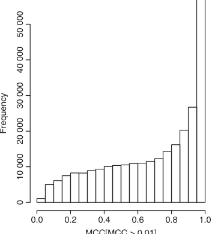

### D(GCC) 的分布

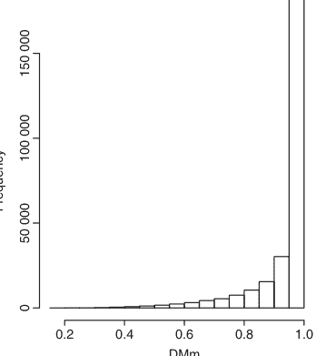

图 5.8 台湾 Air-Box 数据中系列之间 CC 和 GCC 差异的直方图。参见公式 (5.14) 和 (5.19)。

### D(CC) 的分布

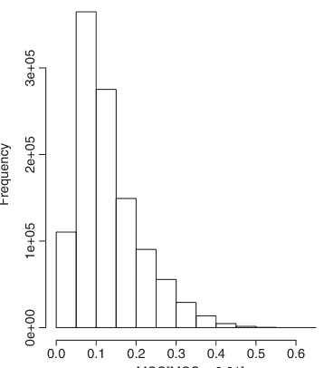

### D(GCC) 的分布

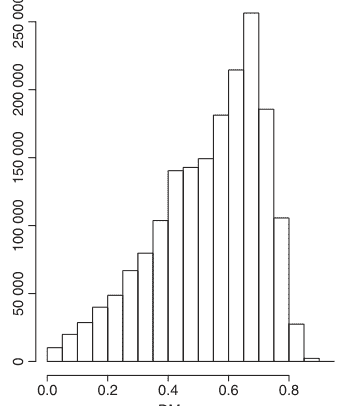

图 5.9 电力价格数据中系列之间 CC 和 GCC 差异的直方图。参见公式 (5.14) 和 (5.19)。

## 5.2 时间序列的层次聚类

层次聚类方法从时间序列之间的近接矩阵（距离或差异）**D** 开始，然后基于该矩阵构建层次结构。所使用的算法有以下两种类型。第一种是自底向上（聚合）方法，它从与单个系列数量相同的组开始，在随后的每个步骤中利用近接度合并两个组。该过程持续进行，直到所有系列都属于一个组。第二种是自顶向下（分割）方法，它从所有系列位于一个组开始，然后经过连续的分割直到到达单个系列。在两种方法中，都使用一个标准来选择适合观测数据的组数。但是，没有规定对早期步骤中错误分组的任何系列进行重新分配。换句话说，一旦两个组被合并或分割，它们在随后的任何步骤中都无法更改。对于大型时间序列集合，自底向上算法需要的计算时间较少，因此在实践中最常用。从现在起，层次方法将指代它们。一个层次自底向上算法通常包括以下三个步骤：

- 1. 将 k 个原始时间序列定义为待聚类的元素，并在元素 u 和 v 之间构建近接矩阵 **D**，其中 u, v = 1, ..., k。设置 i = 1 且 **D**<sub>i</sub> = **D**。将 **D**<sub>i</sub> 的 (u, v) 元素表示为 d<sub>(uv)</sub>。

- 2. 在 **D**<sub>i</sub> 中找到最小距离，设 d<sup>(i)</sup> = min<sub>u,v</sub>{d<sub>(uv)</sub>}。选择一对元素，使其距离等于最小值 d<sup>(i)</sup>。将该对分组形成一个新元素。计算新元素与其他元素之间的距离。（计算这些距离的方法将在下一节中讨论）。元素总数减少 1。将 i 增加 1，并将更新后的距离矩阵也表示为 **D**<sub>i</sub>。

- 3. 使用更新后的 **D**<sub>i</sub> 矩阵返回步骤 2，重复合并过程，直到元素数量变为 1。

该聚类过程需要 k 次迭代才能完成，最小距离序列可表示为 d<sup>(1)</sup> ≤ d<sup>(2)</sup> ≤ ... ≤ d<sup>(k)</sup>。我们稍后将使用这些最小距离来帮助确定聚类数量。

### 5.2.1 定义组间距离的标准

假设我们有一个元素 A，它是一个包含 n<sub>a</sub> ≥ 1 个时间序列的组，以及另一个包含 n<sub>b</sub> ≥ 1 个系列的元素 B。它们合并形成一个新元素 (AB)，该元素包含 n<sub>ab</sub> = n<sub>a</sub> + n<sub>b</sub> 个时间序列。这个新元素 (AB) 到另一个包含 n<sub>c</sub> 个时间序列的元素 C 之间的距离，通常使用以下三种方法之一计算：

- 1. 最近邻法（或最邻近法）：C 与 (AB) 之间的距离是 C 中的时间序列与 A 或 B 中的时间序列之间距离的最小值。从数学上讲，我们有

  d(C; AB) = min{d<sub>CA</sub>, d<sub>CB</sub>}。


由于该标准仅考虑最小距离，可能会发生 C 中的一个序列与 (AB) 中的一个序列相距很远的情况，即使 d(C, AB) 很小。在实践中，该标准倾向于产生绵长的聚类，这些聚类两端可能包含相当不相似的元素。

- 2. 全连接法或最远邻法：C 与新元素 (AB) 之间的距离是 C 中的一个序列与 A 或 B 中的一个序列之间的最大距离。即，
  \( d(C, AB) = \max\{d_{CA}, d_{CB}\} \)。

由于该标准查找最大距离，因此有可能元素 C 离 A 中的元素比离 B 中的元素更近，尽管 C 中的大多数时间序列离 B 中的时间序列比离 A 中的时间序列更近。在实践中，该标准倾向于产生球形聚类。

- 3. 平均连接法：C 与新组 (AB) 之间的距离是 C 与 (AB) 中元素之间的距离的平均值。即
  \( d(C, AB) = \frac{\sum_{c \in C} \sum_{g \in AB} d_{cg}}{n_c n_{ab}} \),

其中 \( n_{ab} \) 是 (AB) 中的时间序列数量。该标准是前两种标准之间的折中方案。主要缺点是，所得距离取决于 C 和 AB 中的元素数量，而另外两个标准则不取决于组中的元素数量。

### 5.2.2 树状图

树状图，或层次树状图，是一种使用层次算法展示聚类结果的树状图形显示。如果序列遵循层次结构，这种显示很有用，但否则可能会产生误导。此外，对于大型数据集，它很难理解。树状图的构建方式如下：

- 1. k 个初始序列显示在图表的底部。
- 2. 序列之间的融合用三条直线表示：两条垂直直线连接序列，一条水平直线指示发生融合的（距离）水平。
- 3. 该过程重复进行，直到所有序列都由直线连接。

如果在任何给定距离（高度或深度）处切断树状图，我们就能在该距离水平上得到时间序列的分组分类。每个组的成员也可用。在下一节中，我们将讨论确定组数的一些程序。

### 5.2.3 选择组数

#### 5.2.3.1 高度图和步长图

层次聚类的输出包括两个元素合并时的不相异性或距离序列 \( d^{(1)} \le d^{(2)} \le \cdots \le d^{(k)} \)。这些距离对应于树状图中的高度。不难想象，如果 \( d^{(i)} \) 和 \( d^{(i+1)} \) 很接近，那么由高度 \( d^{(i)} \) 形成的元素与由高度 \( d^{(i+1)} \) 形成的元素之间的差异相对较小。因此，树状图中的高度及其增量
\(\Delta_i = d^{(i+1)} - d^{(i)}\) 提供了关于聚类数量的某些信息。为了利用这些信息来确定聚类数量，我们针对一组时间序列 \(\{\boldsymbol{z}_1, \dots, \boldsymbol{z}_T\}\) 提出了 *高度图* 和 *步长图*，其中 \(\boldsymbol{z}_t\) 是一个 k 维时间序列：

- 1. 选择之前讨论的距离度量之一，例如 ACF 距离，为 \(\boldsymbol{z}_t\) 构建树状图。
- 2. 设 \(y_t\) 为从 \(\boldsymbol{z}_t\) 中随机选择的序列。
- 3. 为 \(y_t\) 构建时间序列模型。为简单起见，我们专注于 AR 模型，其阶数由信息准则选择，例如赤池信息准则 (AIC) 或贝叶斯信息准则 (BIC)。
- 4. 执行以下模拟 \(M\) 次迭代：
  - a. 对于第 \(j\) 次迭代，使用随机选择的系列 \(y_t\) 的 AR 模型生成 \(k\) 个样本量为 \(T\) 的时间序列。将第 \(j\) 次迭代的模拟数据表示为 \(\{z_t^{(j)}\}\)。
  - b. 对 \(\{z_t^{(j)}\}\) 应用相同的距离度量，以获得树状图，并将其最小距离集合称为 \(\{d_j^{(1)} \le d_j^{(2)} \le \cdots \le d_j^{(k)}\}\)。
- 5. 设 \(\lambda_{0.95}^{(i)}\) 为集合 \(\{d_j^{(i)} | j=1, \dots, M\}\) 的第 \(95\%\) 百分位数。
- 6. 考虑观测数据 \(\{\boldsymbol{z}_t\}\) 的 \(\{d^{(i)} | i=1, \dots, k\}\) 关于 \(i\) 的散点图。在散点图中添加线 \(\{\lambda_{0.95}^{(i)}\}\) 关于 \(i\)。聚类数量则为 \(g+1\)，其中 \(g\) 是散点图右端位于 \(\lambda_{0.95}^{(i)}\) 线上方的点的数量。

我们将此图称为树状图的 *高度图*。由于模拟时间序列均来自单一模型，每组序列 \(\{z_t^{(j)}\}\) 应只有一个聚类。因此，高度 \(\{d_j^{(i)}\}\) 除了高度的尺度外没有特殊含义。那么，使用这些高度来为观测数据的高度 \(\{d^{(i)}\}\) 的行为提供参考点是合理的。如果观测数据来自单一聚类，则 \(d^{(i)}\) 的行为应与模拟参考相似。因此，由 \(95\%\) 百分位数 \(\{\lambda_{0.95}^{(i)} | i=1, \dots, k\}\) 给出的参考线的偏离，表明聚类的存在。

与其直接使用高度 \(d^{(i)}\)，不如获得高度增量 \(\{D_i | i=1, \dots, k\}\)（即步长）关于索引 \(i\) 的散点图。这称为 *步长图*。参考线则是高度 \(95\%\) 百分位数的增量。

为说明这一点，我们考虑包含 PM\(_{2.5}\) 数据逐小时序列的 Taiwan AirBox 数据集。在移除离群序列（29 和 70）后，我们有 \(k=514\) 和 \(T=744\)。图 5.10 显示了所得高度图。从图中看，有两个点相对于建议模拟程序（\(M=100\) 次迭代）所得参考线显得突出。因此，高度图表明数据集中存在三个聚类。图 5.11 显示了所得步长图。在此特定情况下，步长图表明 AirBox PM\(_{2.5}\) 数据集有两个聚类，但也为三个聚类提供了一些支持。这些图是通过本书包的命令 `stepp` 获得的。

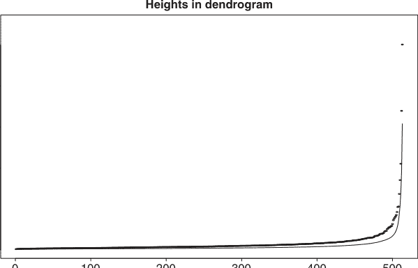

图 5.10 Taiwan AirBox PM2.5 数据集树状图高度的散点图。实线是使用单一模型对数据中随机选择的系列进行模拟所得的参考线。距离度量使用 ACF。

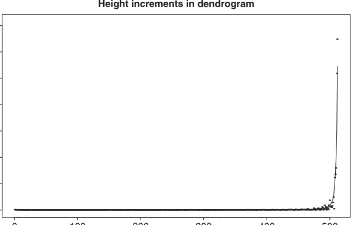

图 5.11 Taiwan AirBox PM2.5 数据集树状图高度增量的散点图。实线是使用单一模型对数据中随机选择的系列进行模拟所得的参考线。距离度量使用 ACF。

#### 5.2.3.2 轮廓统计量

Rousseeuw (1987) 提出的轮廓统计量，用于计算最终聚类结果的质量度量，并选择聚类数量以最大化该质量度量。一个元素的分类质量可以定义为其与其组内成员的平均距离与其与其所属组中最近组成员的平均距离之差。因此，给定元素之间的距离度量和聚类结果后，一个元素到其组内所有成员的平均距离将与其到其最近组成员的平均距离进行比较。一个元素的最近组被定义为不同于该元素所属组、且具有与该元素最小平均距离的成员的组。如果元素分类良好，其到其组内元素的平均距离应小于到其最近组元素的平均距离，差异越大，该元素分类质量越好。此思想可以扩展到集合中的所有元素，并将给定分类的质量定义为所有元素分类质量的平均值。其计算方法如下。

假设我们有观测值分为 \(g\) 个组（例如 \(G_1, \dots, G_g\)，且 \(g > 1\)）的分类。设 \(d(i, i')\) 为用于构建组的距离或不相异性。设 \(a(i)\) 为第 \(i\) 个元素到其组内其他元素的平均距离。例如，如果第 \(i\) 个观测值属于具有 \(n_j\) 个成员的组 \(G_j\)，且 \(i'\) 是该组的其他任何成员，则 \(a(i)\) 由以下公式给出：

\[a(i) = \frac{\sum_{i' \in G_j} d(i, i')}{n_j - 1} .\]

为了判断 \(a(i)\) 的值，即元素 \(i\) 是否分类良好，我们将 \(a(i)\) 与第 \(i\) 个元素到其他组 \(G_h\)（\(h = (1, \dots, g, | h \neq j)\)）成员的平均距离进行比较。到具有 \(n_h\) 个元素的组 \(G_h\) 的平均距离由以下公式给出：

\[b_{G_h}(i) = \frac{\sum_{j \in G_h} d(i, j)}{n_h} .\]

将第 \(i\) 个观测值的最近组定义为平均距离最小的组。请注意，最近组的概念是针对特定元素定义的，且同一组的不同成员通常可能有不同的最近组。设 \(c(i)\) 为组 \(G_j\) 中第 \(i\) 个元素到其最近组的平均距离，计算如下：

\[c(i) = \min_{h \neq j} [b_{G_h}(i)] .\]

然后，第 \(i\) 个观测值的分类质量定义为

\[s(i) = \frac{c(i) - a(i)}{\max(a(i), c(i))} .\]

该度量称为元素 \(i\) 的 *轮廓度量*。如果 \(c(i) > a(i)\)，则元素分类良好且 \(s(i) > 0\)。轮廓度量的最大值为 \(s(i) = 1\)，当 \(a(i) = 0\) 时发生此情况，因为此时观测值与其组内所有其他成员相同，表明完美拟合。一般来说，对于分类良好的观测值，\(a(i) < c(i)\) 且 \(0 < s(i) < 1\)。另一方面，当观测值分类不良时 \(s(i) < 0\)，这意味着到其最近组的平均距离更小

比其所属组的相似度低。然后，我们应该将第 i 个观测值重新分类到其最近的组。通过这种重新分配，轮廓统计量的新值从 s(i) 移动到 -s(i) 并将为正值。统计量 s(i) 的最小值为 -1，当 c(i) = 0 时发生，即第 i 个元素与其他某个组的成员相同，暗示与其已被分类到的组完全缺乏相似性。

我们可以查看 s(i) 值的分布来决定聚类数量。分类质量的一个明显的全局度量是该度量在所有观测值上的平均值。这就是轮廓统计量

S = \frac{\sum_{i=1}^n s(i)}{n}, (5.20)

其中 n = \sum n_j 是待分类元素的总数。该数值越大，全局分类效果越好，群组数量根据该准则选择为在 (5.20) 中使 S 达到最大值的值。

在实践中，该准则通过固定最大群组数 K_max、在不同高度切割树状图直到达到最大群组数、比较得到的轮廓统计量，并选择轮廓统计量最大的聚类结果，在层次聚类中得到应用。此外，我们可以使用 s(i) 的整个分布来做出选择。请注意，轮廓统计量不适合用于决定是否应形成聚类，因为当聚类数量为 1 时它未定义。

当群组大小相似时，轮廓准则效果良好，但可能无法找到包含少量元素的群组。原因是，(5.20) 中少数具有低负值的元素对平均值的影响较小。此外，异常值的存在可能会影响该统计量。一种稳健的轮廓统计量（以下简称 Rsilh）可以通过先清理相对于群组的离群系列来构建。离群系列可以按以下方式查找：（1）加入群组的距离大于距离分布给定阈值的系列，（2）形成大小小于给定最小尺寸群组的系列。在识别出任何离群系列后，群组分两步获得。首先，将轮廓统计量应用于未孤立的时间系列集合，其次，孤立系列是根据所选距离被分配到其最近群组的候选项，该距离可以是简单连接（群组中最近的元素）或其他距离。如果该系列被视为异常值，则将其包含在离群系列的群组 0 中。

#### 5.2.3.3 间隙统计量

选择群组数量的替代方法是 Tibshirani 等人（2001）提出的间隙统计量。该统计量将聚类内部平均距离的度量与数据在其覆盖空间内由均匀分布生成时该度量的期望值进行比较。给定将观测值分类为 g > 1 个组 G_1, ..., G_g，第 j 个组分类同质性的一个指标是该组元素之间平方距离的平均值

D_j = \frac{1}{2n_j} \sum_{i, i' \in G_j} d^2(i, i'),

其中 \(n_j\) 是 \(G_j\) 中的元素数量，每个距离被包含两次，因此求和除以 \(2n_j\)。聚类的质量度量是平均平方距离之和：

```
\( W_g = \sum_{j=1}^g D_j. \)
```

例如，假设每个时间系列由前 \(p\) 个自相关系数描述，并记 \(\theta_{jr}\) 为第 j 组（j = 1, ..., g）中第 r 个系列（r = 1, ..., n_j）的 \(p \times 1\) ACF 向量。第 j 组元素对之间的欧几里得距离为

```
\( D_j = \sum_{r=1}^{n_j} \sum_{s=1}^{n_j} (\theta_{jr} - \theta_{js})'(\theta_{jr} - \theta_{js}) = 2n_j \sum_{r=1}^{n_j} (\theta_{jr} - \bar{\theta}_j)'(\theta_{jr} - \bar{\theta}_j) \)
```

其中 \(\bar{\theta}_j\) 是第 j 组的均值向量。因此

```
\( W_g = \sum_{j=1}^g \sum_{r=1}^{n_j} (\theta_{jr} - \bar{\theta}_j)'(\theta_{jr} - \bar{\theta}_j) = \sum_{j=1}^g n_j s_j^2 \)
```

其中 \(s_j^2 = \sum_{r=1}^{n_j} (\theta_{jr} - \bar{\theta}_j)'(\theta_{jr} - \bar{\theta}_j)/n_j\) 是第 j 组的方差。因此，\(W_g\) 是围绕群组均值的组内平方和，这是衡量分组质量的标准指标。间隙统计量考虑差值

```
\(\text{Gap}(g) = E(\log W_g) - \log W_g,\)
```

其中期望是在假设所有数据均来自相同参考分布的前提下计算的。该假设下的期望值与观测平方和之间的差值越大，分类效果越好。参考分布通常取均匀分布，已证明这是最可能产生虚假聚类的分布。程序如下：

- 1. 将 \(k\) 个时间系列聚类为 \(g = 1, 2, \dots, M\) 个组，并计算值 \(W_1, \dots, W_M\)。

- 2. 生成 \(C\) 个样本，假设每个变量在样本值范围内服从均匀分布，并将聚类方法应用于每个模拟样本，以计算 \(1 \le g \le M\) 和 \(1 \le b \le C\) 的值 \(W_{gb}\) 和 \(\log(W_{gb})\)。计算第 g 组的均值

```
\(\widehat{\log(W_g)} = (1/C) \sum_{b=1}^C \log(W_{gb})\)
```

以及标准差

```
\(sd_g = \sqrt{(1/C) \sum_{b=1}^C [\log(W_{gb}) - \widehat{\log(W_g)}]^2}\)
```

以及间隙统计量

Gap(g) = \widehat{\log(W_g)} - \log(W_g)

- 3. 选择聚类数量，使 g 为满足以下条件的最小值：

Gap(g) \ge Gap(g + 1) - sd_g \sqrt{1 + (1/C)}

### 示例 5.3

再次考虑文件 TaiwanAirBox032017.csv 和 P_electricity1344.csv 中的台湾 AirBox 和新英格兰电力价格数据，但使用一阶差分系列，即 z_t = V x_t，其中 x_t 是观测时间系列。与之前一样，我们从 AirBox 数据集中删除了系列 29 和 70。图 5.12 显示了基于四个距离度量的 AirBox 数据层次聚类结果的树状图，这四个度量分别是 ACF 和 PACF 的前 5 个滞后、自动选择 AR 阶次的 PIC 距离以及 PER。从图中看，PACF 和 PIC 距离似乎提供相似的聚类结果。这并不奇怪，因为 PACF 与 AR 系数密切相关。另一方面，PER 距离似乎提供略有不同的结果。然后，我们将基于 ACF 距离的轮廓统计量和间隙统计量应用于该数据集。轮廓统计量建议两个聚类，而间隙统计量指示四个聚类。此外，基于 ACF 距离，如果选择三个聚类，则聚类大小分别为 390、107 和 17。使用的 R 命令和包

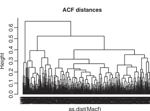

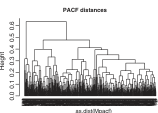

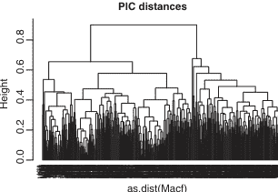

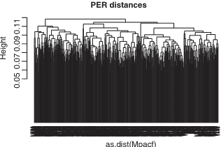

图 5.12 基于四个距离度量对台湾 AirBox 数据一阶差分系列进行聚类的树状图。

下面给出了一些输出，其中用于层次聚类的命令 hclust 是 R 包 stats 的一部分。

#### 距离度量与层次聚类：台湾 AirBox 数据集

```
>x=as.matrix(TaiwanAirBox032017)
>x=x[,-1]
>x=x[,-c(29,70)]
>z=diff (x)
##All the distances are computed with the package TSclust
>require(TSclust)
>Macf=diss(t(z),METHOD ="ACF", lag.max=5)
>Macf=as.matrix(Macf)
>Mpacf=diss(t(z),METHOD ="PACF", lag.max=5)
>Mpacf=as.matrix(Mpacf)
>Mpic=diss(t(z), METHOD ="AR.PIC")
>Mpic=as.matrix(Mpic)
>MPer=diss (t(z), METHOD ="PER", logarithm=TRUE, normalize=TRUE)
>MPer=as.matrix(MPer)
##A Hierarchical clustering with complete distance is applied
> sc1=hclust(as.dist (Macf),method="complete")
>......
> sc4=hclust(as.dist (MPer),method="complete")
> par (mfrow=c(2,2)
> plot(sc1,main="ACF distances",hang=-1)
> .......
> plot(sc4,main="PER distances",hang=-1)
##Make the Step plot for each method
> wd1=diff(sc1$height)
> plot(wd1,main="ACF distances")
>......
> wd4=diff(sc4$height)
> plot(wd4,main="PER distances")
##Apply the Silhouette and gap criteria in the acf cluster
> silh.clus(8,as.dist(Macf) , method="complete")
$nClus
[1] 2
$coef
nClus silIndex
1 1 0.0000000
2 2 0.3819963
3 3 0.2006368
4 4 0.1826210
5 5 0.1419417
6 6 0.1313848
7 7 0.1278480
8 8 0.1194526
```


#### 轮廓系数最大时为2组
> memb=cutree(scl,1:10)
> gap.clus (Macf,memb, 100)
$optim.k
[1] 9
$gap.values
gap
gap
1 -0.037521773
2 -0.097965198
3 -0.087936795
4 -0.005051419
5 -0.018106280
6 -0.006000857
7 -0.004245895
8 -0.034548137
9 0.001659488

#### Gap值先取4再取9
#### 计算3组的大小
> memb=cutree(scl,1:3)
> g1u=which(memb==1)
> g2u=which(memb==2)
> g3u=which(memb==3)
> ng1=length(which(memb==1))
> ng1
[1] 390
> ng2=length(which(memb==2))
> ng2
[1] 107
> ng3=length(which(memb==3))
> ng3
[1] 17

#### 使用位置数据比较各组
> ### 位置数据已加载并进行分析
> locations032017 <- read.csv("XXX/data/locations032017.csv")
> lo=as.matrix(locations032017)
> lo=lo[,-1]
> par(mfrow=c(2,2))
> g1lo=lo[g1u,]
> g2lo=lo[g2u,]
> g3lo=lo[g3u,]
> plot(lo, main="All locations")
> plot(g1lo, main="Group 1 locations")
> plot(g2lo, main="Group 2 locations")
> plot(g3lo, main="Group 3 locations")

为了更好地理解台湾AirBox数据的聚类结果，我们仔细检查了Air Boxes的位置。每个Air Box的经度和纬度在文件locations032017.csv中。图5.13的左图显示了位置

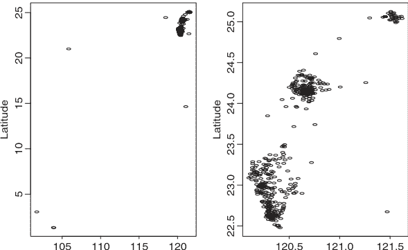

#### 图5.13 台湾AirBox数据中Air Boxes的经度和纬度。左图显示所有516个系列的位置，而右图显示去除六个异常系列后剩余508个系列的位置。

的Air Boxes，由此我们看到位置文件中存在离群位置，因为该岛大约位于东经120–122、北纬22–25之间。因此，在进一步分析中，我们从数据集中删除了八个系列。这些是系列1、29、35、46、70、118、155和157，其中系列29和70的删除之前已解释过。图5.13的右图显示了台湾周围剩余508个PM2.5时间系列的位置。

使用508个差分PM2.5系列，我们应用四种距离度量以及第5.2.3.1节提出的高度图和阶梯图，以识别数据集的聚类数量。四种距离度量分别是基于前5个滞后的ACF和PACF的距离、自动选择阶数的PIC距离以及PER。图5.14显示了高度图的结果。ACF距离的高度图在部分(a)，从中可以清楚地看到三个聚类的迹象。PACF距离的高度图在部分(b)，指示大约五个聚类。PIC距离的高度图在部分(c)，建议两个聚类，PER在部分(d)的结果也建议五个聚类。

图5.15显示了508个差分台湾AirBox系列的阶梯图。同样，分析中使用了相同的四种距离度量。在此特定情况下，PACF和PER距离度量（即部分(b)和(d)）的阶梯图分别建议三个和五个聚类。PIC距离的结果在部分(c)，建议两个聚类。另一方面，ACF距离的阶梯图显示只有一个聚类。然后我们将带有三个聚类的PACF距离度量应用于数据。三个聚类的大小分别为132、346和40。图5.16显示三个聚类成员的位置（经度和纬度）。在此特定情况下，成员位置散布在整个岛上，尽管似乎存在一定的集中。例如，右上方的大部分位置属于聚类1。总体而言，对于一阶差分PM2.5系列，PACF距离并不提供纯粹基于Air Boxes位置的聚类。

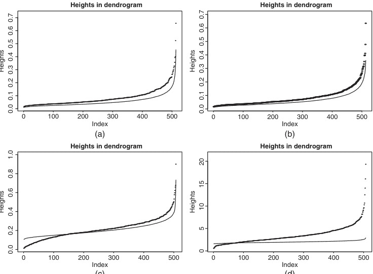

#### 图5.14 508个一阶差分AirBox PM2.5系列的高度图。使用的四种距离度量分别是部分(a)中的前5个滞后的ACF、部分(b)中的PACF、部分(c)中自动选择阶数的PIC，以及部分(d)中的PER。

如第5.1.3节所述，时间序列之间的一种替代差异度量是使用互相关。为演示，我们还将Eq. (5.18)的GCC度量应用于差分AirBox PM2.5数据。使用的命令是`GCCclus`。由轮廓系数统计量选择的聚类数量等于三。三个聚类的成员位置如图5.17所示，其中左上图显示了所有508个系列的位置。从图中可以看出，这三个聚类现在与Air Boxes的地理位置吻合良好。因此，在此特定情况下，基于交叉线性依赖的聚类似乎比基于单个系列PACF的聚类更具信息量。

### 台湾AirBox数据位置的R命令

```
##The locations data are cleaned, 508 series remain
> loc <- read.csv("locations032017.csv")
> loc <- loc[,-1]
> loc1 <- loc[-c(1,29,35,46,70,118,155,157), ]
> dim(loc1)
> par(mfcol=c(1,2))
> plot(loc[,2],loc[,1],xlab="longitude",ylab="latitude")
> plot(loc1[,2],loc1[,1],xlab="longitude",ylab="latitude")
> require(Tsclust)
> da <- read.csv("TaiwanAirBox032017.csv")
```

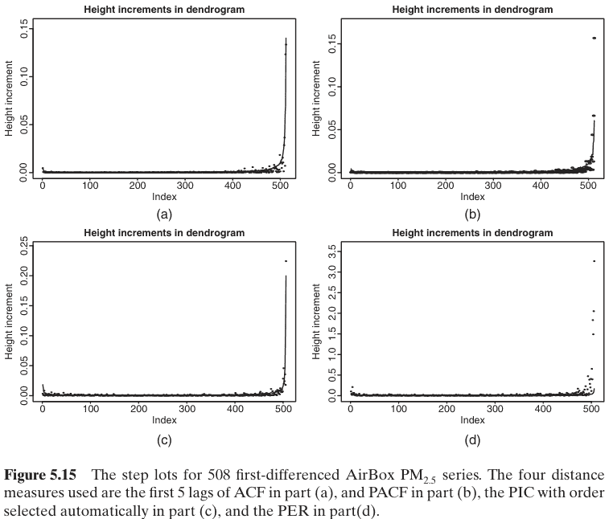
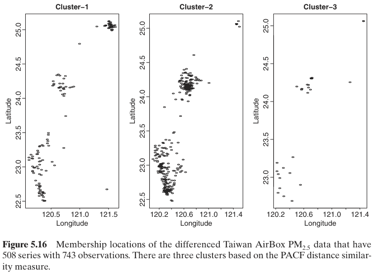

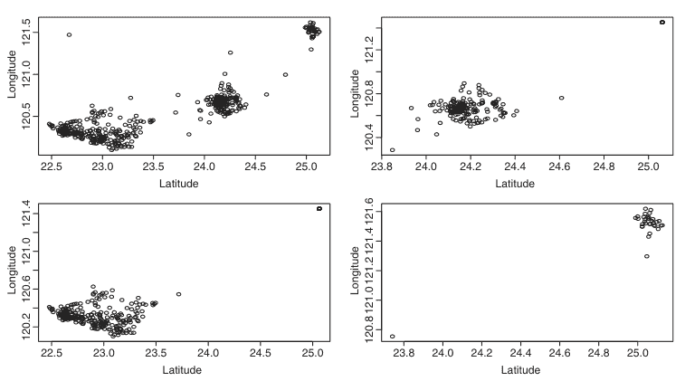

#### 图5.17 左上角为所有508个系列的台湾Air Boxes清洗后位置分布，以及基于GCC的序列增量交叉依赖选择的三组分布。

```
> da <- as.matrix(da[,-1])
> da <- da[,-c(1,29,35,46,70,118,155,157)]
> dda <- diffM(da)
> mPACF <- diss(t(dda),METHOD="PACF" ,lag.max=5)
> cPACF <- hclust(as.dist(mPACF),method="complete")
> names(cPACF)
[1] "merge"     "height"    "order"     "labels"    "method"    "call"
[7] "dist.method"
> memb <- cutree(cPACF,3)
> locg1 <- which(memb==1)
> locg2 <- which(memb==2)
> locg3 <- which(memb==3)
> length(locg1)
[1] 132
> length(locg2)
[1] 346
> length(locg3)
[1] 30
> par(mfcol=c(1,3))
> plot(loc1[locg1,2],loc1[locg1,1],xlab="Longitude",ylab="Latitude",
main="Cluster-1")
> plot(loc1[locg2,2],loc1[locg2,1],xlab="Longitude",ylab="Latitude",
main="Cluster-2")
> plot(loc1[locg3,2],loc1[locg3,1],xlab="Longitude",ylab="Latitude",
main="Cluster-3")
>
##A similar analysis with GCC is applied.
##(Not all commands are shown)
##GCC dissimilarity cluster is applied to the cleaned 508 series
> scl=GCCclus(dda,lag=2,silh=1)
> Number of clusters by using Silhouette statistic 14
```

| 标签 | 绝对频数 | 相对频数 |
|--------|----------|----------|
| 1 | 34 | 0.066929134 |
| 2 | 184 | 0.362204724 |
| 3 | 1 | 0.001968504 |
| 4 | 279 | 0.549212598 |
| 5 | 1 | 0.001968504 |
| 6 | 1 | 0.001968504 |
| 7 | 1 | 0.001968504 |
| 8 | 1 | 0.001968504 |
| 9 | 1 | 0.001968504 |
| 10 | 1 | 0.001968504 |
| 11 | 1 | 0.001968504 |
| 12 | 1 | 0.001968504 |
| 13 | 1 | 0.001968504 |
| 14 | 1 | 0.001968504 |

### 结果是三个聚类和若干异常系列。
### 用位置绘制三个聚类
>g1=which(scl$labels==1)
>g2=which(scl$labels==2)
>g3=which(scl$labels==4)
>g1lo=loc1[g1,]
>g2lo=loc1[g2,]
>g3lo=loc1[g3,]
>par(mfrow=c(2,2))
>plot (loc1)
>plot (g2lo)
>plot (g3lo)
>plot (g1lo)

转向新英格兰地区电力价格的一阶差分系列。图5.18显示第5.2.3.1节的阶梯图。同样，使用了相同的四种距离度量。它们基于5个滞后的ACF和PACF、自动选择AR阶数的PIC距离以及PER。ACF、PACF和PER距离分别选择2、2和3个聚类。另一方面，PIC距离显示单一聚类。我们还应用了GCC相似性度量。使用GCCclus程序，选择的滞后数为10，轮廓系数统计量的聚类数为14。树状图显示于图5.19，来源为Alonso和Peña（2019）。14个聚类中有4个包含192个观测值，分别对应周二、周三、周四和周五的所有系列。周一系列被分为一个包含191个系列的主组和一个孤立系列（周一上午10点，缅因州），后者包含若干离群点。周末系列（周六和周日）也被分为两个聚类，即(i)01至06点（或01至07点）的睡眠小时和(ii)07至24点（08至24点）的清醒小时。

### 用于电力价格数据的R命令

```
> sc2=GCCclus(z,toPlot=TRUE) #z: denotes the differenced data
> k used for GCC: 10
> Number of clusters by using Silhouette statistic 14
```

| 标签 | 绝对频数 | 相对频数 |
|--------|----------|----------|
| 1 | 192 | 0.1428571429 |
| 2 | 192 | 0.1428571429 |
| 3 | 56 | 0.0416666667 |


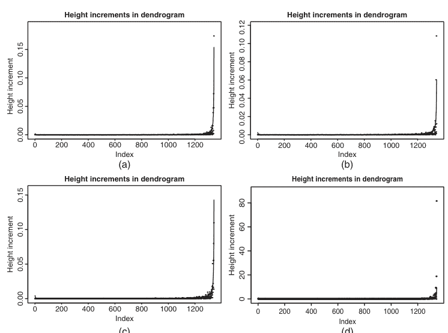

**图 5.18** 1344 个差分新英格兰电力价格序列的阶梯图。所使用的四个距离度量分别为：部分（a）中的 ACF 前 5 个滞后，部分（b）中的 PACF，部分（c）中的自动选择阶数的 PIC，以及部分（d）中的 PER。

| 4 | 4 | 135 | 0.1004464286 |
|---|---|---|---|
| 5 | 5 | 1 | 0.0007440476 |
| 6 | 6 | 191 | 0.1421130952 |
| 7 | 7 | 1 | 0.0007440476 |
| 8 | 8 | 48 | 0.0357142857 |
| 9 | 9 | 133 | 0.0989583333 |
| 10 | 10 | 1 | 0.0007440476 |
| 11 | 11 | 1 | 0.0007440476 |
| 12 | 12 | 9 | 0.0066964286 |
| 13 | 13 | 192 | 0.1428571429 |
| 14 | 14 | 192 | 0.1428571429 |

## 5.3 按变量聚类

与使用距离矩阵 **_D_** 对时间序列进行聚类不同，我们可以用选定的特征或特征向量来表示每个时间序列，并将这些特征作为分类变量。例如，我们可以通过其 AR 系数向量来表示时间序列。此外，当序列数量较大时，距离矩阵 **_D_** 是一个大型方阵，我们可以应用多维缩放技术（例如，Seber, 1984）来得到一个新的 \(k \times p\) 矩阵，其中 \(p \ll k\) 是

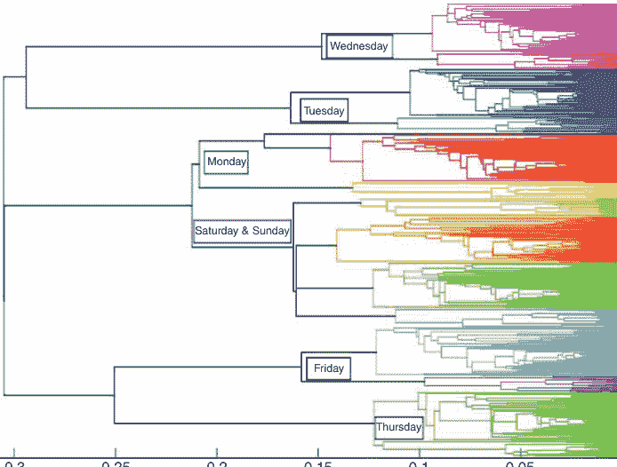

图 5.19 差分电价数据基于公式 (5.18) 的 GCC 不相似性的树状图。

作为变量选择的主坐标，并使用这些新变量进行聚类分析。在本节中，我们介绍了四种基于变量的聚类分析方法。这些方法包括 k-means（也可与不相似性一起使用）、k-medoids、投影方法和混合分布模型。

### 5.3.1 k-means 算法

给定一组由 $k$ 个变量表征的对象（在本例中为 $k$ 个时间序列），观测值为 $(x_1, \dots, x_k)$，我们希望将这些对象划分为给定数量的组（例如 $G$），使每个组尽可能同质。向量 $x_i$（其中 $i = 1, \dots, k$）具有分量 $x_{ij}$，表示第 $i$ 个对象的第 $j$ 个变量（$j = 1, \dots, p$）的值。各组必须互斥，且每个对象仅属于一个组。k-means 的基本思想是进行分组，使最终各组尽可能同质。这是通过所有变量的组内变异或组内平方和（SSW）来衡量的，即需要最小化的量度：

\(\text{SSW} = \sum_{g=1}^G \sum_{j=1}^p \sum_{i=1}^{n_g} (x_{ijg} - \bar{x}_{jg})^2,\) (5.24)

其中 $x_{ijg}$ 是组 $g$ 中对象 $i$ 的第 $j$ 个变量的值，$\bar{x}_{jg}$ 是包含 $n_g$ 个对象（或时间序列）的第 $g$ 组中第 $j$ 个变量的均值。该准则也可写成：

\( min SSW = min \sum_{g=1}^G \sum_{j=1}^p n_g s_{jg}^2. \) (5.25)

其中 \( s_{jg}^2 \) 是第 \( g \) 组中第 \( j \) 个变量的方差。各组中变量的方差明显是分类中异质性的度量，通过最小化它们，我们可以得到同质组。另一种准则是最小化对象与其组中心之间的平方距离。如果使用欧氏距离来度量距离，则该准则写作：

\( min \sum_{g=1}^G \sum_{i=1}^{n_g} (x_{ig} - \bar{x}'_g)'(x_{ig} - \bar{x}_g) = min \sum_{g=1}^G \sum_{i=1}^{n_g} d^2(i, g), \)

其中 \( d^2(i, g) \) 是第 \( g \) 组中对象 \( i \) 与该组均值之间的平方欧氏距离。很容易证明两个准则是等价的。由于标量等于其迹，我们可以将最新的准则写作：

\( min \sum_{g=1}^G \sum_{i=1}^{n_g} tr[d^2(i, g)] = min tr \left[ \sum_{g=1}^G \sum_{i=1}^{n_g} (x_{ig} - \bar{x}_g)(x_{ig} - \bar{x}_g)' \right]. \)

令 \( W \) 为组间平方和矩阵，

\( W = \sum_{g=1}^G \sum_{i=1}^{n_g} (x_{ig} - \bar{x}_g)(x_{ig} - \bar{x}_g)', \) (5.26)

可得

\( min tr(W) = min SSW \)

两个准则一致。该准则也称为迹准则，由 Ward 于 1963 年提出。

最小化该准则需要对 \( G \) 组的所有可能划分进行计算，除非对象数量非常小，否则这显然是不可能完成的任务。k-means 算法寻找最优划分，约束是每次迭代只能将一个对象从一个组移到另一个组。还应注意，当 \( G \) 固定时，该准则才有意义，因为我们可以通过增加组数始终降低 SSW。事实上，通过让每个对象单独成组，我们始终可以使 SSW = 0。

k-means 算法如下：

- 1. 选择 \( G \) 个点作为初始组的中心。这可以通过以下方式完成：
  - (a) 将对象随机分配到 \( G \) 个组，并取各组的中心；
  - (b) 将相互间距最远的 \( G \) 个点作为中心；
  - (c) 使用一些先验信息构建初始组并计算其中心，或预先选择其中心。
- 2. 计算每个对象到 \( G \) 个中心的欧氏距离，并将对象分配给距离最近的组。一旦对象被重新分配，受影响的组的中心将被重新计算。
- 3. 检查重新分配某些对象是否能改进准则 SSW。如果某组中的对象比所在组中心更接近另一组的中心，就会发生这种情况。在此情况下，该对象被移至新组，并重新计算受变更影响的两个组的中心。
- 4. 当无法再改进准则时，停止算法。

因此，算法结果可能取决于初始分配和对象的顺序。算法应始终从不同的初始值开始重复运行，并对样本中的对象进行置换。顺序的影响通常较小，但建议确保其在每种情况下都没有影响。

k-means 使用的 SSW 和迹准则都具有两个重要特性。首先，它们对缩放变化不具有不变性。其次，最小化欧氏距离会产生近似球形的组。关于尺度，如果变量使用不同的单位，则最好对其进行标准化，使 k-means 的结果不依赖于测量尺度中的无关变化。当它们使用相同的单位时，通常最好不进行标准化，因为一个变量的较大方差可能恰恰是由于存在多个具有该变量不同值的对象群体所致，而如果数据被标准化，这些信息可能会被隐藏。

k-means 产生的预期球形组在各组预期具有非常不同形状时可能会带来问题。在这种情况下，我们可以应用变量变换，使其在组内的联合分布预期为近似正态且协方差矩阵为对角矩阵。

#### 5.3.1.1 组数

第 5.2 节的 Silhouette 和 Gap 统计量可用于确定 k-means 中的组数。在这种情况下，距离是表示系列的特征坐标之间的欧氏距离。还有一些特定于变量的附加准则。Hartigan (1975) 提出进行近似 F 检验以评估变异性降低，比较 $SSW_g$ 与 $SSW_{g+1}$，并计算增加一个组时变异性的相对降低。检验为：

\( F = \frac{SSW_g - SSW_{g+1}}{SSW_{g+1}/(n - g - 1)}, \) (5.27)

该检验衡量通过增加一个组而降低的变异性与聚类中平均变异性的关系。F 值与具有 p 和 p(n - g - 1) 自由度的 F 分布进行比较。然而，在实际应用中，这种比较可能并不合理。一般而言，Hartigan (1975) 建议，如果该商大于 10，则引入一个额外组。

Calinski 和 Harabasz (1974) 提出最大化组间平方和与组内平方和之比。请注意，数据的协方差矩阵 V 可表示为：

\(\mathbf{V} = \sum_{i=1}^k (\mathbf{x}_i - \bar{\mathbf{x}})(\mathbf{x}_i - \bar{\mathbf{x}})' = \sum_{g=1}^G \sum_{i=1}^{n_g} (\mathbf{x}_{ig} - \bar{\mathbf{x}}_g)(\mathbf{x}_{ig} - \bar{\mathbf{x}}_g)' + \sum_{g=1}^G n_g (\bar{\mathbf{x}}_g - \bar{\mathbf{x}})(\bar{\mathbf{x}}_g - \bar{\mathbf{x}})’,\)

应用迹算子可得：

\(\text{tr}(\mathbf{V}) = \text{SSW} + \text{SSB}.\)


CH准则通过最大化下式来选择组数：

CH(g) = \frac{SSB_g / (g - 1)}{SSW_g / (n - g)}.

一个有用的图形显示是将此比率作为组数的函数进行绘制。

### 示例 5.4

我们将k-means应用于TaiwanAirBox数据。在剔除八个时间序列后，我们使用508个时间序列的集合，其中六个与偏远位置相关，另外两个只有少数非零数据点。参见示例5.3。使用的R命令是kmeans，位于stats包中。使用了三种维度不同的变量。第一种类型由每个序列的ACF前5个滞后组成，因此p = 5；第二种类型是样本中31天每一天序列的平均值，因此p = 31；第三种类型将时间序列的每个观测值作为一个变量，因此p = T = 743。使用Calinski和Harabasz准则（CHC）来选择聚类数，如下计算。最多允许20个聚类，对于每个组数，k-means使用10个随机起始值运行，准则值保存在向量CHC中。

#### k-means的R命令：

```
##- means with the first five autocorrelation coefficients.
#### The outlier-cleaned series of Example 5.3 is used.
> x=as.matrix(TaiwanAirBox032017)[,-1]
> lo=as.matrix(locations032017)[, -1]
> remv = c(1,29,35,46,70,118,155,157) # outlying locations
> x = x[,-remv]
> lo = lo[-remv,]
> z=diff(x)
##the acf of the stationary series z are computed
> h=6
> aa=acf(z,lag.max=h,plot=FALSE)
> H=c(2:6)
> nl=length(H)
> k = dim(z)[2]
##a matrix with columns the acf of each series is formed
> ACM=matrix(0,nl,k)
> for (i in 1:k) {
> ACM[,i] = aa$acf[H,i,i] }
##the k-means is applied
> Kmax=20
> bbb=rep(0,Kmax)
> Wk=as.vector(bbb)
> Bk=Wk
> HC=Bk[-1]
> CHC=HC
> n=dim(ACM)[2]
> for (i in 1:Kmax) {
+ center=i
+ AA=kmeans(t(ACM),centers=i,nstart=10)
+ Wk[i]=AA$tot.withinss
+ Bk[i]=AA$betweenss
> for (j in 1:(Kmax-1)) {
> HC[j] = (Wk[j] - Wk[j+1]) / (Wk[j+1] / (n-j))
> CHC[j] = (Bk[j] / (j)) / (Wk[j] / (n-j+1)) }
> par(mfrow=c(1,1))
> plot(CHC)
#### Three groups are identified
> AA=kmeans(t(ACM),centers=3,nstart=10)
> AA
k-means clustering with 3 clusters of sizes 148, 191, 169
Cluster means:
[,1] [,2] [,3] [,4] [,5]
1 0.13979848 -0.02746675 -0.04727573 -0.06181010 -0.061825575
2 0.08036432 -0.12370731 -0.09944578 -0.03522905 -0.004116231
3 -0.03754526 -0.05904016 -0.03590138 -0.02665427 -0.024233302
(output truncated)
```

图5.20显示了CHC准则的图，从中我们可以看出三个聚类似乎是合理的。聚类的大小分别为148、191和169。这些组根据前五个ACF的强度来划分序列。基于每个组的中心（即平均ACF），我们发现第3组似乎包含白噪声序列，即观测序列的ARIMA(0,1,0)模型。然而，这些组与Air Boxes的位置无关，如图5.21所示。

接下来，我们通过取PM₂.₅测量值的日均值来构建每个序列的变量。因此，每个序列有31个变量，每个变量是24小时PM₂.₅测量值的平均值。这些变量在显示Air Boxes位置方面比ACF表现更好。组的大小分别为196、171和141。图5.22显示了三个组的位置。

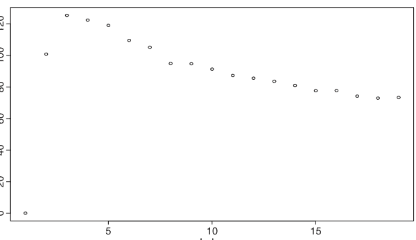

**图5.20** 台湾AirBox数据的CHC准则。该序列已进行差分。

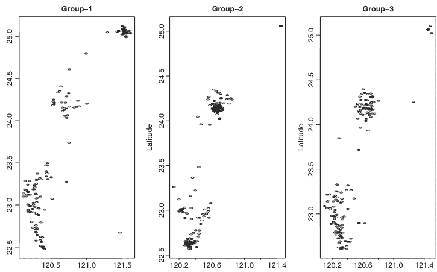

图5.21 使用k-means和ACF前5个滞后得到的三组Air-Boxes的位置（经度和纬度）。

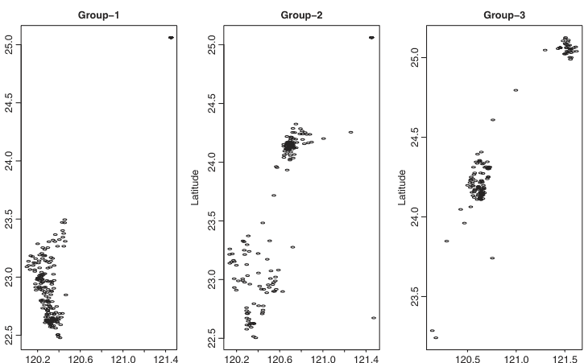

图5.22 使用PM2.5测量值的日均值得到的三组Air Boxes的位置（经度和纬度）。

#### 聚类的R命令：

```
##A set of variables is built as the average value of series each day
> ke=dim(x)[2]
> Md=matrix(0,31,ke)
> for (i in 1:31){
+ for (j in 1:ke) {
+ sl=1+12*(i-1)
+ s2=sl+11
+ Md[i,j]=sum(x[sl:s2,j])/12
+ }
+ }
##For comparison purpose, we also use 3 groups.
> Data=t(Md)
> AD=kmeans(Data,centers=3,nstart=10)
> AD$size
[1] 196 171 141
> lc1 <- which(AD$cluster==1)
> lc2 <- which(AD$cluster==2)
> lc3 <- which(AD$cluster==3)
> par(mfcol=c(1,3))
> plot(lo[lc1,1],lo[lc1,1],xlab="longitude",ylab="latitude",
main="Group-1")
#### Similar commands apply to Groups 2 and 3.
```

最后，我们将每个观测值作为一个变量，并直接对观测时间序列应用k-means。在这种情况下，变量数多于观测数，p = T = 743 > k = 508。同样，CHC准则选择三组，大小分别为152、103和253。图5.23显示了三组Air Boxes的位置。有趣的是，如预期，第1组和第2组中Air Boxes的位置更加集中。此结果与示例5.3一致，在示例5.3中，我们表明考虑序列之间的互相关关系能够根据Air Boxes的位置得到更有意义的分类。根据公式(5.1)，如果两个序列具有强正互相关，则它们之间的欧氏距离较小；如果互相关较弱或为负，则距离会增加。因此，SSW准则将具有强正互相关的序列归为同一组。图5.24显示了这一点，它展示了每组内时间序列之间相关性的直方图：两组由强相关序列组成，第三组包含低相关或负相关的序列。正如我们之前发现的，地理上的邻居预期具有较高的互相关性。

### 5.3.2 k-Medoids

k-means算法可能受异常值影响，因此提出了多种替代方法来解决这个问题。Kaufman和Rousseeuw（1987）提出了一种与k-means相关但存在几个差异的分区算法。首先，组的中心是其medoid，而不是样本均值。组的medoid是使其与组内所有成员的平均离差（或平均距离）最小化的成员。对于标量变量，组的medoid是L1距离的中位数。然而，对于多元变量，组的中位数可以有多种定义，且medoid不唯一。其次，组间对象交换的方式与k-means不同。第三，它可以应用于任意点间的离差或距离度量D(i, j)，而k-means是基于欧氏距离构建的。一旦选择了度量D(i, j)，准则就是最小化

SM = \sum_{j=1}^G \sum_{i \in G_j} D(i, M(j)), \quad (5.28)

其中M(j)是第i个对象所属的第j组的medoid，G是组的数量，G_j表示第j组。k-medoids算法，或称为围绕medoid分区（PAM）算法，工作方式如下（更多细节请参见Kaufman和Rousseeuw，2009）：

- 1. Build：从k个对象（在我们的情况中为时间序列）中选择G个作为初始组的领导者（medoids），并将每个对象与其最近的medoid关联。选择方法如下：首先选择使目标函数（5.28）下降最大的对象作为第一个领导者。对于每个非领导者对象，计算其导致的目标函数下降量，并选择（5.28）值最小的对象作为新的领导者。继续同样的方式，直到找到G个领导者。

- 2. Swap：检查将领导者与其组内某个成员交换是否会减小（5.28）。对所有对象和组进行此检查。

- 3. 如果通过交换两个对象可以减小Eq. (5.28)中的目标函数SM，则执行交换。当无法再减小目标函数时，停止过程。

对于大量对象，该算法较慢，因此开发了一些近似算法，例如R中的Clustering Large Applications（CLARA）等。**CLARA**在多个子样本上应用PAM并给出最佳结果，而其他算法则通过抽样仅探索对象与领导者之间可能交换的一个子集。

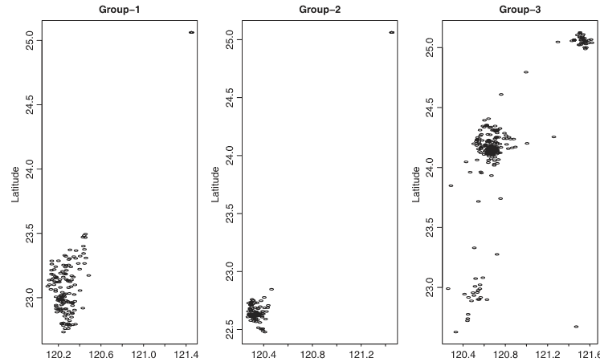

图5.23 直接使用每小时PM2.5测量值得到的三组Air Boxes的位置（经度和纬度）。

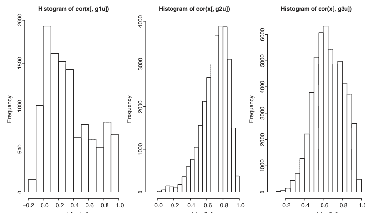

图5.24 按序列间欧氏距离聚类的Air Boxes，各组内序列之间互相关的直方图。

### 5.3.3 基于变量的模型聚类

对于基于模型的方法，我们假设k个时间序列由G个不同的模型生成，目标是将序列分类为这G个组，使得每个组的所有成员都遵循同一模型。通常，模型由一个p参数向量表征。它可以是模型的AR表示系数，也可以是通常假设服从多元正态分布的一般特征向量。将序列划分为组的自然方法是假设参数向量θ_i由G个多元正态分布的混合生成。然后，目标是共同估计混合中各分布的参数以及每个序列属于混合中且仅属于一个分量的后验概率。这种方法称为基于模型的聚类，由Banfield和Raftery（1993）等人提出。这些作者还基于多元数据的正态分布混合开发了算法MCLUST。


对于时间序列分析，该方法已由 Xiong 和 Yeung (2004) 研究用于 ARMA 混合模型，并由 Frühwirth-Schnatter 和 Kaufmann (2008) 从贝叶斯角度进行研究。这些程序首先对系列划分到各组进行初始估计。接着，计算混合模型的参数，并利用这些参数重新将系列分配到各组，重复这两个步骤直至收敛。估计是逐组进行的，最佳解由 BIC 准则或后验概率选定。

#### 5.3.3.1 AR 混合模型的最大似然（ML）估计

假设每个系列由一个高斯 AR(p) 模型生成，其中 \(p < k\)，属于 \(G\) 个组之一，各组具有不同的 AR 参数和残差方差。各系列相互独立，每个系列 \(\boldsymbol{z}_i = (z_{i1}, \dots, z_{iT})'\)，\(i=1, \dots, k\)，可被视为由一组分布混合生成：

\(f(\boldsymbol{z}_i) = \sum_{g=1}^G \pi_g f_g(\boldsymbol{z}_i | \boldsymbol{\phi}_g, \sigma_g^2),\) (5.29)

其中 \(\pi_g\) 是第 \(g\) 组的未知概率，\(\boldsymbol{\phi}_g = (\phi_{1g}, \dots, \phi_{pg})'\) 是 AR 参数向量，\(\sigma_g^2\) 是组 \(g\) 中噪声的方差，\(f_g\) 是由高斯 AR(p) 生成的单变量观测的联合密度，见第 2.8.3 节。记 \(\boldsymbol{\omega}_g = (\boldsymbol{\phi}'_g, \sigma_g^2)\)，以及 \(\boldsymbol{\beta} = (\pi_1, \dots, \pi_G, \boldsymbol{\phi}'_1, \dots, \boldsymbol{\phi}'_G, \sigma_1^2, \dots, \sigma_G^2)'\) 为公式 (5.29) 中混合模型的全部参数向量，则对于 \(\tilde{\boldsymbol{z}}_i = (z_{i,p+1}, \dots, z_{i,T})'\)，\(i=1, \dots, k\)，其联合条件对数似然为

\(L_C(\boldsymbol{\beta}) = \sum_{i=1}^k \log \left( \sum_{g=1}^G \pi_g f_g(\tilde{\boldsymbol{z}}_i | \boldsymbol{\psi}_g) \right),\) (5.30)

其中 \(f_g(\tilde{\boldsymbol{z}}_i | \boldsymbol{\psi}_g)\) 是给定前 \(p\) 个观测值后 \(\tilde{\boldsymbol{z}}_i\) 的联合密度函数。该函数具有许多极大值，与每个密度由一个观测值精确确定的解相关联。为避免这些奇异性，我们假设每组至少有 \(p+1\) 个观测值，并尝试找到该函数的一个局部极大值。该似然函数的另一个问题是正态分布未被识别，因为顺序 \(1, \dots, G\) 是任意的。为解决此问题，我们可以假设分布 \(1, \dots, G\) 对应于 \(\pi_1 \ge \pi_2 \ge \dots \ge \pi_G\)。

为最大化公式 (5.30) 中关于概率 \(\pi_g\) 的函数，引入拉格朗日乘数并施加限制 \(\sum_{g=1}^G \pi_g = 1\)，待最大化的函数为

\(L_C(\boldsymbol{\beta}) = \sum_{i=1}^k \log \sum_{g=1}^G \pi_g f_g(\tilde{\boldsymbol{z}}_i | \boldsymbol{\psi}_g) - \lambda \left( \sum_{g=1}^G \pi_g - 1 \right).\) (5.31)

对函数关于组概率 \(\pi_g\) 求导：

\(\frac{\partial L_C(\boldsymbol{\beta})}{\partial \pi_g} = \sum_{i=1}^k \frac{f_g(\tilde{\boldsymbol{z}}_i | \boldsymbol{\psi}_g)}{\sum_{g=1}^G \pi_g f_g(\tilde{\boldsymbol{z}}_i | \boldsymbol{\psi}_g)} - \lambda = 0\)

两边乘以 \(\pi_g\)（假设 \(\pi_g \neq 0\)，否则模型 g 冗余），我们写出

$$\lambda \widehat{\pi}_g = \sum_{i=1}^k \widehat{\pi}_{ig}.$$

其中 \(\widehat{\pi}_{ig}\) 是给定数据 \(\vec{\mathbf{z}}_i\) 时，系列 \(i\) 由第 \(g\) 个分布生成的后验概率。这些概率由贝叶斯定理计算

$$\widehat{\pi}_{ig} = \frac{\pi_g f_g(\vec{\mathbf{z}}_i | \boldsymbol{\psi}_g)}{\sum_{g=1}^G \pi_g f_g(\vec{\mathbf{z}}_i | \boldsymbol{\psi}_g)},$$

且 \(\sum_{g=1}^G \widehat{\pi}_{ig} = 1\)。为确定 \(\lambda\) 的值，将 (5.32) 对所有组求和，得到 \(\lambda = k\)，将此值代入 (5.32)，先验组概率估计为

$$\widehat{\pi}_g = \frac{1}{k} \sum_{i=1}^k \widehat{\pi}_{ig}.$$

为估计 AR 参数，我们对公式 (5.31) 关于它们求导，可写为

$$\frac{\partial L_C(\boldsymbol{\beta})}{\partial \boldsymbol{\phi}_g} = \sum_{i=1}^k \frac{\pi_g f_g(\vec{\mathbf{z}}_i | \boldsymbol{\psi}_g)}{\sum_{g=1}^G \pi_g f_g(\vec{\mathbf{z}}_i | \boldsymbol{\psi}_g)} \frac{\partial \log f_g(\vec{\mathbf{z}}_i | \boldsymbol{\psi}_g)}{\partial \boldsymbol{\phi}_g} = 0.$$

利用公式 (5.33) 和第 2.8.1 节的结果，我们有

$$\frac{\partial L_C(\boldsymbol{\beta})}{\partial \boldsymbol{\phi}_g} = 0 = \sum_{i=1}^k \widehat{\pi}_{ig} (\widetilde{\mathbf{Z}}'_i \vec{\mathbf{z}}_i - \widetilde{\mathbf{Z}}'_i \widetilde{\mathbf{Z}}_i \boldsymbol{\phi}_g),$$

其中 \(\widetilde{\mathbf{Z}}_i\) 是滞后值的 \((T-p) \times p\) 矩阵。因此，

$$\widehat{\boldsymbol{\phi}}_g = \left( \sum_{i=1}^k \widehat{\pi}_{ig} \widetilde{\mathbf{Z}}'_i \widetilde{\mathbf{Z}}_i \right)^{-1} \left( \sum_{i=1}^k \widehat{\pi}_{ig} \widetilde{\mathbf{Z}}'_i \vec{\mathbf{z}}_i \right),$$

这正是使用所有系列估计参数的标准方程，但每个系列都按该系列属于各组的估计后验概率加权。创新方差可得到类似方程。然而，为计算 \(\widehat{\boldsymbol{\phi}}_g\)，我们需要 \(\widehat{\pi}_{ig}\)，它们由 (5.33) 计算并依赖模型参数。直觉上，我们可以在这两个步骤之间迭代，这就是期望-最大化（EM）算法提供的解。

#### 5.3.3.2 EM 算法

EM 算法是一种强大的迭代方法，用于求缺失值和缺失变量（隐变量）的 ML 估计。它由 Dempster 等人 (1977) 提出。如在我们的情况中，存在缺失变量时，算法在期望（E）步和极大化（M）步之间迭代：E 步利用参数的当前估计求关于缺失变量的对数似然期望；M 步给定缺失变量的值，对参数极大化对数似然。

为应用 EM 算法，我们通过引入一组未观测或缺失的向量变量 ($s_1, \dots, s_k$) 来转换问题，其中 $s_i$ 是一个 $G$ 维多项分布变量向量，仅有一个分量等于 1，对应于 \(\tilde{z}_i\) 所属的组，其余均为 0。例如，如果 \(\tilde{z}_i\) 来自第一个模型，则 \(s_{i1} = 1\) 且 \(s_{i2} = \cdots = s_{iG} = 0\)。此时 \(\sum_{g=1}^G s_{ig} = 1\) 且 \(\sum_{i=1}^k \sum_{g=1}^G s_{ig} = k\)。有了这些新变量，\(\tilde{z}_i\) 给定 \(s_i\) 下的密度函数可写为

$$f(\tilde{z}_i|s_i) = \prod_{g=1}^G f_g(\tilde{z}_i|\psi_g)^{s_{ig}}. \quad (5.36)$$

同理，缺失变量 \(s_i\) 的概率函数为

$$p(s_i) = \prod_{g=1}^G \pi_g^{s_{ig}}. \quad (5.37)$$

另一方面，观测变量 \(\tilde{z}_i\) 和缺失变量 \(s_i\) 的联合密度函数为

$$f(\tilde{z}_i, s_i) = f(\tilde{z}_i|s_i)p(s_i),$$

根据公式 (5.36) 和 (5.37)，可写为

$$f(\tilde{z}_i, s_i) = \prod_{g=1}^G (\pi_g f_g(\tilde{z}_i|\psi_g))^{s_{ig}},$$

联合对数似然函数为

$$L(\beta) = \sum_{i=1}^k \log f(\tilde{z}_i, s_i) = \sum_{i=1}^k \sum_{g=1}^G s_{ig} \log \pi_g + \sum_{i=1}^k \sum_{g=1}^G s_{ig} \log f_g(\tilde{z}_i|\psi_g). \quad (5.38)$$

EM 算法从参数向量的初始估计 \(\hat{\beta}^{(0)}\) 开始，通常通过层次聚类或 \(k\)-means 计算得到。在 E 步中，我们给定初始参数和观测数据，计算完全似然 (5.38) 中缺失值的条件期望。由于似然关于 \(s_{ig}\) 是线性的，这等价于用缺失变量的期望替代缺失变量。缺失变量 \(s_{ig}\) 为取值 0 或 1 的二项分布变量，且

$$E(s_{ig}|\hat{\beta}^{(0)}, Z) = p(s_{ig} = 1|\hat{\beta}^{(0)}, Z) = \hat{\pi}_{ig}^{(0)}$$

其中 \(\hat{\pi}_{ig}^{(0)}\) 是在已观测 \(z_i\) 且模型参数由 \(\hat{\beta}^{(0)}\) 给定时，观测值 \(z_i\) 来自模型 \(g\) 的概率。这些概率为


可由(5.33)计算得出的后验概率，以\(\widehat{\boldsymbol{\beta}}^{(0)}\)作为参数值。通过用期望替换缺失变量，我们得到

\(L_C^*(\boldsymbol{\beta}) = \sum_{i=1}^k \sum_{g=1}^G \widehat{\pi}_{ig}^{(0)} \log \pi_g + \sum_{i=1}^k \sum_{g=1}^G \pi_{ig}^{(0)} \log f_g(\mathbf{z}_i | \boldsymbol{\psi}_g)\)

在M步中，对该函数求极大值并获得参数\(\boldsymbol{\beta}\)。我们发现参数\(\pi_g\)仅出现在第一项中，正态分布的参数仅出现在第二项中，因此可以独立求解。从\(\pi_g\)开始，这些参数需满足其和为一，并由(5.34)计算得出。随后，利用值\(\widehat{\pi}_{ig}^{(0)}\)计算AR参数和残差方差的新估计量。这样便得到新的参数向量\(\widehat{\boldsymbol{\beta}}^{(1)}\)，算法迭代直至收敛。

#### 5.3.3.3 多元正态混合分布的估计

若使用特征向量\(\mathbf{x}_i\)来总结每个时间序列，EM算法同样适用。假设该向量服从多元正态混合分布，均值向量为\(\boldsymbol{\mu}_g\)，协方差矩阵为\(\mathbf{V}_g\)，概率为\(\pi_g\)，其中\(g=1, \dots, G\)，并将\(\boldsymbol{\psi} = (\boldsymbol{\pi}, \boldsymbol{\mu}_1, \dots, \boldsymbol{\mu}_G, \mathbf{V}_1, \dots, \mathbf{V}_G)\)称为参数向量，估计算法如下：

- 1. 从初始值\(\widehat{\boldsymbol{\psi}}^{(0)}\)开始。令\(s=1\)，并按以下公式计算\(\widehat{\pi}_{ig}^{(s)}\)：

\(\pi_{ig}^{(s)} = \frac{\pi_g^{(s-1)} f_g^N(\mathbf{x}_i | \widehat{\boldsymbol{\mu}}_g^{(s-1)}, \widehat{\mathbf{V}}_g^{(s-1)})}{\sum_{g=1}^G \pi_g^{(s-1)} f_g^N(\mathbf{x}_i | \widehat{\boldsymbol{\mu}}_g^{(s-1)}, \widehat{\mathbf{V}}_g^{(s-1)})}\)

和

\(\widehat{\pi}_g^{(s)} = \frac{1}{k} \sum_{i=1}^k \pi_{ig}^{(s)}\)

- 2. 使用以下公式估计多元正态分布的参数：

\(\widehat{\boldsymbol{\mu}}_g^{(s)} = \sum_{i=1}^k \frac{\pi_{ig}^{(s)}}{\sum_{i=1}^k \pi_{ig}^{(s)}} \mathbf{x}_i\)

\(\widehat{\mathbf{V}}_g = \sum_{i=1}^k \frac{\pi_{ig}^{(s)}}{\sum_{i=1}^k \pi_{ig}^{(s)}} (\mathbf{x}_i - \widehat{\boldsymbol{\mu}}_g)(\mathbf{x}_i - \widehat{\boldsymbol{\mu}}_g)'\)

- 3. 转至步骤1，令\(s \leftarrow s + 1$，并迭代上述两步直至收敛。

在群体数量较多时应用前述方法需要进行一些简化，以避免需估计的参数数量增加，并确保协方差矩阵的正定性。程序MCLUST（Fraley and Raftery, 1999；Fraley et al., 2012）通过谱分解对协方差矩阵进行参数化，采用EM算法。

\(\mathbf{V}_g = \lambda_g \mathbf{C}_g \mathbf{A}_g \mathbf{C}_g'\)

其中\(\boldsymbol{C}_g\)是包含\(\boldsymbol{V}_g\)特征向量的正交矩阵，\(\lambda_g\boldsymbol{A}_g\)是其特征值矩阵，标量\(\lambda_g\)为矩阵的最大值。标量\(\lambda_g\)表示椭球的体积，\(\boldsymbol{C}_g\)中矩阵的特征向量表示方向，\(\boldsymbol{A}_g\)中的特征值表示椭球的形状。这样，我们可以让某些群体的方向或其他群体的形状有所不同。该程序（1）为最大群体数选择一个值\(M$；（2）对\(G=1, ..., M$及分解（5.43）的不同假设，通过EM算法估计混合模型的参数，并通过层次聚类固定初始条件；（3）使用BIC准则选择最合适的群体数量及协方差矩阵条件。BIC计算中使用的参数数量取决于$G$以及各组模型的参数数量。

#### **5.3.3.4 贝叶斯估计**

基于模型的聚类也可以从贝叶斯观点出发，在估计中使用马尔可夫链蒙特卡罗（MCMC）方法，如Frühwirth-Schnatter and Kaufmann (2008)所提。同前文一样，假设我们有$G$个群体，每个群体对其成员系列有一个独特的AR($p$)模型。我们需要估计每个群体的模型参数，其中\(\boldsymbol{\psi}_g = (\boldsymbol{\psi}'_g, \sigma^2_g)$，$g = 1, ..., G$，并将\(\boldsymbol{\psi} = (\boldsymbol{\psi}_1, ..., \boldsymbol{\psi}_G)$称为混合模型的参数向量。我们还需要分类变量\(\boldsymbol{S} = (s_1, ..., s_k)$，这些变量现在被假设为独立变量，各自服从参数为\(p(s_i = g) = n_g/k = \pi_i$的多项分布，其中\(n_g$是第$g$组中的系列数量，未知且需估计，并称\(\boldsymbol{\pi} = (\pi_1, ..., \pi_G)'$。在给定参数和分类变量的情况下，系列\(z_i$（\(i = 1, ..., k$）的分布\(p(z_i|\boldsymbol{\psi}_g, \boldsymbol{S})$被假设为正态分布（这可以推广）。我们为参数向量\(\boldsymbol{\psi}_g$采用共轭先验，为\(\boldsymbol{S}$采用狄利克雷先验。现在，参数的自然分解如下：（1）在给定分类变量的情况下，估计每个组的AR参数及残差方差；（2）在给定模型参数的情况下，估计分类变量。然后，MCMC过程（或吉布斯采样器）的应用如下：

- **1.** 初始化：从先验分布中抽取初始估计值，或对\(k$个时间序列应用具有\(G$个簇的\(k$-means方法。在后一种情况下，通过合并各组内的系列来获得AR(\(p$)模型的初始估计值。

- **2.** 对于迭代\(m = 1, ..., M$，其中\(M\)为预先指定的正整数，（a）使用当前参数值，通过从后验\(p(s_i| z_i; \boldsymbol{\psi}, \boldsymbol{\pi})\)中抽取随机样本来更新分类变量；（b）通过从条件后验分布\(p(\boldsymbol{\psi} | \boldsymbol{Z}, \boldsymbol{S})\)中抽取样本来更新AR系数和残差方差，并从后验\(p(\boldsymbol{\pi} | \boldsymbol{Z}, \boldsymbol{S})\)中更新\(\boldsymbol{\pi}\)。

- **3.** 抛弃随机抽取的前\(N$次迭代，利用剩余\(M - N$次迭代的抽取结果进行推断。

在实践中，应使用足够大的\(M\)，并检查MCMC算法的收敛性。

群体数量的选择方法如下。设\(M_G\)为具有\(G\)个群体的模型规范，其中\(G = 1, ..., G_{max}\)，\(G_{max}\)为预先指定的正整数，并使用均匀先验\(p(M_G) = 1/G_{max}$。计算边缘似然

\(p(\mathbf{Z}|M_G) = \int p(\mathbf{Z}|\boldsymbol{\pi}, \boldsymbol{\pi}, \mathbf{S}, G)p(\boldsymbol{\pi}, \boldsymbol{\pi}, \mathbf{S})d\boldsymbol{\psi}d\boldsymbol{\pi}d\mathbf{S},\)

并将其与先验\(p(M_G)$结合，利用贝叶斯定理计算后验\(p(M_G|\mathbf{Z})\)以确定群体数量。所用方法的详情见Frühwirth-Schnatter and Kaufmann (2008)和Tsay (2014, chapter 6)。与所有MCMC程序一样，必须检查迭代的收敛性，读者可参阅Gamerman and Lopes (2006)及其中的参考文献。该方法已被Wang et al. (2013)用于改进许多时间序列的预测。

#### 5.3.3.5 带结构断点的聚类

Wang and Tsay (2019) 提出了一种基于贝叶斯的方法，用于对带结构断点的时间序列进行聚类，推广了Frühwirth-Schnatter and Kaufmann (2008)的工作。断点数量被视为随机变量，群体成员身份和群体特定参数允许在这些断点处变化。一旦找到断点和群体成员身份，就可以对同一组中的所有系列进行信息合并，以用于估计和预测。当有新时期的观测值时，可将体制序列和参数的估计结果用作更新的初始值，而无需重新运行估计。

#### 示例 5.5

我们使用**mclust**包对台湾AirBox数据进行基于模型的聚类。该系列由前五个自相关系数总结。所使用的R命令如下。我们不重复ACM矩阵的计算，因为它与示例5.4相同。主要命令是**mclustBIC**，它提供了BIC值的摘要，作为不同情景下模型后验概率的近似，这些情景由正态混合分布中协方差矩阵的结构给出。一旦选择了聚类数量，命令**Mclust**即给出混合模型的估计结果。

#### 使用包**mclust**进行基于模型的聚类的R命令：

```
##application of mclust to ACM of the AirBox data
> require(mclust)
> Dat=t(ACM)
> st=mclustBIC(Dat, G=1:12)
fitting ...
|=============================|
> plot(st)
plot (st)
> st
```

基于BIC准则的前3个模型：

| 模型 | BIC |
|-------|-----|
| VVE,3 | 7362.747 |
| EEV,2 | 7353.859 |
| EVE,3 | 7342.181 |

```
##Given that the maximum values of the BIC for most of the models
##is for G=3, three clusters are selected.
```


> s1 = Mclust(Dat, G=3)
> summary(s1)

---------------------------------------------------------------------------
由EM算法拟合的高斯有限混合模型
---------------------------------------------------------------------------
#### 为节省空间而编辑的输出
聚类表：

| 1 | 2 | 3 |
|---|---|---|
| 35 | 196 | 277 |

> s1$BIC
贝叶斯信息准则（BIC）：
```
        EII     VII     EEI     VEI     EVI     VVI     EEE
EII 3 7209.426 7224.402 7322.735 7341.534 7306.48 7317.736 7298.159
EVE     VEE     VVE     EEV     VEV     EVV     VVV
3 7342.181 7303.551 7362.747 7297.843 7299.565 7266.905 7255.187
Top 3 models based on the BIC criterion:
VVE,3   EVE,3   VEI,3
7362.747 7342.181 7341.534
> pp=s1$parameters
> pp$mean
        [,1]          [,2]          [,3]
[1,]  0.19604984  0.10948809  0.007026086
[2,] -0.01327302 -0.07975918 -0.078649900
[3,] -0.05420812 -0.08667588 -0.049024126
[4,] -0.08677588 -0.04970037 -0.027687299
[5,] -0.05664926 -0.02840346 -0.023241266
```

图 5.25 显示了程序 mclustBIC 的输出，其中包含不同数量的组和协方差矩阵结构的 BIC 值（与后验概率成正比）。当组数为三且协方差矩阵为 VVE（椭圆型，特征值和特征向量取决于组）、EVE（椭圆型，特征值取决于组但特征向量相同）和 VEI（对角型，方差取决于组）时，出现最大的后验概率或 BIC 值。如预期，它们根据自相关的强度将系列分开。概率最高的模型 VVE,3 有三组和用于自相关系数的一般协方差矩阵。

### 5.3.4 基于投影的聚类

当特征向量 _x<sub>i</sub>_ 的维度 _p_ 和系列数量 _k_ 很高，且 _k > p_ 时，将特征向量投影到一个较低维度的子空间上以便轻松进行聚类将是有益的。寻找一个有助于总结高维数据的低维投影空间的想法，被 Friedman 和 Tukey (1974) 称为“_投影追踪_”。

Peña 和 Prieto (2001) 提出了一种基于通过最大化或最小化峭度获得的方向的一维投影追踪算法

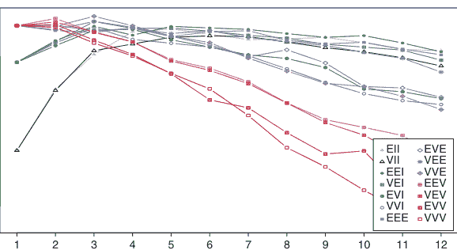

图 5.25 台湾 AirBox 数据不同组数和协方差结构的 BIC 值。

投影数据的峭度系数。最小化峭度系数意味着最大化投影的双峰性，而最大化峭度系数意味着检测投影中与数据主体明显分离的异常值组。寻找双峰性会导致将样本分成两个大簇以供进一步分析。相对于中心分布寻找异常值组会导致识别出沿某些特定投影与其余数据明显分离的小簇。他们证明，如果数据是由具有相同协方差矩阵的两个正态分布的混合生成的，那么最小化峭度的方向就是我们将在第 5.5 节中讨论的 Fisher 最佳线性判别方向。他们还展示了这些方向的其他最优性性质，当数据来自多个椭圆分布的混合时。基于这些结果，他们提出了一种迭代程序，在该程序中，数据被投影到这些极端峭度方向上，并沿着它们进行一维簇搜索。我们下面简要描述我们的算法，详细内容可见 Peña 和 Prieto (2001)，以及关于讨论投影峭度的截断值和最大化或最小化优化方法的内容。

投影方向 \(\boldsymbol{d}_s\) 通过以下步骤获得。从 \(s = 1\) 开始，令 \(\boldsymbol{y}_i^{(1)} = \boldsymbol{x}_i\) 并定义

```
\(\bar{\boldsymbol{y}}^{(s)} = \frac{1}{k} \sum_{i=1}^k \boldsymbol{y}_i^{(s)} ,\)

\(\boldsymbol{S}_s = \frac{1}{(k-1)} \sum_{i=1}^k [\boldsymbol{y}_i^{(s)} - \bar{\boldsymbol{y}}^{(s)}][\boldsymbol{y}_i^{(s)} - \bar{\boldsymbol{y}}^{(s)}]'.\)
```

- 1. 找到一个求解以下问题的方向 \(\boldsymbol{d}_s\)

```
\(\max \quad s(\boldsymbol{d}_s) = \frac{1}{k} \sum_{i=1}^k (\boldsymbol{d}_s'\boldsymbol{y}_i^{(s)} - \boldsymbol{d}_s'\bar{\boldsymbol{y}}_s)^4\)

s.t. \(\boldsymbol{d}_s'\boldsymbol{S}_s \boldsymbol{d}_s = 1,\)
(5.44)
```

即，一个最大化投影数据峭度系数的方向。

- 2. 将观测值投影到与方向 \(\mathbf{d}_1, \dots, \mathbf{d}_s\) 为 \(\mathbf{S}_s\)-正交的子空间上。如果 \(s < p\)，定义

  \(\mathbf{y}_i^{(s+1)} = (\mathbf{I} - \mathbf{d}_s \mathbf{d}_s' \mathbf{S}_s) \mathbf{y}_i^{(s)},\)

  令 \(s \leftarrow s + 1\) 并通过重复步骤 1 计算一个新方向。否则，停止。

- 3. 通过重复步骤 1 和 2 计算另一组 \(p\) 个方向 \(\mathbf{d}_{p+1}, \dots, \mathbf{d}_{2p}\)，但现在 Eq. (5.44) 中的目标函数被最小化而不是最大化。

请注意，在每个步骤 \(s\)（\(s > 1\)）中，找到的方向与前一个方向为 \(\mathbf{S}_s\)-正交（而不仅仅是正交）。做出此选择是为了确保算法的每个步骤都是仿射等价的，因此完整的程序（有关详细信息，请参见 Peña 和 Prieto, 2001）。

投影数据中的组搜索是使用一阶间隙或间隔进行的，它们是顺序统计量之间的差异。当我们在一个投影中找到一个足够大的一阶间隙时，我们认为一组时间系列可以分为两个簇。在测试间隙中的显著值之前，我们首先标准化投影数据，并使用标准一元正态分布函数 \(\Phi\) 的逆函数将这些观测值进行变换。这样，如果投影数据服从正态分布，则变换后的数据将呈均匀分布。然后我们可以利用这样一个事实：对于均匀数据，间隔是同分布的。用于识别显著间隙的结果算法已按如下方式实现：

- 1. 对于每个方向 \(\mathbf{d}_s, s = 1, \dots, 2p\)，计算原始观测值的一元投影 \(u_{si} = \mathbf{x}'_i \mathbf{d}_s\)。
- 2. 标准化这些观测值，\(p_{si} = (u_{si} - m_s)/s_s\)，其中 \(m_s = \sum_i u_{si}/k\) 且 \(s_s = \sum_i (u_{si} - m_s)^2 / (k-1)\)。
- 3. 对每个 \(s\) 值对投影 \(p_{si}\) 进行排序，以获得顺序统计量 \(p_{s(i)}\)，并使用标准正态分布函数的逆函数 \(p_{si} = \Phi^{-1}(p_{s(i)})\) 对其进行变换。
- 4. 计算连续值之间的间隔，\(w_{si} = p_{s,i+1} - p_{si}\)。
- 5. 在 \(w_{si}\) 中搜索显著间隙的存在。这些较大的间隔将是存在多个簇的指示。特别是，我们引入一个阈值 \(\kappa = \nu(c)\)，其中 \(\nu(c) = 1 - (1 - c)^{1/k}\) 表示间隔分布的 \(c\) 百分位数，定义 \(i_{0s} = 0\) 和

  \(r = \inf_j \{ k > j > i_{0s} : w_{sj} > \kappa \}.\)

  如果 \(r \neq 0\) 且一个或多个间隔 \(w_{sj}\) 大于 \(\kappa\)，则在此方向中已检测到几个可能的簇，转到步骤 6。否则，转到下一个投影方向。

- 6. 将所有满足 \(p_{sl} \le p_{sr}\) 的观测值 \(l\) 标记为属于与 \(p_{sl} > p_{sr}\) 所具有的簇不同的簇。令 \(i_{0s} = r\) 并重复步骤 5。

请注意，在每个方向中，如果存在 \(n\) 个大于阈值的间隔，则检测到 \(n + 1\) 个组。这应用于所有 \(2p\) 个方向。在完成间隙分析后，算法执行最后一步


通过使用马氏距离，将数据中已识别簇内的观测值重新分配。簇按大小排序，使得 \(n_1 \ge n_2 \ge \cdots \ge n_G\)，并且观测值被标记，使得前 \(n_1\) 个属于第一组，最后 \(n_G\) 个属于第 \(G\) 组。然后，从最大的簇开始，对于 \(g = 1, \dots, G\)，计算簇中观测值的均值 \(\boldsymbol{m}_g\) 和协方差矩阵 \(\boldsymbol{S}_g\)，以及所有未分配给该簇 \(g\) 的观测值的马氏距离 \(\delta_j = (\boldsymbol{x}_j - \boldsymbol{m}_j)^t \boldsymbol{S}_g^{-1} (\boldsymbol{x}_j - \boldsymbol{m}_j)\)。如果此簇外的任何观测值满足 \(\delta_j \le \chi^2_{p, 0.99}\)，则将该观测值添加到簇中。该程序在 Peña and Prieto (2001) 提出的 Monte Carlo 结果中似乎在 \(p < k\) 时优于 \(k\)-means 和 MCLUST。然而，当 \(p\) 很大时，由于算法计算变量的协方差矩阵，其性能可能会下降，除非 \(k/p\) 适中，比方说大于 10。

### 示例 5.6

我们再次分析台湾 AirBox 数据，以每天的平均值作为变量，因此 \(p = 31\)。如同示例 5.3，使用了 \(k = 508\) 个序列。基于投影的聚类使用包含在 **SLBDD** 书籍包中的命令 `ClusKur` 和 `ClusMain` 进行应用。使用的数据在矩阵 `Data` 中，计算方式如示例 5.4。命令 `ClusKur` 的输出是找到的组数和观测值的标签。在这个特定实例中，找到了四个组，并且几个异常值，用标签 '-1' 标识，不属于之前的任何组。图 5.26 显示了各组的位置，图 5.27 显示了用于查找簇的三个方向。

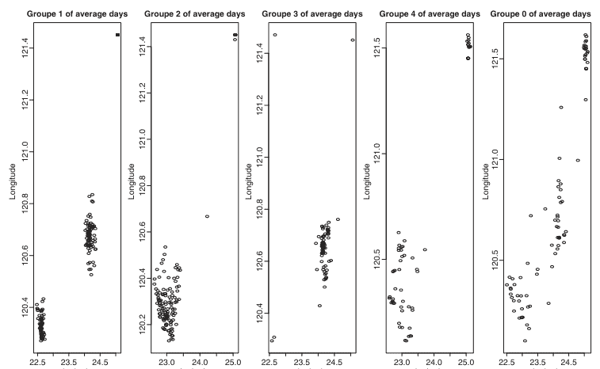

图 5.26. 基于投影找到的五个组的位置，针对台湾 AirBox 数据，以每日 PM\(_{2.5}\) 测量的平均值作为变量。

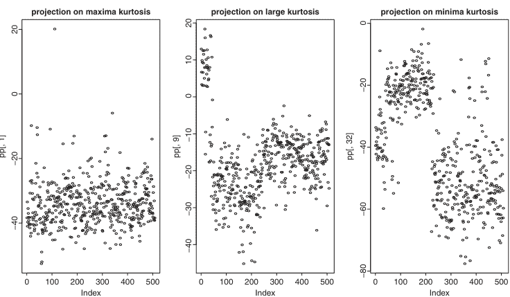

图 5.27 用于为台湾 AirBox 数据查找簇的三个投影方向，以每日平均测量值作为变量。

### 通过投影进行聚类的 R 命令。

```
> par(mfrow=c(1,1))
> sall=ClusKur(Data) # Data is the data matrix from Example 5.4.
> plot(sall$lbl,main="AirBoxes groups,-1 are outliers of these 4 groups")
> bb=ClusMain(Data)
##The columns of matrix pp are the projections of the data in the 31
##directions of largest and the 31 of smallest kurtosis
> pp=Data %*% t(bb$V)
> ng1=length(g1u)
> ng1
[1] 154
> ng2=length(g2u)
> ng2
[1] 130
> ng3=length(g3u)
> ng3
[1] 76
> ng4=length(g4u)
> ng4
[1] 63
> ng0=length(g0u)
> ng0
[1] 85
> g1lo=lo[g1u,]
> g2lo=lo[g2u,]
> g3lo=lo[g3u,]
> g4lo=lo[g4u,]
> g0lo=lo[g0u,]
> par(mfrow=c(1,5))
##The relation between groups and location is displayed
> plot(g1lo, main="Group 1 of average days")
> plot(g2lo, main="Group 2 of average days")
> plot(g3lo, main="Group 3 of average days")
> plot(g4lo, main="Group 4 of average days")
> plot(g0lo, main="Group 0 of average days")
```

## 5.4 时间序列分类

判别，或分类，出现在人类活动的许多领域：从医疗诊断到信用评分，再从欺诈检测到识别艺术赝品。判别分析的首次应用由 R. A. Fisher 于 1935 年发明（参见 Fisher Box, 1978），包括通过利用人类头骨和其他类人猿头骨的物理颅骨测量值分布，将发掘中发现的头骨遗骸分类为人类或非人类。

在时间序列分析中，假设我们有一个系统，它处于 c 种可能状态之一，例如 S = (s1, ..., sc)，并且它生成一系列向量，其属性取决于状态。给定状态时，这些时间序列向量的特征是已知的，或者可以通过在每种状态下生成的序列样本来估计，我们的目标是给定状态时预测系统的预期输出。现在，观察到一个新的时间序列向量，但状态未知，我们想要估计系统的状态。在接下来的内容中，我们将状态和簇互换使用。

所使用的方法取决于簇的可用信息。对于第一类方法，我们知道每个簇的时间序列模型。因此，我们可以计算观察到的时间序列由给定簇的模型生成的概率，并将序列分类到概率最高的簇中。对于第二类方法，我们知道每个簇中时间序列的特征（或变量）向量的分布，并使用这些特征进行分类。这种情况类似于多变量分析中的标准判别问题。对于第三类方法，我们知道给定簇中特征向量的一些属性，但不知道它们的联合分布，并使用非参数方法进行分类。

### 5.4.1 一组模型中的分类

首先假设系统的输出是一个单变量时间序列，并且给定状态时生成该序列的模型是已知的。因此，我们观察到一个序列，z = (z1, ..., zT)'，它由 c 个过程中的一个生成，具有边缘均值向量 \(\mu_j = (\mu_{j1}, \dots, \mu_{jT})'\)，其中 \(j = 1, \dots, c\)，以及依赖于滞后的协方差矩阵，表示为 \(\Sigma_j = \{\gamma_j(\ell) : 0 \le \ell \le T - 1\}\)，其中 \(\gamma_j(\ell) = E[(z_t - \mu_{j,t})(z_{t-\ell} - \mu_{j,t-\ell})]\)。假设我们有系统处于第 \(i\) 个状态的先验概率 \(p(s_i)\)，其中 \(\sum_{i=1}^c p(s_i) = 1\)。根据贝叶斯定理，系统处于状态 \(s_i\) 的后验概率为

```
\(p(s_i|\mathbf{z}) = \frac{p(\mathbf{z}|s_i)p(s_i)}{\sum_{j=1}^c p(\mathbf{z}|s_j)p(s_j)}.\) (5.45)
```

要计算 \(p(\mathbf{z}|s_i)\)，通常假设过程是高斯的，因此概率与似然成正比，我们有

```
\(p(\mathbf{z}|s_j) \propto |\boldsymbol{\Sigma}_j|^{-\frac{1}{2}} \exp \left[ -\frac{1}{2} (\mathbf{z} - \boldsymbol{\mu}_j)' \boldsymbol{\Sigma}_j^{-1} (\mathbf{z} - \boldsymbol{\mu}_j) \right],\) (5.46)
```

并且状态被估计为具有最高后验概率的状态

```
\(\widehat{s}_i = \arg \max_{s_j \in S} [p(\mathbf{z}|s_j)p(s_j)].\)
```

当先验概率相等时，这相当于用 \(c\) 个模型拟合序列 \(\mathbf{z}\) 并选择导致最佳拟合的状态。如我们在第 2 章（第 2.8.3 节）中看到的，通过预测误差分解，

```
\(p(\mathbf{z}|s_i) = p(z_1|s_i)p(z_2|z_1, s_i)\dots p(z_T|z_1, \dots, z_{T-1}, s_i).\)
```

假设每个状态中的时间序列模型是一个 ARMA \((p_j, q_j)\) 模型，其中 \(j = 1, \dots, c\)。令 \(e_{jt} = z_t - \mu_j\)，\(e_{jt}\) 的模型可以写成 \(\pi_j(B)e_{jt} = \epsilon_{jt}\)，其中 \(\pi_j(B) = 1 - \pi_{j1}B - \pi_{j2}B^2 - \cdots\)。因此，

```
\(\left[ \begin{array}{cccccc} 1 & 0 & 0 & \cdots & 0 & \\ -\pi_{j1} & 1 & 0 & \cdots & 0 & \\ -\pi_{j2} & -\pi_{j1} & 1 & \cdots & 0 & \\ \vdots & \vdots & \vdots & \ddots & \vdots & \\ -\pi_{jp} & -\pi_{j,p-1} & \cdots & \cdots & 0 & \\ \vdots & \vdots & \cdots & \cdots & \vdots & \\ -\pi_{j,T-1} & \pi_{j,T-2} & -\pi_{jp} & \cdots & 1 & \end{array} \right] \left[ \begin{array}{c} e_{j1} \\ e_{j2} \\ e_{j3} \\ \vdots \\ \vdots \\ e_{jT} \end{array} \right] = \left[ \begin{array}{c} \epsilon_{j1} \\ \epsilon_{j2} \\ \epsilon_{j3} \\ \vdots \\ \vdots \\ \epsilon_{jT} \end{array} \right].\)
```

或者

```
\(\Pi_j e_j = \epsilon_j\)
```

其中 \(\Pi_j\) 是一个包含第 \(j\) 个 ARMA 模型参数的 Toeplitz 三角矩阵。令 \(\sigma_j^2 I\) 为白噪声过程 \(\{\epsilon_{jt}\}\) 的协方差矩阵，并将 \(\Sigma_j\) 称为 \(e_j\) 的协方差矩阵，我们有

```
\(\Pi_j \Sigma_j \Pi'_j = \sigma_j^2 I,\)
```

因此，

```
\(\Sigma_j^{-1} = \frac{1}{\sigma_j^2} \Pi' \Pi_j.\)
```


由于 $|\Pi_j| = 1$，作为对角元素均为一的三角矩阵，则 $|\Sigma_j^{-1}| = \sigma_j^{-2}$，在似然公式 (5.46) 中我们用 $\sigma_j^{-1}$ 替换 $|\Sigma_j|^{-\frac{1}{2}}$。指数为

$$e'_j \Sigma_j^{-1} e_j = e'_j \frac{1}{\sigma_j^2} (\Pi'_j \Pi_j) e_j = \frac{1}{\sigma_j^2} \sum_{t=1}^T e_{jt}^2.$$

由于 $\sigma_j^2$ 由 $\hat{\sigma}_j^2 = \sum_{t=1}^T e_{jt}^2 / T$ 估计，公式 (5.46) 中的概率仅取决于 $\widehat{\sigma}_j^2$，且后验概率最高的状态是 $\widehat{\sigma}_j^2$ 最小的状态。在这种情况下，判别分析将观测时间序列分配给对时间序列拟合最优（即模型）或一步前项平方预测误差最小的状态。不难看出，通过此过程我们也最小化了分类误差。为简化起见，假设 $c = 2$，当序列由状态 $s_1$ 生成但被分类到状态 $s_2$ 时的分类误差为

$$p(z \in s_2 | s_1) \propto p(s_1 | z \in s_2) p(z \in s_2)$$

若 $p(s_1 | z \in s_2)$ 最小，则 $p(z \in s_2 | s_1)$ 将达到最小，这意味着给定 $z$ 时 $s_1$ 的概率必须最小，或给定 $z$ 时 $s_2$ 的概率最大。这解释了所使用的准则。

扩展到多变量时间序列是直接的。假设给定状态时的输出为 $k$ 个时间序列的向量，数据在 $Z$ 中，即一个 $T \times k$ 矩阵。我们希望选择使 $p(Z|s_j)$ 最大化的状态。假设所有状态的先验概率相同，则我们希望最大化给定每个可能模型的数据的似然。为简化起见，假设生成的模型为 $VAR(p_j)$。然后，使用第 3.2.3 节的符号和第 3 章的结果，我们有

$$\log p(Z|s_j) \propto - \frac{T-p}{2} \log |\Sigma_j^a| - \frac{1}{2} S(\beta_j),$$

其中 $\Sigma_j^a$ 是在模型 $VAR(p_j)$ 下估计的残差的协方差矩阵，$\beta_j$ 为该模型的参数。因此，估计的状态是拟合最优的状态，其优劣由 $|\Sigma_j^a|$ 衡量。

当各状态的模型未知时，可以使用状态中序列的相关矩阵或频谱进行分类。Kazizawa et al. (1998) 提出使用时间序列静态向量的 Kullback-Leibler (KL) 散度，在地震学中区分地震与采矿或核爆炸。假设联合正态性且序列标准化为零均值和单位方差，带有相关矩阵 $R_0$ 的新观测序列 ($x_{01}, ..., x_{0T}$) 与状态 $s_j$ 的 $R_j$ 矩阵之间的 KL 散度为

$$D_{KL}(0; s_j) = \frac{1}{2} \left[ \text{tr}(R_j R_0^{-1}) - \log \frac{|R_j|}{|R_0|} - kT \right], \quad (5.47)$$

序列被分类到使公式 (5.47) 最小的状态。另一种方法是将大的 $kT$ 平方协方差矩阵替换为 $h$ 取较小值时的 $kh$ 平方协方差矩阵，如前所述。

### 5.4.2 检查分类规则

分类规则估计后，通过某种形式的交叉验证（CV）检验其样本外性能很有用：将样本分为两部分，一部分用于估计分类模型，另一部分用于评估分类误差。对于独立数据，这通常采用 h 折 CV 或留 h 法 CV 进行，即从样本中随机选择 h 个观测作为测试子样，利用剩余大小为 $T - h$ 的数据（称为训练样本）估计模型，并用估计模型在大小为 h 的测试子样中计算分类误差。为改进分类误差的估计，可重复该过程多次并得到平均样本外分类误差。将样本划分为训练集和测试集的最佳方式取决于模型，而在实践中似乎效果较好的一般规则是：用 60–70% 的样本进行估计，30–40% 用于估计分类误差。

对于时间序列，若随机删除观测值，将面临缺失值问题。然后，如第 4 章所讨论，估计模型，并为被删除的观测值提供插值。最后，利用真实值可计算插值误差。然而，对于相关数据，若删除 $x_{t_0}$，则后续值 $x_{t_0+1}, \dots, x_{t_0+k}$ 与 $x_{t_0}$ 相关，因此并未删除 $x_{t_0}$ 中的全部信息。其结果是，插值误差将小于样本外预测误差。对时间序列进行 CV 的更好方法是将样本分为两个连续时期 $(1, \dots, t_0)$ 和 $(t_0 + 1, \dots, T)$，在第一部分估计模型并在第二部分计算预测误差。为避免预测原点的依赖，对所有满足 $t_{\min} \le t_0 \le T - 1$ 的原点重复此过程，其中 $t_{\min}$ 取样本中 $T/2$ 至 $2T/3$ 之间的值。该程序称为滚动预测。

当我们使用将在下文讨论的序列特征进行分类时，可通过将样本分为训练样本和测试样本来应用标准 CV。

## 5.5 基于特征的分类

假设向量时间序列可以总结为一个维度为 $p$ 的特征向量 $\mathbf{x}$。例如，若输出为平稳单变量时间序列，可通过其自相关系数或通过拟合小波得到的系数的周期图等对其进行总结。对于平稳向量时间序列，可通过交叉相关矩阵或拟合某些基函数的系数对其进行总结。对于非平稳时间序列，可将所选区间中的趋势、季节系数等作为特征。通常，特征的选择取决于具体应用。对于地震时间序列，Shumway 和 Stoffer (2000) 使用峰谷振幅作为区分特征，Huang et al. (2004) 使用局部频谱特性处理同类数据。Maharaj 和 Alonso (2014) 使用拟合到心电图时间序列的小波的方差和相关系数特征向量，以区分患病人员和健康人员。

首先假设特征向量具有依赖于状态的已知分布。假设正态性，则有 $\mathbf{x} \in N_p(\mu_j, V_j)$，其中 $j = 1, 2, \dots, c$。给定观测特征 $\mathbf{x}_0$ 的信息时，各状态的概率为 $p(s_i|\mathbf{x}_0)$，后验概率变为 $p(\mathbf{x}_0|s_j)$。将 $\mathbf{z}$ 替换为 $\mathbf{x}_0$ 得到的这些概率在公式 (5.45) 和 (5.46) 中给出。因此，解决方案是使用最大后验概率进行分类，或者，若假设先验概率相等，则使用 ML。

若特征的分布未知，则假设每个状态生成的 $n$ 个向量时间序列样本形式为 $(s_i, \mathbf{z}_i^T(i))$，其中 $s_i$ 指示状态，$\mathbf{z}_1^T(i)$ 是时间序列向量，其被转换为样本 $(s_j, \mathbf{x}_i)$，其中 $\mathbf{x}_i$ 为特征向量。利用这些信息，我们估计给定状态下的特征联合分布 $f(\mathbf{x}|s_j)$，其常被假设为多元正态分布。为简化后续章节的阐述，我们将参数 $\mu_j$ 和 $V_j$ 视为已知，尽管它们通常以常规方式估计。

### 5.5.1 线性判别函数

假设所有状态的先验概率和协方差矩阵相同，即 $V_j = V$，并首先考虑 $c = 2$ 的情况。假设正态性，特征向量 $\mathbf{x}_0$ 被分类到第一个状态，当

\((\mathbf{x}_0 - \mu_1)'\mathbf{V}^{-1}(\mathbf{x}_0 - \mu_1) < (\mathbf{x}_0 - \mu_2)'\mathbf{V}^{-1}(\mathbf{x}_0 - \mu_2).\)

记
\(D_i = (\mathbf{x}_0 - \mu_i)'\mathbf{V}^{-1}(\mathbf{x}_0 - \mu_i), \quad i = 1, 2,\quad (5.48)\)

为 $\mathbf{x}_0$ 与均值向量之间的马氏距离，则当 $D_2 > D_1$ 时，输出序列将被分类到第一个总体。该规则的一个著名替代解释可通过将方程写为

\((\mu_1 - \mu_2)'\mathbf{V}^{-1}\mathbf{x}_0 > \frac{1}{2}(\mu_1 - \mu_2)'\mathbf{V}^{-1}(\mu_1 + \mu_2),\)

得到，这意味着特征被组合形成线性指标 $v = \mathbf{w}'\mathbf{x}_0$，其中 $\mathbf{w} = \mathbf{V}^{-1}(\mu_1 - \mu_2)$，若该指标大于给定的
$v_0 = \frac{1}{2}(\mu_1 - \mu_2)'\mathbf{V}^{-1}(\mu_1 + \mu_2),$

则选择第一个状态。这就是著名的 Fisher 线性判别函数（LDF）。不难看出，该规则最小化了分类误差之和 $p(\mathbf{z} \in s_2|s_1) + p(\mathbf{z} \in s_1|s_2)$，其中符号 $\mathbf{z} \in s_2$ 表示序列被分类到状态 $s_2$。

在 $c$ 个状态的一般情况下，假设协方差矩阵相同，上述过程的扩展是对 $i = 1, \dots, c$ 计算马氏距离 (5.48)，并将序列分类到其均值向量最接近观测特征向量的状态。该规则也可表述为寻找将空间划分为 $c$ 个区域的 $c-1$ 个分离超平面。

当参数未知且从包含 $n_i$ 个第 $i$ 状态元素的大小为 $n$ 的训练样本中估计，其中 $n = \sum_{i=1}^c n_i$ 时，均值向量由样本均值估计，协方差矩阵由汇合协方差矩阵估计
\(\widehat{\mathbf{V}} = \sum_{i=1}^c \sum_{j=1}^{n_i} (\mathbf{x}_{ij} - \bar{\mathbf{x}}_i)(\mathbf{x}_{ij} - \bar{\mathbf{x}}_i)'/(n-c).\quad (5.49)\)


### 5.5.2 二次分类与可接受函数

在时间序列分类中，状态的协方差矩阵通常不同。例如，我们看到两个平稳时间序列模型是由两个协方差矩阵不同的高斯总体生成的。这里 c = 2。因此，如果观测值 x_0 更可能由状态 1 生成，我们将序列 x_{0t} 分类为状态 1，这意味着

$$ \log |V_1| + (\mathbf{x}_0 - \boldsymbol{\mu}_1)' \mathbf{V}_1^{-1} (\mathbf{x}_0 - \boldsymbol{\mu}_1) > \log |V_2| + (\mathbf{x}_0 - \boldsymbol{\mu}_2)' \mathbf{V}_2^{-1} (\mathbf{x}_0 - \boldsymbol{\mu}_2), $$

因此，如果

$$ \mathbf{x}_0' (\mathbf{V}_1^{-1} - \mathbf{V}_2^{-1}) \mathbf{x}_0 - 2\mathbf{x}_0' (\mathbf{V}_1^{-1} \boldsymbol{\mu}_1 - \mathbf{V}_2^{-1} \boldsymbol{\mu}_2) > c, \quad (5.50) $$

其中 \( c = \log(|V_2|/|V_1|) + \boldsymbol{\mu}_2' \mathbf{V}_2^{-1} \boldsymbol{\mu}_2 - \boldsymbol{\mu}_1' \mathbf{V}_1^{-1} \boldsymbol{\mu}_1 \)。这是一个二次判别规则。具体来说，定义

$$ \mathbf{V}_d^{-1} = (\mathbf{V}_1^{-1} - \mathbf{V}_2^{-1}), $$

以及新变量

$$ \mathbf{y}_0 = \mathbf{V}_d^{-1/2} \mathbf{x}_0. $$

设 \( \mathbf{y}_0 = (y_{01}, \dots, y_{0p})' \)，并定义 \( \mathbf{m} = (m_1, \dots, m_p)'\) 为

$$ \mathbf{y} = \mathbf{V}_d^{1/2} (\mathbf{V}_1^{-1} \boldsymbol{\mu}_1 - \mathbf{V}_2^{-1} \boldsymbol{\mu}_2), $$

式 (5.50) 可以写为 \( \mathbf{y}_0' \mathbf{y}_0 - 2 \mathbf{y}_0' \mathbf{m} > c \)，或

$$ \sum_{i=1}^p y_{0i}^2 - 2 \sum_{i=1}^p y_{0i} m_i > c, $$

这是关于新变量 \( y_{0i} \) 的二次方程。

在 c 个状态的一般情况下，观测值 \( \mathbf{x}_0 \) 被分类到以下状态中：

$$ D_i(\mathbf{x}_0) = \log |\mathbf{V}_i| + (\mathbf{x}_0 - \boldsymbol{\mu}_i)' \mathbf{V}_i^{-1} (\mathbf{x}_0 - \boldsymbol{\mu}_i) \quad (5.51) $$

其中 \( D_i(\mathbf{x}_0) \) 最大的状态。

当参数必须估计时，在线性情况下，我们需要估计 cp 个均值参数和协方差矩阵的 \( p(p+1)/2 \) 个参数。在二次情况下，这个数量增长到 \( c(p + p(p+1)/2) \)，如果特征向量的维度较大，这种估计需要大样本。Friedman (1989) 提议通过以下方式使用协方差矩阵的收缩估计量：

$$ \widehat{\mathbf{V}}_i(\alpha) = \alpha \widehat{\mathbf{V}}_i + (1 - \alpha) \widehat{\mathbf{V}}, $$

其中 \( \widehat{\mathbf{V}}_i \) 是第 i 组协方差矩阵的估计，\( \widehat{\mathbf{V}} \) 是式 (5.49) 中的合并协方差矩阵。

在这些情况下，另一种方法是根据某些标准获得良好的线性判别规则。这是 Anderson 和 Bahadur (1962) 的可接受线性程序的思想。可接受线性程序的集合形式为：

$$ \mathbf{w} = (t_1 \mathbf{V}_1 + t_2 \mathbf{V}_2)^{-1} (\boldsymbol{\mu}_2 - \boldsymbol{\mu}_1), \quad (5.52) $$
其中 $t_1$ 和 $t_2$ 为正数，使得矩阵 $(t_1 V_1 + t_2 V_2)$ 为正定。那么分类的截断点 $\tau$ 为 $\tau = w' \mu_1 + t_1 w' V_1 w = w' \mu_2 - t_2 w' V_2 w$。为了找到 $t_1$ 和 $t_2$，我们可以固定 $t_1 = 1$，并通过计算分类误差并使其和尽可能小来找到 $t_2$。可接受线性程序可以通过信息度量获得。这些线性可接受程序的替代方法是在包含变量非线性变换的更大空间中寻找线性程序，这通过支持向量机进行讨论。

### 5.5.3 逻辑回归

通常，特征分布的参数未知，必须从先前的时间序列数据中估计。当该分布为多元正态分布时，使用估计马氏距离的 Fisher LDF 在协方差矩阵相等时是最优的，并且在大样本中通常效果良好。然而，当用于分类的特征分布不是正态时，我们无法保证 LDF 会是最优的。

一种可能性是构建模型，使用特征作为解释变量来预测分类变量的值。例如，如果我们希望区分那些将被偿还的贷款和那些难以收回的贷款，可以向数据库中添加一个新变量 $y$，当贷款被偿还时取值为零，否则取值为一。分类问题变成了预测新元素中虚拟变量 $y$ 的值，而该元素中我们知道变量向量 $\boldsymbol{x}$。如果预测变量更接近零而非一，我们将元素分类到第一状态；否则，将其放入第二状态。

假设构建分类器的样本由元素 $(y_i, x_i)$ 组成，其中 $y_i$ 是该元素中二元分类变量的值，$x_i$ 是作为解释变量使用的 $p$ 个特征的向量。预测已知变量 $x$ 的新元素中分类变量值的最简单方法是构建回归模型：

```
y = \beta_0 + \beta_1'x + u, (5.53)
```

可以看出，使用最小二乘法估计该方程的分类等价于 Fisher 的 LDF。注意，给定固定值 $x = x_0$ 时，变量 $y$ 是二项分布，可能取值为一和零，概率 $p_0(x_0) = P(y = 0|x_0)$ 和 $p_1(x_0) = P(y = 1|x_0)$ 必须和为一，期望值为 $p_1(x_0)$。对 (5.53) 取期望，我们得到

```
p_1(x_0) = \beta_0 + \beta_1'x_0. (5.54)
```

但是，我们不能保证值 $\widehat{\beta}_0 + \widehat{\beta}_1'x_0$ 会在零和一之间，以便解释为概率。为了避免这个问题，我们将 (5.54) 转换为

```
p_1(x) = F(\beta_0 + \beta_1'x), (5.55)
```

其中，取 $F$ 为任何分布函数，$p_1(x)$ 将在零和一之间。通常选择逻辑分布函数，因为此时

```
p_1(x) = \frac{e^{\beta_0 + \beta_1'x}}{1 + e^{\beta_0 + \beta_1'x}}. (5.56)
```

并且 \( p_1(\mathbf{x}_0) = 1/(1 + e^{\beta_0 + \beta'_1 \mathbf{x}_0})。$ 我们可以通过 *Logit* 变量 \( g_i \) 来估计线性方程，该变量定义为：

\( g_i = \log \frac{p_1(\mathbf{x}_i)}{p_0(\mathbf{x}_i)} = \beta_0 + \beta'_1 \mathbf{x}_i \) (5.57)

它表示在对数尺度上属于两个总体的概率之差。可以看出，如果特征服从正态分布，则它们服从逻辑模型，但在这种情况下，估计该模型比估计 Fisher LDF 效率更低。由概率 (5.57) 定义的逻辑模型可以通过 ML 估计；见 Hosmer and Lemeshow (1989)。逻辑模型是广义线性模型的特例；见 McCullagh (2018)。

该模型可以轻松扩展到 G 个类，将一个类作为参考类，例如最后一个类，并假设每个类的概率已给出，推广 (5.57)，

\( P_g(\mathbf{x}) = \frac{e^{\beta_{0g} + \beta'_{1g} \mathbf{x}}}{1 + \sum_{j=1}^{G-1} e^{\beta_{0j} + \beta'_{1j} \mathbf{x}}}, \quad g = 1, \dots, (G-1). \) (5.58)

这些概率意味着 \( G-1 \) 个像 (5.57) 这样的 logit 模型，其中现在 \( g_i \) 是第 i 个类的概率除以参考类概率的对数比。因此，由 (5.58) 定义的多项式模型具有 \( (G-1)(p+1) \) 个参数，即解释变量的系数，可以通过 ML 估计。一旦定义概率 (5.58) 的参数被估计，新数据将被分类到最可能的类。当有许多变量和类时，建议与许多相关变量的回归一样，使用收缩估计，即 Lasso 方法，在第 7 章中讨论，这是一个好的替代方案。关于逻辑模型的 ML 估计及其应用的参考文献，见 McLachlan (2004)。

### 示例 5.7

我们考虑 Andrzejak et al. (2001) 和 Maharaj 和 Alonso (2007) 研究的脑电图（EEG）系列。EEG 是大脑电活动的记录。我们有 200 个个体的时间序列，T = 4096 次 EEG 观测。前 100 个系列，类型 A，对应于健康志愿者，而后 100 个系列，类型 E，由患者发作期间的 EEG 记录组成。图 5.28 和 5.29 显示了时间序列图，以及第 2 章中的三个 EDQ (prob = 0.01,0.5,0.95)。从图中可以看出，癫痫患者（类型 E）的 EEG 系列比健康个体（类型 A）的极端值多得多。此特征可用于区分。我们对两组系列使用命令 `SummaryModel` 拟合 ARIMA 模型，发现类型 A 的系列大多（76%）遵循 ARMA(5,3) 或 ARMA(5,2) 模型，而类型 E 的系列大多（55%）遵循其他 ARMA 模型。作为示例，在本例中，我们使用前 5 个自相关系数来对数据进行分类。图 5.30 显示两组滞后-1 ACF 的直方图不同，但差异较小。我们将 LDF 和逻辑回归 (LG) 应用于 EEG 数据。首先将这两种方法应用于所有数据，然后在包含 65% 数据的训练样本中进行估计，并在剩余 35% 数据的测试样本中进行评估。图 5.31 显示了投影


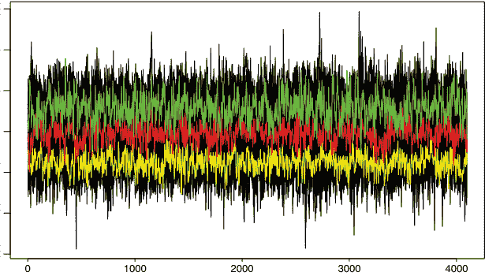

Figure 5.28 健康个体脑电图数据的经验动态分位数（概率为 0.05、0.5 和 0.95）

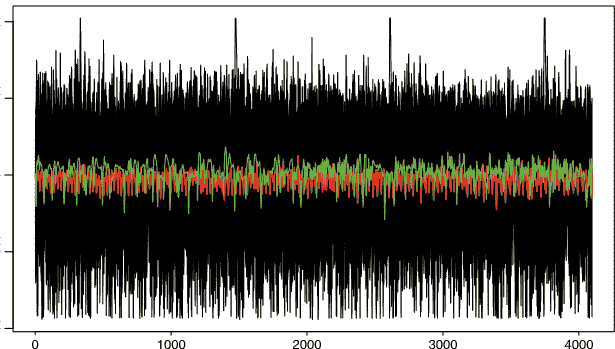

Figure 5.29 癫痫患者脑电图数据的经验动态分位数（概率为 0.05、0.5、0.95）

用LDF计算的最大判别方向上的数据。LR的估计模型所有系数均具有统计显著性，如输出所示。使用全部数据时，LDF的判别错误为9，LR为2.5%。然而，当分割样本时，LDF在训练样本中有8%的错误，在测试样本中有16%的错误，而LR在训练样本中有3%的错误，在测试样本中有33%的错误。这些结果表明LR存在一定的过拟合。仅用一个样本比较两种方法可能具有误导性，使用多个训练和测试数据分割来复制分析是有用的。使用50个分割和运行程序

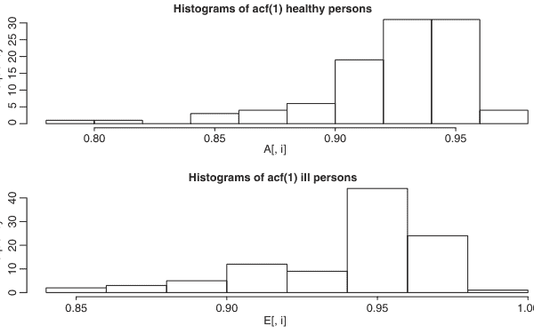

Figure 5.30 健康人和癫痫患者脑电图数据滞后-1自相关系数的直方图

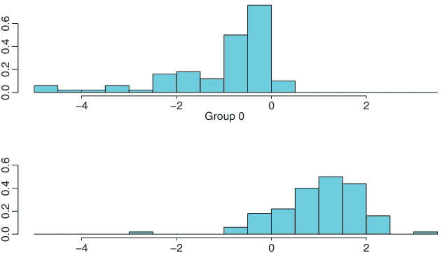

Figure 5.31 脑电图数据在最大判别方向上的投影

discrim程序执行所有分析，LDF的平均结果为：样本内8%，样本外13%；LR为：样本内3%，样本外13%。因此，在本例中，两种方法表现相似。

### R命令和脑电图数据分析

```
> # Example of discrimination with the EEG data
> library(caTools)
> library(MASS)
> library(e1071)
> XA <- read.csv("EEGsetA.csv", header=FALSE)
> XE <- read.csv("EEGsetE.csv", header=FALSE)
> XA=as.matrix(XA)
> XE=as.matrix(XE)
> k=dim(XA) [2]
> T=dim(XA) [1]
> #The EDQ(.05,.5,.95) shows differences between the two groups
> edqplot(XA)
> edqplot(XE)
> edqplot(XA)
> edqplot(XE)
#There are also differences among models in both groups
> SummaryModel(XA)
Number of stationary series: 100
q=0 q=1 q=2 q=3
p=0 0 0 0 0
p=1 0 0 0 0
p=2 0 0 2 0
p=3 0 0 4 3
p=4 0 0 6 9
p=5 0 0 31 45
> SummaryModel(XE)
Number of stationary series: 100
q=0 q=1 q=2 q=3
p=0 0 0 0 0
p=1 0 0 0 0
p=2 0 0 0 4
p=3 0 0 3 9
p=4 0 0 15 23
p=5 0 1 22 23
> h=5
> #Compute acf and ccf of the stationary series XA.
> aa=acf (XA,lag.max=h,plot=FALSE)
> #aa matrix with columns the acf of each series is formed
> MA=matrix(0,h,k)
> nl=h+1
> for(i in 1:k)
+   { MA[,i]=aa$acf[c(2:nl),i,i] }
> k=dim(XE) [2]
> T=dim(XE) [1]
> #Compute the acf and ccf of the stationary series XE
> aa=acf (XE,lag.max=h,plot=FALSE)
> #aa matrix with columns the acf of each series is formed
> ME=matrix(0,h,k)
> nl=h+1
> for(i in 1:k)
+   { ME[,i]=aa$acf[c(2:nl),i,i] }
> A=t(MA)
> E=t(ME)
> ACM=rbind(A,E)
> par(mfrow=c(2,1))
> #The histogram of the acf(1) for healthy and ill patients
> i=1
> plot (hist (A[,i],plot=FALSE),main="histograms of acf(1) healthy persons")
> plot (hist (E[,i],plot=FALSE),main="histograms of acf(1) ill persons")
> y1=matrix(0,100,1)
> y2=matrix(1,100,1)
> y=rbind(y1,y2)
> yf=as.factor(y)
> data=data.frame(yf,ACM)
> names(data)
[1] "yf" "X1" "X2" "X3" "X4" "X5"
> ## Discrimination with LDF
> ##First with all the data
> slda1=lda(x=ACM,grouping = yf, cv=TRUE)
> plot(slda1)
> plot(slda1)
> cl=predict(slda1,ACM)$class
> slda1.data <- cbind(data, predict(slda1)$x)
> tf0 = table(yf, cl)
> tf0
```

| yf | 0 | 1 |
|---|---|---|
| 0 | 95 | 5 |
| 1 | 13 | 87 |

```
> ## Logistic discrimination with all the data
> lg1=glm(yf~., data=data,family=binomial(link="logit"))
> summary(lg1)
Call:
glm(formula = yf ~ ., family = binomial(link = "logit"), data = data)
Deviance Residuals:
Min 1Q Median 3Q Max
-1.1993 -0.1308 0.0161 0.1821 5.6475

Coefficients:
Estimate Std. Error z value Pr(>|z|)
(Intercept) -1246.9 207.0 -6.024 1.70e-09 ***
X1 439.1 130.8 3.356 0.000792 ***
X2 2932.6 511.0 5.739 9.54e-09 ***
X3 -3595.0 627.6 -5.728 1.01e-08 ***
X4 1874.0 350.7 5.344 9.07e-08 ***
X5 -402.7 86.5 -4.656 3.23e-06 ***
---
Signif. codes: 0 '***' 0.001 '**' 0.01 '*' 0.05 '.' 0.1 ' ' 1
(Dispersion parameter for binomial family taken to be 1)

Null deviance: 277.259 on 199 degrees of freedom
Residual deviance: 70.907 on 194 degrees of freedom
AIC: 82.907

Number of Fisher Scoring iterations: 8
> ## Compute probabilities in the form of P(y=1|X) .
> ##Our decision boundary will be 0.5. If P(y=1|X) > 0.5
> ##then y = 1 otherwise y=0.
> y_lgl <- predict(lg1,newdata=data,type='response')
> y_lglr <- ifelse(y_lgl > 0.5,1,0)
> misClasificError <- mean(y_lglr != yf)
> print(paste('Accuracy',1-misClasificError))
[1] "Accuracy 0.975"
> t10 = table(yf, y_lglr)
> t10
```

| yf | 0 | 1 |
|---|---|---|
| 0 | 99 | 1 |
| 1 | 4 | 96 |

```
> # Discrimination via splitting the sample
> #Splitting the data set into a training set and a test set
> set.seed(123)
> split = sample.split(yf, SplitRatio = 0.65)
> training_set = subset(data, split == TRUE)
> test_set = subset(data, split == FALSE)
> training_set[ ,-1] = scale(training_set[ ,-1])
> test_set[ ,-1] = scale(test_set[ ,-1])
> ## LDA with the splitted sample
> fld1=lda(x=training_set[ ,-1],grouping = training_set[ ,1])
> plot(fld1)
> y_fld1 = predict(fld1, newdata = training_set[ ,-1])
> misClasificError <- mean(y_fld1$class != training_set[,1])
> print(paste('Accuracy of LDF in sample',1-misClasificError))
[1] "Accuracy of LDF in sample 0.923076923076923"
> y_fld2 = predict(fld1, newdata = test_set[ ,-1])
> misClasificError <- mean(y_fld2$class != test_set[,1])
> print(paste('Accuracy of LDF out of sample',1-misClasificError))
[1] "Accuracy of LDF out of sample 0.842857142857143"
> tf1 = table(training_set[ , 1], y_fld1$class)
> tf1
    1
0 61 4
1 6 59
> tf2 = table(test_set[ , 1], y_fld2$class)
> tf2
    1
0 28 7
1 4 31
> # Logistic discrimination splitting the sample
> lg2=glm(yf~.,data=training_set,family=binomial(link="logit"),
> control = list(maxit = 50))
> summary(lg2)
Call:
glm(formula=yf ~.,family=binomial(link="logit"),data=training_set,
control = list(maxit = 50))

Deviance Residuals:
    Min       1Q   Median       3Q      Max  
-1.62439 -0.00012  0.00000  0.00313  1.90223 

Coefficients:
             Estimate Std. Error z value Pr(>|z|)  
(Intercept)  -8.138    4.281   -1.901  0.0573 .
X1           84.759   45.209    1.875  0.0608 .
X2          710.381  410.286    1.731  0.0834 .
X3         -1509.568  822.208   -1.836  0.0664 .
X4          910.752  491.394    1.853  0.0638 .
X5         -179.072  96.971   -1.847  0.0648 .
---
Signif. codes:  0 '***' 0.001 '**' 0.01 '*' 0.05 '.' 0.1 ' ' 1

(Dispersion parameter for binomial family taken to be 1)

    Null deviance: 180.218  on 129  degrees of freedom
Residual deviance:  10.136 on 124  degrees of freedom
AIC: 22.136
Number of Fisher Scoring iterations: 12
> y_lg2 = predict(lg2, newdata = training_set[,-1])
> y_lg2r <- ifelse(y_lg2 > 0.5,1,0)
> misClasificError <- mean(y_lg2r != training_set[,1])
> print(paste('Accuracy of LR in sample',1-misClasificError))
[1] "Accuracy of LR in sample 0.976923076923077"
> t11 = table(training_set[, 1], y_lg2r)
> t11
y_lg2r
0 1
0 64 1
1 2 63
> y_lg3 = predict(lg2, newdata = test_set[,-1])
> y_lg3r <- ifelse(y_lg3 > 0.5,1,0)
> misClasificError <- mean(y_lg3r != test_set[,1])
> print(paste('Accuracy of LR out of sample',1-misClasificError))
[1] "Accuracy of LR out of sample 0.671428571428571"
> t12 = table(test_set[, 1], y_lg3r)
> t12
y_lg3r
0 1
0 31 4
1 19 16
[1] "Accuracy LDF in sample 0.903538461538462"
[1] "Accuracy LDF out of sample 0.871142857142857"
[1] "Accuracy LR in sample 0.968615384615385"
[1] "Accuracy LR out of sample 0.876571428571429"
```

## 5.6 非参数分类

当特征的分布未知时，可使用几种非参数方法进行判别。第一种是最近邻（NN），该方法应用非常简单，并常作为方法间比较的基准（参见，例如，Dau et al. 2018）。第二种是支持向量机（SVM），由Vapnik（2013）提出，与机器学习中分类机构建理论相关，如Cherkassky和Mulier（1998）以及Vapnik（2013）所述。第三，有一些分类方法可以应用于更广泛的预测问题集，包括时间序列预测，这些程序在第7章和第8章中有所介绍。它们包括分类和回归树（CART）、随机森林、提升、神经网络和深度学习。最后，对于大型数据集，我们可以估计特征的联合概率分布，并使用此经验分布对新观测值进行分类。这些程序在时间序列分类问题的不同设置中的效率仍在进行深入研究。

### 5.6.1 最近邻

一种简单且通用的分类程序，在许多情况下都取得了良好的效果，具体如下：


- 1. 定义两点之间的距离度量。
- 2. 计算待分类点 \(x_0\) 与样本中所有点之间的距离。
- 3. 选择最接近 \(x_0\) 的 \(m\) 个样本点。计算这些 \(m\) 个点属于每个总体的比例。将点 \(x_0\) 归类到这 \(m\) 个点中频率最高的总体。

该方法称为m-NN。在m=1的特定情况下，NN将新元素归类到其最近元素所属的总体。一个关键问题是m的选择。一种可能性是尝试不同的值，将分类错误作为m的函数得到，并选择导致最小观测分类错误的m值。

这种简单方法的优点之一在于它只查看待分类新数据周围的点分布。因此，如果某些特征不相关且有用于分类的信息包含在较小维度的空间中，则局部近似使得计算出的距离可能是较大空间的良好表示。对于时间序列分析，可以使用第5.1节中提出的任何距离和不相似性度量。

当特征空间的维度p较大时，NN效果不好。此时，一点到其他所有点的距离通常较高，这会降低该方法的性能。例如，假设数据由单位边长、维度为p的超立方体中均匀分布的点定义。考虑一个边长L < 1的内部超立方体。它将包含总体（初始总体）中等于 \(p_r = L^p\) 比例的点。对于较大的p，例如p = 500，边长L = 0.99的大超立方体将以p = 0.0065的概率包含总体中的点。因此，如果我们从总体中抽取n = 1000的样本，该超立方体中预期的点数为6.5。高维空间在相对意义上非常宽广，局部距离在高维中可能效果不好。针对这种情况，已提出了一些自适应最近邻方法；参见Hastie et al. (2001)。另一种可能性是通过将数据投影到某些有用方向（如极端峰度方向）来降低空间维度；参见Peña and Prieto (2001)和Peña et al. (2010)。这些方法的效率和有用性需要进一步研究。

### 5.6.2 支持向量机

歧视的一种流行方法是SVM；参见Vapnik and Chapelle (2000)、Cherkassky and Mulier (1998)、Scholkopf and Smola (2001)及其参考文献。我们在此首先针对两个状态的情况介绍该方法。该程序处理分类问题与之前的方法略有不同：(1) 与其寻找依赖于样本中所有点的全局解，不如寻找主要依赖于定义两个状态之间边界的点的局部解；(2) 与其寻找变量空间的降维并在较小空间中求解问题，不如寻找更大的空间，包括原始变量的非线性变换，使得点可以在其中完美地线性分离。\( R^p \) 中的超平面是维度为 \( p - 1 \) 的子空间，由线性方程定义

```
\( w'x = b, \quad (5.59) \)
```

其中 \( w = (w_1, ..., w_p) \neq 0 \)，\( x = (x_1, ..., x_p)' \)，且 \( b \) 为实数。如果超平面包含原点，其方程变为 \( w'x = 0 \)：所有从原点指向超平面上一点 \( x \) 的向量都与定义超平面的向量 \( w \) 正交。如果超平面不包含原点，则 \( b \neq 0 \)。设 \( x_0 \) 为原点在超平面上的投影，则 \( w'x_0 = b \)。因此，我们可以将Eq. (5.59)改写为

```
\( w'x = w'x_0 \quad \text{or} \quad w'x + w_0 = 0, \)
```

其中 \( w_0 = -w'x_0 \)。一般来说，\( R^p \) 中的超平面将 \( R^p \) 划分为两个分离子空间，即 \( w'x + w_0 > 0 \) 和 \( w'x + w_0 < 0 \)。

#### 5.6.2.1 线性可分问题

假设我们有一个包含 \( n \) 个元素的训练集 \( \{(y_i, x_i)\} \)，其中 \( y_i \) 是二元分类变量，为简化起见，其可能取值为 \( -1 \) 和 \( +1 \)。如果该集合线性可分，则一组的所有观测值（例如 \( y_i = -1 \) 的观测值）位于超平面的一侧，而另一组的所有点（\( y_i = 1 \) 的点）位于另一侧。因此，一侧的点满足 \( w'x_i + w_0 < 0 \)，另一侧的点满足 \( w'x_i + w_0 > 0 \)。此外，对于某个依赖于数据的值 \( m \)，存在等价关系 \( w'x_i + w_0 \le -m \) 和 \( w'x_i + w_0 \ge m \)。这两个不等式可以合写为

```
\( y_i(w'x_i + w_0) \ge m, \quad \text{for } i = 1, ..., n, \quad (5.60) \)
```

我们希望找到使 \( m \)（即组间的间隔或分离）尽可能大的超平面。图5.32说明了我们要解决的问题。在最大化问题中，必须考虑到满足Eq. (5.60)条件的超平面不是唯一的，因为任何其他超平面 \( c(\mathbf{w}'\mathbf{x}_i + w_0) = 0 \)（对任意 \( c \neq 0 \)）也是解。为了确定超平面，我们定义 \(\mathbf{u} = \mathbf{w}'/\|\mathbf{w}\|\)，待求解的问题为

max(m)  
such that \(\|\mathbf{u}\| = 1\) and \(y_i(\mathbf{u}'\mathbf{x}_i + w_0) \geq m\). (5.61)

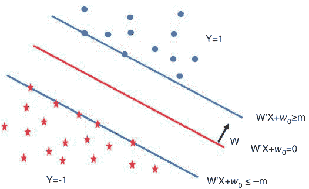

我们以略有不同的方式写出这个优化问题，这更容易求解。首先，请注意，点 \(\mathbf{x}_i\) 到一般超平面 \(\mathbf{w}'\mathbf{x} + w_0 = 0\) 的距离是该点与其在超平面上的投影 \(\mathbf{x}_i(p)\) 之间的距离。向量 \(\mathbf{x}_i - \mathbf{x}_i(p)\) 与超平面正交，因此我们可以写成

\(\mathbf{x}_i - \mathbf{x}_i(p) = d_i\mathbf{u},\)

其中 \(\mathbf{u}\) 是与超平面正交的单位长度向量，\(d_i\) 是到超平面的距离。如果我们将此方程乘以 \(\mathbf{u}'\)，并使用 \(\mathbf{x}_i(p)\) 在超平面上，因此 \(\mathbf{w}'\mathbf{x}_i(p) + w_0 = 0\)，则

\(\mathbf{u}'(\mathbf{x}_i - \mathbf{x}_i(p)) = \frac{\mathbf{w}'}{\|\mathbf{w}\|}[\mathbf{x}_i - \mathbf{x}_i(p)] = \frac{\mathbf{w}'\mathbf{x}_i + w_0}{\|\mathbf{w}\|} = d_i.\)

因此，Eq. (5.60) 的等价条件为，对于某个 \( M \) 值

\(y_i\frac{(\mathbf{w}'\mathbf{x}_i + w_0)}{\|\mathbf{w}\|} \geq M \qquad \text{for } i = 1, \dots, n\)

或

\(y_i(\mathbf{w}'\mathbf{x}_i + w_0) \geq \|\mathbf{w}\|M, \qquad \text{for } i = 1, \dots, n.\)

向量 \(\mathbf{w}\) 的范数是任意的，但必须定义它来确定超平面。事实上，与Eq. (5.61)相比，如果 \(\|\mathbf{w}\| = 1\)，则 \(M = m\)。我们需要用这些变量中的任何一个来固定尺度，一个简单的解是取

\(\|\mathbf{w}\| = 1/M,\)

并且最大化距离 \(M\) 等同于最小化范数 \(\|\mathbf{w}\|\)。这种方法的另一个优点是我们不需要限制 \(\|\mathbf{w}\| = 1\)，因为超平面由解完美定义。优化问题随后为

\(\min \frac{1}{2}\|\mathbf{w}\|^2,\)  
subject to \(y_i(\mathbf{w}'\mathbf{x}_i + w_0) \geq 1, \quad i = 1, \dots, n.\) (5.62)

这是一个带有 \( p + 1 \) 个变量的二次优化问题，即向量 \(\mathbf{w}\) 的分量加上 \( w_0 \)。待最小化的函数可以用拉格朗日乘法表示为

\(F_L = \frac{1}{2}\mathbf{w}'\mathbf{w} - \sum_{i=1}^n \lambda_i[y_i(\mathbf{w}'\mathbf{x}_i + w_0) - 1],\) (5.63)


其中 $\lambda_i \ge 0$，使得当所有点的约束条件都满足时 $F_L \le w'w/2$，且如果对变量 $(y_j, x_j)$ 不满足约束条件 $y_i(w'x_i + w_0) \ge 1$，则会增加 $F_L$。对 $w$ 和 $w_0$ 求导

$$\frac{\partial F_L}{\partial w} = 0 = w - \sum_{i=1}^n \lambda_i y_i x_i,$$ (5.64)

$$\frac{\partial F_L}{\partial w_0} = 0 = \sum_{i=1}^n \lambda_i y_i,$$ (5.65)

并将这些方程代入公式 (5.63)，我们得到对偶问题

$$F_D = \frac{1}{2}w'w - w'w + \sum_{i=1}^n \lambda_i = \sum_{i=1}^n \lambda_i - \frac{1}{2} \sum_{i=1}^n \sum_{j=1}^n \lambda_i \lambda_j y_i y_j x_i' x_j,$$ (5.66)

这是一个关于 $n$ 个变量 $\lambda_i$ 的问题，这些变量满足限制条件 $\lambda_i \ge 0$ 和 $\sum_{i=1}^n \lambda_i y_i = 0$。它被称为对偶问题，最小化 $F_L$ 以找到定义超平面的 $p+1$ 个变量及其限制条件，等价于在满足各自限制条件的 $n$ 个变量 $\lambda_i$ 条件下最大化 $F_D$。第二个问题更容易求解，且目标函数仅通过特征向量的标量积依赖于数据。这是一个具有二次准则和线性约束的凸优化问题，可通过标准优化方法求解。参见，例如，Hastie et al. (2001)。

还要注意，超平面由样本点之间的标量积定义，因为根据公式 (5.64) 它可以写成

$$f(x) = w'x + w_0 = \sum_{i=1}^n \lambda_i y_i x_i' x + w_0.$$ (5.67)

超平面由 $\lambda_i > 0$ 的点定义，而 $\lambda_i = 0$ 的点在超平面方程中不起作用。$\lambda_i > 0$ 的点称为支持向量，并满足 $y_i(w'x_i + w_0) = 1$。参见图 5.32。分类是根据 $w'x_i + w_0$ 的符号进行的。请注意，限制条件定义了一个由限制超平面 $w'x_i + w_0 = 1$ 和 $w'x_i + w_0 = -1$ 所界定的空间，该空间内不存在数据点。包含在这些限制超平面中的数据是支持向量，它们起着关键作用，因为如果它们被修改，分类将会改变，这一特性仅适用于支持向量。这是与 Fisher 的 LDF 或逻辑回归的重要区别。在这些方法中，对任意点的微小扰动（从 $x_i$ 到 $x_i + \epsilon u$，其中 $\epsilon$ 很小）可能会导致分类变化。在支持向量机 (SVM) 中，这种情况会发生在靠近限制超平面的点上，但对远离两个超平面的点则没有影响。

对于具有相同协方差矩阵的正态可分数据，Fisher LDF 提供的解是最优的，但当协方差矩阵不同且数据不服从正态分布时，SVM 提供了一个有用的替代方案。通常在这些情况下，逻辑回归会提供与 SVM 类似的解。

#### 5.6.2.2 非线性可分问题

如果数据不可线性分离，我们可以修改问题，找到一个超平面，使其在大多数数据上最大化类群间的分离，但允许少数点被错误分类。为了达到这个目的，我们为每个点引入一个变量 $\alpha_i \ge 0$，如果点被正确分类则该变量为零，否则为正。公式 (5.62) 的优化问题修改为

$$
\min \left( \frac{1}{2} \|w\|^2 + C \sum_{i=1}^n \alpha_i \right) , \tag{5.68}
$$

\[
\text{subject to } y_i(w'x_i + w_0) \ge 1 - \alpha_i, \quad i = 1, \dots, n, \\
\alpha_i \ge 0, \tag{5.69}
\]

其中需要给定参数 $C$。通常会尝试不同的值，并选择分类误差最小的那个。它也可以通过交叉验证 (CV) 获得，如第 5.4.2 节所述。拉格朗日函数为

$$
F_L = \frac{1}{2} w'w + C \sum_{i=1}^n \alpha_i - \sum_{i=1}^n \lambda_i [y_i(w'x_i + w_0) - (1 - \alpha_i)] - \sum_{i=1}^n \mu_i \alpha_i \tag{5.70}
$$

其中 $\lambda_i \ge 0$。对 $w$、$w_0$ 和 $\alpha_i$ 求导，我们有

$$
\frac{\partial F_L}{\partial w} = 0 = w - \sum_{i=1}^n \lambda_i y_i x_i, \\
\frac{\partial F_L}{\partial w_0} = 0 = \sum_{i=1}^n \lambda_i y_i, \\
\frac{\partial F_L}{\partial \alpha_i} = 0 = C - \lambda_i - \mu_i
$$

并且，将这些方程代入公式 (5.70)，我们得到对偶函数

$$
F_D = \sum_{i=1}^n \lambda_i - \frac{1}{2} \sum_{i=1}^n \sum_{j=1}^n \lambda_i \lambda_j y_i y_j x'_i x_j, \tag{5.71}
$$

该函数需在限制条件 $\mu_i \ge 0, 0 \le \lambda_i \le C$ 和 $\sum_{i=1}^n \lambda_i y_i = 0$ 下最大化。该问题与公式 (5.66) 类似，同样，函数 $F_D$ 以及超平面都通过标量积 $x'_i x_j$ 依赖于数据，如公式 (5.67) 所示。

除了允许存在一些不可线性分离的点外，SVM 方法还可以通过增加空间维度来处理非线性。这通过引入以前特征的非线性函数作为新特征，并在该更大空间中寻找最优线性分离来实现。这种方法与经典程序所采用的方法相反，经典程序将数据投影到较小空间并使用非线性函数来分离状态。例如，在图 5.33 中，两个组在一维空间中无法分离，但在二维空间中是线性可分的。当我们引入新变量时，重要的是要意识到，如公式 (5.66) 所示，目标函数仅依赖于观测值之间的标量积。

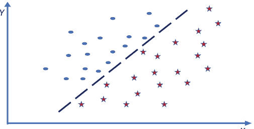

**Figure 5.33** 可在二维空间中线性分离但不能在一维空间中分离的两个变量。

因此，如果我们引入特征的非线性变换，并从变量 $\mathbf{x} \in R^p$ 转到一组新变量 $\boldsymbol{h}(\mathbf{x}) \in R^q$，其中 $q > p$，我们需要计算标量积 $\boldsymbol{h}(\mathbf{x})'\boldsymbol{h}(\mathbf{x})$。一种快速方法是使用内积核函数，它直接给出标量积。例如，多项式内积核函数是

$$
K(\mathbf{x}_i, \mathbf{x}'_j) = (1 + \mathbf{x}'_i \mathbf{x}'_j)^d = \boldsymbol{h}(\mathbf{x}_i)' \boldsymbol{h}(\mathbf{x}_j),
$$

它提供了两个向量 $\boldsymbol{h}(\mathbf{x}_i)'\boldsymbol{h}(\mathbf{x}_j)$ 的标量积，该标量积包含了 $\mathbf{x}$ 中每个 $p$ 个特征上的 $d$ 阶多项式。例如，假设 $d=2$ 和 $p=2$。那么，$\mathbf{x}_i = (x_{1i}, x_{2i})'$ 和 $\mathbf{x}'_i \mathbf{x}_i = x_{1i}^2 + x_{2i}^2$，且

$$
K(\mathbf{x}_i, \mathbf{x}_i) = (1 + x_{1i}^2 + x_{2i}^2)^2 = (1 + 2x_{1i}^2 + 2x_{2i}^2 + 2x_{1i}^2 x_{2i}^2 + x_{1i}^4 + x_{2i}^4).
$$

这个内积包括原始变量中 $d=2$ 次多项式的所有项。请注意，$K(\mathbf{x}_i, \mathbf{x}_i)$ 是向量 $\boldsymbol{h}(\mathbf{x}_i) = (1, \sqrt{2}x_{1i}, \sqrt{2}x_{2i}, \sqrt{2}x_{1i}x_{2i}, x_{1i}^2, x_{2i}^2)$ 的平方范数，其中 $\boldsymbol{h}(\mathbf{x}_i) \in \mathbf{R}^6$。一般来说，$K(\mathbf{x}_i, \mathbf{x}_j)$ 给出了向量 $\boldsymbol{h}(\mathbf{x}_i)$ 和 $\boldsymbol{h}(\mathbf{x}_j)$ 的标量积，包括所有直到 $d$ 阶的项。因此，如果我们使用这个核来增加特征空间的维度，超平面是

$$
f(\boldsymbol{h}(\mathbf{x})) = \boldsymbol{w}' \boldsymbol{h}(\mathbf{x}) + w_0 = \sum_{i=1}^n \lambda_i y_i K(\mathbf{x}_i, \mathbf{x}) + w_0,
$$

其中现在 $\mathbf{x} \in \mathbf{R}^q$ 和 $\boldsymbol{h}(\mathbf{x}) \in \mathbf{R}^q$，且需要求解的优化问题是采用新变量 $\boldsymbol{h}(\mathbf{x}_i)$ 的公式 (5.71)，其形式为

$$
\max F_D = \sum_{i=1}^n \lambda_i - \frac{1}{2} \sum_{i=1}^n \sum_{j=1}^n \lambda_i \lambda_j y_i y_j K(\mathbf{x}_i, \mathbf{x}_j),
$$

$$
C \ge \lambda_i \ge 0, \quad \mu_i \ge 0, \quad \sum_{i=1}^n \lambda_i y_i = 0.
$$

其他可用的内积核函数包括基于径向基、样条、傅里叶系数、Sigmoid 等的核函数（Cherkassky and Mulier, 1998）。


对于多于两个状态的情况，分类是分步进行的。在第1步，在第一个状态与其余状态之间进行分类。如果元素被分类至第一个状态，则程序停止。否则，进入第2步，在第二个状态与其余状态之间进行分类。该过程持续进行，直到元素被分类为止。

### 5.6.3 密度估计

如果特征的密度不服从正态分布，且所考虑的特征数量 \(p\) 不过大，则可以使用系统之前输出的训练集来直接估计特征的分布。假设由状态 \(s_i\) 生成的时间序列有 \(n_i\) 个，总观测数为 \(n = n_1 + \cdots + n_c\)。要对维度为 \(p\) 的点 \(\mathbf{x}_0\) 进行分类，我们无需估计所有密度，只需估计该点处的密度。随后，通过最大化后验概率来进行分类，即最大化

```
\(\max_{i \in S} \pi_i f(\mathbf{x}_0 | s_i).\)
```

在点 \(\mathbf{x}_0\) 处估计给定状态密度的一种方法是：在 \(p\) 维空间中构建一个以 \(\mathbf{x}_0\) 为中心、边长为 \(h\) 的超立方体，统计来自该状态并落入其中的点数 \(n_i(\mathbf{x}_0)\)，并按超立方体体积内点的相对频率来估计密度，如下

```
\(\widehat{f}(\mathbf{x}_0 | s_i) = \frac{n_i(\mathbf{x}_0)}{n_i h^p}.\)
```

此过程与最近邻（NN）方法类似，但不是设定 \(m\) 个最近点的数量，而是设定带宽 \(h\)，并统计每个分布中有多少点落入该区间。上述规则可以写成

```
\(\widehat{f}(\mathbf{x}_0 | s_i) = \frac{1}{n_i h^p} \sum_{i=1}^n \prod_{j=1}^p k \left( \frac{x_{ij} - x_{0j}}{h} \right),\)
```

其中函数 \(k\) 被称为核函数，并满足

```
\(k \left( \frac{x_{ij} - x_{0j}}{h} \right) = \begin{cases} 1, & \text{if } |x_{ij} - x_{0j}| \le h, \\ 0, & \text{otherwise.} \end{cases}\)
```

该密度估计器相当不规则，因为点要么进入超立方体并以值1对该点密度做出贡献，要么对密度确定毫无贡献。更好的估计器是允许点根据其到该点的距离，对给定点处的密度函数估计做出贡献，这可以通过使用根据点到目标点的距离对点的信息进行加权平均的核函数来实现。一种常用的核函数是正态或高斯核函数，由下式给出

```
\(k_G \left( \frac{x_{ij} - x_{0j}}{h} \right) = \frac{1}{\sqrt{2\pi}} \exp \left[ -\frac{1}{2} \left( \frac{x_{ij} - x_{0j}}{h} \right)^2 \right].\)
```

然后，在假设特征相互独立的情况下，我们得到所谓的朴素贝叶斯分类器，由下式给出

$$\widehat{f}^{\text{NB}}(\mathbf{x}_0|s_i) = \frac{1}{n_i h^p} \sum_{l=1}^{n_i} \prod_{j=1}^p k_G\left(\frac{x_{lj} - x_{0j}}{h}\right).$$

该过程可以通过考虑变量间的依赖关系并使用正态多变量核函数来改进，从而得到：

$$\widehat{f}(\mathbf{x}_0|s_i) = \frac{1}{n_i h^p |\mathbf{S}_i|^{1/2}} \sum_{l=1}^{n_i} \exp \left\{ - \frac{1}{2h^2} (\mathbf{x}_l - \mathbf{x}_0)' \mathbf{S}_i^{-1} (\mathbf{x}_l - \mathbf{x}_0) \right\},$$

其中 \(\mathbf{S}_i\) 是状态 \(s_i\) 中协方差矩阵的估计值。通常，所有状态中都会使用每个状态估计矩阵的加权平均值，取相同的 \(\mathbf{S}_i\) 矩阵。

所有核方法的问题在于，密度估计对带宽参数 \(h\) 的选择高度敏感，而 \(h\) 是未知的，但可以通过CV估计。

### 示例 5.8

我们再次使用台湾AirBox数据及其位置。位置图表明，一些Air Box位于台北（岛屿北部，纬度 \(\le 22.7\) 且经度 \(\le 129.5\)），另一些位于台北东南部的宜兰县（纬度 \(\ge 24.5\) 且经度 \(\ge 121.4\)）。利用这两个地点的序列集，我们开发了一种判别程序，用于将新的时间序列分类为来自北部（台北）或南部（宜兰）。可用于判别的变量是在示例5.1中计算的前五个自相关系数。用于判别的 **R** 命令如下，但我们未重复示例5.1和5.6中使用的命令。

结果表明，自相关系数的判别能力较低。SVM中的分类错误率约为30-35%，LDF和LR略高一些。我们在SVM中尝试了其他非线性核函数，但结果相似，在本例中，SVM的非线性特性并未提供明显优势。

#### 用于判别分析的 R 命令：

```
> #The two groups of data, Taipei and Yilan, are obtained.
> library(caTools)
> library(MASS)
> library(e1071)
> lo=as.matrix(locations032017)
> x=as.matrix(TaiwanAirBox032017)
> #First, we build the matrix of clean data
> x=x[,-c(1,29,70)]
> lo=lo[,-1]
> lo=lo[-c(29,70),]
> #Data frame with classification variable for Taipei and Yilan.
> i1=which(lo[,1]<22.7)
> i2=which(lo[,2]<120.5)
> i3=sort(intersect(i1,i2))
> x1=x[, i3]
> i4=length(i3)
> y1=matrix(0,i4,1)
> j1=which(lo[,1]>24.5)
> j2=which(lo[,2]>121.4)
> j3=sort(intersect(j1,j2))
> j4=length(j3)
> intersect(j3,j3)
> x2=x[, j3]
> y2=matrix(1,j4,1)
> y=c(y1,y2)
> xc=cbind(x1,x2)
##The computation of ACF is similar to Examples 5.1 and 5.6.
#### The data, prepared as in Example 5.6 is in data.frame=data
##Splitting the data set into the Training set and Test set
> set.seed(123)
> split = sample.split(y, SplitRatio = 0.65)
> training_set = subset(data, split == TRUE)
> test_set = subset(data, split == FALSE)
> training_set[,-1] = scale(training_set[,-1])
> test_set[,-1] = scale(test_set[,-1])
#### Discrimination with Support Vector Machine
> svm = svm(y~training_set[,1], x=training_set[,-1],
             type = 'C-classification', kernel = 'sigmoid')
> y_sv1 = predict(svm, newdata = training_set[,-1])
> misClasificError <- mean(y_sv1 != training_set[,1])
> print(paste('Accuracy of SVM in sample',1-misClasificError))
[1] "Accuracy of SVM in sample 0.7083333333333333"
> y_sv2 = predict(svm, newdata = test_set[,-1])
> misClasificError <- mean(y_sv2 != test_set[,1])
> print(paste('Accuracy of SVM out of sample',1-misClasificError))
[1] "Accuracy of SVM out of sample 0.6666666666666667"
#### As a reference we present the results with LDF and LR for this data
#### LDF and LR are computed as in Example 5.6
> print(paste('Accuracy of LDF in sample',1-misClasificError))
[1] "Accuracy of LDF in sample 0.75"
> print(paste('Accuracy of LDF out of sample',1-misClasificError))
[1] "Accuracy of LDF out of sample 0.705882352941176"
> print(paste('Accuracy of LR in sample',1-misClasificError))
[1] "Accuracy of LR in sample 0.729166666666667"
> print(paste('Accuracy of LR out of sample',1-misClasificError))
[1] "Accuracy of LR out of sample 0.705882352941176"
```

## 5.7 其他分类问题和方法

通常，我们会遇到只有部分可用数据带有标签的情况。例如，我们有住院病人的体温时间系列，并知道其中一些人已通过检测确认感染COVID-19病毒，而另一些人尚未接受病毒检测。在其他情况下，我们拥有时间序列向量的演变，但可能类别或组别的标签仅在样本的一小部分中已知。此类问题被称为 _部分无监督分类_，尤其在为对象获取分类标签成本高昂时会出现。在这种情况下，我们必须结合使用聚类和判别方法来估计类别的概率，即对部分数据应用聚类分析，对另一部分应用判别模型，例如参见 Liu et al. (2002)。

在其他情况下，我们拥有所有对象的数据和标签，但大多数对象属于同一类别，只有少数属于其他不常见类别。例如，在欺诈检测问题中，可能有许多正常操作，但只有少数描述欺诈。在这种情况下，分类器可能通过将所有对象分配给较大类别来最小化分类错误。这被称为不平衡分类问题，已提出多种解决方案。关于该主题的综述，参见 Ganganwar (2012)。

解决此问题的第一种也是最简单的方法是使用贝叶斯方法，计算对象属于每个类别的后验概率，如Eq. (5.19)所示，并考虑先验概率。我们还可以将分类错误的后果纳入考虑，并将其作为决策问题来处理。第二种方案适用于非常大的数据集，我们可以对数据进行采样以提供更平衡的类别分布，要么通过对少数类示例进行随机过采样并随机复制，要么通过随机欠采样，移除过度代表类别中的病例。第三种方案是将问题视为异常值检测，即尝试在数据集中识别非典型事件，或识别与其余系列不典型的系列，如我们在第4章中讨论过的。

时间序列分类也已从功能数据分析的角度进行研究，通常使用深度概念。关于非平稳时间序列聚类的带宽深度方法，参见 Lopez-Pintado and Romo (2006) 和 Tupper et al. (2015)。功能数据的一种常用距离是动态时序规整，它考虑按顺序取值但时间点不同的系列值之间的距离。参见 Jeong et al. (2011)。

## 练习

- 1. 考虑世界股票指数。使用交叉线性相关作为不相似性度量，应用层次聚类。比较使用不同滞后数的不相似性度量所获得的结果。讨论用于选择聚类数量的不同标准。

- 2. 使用标准化系列之间的欧氏距离，对世界股票指数应用k-means和k-medoids进行聚类。评论所找到的聚类与练习1中获得的聚类之间的差异。

- 3. 考虑文件UMEdata2000_2018.csv中2000年至2019年欧盟的季度经济系列。比较使用系列单变量属性（例如前五个自相关系数）之间的不相似性度量进行层次聚类的结果，以及使用交叉相关的结果。

- 4. 按照示例5.7的分析，对五个EEG数据文件进行判别。对文件EEGsetB.csv、EEGsetC.csv和EEGsetE.csv中的数据应用类似分析。选择在癫痫发作个体和健康个体之间对五个文件进行分类的最佳方式，并使用A至E五个文件比较不同的判别方法。

- 5. 应用SVM对文件EEGsetA.csv与EEGsetB.csv、EEGsetC.csv、EEGsetD.csv和EEGsetE.csv中的数据进行判别，以便对健康个体或癫痫患者的结果进行分类。


6. 使用示例 5.5 中的台湾 AirBox 数据，比较使用 ACF 获得的聚类结果和使用对该序列进行 AR 拟合所得系数的聚类结果。

## 参考文献

- Alonso, A. M., Berrendero, J. R., Hernández, A., and Justel, A. (2006). 基于预测密度的时间序列聚类. 计算统计与数据分析, 51: 762–766.

- Alonso, A. M. and Peña, D. (2019). 基于线性依赖的时间序列聚类. 统计与计算, 29: 655–676.

- Anderson, T. W. and Bahadur, R. R. (1962). 不同协方差矩阵的两元多元正态分类. 数理统计年鉴, 33: 420–431.

- Andrzejak, R. G., Lehnertz, K., Rieke, C., Mormann, F., David, P., and Elger, C. E. (2001). 脑电活动时间序列中非线性确定性和有限维结构的指示：依赖于记录区域和大脑状态. 物理评论 E 64, 061907.

- Banfield, J. D. and Raftery, A. E. (1993). 基于模型的高斯和非高斯聚类. 计量生物学, 49: 803–821.

- Caiado, J., Crato, N., and Peña, D. (2006). 基于周期图的时间序列分类度量. 计算统计与数据分析, 50: 2668–2684.

- Calinski, T. and Harabasz, J. (1974). 一种用于聚类分析的树枝方法. 统计通讯-理论与方法, 3: 1–27.

- Cherkassky, V. and Mulier, F. (1998). 从数据中学习：概念、理论与方法. John Wiley & Sons, New York, NY.

- Corduas, M. and Piccolo, D. (2008). 基于自回归度量的时间序列聚类与分类. 计算统计与数据分析, 52: 1860–1872

- Dau, H. A., Bagnall, A., Kamgar, K., Yeh, C. C. M., Zhu, Y., Gharghabi, S., Ratanamahatana, C. A., and Keogh, E. (2018). UCR 时间序列档案. arXiv 预印本 arXiv:1810.07758.

- Dempster, A. P., Laird, N. M., and Rubin, D. B. (1977). 通过 EM 算法从不完整数据中求极大似然. 英国皇家统计学会杂志, B 系列, 39: 1–38.

- Fraley, C. and Raftery, A. E. (1999). MCLUST: 用于基于模型的聚类分析的软件. 分类期刊, 16: 297–306.

- Fraley, C., Raftery, A. E., Murphy, T. B., and Scrucca, L. (2012). 适用于 R 的 mclust 版本 4: 用于基于模型的聚类、分类和密度估计的正态混合建模. 技术报告第 597 号. 华盛顿大学统计学系.

- Friedman, J. (1989). 正则判别分析. 美国统计协会杂志, 84: 165–175.

- Fisher Box, J. (1978). R.A. 费舍尔：一位科学家的一生. John Wiley & Sons, New York, NY.

- Friedman, J. H. and Tukey, J. W. (1974). 一种用于探索性分析的投影追踪算法. IEEE 计算机汇刊, 23: 881–889.

- Frühwirth-Schnatter, S. and Kaufmann, S. (2008). 多元时间序列的基于模型的聚类. 商业与经济统计期刊, 26: 78–89.

- Ganganwar, V. (2012). 不平衡数据集分类算法概述. 国际新兴技术与先进工程期刊, 2: 42–47.

- Gamerman, D. and Lopes, H. F. (2006). 马尔可夫链蒙特卡洛：用于贝叶斯推断的随机模拟. Chapman and Hall/CRC, London, UK.

- Hartigan, J. A. (1975). 聚类算法. John Wiley & Sons, New York, NY.

- Hastie, T., Tibshirani, R., and Friedman, J. (2001). *统计学习基础*. New York: 统计学春秋丛书.

- Hosmer, D. W. and Lemeshow, S. S. (1989). *应用逻辑回归*. John Wiley & Sons, Hoboken, NJ.

- Huang, H. Y., Ombao, H., and Stoffer, D. S. (2004). 使用 SLEX 模型对非平稳时间序列进行鉴别和分类. *美国统计协会杂志*, **99**: 763–774.

- Jeong, Y. S., Jeong, M. K., and Omitaomu, O. A. (2011). 用于时间序列分类的加权动态时间变形. *模式识别*, **44**: 2231–2240.

- Kakizawa, Y., Shumway, R. H., and Taniguchi, M. (1998). 多元时间序列的鉴别与聚类. *美国统计协会杂志*, **93**: 328–340.

- Kaufman, L. and Rousseeuw, P. J. (1987). 基于 medoid 的聚类. 收录于 Y. Dodge (eds.) 编著. *基于 L1 范数及相关方法的统计数据分析*. North-Holland.

- Kaufman, L. and Rousseeuw, P. J. (2009). *从数据中寻找群组：聚类分析导论*. John Wiley & Sons, Hoboken, NJ.

- Lopez-Pintado, S. and Romo, J. (2006). 功能数据的基于深度的分类. *DIMACS 离散数学与理论计算机科学丛书*, **72**, 103.

- Liu, B., Lee, W. S., Yu, P. S., and Li, X. (2002). 文本文档的部分监督分类. *第 19 届国际机器学习会议论文集*, Sydney, Australia, 387–394.

- Lütkepohl, H. (1996) *矩阵手册*. John Wiley & Sons, Hoboken, NJ.

- McLachlan, G. J. (2004). *判别分析与统计模式识别*. John Wiley & Sons, New York, NY.

- Maharaj, E. A. and Alonso, A. M. (2007). 使用小波对局部平稳时间序列进行鉴别. *计算统计与数据分析*, **52**: 879–895.

- Maharaj, E. A. and Alonso, A. M. (2014). 多元时间序列的判别分析：基于 ECG 信号的诊断应用. *计算统计与数据分析*, **70**: 67–87.

- Maharaj, E. A., D'Urso, P., and Caiado, J. (2019). *时间序列聚类与分类*. Chapman and Hall/CRC, London, UK.

- McCullagh, P. (2018). *广义线性模型*. Routledge, Abingdon, UK.

- Montero, P. and Vilar, J. A. (2014). TSclust: 用于时间序列聚类的 R 包. *统计软件期刊*, **62**: 1–43.

- Peña, D. (1990). 时间序列中的有影响观测值. *商业与经济统计期刊*, **8**: 235–241.

- Peña, D. and Prieto, F. J. (2001). 利用投影进行簇识别. *美国统计协会杂志*, **96**: 1433–1445.

- Peña, D. and Rodriguez, J. (2002). 时间序列拟合优效检验的有力组合检验. *美国统计协会杂志*, **97**: 601–610.

- Peña, D., Prieto, F. J., and Viladomat, J. (2010). 作为揭示聚类结构的有趣方向的峰度矩阵特征向量. *多元分析期刊*, **109**: 1995–2007.

- Piccolo, D. (1990). 用于分类 ARMA 模型的距离度量. *时间序列分析期刊*, **2**: 153–163.

- Rousseeuw, P. J. (1987). 轮廓：聚类分析解释和验证的图形辅助工具. *计算与应用数学期刊*, **20**: 53–65.

- Scholkopf, B. and Smola, A. J. (2001). *基于核的学习：支持向量机、正则化、优化及更多*. MIT Press, Cambridge, MA.

- Seber, G. A. F. (1984). 多元观测. John Wiley & Sons, Hoboken, NJ.

- Shumway, R. H. and Stoffer, D. S. (2000). 时间序列分析及其应用. Springer.

- Tibshirani, R., Walther, G., and Hastie, T. (2001). 通过差距统计量估计数据集中的聚类数量. 英国皇家统计学会杂志, Series B, 63: 411–423.

- Tsay, R. S. (2014). 多元时间序列分析：附带 R 与金融应用. John Wiley & Sons, Hoboken, NJ.

- Tsay, R. S. (2020). 通过极值理论对高维时间序列中的序列相关性进行检验. 计量经济学, 216: 106–117

- Tupper, L. L., Matteson, D. S., and Anderson, C. L. (2015). 非平稳时间序列和风速行为的带深度聚类. arXiv: 1509.00051.

- Vapnik, V. (2013). 统计学习理论的本质. Springer Science & Business Media, New York, NY.

- Vapnik, V. and Chapelle, O. (2000). 支持向量机误差期望的边界. 神经计算, 12: 2013–2036.

- Xiong, Y. and Yeung, D. (2004). 基于 ARMA 混合的时间序列聚类. 模式识别, 37: 1675–1689.

- Wang, Y. and Tsay, R. S. (2019). 带结构断点的多元时间序列聚类. 时间序列分析期刊, 40: 182–202.

- Wang, Y., Tsay, R. S., Ledolter, J., and Shrestha, K. M. (2013). 高维时间序列的同步预测：一种稳健的基于模型的聚类方法. 预测期刊, 32: 673–684.


## 第 6 章
