# 6 动态因子模型

因子模型（FM）由英国心理学家查尔斯·斯皮尔曼在二十世纪前二十五年提出，用于解释智力概念。他发现，不同人在一组心智能力测试中的结果可以由一个一般因子解释，他称其为智力因子 G，以及一个特定成分，该成分取决于测试类别。FM 最初主要在心理学中研究，随后在经济学中用于研究经济发展的维度，在社会学中用于理解社会和经济概念。有关更多信息，请参见 Harman (1976)。

时间序列早期因子分析包括 Anderson (1963)，他认识到需要为时间序列数据（如滞后因子效应）开发特定结果，以及 Brillinger (1964)，他为时间序列引入了动态主成分（DPCs）。Geweke (1977) 对 k 个平稳时间序列提出了动态因子模型（DFM），假设每个变量是两个独立成分之和：由 r 个因子生成的共同成分，加上特定成分或噪声。假设 r 个因子遵循独立线性过程，并可以带滞后地影响变量。他还提出了一种频域程序，通过采用经典 Jöreskog 的最大似然（ML）方法来估计 FM 模型（Jöreskog, 1967）。Sargent 和 Sims (1977) 将该模型称为指数模型，并讨论了使用 Geweke 的估计方法在经济学中的应用。另请参见 Geweke 和 Singleton (1981)。Engle 和 Watson (1981) 将单一 FM 视为线性系统状态空间表示的特例，并展示了如何使用卡尔曼滤波器估计该模型。Chamberlain (1983) 和 Chamberlain 与 Rothschild (1983) 引入了近似动态因子模型（ADFM），其中噪声具有动态性，但特征值有界，并将其应用于套利定价模型，强调有界和无界特征值之间的差异。Connor 和 Korajczyk (1986) 讨论了这些模型，也针对套利问题，并表明可以通过主成分分析（PCA）获得因子的一致估计。

Peña 和 Box (1987) 提出了一个 FM，其中所有动态均由因子驱动，噪声序列不相关。该模型通常称为精确 DFM（EDFM）。他们提出了对滞后协方差矩阵进行特征值分析以估计因子的方法。作者还首次将 DFM 的属性与向量自回归移动平均（VARMA）过程相关联，表明当数据由 DFM 生成时，VARMA 模型缺乏识别性。Stock 和 Watson (1988) 提出了一个用于共同趋势的检验统计量，为 DFM 的非平稳分析打开了道路，Molenaar 等人 (1992) 研究了非平稳 DFM，其中因子遵循线性趋势。他们使用 Jöreskog 的 ML 方法估计了该模型。Forni 等人 (2000) 提出了一种通用方法，允许因子具有无限动态和非正交特异性成分，并使用 Brillinger (1964) 的 DPCs 估计了该模型。他们将该模型称为广义动态因子模型（GDFM），并开发了其用于结构分析和预测的属性（Forni et al. 2005, 2009, 2015）。有关各种 FM 的讨论，请参见 Tsay (2014, 第 6 章)。

近年来，DFM 已成为统计学和计量经济学中一个活跃的研究领域，有许多重要贡献，该领域仍在快速发展。一些近期参考文献包括：Creal 和 Tsay (2015) 考虑具有时间变载荷的高维随机 Copula 模型；Bai 和 Li (2016) 研究近似 FM 中的最大似然推断；Chan 等人 (2017) 考虑 DFM 中的推断和模型选择；Gao 和 Tsay (2019) 提出了一种用于高维时间序列的结构-因子方法；Zhang 等人 (2018) 提出通过 DFM 识别协整的方法；McAlinn 等人 (2018) 从贝叶斯角度考虑稀疏 DFM；Wang 等人 (2019)；Chen 等人 (2020) 研究矩阵值高维时间序列的 FM；以及 Gao 和 Tsay (2020) 调查高维单位根时间序列的结构 FM。

使用 DFM 对多变量时间序列进行建模的优势在于，它们可以用少量参数表示动态演化。与 VARMA 模型相比，这是一个明显的优势，因为 VARMA 模型的参数数量随系列数量的平方增长。在本章中，我们介绍了为平稳和非平稳时间序列提出的 DFM。我们首先研究平稳数据的 EDFM，其中所有动态均由因子驱动，而噪声为白噪声。在某些一般条件下，该模型识别性良好，可以获得一致估计。噪声的动态可以推广以允许某些弱自相关或交叉相关，如同在 ADFM 中一样。该模型在有限样本中不具有识别性，但对弱噪声依赖做出某些强假设后，它可以渐近识别。另一种扩展是允许因子以更复杂的动态影响系列，甚至包括无限数量的滞后，该模型称为 GDFM。该框架通常包括 ADFM 的噪声假设。然后可以通过广义动态主成分（GDPC）估计该模型。

DFM 也已扩展到非平稳数据，主要用于整合过程。然而，所提出的不同程序的优劣仍在研究中。我们还讨论了文献中可用的其他 FM 公式和扩展。最后，我们处理样本量小于正在研究的时间序列数量的情况。

## 6.1 平稳系列的 DFM

考虑 k 维平稳时间序列 z1, ..., zT 的实现，其中 zt = (z1t, ..., zkt)'。我们假设每个时间序列均已通过减去其样本均值进行中心化，使得对于所有 j = 1, ..., k，sum zjt = 0，并令 Z 为维度为 T x k 的数据矩阵，其中第 i 行是 zt'。我们假设系列的动态演化可以解释为两个正交成分之和。第一个成分在所有系列中是共同的，因此负责系列间的自相关和交叉相关。第二个成分是噪声，也称为特定或特异性成分，可能考虑到各系列特有的一些较小动态。DFM 定义如下：

```
z_t = P f_t + n_t,
```

其中 f_t = (f_{1t}, ..., f_{rt})' 是 r 维公共因子向量，P = [p_{ij}] 是 k x r 因子载荷矩阵，n_t = (n_{1t}, ..., n_{kt})' 是 k 维特异性系列。两个成分 f_t 和 n_t 是独立的。令 p_{i.} 为 P 矩阵的第 i 行（即 1 x r 行向量），则有

```
z_{it} = p_{i.} f_t + n_{it}.
```

令 F 为因子值的 T x r 矩阵，其中第 i 行是 f'_t，令 N 为噪声的 T x k 矩阵。在矩阵表示中，FM 变为

```
Z = F P' + N.
```

k x 1 向量 c_t = P f_t = (c_{1t}, ..., c_{kt})' 表示每个系列的共同成分，由 f_t 中的 r 个未观察到的公共因子生成，在实践中，r << k。在 f_t 和 n_t 均为具有对角协方差矩阵的白噪声过程的特殊情况下，该模型简化为多变量分析中的经典因子模型。

与经典 FM 类似，我们需要对载荷和因子施加条件，以识别 Eq. (6.1) 中的 FM。对于任何可逆的 r x r 矩阵 Q，我们有

```
c_t = P f_t = P Q^{-1} Q f_t \equiv P^* f_t^*,
```

其中 P^* = P Q^{-1} 和 f_t^* = Q f_t。因此，我们需要固定 P 和 f_t 的标度，并可以在两种方法中选择。第一种方法是要求 \Gamma_f(0) = E(f_t f_t') = I（即 r x r 单位矩阵），与经典 FM 中一样。此要求意味着 \Gamma_{f^*}(0) 也必须是 r x r 单位矩阵。因此，

```
I = \Gamma_{f^*}(0) = E[f_t^* (f_t^*)'] = Q E[f_t f_t'] Q' = Q Q',
```

这意味着 Q 是正交矩阵。第二种方法是要求 P'P = I。在此情况下，我们还需要 (P^*)' P^* = I，因此，我们有

```
I = (P^*)' P^* = (Q^{-1})' P' P Q^{-1} = (Q^{-1})' Q' Q^{-1},
```


这意味着 $(QQ')^{-1} = I$ 因而 $QQ' = I$。同样，$Q$ 是一个正交归一矩阵。两种方法对 $Q$ 得出了相同的要求。前面的讨论表明，公式 (6.1) 中的动态因子模型尚未被唯一识别。事实上，对于任何 \( r \times r \) 正交归一矩阵 $Q$，都有

$$z_t = P f_t + n_t = P^* f_t^* + n_t.$$

其中 $P^* = P Q^{-1}$ 且 $f_t^* = Q f'_t$。请注意，\( r \times r \) 正交归一矩阵 $Q$ 具有 $r(r+1)/2$ 个独立元素，并且它表示 $r$ 维空间中的旋转。

在本章中，我们采用 $P'P = I$ 的条件。由于公共因子 $f_t$ 不可观测（也称为潜在因子），我们进一步假设，不失一般性，$\Gamma_f(0)$ 是对角矩阵。换句话说，如果需要，我们可以对潜在公共因子 $f_t$ 进行正交化。在上述假设下，动态因子模型在旋转下是可识别的。请注意，用任意正交矩阵旋转不相关因子 $f_t^* = A f_t$，其中 $A A' = I$ 是正交的，可能导致新因子的协方差矩阵 $E(f_t^{*'} f_t^{*}) = A \Gamma_f(0) A'$ 不一定是对角矩阵。然而，该旋转将保持新载荷矩阵的正交归一条件，因为 $(P^*)' P^* = (A^{-1})' P' P A^{-1} = (A A')^{-1} = I$。当然，一旦将识别模型拟合到数据，我们总是可以探索因子的旋转是否会导致更易理解的模型。此外，如前所述，可以始终对 $f_t$ 进行正交化，以便得到的公共因子具有对角协方差矩阵。

除了结构公式 (6.1) 之外，我们还需要指定公共因子和噪声的模型。假设因子是线性平稳序列，可以用 VARMA 模型很好地近似，

$$\Phi(B) f_t = \Theta(B) a_t, \quad (6.4)$$

其中 $\Phi(B) = I - \Phi_1 B - \cdots - \Phi_p B^p$ 且 $\Theta(B) = I - \Theta_1 B - \cdots - \Theta_q B^q$ 并且，为了平稳性和可逆性，行列式方程 $|\Phi(B)| = 0$ 和 $|\Theta(B)| = 0$ 的根位于单位圆外。因子必须具有对角协方差矩阵，并且为简单起见，VARMA 表示 (6.4) 的所有多项式矩阵都是 \( r \times r \) 对角矩阵，且 \( a_t \sim N_r(0, \Sigma_a) \)，其中 $\Sigma_a$ 是对角方差-协方差矩阵，对所有 \( h \neq 0 \) 有 $E(a_t a'_{t-h}) = 0$。此外，我们假设因子与特异噪声不相关，即，对所有 \( h = 0, \pm 1, \pm 2, \dots \) 有 $E(a_t n'_{t-h}) = 0$。

对特异或具体分量 $n_t$ 通常施加两种假设。在第一种情况下，特异分量只是一个白噪声过程，即 $n_t = e_t$，其中 $e_t$ 是一组均值为零、协方差矩阵为 $\Sigma_e$ 的独立同分布随机向量序列。此外，如前所述，$\{e_t\}$ 与 $f_t$ 不相关，或者等价地说，$\{e_t\}$ 与 $\{a_t\}$ 不相关，即对所有 \( h = 0, \pm 1, \pm 2, \dots \) 有 $E(a_t e'_{t-h}) = 0$。在对 $n_t$ 作此假设下，模型是完全识别的（旋转除外），它被称为精确 DFM 或 EDFM。该模型由 Peña 和 Box (1987) 提出。当 $k$ 较大时，协方差矩阵中的参数个数为 $k(k+1)/2$，可能大于 $T$，在这种情况下，通常进一步假设 $\Sigma_e$ 为对角矩阵以提高估计效率。在实际应用中，无论样本量 $T$ 如何，估计噪声项 $\hat{n}_t$ 的样本协方差矩阵都是奇异的。

第二种假设适用于高维情况，其中 $k$ 可以趋近于无穷。此时，$n_t$ 可能具有某些弱自相关和截面相关，因此 $n_t$ 的协方差矩阵的最大特征值相对于公共因子的最小方差来说相对较小。在该假设下，当 $T$ 和 $k$ 都趋于无穷时，动态因子模型是可识别的。得到的模型称为近似 DFM 或 ADFM。ADFM 甚至允许公共因子与噪声之间存在某些弱交叉相关，只要这些相关性在渐近意义上趋于零。一般来说，为了识别 ADFM，要求当 $k$ 和 $T$ 较大时，所有自相关或交叉依赖性消失，以便模型在极限上趋近于精确 DFM。我们将在下一节介绍该模型的一些进一步细节。ADFM 由 Geweke (1977)、Chamberlain (1983) 和 Chamberlain & Rothschild (1983) 提出，并由 Forni et al (2000)、Stock and Watson (2002a, 2002b) 以及 Bai and Ng (2002) 研究。

### 6.1.1 协方差矩阵的性质

对于平稳时间序列，估计动态因子模型所需的可用信息包含在序列的协方差矩阵中。然后，根据公式 (6.1)，将 \(\Gamma_f(h)\) 和 \(\Gamma_n(h)\) 分别称为因子和噪声的滞后 h 协方差，则有

$$\Gamma_z(h) = P\Gamma_f(h)P' + \Gamma_n(h), \quad h \ge 0.\tag{6.5}$$

这个矩阵方程在研究动态因子模型中起着重要作用。在实践中，必须小心，因为自协方差矩阵取决于标度。如果使用 $z_t$ 的标准化过程，则结果可能与基于原始标度的结果不同。如同经典因子分析中一样，如果系列不是相同的测量单位，标准化它们可以使结果免受标度效应的影响。当所有系列都在相同的标度时，方差较大的系列对结果的影响较大。因此，根据数据和分析目标，我们可以决定是否应该对观察过程 $z_t$ 进行标准化。我们建议两者都尝试并比较结果。

#### 6.1.1.1 精确 DFM

在这种情况下，$k$ 是有限的且 $n_t = e_t$ 是白噪声，因此公式 (6.5) 给出

$$\Gamma_z(0) = P\Gamma_f(0)P' + \Sigma_e,\tag{6.6}$$

$$\Gamma_z(h) = P\Gamma_f(h)P', \quad h > 0.\tag{6.7}$$

由公式 (6.7) 可知，由于 $P$ 满秩，\(\Gamma_z(h)\) 的秩与 \(\Gamma_f(h)\) 的秩相同。因此，公共因子的数量为 $r = \max_h\{\text{rank}[\Gamma_z(h)] \mid h > 0\}$。因而，检查 $z_t$ 的样本自协方差矩阵的秩可以提供关于公共因子数量的信息。更多细节将在下一节给出。

接下来，由于模型的所有动态依赖都由公共因子 $f_t$ 驱动，进一步假设公共因子的任何线性组合都不是白噪声系列，这似乎是自然的。此外，如果 $f_t$ 的潜在公共因子 $f_{it}$ 彼此独立，那么对于所有 $h$，\(\Gamma_f(h)\) 都是对角矩阵。因此，根据公式 (6.6) 和 (6.7)，$\Gamma_z(h)$ 对所有 $h \ge 0$ 都是对称的。$z_t$ 的自协方差矩阵的这些特征可用于验证具有独立公共因子的精确 DFM 的存在性。

对公式 (6.6) 中特异分量 $n_t$ 的协方差矩阵 $\Sigma_e$ 作进一步假设，我们有以下两个有趣的情况：

- I. 协方差矩阵 $\Sigma_e = \sigma^2 I$：用 $P$ 的第 $j$ 列 $p_j$ 右乘公式 (6.6)，并使用 $P'P = I$ 和一些代数运算，我们有

$$\Gamma_z(0)p_j = (\gamma_{f_j}^2 + \sigma^2)p_j,$$

其中 $\gamma_{f_j}^2$ 是第 $j$ 个公共因子 $f_{jt}$ 的方差，$1 \le j \le r$。因此，在这种情况下，第 $j$ 列 $p_j$ 是 $\Gamma_z(0)$ 与特征值 $\gamma_{f_j}^2 + \sigma^2$ 相关的特征向量。此外，设 $P_\perp$ 为 $P$ 在 $R^k$ 中的 $k \times (k-r)$ 正交补，使得 $(P_\perp)'P = 0$，即一个 $(k-r) \times r$ 的零矩阵。然后，用 $P_\perp$ 的第 $j$ 列 $p_j^*$ 右乘公式 (6.6)，我们有

$$\Gamma_z(0)p_j^* = \sigma^2 p_j^*,$$

其中 $1 \le j \le k - r$。因此，$p_j^*$ 是 $\Gamma_z(0)$ 与特征值 $\sigma^2$ 相关的特征向量。基于前面的讨论，我们看到，在这种情况下，$\Gamma_z(0)$ 与 $r$ 个最大特征值相关的 $r$ 个特征向量构成精确 DFM 的载荷矩阵。

- II. 协方差矩阵 $\Sigma_e = \text{diag}\{\sigma_1^2, \dots, \sigma_k^2\}$。设 $\sigma^2 = \max_{1 \le j \le k}\{\sigma_j^2\}$ 为噪声的最大方差。我们有

$$\Sigma_e = \sigma^2 I + D_0,$$

其中 $D_0 = \text{diag}\{\sigma_1^2 - \sigma^2, \dots, \sigma_k^2 - \sigma^2\}$。不失一般性，假设 $\gamma_{f,r}^2$ 为公共因子 $f_{jt}$（$1 \le j \le r$）的最小方差。然后，使用与情况 I 相同的方法，我们得到

$$\Gamma_z(0)p_r = (\gamma_{f,r}^2 + \sigma^2)(p_r + \delta_r), \quad (6.8)$$

其中 $\delta_r = D_0 p_r / (\gamma_{f,r}^2 + \sigma^2)$。由公式 (6.8) 可知，$p_r$ 不再是 $\Gamma_z(0)$ 的特征向量，因为 $\delta_r$ 通常不是零向量。然而，如果 $\gamma_{f,r}^2$ 远大于 $\sigma^2$，则 $\delta_r$ 会很小甚至可以忽略不计，且 $p_r$ 近似为 $\Gamma_z(0)$ 与特征值 $\gamma_{f,r}^2 + \sigma^2$ 的特征向量。总结来说，设 $\sigma^2 / \gamma_{f,r}^2$ 为所研究精确 DFM 的噪声信噪比，其中 $\gamma_{f,r}^2$ 是公共因子的最小方差，$\sigma^2$ 是噪声的最大方差。那么，只要噪声信噪比 $\sigma^2 / \gamma_{f,r}^2$ 非常小，情况 I 的结果在情况 II 中近似成立。总结来说，如果噪声信噪比较小（或等价地说，信噪比较大），模型会更有用且更容易识别。


#### 6.1.1.2 近似 DFM

在这种情况下，模型在有限样本中不可识别，但在某些条件下，当 $k$ 和 $T$ 都趋于无穷大时，可以识别。当 $n_t$ 具有动态依赖性时，Eq. (6.7) 变为

$$\Gamma_z(h) = \mathbf{P}\Gamma_f(h)\mathbf{P}' + \Gamma_n(h), \quad h > 0, \tag{6.9}$$

前提是 $f_t$ 与 $n_{t-h}$ 不相关。那么，$\Gamma_z(h)$ 的秩不再提供关于公共因子数量 $r$ 的信息。然而，在与 EDFM 的 Case II 类似条件下，我们仍然可以识别载荷矩阵。如果我们要求

$$\lim_{k \to \infty} \frac{1}{k^2} \sum_{i=1}^k \sum_{j=1}^k |\gamma_{n,ij}| \to 0, \tag{6.10}$$

其中 $\gamma_{n,ij}$ 是 $n_{it}$ 和 $n_{jt}$ 的协方差。这个条件相当强。它意味着噪声分量 $n_t$ 的自相关和交叉依赖应该很弱，并且当 $k$ 增加时，大多数都为零。有兴趣的读者请参阅 Forni et al. (2000)，以了解对 ADFM 识别的仔细研究。

### Example 6.1

为了演示自协方差矩阵如何显示 DFM 的特征，我们考虑 19 个欧元国家的标准化国内生产总值的增长率。原始数据在文件 `UMEdata20002018.csv` 中，包含 57 个变量和 76 个观测值。数据跨度从 2000 年第一季度到 2018 年第四季度。对于每个国家，有三个经济变量，分别是 (a) 市场价格国内生产总值 (GDP)、(b) 最终消费支出 (CON) 和 (c) 毛固定资本形成 (INV)。

为了平稳性，我们考虑 GDP 序列的增长率。因此，在本示例中，19 维的 GDP 增长率序列为 $z_t = \nabla \log(\text{GDP}_t)$。图 6.1 显示了该序列 $z_t$ 的时间图。从图中可以明显看出，正如预期的那样，所有 19 个经济体都受到了 2008 年金融危机的影响。该图还表明，一些国家在 2013 年左右经历了负增长。我们对 $h = 0, \dots, 4$ 的 $\widehat{\Gamma}_z(h)$ 进行特征值-特征向量分析。除了协方差矩阵外，滞后自协方差矩阵不是对称的，因此其特征值（和特征向量）可能包含复数。我们的目标是展示样本自协方差矩阵所表现出的模式的一致性，并且这些模式为对 19 个 GDP 增长率序列使用 DFM 提供了一些依据。

表 6.1 提供了 $h = 0, \dots, 4$ 时 $\widehat{\Gamma}_z(h)$ 的四个最大特征值的绝对值。从表中可以清楚地看出，对于所有考虑的 $h$，第一个特征值占主导地位，并且其值随着 $h$ 增加而减少。更有趣的是，第一个特征值是实数。各种滞后 $h$ 下第一个特征值的主导性质表明，系统中至少存在一个公共因子，即 $r = 1$。

### TABLE 6.1 2000.II 至 2018.IV 期间 19 个欧元国家 GDP 序列增长率样本自协方差矩阵前四个特征值的绝对值，* 表示复数特征值

| 滞后(h) | 0 | 1 | 2 | 3 | 4 |
|---|---|---|---|---|---|
| 第 1 | 0.178 | 0.125 | 0.075 | 0.044 | 0.020 |
| 第 2 | 0.034 | 0.014 | 0.010* | 0.009* | 0.010* |
| 第 3 | 0.024 | 0.009 | 0.010* | 0.009* | 0.010* |
| 第 4 | 0.018 | 0.007 | 0.004* | 0.006* | 0.007 |

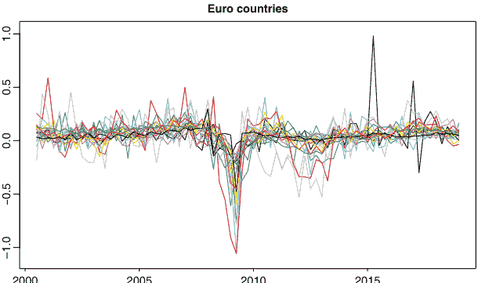

图 6.1 2000.II 至 2018.IV 期间 19 个欧元国家 GDP 增长率的时间图。

图 6.2 绘制了 $h = 0, 1, 2$ 和 3 时 $\widehat{\Gamma}_z(h)$ 第一个特征值的载荷。由于特征向量的符号无法确定，我们调整符号，使每个载荷向量的第一个元素为正。从图中可以看出，载荷相当一致。这一结果表明，对于 $h = 0, 1, 2$ 和 3，载荷矩阵 $P$ 的第一列是稳定的。因此，样本自协方差矩阵的特征值-特征向量分析似乎表明，对于这个特定例子，单因子 DFM 可能适用于 19 维 GDP 增长率。此外，载荷表明公共因子是 GDP 增长率的加权平均。

### 示例 6.1 中使用的 R 命令：R 输出已编辑以节省空间。

```
> UMEdata = read.csv("UMEdata20002018.csv", header=FALSE)
>x=as.matrix(UMEdata)
>n=nrow(x)
>G=matrix(0,n,19)
>for (i in 1:19) {G[,i]=x[,1+3*(i-1)]}
>G0=log(G)
>S0=scale(G0)
>G1=diff(S0)
> y1 <- range(G1)
> tdx <- c(2:76)/4+2000
> plot(tdx,G1[,1],xlab="year",ylab="Growth rate", main="Euro countries",
type="l",ylim=y1)
> for (i in 2:19){lines(tdx,G1[,i],col=i)}
>out=acf(G1,lag.max=4,type="covariance",plot=FALSE)
>S0=eigen(out$acf[1,,])
>E0=S0$values[1:4]
>EV0=S0$vectors[,1]
>EVS0=S0$vectors[,2]
>S1=eigen(out$acf[2,,])
>S1$values[1:4] # May have complex eigenvalues
>Mod(S1$values[1:4])
>E1=S1$values[1:4]
>EV1=S1$vectors[,1]
>EVS1=S1$vectors[,2]
......
>EVf=cbind(EVF0,EVF1,EVF2,EVF3)
>EVS=cbind(EVS0,EVS1,EVS2,EVS3) # Not shown
>ts.plot(EVF)
>EVF=cbind(-EVF0,EVF1,EVF2,-EVF3) # Change some signs
>ts.plot(EVF) # re-plot.
```

### 6.1.2 动态因子和 VARMA 模型

Eq. (6.1) 的 EDFM，其中 $n_t$ 为白噪声，意味着观测序列的 $k-r$ 个线性组合是白噪声，$r$ 个线性组合包含所有动态。令 $P^\perp$ 为满足 $(P^\perp)'P = 0$ 的 $k \times (k-r)$ 矩阵。那么， $k-r$ 个线性组合 $y_{1t} = (P^\perp)'z_t$ 是白噪声，而 $r$ 个线性组合

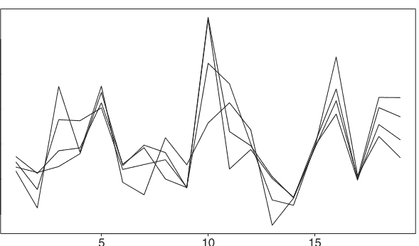

图 6.2 19 个欧元国家 GDP 增长率自协方差矩阵前几个特征值的载荷，滞后 0 到滞后 3。

$y_{2t} = P'z_t$ 包含公共因子。Hu (2005) 证明了相反也是成立的。也就是说，考虑 $z_t$ 的 VAR($p$) 模型

$$z_t = \sum_{i=1}^p \Phi_i z_{t-i} + a_t,$$

如果我们能找到一个 $k \times k$ 矩阵 $G$，使得 $y_t = Gz_t$ 满足模型

$$y_t = \sum_{i=1}^p \Phi_i^* y_{t-i} + a_t^*,$$

其中 $\Phi_i^* = G\Phi_i G^{-1}$ 且 $\Sigma_a^* = G\Phi_i G'$，并且这个新序列 $y_t$ 可以分区为 $y_t' = (y_{1t}', y_{2t}')'$，其中 $y_{1t}$ 是 $(k-r)$ 维白噪声过程且 $y_{2t}$ 遵循 VAR($p$) 模型，那么 $z_t$ 遵循 Eq. (6.1) 中的 DFM。

接下来，Box and Tiao (1977) 和 Tiao and Tsay (1989) 研究了简化遵循 VARMA 模型的时间序列向量动态的方法。如第 3 章所示，Box and Tiao (1977) 提出搜索线性组合 $v_t = C'z_t$，其元素根据其可预测性排列。从

$$z_t = \widehat{z}_{t-1}(1) + e_t, \quad \text{(6.11)}$$

并令 $\Gamma_p(1) = E\{\widehat{z}_{t-1}(1)\widehat{z}'_{t-1}(1)\}$，我们有 $\Gamma_z(0) = \Gamma_p(1) + \Sigma_\epsilon$，并且在第 3.5.2 节中显示了最大可预测性的线性组合由矩阵

$$M = \Gamma_z^{-1}(0)\Gamma_p(1).$$

的最大特征值给出。假设 EDFM，并从 Eq. (6.6)，我们有 $\Gamma_p(1) = P\Gamma_f(0)P'$。因此，最大可预测性的线性组合由矩阵

$$M = \Gamma_z^{-1}(0)P\Gamma_f(0)P',$$

对应的最大特征值的特征向量给出，其秩为 $r$。然后，

$$MP = \Gamma_z^{-1}(0)P\Gamma_f(0).$$

为简化起见，假设 $\Sigma_\epsilon = \sigma^2 I$，并使用 $\Gamma_f(0) = \text{diag}\{\gamma_{f,1}^2, \dots, \gamma_{f,r}^2\}$ 和矩阵反演公式

$$(A + BDB')^{-1} = A^{-1} - A^{-1}B(B'A^{-1}B + D^{-1})^{-1}B'A^{-1},$$

经过一些代数运算，我们可以得到

$$\Gamma_z^{-1}(0)P = [\sigma^2 I + P\Gamma_f(0)P']^{-1}P = P[\sigma^2 I + \Gamma_f(0)]^{-1} = PV,$$

其中 $V$ 是一个对角矩阵，其第 $j$ 个对角元素为 $(\gamma_{f,j}^2 + \sigma^2)^{-1}$，其中 $\gamma_{f,j}^2$ 是 $f_{jt}$ 的方差。因此，由于 $MP = PV\Gamma_f(0) = PD$，其中 $D$ 是一个对角矩阵，其元素为 $\gamma_{f,j}^2/(\gamma_{f,j}^2 + \sigma^2)$，最大可预测性方向由 $P$ 矩阵中对应于方差最大的因子的列给出。


这为 EDFM 与 Box 和 Tiao (1977) 的工作提供了直接联系。如在第 3 章中所述，Tiao 和 Tsay (1989) 通过标量分量模型引入了 VARMA 模型的简化，这些模型是具有特定动力学的观测时间序列的线性组合。特别是，SCM(0,0) 是一个白噪声过程，在 EDFM 下，白噪声线性组合的数量，即 SCM(0,0) 的数量，为 $k - r$。因此，SCM(0,0) 模型也与 EDFM 相关联。

Peña 和 Box (1987) 证明，如果系列 $z_t$ 遵循 Eq. (6.1) 中的 DFM，且因子由 VARMA($p_1, q_1$) 过程给出，则该系列也遵循 VARMA($p_2, q_2$) 过程，其中 $p_1 = p_2$ 且 $q_2 = \max(p_1, q_1)$。然而，系列 $z_t$ 的 VARMA($p_2, q_2$) 表示的参数矩阵无法识别，这可能使 VARMA 模型的估计变得困难和不稳定。

## 6.2 将平稳 DFM 拟合到数据

给定数据 $\{z_1, \dots, z_T\}$，其中 $z_t = (z_{t1}, \dots, z_{tk})'$，为简化起见，假设每个系列 $z_{it}$ 都已进行均值调整。令 $\mathbf{Z}$ 为 $T \times k$ 数据矩阵，其中 $\mathbf{Z}' = [z_1, \dots, z_T]$。则 $\hat{\mathbf{F}}_z(h) = \sum_{t=h+1}^T z_t z_{t-h}' / T$，特别是 $\hat{\mathbf{F}}_z(0) = \mathbf{Z}'\mathbf{Z} / T$。在本节中，我们讨论估计 $k \times r$ 载荷矩阵 $\mathbf{P}$、$T \times r$ 公共因子矩阵 $\mathbf{F}$ 以及因子和噪声模型参数的不同程序。我们从公共因子数量 $r$ 已知的情况开始，然后讨论选择 $r$ 的方法。

在本节中，我们假设 $T > k$。$T \le k$ 的情况将在第 6.10 节中讨论，在那里我们采用不同的公式，并使用投影 PCA 来提高估计公共因子的效率。

### 6.2.1 主成分 (PC) 估计

在某些条件下，EDFM 和 ADFM 的一致估计可以通过样本协方差矩阵 $\hat{\mathbf{F}}_z(0)$ 的特征值-特征向量分析获得。在给定 $r$ 的情况下，载荷矩阵 $\mathbf{P}$ 通过与最大 $r$ 个特征值对应的 $\hat{\mathbf{F}}_z(0)$ 的归一化特征向量来估计。将估计值记为 $\hat{\mathbf{P}}$，由于 $\hat{\mathbf{F}}_z(0)$ 在 $T > k$ 时是对称正定的，因此有 $\hat{\mathbf{P}}'\hat{\mathbf{P}} = \mathbf{I}$。然后潜在因子通过 $\hat{f}_t = \hat{\mathbf{P}}' z_t$ 估计，即数据矩阵 $\mathbf{Z}$ 的前 $r$ 个主成分。注意，在 (6.1) 中左乘 $\hat{\mathbf{P}}'$，我们有

$\hat{\mathbf{P}}' \mathbf{z}_t = \hat{\mathbf{P}}' \mathbf{P} \mathbf{f}_t + \hat{\mathbf{P}}' \mathbf{n}_t$

并且，对于固定 $k$，$\hat{\mathbf{P}}$ 将在 $T \to \infty$ 时收敛到 $\mathbf{P}$。因此，我们近似有 $\hat{\mathbf{P}}'\hat{\mathbf{P}} = \mathbf{I}$。对于 EDFM，噪声 $n_t$ 是白噪声，线性组合 $\hat{\mathbf{P}}' n_t$ 是零均值变量，其样本均值将随着 $T$ 的增加通过大数定律收敛到零。对于 ADFM，对噪声和 $f_t$ 的结构施加了适当条件，使得 $\hat{\mathbf{F}}_z(0)$ 的特征向量继续提供载荷和因子 $\hat{f}_t = \hat{\mathbf{P}}' z_t$ 的一致估计。参见 Bai and Ng (2002, 2013)。

正式地，我们希望找到一个 \(k \times r\) 矩阵 \(\widehat{\boldsymbol{P}}\) 和一个 \(T \times r\) 因子矩阵 \(\widehat{\boldsymbol{F}}\)，其中 \(\widehat{\boldsymbol{F}}' = [\widehat{f}_1, \dots, \widehat{f}_T]\)，以最小化

\(\text{MSE}(\boldsymbol{P}, \boldsymbol{F}) = \frac{1}{kT} \sum_{t=1}^T (z_t - \boldsymbol{P} f_t)'(z_t - \boldsymbol{P} f_t),\quad (6.12)\)

在限制条件 \(\widehat{\boldsymbol{P}}'\widehat{\boldsymbol{P}} = \boldsymbol{I}\) 和 \(\widehat{\boldsymbol{F}}'\widehat{\boldsymbol{F}} = \boldsymbol{D}$ 下，其中 \(\boldsymbol{D}$ 是正定对角矩阵。然后

\(\frac{\partial \text{MSE}(\boldsymbol{P}, \boldsymbol{F})}{\partial f_t} = -2\widehat{\boldsymbol{P}}' z_t + 2\widehat{\boldsymbol{P}}'\widehat{\boldsymbol{P}}\widehat{f}_t = \boldsymbol{0},\)

并施加限制 \(\widehat{\boldsymbol{P}}'\widehat{\boldsymbol{P}} = \boldsymbol{I}\)，我们有

\(\widehat{f}_t = \widehat{\boldsymbol{P}}' z_t,\quad (6.13)\)

并且

\(\frac{\partial \text{MSE}(\boldsymbol{P}, \boldsymbol{F})}{\partial \boldsymbol{P}'} = -2 \sum_{t=1}^T z_t \widehat{f}_t' + 2 \widehat{\boldsymbol{P}} \sum_{t=1}^T \widehat{f}_t \widehat{f}_t' = \boldsymbol{0},\)

在限制条件 \(\widehat{\boldsymbol{F}}'\widehat{\boldsymbol{F}} = \sum_{t=1}^T \widehat{f}_t \widehat{f}_t' = \boldsymbol{D}$ 下，并使用 Eq. (6.13)，我们有 $\boldsymbol{Z}'\boldsymbol{Z}\widehat{\boldsymbol{P}} = \widehat{\boldsymbol{P}}\boldsymbol{D}$，$\widehat{\boldsymbol{P}}$ 的列（记为 $\widehat{p}_{\cdot j}$）必须满足

\(\widehat{\boldsymbol{\Gamma}}_z(0)\widehat{p}_{\cdot j} = \lambda_j \widehat{p}_{\cdot j}.\quad (6.14)\)

因此，$\widehat{\boldsymbol{P}}$ 的列是对应于 $\widehat{\boldsymbol{\Gamma}}_z(0)$ 最大 $r$ 个特征值的特征向量。不难看出

\(\text{MSE}(\widehat{\boldsymbol{P}}, \widehat{\boldsymbol{F}}) = \sum_{j=1}^r \lambda_j,\)

因此，我们选择矩阵 $\widehat{\boldsymbol{\Gamma}}_z(0)$ 的 $r$ 个最大特征值。第 1 章对主成分进行了类似的分析。

Stock and Watson (2002a, 2002b) 和 Bai and Ng (2002) 证明，当 $k$ 和 $T$ 都趋于无穷大且噪声的弱自相关和交叉相关时，PC 估计是一致的。然而，正如我们稍后所见，当 $c = \lim_{T,k \to \infty} k/T$ 大于 1 时（即 $k > T$），无法获得一致性。关于特殊分量结构的条件可以稍微推广，允许自相关和交叉相关依赖于 $t$，然后对所有 $t$ 取上确界。此外，噪声的分布必须满足一些广泛条件才能证明一致性。

一旦因子被估计，特殊分量就可以计算为 $\widehat{n}_t = (\boldsymbol{I} - \widehat{\boldsymbol{P}}\widehat{\boldsymbol{P}}')z_t$，我们可以对每个分量 $n_{it}$ 估计标量自回归移动平均 (ARMA) 模型。注意，估计的噪声是维度为 $k - r$ 的线性空间中的 $k \times 1$ 向量，因为其中有 $r$ 个线性组合必须等于零，即 $\widehat{\boldsymbol{P}}'\widehat{n}_t = (\widehat{\boldsymbol{P}}' - (\widehat{\boldsymbol{P}}'\widehat{\boldsymbol{P}})\widehat{\boldsymbol{P}}')z_t = 0$。将 $\widehat{\boldsymbol{N}}' = [\widehat{n}_1, \dots, \widehat{n}_T]$ 称为估计噪声矩阵，估计的噪声协方差矩阵 $\widehat{\boldsymbol{\Gamma}}_n(0) = \boldsymbol{N}'\boldsymbol{N}/T$ 是奇异的。然而，其对角元素（即噪声方差）可以通过 $\sum_{t=1}^T \hat{\eta}_{it}^2 / T$ 估计。注意，由 Eq. (6.6)，

$$\sum_{i=1}^k \gamma_{z_i}(0) = \sum_{j=1}^r \gamma_{f_j}(0) + \sum_{i=1}^k \gamma_{\eta_i}(0),$$

噪声方差之和等于系列方差之和减去因子方差之和。

因子的模型也通过每个因子时间序列 $\hat{f}_{it}$ 的单变量分析得到。

### 6.2.2 汇总 PC 估计器

对于 EDFM，Peña 和 Box (1987) 提出的一种比 PCA 更高效的估计可以通过汇总滞后自协方差矩阵的信息来获得。这些矩阵的性质表明，我们可以通过汇总数据估计的滞后自协方差矩阵中与最大特征值相关的 $r$ 个特征向量来估计 \(P\)。这可以通过形成汇总矩阵来实现

$$C = \sum_{i=1}^{h_0} \hat{\Gamma}_z(h),$$

其中 \(h_0\) 是一个预设的正整数，并计算 \(C\) 对应于最大 \(r\) 个特征值的特征向量以形成矩阵 $\hat{P}$。然而，由于估计的矩阵 $\hat{\Gamma}_z(h)$ 不一定是对称的，它们可能具有复数特征值。Lam et al. (2011) 提出的一个更好的替代方案是使用一个与 $\hat{\Gamma}_z(h)$ 具有相同特征向量的对称矩阵。定义

$$L = \sum_{i=1}^{h_0} \hat{\Gamma}_z(h)\hat{\Gamma}_z(h)'. \quad (6.15)$$

并使用对应于最大 \(r\) 个特征值的 \(L\) 的特征向量来估计载荷和因子。如第 6.2.1 节所示的协方差矩阵的特性表明，汇总信息不仅在噪声为白噪声时有用，而且在噪声存在异方差或具有相似自相关结构时也有用。有关使用矩阵 (6.15) 估计因子的优势，请参见 Lam et al. (2011)、Chan et al. (2017)、Gao 和 Tsay (2019) 以及 Caro 和 Peña (2020)。

### 6.2.3 广义 PC 估计器

在异质性情况下，噪声分量的方差各不相同，可以使用广义最小二乘法来提高估计效率。目标函数变为

$$\text{MSE}(P, F) = \frac{1}{kT} \sum_{t=1}^T (z_t - P f_t)' \Sigma_n^{-1} (z_t - P f_t). \quad (6.16)$$


As \(\Sigma_n^{-1}\) is unknown, the minimization of Eq. (6.16) is usually carried out in two steps. First, the estimators in Eqs. (6.13) and (6.14) are used to compute \(\hat{\boldsymbol{n}}_t = (\boldsymbol{I} - \hat{\boldsymbol{P}}\hat{\boldsymbol{P}}')\boldsymbol{z}_t\). As mentioned before, estimating the noise covariance matrix with \(\hat{\boldsymbol{n}}_t\) results in a singular matrix, because the idiosyncratic space is of dimension \(k - r\). However, assuming that \(\Sigma_n\) is diagonal, the variances, \(\{\sigma_i^2\}\), can be estimated using each component \(n_{it}\). By transforming the variables in Eq. (6.16) by \(\boldsymbol{z}_t^* = \hat{\Sigma}_n^{-1/2} \boldsymbol{z}_t = \{z_{it}/\hat{\sigma}_i, i = 1, \dots, k\}\) and letting \(\boldsymbol{P}^* = \hat{\Sigma}_n^{-1/2} \boldsymbol{P}\), we have the standard least squares problem with homoscedastic variables. We can then apply PCA to the new variables \(\boldsymbol{z}_t^*\) to obtain a new loading matrix \(\hat{\boldsymbol{P}}^*\) that verifies \(\boldsymbol{P}^* = \hat{\Sigma}_n^{-1/2} \boldsymbol{P}\). To obtain the original loading matrix for the observed variables, we can transform with \(\hat{\boldsymbol{P}} = \hat{\Sigma}_n^{1/2} \hat{\boldsymbol{P}}^*\). Unless there exist large differences among the variances of the noises, the advantage of using generalized least squares is usually small. A second simple alternative is to estimate the covariance matrix associated with common factors by \(\hat{\Gamma}_c(0) = \hat{\Gamma}_z(0) - \hat{\Sigma}_n\), and then compute the PCs of \(\hat{\Gamma}_c(0)\). A more efficient and complex two step procedure has been proposed by Breitung and Tenhofen (2011).

### 6.2.4 ML 估计

The ML estimation requires some assumptions on the distribution of the observed time series. Often, \(\boldsymbol{z}_t\) is supposed to be Gaussian and two ML estimation approaches have been proposed. The first one is an extension of the classical FM and assumes that \(f_t\) is a random variable with zero mean and covariance matrix \(\Gamma_f(0)\), but has no dynamics. That is, \(f_t\) is uncorrelated with its past values. Then, \(\boldsymbol{z}_t\) is \(N_k(0, \Gamma_z(0))\) with \(\Gamma_z(0) = \boldsymbol{P}\Gamma_f(0)\boldsymbol{P}' + \Sigma_e\). In this particular instance, the parameters include (a) the \(k \times r\) elements of the loading matrix \(\boldsymbol{P}\), (b) the \(r\) diagonal elements of \(\Gamma_f(0)\), and (c) the \(k\) diagonal elements of \(\Sigma_e\). The series \(z_t\) is independent of its lagged values, and the log-likelihood function is

```
\(L(\boldsymbol{P}, \Gamma_f(\mathbf{0}), \Sigma_n) = -\frac{T}{2} \log|\Gamma_z(0)| - \frac{1}{2} \sum_{t=1}^T \boldsymbol{z}_t'[\Gamma_z(0)]^{-1}\boldsymbol{z}_t,\)
```

that can be written as

```
\(L(\boldsymbol{P}, \Gamma_f(\mathbf{0}), \Sigma_n) = -\frac{T}{2} \log|\Gamma_z(0)| - \frac{T}{2} \text{tr}[\hat{\Gamma}_z(0)\Gamma_z^{-1}(0)],\) (6.17)
```

where tr(\(\boldsymbol{A}\)) denotes the trace of the matrix \(\boldsymbol{A}\). The maximization of Eq. (6.17) can be carried out by taking the partial derivatives with respect to the parameters. The situation is similar to that of the standard factor analysis when \(T > k\), see Seber (1984), and has been studied in the time series literature by Bai and Li (2012). For \(k \ge T\), these authors proposed a quasi-likelihood function in which instead of the covariance matrix of the observations, which is singular, an approximate full rank matrix is used.

The second approach, see Choi (2012), Doz et al. (2012), and Bai and Li (2016), is to take \(f_t\) as parameters, or random variables, with dynamical dependence, and to use the conditional distribution of \(z_t\) as \(N_k(P f_t, \Sigma_e)\). The log-likelihood then becomes

```
\(L(\boldsymbol{P}, \boldsymbol{F}, \Sigma_e) = -\frac{T}{2} \log|\Sigma_e| - \frac{1}{2} \sum_{t=1}^T (\boldsymbol{z}_t - \boldsymbol{P} f_t)' \Sigma_e^{-1} (\boldsymbol{z}_t - \boldsymbol{P} f_t),\) (6.18)
```

where the parameters include (a) the \(k \times r\) elements of \(\mathbf{P}\), (b) the \(T \times r\) elements of \(\mathbf{F}\), and (c) the \(k\) diagonal elements of \(\Sigma_e\). Assuming \(\Sigma_e = \sigma^2\mathbf{I}\), maximizing Eq. (6.18) is equivalent to PCA, and assuming \(\Sigma_e\) a positive definite matrix to generalized PCs. The minimization of Eq. (6.18) can be carried out by putting the model in a state space form and computing the likelihood function using the Kalman filter. The observation equation for the state space representation is simply Eq. (6.1). The transition equation is obtained by assuming a VAR(\(p_1\)) and a VAR(\(p_2\)) model for the factors and noises, respectively. See Chapter 2 for state-space model and Kalman filter. This approach is useful for a small \(k\) and has the advantage of allowing the series to contain different periodicities, but it is less useful when \(k\) is large. The EM algorithm has also been used for estimating FMs but, again, is not practical for large \(k\).

The following iterative procedure, proposed by Bai and Li (2016), can be carried out easily with some initial estimates of \(\mathbf{P}\) and \(\mathbf{F}\) to perform the approximate ML estimation:

- 1. Given the present estimates \(\widehat{\mathbf{P}},\widehat{\mathbf{F}}\), the residuals are computed by \(\widehat{\mathbf{n}}_t = (\mathbf{I} - \widehat{\mathbf{P}}\widehat{\mathbf{P}}')\mathbf{z}_t\), and the noise variances, \(\text{var}(n_{it}) = \widehat{\sigma}_i^2\), which are used to form a diagonal matrix \(\widehat{\Sigma}_e\).
- 2. Autoregressive (AR) models are fitted to each residual series, \(\widehat{\phi}_i(B)\widehat{n}_{it} = a_{it}\), \(i = 1, \dots, k\).
- 3. The vector of loadings for each series, \((\mathbf{p}_{t\cdot})'\), that is, the \(i\)th row of the matrix \(\widehat{\mathbf{P}}\), is updated with the following regression
  \(\widehat{\phi}_i(B)z_{it} = (\mathbf{p}_{t\cdot}')\widehat{\phi}_i(B)\widehat{\mathbf{f}}_t + \epsilon_{it}.\)
- 4. The factors are updated by using the current vector of loadings and running the regression
  \(\widehat{z}_{it}/\widehat{\sigma}_i = (\mathbf{p}_{t\cdot}')\widehat{\mathbf{f}}_t/\widehat{\sigma}_i + \epsilon_{it}^*.\)
- 5. With the new factors and loadings, go to step 1 and iterate until convergence.

### 6.2.5 选择因子数量

Several tests have been proposed in the literature to select the number of factors and we will present here the most often used ones. The first class of tests is based on checking the rank of the autocovariance matrices. Note that for the EDFM, the maximum rank must be \(r\) and this maximum is achieved also by the sum of some autocovariance matrices with \(h > 0\). These tests are less useful if there is strong autocorrelation in the noises (e.g. the ADFM), because then the lag covariance matrices can be full rank. Also, these types of tests work well for \(T >> k\), that is, with a small number of long time series, but are less powerful when \(k\) is relatively large compared with \(T\). A second class of tests make use of the idea of separating the large eigenvalues of the covariance matrices from the small ones and selecting \(r\) as the number of large eigenvalues. A third way to select the number of factors is to use a model selection criterion. We describe these three methods next. The selection of \(r\) for the case of \(k \ge T\) can be carried out by testing for high-dimensional white noises discussed in Section 6.10.

#### 6.2.5.1 通过规范相关分析进行秩检验

Tiao and Tsay (1989) proposed to check the rank of some moment matrices for both the stationary and nonstationary vector time series using canonical correlation analysis and a chi-square statistic. A similar test for EDFM was proposed by Peña and Poncela (2006) as follows. For all h > 0, there exists a k × (k − r) matrix \(\mathbf{P}_\perp\) such that \(\Gamma_z(h)\mathbf{P}_\perp = \mathbf{0}\). Thus, the k − r independent linear combinations of the observed series given by \(\mathbf{P}'_\perp\mathbf{z}_t\) are cross-sectionally and serially uncorrelated for all lags, and also uncorrelated with \(\mathbf{P}'_\perp\mathbf{z}_{t-h}\). Consider now the k × k canonical correlation matrix

```
\(\mathbf{M}(h) = [E(\mathbf{z}_t\mathbf{z}'_t)]^{-1} E(\mathbf{z}_t\mathbf{z}'_{t-h})[E(\mathbf{z}_{t-h}\mathbf{z}'_{t-h})]^{-1} E(\mathbf{z}_{t-h}\mathbf{z}_t),\)
```

where, for simplicity, we assume \(E(\mathbf{z}_t) = \mathbf{0}\). Assuming an EDFM satisfying \(\Gamma_z(h) = \Gamma_z(-h)\), we have that

```
\(\mathbf{M}(h) = [\Gamma_z^{-1}(0)\Gamma_z(h)]^2.\)
```

Suppose that \(rank[\Gamma_f(h)] = r\), which is also the rank of \(\Gamma_z(h)\), then, we have \(rank[\mathbf{M}(h)] = r\). The number of zero canonical correlations between \(\mathbf{z}_{t-h}\) and \(\mathbf{z}_t\) is given by the number of zero eigenvalues of the \(\mathbf{M}(h)\) matrix, that is k − r. Thus, the number of common factors r is equivalent to the number of non-zero canonical correlations between \(\mathbf{z}_{t-h}\) and \(\mathbf{z}_t\).

The test for the number of factors is based on the aforementioned result. Let \(\widehat{\lambda}_1 \ge \widehat{\lambda}_2 \ge \cdots \ge \widehat{\lambda}_k\) be the ordered eigenvalues of the matrix \(\widehat{\mathbf{M}}(h)\). If we have r factors, the eigenvalues \(\widehat{\lambda}_{r+1}, \dots, \widehat{\lambda}_k\) are estimates of squared correlations equal to zero and have asymptotic variance 1/(T − h). Therefore, the statistics \(-(T-h)\log(1-\widehat{\lambda}_j) \simeq (T-h)\widehat{\lambda}_j\) follow a chi-square distribution. It can be shown (see Peña and Poncela, 2006) that the statistic

```
\(S_{h-r} = -(T-h) \sum_{j=r+1}^k \log(1-\widehat{\lambda}_j),\)
```

is asymptotically a \(\chi^2_{(k-r)^2}\). The test is applied sequentially. It starts with r = 0 and if the hypothesis is rejected, the value r = 1 is tried and so on. The testing procedure stops when the hypothesis of r factor, or r non-zero canonical correlation cannot be rejected.

This test works well when T/k is large, but deteriorates when this ratio is small. Also, when the lag covariance matrices of the factors are not full rank, the test may fail. For instance, suppose two factors that follow moving-average (MA) processes. The first is MA(1) and the second is MA(3), but with coefficients for lags one and two equal to zero. Then, the lag-1 covariance matrix of the two factors is of rank one, the lag-2 matrix is rank zero, and the lag-3 has rank one. Thus, the test would indicate a single factor, instead of two. However, the test can be modified to overcome such difficulties by either checking the equivalence of identified common factors for different lags or applying canonical correlation analysis simultaneously to multiple lag autocovariance matrices. See Bolivar et al. (2020).


#### 6.2.5.2 特征值跃变检验

此处的检验基于协方差矩阵或滞后协方差矩阵之和的连续特征值（按适当顺序排列）的比率。该想法源于用于选择主成分数量的肘部图和随机矩阵理论，检验旨在寻找特征值比率的跃变，这种跃变会在达到真实因子数量时出现。参见 Onatski (2009, 2010)、Lam and Yao (2012) 以及 Ahn and Horenstein (2013)。

Lam and Yao (2012) 提议计算合并协方差矩阵的有序特征值 $\lambda_1 \ge \lambda_2 \ge \cdots \ge \lambda_k$

$$\mathbf{M} = \sum_{h=1}^{h_0} \hat{\mathbf{\Gamma}}_z(h) \hat{\mathbf{\Gamma}}_z(h)', \tag{6.21}$$

其中 $h_0$ 是预先指定的正整数，并选择 $r$ 为

$$\hat{r} = \arg \min_{1 \le i \le r^*} \frac{\hat{\lambda}_{i+1}}{\hat{\lambda}_i},$$

对于某些 $r^* = \alpha k$，其中 $k$ 是序列的数量且 $0 < \alpha < 1$ 例如 $\alpha = 0.2$。假设前 $r$ 个特征值较大，其余特征值较小。那么，比率 $\lambda_{i+1}/\lambda_i \le 1$ 在 $i = r$ 时会出现较大下降。

Ahn and Horenstein (2013) 也提出了一种类似的检验，使用协方差矩阵 $\hat{\Gamma}_z(0)$ 的有序特征值 $\nu_1 \ge \nu_2 \ge \cdots \ge \nu_k$。准则是

$$\hat{r} = \arg \max_{1 \le i \le r^*} \frac{\nu_i}{\nu_{i+1}}.$$

如果某些因子是白噪声，则无法应用 Lam and Yao 准则，因为滞后协方差矩阵中不包含这些因子的信息。然而，Ahn and Horenstein 检验仍然有效。此外，如果不存在共同因子，则两种检验都无法使用。有限经验表明，比率往往由一个主导因子支配，这通常发生在 $\mathbf{z}_t$ 中存在强自相关时。事实上，该检验在应用中倾向于找到 $r = 1$。一旦消除了第一个主导因子，该检验可以进行迭代并应用于残差。

#### 6.2.5.3 使用信息准则

与许多其他统计问题一样，信息准则可用于选择共同因子的数量。第 3 章解释的贝叶斯信息准则（BIC）在 $T > k$ 时可使用，如

$$\text{BIC}(r) = \log \hat{\sigma}_r^2 + r \frac{\log T}{T}$$

但当 $k$ 较大或接近 $T$ 时，此准则并不总能对因子数量提供一致的估计。Bai and Ng (2002) 提出了一种在实践中似乎效果良好的一致模型选择准则，可表示为

$$\text{BNG}(r) = \log \hat{\sigma}_r^2 + r \frac{\log (\min(T, k))}{\min(T, k)}.$$

其中

\(\widehat{\sigma}_r^2 = \text{MSE}(\widehat{\boldsymbol{P}}_r, \widehat{\boldsymbol{F}}_r) = \frac{1}{kT} \sum_{t=1}^T (\boldsymbol{z}_t - \widehat{\boldsymbol{P}}_r \boldsymbol{f}_t^r)' (\boldsymbol{z}_t - \widehat{\boldsymbol{P}}_r \boldsymbol{f}_t^r)\)

是在拟合 $r$ 个因子时的均方误差（MSE），此处使用 $\boldsymbol{f}_t^r$ 表示 $\boldsymbol{f}_t$ 的维度为 $r$。因子数量的选择旨在最小化 BNG($r$)。

### 6.2.6 使用 DFM 进行预测

使用 DFM 模型进行预测是通过为每个因子和每个噪声序列拟合适当的标量 ARMA 模型，并从拟合模型生成预测来进行的，例如 \(\widehat{f}_t^r(h)\) 和 \(\widehat{n}_t(h)$，其中 $h$ 是预测步距，$t$ 是预测原点。然后

\(\widehat{\boldsymbol{z}}_t(h) = \widehat{\boldsymbol{P}}\widehat{\boldsymbol{f}}_t^r(h) + \widehat{\boldsymbol{n}}_t(h). \quad (6.22)\)

使用 EDFM 预测单个时间序列时，因子汇总了关于动态的所有信息，且

\(E(z_{i,t+h}|\boldsymbol{Z}, \boldsymbol{F}) = E[(\mathbf{p}_t^i)' \boldsymbol{f}_{t+h} + n_{i,t+h} | \boldsymbol{Z}, \boldsymbol{F}] = (\mathbf{p}_t^i)' E(\boldsymbol{f}_{t+h} | \boldsymbol{F}) + E(n_{i,t+h} | \boldsymbol{Z}, \boldsymbol{F}).\)

因此，要预测每个单独的时间序列，只需要所有因子的预测外加特定噪声的预测。

DFM 生成的预测可以表示为（参见 Peña and Poncela, 2004）包含一个类似于层次贝叶斯模型推导出的汇总项。例如，假设一个单因子 DFM，其中因子遵循参数为 $\phi$ 的 AR(1) 过程。根据 (6.22)，每个系列的预测为 \(\widehat{z}_{i,t+h|t} = \boldsymbol{\phi}^h p_i f_{i|t}\)，该方程也可以写成

\(\widehat{z}_{i,t+h|t} = \boldsymbol{\phi}^h \left[ \alpha_t p_i f_{i|t|-1} + (1 - \alpha_t) \sum_{i=1}^k \delta_i z_{it} \right],\)

其中 \(\delta_i = (p_i^2 / \sigma^2) / \sum_{i=1}^k (p_i^2 / \sigma^2)\) 是第 $i$ 个系列的相对信噪比。因此，预测可以看作是两个项的加权组合：第一项是使用截至 $t-1$ 时信息的时间 $t$ 因子预测，第二项是时间 $t$ 时系列值的加权平均，每个系列的权重取决于其相对信噪比。预测中两个项的权重取决于其相对精度，即 \(\alpha_t = \text{var}^{-1}(f_{i|t|-1}) / [\text{var}^{-1}(f_{i|t|-1}) + \sum_{i=1}^k (p_i^2 / \sigma^2)]\)；有关更深入的分析，请参见 Peña and Poncela (2004)。这些作者推导了单因子情况下 FM 预测相对于单变量和收缩模型的预期收益，并表明 FM 的优势随时间序列向量的维度和各组件之间动态关系的强度而增加。

Boivin and Ng (2006) 研究了使用更多数量的系列来提取因子对预测的优势。当特征误差存在交叉相关时，这种优势可能非常小，甚至成为缺点。在第 7 章中，我们将看到如何将 DFM 与其他方法结合来预测大量时间序列。

DFM 也可以与其他方法结合以产生非线性预测。Fan et al. (2017) 提出了充分预测，这是一种有趣的预测方法，除线性 DFM 预测外，还结合了一组从高维预测器中推断出的充分预测指标。该方法通过利用 FMs 汇总交叉相关，将基于切片逆回归（Li, 1991）的充分维度缩减和 Cook (2018) 的中心子空间分析扩展到高维模式。

### 示例 6.2

为说明这一点，我们再次考虑示例 6.1 中使用的 19 个欧元区国家季度 GDP 的增长率。将 Lam and Yao 检验应用于公式 (6.21) 中的合并协方差矩阵，我们得到了 \(\hat{r} = 1\)。估计的共同因子如图 6.3 所示。总体而言，估计的共同因子与从样本协方差矩阵获得的因子相似。该因子解释了系列约 51% 的变异性。该分析通过与本书关联的 SLBDD R 包中的命令 `dfmpc` 进行。该程序还给出了载荷向量，见图 6.4，以及因子和特征噪声的模型。

### 用于 DFM 分析的 R 命令：续示例 6.1。

```
>out=dfmpc(G1)
>out$r # output is not shown.
>out$F
>out$L
>plot(tdx,-out$F[,1],xlab='year',ylab='1st factor',type='l')
>plot (1:19,-out$L,xlab='country',ylab='weight',type='l')
>out$MarmaF
>out$MarmaE
```

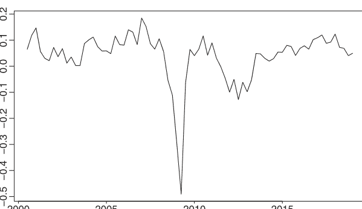

图 6.3 19 个欧元区国家 GDP 系列增长率的第一个共同因子的时间图。

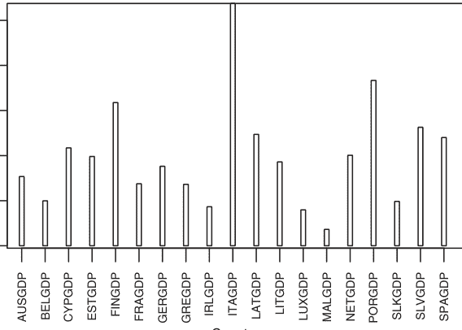

图 6.4 19 个欧元区国家 GDP 系列增长率的第一个共同因子的载荷。

### 示例 6.3

我们继续研究采用欧洲货币联盟（EMU）的 19 个国家的季度市场价格 GDP 系列、最终消费支出（CON）和毛固定资本形成（INV）系列，总共 57 个时间序列。数据跨度为 2000 年第 1 季度至 2018 年第 4 季度，总共 76 个季度观测值。参见示例 6.1 和 6.2。图 6.5 显示了增长率 ∇ log x<sub>t</sub> 的时间图。应用 DFM 分析，我们发现选择了一个单一共同因子，如图 6.6 所示。相应的载荷如图 6.7 所示，来自

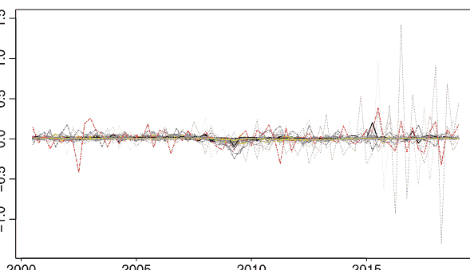

图 6.5 欧洲货币联盟 19 个国家 57 个经济变量的增长率时间图。季度数据，2000 年至 2018 年。


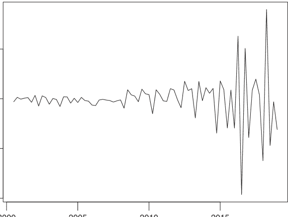

图 6.6 EMU 国家 57 个经济增长率序列第一个公因子的时间图。

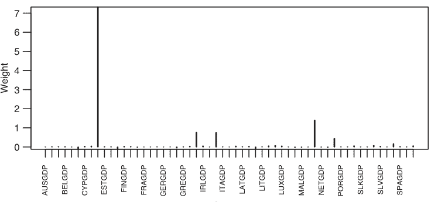

图 6.7 EMU 国家 57 个经济增长率序列第一个公因子的载荷。

由此可见，载荷在第九个序列上给予了较大权重，该序列为塞浦路斯的投资序列。这很不寻常，我们发现第九个序列与公因子之间的样本相关系数为 0.996。图 6.8 显示了 57 个序列的方差，可见第九个序列的方差比其他序列的方差大 10 倍以上。这一现象证实了我们的担忧，即 PCA 严重依赖所涉及序列的量纲。从某种意义上说，第九个序列可视为离群序列。为缓解量纲效应，我们对增长率序列进行了标准化并重复了分析。标准化后的增长率如图 6.9 所示。现在很明显，所有增长率均受 2008 年金融危机影响。对标准化后的增长率进行分析也选择了一个公因子，如图 6.10 所示。相应的载荷在图 6.11 中给出。载荷表明，公因子是标准化后的增长率的加权平均。

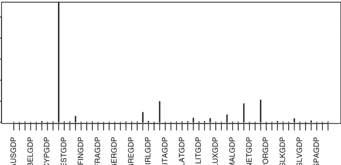

图 6.8 EMU 国家 57 个经济增长率序列的方差。

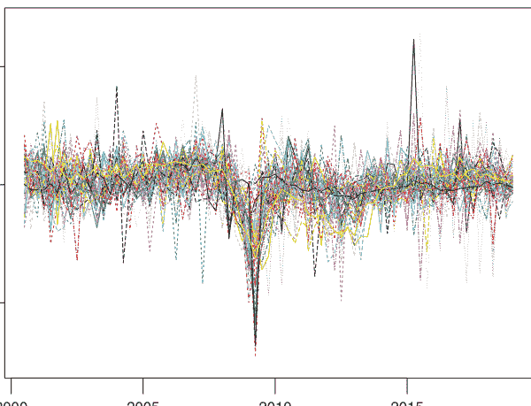

图 6.9 欧洲货币联盟 19 国 57 个经济系列标准化增长率的时间图。季度数据，2000 年至 2018 年。

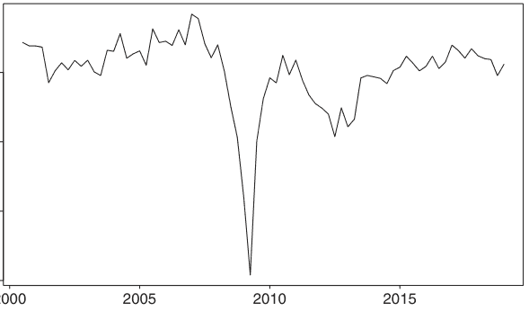

图 6.10 EMU 国家标准化增长率第一个公因子的时间图。

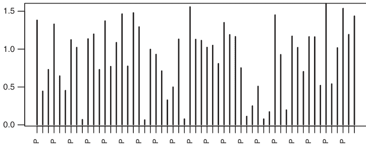

图 6.11 EMU 国家标准化增长率第一个公因子的载荷。

### 示例 6.3 的 R 命令

```
>library(MTS)
>x=as.matrix(EMUdata)
>y=log(x)
>y1=diffM(y)
>tdx= c(2:76)/4+2000 # calendar time
>MTSplot(y1,tdx)
>sall1=dfmpp(y1, stand = 0, mth = 0, r = 1, lagk = 0)
>plot(tdx,sall1$F[,1],xlab='year',ylab='1st factor',type='l')
>plot(1:57,-sall1$L,xlab='country',ylab='1st factor',type='l')
```

```
>syl=scale(y1)
>sal2=dfmpc(syl, stand = 0, mth = 0, r = 1, lagk = 0)
>MTSplot(syl,tdx)
>plot(tdx, -sal2$F[,1], xlab='year', ylab='1st factor', type='l')
>plot(1:57, -sal2$L,xlab='country', ylab='1st factor', type='l')
```

### 6.2.7 DFM 的替代表述

Li and Sheddon (2002) 提出了一种不同的 FM。他们假设向量时间序列 \( \mathbf{y}_t \) 的每个分量 \( y_{it} \) 由以下公式生成

\( y_{it} = \sum_{j=1}^r \lambda_{ij} Z_{ji}(t), \quad i = 1, \dots, k, \quad (6.23) \)

其中 \( \lambda_{ij} \) 是未知实数，分量 \( Z_{ji}(t), i = 1, \dots, k \) 是从共同概率分布中抽取的独立过程。假设序列已标准化，将等式 (6.23) 写为 \( \mathbf{y}_{it} = \boldsymbol{\lambda}'_i \mathbf{Z}_i(t) \)，其中 \( \boldsymbol{\lambda}'_i = (\lambda_{i1}, \dots, \lambda_{ir}) \) 且 \( \mathbf{Z}_i(t) = (Z_{1i}(t), \dots, Z_{ri}(t))' \)，并记 \( \rho_i(h) = E(y_{it} y_{it+h}) / E(y_{it}^2) \)，则有 \( \rho_i(h) = \boldsymbol{\lambda}'_i \Gamma_{\mathbf{Z}_i}(h) \boldsymbol{\lambda}_i / \boldsymbol{\lambda}'_i \Gamma_{\mathbf{Z}_i}(0) \boldsymbol{\lambda}_i \)，其中 \( \Gamma_{\mathbf{Z}_i}(h) \) 是 \( \mathbf{Z}_i(t) \) 的滞后-\( h \) 自协方差矩阵。由于这些分量已标准化且互不相关，矩阵 \( \Gamma_{\mathbf{Z}_i}(0) \) 是单位矩阵，\( \Gamma_{\mathbf{Z}_i}(h) \) 是对角矩阵。记 \( \phi_{ij}(h) = E(Z_{ij}(t) Z_{ij}(t+h)) \) 为 \( \Gamma_{\mathbf{Z}_i}(h) \) 的第 \( j \) 个对角元素，它表示过程 \( Z_{ij}(t) \) 的滞后-\( h \) 自相关系数，则有

\( \rho_i(h) = \sum_{j=1}^r \lambda_{ij}^2 \phi_{ij}(h) / \sum_{j=1}^r \lambda_{ij}^2 = \sum_{j=1}^r p_{ij}^2 \phi_{ij}(h), \)

其中 \( p_{ij}^2 = \lambda_{ij}^2 / \sum_{j=1}^r \lambda_{ij}^2 \) 是满足 \( \sum_{i=1}^r p_{ij}^2 = 1 \) 的权重。这是式 (6.1) 中 EDFM 的相同表达式，其中独立因子遵循相同的分布。就此而言，正如 Peña (2009) 所示，两种表述是等价的。

Gao and Tsay (2019, 2020) 提出了另一种 DFM 模型，避免了噪声协方差矩阵的奇异性。他们假设，观测到的 \( k \) 维时间序列是 \( r \) 个公因子和 \( k-r \) 个个体特异噪声的非奇异线性变换。因此，他们不使用 DFM 模型 \( \mathbf{z}_t = \mathbf{P} \mathbf{f}_t + \mathbf{n}_t \)（其中 \( \mathbf{n}_t \) 的维度为 \( k \)），而是假设噪声的维度为 \( k-r \)。如 Tiao and Tsay (1989) 所示，利用序列及其滞后值之间的典型相关分析，任何有限阶 VARMA 模型都可写为

\( \mathbf{z}_t = \mathbf{L}_1 \mathbf{f}_t + \mathbf{L}_2 \mathbf{e}_t, \quad (6.24) \)

其中 \( \mathbf{L}_1 \) 是 \( k \times r \)，\( \mathbf{L}_2 \) 是 \( k \times (k-r) \)，\( \mathbf{f}_t \) 是具有动态结构的 \( r \) 维因子，满足 \( \Gamma_f(0) = \mathbf{I}_r \)，\( \mathbf{e}_t \) 是均值为零且协方差矩阵 \( \boldsymbol{\Sigma}_e \) 为正定的 \( (k-r) \) 维白噪声过程。此外，\( \mathbf{f}_t \) 的任何线性组合都不是白噪声过程，且 \( \{ \mathbf{f}_t \} \) 和 \( \{ \mathbf{e}_t \} \) 不相关。不失一般性，可假设 \( \mathbf{L}'_1 \mathbf{L}_1 = \mathbf{I}_r \) 且 \( \mathbf{L}'_2 \mathbf{L}_2 = \mathbf{I}_{k-r} \)，但 \( \mathbf{L}_1 \) 一般不与 \( \mathbf{L}_2 \) 正交。然后，记 \( \mathbf{L}^*_1 \) 为 \( \mathbf{L}_1 \) 的正交补，则有

\( (\mathbf{L}^*_1)' \mathbf{z}_t = (\mathbf{L}^*_1)' \mathbf{L}_2 \mathbf{e}_t, \)

因此，得到 \( k-r \) 个 \( z_t \) 的线性组合，它们均为白噪声。因此，因子个数可通过搜索为白噪声的线性组合个数来确定。

同样地，记 \( \mathbf{L}^*_2 \) 为 \( \mathbf{L}_2 \) 的正交补，并对等式 (6.24) 左乘，则有

\( (\mathbf{L}^*_2)' \mathbf{z}_t = (\mathbf{L}^*_2)' \mathbf{L}_1 \mathbf{f}_t, \)

该式不涉及噪声分量 \( \mathbf{e}_t \)。因此，可以推导出不受噪声项影响的公因子 \( \mathbf{f}_t \) 的估计量。这与之前通过 PCA 提到的公因子估计不同，其中估计量 \( \hat{\mathbf{f}}_t \) 始终受噪声分量影响。Gao and Tsay (2019) 将此类估计程序称为投影 PCA。由于该模型在高维情况下（即 \( k > T \））具有一些优势，我们将在 6.10 节进一步讨论。

## 6.3 平稳序列的广义 DFM (GDFM)

DFM 假设序列与公因子之间存在同期关系。本模型可推广，见 Forni et al. (2000)，假设观测时间序列受因子及其所有过去值的影响。所得模型称为 GDFM。假设滞后阶数有限，其表达式为：

\( z_t = \sum_{l=0}^{L-1} P_l f_{t-l} + n_t, \quad (6.25) \)

其中 \( L \) 是正整数。\( f_t \) 是互不相关的 \( q \) 维平稳公因子向量，\( L \) 个矩阵 \( P_l \) 是 \( k \times q \) 因子载荷矩阵，\( n_t \) 是噪声或个体特异部分，为平稳并满足近似 DFM 的条件。当 \( L > 1 \) 时，在等式 (6.25) 中用 \( q \) 表示因子个数，若 \( L = 1 \) 则恢复记号 \( r \)。此记号变更的原因稍后将变得清晰。序列 \( z_t \) 的公共分量为 \( c_t = \sum_{l=0}^{L-1} P_l f_{t-l} \)，由 \( q < k \) 个未观测因子序列生成。尽管 GDFM 的提出允许 \( L \) 趋于无穷，但本节仅讨论 \( L \) 有限的情况，这也是实践中最重要的情形。载荷矩阵和因子的识别条件与 DFM 类似，即 \( P_l' P_l = I_q \)（\( l = 0, 1, \dots, L-1 \)），且 \( E(f_t f_t') \) 为对角阵。

模型 (6.25) 也可写为

\( z_t = P(B)f_t + n_t, \)

其中 \( P(B) = P_0 + P_1 B + \cdots + P_{L-1} B^{L-1} \) 是滞后算子的矩阵多项式。假设因子遵循对角矩阵的向量自回归（VAR）模型

\( A(B)f_t = a_t, \)

则有

\( z_t = \Psi(B)a_t + n_t, \)

其中 \( \Psi(B) = P(B)A(B) \)。请注意，在有限样本中，\( \Psi(B) \) 分解为 \( A(B) \) 和 \( P(B) \) 存在识别问题，因为二者均未观测到。


为了识别 GDFM，Forni et al. (2000) 在频率域内针对每个频率的观测数据谱密度矩阵的特征值提出了条件。他们假设这些矩阵有 $q$ 个特征值在 \( k \to \infty \) 时发散。然而，对于噪声分量，这些矩阵的所有特征值都有界。由于谱密度矩阵是协方差矩阵的傅里叶变换（参见 Shumway and Stoffer, 2000），该性质等价于：所有滞后协方差矩阵都有 $q$ 个在 \( k \to \infty \) 时发散的特征值，而特殊分量协方差矩阵的最大特征值在所有滞后下均有界。从直观角度来看，这意味着因子对几乎所有序列都有影响，且仅有少数载荷参数为零。可以说，因子对观测序列具有普遍性影响。然而，噪声集中在有限数量的序列上。对噪声的这些假设与 ADFM 中提出的假设类似。换句话说，噪声与信号比必须在 \( k \to \infty \) 时趋于零，模型才能被识别。

### 6.3.1 GDFM 的一些性质

Model (6.25) can be written as model (6.1) by defining a \( k \times r \) loading matrix \( \boldsymbol{B} = [\boldsymbol{P}_0, \dots, \boldsymbol{P}_{L-1}] \), where now \( r = qL \) and a \( r \times 1 \) vector of series \( \boldsymbol{F}_t^D = [\boldsymbol{f}'_t, \dots \boldsymbol{f}'_{t-L+1}]' \). Then

\( z_t = \boldsymbol{B} \boldsymbol{F}_t^D + \boldsymbol{n}_t, \quad (6.26) \)

but this equation does not represent the standard DFM because \( \boldsymbol{B}' \boldsymbol{B} \neq \boldsymbol{I}_r \), as in general \( \boldsymbol{P}_i' \boldsymbol{P}_j \neq \boldsymbol{0} \), for \( i \neq j \), and the covariance matrices \( \Gamma_F^D(h) \) are no longer diagonal. The covariance matrices of the observed series \( \boldsymbol{z}_t \) satisfy

\( \Gamma_z(h) = \boldsymbol{B} \Gamma_F^D(h) \boldsymbol{B}' + \Gamma_n(h), \)

where now \( \boldsymbol{B} \) is \( k \times qL \) and \( \Gamma_F^D(h) \) is \( qL \times qL \). The matrix \( \boldsymbol{B} \) can be written as \( \boldsymbol{UDV}' \) for the singular value decomposition and model (6.26) is equivalent to

\( z_t = \boldsymbol{U} \boldsymbol{F}_t^S + \boldsymbol{n}_t, \)

where the vector of static factors \( \boldsymbol{F}_t^S = \boldsymbol{DV}' \boldsymbol{F}_t^D \) is a linear transformation of the original dynamic factors. These factors can be made orthogonal with some additional transformation

\( z_t = \boldsymbol{U} \boldsymbol{M} \boldsymbol{M}' \boldsymbol{F}_t^S + \boldsymbol{n}_t = \boldsymbol{P} \boldsymbol{f}_t + \boldsymbol{n}_t, \)

where \( \boldsymbol{M} \) is an orthonormal matrix with the eigenvectors of the covariance matrix of \( \boldsymbol{F}_t^S \) and \( \boldsymbol{P} = \boldsymbol{U} \boldsymbol{M} \) and \( \boldsymbol{f}_t = \boldsymbol{M}' \boldsymbol{F}_t^S \). Note that although \( \boldsymbol{P} \Gamma_F^S(h) \boldsymbol{P}' \) could have rank \( qL \), the space of the static factor could be well approximated by a space of lower dimension than \( qL \). As an illustration, consider the simple model with \( L=2 \)

\( z_t = \boldsymbol{P}_0 f_t + \boldsymbol{P}_1 f_{t-1} + \boldsymbol{n}_t, \)

and the factors follow the VAR(1) model \( \boldsymbol{f}_t = \boldsymbol{\Phi} \boldsymbol{f}_{t-1} + \boldsymbol{u}_t \). Then, this GDFM model can also be written as

\( z_t = (\boldsymbol{P}_0 \Phi + \boldsymbol{P}_1) f_{t-1} + \boldsymbol{n}_t + \boldsymbol{P}_0 u_t = \boldsymbol{P}^* f_t^* + \boldsymbol{n}_t^*, \)

This model can be seen as a DFM with r = 2q, as in (6.26), or as a DFM with r = q factors, f_t^*, that have VAR(1) structure and a white noise, n_t^*, with a non-diagonal covariance matrix. In particular, if the variances of the factor noises, u_t, are smaller than those of the n_t and the off-diagonal elements of the covariance matrix are small, the model will be close to a standard EDFM with r = q factors. In practice, there is strong evidence that the number of dynamic factors found, q, is usually smaller than the number of static factors, r, but also that r < qL.

The estimation of GDFM can be carried out by DPC analysis in the frequency domain, as proposed by Forni et al. (2000, 2005) or by linear generalized DPC analysis in the time domain, as proposed by Peña et al. (2019). This last approach seems to work better in finite samples, see Peña and Yohai (2016) and Peña et al. (2019), and has the advantage that it can be applied to the nonstationary case, where the spectral approach cannot.

### 6.3.2 GDFM 与 VARMA 模型

As mentioned in Chapter 3, to overcome the problem of using a large number of parameters in a VARMA model when k is large, Velu, Reinsel and Wichern (1986) proposed reduced rank models. In particular, the reduced rank VAR model assumes that z_t follows a VAR model with parameter matrices that can be decomposed as:

$z_t = \Phi(B)z_{t-1} + e_t = A(B)C(B)z_{t-1} + e_t, \quad (6.27)$

where $A(B) = \sum_{i=0}^{p_1} A_i B^i$ and $C(B) = \sum_{i=0}^{p_2} C_i B^i$ are matrix polynomials of dimensions $k \times r$ and $r \times k$, where $r < k$, and with degrees $p_1$ and $p_2$, respectively. The series $z_t$ follows a VAR($p_1 + p_2 + 1$) model. Calling $C(B)z_{t-1} = f_t$, we can write the model as

$z_t = A(B)f_t + e_t, \quad (6.28)$

which looks like a GDFM with r factors and a white noise term. However, there is an important difference between the two models. In the reduced rank representation (6.28), the factors $f_t$ must be linear combinations of lagged values of the series, whereas in the GDFM the factors do not have these restrictions and they include the contemporaneous information as well as the past information. See Ahn and Reinsel (1988) for generalizations of Model (6.28) to the nested reduced rank AR model, and its relationship to the scalar components model of Tsay and Tiao (1985) and Tiao and Tsay (1989).

## 6.4 动态主成分

### 6.4.1 用于最优重构的动态主成分

We have seen in Chapter 1 that the standard PCs provide an optimal reconstruction of the time series data using only contemporaneous information. Brillinger (1981) addressed the reconstruction problem in a more general form, allowing the use of lagged values, and defined Dynamic Principal Components, (DPCs) as linear combinations of the time series that provide an optimal reconstruction using all leads and lags of the data. Formally, consider a zero-mean k-dimensional stationary process

{z_t | -∞ < t < ∞}. Define the first DPC as a linear combination of all the values of the series

$$f_t = \sum_{h=-\infty}^{\infty} c'_h z_{t-h}, \qquad (6.29)$$

where the $c_h$ are k-dimensional vectors such that $f_t$ provides an optimal reconstruction of the data using all of its lags and leads, that is, the first DPC minimizes:

$$E \left[ \left( z_t - \sum_{j=-\infty}^{\infty} \beta_j f_{t+j} \right)' \left( z_t - \sum_{j=-\infty}^{\infty} \beta_j f_{t+j} \right) \right], \qquad (6.30)$$

using some $k \times 1$ vectors $\beta_j, -\infty < j < \infty$. Brillinger elegantly solved this problem in the frequency domain by showing that $c_k$ is the inverse Fourier transform of the PCs of the cross-spectral matrices for each frequency, and $\beta_j$ is the inverse Fourier transform of the conjugates of the same PCs. See Brillinger (1981) and Shumway and Stoffer (2000) for the details. When this procedure is adapted to finite samples, the number of lags in Eq. (6.29) and in the reconstruction of the series in Eq. (6.30) are to be defined. Also, the approach proposed by Brillinger to solve the problem can only be applied to stationary time series. These DPC has been used by Forni et al. (2000, 2005) for estimation of GDFMs.

### 6.4.2 单侧 DPC

Peña et al. (2019) proposed a way to compute the DPC in the time domain that is more efficient than that in the frequency domain in finite samples. They called the estimates one-sided dynamic principal component (ODPC), because they used the lagged values of the series to differentiate them from those defined by Brillinger that use both the past and future values. The ODPCs are summarised as follows. Consider two nonnegative integers $c_1$ and $c_2$. Let $a' = (a'_1, \dots, a'_{c_1})$ be a $k(c_1 + 1)$-dimensional vector, where $a' = (a_{h1}, \dots, a_{hk})$. Also, let $B$ be a $(c_2 + 1) \times k$ matrix of the form $B' = [\mathbf{b}_0, \dots, \mathbf{b}_{c_2}]$, where each $\mathbf{b}_i \in R^k$. Define the first DPC as,

$$f_t(\widehat{a}) = \sum_{h=0}^{c_1} z'_{t-h} \widehat{a}_h, \quad t = c_1 + 1, \dots, T, \qquad (6.31)$$

which is a linear combination of the lagged values of the series that has the property that the reconstruction of the original data via

$$z^{R,1}_t(a, B) = \sum_{h=0}^{c_2} \mathbf{b}_h f_{t-h}(a), \quad t = c_1 + c_2 + 1, \dots, T, \qquad (6.32)$$

minimizes the MSE in the reconstruction. That is, the vector $\widehat{a}$ and the matrix $\widehat{B}$ are such that

$$(\widehat{a}, \widehat{B}) = \arg \min_{\|a\|=1, B} \frac{1}{T^* k} \sum_{t=(c_1+c_2)+1}^{T} \| z_t - z^{R,1}_t(a, B) \|^2, \qquad (6.33)$$

where $T^* = T - (c_1 + c_2)$ is the effective number of observations we can reconstruct with the ODPC. Note that by (6.31), we can compute the component for


$t = c_1 + 1, ..., T$，根据公式 (6.32)，我们可以重建的第一个值是 $t = c_1 + c_2$。约束 $\|\boldsymbol{a}\| = 1$ 是为了识别目的而包含的，因为如果我们将公式 (6.31) 中的 $\boldsymbol{a}_h$ 乘以 $g$ 并将 $\boldsymbol{b}_h$ 除以 $g$，解保持不变。

第二个 ODPC 然后定义为滞后系列的线性组合，可用于最优重建第一个分量的残差。高阶分量的定义类似。最后，使用前 $v$ 个单侧 DPC 对 $\boldsymbol{z}_t$ 的重建给出如下：

\(\widehat{z}^v_t = \sum_{i=1}^v \sum_{h=0}^{c_2^i} \widehat{\boldsymbol{b}}^i_h \widehat{f}^i_{t-h}, \quad c_{\max}^v + 1 \le t \le T,\)

这里 \(c^i_1\) 和 \(c^i_2\) 是第 \(i\) 个 ODPC 的 \(c_1\) 和 \(c_2\) 的取值，且 \(c_{\max}^v = \max\{c_1^i + c_2^i | i = 1, ..., v\}\)。

我们现在描述一个计算 ODPC 的算法。由于其定义是序列的，提出一个计算第一个分量的算法即可。在下文中，为了简化记号，我们省略指示分量编号的上标。为了推导计算 \(\widehat{\boldsymbol{a}}\) 和 \(\widehat{\boldsymbol{B}}\) 的算法，我们需要先将公式 (6.33) 中的目标函数表示成更易处理的形式。为此，我们引入一些进一步的记号。设 \(\boldsymbol{Z}_h\) 为 \(T^* \times k\) 观测数据矩阵，即：

\(\boldsymbol{Z}_h = \begin{bmatrix} \boldsymbol{z}'_{h+1} \\ \boldsymbol{z}'_{h+2} \\ \vdots \\ \boldsymbol{z}'_{T+T^*} \end{bmatrix},\)

并考虑 \(h = 0, ..., (c_1 + c_2)\) 的矩阵序列 \(\boldsymbol{Z}_h\)。矩阵 \(\boldsymbol{Z}_{c_1+c_2}\) 包含待重建的观测值，而矩阵 \(\boldsymbol{Z}_0, ..., \boldsymbol{Z}_{c_1+c_2-1}\) 用于计算该分量。我们还需要，对于 \(l = c_1, ..., (c_1 + c_2)\)，包含用于计算该分量的滞后值的 \(T^* \times k(c_1 + 1)\) 矩阵序列 \(\boldsymbol{Z}_{l, c_1} = [\boldsymbol{Z}_l, \boldsymbol{Z}_{l-1}, ..., \boldsymbol{Z}_{l-c_1}]\)，其中 \(\boldsymbol{F}_{c_1, c_2} = [\boldsymbol{f}_{(c_1+c_2)}, \boldsymbol{f}_{(c_1+c_2)-1}, ..., \boldsymbol{f}_{c_1}]\) 的列为分量，\(\boldsymbol{f}_j = (f_{j+1}, ..., f_{T-(c_1+c_2)+j})'\) 给出了分量的值。这些最后的矩阵由以下关系相关：

\(\boldsymbol{F}_{c_1, c_2} = (\boldsymbol{Z}_{c_1+c_2, c_1} \boldsymbol{a}, ..., \boldsymbol{Z}_{c_1, c_1} \boldsymbol{a}),\)

其中 \(\boldsymbol{F}_{c_1, c_2} = \boldsymbol{F}_{c_1, c_2}(\boldsymbol{a})\)，尽管这种依赖关系在记号中未明确体现。\(\boldsymbol{Z}_{c_1+c_2}\) 的重建可以写成一个同维度的矩阵 \(\boldsymbol{Z}^R_{c_1+c_2}\)，即 \(T^* \times k\)，

\(\boldsymbol{Z}^R_{c_1+c_2} = \boldsymbol{F}_{c_1, c_2} \boldsymbol{B}.\)

然后，\((\widehat{\boldsymbol{a}}, \widehat{\boldsymbol{B}})\) 可通过最小化以下式子获得：

\(\| \boldsymbol{Z}_{c_1+c_2} - \boldsymbol{F}_{c_1, c_2} \boldsymbol{B} \|^2_F = \| \text{vec}(\boldsymbol{Z}_{c_1+c_2}) - \text{vec}(\boldsymbol{Z}^R_{c_1+c_2}) \|^2,\)

限制条件为 \(\| \boldsymbol{a} \| = 1\)，其中 \(\| \cdot \|_F\) 为 Frobenius 范数。

然后，可以证明（参见 Peña et al. 2019），\(\widehat{\boldsymbol{a}}\) 的最小二乘估计为

\(\widehat{\boldsymbol{a}} = (\boldsymbol{Y}' \boldsymbol{Y})^{-1} \boldsymbol{Y}' \text{vec}(\boldsymbol{Z}_{c_1+c_2}),\)

其中矩阵 **Y** 由以下给出：

$$Y = (B \otimes I_{T^*})Z^B,$$

矩阵 $Z^B$ 由包含用于计算该分量的滞后值的矩阵 $Z_{l, c_1}$ 构成。此解应标准化为单位范数。

另一方面，对于固定的 $F_{c_1, c_2}$，最优 $B$ 也可以通过最小二乘法计算

$$\widehat{B} = (F'_{c_1, c_2} F_{c_1, c_2})^{-1} F'_{c_1, c_2} Z_{c_1+c_2}.\tag{6.36}$$

我们可以应用交替最小二乘算法来计算 $\widehat{a}$ 和 $\widehat{B}$。设 $a^{(i)}$、$B^{(i)}$ 和 $f^{(i)}$ 为第 $i$ 次迭代对应的 $a$、$B$ 和 $f$ 的取值。设 $\delta \in (0, 1)$ 为停止迭代的容忍参数。在我们的实现中，取 $\delta = 10^{-4}$。与之前一样，算法通过给出分量的初始值（例如 $f^{(0)}$）并描述从 $f^{(i)}$ 计算 $B^{(i+1)}$、$a^{(i+1)}$ 和 $f^{(i+1)}$ 的规则来定义。具体步骤如下：

- 1. 给定 $f^{(i)}$，根据公式 (6.36) 定义 $B^{(i+1)}$，其中 $F_{c_1, c_2}$ 对应于 $f^{(i)}$。
- 2. 使用 $B = B^{(i+1)}$ 根据公式 (6.35) 计算 $a_p^{(i+1)}$，并令 $a^{(i+1)} = a_p^{(i+1)} / \|a_p^{(i+1)}\|$。
- 3. $f^{(i+1)}$ 的第 $t$ 个坐标由公式 (6.31) 给出，其中 $a = a^{(i+1)}$。

当 MSE 的相对下降小于 $\delta$ 时停止迭代。很明显，在此算法中，每一步 MSE 都会减小，因此它收敛到一个局部最小值。为了获得全局最小值，初始值 $f^{(0)}$ 应足够接近最优值。我们建议将 $f^{(0)}$ 取为数据第一个普通 PC 的最后 $T - c_1$ 个坐标。

### 6.4.3 模型选择与预测

在实践中，需要选择分量的数量以及每个分量中的滞后数量。为简化记号，假设对于每个分量 $c_1 = c_2$，即用于定义第 $i$ 个 DPC 的 $z_t$ 的滞后数量与用于重建原始序列的 $\widehat{f}_t^i$ 的滞后数量相同。选择分量数量和滞后数量的一种可能方法是逐步最小化交叉验证预测误差。假设我们要进行 $h$ 步先行预测。固定最大滞后数量 $G_{\max}$ 和窗口大小 $w$。然后，给定 $g \in \{1, \dots, G_{\max}\}$，我们使用 $g$ 个滞后计算第一个 ODPC，对 $t = 1, \dots, w$ 使用时期 $1, \dots, T - h - t + 1$，对于每个拟合，我们计算一个 $h$ 步先行预测和相应的 MSE $E_{t,h}$。预测误差的交叉验证估计如下：

$$\widehat{MSE}_{1,g} = \frac{1}{w} \sum_{t=1}^w E_{t,h}.$$

我们为第一个分量选择最小化 $\widehat{MSE}_{1,g}$ 的 $g^{*,1}$ 值。然后，我们固定使用 $g^{*,1}$ 个滞后计算的第一个分量，并对第二个分量重复该过程。如果使用两个分量得到的最优交叉验证预测误差 $\widehat{MSE}_{2,g}$ 大于仅使用一个分量的 $\widehat{MSE}_{1,g}$，则我们停止，ODPCA 具有一个分量，拥有 \(g^{*,1}\) 个滞后；否则，我们添加使用 \(g^{*,2}\) 个滞后定义的第二个分量，并如以前一样继续。

同样的逐步方法也可应用于最小化信息准则，而不是交叉验证预测误差。这将显著降低计算负担。以下准则受 Bai and Ng (2002) 提出的 IC\(_{p3}\) 准则启发，在实践中似乎能取得良好效果。设 \(\hat{\sigma}_{1,g}^2\) 为使用 \(g\) 个滞后定义的第一个 ODPCA 的重建 MSE。设 \(T^{*,1,g} = T - 2g\)。然后我们在 \(1, \dots, G_{max}\) 中选择最小化以下式子的 \(g^{*,1}\) 值：

\(\text{BNG}_{1,g} = \log(\hat{\sigma}_{1,g}^2) + (g+1) \frac{\log(\min(T^{*,1,g}, g))}{\min(T^{*,1,g}, g)}.\)

请注意，\((g+1)\) 是使用 \(g\) 个滞后拟合单个分量所隐含的静态因子数量。现在假设我们已经计算了 \(q-1\) 个 DPC，每个具有 \(c_1 = c_2 = g^{*,i}\) 个滞后，\(i = 1, \dots, q-1\)。设 \(\hat{\sigma}_{q,g}^2\) 为使用各分量拟合得到的重建 MSE，其中前 \(q-1\) 个分量使用 \(g^{*,i}, i = 1, \dots, q-1\) 定义，最后一个分量使用 \(g\) 个滞后定义。设 \(T^{*,q,g} = T - \max\{2g^{*,1}, \dots, 2g^{*,q-1}, 2g\}\)。设 \(g^{*,q}\) 为在 \(1, \dots, G_{max}\) 中最小化以下式子的值：

\(\text{BNG}_{q,g} = \log(\hat{\sigma}_{q,g}^2) + \left( \sum_{i=1}^{q-1} (g^{*,i} + 1) + g + 1 \right) \frac{\log(\min(T^{*,q,g}, g))}{\min(T^{*,q,g}, g)}.\)

请注意，\(\sum_{i=1}^{q-1} (g^{*,i} + 1)\) 是拟合 \(q-1\) 个动态分量（每个具有 \(g^{*,i}\) 个滞后）所隐含的静态因子数量。如果 \(\text{BNG}_{q^{*,g}, g}\) 大于 \(\text{BNG}_{q-1, g^{*,q-1}}\)，则我们停止，最终模型是具有 \(q-1\) 个分量的 ODPC。否则，我们添加使用 \(g^{*,q}\) 定义的第 \(q\) 个分量，并如以前一样继续。

将 \(q\) 个 DPC 拟合到数据后，每个具有 \((c_1, c_2)\) 个滞后，\(i = 1, \dots, q\)，我们可以如下构建预测。假设我们已决定对这些 DPC 分别预测的程序。例如，我们可以以自动方式将 ARMA 模型拟合到各分量。设 \(\hat{f}_j^{i|h}\)（\(h > 0\)）为截至时间 \(T\) 的信息下对 \(f_{T+h}^i\) 的预测。然后我们可以得到 \(z_T\) 的 \(h\) 步先行预测如下：

\(\hat{z}_{T+v|T} = \sum_{i=1}^{q} \sum_{h=0}^{c_2} \hat{b}_h^i \hat{f}_{T+v-h|T}^i.\)

### 6.4.4 单侧 DPC 与 GDFM 估计

单侧 DPC 或 ODPC 提供了一种估计 GDFM 的有用方法。事实上，Peña et al. (2019) 证明了，当序列数量和样本量都趋于无穷大时，用 ODPC 得到的重建在均方意义下收敛到 GDFM 的共同部分。因此，ODPC 提供了一种估计具有有限滞后数量的 DFM 共同部分的替代方法。对于非平稳时间序列，我们将在下一部分介绍这些时域 DPC 的推广版本，以估计非平稳 GDFM。


### 示例 6.4

再次考虑 19 个欧元区国家从 2000.II 到 2018.IV 的标准化 GDP 系列的增长率。这些数据在示例 6.1 中介绍过。我们使用 R 程序包 odpc 演示 ODPC 的估计。图 6.12 显示了第一个估计 ODPC 的时间图，图 6.13 显示了第二个因子或第二个 ODPC。这些结果使用三个滞后计算得出。图 6.14 绘制了第一个 DPC 的 a^1 系数，而图 6.15 也显示了第一个 DPC 在 B 中的载荷。

#### 动态主成分的 R 命令：

```
>require(odpc) # load package
sal<- odpc(G1, ks=c(3,3))
> sal

k1 k2 MSE
Component 1 3 3 0.006
Component 2 3 3 0.004
#### Two components are selected with 3 lags. Now
#### sal[[1]] has the information of the 1st component, sal[[2]] of the
#### second component and so on.
> f1<- sal[[1]]$f
> a1<- sal[[1]]$a
> f2<- sal[[2]]$f
> a2<- sal[[2]]$a
> y1 <- range(f1)
> tdx <- c(5:76)/4+2000
```

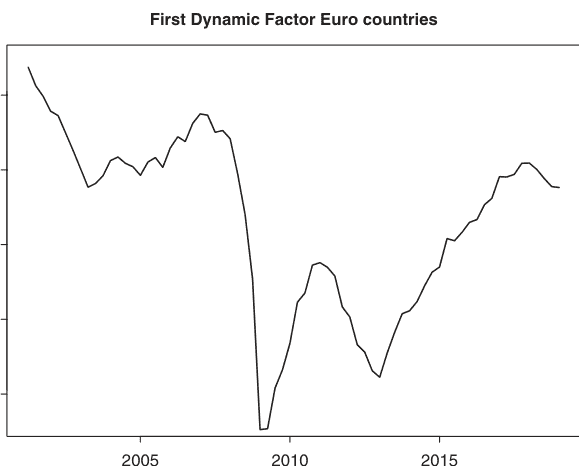

图 6.12 欧洲货币联盟 19 个国家 GDP 系列增长率的第一个动态因子。该因子使用三个滞后构建，并带入三个滞后。

### 欧元区国家第二个动态因子

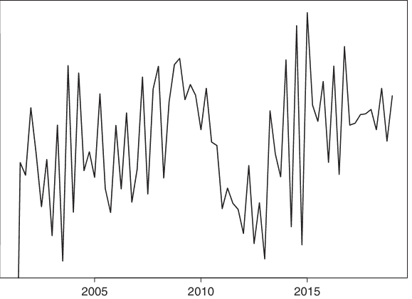

图 6.13 欧洲货币联盟 19 个国家 GDP 系列增长率的第二个动态因子。该因子使用三个滞后构建，并带入三个滞后。

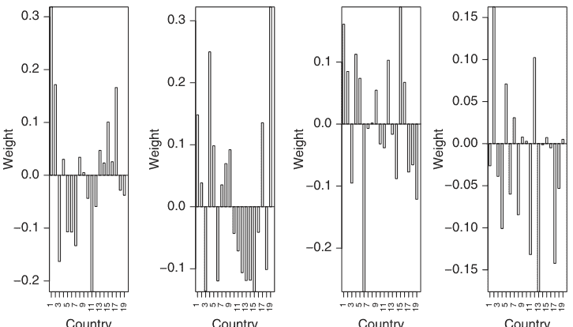

图 6.14 构建欧洲货币联盟 19 个国家 GDP 增长率第一个动态因子的滞后系列权重（a 系数）。这些权重适用于从零到三的滞后。

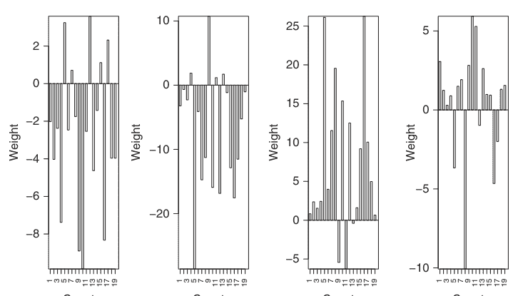

**图 6.15** 用于重建欧洲货币联盟 GDP 增长率的第一个动态主成分的滞后载荷（**b** 系数）。这些载荷适用于从零到三的滞后。

```
> plot(tdx, -f1,xlab="year",ylab="Dynamic Factor", main="First Dynamic
Factor Euro countries", type="l", ylim=y1)
> plot (tdx, -f2,xlab="year",ylab="Dynamic Factor", main="Second Dynamic
Factor Euro countries", type="l", ylim=y1)
### A vector is split into its lags in order to plot them.
> a10=a1[1:19]
> a11=a1[20:38]
> a12=a1[39:57]
> a13=a1[58:76]
> par(mfrow=c(1,4))
> plot (a10,xlab="Country",ylab="Lag 0 weight ", type="l")
> plot (a11,xlab="Country",ylab="Lag 1 weight ", type="l")
> plot (a12,xlab="Country",ylab="Lag 2 weight ", type="l")
> plot (a13,xlab="Country",ylab="Lag 3 weight ", type="l")
> B1 <- sal[[1]]$B
> par(mfrow=c(1,4))
### The Loadings B are plotted
> plot (B1[1,],xlab="Countries",ylab="Loadings 1st DF lag 0", type="l")
> plot (B1[2,],xlab="Countries",ylab="Loadings 1st DF lag 1", type="l")
> plot (B1[3,],xlab="Countries",ylab="Loadings 1st DF lag 2", type="l")
> plot (B1[4,],xlab="Countries",ylab="Loadings 1st DF lag 3", type="l")
```

## 6.5 非平稳系列的 DFM

为简化起见，假设时间序列 $z_t$ 满足 \(\bar{z} = \sum_{l=1}^T z_l / T = \mathbf{0}\) 并且是一个 \(I(1)\) 过程。那么，一些共同因子是 \(I(1)\)，但其中一些可能是平稳的。Hu 和 Chou (2004) 考虑了这种模型，并提出使用标量组件模型 (Tiao and Tsay, 1989) 来分离平稳和非平稳因子。Peña 和 Poncela (2006) 提出了一种正式方法，采用以下模型：

$z_t = P_1 f_{1t} + P_2 f_{2t} + n_t, \quad (6.37)$

其中 $P_1$ 和 $f_{1t}$ 对应于 $r_1$ 维的 \(I(1)\) 共同因子，$P_2$ 和 $f_{2t}$ 对应于 $r_2$ 维的平稳共同因子，$n_t$ 是一个平稳噪声过程。对于 \(I(d)\) 过程 $y_t$，作者定义了广义样本自协方差矩阵 $C_y(h)$ 为

$C_y(h) = \frac{1}{T^{2d}} \sum_{t=h+1}^T z_{t-h} z'_t, \quad (6.38)$

并表明 (1) 这些广义协方差矩阵收敛到某些随机矩阵，(2) 对于非平稳因子的识别，这些矩阵的作用与平稳系列的样本自协方差矩阵相同。事实上，他们表明，在模型 (6.37) 下，广义样本协方差矩阵 $C_y(h)$（有限 $h$）弱收敛到一个随机矩阵 $\Gamma_y$，该矩阵几乎可以肯定地有 $r_1$ 个大于零的特征值和 $k - r_1$ 个等于零的特征值。另外，对应于 $r_1$ 个大于零特征值的特征向量构成了由载荷子矩阵 $P_1$ 的列所张成的空间的基。

这意味着，公共非平稳因子的数量可以通过 $C_y(h)$ 的非零特征值数量来找到，相应的特征向量提供了 $P_1$ 载荷矩阵的估计。因此，令 $\hat{P}_1$ 为由与 $C_y(0)$ 的 $r_1$ 个最大特征值相关的特征向量组成的矩阵，我们通过 $\widehat{f}_{1t} = \hat{P}'_1 z_t$ 估计整合因子。接下来，我们通过以下方法获得一个不含非平稳因子的新系列 $y_t$：

$y_t = z_t - \hat{P}_1 \widehat{f}_{1t} = P_2 f_{2t} + n_t + \varepsilon_t, \quad (6.39)$

其中 $\varepsilon_t = P_1 f_{1t} - \hat{P}_1 \widehat{f}_{1t}$ 是一个随着 \( T \rightarrow \infty \) 收敛到零的过程。那么，过程 $y_t$ 大约会遵循公式 (6.1) 中的静态 DFM，我们可以应用之前讨论用于静态时间序列的方法来估计 $P_2$ 和 $f_{2t}$。最后，计算噪声，并可以构建因子和噪声的模型。作为广义协方差矩阵的替代方案，我们可以使用汇总协方差矩阵 (6.21) 来计算特征向量。

这种方法要求噪声是平稳的。否则，$C_y(0)$ 的特征结构将无法提供信息，公式 (6.39) 中的系列 $y_t$ 很可能具有整合噪声，导致识别问题。另外，如我们在第 3 章中所见，独立的 \(I(1)\) 系列可能具有很强的相关系数，进而可能导致伪回归问题。参见第 3.5.1 节。因此，一组独立的 \(I(1)\) 系列可能具有许多非对角非零系数的协方差矩阵，应用主成分分析可能导致伪因子。

Bai 和 Ng (2004) 提出了一种替代程序，该程序不假设噪声是平稳的，即对观测系列进行一阶差分，并将 DFM 应用于生成的平稳系列。令 $y_t = \nabla z_t$ 并写成：

$y_t = P_1 \tilde{f}_{1t} + P_2 \tilde{f}_{2t} + \tilde{n}_t.$

这是一个静态 DFM，因子为 \(\tilde{f}_{1t} = \nabla f_{1t}\) 和 \(\tilde{f}_{2t} = \nabla f_{2t}\)，噪声是平稳的，但可能不可逆。我们可以在差分后应用静态 DFM 的程序来找到一组因子 \(\tilde{f}_t\)，其中包括平稳和非平稳因子。然后，我们可以通过 \(f_1 = \tilde{f}_1\) 和

```
\(\hat{f}_t = \sum_{s=2}^t \tilde{f}_s, \quad t \ge 2,\)
```

构建整合因子，并检查 \(\hat{f}_t\) 组分的平稳性。这可以使用第 2 章讨论的扩展 Dickey-Fuller 检验来完成。请注意，此程序找到的整合因子数量可能大于真实数量 \(r_1\)，需要协整检验来选择因子数量。参见第 3 章。然后，计算噪声系列 \(\hat{n}_t = z_t - \hat{P}'_f \hat{f}_{1t} - \hat{P}'_{2f} \hat{f}_{2t}\)，并对每个组分进行平稳性检验并用于建模。

第一种方法在水平上运行，没有识别问题，并且有优势是整合因子空间的维度可以直接找到。如果我们预期系列具有带有平稳噪声的公共因子，则建议使用此方法。另一方面，如前所述，如果系列是独立的 I(1) 系列，或者某些噪声是整合的（参见 Onatski 和 Wang, 2019），它可能会找到伪因子。第二种方法在差分后的系列上运行，当噪声是整合时，更适合检验整合因子的存在，但当噪声是平稳时，它在找到整合因子维度方面效率较低，如 Corona 等人 (2020) 的蒙特卡洛研究所示。Choi (2017) 指出这种效应的一个原因是，对平稳噪声进行差分通常会增加其方差和自相关性，使公共因子的估计效率降低。无论如何，这仍然是一个开放问题，需要更多研究来判断两种方法的相对优劣。例如，参见 Corona 等人 (2017) 关于在静态单变量变换后选择因子数量的方法性能的研究。因此，我们的建议始终是尝试两种方法并比较它们的结果。Gao 和 Tsay (2020) 最近提出了另一种方法，也对 $z_t$ 的水平进行操作。

### 示例 6.5

我们再次分析 19 个欧元区国家的 GDP 系列，但现在直接使用水平。图 6.16 显示了这 19 个标准化 GDP 系列的时间图。图显示，所有国家的 GDP 系列在 2008 年金融危机之前增长迅速。然后，所有国家都深受金融危机影响，尽管其中大多数很快恢复了增长，但有三个国家在 2013 年左右又出现下降。这三个经济体是希腊、葡萄牙和意大利。事实上，有两个国家的 GDP 系列尚未恢复到危机前水平。

我们使用程序 `dfmpc` 分析这些系列以估计因子，并通过 Lam 和 Yao 检验发现两个共同因子。这两个因子显示在图 6.17 中。第一个因子解释了 79.72% 的变异性，第二个解释了 14.95%。这些结果与滞后协方差矩阵的主要特征值一致，由于系列是标准化的，这些特征值即为相关系数矩阵的特征值。这些特征值显示在表 6.2 中，并建议使用两个因子。


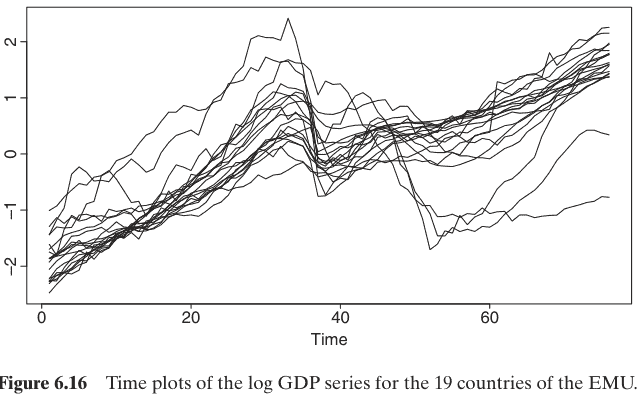

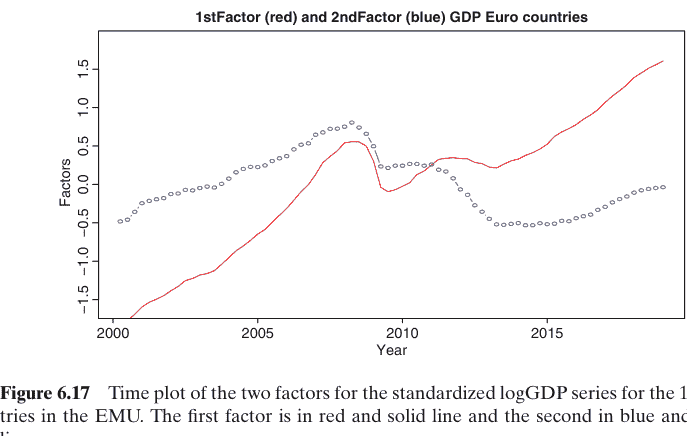

| | 0 | 1 | 2 | 3 | 4 | 5 |
|---|---|---|---|---|---|---|
| λ₁ | 0.298 | 0.282 | 0.266 | 0.250 | 0.234 | 0.218 |
| λ₂ | 0.270 | 0.261 | 0.250 | 0.235 | 0.217 | 0.196 |
| λ₃ | 0.070 | 0.067 | 0.065 | 0.062 | 0.061 | 0.060 |
| λ₄ | 0.039 | 0.038 | 0.036 | 0.032 | 0.029 | 0.024 |
| λ₅ | 0.008 | 0.007 | 0.006 | 0.004 | 0.003 | 0.003 |

获得滞后相关矩阵特征值和特征向量的 R 命令如下所示，其中对于 i = 0, ..., 5，矩阵 Si 包含滞后 i 协方差矩阵，Ei 是矩阵 Si 的五个最大特征值，EVfi 是与矩阵 Si 第一个特征值相关联的特征向量，EVsi 是对应于第二个特征向量的特征向量。另外，两个特征值的载荷对于不同滞后是稳定的。因子的估计载荷如图 6.18 所示。第一个因子是所有国家的加权平均值，尽管希腊 (8)、意大利 (10) 和葡萄牙 (16) 的权重比其他国家小。第二个因子载荷根据正负权重区分国家：负载荷最大的国家是希腊 (8)、意大利 (10) 和马耳他 (14)。

### 示例 6.5 使用的 R 命令：

```
> x=as.matrix(UMBdata)
> n=nrow(x)
> G=matrix(0,n,19)
> for (i in 1:19) {G[,i]=x[,1+3*(i-1)]}
> G0=log(G)
> G1=scale(G0)
> ##the data in logs and scale is in G1
> yl <- range(G1)
> tdx <- c(1:76)/4+2000
> plot(tdx,G1[,1],xlab="year",ylab="logGDP", main="GDP Euro countries",
```

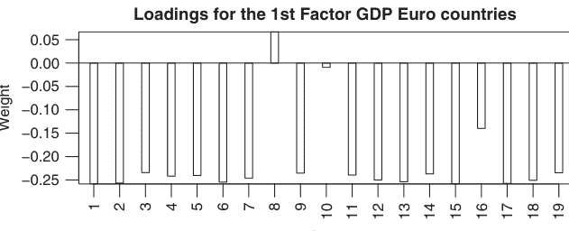

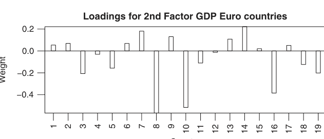

图 6.18 货币同盟 19 个国家 logGDP 系列的两个因子载荷。

```
type="l", ylim=y1)
> for (i in 2:19) {lines (tdx,G1[,i],col=i)}
> out=acf (G1,lag.max=5,type="covariance",plot=FALSE)
>
> S0=eigen(out$acf[1,,])
> B0=S0$values[1:5]
> EVf0=S0$vectors[,1]
> EVs0=S0$vectors[,2]
### Same commands to compute S1-S5 to EVS1-EVS5
> EVf=cbind(EVf0,EVf1,EVf2,EVf3,EVf4,EVf5)
> EVs=cbind(EVs0, EVs1,EVs2, EVs3, EVs4, EVs5)
> out=dfmpc(G1)
> out$r
[1] 2
```

```
> y1 <- range(out$F)
> tdx <- c(1:76) /4+2000
> plot (tdx,-out$F[,1], xlab="year",ylab="Factors", main="1stFactor (red)
and 2ndFactor (blue) GDP Euro countries", type="l",ylim=y1,col="red")
> lines (tdx,-out$F[,2], type="b", col="blue")
> par (mfrow=c(2,1))
> plot(out$L[1,], xlab="Countries",ylab="Loadings",
main="Loadings for the 1stFactor (red) GDP Euro countries",
type="b",col="red")
> plot(out$L[,2], xlab="Countries",ylab="Loadings",
main="Loadings for 2ndFactor (blue) GDP Euro countries",
type="o",col="blue")
```

### 6.5.1 协整与 DFM

正如第 3 章所讨论的，非平稳时间序列向量可以协整，该系列的一些线性组合是平稳的；参见 Banerjee 等人 (1993) 和 Johansen (1995)。具有某些整合因子和平稳噪声的 DFM 意味着系列 \(z_t\) 的协整。令 \(P_1^\perp\) 为 \(P_1\) 的 \(k \times (k - r_1)\) 正交补矩阵，使得 \(P'_1 P_1^\perp = 0_{(r_1 \times k - r_1)}\)，则有

\(P_1^{\perp'} z_t = P_1^{\perp'} P z_{2t} + P_1^{\perp'} n_t.\)

由于前一等式右边由平稳系列的线性组合构成，\(P_1^{\perp'} z_t\) 中的 \(k - r_1\) 个系列是平稳的。事实上，这些系列代表了 \(z_t\) 的协整系列。进一步分析见 Scribano and Peña (1994)。因此，DFM 提供了一种寻找协整关系的直接方法。关于通过 DFM 估计协整秩的一致性建议，参见 Zhang et al. (2018)。当有许多时间序列（即 \(k\) 很大）时，整合因子的数量 \(r_1\) 预计相对较小，因此协整关系的数量 \(k - r_1\) 将很大。有观点认为（参见 Barigozzi et al. (2016, 2017)），具有平稳噪声的 DFM 隐含的大量协整关系与实证证据不一致，这意味着在实际应用中噪声可能遵循整合过程。这些作者还考虑了因子具有降秩表示或因子之间存在协整的可能性，并提出了一种在某些噪声协整时估计它们的程序。噪声可能非平稳这一事实表明，FM 中噪声的协方差矩阵可能有一些主导特征值，这可能导致通过 PCA 或检验特征值比率来识别共同因子数量时出现困难。该问题已在 Gao and Tsay (2018) 中得到解决。

## 6.6 非平稳系列的 GDFM

关于非平稳数据的 GDFM 结果很少，大多数应用都是通过对系列进行差分来构建平稳 GDFM。基于频域中 DPC 的估计程序只能应用于平稳系列，但存在一种时域方法，即广义动态主成分（GDPC），由 Peña and Yohai (2016) 提出，该方法不需要平稳性假设，可以应用于非平稳时间序列。这些广义 DPC 是用于重构数据的最优函数，不限制为观测值的线性组合。请注意，Brillinger 的 DPC 和第 6.5 节中介绍的 ODPC 都是观测系列的线性组合。去除这一限制后，GDPC 可以是观测值的非线性函数，因此可以更好地适应系列的非平稳行为。Smucer (2019) 证明，这些 GDPC 是 GDFM 共同部分的估计的一致估计量。

### 6.6.1 广义 DPC 估计

GDPC 可以按如下计算。有关更详细的解释，参见 Peña and Yohai (2016)。

假设我们观察到满足 $\sum_{t=1}^T z_{j,t} = 0$ 的系列 $z_{j,t}$。考虑两个正整数 $c_1$ 和 $c_2$。我们定义具有 $c_1$ 个滞后和 $c_2$ 个超前的第一个 GDPC 为向量 $\boldsymbol{f} = (f_t)_{-c_1+1 \le t \le T+c_2}$，使得将系列 $z_{j,t}$ ($1 \le j \le k$) 重构为 $\{f_j t - c_1 \le j \le t + c_2\}$ 元素的线性组合，关于 MSE 准则是最优的。更准确地说，原始系列 $z_{j,t}$ 的重构定义为

$\widehat{z}_{j,t} = \sum_{i=-c_1}^{c_2} \beta_{j,i} f_{t+i}.$

我们可以通过令 $L = c_1 + c_2$ 并定义新分量 $f_t^* = f_{t+c_2}$，仅使用分量的滞后来写出此表达式，这样值 $(f_{t+c_2}, \dots, f_{t-c_1})$ 就转换为 $(f_t^*, \dots, f_{t-L}^*)$，并将 $\beta_{j,i}^*$ 称为对应于 $f_{t-i}^*$ 的新系数，它们与之前的系数的关系为 $\beta_{j,i}^* = \beta_{j,c_2-i}$。然后，重构系列也可以表示为

$\widehat{z}_{j,t} = \sum_{i=-c_1}^{c_2} \beta_{j,i} f_{t+i} = \sum_{h=0}^L \beta_{j,h}^* f_{t-h}^* .$

因此，不失一般性，我们可以使用 PC 的 $L$ 个滞后来重构系列。定义 $(L+1) \times 1$ 向量 $\boldsymbol{f}_t = (f_t, \dots, f_{t-L})'$ 和具有行 $\boldsymbol{b}_j' = (\beta_{j,0}, \dots, \beta_{j,L})$ 的 $k \times (L+1)$ 矩阵 $\boldsymbol{B}$，我们希望最小化

$\text{MSE}(\boldsymbol{f}, \boldsymbol{B}) = \frac{1}{Tk} \sum_{j=1}^k \sum_{t=1}^T \left( z_{j,t} - \sum_{i=0}^L \beta_{j,i} f_{t-i} \right)^2 = \frac{1}{Tk} \sum_{t=1}^T (\boldsymbol{z}_t - \boldsymbol{B f}_t)' (\boldsymbol{z}_t - \boldsymbol{B f}_t) . \quad (6.40)$

请注意，即使在非平稳向量时间序列的情况下，该损失函数也定义良好。$T + L$ 维向量 $\boldsymbol{f} = (f_{1-L}, \dots, f_T)'$ 和 $k \times (L + 1)$ 矩阵 $\boldsymbol{B}$ 的最优选择由以下给出

$(\widehat{\boldsymbol{f}}, \widehat{\boldsymbol{B}}) = \arg \min_{\boldsymbol{f} \in \mathbb{R}^{T+L}, \boldsymbol{B} \in \mathbb{R}^{k \times (L+1)}} \text{MSE}(\boldsymbol{f}, \boldsymbol{B}). \quad (6.41)$

显然，如果 $\boldsymbol{f}$ 是最优的，那么 $\gamma \boldsymbol{f} + \boldsymbol{\delta}$ 也是最优的。因此，我们可以选择 $\boldsymbol{f}$ 使得 $\sum_{t=1-L}^T f_t = 0$ 且 $(1/(T + L)) \sum_{t=1-L}^T f_t^2 = 1$。我们称 $\widehat{\boldsymbol{f}}$ 为观测系列 $\boldsymbol{z}_1, \dots, \boldsymbol{z}_T$ 的阶数 $L$ 的第一个（可能非平稳）GDPC。请注意，阶数为 0 的第一个 GDPC 对应于数据的第一个常规 PC。由于

$\text{MSE}(\boldsymbol{f}, \boldsymbol{B}) = \frac{1}{Tk} \left[ \sum_{t=1}^T \boldsymbol{z}_t' \boldsymbol{z}_t - 2 \sum_{t=1}^T \boldsymbol{z}_t' \boldsymbol{B} \boldsymbol{f}_t + \sum_{t=1}^T \boldsymbol{f}_t' \boldsymbol{B}' \boldsymbol{B} \boldsymbol{f}_t \right].$

然后

$\frac{\partial \text{MSE}(\boldsymbol{f}, \boldsymbol{B})}{\partial \boldsymbol{B}} = 0 = - \sum_{t=1}^T \boldsymbol{f} \boldsymbol{z}_t' + \sum_{t=1}^T \boldsymbol{f} \boldsymbol{f}_t' \boldsymbol{B}'. \quad (6.42)$

定义 $\boldsymbol{F}' = [\boldsymbol{f}_1, \dots, \boldsymbol{f}_T]$ 为包含重构数据 $\boldsymbol{Z}$ 所需的分量所有滞后值的 $(L + 1) \times T$ 矩阵。等式 (6.42) 意味着

$\widehat{\boldsymbol{B}}' = (\boldsymbol{F}' \boldsymbol{F}')^{-1} \boldsymbol{F}' \boldsymbol{Z}. \quad (6.43)$

等式 (6.40) 对 $f_t$ 的偏导数考虑到所有项 $z_{1,t}, \dots, z_{j,t+L}$ 都使用 $f_t$ 进行重构，因此方程中会出现 $\beta_{j,i}$ 系数的平方和交叉积。可以证明（参见 Peña and Yohai, 2016），$\widehat{\boldsymbol{f}}$ 的估计可以写成

$\widehat{\boldsymbol{f}} = \boldsymbol{D}(\boldsymbol{B})^{-1} \sum_{j=0}^L \boldsymbol{C}_j(\boldsymbol{Z}) \boldsymbol{\beta}_j, \quad (6.44)$

其中，平方 $(T + L)$ 矩阵 $\boldsymbol{D}(\boldsymbol{B})$ 包含矩阵 $\boldsymbol{B}$ 元素的交叉积，矩阵 $\boldsymbol{C}_j(\boldsymbol{Z})$ 包含 $\boldsymbol{Z}$ 的元素，维度为 $(T + L) \times (L + 1)$。

为了定义计算 $(\widehat{\boldsymbol{f}}, \widehat{\boldsymbol{B}})$ 的迭代算法，只需给出一个初始值 $\boldsymbol{f}^{(0)}$ 和一个规则，描述在已知 $\boldsymbol{f}^{(h)}$ 时如何计算 $\boldsymbol{B}^{(h)}$ 和 $\boldsymbol{f}^{(h+1)}$。对于等式 (6.43)，给定 $\boldsymbol{f}^{(h)}$，系数 $\boldsymbol{B}^{(h)}$ 可以通过线性回归方法获得

$\boldsymbol{B}^{(h)} = [\boldsymbol{F}(\boldsymbol{f}^{(h)})' \boldsymbol{F}(\boldsymbol{f}^{(h)})]^{-1} \boldsymbol{F}(\boldsymbol{f}^{(h)})' \boldsymbol{Z},$

并且根据等式 (6.44)，$\boldsymbol{f}^{*(h+1)}$ 按以下方式计算

$\boldsymbol{f}^{*(h+1)} = \boldsymbol{D}(\boldsymbol{B}^{(h)})^{-1} \sum_{j=0}^L \boldsymbol{C}_j(\boldsymbol{Z}) \boldsymbol{\beta}_j^{(h)},$

并且将分量向量标准化为均值为零、方差为一。


初始值 $f^{(0)}$ 可以设置为标准（非动态）第一主成分，并补齐 $L$ 个零。当
$$\frac{\text{MSE}(f^{(h)}, B^{(h)}) - \text{MSE}(f^{(h+1)}, B^{(h+1)})}{\text{MSE}(f^{(h)}, B^{(h)})} < \varepsilon,$$
对某个值 $\varepsilon$ 时，我们停止迭代。

请注意，计算 $f^{(h)}, B^{(h)}$ 所需逆矩阵的维数与时间序列数量无关，因此我们可以处理大量序列。

第二个GDPC是使用残差 $r_{jt}(1) = z_{jt} - \widehat{z}_{jt}(1)$ 计算的，其中 $\widehat{z}_{jt}(1)$ 是使用第一个GDPC重构得到的值。这些残差被用作观测数据，并据此计算新的分量。一般来说，如果我们已经计算了第 $h$ 个GDPC $\widehat{z}_{jt}(h)$，使用残差 $r_{jt}(h-1)$，那么用于计算下一个 $(h+1)$ 个分量的新数据是 $r_{jt}(h) = r_{jt}(h-1) - \widehat{z}_{jt}(h)$。通过这种方式，各分量在所有涉及的滞后阶数上都是不相关的。最后，分量数和滞后数的选择可以如ODPC情况中那样进行。

### 示例 6.6

与示例 6.5 类似，我们直接使用水平值分析 19 个欧元国家的 GDP 序列。我们应用 CRAN 包 `gdpc` 中的程序 `auto.gdpc`。关于该包的说明，请参见 Peña et al. (2020)。我们使用默认选项运行该程序，其中 GDPC（或动态因子）的数量以及所需的滞后数通过交叉验证选择，如前文所述。选择了一个单一因子，配有 10 个滞后，它解释了 99.2% 的变异性。请注意，该因子本身解释的变异性比例大于示例 6.5 中估计的两个因子（94.67%，即 79.72 + 14.95% = 94.67%）。图 6.19 显示了该因子，图 6.20 显示了该因子中 11 个滞后（包括滞后零）的系列载荷。

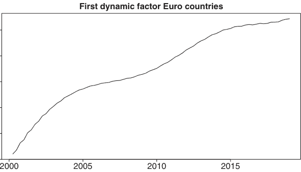

图 6.19 EMU 中 19 个国家标准化 logGDP 序列的第一个 GDPC。

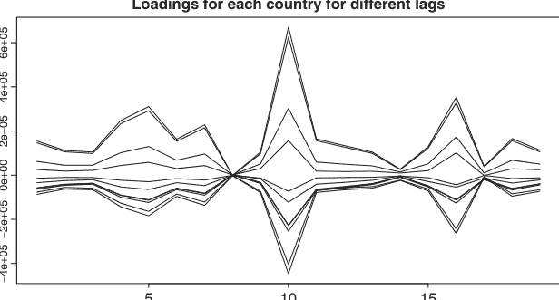

图 6.20 EMU 中 19 个国家 logGDP 序列具有 10 个滞后的 GDPC 的载荷。

#### 示例 6.6 使用的 R 命令：

```r
require(gdpc)
x=as.matrix(EMUdata)
n=nrow(x)
G=matrix(0,n,19)
for (i in 1:19){G[,i]=x[,1+3*(i-1)]}
G0=log(G)
G1=scale(G0)
sal<- auto.gdpc(G1, niter_max=1000)
sal
#the summary of the fitted GDPC:
Number.of.lags LOO MSE Explained.Variance
Component 1 10 0.014 0.008 0.992
#sal[[1]] has the information of the 1st component, sal[[2]] of the
#second component and so on
> f1<- sal[[1]]$f
> beta1<- sal[[1]]$beta
> y1 <- range(f1)
> tdx <- c(1:76)/4+2000
> plot(tdx,f1,xlab="year",ylab="Dynamic Factor",
main="First Dynamic Factor Euro countries", type="l", ylim=y1)
> ts.plot(beta1,xlab="countries",ylab="beta",
main="Loadings for each country for different lags")
```

## 6.7 DFM中的异常值

### 6.7.1 因子异常值和特有异常值

我们考虑动态因子模型中两种类型的异常值。一种是影响所有或大多数时间序列的因子异常值，另一种是仅影响一个或几个时间序列的特有分量异常值。这两种异常值类似于第 4 章中研究的多变量和单变量异常值。然而，通过在估计中纳入动态因子模型的结构，检测程序的功效得到了提高。

设 \(\boldsymbol{f}_t = (f_{1t}, \dots, f_{rt})'\) 为动态因子向量。如果在时间索引 \(t=o\) 时，第 \(j\) 个动态因子出现因子异常值，即代替 \(\boldsymbol{f}_t\)，我们有一组潜在因子 \(\boldsymbol{f}_t^* = (f_{1t}^*, \dots, f_{rt}^*)'\)，给定为

\(\boldsymbol{f}_t^* = \boldsymbol{f}_t + \boldsymbol{w}_j^{(o)} I_t^{(o)},\) \tag{6.45}

其中 \(\boldsymbol{w}_j^{(o)} = (0, \dots, 0, w_j^{(o)}, 0, \dots, 0)'\) 是第 \(j\) 个动态因子中异常值的大小，\(I_t^{(o)}\) 是时间 \(t=o\) 的指示变量；参见第 4 章。方程 (6.45) 中的因子异常值可能根据载荷影响所有时间序列分量。还请注意，同一因子的所有异常值对系列的影响与该因子的载荷成正比。观测时间序列为

\(\boldsymbol{z}_t = \boldsymbol{P}\boldsymbol{f}_t^* + \boldsymbol{n}_t = \boldsymbol{P}(\boldsymbol{f}_t + \boldsymbol{w}_j^{(o)} I_t^{(o)}) + \boldsymbol{n}_t = \boldsymbol{y}_t + \boldsymbol{P}\boldsymbol{w}_j^{(o)} I_t^{(o)}\)

其中 \(\boldsymbol{y}_t\) 是无异常值系列，\(\boldsymbol{P}\boldsymbol{w}_j^{(o)} = w_j^{(o)} \boldsymbol{p}_j\) 是异常值的影响。

另一方面，特有异常值是单个特有噪声分量中的加法异常值。因此，如果 \(\boldsymbol{n}_t = (n_{1t}, \dots, n_{kt})'\) 是特有噪声向量，则在时间 \(t=i\) 时，第 \(l\) 个特有噪声分量中出现特有异常值，即代替 \(\boldsymbol{n}_t\)，我们有 \(\boldsymbol{n}_t^* = (n_{1t}^*, \dots, n_{kt}^*)'\)，给定为

\(\boldsymbol{n}_t^* = \boldsymbol{n}_t + \boldsymbol{w}_l^{(i)} I_t^{(i)},\) \tag{6.46}

其中 \(\boldsymbol{w}_l^{(i)} = (0, \dots, 0, w_l^{(i)}, 0, \dots, 0)'\) 是特有异常值的大小，\(I_t^{(i)}\) 是 \(t=i\) 的指示变量。方程 (6.46) 中的特有异常值仅影响一个时间序列，因为观测时间序列为

\(\boldsymbol{z}_t = \boldsymbol{P}\boldsymbol{f}_t + \boldsymbol{n}_t^* = \boldsymbol{P}\boldsymbol{f}_t + (\boldsymbol{n}_t + \boldsymbol{w}_l^{(i)} I_t^{(i)}) = \boldsymbol{y}_t + \boldsymbol{w}_l^{(i)} I_t^{(i)}.\) \tag{6.47}

因此，时间 \(t=i\) 时第 \(l\) 个噪声分量中的特有异常值在第 \(l\) 个观测时间序列中产生大小为 \(w_l^{(i)}\) 的异常值。

在实践中，观测时间序列 \(\{\boldsymbol{z}_1, \dots, \boldsymbol{z}_T\}\) 可能受到多个因子和/或特有异常值的存在影响，如下所示

\(\begin{aligned} \boldsymbol{z}_t = \boldsymbol{P}\left( \boldsymbol{f}_t + \sum_{i=1}^F \boldsymbol{w}_{j_i}^{(o_{j_i})} I_t^{(o_{j_i})} \right) + \left( \boldsymbol{n}_t + \sum_{j=1}^I \boldsymbol{w}_{l_j}^{(i_j)} I_t^{(i_j)} \right) \\ = \boldsymbol{y}_t + \sum_{i=1}^F \boldsymbol{P}\boldsymbol{w}_{j_i}^{(o_{j_i})} I_t^{(o_{j_i})} + \sum_{j=1}^I \boldsymbol{w}_{l_j}^{(i_j)} I_t^{(i_j)}, \end{aligned}\) \tag{6.48}

对于 \(t=1, \dots, T\)，其中 \(\boldsymbol{w}_{j_1}^{(o_1)}, \dots, \boldsymbol{w}_{j_F}^{(o_F)}\) 分别是时间 \(o_1, \dots, o_F\) 时第 \(j_1\) 个、...、第 \(j_F\) 个动态因子中的 \(F\) 个因子异常值的大小，\(\boldsymbol{w}_{l_1}^{(i_1)}, \dots, \boldsymbol{w}_{l_I}^{(i_I)}\) 分别是时间 \(i_1, \dots, i_I\) 时第 \(l_1\) 个、...、第 \(l_I\) 个特有噪声分量中的 \(I\) 个特有异常值的大小。请注意，方程 (6.48) 的表达式足够灵活，可以涵盖诸如一组因子异常值在同一时间点影响不同动态因子，或因子异常值与特有异常值在同一时间点同时出现等情况。这些异常值的影响是在样本协方差矩阵中引入偏差，如果某些异常值较大，这种偏差可能很严重。

### 6.7.2 在动态因子模型中查找异常值的程序

Galeano et al. (2020) 提出了一种用于平稳高维时间序列异常值检测的程序，分为以下五个步骤：

- 1. 对时间序列 \(\{x_{1t}^*, \dots, x_{Tt}^*\}\) 进行初步清洗，得到数据 \(\{x_{1}^{\circ}, \dots, x_{T}^{\circ}\}\)。
- 2. 使用清洗后的数据获得因子数 \(r\)、因子载荷矩阵 \(P\) 及其正交补矩阵 \(V\) 的稳健估计值，分别记为 \(\hat{\tau}\)、\(\hat{P}\) 和 \(\hat{V}\)。
- 3. 用 \(\hat{V}'\) 投影时间序列 \(\{x_{1t}^*, \dots, x_{Tt}^*\}\) 以检测并清洗系列中的特有异常值，得到时间序列 \(\{x_{1}^{\Diamond}, \dots, x_{T}^{\Diamond}\}\)。
- 4. 用 \(\hat{P}'\) 投影时间序列 \(\{x_{1}^{\Diamond}, \dots, x_{T}^{\Diamond}\}\) 以检测并清洗系列中的因子异常值，得到时间序列 \(\{x_{1}^{\bullet}, \dots, x_{T}^{\bullet}\}\)。
- 5. 使用时间序列 \(\{x_{1}^{\bullet}, \dots, x_{T}^{\bullet}\}\) 再次估计因子载荷矩阵 \(P\) 和其正交补矩阵 \(V\)，并重复步骤 3-5 直到不再发现异常值。

这五个步骤可以自动执行。在该程序的第一步中，通过第 4 章中解释的 Galeano et al. (2006) 程序对观测数据进行初步时间序列清洗。在第二步中，使用步骤 1 获得的清洁数据估计因子数 \(r\)、载荷矩阵 \(P\) 及其正交补 \(V\)。在第三步中，检测特有异常值并从观测时间序列 \(\{x_{1t}^*, \dots, x_{Tt}^*\}\) 中去除其影响。这是通过使用转换时间序列 \(z_t = \hat{V}'x_t^*\) 的信息，对每个系列和每个时间点进行特有异常值检验来完成的，\(t = 1, \dots, T\)。在第四步中，我们利用特有异常值已从时间序列 \(\{x_{1}^{\Diamond}, \dots, x_{T}^{\Diamond}\}\) 中移除这一事实，使用 \(f_t^{\Diamond} = \hat{P}'x_t^{\Diamond}\)（\(t = 1, \dots, T\)）估计动态因子，其中 \(\hat{P}\) 是步骤 2 中获得的 \(P\) 的稳健估计值，然后，我们使用单变量时间序列算法检测每个动态因子中的因子异常值。在程序的最后一步中，我们迭代前面的步骤，直到不再发现异常值。

请注意，与第 4 章中的投影程序相比，一个重要的区别是，在这里我们将系列投影在因子空间和正交噪声空间上，而不是将它们投影在极端峰度方向上。动态因子模型引导每种异常值的搜索，而在之前的无模型算法中，我们只是希望从数据中清除严重错误。因此，可以在本节所介绍的算法的步骤 1 中应用之前的程序，以对数据进行初步清洗并计算协方差矩阵的稳健估计。

动态因子模型中的异常值最初由 Baragona and Battaglia (2007) 研究。Breitung and Eickmeier (2011) 考虑了这些模型中的水平转移或结构性断点，并


Cheng 等 (2016) 提出了水平偏移的收缩估计。DFM 中缺失值估计已由 Bai 和 Ng (2019) 研究。

## 6.8 具有聚类结构的 DFM

通常，有些因素会影响所有序列，而其他因素是特定于某组的，且仅影响该组中的部分序列。例如，我们可能有不同经济发展水平的国家群体、相互关联的产业部门以及双边贸易。那么，这些国家的经济时间序列的动态演变可能受到一些反映全球经济演变的一般因素，以及一些依赖于特定组的特定因素的影响。在这种情况下，我们得到一个具有聚类结构的 DFM（DFMCS）。此类模型已由 Wang (2010)、Hallin 和 Liška (2011)、Lin 和 Ng (2012)、Bonhomme 和 Manresa (2015)、Su 等 (2016)、Ando 和 Bai (2016, 2017) 以及 Alonso 等 (2020) 等学者研究。

将 $k$ 维时间序列分区为 $z_t = (z'_{1t}, z'_{2t}, \dots, z'_{ct})'$，其中 $z_{it}$ 是一个满足 $\sum_{i=1}^c k_i = k$ 的 $k_i$ 维时间序列。换句话说，我们有 $c$ 个时间序列聚类，第 $i$ 个聚类包含 $k_i$ 个时间序列。DFMCS 可以写为

$$
z_t = P_0 f_{0t} + \sum_{i=1}^c P_i f_{it} + n_t, \quad (6.49)
$$

其中 $n_t$ 是噪声向量，$f_{0t} = (f_{01t}, \dots, f_{0r_0 t})'$ 是一个 $r_0$ 维的全局因素向量，$P_0$ 是一个 $k \times r_0$ 的全局载荷矩阵。$f_{it} = (f_{i,1t}, \dots, f_{i,r_i t})'$ 是第 $i$ 个聚类的 $r_i$ 维共同因子，$P_i$ 是第 $i$ 个聚类的 $k \times r_i$ 载荷矩阵，满足 $P_i = [0'_{i-1}, w'_i, 0'_{c-i}]'$，其中 $0_{i-1}$ 是当 $i > 1$ 时维度为 $(\sum_{j=1}^{i-1} k_j)$ 行乘以 $r_i$ 列的零矩阵，$w_i$ 是第 $i$ 个聚类的 $k_i \times r_i$ 载荷矩阵，而 $0_{c-i}$ 是当 $i < c$ 时另一个维度为 $(\sum_{j=i+1}^c k_j)$ 行乘以 $r_i$ 列的零矩阵。这样一来，$P_i f_{it}$ 仅影响第 $i$ 个聚类中的时间序列。因素总数为 $r = r_0 + r_1 + \dots + r_c$。

Wang (2010) 研究了等式 (6.49) 中 DFMCS 的识别问题，所需条件为：(1) $P'_0 P_0 = I_{r_0}$，其中 $I_{r_0}$ 是阶数为 $r_0$ 的单位矩阵；(2) 对于 $i = 1, \dots, c$，$P'_i P_i = w'_i w_i = I_{r_i}$；(3) $P'_0 P_i = 0_{r_0 \times r_i}$；以及 (4) $r = \sum_{j=1}^c r_j$ 个因素的协方差矩阵为对角矩阵。另需注意，按定义，当 $i \neq j$ 时，$P'_i P_j = 0_{r_i \times r_j}$。我们可以将该模型写为标准 DFM。令 $f_t = (f'_{0t}, f'_{1t}, \dots, f'_{ct})'$，以及 $P = [P_0 | P_1 | \dots | P_c]$，则有

$$
z_t = P f_t + n_t, \quad (6.50)
$$

前述条件意味着通常的识别限制 $P'P = I_r$。

特异项与因素的假设与先前相同。特异项或噪声 $n_t = (n_{1t}, \dots, n_{kt})'$ 是一个一般平稳时间序列序列，均值为 $0_k$，并具有如 ADFM 一般的弱序列相关性。全局因素和特定因素彼此正交，并遵循对角 VARMA。此外，我们假设因子模型中出现的两个创新过程在所有滞后阶数上均不相关。然而，聚类的数量及序列归属各聚类的分配是未知的。

DFMCS 的估计需要获得以下参数：(1) 全局因素的数量 $r_0$，组的数量 $c$，以及每个 $c$ 个组中的特定因素数量 $r_1, \dots, r_c$；(2) 标签变量 $g_i \in \{1, \dots, c\}$，指示序列属于哪个组，我们称 $G$ 为分量为 $g_i$（$i = 1, \dots, k$）的 $k \times 1$ 向量；(3) 全局和特定因素的载荷矩阵 $P_0, P_1, \dots, P_c$ 以及这些因素的时间序列 $f_{0t}, f_{1t}, \dots, f_{ct}$。在得到估计的因素和噪声，其中 $\hat{n}_t = z_t - \hat{P} f_t$ 后，可以获得因素和噪声的标量 ARMA 模型参数的估计量。

### 6.8.1 拟合 DFMCS

我们考虑的程序包含以下三个步骤：

- 1. 使用所有时间序列估计一组初始因素及其载荷，并用于构建每个时间序列的共同分量。然后，使用第 5 章提出的广义交叉相关（GCC）方法对这些共同分量进行基于依赖性的聚类，以找到各组。

- 2. 在上一步找到的每组时间序列中估计一组新的因素及其载荷。将各组中发现的所有因素以及第 1 步中发现的因素进行比较，并分类为全局因素或特定因素；

- 3. 从每个时间序列中移除全局因素的影响，并使用得到的组特异残差重新估计特定因素。最后，检查各组是否可能重新组合。

在第一步中，因素和载荷的初始估计是通过对时间序列的样本协方差矩阵 $\hat{\Gamma}_z(0)$ 应用主成分分析（PCA）进行的。如我们所见，与该矩阵 $r_*$ 个最大特征值相关的特征向量为因素载荷矩阵 $\hat{P}$ 提供了估计，其列为 $\hat{p}_1 \dots \hat{p}_{r_*}$。因素数量 $r_*$ 通过使用 Ahn 和 Horenstein (2013) 提出的检验来确定，该检验基于矩阵 $\hat{\Gamma}_z(0)$ 连续特征值的比率。需要注意的是，矩阵 $\hat{P}$ 预计应包含所有全局因素以及部分（或全部）组特异因素，因此该矩阵中的因素数量 $r_*$ 通常大于全局因素的真实数量 $r_0$。此外，在实际应用中，当因素的强度程度不同时，如果对特征值比率检验应用两次——首先检测少数几个主导因素，然后寻找其他因素——结果通常会更好，正如 Lam 和 Yao (2012) 所建议的。随后，因素通过 $\hat{f}_{it} = \hat{p}'_i z_t$ 估计，其中 $i = 1, \dots, r_*$，共同分量通过 $\mathbf{f}_t = \hat{\mathbf{P}} \hat{\mathbf{p}}' \mathbf{z}_t$ 估计。

现在，通过对使用 GCC 计算的离散矩阵应用单链接层次聚类算法来构建各组。聚类数量是通过对轮廓（Silhouette）算法进行修改获得的，增加了聚类必须具有最小大小的限制。我们通过在树状图分析中省略与其余序列具有相对较小依赖性的时间序列（例如，树状图合并的 90% 分位数）来实现这一限制。一旦各组形成，被省略的时间序列会在单链接意义上被分配到最近的聚类。这样一来，我们得到了组数量 $c$ 的估计值，以及向量 $G$ 的估计器，该向量给出了序列到 $c$ 个组的分配。

在第二步中，我们使用上一步找到的各组中的序列来估计新的因素集及其载荷。设 $r^s_1, \dots, r^s_c$ 为通过对各组时间序列样本协方差矩阵的特征值应用 Ahn 和 Horenstein (2013) 检验而在每个组中找到的因素数量。特定载荷矩阵 $\widehat{P}_i$（维度为 $k \times r^s_i$，列为 $\widehat{p}_{i1}, \dots, \widehat{p}_{ir^s_i}$）是通过在 $i$ 个组中对应于最大 $r^s_i$ 个特征值的特征向量上添加一组不属于该组的观测值的零值来构建的。各组中的因素通过 $\widehat{f}^s_{ij,t} = \widehat{p}'_{ij} z_t$ 估计，其中 $j = 1, \dots, r^s_i$。这些组因素预计包含所有特定因素以及部分（或全部）全局因素。

接下来，为了决定某个因素是全局因素还是特定因素，我们将第 1 步中找到的 $r_*$ 个因素集与第二步中找到的 $\sum_{i=1}^c r^s_i$ 个因素集进行比较。需要注意的是，第一个集合中的因素可能是第二个集合中因素的旋转，因此并不明显哪些应被分类为全局因素，哪些应被分类为特定因素。因此，我们首先通过应用以下三条简单规则来决定第一个 $r_*$ 个因素集中的每个因素 $f_t$ 是全局因素还是特定因素：

- 1. 如果 $f_t$ 不属于第二个因素集中的任何因素，则它是全局因素。

- 2. 如果 $f_t$ 仅属于第二个因素集中的一个因素集，则它是该组中的特定因素。

- 3. 如果 $f_t$ 属于第二个因素集中的多个因素集，则它是全局因素。

我们通过计算因素 $f_t$ 与该组中因素 $\widehat{f}^s_{i1,t}, \dots, \widehat{f}^s_{ir^s_i,t}$（$i = 1, \dots, c$）之间的经验典型相关性来决定因素 $f_t$ 是否属于一组特定因素。当因素 $f_t$ 与该组元素的经验典型相关性高于某个阈值 $\rho_0$ 时，我们说 $f_t$ 属于该组。阈值 $\rho_0 = 0.9$ 在我们的蒙特卡罗练习中似乎效果良好。随后，我们检查带有 $r^s_1, \dots, r^s_c$ 个因素的任何组是否包含不属于第 2 步中找到的因素集的任何因素。如果是这种情况，则该因素被分类为相应组中的特定因素。

在第三步中，我们计算残差 $v_t = z_t - \widehat{P}_0 \widehat{f}_{0t}$，其中 $\widehat{f}_{0t}$ 是在第 3 步中获得的估计全局因素向量，$\widehat{P}_0$ 是这些因素对应的载荷矩阵，并使用对应于每个组的系列 $v_{it}$ 重新估计特定因素。然后，我们验证所获得的组是由于不同的特定因素而非全局因素中因素载荷的差异所致。这是通过检查所有组是否至少包含一个特定因素来完成的。我们可能面临以下情况：(1) 找到的所有 $c$ 个组均至少包含一个特定因素，我们得到一个具有 $c$ 个组的 DFMCS；(2) $c_1$ 个组（$1 \le c_1 < c$）包含特定因素，而 $c_2 = c - c_1$ 个组仅包含全局因素，那么我们得到一个具有 $c_1 + 1$ 个组的 DFMCS；以及 (3) 所有组仅包含全局因素，那么我们得到标准 DFM。

为了证明这一最后验证，即检查各组是由不同的特定因素生成而非全局因素的不同载荷所致，请考虑下面的简单模型

$$
\begin{bmatrix} z_{1t} \\ z_{2t} \end{bmatrix} = \begin{bmatrix} a \mathbf{1}_{k_1} \\ b \mathbf{1}_{k_2} \end{bmatrix} f_t + \begin{bmatrix} n_{1t} \\ n_{2t} \end{bmatrix},
$$

其中 \(z_{it}\) 是 \(k_i \times 1\)，且 \(k = k_1 + k_2\)，而 \(\mathbf{1}_{k_i} = (1, \dots, 1)'\) 也是 \(k_i \times 1\)。在此模型中，存在两个具有相似依赖性的时间序列组。为简化起见，


假设噪声是 i.i.d. 的，具有相同的方差 \(\sigma^2\)，并令 \(s = \text{Var}(\hat{f}_t)/\sigma^2\) 为信噪比。那么，第一组和第二组系列中任何两个变量的互相关分别为 \(r_1 = a^2s/(1+a^2s)\) 和 \(r_2 = b^2s/(1+b^2s)\)，而不同组别系列之间的相关性为 \(r_{12} = abs/\sqrt{(1+a^2s)(1+b^2s)}\)。因此，如果 \(a\) 与 \(b\) 相差很大，聚类应该能够检测出两组时间序列。

最后，给定估计的因子、载荷 (\(\hat{\boldsymbol{P}}_0\hat{\boldsymbol{f}}_{0t}, \hat{\boldsymbol{P}}_1\hat{\boldsymbol{f}}_{1t}, \dots, \hat{\boldsymbol{P}}_c\hat{\boldsymbol{f}}_{ct}\)) 和组别，我们可以为因子估计 AR 模型，并计算残差或特殊分量 \(\hat{\boldsymbol{n}}_t = \boldsymbol{z}_t - \hat{\boldsymbol{P}}_0\hat{\boldsymbol{f}}_{0t} - \sum_{i=1}^c \hat{\boldsymbol{P}}_i\hat{\boldsymbol{f}}_{it}\)，并对它们拟合 AR(\(p\)) 模型。

### 示例 6.7

我们分析了 ISO 新英格兰电力市场从 2004 年 1 月到 2016 年 12 月的逐日前瞻小时需求数据集。该数据集在文件 `PElectricity1344.csv` 中可用，并在示例 2.1 中介绍。新英格兰地区分为八个负荷区：康涅狄格州 (CT)、缅因州 (ME)、新罕布什尔州 (NH)、罗得岛州 (RI)、佛蒙特州 (VT)、马萨诸塞州东北部和波士顿 (NEMA)、马萨诸塞州东南部 (SEMA) 以及马萨诸塞州西部/中部 (WCMA)。

每个时间序列 \(D_{it}\)，其中 \(1 \le i \le 1344\) 且 \(1 \le t \le 678\)，对应于八个地区中的某一个在一周中某一天的 24 小时中的某一小时的电力需求，即我们共有 \(8 \times 24 \times 7 = 1344\) 个时间序列。每个系列中的点数为 \(T=678\)，对应于 13 年中大约 52 周。这些系列需要进行季节性差分和对数变换才能变得平稳（见 García-Martos 和 Conejo, 2013）。此外，由于系列中有些值为负数，我们在对所有数据取对数变换前加上 15，分析的系列为 \(z_{it} = \nabla_7 \log(D_{it} + 15)\)。

图 6.21 显示了对数化并进行差分后的系列图。示例 2.1 中展示了更多系列图。这些图中显示了一些明显的离群值

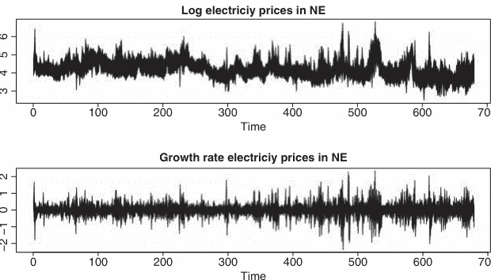

图 6.21 新英格兰地区 13 年间 1344 个周系列电力价格的时间序列图。

图，并为了说明离群值检测的重要性，我们用原始时间序列 \(z_{it}\) 总结了聚类解，以便与使用离群值校正时间序列 \(z_{it}^c\) 获得的结果进行比较。使用 Ahn 和 Horenstein 的两步法对原始系列 \(z_{it}\) 选取了三个因子，并且很明显 02:00 时的行为与其他不同时间不同。的确，第一个因子本质上是在衡量这一特定时间的影响。

我们随后对 \(z_{it}\) 应用清洗程序。在第一步中，沿最大峰度方向进行投影，该程序在七个投影时间序列中识别出 70 个多元加性离群值（MAOs，见第 4 章），平均每个投影时间序列有 10 个离群值。在移除离群值影响后，第二步沿最小峰度方向进行投影，该程序在五个投影时间序列中识别出 23 个 MAO，即每个投影时间序列平均 4.6 个离群值。移除这些离群值后，第三步使用随机投影，在 12 个随机投影中发现 20 个 MAO，即每个投影时间序列平均 1.66 个离群值。最后，第四步使用单变量搜索，在 192 个系列中的 47 个系列上发现 59 个加性离群值，即每个系列平均 1.25 个离群值。总结而言，该程序检测出 113 个 MAO 和 59 个单变量加性离群值，并在所有 192 个时间序列的总数据点中清洗了 2.38%。

MAO 数量最多出现在星期日和星期一。事实上，星期日检测到的 56 个 MAO 中有 24 个对应于夏令时日，在这些日子里 02:00 的需求被设为零。

使用 192 个离群值校正系列，Ahn 和 Horenstein 的两步法检测出两个因子，分别解释了总变异的 77.1% 和 8.8%。这两个因子的载荷以曲线形式显示在图 6.22 中。第一个因子本质上是系列的加权平均值，在 24 小时中具有 *相似的权重*（范围从 0.037 到 0.100）。因此，它复制了平均全球动态的

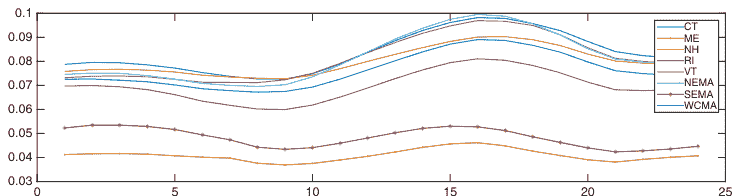

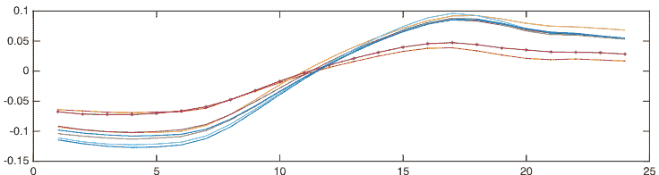

**图 6.22** 离群值校正系列两个初始因子的估计载荷。载荷显示为一天中 24 小时的函数，每条曲线代表八个区域中的一个。

差分后的系列。关于每个小时的影响，它给下午（13:00 至 19:00）更高的相对权重。第二个因子对第 1 到第 11 小时的系列赋予负权重，对第 12 到第 24 小时的系列赋予正权重。此外，它将夜间（1:00 至 7:00）与其余小时区分开来，在 17:00 至 19:00 处出现峰值。请注意，这些因子在不同地区并不相同，因为第二区（ME）和第七区（SEMA）的载荷与其他区域不同。因此，如果不考虑数据中存在聚类，我们可能会得出结论：带有两个因子的 DFM 似乎适合于这些数据。

我们使用系列的 GCC 搜索聚类。首先，为了观察离群值的影响，我们将此度量应用于原始系列。图 6.23(a) 显示了生成的树状图。第二个小时的需求系列（蓝色聚类）出现在顶部，揭示了这些系列与其他系列相距甚远。未发现其他群组。另一方面，图 6.23(b) 中离群值校正时间序列的树状图清楚地显示了两个聚类。第一个聚类（红色）包含 11:00 至 24:00 小时的需求时间序列，第二个聚类（绿色）包含 01:00 至 10:00 小时的系列。轮廓统计量也指示有两个聚类。因此，我们得出结论：离群值校正后的系列形成两组：第一组大致包括日间时段的系列，第二组包括夜间时段的系列。

当将 Ahn 和 Horenstein 的两步法应用于两组中的系列时，每个聚类中都得到七个因子。这七个因子分别解释了第一个和第二个聚类中系列变异性的大约 96.8% 和 97.6%。由于其中一些因子可能是全局性的，而其他因子是特定的，我们将先前用所有系列找到的 2 个因子与两个聚类中找到的 14 个因子进行比较

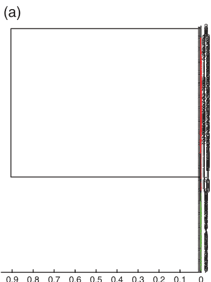

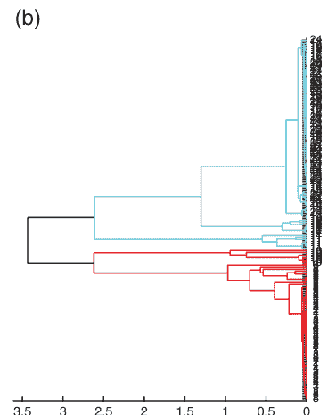

**图 6.23** (a) 电力价格原始系列 \( z_{it} \) 的树状图。(b) 离群值校正系列 \( z^c_{it} \) 的树状图。

并在两个聚类中使用第 6.8.1 节提出的规则找到。这两个初始因子被归类为全局因子。第一个因子与两个聚类中的因子的典型相关性分别为 0.984 和 0.967。第二个因子的相关性较弱，分别为 0.673 和 0.799，但其与所有特定因子集合的典型相关性几乎为 1。这意味着其影响分布在各组中找到的几个因子之间。现在，我们应用程序的第 4 步并得到 \(R_{it} = z_{it}^c - \widehat{P}_0 \widehat{f}_{0t}\)，其中 \(\widehat{P}_0\) 和 \(\widehat{f}_{0t}\) 分别为两个全局因子的估计载荷和因子。对 \(R_{it}\) 应用 Ahn 和 Horenstein 检验，针对各个聚类中的系列，分别得到第一个聚类和第二个聚类的六个和五个因子。这些因子显然是特定的，并且与两个全局因子正交。

图 6.24 和 6.25 显示了两组中这些特定因子的载荷。请注意，从地理角度看，两个极端区域——缅因州 (ME) 和马萨诸塞州东南部 (SEMA)——在两个聚类的几乎所有特定因子中具有最大影响，而对于全局因子，情况则恰恰相反：这些区域在图 6.22 的两个全局因子中具有最小的权重。关于每个小时的影响，与全局因子相比，这些组因子的结构呈现出更丰富的图景。在组 1 中，前三个因子对 11:00 至 18:00 的权重高于 19:00 至 24:00，而第四和第六个因子解释了当大多数人回家时电力需求的峰值，即 17:00–18:00。在第二个聚类中，前两个因子在 1:00–2:00 和 7:00–8:00 附近具有相反的需求峰值。其他三个因子在不同时间段的变异性很小，但它们在八个区域之间存在显著差异。

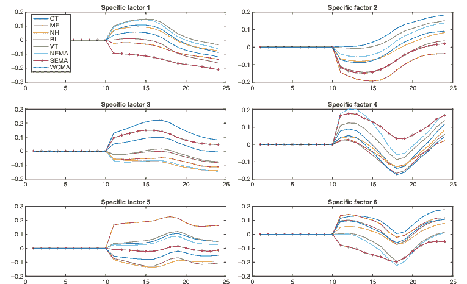

图 6.24 使用离群值校正系列，对第一组（11:00 至 24:00 小时）的六个特定因子进行的估计载荷。


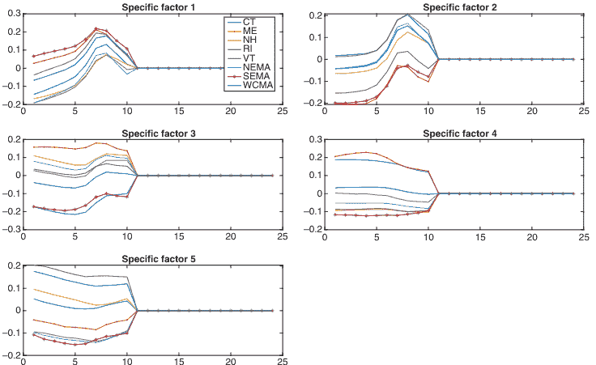

图 6.25 使用去异常值校正后的序列，估计第二组（小时 1:00 至 10:00）五个特定因子的载荷。

最后，我们进行样本外预测练习，以比较聚类与非聚类模型的拟合情况。因此，我们考虑：(1) 具有两个因子的拟合 DFM（M1）；以及 (2) 具有两个全局因子和十一个特定因子的拟合 DFMCS 模型（M2）。前 10 年的数据用于模型估计的训练期，最后 3 年（1095 天）用于测试期。季节性自回归积分滑动平均（ARIMA）模型（如 Alonso et al., 2006; García-Martos and Conejo, 2013）被拟合到模型 M1 和 M2 中的因子。为简单起见，在两个模型中，特征项均被假设为白噪声。我们使用滚动窗口在测试期内进行一日前预测。我们使用以下表达式计算平均绝对预测误差（MAE）和均方根预测误差（RMSE）：

```
MAE = \frac{1}{192} \frac{1}{1095} \sum_{i=1}^{192} \sum_{t=1}^{1095} |X_{t,i} - \hat{X}_{t,i}|,
```

和

```
RMSE = \left( \frac{1}{192} \frac{1}{1095} \sum_{i=1}^{192} \sum_{t=1}^{1095} (X_{t,i} - \hat{X}_{t,i})^2 \right)^{1/2},
```

其中 \(z_{it}\) 对应第 \(t\) 天的第 \(i\) 个序列，\(\hat{\zeta}_{it}\) 是其预测值。模型 M1 的 MAE 和 RMSE 分别为 0.0526 和 0.1131，而模型 M2 分别为 0.0487 和 0.1100。这些结果表明，引入聚类结构和特定因子对整体样本外预测产生了中等程度的改进。模型 M1 在聚类 1（聚类 2）的时间序列上计算的 MAE 和 RMSE 为 0.0545 和 0.0734（0.0501 和 0.1522），模型 M2 为 0.0502 和 0.0677（0.0465 和 0.1505），MAE 改进了 7.88%，RMSE 改进了 7.86%（7.04 和 1.10 %），分别。也就是说，两个聚类均观察到改进，且第一个聚类的改进更大。

## 6.9 DFM 的一些扩展

本章介绍的模型已以多种方式进行了扩展。首先，载荷可能不是恒定的，而是随时间变化，或者因子模型（FM）的参数在观测期内也可能发生变化。请注意，由于只有公共组件（载荷与因子的乘积）可以被识别，因此假设两个结构同时变化是没有意义的。最受研究的变化是因子载荷。Stock and Watson (2002a, 2002b) 证明，如果这些载荷变化的幅度较小，则通过主成分（PC）进行的估计仍然是一致的。然而，可以看出，如果这些变化不够小，PC 估计将变得低效。Motta et al. (2011) 研究了局部平稳因子模型。Motta and Ombao (2012) 假设载荷随时间平滑变化，并通过估计的时间变化协方差矩阵的谱分解来估计它们，而 Su and Wang (2017) 应用 PC 的局部版本来估计因子和载荷。其他方法基于使用小波来估计载荷的演变；参见 Cataño et al. (2020)。关于因子模型中参数变化，Corral and Peña (2008) 假设因子遵循 AR 阈值模型并研究了其估计。

DFM 的一个重要未来发展是时间上的张量数据分析。例如，假设我们分析不同时间、不同市场中不同产品的需求演变。在每个时间 t，t = 1, ..., T，我们观察一个矩阵，包含不同市场 j = 1, ..., J 中产品 i = 1, ..., I 的销售量。因子可能同时作用于两个维度：产品和市场。将时间 t 的 \( I \times J \) 维数据矩阵记为 \( Z_t \)，Wang et al. (2019) 和 Chen et al. (2020) 假设因子模型

\( Z_t = R F_t C' + U_t,\)

其中 \( R \) 是一个 \( I \times r_1 \) 行载荷矩阵，\( F_t \) 是一个 \( r_1 \times r_2 \) 的因子矩阵，\( C \) 是一个 \( J \times r_2 \) 列载荷矩阵。在此示例中，数据是三阶张量，但该模型可以推广到任何 h 阶张量。随着可按不同维度分类的大数据日益增长，此类扩展在未来将变得越来越重要。

另一个扩展是考虑 DFM 中的季节性。这些模型可以扩展以包含季节性因子，如下

\( z_t = P_1 f_{1t} + P_2 f_{2t} + P_3 f_{3t} + e_t,\)

为简单起见，我们假设 \( e_t \) 为白噪声，\( f_t = (f'_{1t}, f'_{2t}, f'_{3t})' \) 中包含三组公共因子。这些公共因子分别与整合因子、季节性因子和平稳因子相关。因此，\( f_{1t} \) 是维度为 \( r_1 \) 的非平稳非季节性因子向量，并遵循 \( d \ge 1 \) 的模型：

\( \Phi_1(B) \nabla^d f_{1t} = \theta_1(B) a_{1t},\) (6.51)

$f_{2t}$ 是维度为 $r_2$、周期为 $s$ 的季节性因子，满足

$$
\Phi_2(B^s)\nabla_s^D f_{2t} = \theta_2(B^s)a_{2t}, \quad (6.52)
$$

其中 $\nabla_s = (1 - B^s)$ 且 $D \ge 0$，而 $f_{3t}$ 由维度为 $r_3$ 的平稳因子组成，并遵循模型

$$
\Phi_3(B)f_{3t} = \theta_3(B)a_{3t}, \quad (6.53)
$$

其中 AR 和 MA 矩阵多项式满足第 3 章讨论的可识别性条件。事实上，我们假设，对于每个 $i = 1, 2, 3$，$\{a_{it}\}$ 是均值为 $\mathbf{0}$、协方差矩阵为对角矩阵 $\Sigma_i$ 的高斯白噪声过程，且所有参数矩阵均为对角矩阵。这里，$r_1 + r_2 + r_3 = r$，我们写 $\mathbf{P} = [\mathbf{P}_1 \mathbf{P}_2 \mathbf{P}_3]$，其中子矩阵 $\mathbf{P}_i$ 的维度为 $k \times r_i$，且 $f_{it} = (f_{i1t}, \dots, f_{ir_i,t})'$，$i = 1, 2, 3$。创新过程 $\{a_{1t}\}$、$\{a_{2t}\}$、$\{a_{3t}\}$ 和 $\{e_t\}$ 互不相关。我们假设 $\mathbf{P}'\mathbf{P} = \mathbf{I}_r$，这意味着对于 $i = 1, 2, 3$ 有 $\mathbf{P}'_i\mathbf{P}_i = \mathbf{I}_{r_i}$。

为简单起见，假设 $d = D = 1$。我们定义样本广义季节性自协方差（SGCV）矩阵 $C_{z,s}(h)$ 如下

$$
C_{z,s}(h) = \frac{s^{2d}}{T^{2d}} \sum_{t=h+1}^T z_t z'_{t-h}. \quad (6.54)
$$

$C_{z,s}(h)$ 中的归一化常数等于 $1/(T/s)^{2d}$，其中 $T/s$ 是样本中的季节数，前提是 $T$ 是 $s$ 的倍数。可以证明，见 Nieto et al. (2016)，当 $h$ 固定且 $T \to \infty$ 时，序列 $\{C_{z,s}(h)\}$ 弱收敛到一个随机矩阵 $\Gamma_{z,s}(h)$，该矩阵具有以下性质：(a) 对于 $h = js$（$j$ 为正整数），$\Gamma_{z,s}(h)$ 几乎可以肯定有 $r_1 + r_2$ 个正特征值和 $k - r_1 - r_2$ 个零特征值；(b) 对于 $h \neq js$，$\Gamma_{z,s}(h)$ 几乎可以肯定有 $r_1$ 个正特征值和 $k - r_1$ 个零特征值。设 $\lambda_1(h), \dots, \lambda_k(h)$ 为 $\Gamma_{z,s}(h)$ 的特征值。那么，如果 $h = js$，对应 $r_1 + r_2$ 个正特征值的特征向量构成子矩阵 $[\mathbf{P}_1 \mathbf{P}_2]$ 列空间的一组基；如果 $h \neq js$，对应 $r_1$ 个正特征值的特征向量构成子矩阵 $\mathbf{P}_1$ 列空间的一组基。

因此，我们预期样本协方差矩阵 $C_{z,s}(h)$ 具有两个不相交的特征值子集：一个包含相对较大的正值，另一个由接近于零的小值组成。对于有序特征值，当 $h \neq js$ 时，小值将出现在 $i = r_1 + 1, \dots, k$；当 $h = js$ 时，小值将出现在 $i = r_1 + r_2 + 1, \dots, k$。基于这些结果拟合模型的程序已由 Nieto et al. (2016) 提出。

## 6.10 高维情形

### 6.10.1 稀疏主成分

本节讨论了在维度 $k$ 大于样本量 $T$ 的高维时间序列中 DFM 的 PC 估计。在这些情况下，PC 估计不一致，在有限样本中可能不准确。

作为示例，表 6.3 和 6.4 展示了在具有一个因子的 EDFM 中，通过 PC 估计协方差矩阵最大特征向量的两个精度指标，该因子为方差为 25 的白噪声，噪声服从 $N(0,1)$。表 6.3 展示


表 6.3 大信噪比单因子 EDFM 中，协方差矩阵第一个特征向量与 PC 估计特征向量之间相关系数的绝对值，作为样本量 T 和序列数量 k 的函数

| T/k | 10 | 20 | 50 | 100 | 200 | 300 | 400 | 500 |
|---|---|---|---|---|---|---|---|---|
| 100 | 0.992 | 0.983 | 0.960 | 0.924 | 0.868 | 0.813 | 0.769 | 0.726 |
| 200 | 0.996 | 0.991 | 0.979 | 0.961 | 0.924 | 0.894 | 0.862 | 0.838 |
| 300 | 0.997 | 0.994 | 0.986 | 0.972 | 0.948 | 0.924 | 0.903 | 0.883 |

表 6.4 大信噪比单因子 EDFM 中，协方差矩阵第一个特征向量与 PC 估计特征向量之间角度的绝对值（以梯为单位），作为样本量 T 和序列数量 k 的函数

| T/k | 10 | 20 | 50 | 100 | 200 | 300 | 400 | 500 |
|---|---|---|---|---|---|---|---|---|
| 100 | 3.46 | 5.06 | 8.18 | 11.57 | 16.15 | 19.44 | 22.38 | 25.25 |
| 200 | 2.39 | 3.52 | 5.82 | 8.08 | 11.59 | 14.03 | 16.13 | 18.03 |
| 300 | 1.92 | 2.92 | 4.71 | 6.74 | 9.56 | 11.60 | 13.31 | 14.85 |

真实特征向量与 PC 估计特征向量之间相关系数的绝对值，表 6.4 则为两个向量之间的角度（以梯为单位）。很明显，当 k/T 增加时，估计精度会下降，且在 k > T 时可能非常差。构建这些表格的 R 命令见附录，读者可以检查，降低信噪比会使 PC 的精度变得非常低。例如，当因子方差为 4，T=100 且 k=40 时，真实特征向量与估计特征向量之间的相关系数低至 0.35。

要解释这些结果，请考虑具有一个因子的简单 EDFM 情况。观测值的协方差矩阵由下式给出

```
\Gamma_z(0) = pp'\gamma_0 + \sigma^2 I
```

其中 p 为载荷向量。令 s = \gamma_0/\sigma^2 为信噪比。将 \widehat{p} 称为 p 的 PC 估计值，估计精度可由 \cos \alpha = p'\widehat{p} 或 \text{corr}(\widehat{p}, p) 衡量，两个向量之间的角度越接近零，或相关系数越接近一，估计的准确性越好。Johnstone and Lu (2009) 证明，当 T 和 k 都趋于无穷大，并记 c = \lim_{T,k \to \infty} k/T 时，有

```
\lim_{T,k \to \infty} \cos^2 \alpha = \frac{(s^2 - c)_+}{s^2 + sc} \quad (6.55)
```

其中 (a)_+ = \max\{a, 0\}。因此，若 \lim_{T,k \to \infty} \cos^2 \alpha = 1，则 \widehat{p} 是 p 的一致估计量。这要求 c = 0，即 k 必须固定，或者在 T 趋于无穷大时与 T 一起非常缓慢地增长。这是 T > k 且 k 固定时的标准 PC 应用。当 c > 0 时，估计精度取决于信噪比 \( s \)。若该比率较小且 \( s^2 < c \)，则 \( \lim_{T,k \to \infty} \cos^2 \alpha = 0 \)，且向量 \( \widehat{p} \) 与 \( p \) 正交：估计未提供关于真实值的任何信息。若信噪比较强且 \( s^2 > c \)，估计精度随 \( s^2 \) 增大，但估计量永远不一致，且在极限中始终存在某些偏差。有关此分析的推广，请参见 Wang and Fan (2017)。

已提出多种解决方案来克服这一困难。Johnstone and Lu (2009) 证明，即使 \( k > p \)，如果向量 \( p \) 是稀疏的，即许多系数等于零，PC 仍可提供一致估计。他们提出了一种两步程序：首先选择方差较大的变量 \( z_{it} \)，然后在这组选定变量的小集合上应用 PC。最终向量 \( \widehat{p} \) 由选定变量的估计值构成，其余变量为零。另一种解决方案是向计算 PC 的方法添加稀疏性条件，无论是通过方差最大化还是最优重构。Jolliffe et al. (2003) 使用最大方差条件和 Lasso（在第 7 章中研究）来解决以下问题：

\(\max \{v'X'Xv\}, \quad \text{subject to } \|v\|_1 \le t, \|v\|_2 = 1. \quad (6.56)\)

去掉限制 \(\|v\|_1 \le t\) 后，该问题成为计算 PC 的标准方法，即作为矩阵 \( X'X \) 的主要特征向量。添加限制 \(\|v\|_1 \le t\)，即 PC 的系数绝对值之和必须很小，从而得到稀疏解。Hastie et al. (2015) 讨论了求解 Eq. (6.56) 的有效方法。Zou and Hastie (2005) 利用 PC 的最优重构性质，寻找投影方向 \( v \) 和系数 \( \beta \)，使其满足

\(\min \left\{ \frac{1}{T} \sum_{i=1}^T \|z_i - \beta v' z_i\|_2^2 + \lambda_1 \|v\|_1 + \lambda_2 \|v\|_2^2 \right\}, \quad \text{subject to } \|\beta\|_2 = 1.\)

该程序也使用 Lasso 限制，与下一章中研究的弹性网高度相关。

在下一节中，我们将介绍一种用于多变量和高维时间序列分析的结构-FM。该模型假设，观测到的 \( k \) 维时间序列是 \( r \) 个共同因子和 \( k-r \) 个白噪声过程的非奇异线性变换。对于有限的 \( k \)，结构-FM 优于传统的精确 FM，因为噪声的样本协方差矩阵是正定的。对于 \( k \) 趋于无穷大的情况，结构-FM 使用不同的方法来指定共同因子的数量，而非特征向量比率，从而避免了此处提到的 PCA 所面临的困难。

### 6.10.2 结构-FM 方法

Gao and Tsay (2018) 提出了以下结构-FM

\( z_t = P \begin{bmatrix} f_t \\ \epsilon_t \end{bmatrix} = [P_1, P_2] \begin{bmatrix} f_t \\ \epsilon_t \end{bmatrix} = P_1 f_t + P_2 \epsilon_t, \quad (6.57) \)

其中 \( P \) 是一个 \( k \times k \) 非奇异矩阵，\( f_t = (f_{1t}, \dots, f_{rt})' \) 是共同因子，\( \epsilon_t = (\epsilon_{1t}, \dots, \epsilon_{vt})' \) 是 \( v \) 维白噪声，且 \( v = k - r \)，\( P_1 \) 是 \( k \times r \) 载荷矩阵，\(\boldsymbol{P}_2\) 是 \( k \times v \) 实矩阵。在模型 (6.57) 中，我们假设 \(\boldsymbol{\Gamma}_f(0) = \boldsymbol{I}_r\)、\(\boldsymbol{\Gamma}_{\epsilon}(0) = \boldsymbol{I}_v\)、\(\text{Cov}(\boldsymbol{f}_t, \boldsymbol{\epsilon}_t) = \mathbf{0}\)，且 \(\boldsymbol{f}_t\) 的任何线性组合都不是白噪声序列；否则，我们可以将白噪声移至 \(\boldsymbol{\epsilon}_t\)。

令 \(\boldsymbol{P}_1 = \boldsymbol{A}_1\boldsymbol{Q}_1\) 且 \(\boldsymbol{P}_2 = \boldsymbol{A}_2\boldsymbol{Q}_2\)，其中 \(\boldsymbol{A}_1\) 和 \(\boldsymbol{A}_2\) 是半正交矩阵，满足 \(\boldsymbol{A}'_1\boldsymbol{A}_1 = \boldsymbol{I}_r\) 和 \(\boldsymbol{A}'_2\boldsymbol{A}_2 = \boldsymbol{I}_v\)。这可以通过 QR 分解或奇异值分解始终完成。在这种参数化下，\(\boldsymbol{f}_t\) 和 \(\boldsymbol{\epsilon}_t\) 的强度分别由 \(\boldsymbol{Q}_1\) 和 \(\boldsymbol{Q}_2\) 表示。等式 (6.57) 中的模型可改写为

\(\boldsymbol{z}_t = \boldsymbol{A}_1\boldsymbol{x}_t + \boldsymbol{A}_2\boldsymbol{e}_t, \quad (6.58)\)

其中 \(\boldsymbol{x}_t = \boldsymbol{Q}'_1\boldsymbol{f}_t\) 且 \(\boldsymbol{e}_t = \boldsymbol{Q}_2\boldsymbol{e}_t\)。请注意，FM 的可识别性继续适用于等式 (6.58) 中的模型，但由 \(\boldsymbol{A}_1\)（因此由 \(\boldsymbol{P}_1\)）生成的列空间可以被识别。\(\boldsymbol{A}_2\) 的列空间也是如此。等式 (6.57) 与传统 FM 的主要区别在于，等式 (6.57) 及因此等式 (6.58) 中的随机向量始终具有总维度 \(k\)。因此，共同因子的数量 \(r\) 可由 \(k-v\) 识别，其中 \(v\) 是观测向量 \(\boldsymbol{z}_t\) 中嵌入的白噪声过程的数量。最近已提出多种方法来检验高维白噪声过程。下面的分析利用了这些白噪声检验统计量。请参见第 6.10.4 节。

### 6.10.3 估计

在本节中，我们概述了等式 (6.58) 模型的估计程序。我们首先简要讨论 Gao and Tsay (2018) 所使用估计方法背后的依据。令 \(\boldsymbol{B}_1\) 和 \(\boldsymbol{B}_2\) 分别为 \(\boldsymbol{A}_1\) 和 \(\boldsymbol{A}_2\) 的正交补，因此 \(\boldsymbol{B}_1 \in R^{k \times v}\) 和 \(\boldsymbol{B}_2 \in R^{k \times r}\) 是两个满足 \(\boldsymbol{B}'_1\boldsymbol{A}_1 = \mathbf{0}\) 和 \(\boldsymbol{B}'_2\boldsymbol{A}_2 = \mathbf{0}\) 的半正交矩阵。由等式 (6.58) 得

\(\boldsymbol{B}'_1\boldsymbol{z}_t = \boldsymbol{B}'_1\boldsymbol{A}_2\boldsymbol{e}_t, \quad (6.59)\)

因此 \(\boldsymbol{B}'_1\boldsymbol{z}_t\) 是一个 \(v\) 维白噪声过程。同样，由等式 (6.58) 得

\(\Gamma_z(h) = \boldsymbol{A}_1\Gamma_x(h)\boldsymbol{A}'_1 + \boldsymbol{A}_1\Sigma_{xe}(h)\boldsymbol{A}'_2, \quad h \ge 1, \quad (6.60)\)

其中 \(\Sigma_{xe}(h) = \text{Cov}(\boldsymbol{x}_t, \boldsymbol{e}_{t-h})\)，且

\(\Gamma_z(0) = \boldsymbol{A}_1\Gamma_x(0)\boldsymbol{A}'_1 + \boldsymbol{A}_2\Gamma_e(0)\boldsymbol{A}'_2. \quad (6.61)\)

对于预指定的正整数 \(h_0\)，如等式 (6.21) 所示，定义

\(\boldsymbol{M} = \sum_{h=1}^{h_0} \Gamma_z(h)\Gamma_z(h)', \quad (6.62)\)

这是一个 \(k \times k\) 半正定矩阵。由于 \(\boldsymbol{B}'_1\boldsymbol{A}_1 = \mathbf{0}\)，我们有 \(\boldsymbol{M}\boldsymbol{B}_1 = \mathbf{0}\)，因此 \(\boldsymbol{B}_1\) 的列是与 \(\boldsymbol{M}\) 的零特征值相关的特征向量，而因子载荷空间（即 \(\boldsymbol{A}_1\) 的列空间）由与 \(\boldsymbol{M}\) 的 \(r\) 个非零特征值相关的特征向量张成。这提供了 \(\boldsymbol{A}_1\) 的估计。


接下来，由等式 (6.58) 得

$B'_2 z_t = B'_2 A_1 x_t, \quad (6.63)$

它与等式 (6.59) 中定义的 $B'_1 z_t$ 不相关。因此，

$B'_2 \Gamma_z(0) B_1 B'_1 \Gamma_z(0) B_2 = \mathbf{0}, \quad (6.64)$

这意味着 $B_2$ 由以下矩阵的零特征值对应的 $r$ 个特征向量组成

$S = \Gamma_z(0) B_1 B'_1 \Gamma_z(0). \quad (6.65)$

Gao 和 Tsay (2018) 表明矩阵 $B'_2 A_1$ 是可逆的，因此，由等式 (6.63) 得 $x_t = (B'_2 A_1)^{-1} B_2 z_t$。这提供了公共因子 $x_t$ 及因此的 $f_t$ 的估计。由等式 (6.58)，$x_t$ 不涉及白噪声项 $e_t$，因此估计的公共因子 $\hat{f}_t = Q_1^{-1} x_t$ 不会涉及噪声项 $e_t$。这种估计方法因而提高了公共因子 $f_t$ 估计的效率。作者将等式 (6.65) 中 $S$ 的特征值-特征向量分析称为投影 PCA，因为它在执行 PCA 之前将观测序列 $z_t$ 投影到 $B_1$ 的方向上。

转到实际估计。暂且假设公共因子的数量 $r$ 已知。$r$ 的选择将在下一节给出。首先，我们对样本矩阵进行特征值-特征向量分析

$\widehat{M} = \sum_{h=1}^{h_0} \hat{\Gamma}_z(h) \widehat{\Gamma}_z(h)',$

其中 $h_0$ 是一个小的正整数。令 $\hat{A}_1 = [\hat{a}_1, ..., \hat{a}_r]$ 和 $\hat{B}_1 = [\hat{B}_1, ..., \hat{B}_v]$ 为分别由 $\widehat{M}$ 与非零特征值和零特征值相关联的特征向量组成的半正交矩阵。接下来，我们对 $\hat{S} = \hat{\Gamma}_z(0) \hat{B}_1 \hat{B}'_1 \hat{\Gamma}_z(0)$ 进行特征值-特征向量分析，这是一个秩最大为 $k - r$ 的 $k \times k$ 矩阵。令 $\hat{B}_2 = [\hat{B}_{v+1}, ..., \hat{B}_k]$，其中 $\hat{B}_i$（$i = v + 1, ..., k$）是与 $\hat{S}$ 的 $r$ 个最小特征值相关联的特征向量。对于较大的 $k$，Gao 和 Tsay (2018) 提供了一种计算 $\hat{B}_2$ 的修改方法，如果允许噪声协方差矩阵 $\Gamma_e(0)$ 的某些最大特征值在 $k \to \infty$ 时趋于无穷大。有兴趣的读者可参阅该文档以获取详细信息。然后我们可以通过 $\hat{x}_t = (\hat{B}'_2 \hat{A}_1)^{-1} \hat{B}'_2 z_t$ 估计因子过程。最后，白噪声过程可以通过 $\hat{e}_t = \hat{A}'_2 z_t - \hat{A}'_2 \hat{A}_1 \hat{x}_t$ 估计，其中 $\hat{A}_2 = [\hat{B}_1, ..., \hat{B}_v]$ 由与 $\hat{S}$ 的 $v$ 个最大特征值相关联的特征向量组成。

#### 6.10.4 选择公共因子的数量

在 $k \ge T$ 的情况下，典型相关分析无法用于选择公共因子的数量 $r$。然而，根据前一节的讨论，$\hat{B}'_1 z_t$ 是一个 $v$ 维白噪声，其中 $v = k - r$。因此，通过检验矩阵 $\widehat{M}$ 主成分中的白噪声序列数量，我们可以估计 $v$。用 $\hat{v}$ 表示估计的白噪声序列数量。那么，$\hat{r} = k - \hat{v}$。关键问题是如何检验高维白噪声时间序列。

近年来，高维白噪声过程检验已得到广泛研究。这里我们讨论两种方法。其他可能的方法包括 Ling et al. (2020) 及其参考文献。我们讨论的两种方法利用时间序列滞后自相关矩阵的最大绝对交叉相关。为了我们的目的，我们想检测 \(\hat{\boldsymbol{u}}_t = [\hat{\mathbf{A}}_1, \hat{\mathbf{B}}_1]'\boldsymbol{z}_t\) 中的白噪声系列数量，其中 \([\hat{\mathbf{A}}_1, \hat{\mathbf{B}}_1]\) 是等式 (6.62) 中矩阵 \(\hat{\boldsymbol{M}}\) 的特征向量矩阵。为了讨论简便，令 \(\boldsymbol{w}_t\) 为 \(\hat{\boldsymbol{u}}_t\) 的一个 \(d\) 维子序列，其中 \(1 \le d \le k\)。我们的目标是检验原假设 \(H_0 : \Gamma_w(1) = \cdots = \Gamma_w(m) = \mathbf{0}\) 与备择假设 \(H_a : \Gamma_w(h) \neq \mathbf{0}\) 对于某些满足 \(1 \le h \le m\) 的 \(h\)，其中 \(m\) 是正整数，并且为了简便，我们假设 \(\hat{\boldsymbol{u}}_t\) 已标准化，因此 \(\Gamma_w(h)\) 是 \(\boldsymbol{w}_t\) 的滞后-\(h\) 自相关矩阵。第一种方法由 Chang et al. (2017) 提出，检验统计量为

\(T_1(m) = \sqrt{T} \times \max_{1 \le h \le m} \max_{1 \le i \le j \le d} |\hat{\gamma}_{w,ij}(h)|, \quad (6.66)\)

其中 \(\hat{\gamma}_{w,ij}(h)\) 是 \(\hat{\boldsymbol{\Gamma}}_w(h)\) 的 \((i,j)\) 第个元素。作者表明，在 \(\boldsymbol{w}_t\) 具有有限四阶矩和原假设下，\(T_1(m)\) 的极限分布可以近似为正随机向量的 \(L_\infty\)-范数，因此，模拟可用于获取检验统计量 \(T_1(m)\) 的渐近临界值。有限经验表明，如果 \(d\) 适中，该检验统计量表现相当不错。对于较大的 \(d\)，该检验统计量需要密集的计算时间。

白噪声检验的第二种方法由 Tsay (2020) 提出。作者不直接使用 \(\boldsymbol{w}_t\)，而是提议使用 \(\boldsymbol{w}_t\) 的秩序列。对于标量时间序列 \(y_t\) 及其实现 \(\{y_1, \dots, y_t\}\)，其秩序列是通过用样本中的秩统计量替换 \(y_t\) 得到的时间序列。令 \(\hat{\boldsymbol{R}}_w(h)\) 为 \(\boldsymbol{w}_t\) 的秩序列的滞后-\(h\) 样本自相关矩阵。定义

\(T_{\max}(h) = \max_{1 \le i \le j \le d} \hat{r}_{w,ij} \text{ and } T_{\min}(h) = - \min_{1 \le i \le j \le d} \hat{r}_{w,ij},\)

其中 \(\hat{r}_{w,ij}\) 是 \(\hat{\boldsymbol{R}}_w(h)\) 的 \((i,j)\) 第个元素。注意，\(T_{\max}(h)\) 是 \(\boldsymbol{w}_t\) 在滞后 \(h\) 时的最大秩交叉相关，而 \(-T_{\min}(h)\) 是 \(\boldsymbol{w}_t\) 在滞后 \(h\) 时的最小秩交叉相关。在 \(\boldsymbol{w}_t\) 是 \(d\) 维白噪声且 \(\boldsymbol{\Gamma}_w(0)\) 为对角矩阵的原假设下，Tsay (2020) 表明 \(\{\hat{r}_{w,ij}(h)|1 \le i, j \le d\}\) 渐近独立并服从 \(N(0, 1)\) 分布。\(T_{\max}(h)\) 和 \(T_{\min}(h)\) 都是 \(d^2 N(0, 1)\) 随机变量的极值，因此它们渐近服从 Gumbel 分布。此外，\(T_{\max}(h)\) 和 \(T_{\min}(h)\) 渐近独立。现在，定义检验统计量

\(T_2(m) = \sqrt{T} \times \max_{1 \le h \le m} \max \{T_{\max}(h), T_{\min}(h)\} . \quad (6.67)\)

由于在我们的应用中 \(\boldsymbol{w}_t\) 的分量不相关，因此 Tsay (2020) 使用的一个假设自动满足。因此，在 \(\boldsymbol{w}_t\) 具有连续分布且原假设成立的前提下，等式 (6.67) 中的 \(T_2(m)\) 渐近遵循独立 Gumbel 分布的乘积，其临界值可得到解析形式。具体而言，设 \(\alpha\) 为 I 类错误，则若

\(T_2(m) \ge c_{d,m} \times \chi_{1-\alpha/2} + s_{d,m},\)

则在 5% 水平上拒绝原假设 \(H_0\)，其中 \(\chi_{1-\alpha/2} = -\ln(-\ln(1-\alpha/2))\) 是标准 Gumbel 分布的 \((1-\alpha/2)\) 分位数，且

$$c_{d,m} = [2 \ln(d^2 m)]^{-1/2} \quad \text{and} \quad s_{d,m} = \sqrt{2 \ln(d^2 m)} - \frac{\ln(4\pi) + \ln(\ln(d^2 m))}{2(2 \ln(d^2 m))^{1/2}}.$$

除了具有解析形式的临界值外，等式 (6.67) 中的检验统计量 \(T_2(m)\) 还有其他一些优点。它不要求 \(\boldsymbol{w}_t\) 存在任何矩（例如柯西分布），并且对 \(\boldsymbol{w}_t\) 中的异常值具有鲁棒性。

#### 6.10.5 载荷估计的渐近性质

对于两个满足 \(\boldsymbol{H}_1'\boldsymbol{H}_1 = \boldsymbol{H}_2'\boldsymbol{H}_2 = \boldsymbol{I}_r\) 的 \(k \times r\) 半正交矩阵 \(\boldsymbol{H}_1\) 和 \(\boldsymbol{H}_2\)，\(\boldsymbol{H}_1\) 和 \(\boldsymbol{H}_2\) 所张列空间之间的差异可通过以下方式度量

$$D(\boldsymbol{H}_1, \boldsymbol{H}_2) = \sqrt{1 - \frac{1}{r} \text{tr}(\boldsymbol{H}_1 \boldsymbol{H}_1' \boldsymbol{H}_2 \boldsymbol{H}_2')}.\tag{6.68}$$

这里 \(D(\boldsymbol{H}_1, \boldsymbol{H}_2) \in [0, 1]\)。当且仅当 \(\boldsymbol{H}_1\) 和 \(\boldsymbol{H}_2\) 的两个列空间等价时，其值为零；当且仅当两个列空间互相正交时，其值为 1。我们使用该度量来量化因子模型（FM）估计的准确性。例如，我们使用 \(D(\widehat{\boldsymbol{A}}_1, \boldsymbol{A}_1)\) 来衡量使用 \(\widehat{\boldsymbol{A}}_1\) 估计 \(\boldsymbol{A}_1\) 的一致性。

对于固定的 \(k\)，在某些温和条件下（例如 \(\boldsymbol{f}_t\) 和 \(\boldsymbol{e}_t\) 存在某些有限阶矩，以及 \(\boldsymbol{z}_t\) 和 \(\boldsymbol{f}_t\) 满足某些 \(\alpha\)-混合条件），我们可以推导 FM 估计量的渐近性质。例如，如预期，\(D(\widehat{\boldsymbol{A}}_1, \boldsymbol{A}_1) = O(T^{-1/2})\)。详情可见 Gao 和 Tsay (2019)。对于高维情况，只要 \(k = o(T^{1/2})\)，即可得到类似结果。另一方面，当 \(k\) 和 \(T\) 都趋于无穷大时，估计量的极限性质会变得更加复杂。考虑等式 (6.57) 中的模型。我们只关注 \(\boldsymbol{f}_t\) 和 \(\boldsymbol{e}_t\) 独立的情况。\(\boldsymbol{f}_t\) 与某些 \(h > 0\) 的 \(\boldsymbol{e}_{t-h}\) 相关的情况可见 Gao 和 Tsay (2018)。

令 \(\boldsymbol{L}_1 = [\boldsymbol{c}_1, \dots, \boldsymbol{c}_r]\) 和 \(\boldsymbol{L}_2 = [\boldsymbol{c}_{r+1}, \dots, \boldsymbol{c}_k]\)。随着 \(k\) 增加，我们需要一些度量来量化载荷和噪声的强度。

- 1. 条件 A：\(\boldsymbol{L}_1\) 的列满足 \(j = 1, \dots, r\) 时 \(\|\boldsymbol{c}_j\|_2^2 \asymp k^{1-\delta_1}\)，且 \(\delta_1 \in [0, 1)\)，其中 \(a \asymp b\) 意味着 \(a = O(b)\) 且 \(b = O(a)\)。此外，对于每个列 \(\boldsymbol{c}_j\)，\(\min_{\theta_i \in \mathcal{K}, i \neq j} \|\boldsymbol{c}_j - \sum_{1 \le i \le r, i \neq j} \theta_i \boldsymbol{c}_i\|_2^2 \asymp k^{1-\delta_1}\)。
- 2. 条件 B：\(\boldsymbol{L}_2\) 允许奇异值分解 \(\boldsymbol{L}_2 = \boldsymbol{A}_2 \boldsymbol{D}_2 \boldsymbol{V}_2'\)，其中 \(\boldsymbol{A}_2 \in \mathcal{R}^{k \times v}\) 在等式 (6.58) 中给出，\(\boldsymbol{D}_2 = \text{diag}(d_1, \dots, d_v)\) 且 \(\boldsymbol{V}_2 \in \mathcal{R}^{v \times v}\) 满足 \(\boldsymbol{V}_2' \boldsymbol{V}_2 = \boldsymbol{I}_v\)。此外，存在一个有限整数 \(0 < g < v\)，使得对于某些 \(\delta_2 \in [0, 1)\)，\(d_1 \asymp \cdots \asymp d_g \asymp k^{(1-\delta_2)/2}\) 且 \(d_{g+1} \asymp \cdots \asymp d_v \asymp 1\)。

条件 A 中的 \(\delta_1\) 用于量化因子的强度，\(\boldsymbol{L}_1 \boldsymbol{L}_1'\) 的特征值均为 \(k^{1-\delta_1}\) 阶。如果 \(\delta_1 = 0\)，相应的因子称为强因子，因为它们包含 \(\boldsymbol{c}_j\) 的每个元素为 \(O(1)\) 的情况。如果 \(\delta_1 > 0\)，相应的因子称为弱因子，且 \(\delta_1\) 越小，因子越强。使用指数 \(\delta_1\) 的一个优点是将收敛


将估计因子的收敛率与因子强度显式联系起来。条件 A 确保 \(\boldsymbol{x}_t\) 中所有公共因子具有相同的强度 \(\delta_1\)。在实践中，因子可能具有多个强度水平。在这种情况下，载荷矩阵的一致性将取决于最弱因子的强度。为了节省篇幅，我们不在此处考虑此问题。条件 B 成立有许多充分条件。例如，如果我们允许 \((\boldsymbol{c}_{r+1}, ..., \boldsymbol{c}_{r+g})\) 对某些 \(\delta_2 \in (0, 1)\) 满足条件 A，且 \((\boldsymbol{c}_{r+g+1}, ..., \boldsymbol{c}_k)\) 的 \(L_1\)- 和 \(L_\infty\)- 范数均有限，则条件 B 成立。一种特殊情况是让 \(\boldsymbol{c}_{r+g+j}\) 成为标准单位向量。\(\delta_1\) 与 \(\delta_2\) 之间的约束将在以后不同情形下用于保证估计的一致性。

如果 \(r\) 是已知且固定的，Gao 和 Tsay (2018) 表明，在包括条件 A 和 B 以及 \(\boldsymbol{f}'_t\) 与 \(\boldsymbol{e}_t\) 独立在内的某些条件下，若 \(kT^{-1/2} = o(1)\)，则 \(D(\widehat{\boldsymbol{A}}_1, \boldsymbol{A}_1) = O_p(k^{\delta_1} T^{-1/2})\) 且 \(D(\widehat{\boldsymbol{B}}_1, \boldsymbol{B}_1) = O_p(k^{\delta_1} T^{-1/2})\)。因此，若 \(\delta_1 > 0\)，收敛率比固定 \(k\) 的情况更慢。因此，载荷强度影响 FMs 中估计的收敛率。\(\boldsymbol{B}_2\) 的估计要困难得多。在某些情况下，对于大 \(k\) 没有可用的一致估计量。为缓解这一困难，我们估计 \(\boldsymbol{B}_2^*\)，即由矩阵 \(\boldsymbol{S}\)（公式 (6.65) 中）对应最小的 \(k-g\) 个特征值的特征向量所张成的子空间。令 \(\widehat{\boldsymbol{B}}_2^*\) 由 \(\widehat{\boldsymbol{S}}\) 对应 \(k-g\) 个最小特征值的特征向量组成。然后 \(\widehat{\boldsymbol{B}}_2\) 的选择是 \(\widehat{\boldsymbol{B}}_2^*\) 的一个子空间。在上述条件下，若 \(kT^{-1/2} = o(1)\)，我们也有

```
\(D(\widehat{\boldsymbol{B}}_2^*, \boldsymbol{B}_2^*) = O_p[k^{2\delta_2-\delta_1} T^{-1/2} + k^{\delta_2} T^{-1/2} + (1 + k^{2(\delta_2-\delta_1)}) D(\widehat{\boldsymbol{B}}_1, \boldsymbol{B}_1)]\).
```

最后，Gao 和 Tsay (2020) 研究了具有单位根的高维 FMs 的情况。

## 附录 6.A：一些 R 命令

给出了用于通过主成分法估计协方差矩阵最大特征向量、利用两种精度指标计算表 6.3 和表 6.4 的命令。

```
t0 <- proc.time() # start the clock
N=250
R0=rep(0,N)
ANG=rep(0,N)
COS=rep(0,N)
#define the signal to noise ratio with the sd of the factor
fsd=5
vT=c(100,200,300)
vk=c(10,20,50,100,200,300,400,500)
dT=length(vT)
dk=length(vk)
TAB1=matrix(0,dT,dk)
TAB2=matrix(0,dT,dk)
for (j in 1:dk) {
for (t in 1:dT) {
T=vT[t]
k=vk[j]
for(i in 1:N){
a=rnorm(k*T)
A=matrix(a,T,k)
f=rnorm(T)*fsd
### a general arima model for the factor can be used with
##f=arima.sim(n=T,list(ar=c(.7)))
F=matrix(f,T,1)
p=runif(k)
pe=p/sqrt(sum( p ^ 2 ))
P=matrix(pe,1,k)
YC=F %*% P
Y=YC+A
S=cov(Y)
ES=eigen(S)
EV=ES$values
EVV=ES$vectors
pv=ES$vectors[,1]
pv=as.matrix(pv,1,k)
ro=abs(cor(pv,pe))
R0[i]=ro
cos=abs(sum(pv*pe))
angr=acos(cos)
ang=angr*180/pi
ANG[i]=ang
TAB1[t,j]=mean(R0)
TAB2[t,j]=mean(ANG) }}
tf=proc.time()-t0
```

## 练习

- 1. 在 DFM \( z_t = P f_t + a_t \) 中，其中 \( P = \frac{1}{\sqrt{k}} 1 \) 是一个 \( k \times 1 \) 向量，\( 1 = (1, \dots, 1)' \)，且 \( a_t \) 为协方差矩阵 \( \Sigma_a = \sigma^2 I \) 的白噪声：(1) 说明系列 \( c'_j z_t \)（\( j = 1, \dots, k - 1 \)）构成白噪声的线性组合形式；(2) 求这些线性组合的方差。

- 2. 假设 DFM \( z_t = P f_t + n_t \)，其中 \( n_t \) 遵循对角 VAR 模型。在什么条件下，因子 \( f_t \) 是数据的线性组合？因子方差与噪声方差应满足什么关系，才能通过主成分分析获得因子的一致估计？

- 3. 考虑具有一个因子和两个滞后的 GDFM，\( z_t = P_0 f_t + P_1 f_{t-1} + P_2 f_{t-2} + n_t \)，其中因子遵循 \( f_t = \phi f_{t-1} + u_t \)。证明该模型可以写为具有一个因子的 DFM，\( z_t = P^* f_t^* + n_t^* \)，其中 \( f_t^* = f'_{t-1} + u_t^* \)。

- 4. 假设 GDFM \( z_t = P_0 f_t + P_1 f_{t-1} + a_t \)（其中 \( a_t \) 为白噪声）使用带有一个滞后的 ODPC 估计，且 \( c_1 = c_2 = 1 \)。证明 \( z_t \) 的估计可以表示为 \( \hat{z}_t = A_0 z_t + A_1 z_{t-1} + A_2 z_{t-2} \)。

- 5. 将 DFM 拟合到文件 CPIEurope2000-15.csv 中的 EUUS（CPI）价格指数。应用变换 VV12 log zt 和命令 dfmpc 来拟合模型。分析发现的三个因子的性质以及残差的模型。

- 6. 将 DFM 拟合到文件 CPIEurope2000-15.csv 中 EUUS（CPI）价格指数的水平数据。应用变换 log(zt) 和命令 dfmpc 来拟合模型。分析发现的第一个因子的性质。取该因子的残差，再次应用 dfmpc 命令。将结果与练习 5 中获得的结果进行比较。

- 7. 使用文件 gdpsimple6c8010.txt 中六个国家的 GDP 数据拟合一个 FM。将结果与拟合了 VAR 模型的示例 3.2 中的结果进行比较。

- 8. 修改附录中给出的命令，以检查主成分法在不同信噪比下估计 EDFM 的精度，并观察该比率下降时精度的下降情况。同时，检查更多因子对估计精度的影响。

## 参考文献

Ahn, S. C. 和 Horenstein, A. R. (2013). 因子个数的特征值比检验。*Econometrica*, **83**: 1203–1227.

Ahn, S. K. 和 Reinsel, G. C. (1988). 多元时间序列的嵌套降阶自回归模型。*Journal of the American Statistical Association*, **83**: 849–856.

Alonso, A. M., Berrendero, J. R., Hernández, A., 和 Justel, A. (2006). 基于预测密度的时间序列聚类。*Computational Statistics and Data Analysis*, **51**: 762–766.

Alonso, A. M., Galeano, P., 和 Peña, D. (2020). 具有簇结构的动态因子模型构建的稳健程序。*Journal of Econometrics*, **216**: 35–52.

Anderson, T. W. (1963). 多元时间序列统计分析中因子分析的应用。*Psychometrika*, **28**: 1–25.

Ando, T. 和 Bai, J. (2016). 未知群组成员条件下具有分组因子结构的面板数据模型。*Journal of Applied Econometrics*, **31**: 163–191.

Ando, T. 和 Bai, J. (2017). 大量金融时间序列的聚类：具有高维预测变量和因子结构的面板数据方法。*Journal of the American Statistical Association*, **519**: 1182–1198.

Bai, J. 和 Li, K. (2012). 高维因子模型的统计分析。*The Annals of Statistics*, **40**: 436–465.

Bai, J. 和 Li, K. (2016). 高维近似因子模型的极大似然估计与推断。*Review of Economics and Statistics*, **98**: 298–309.

Bai, J. 和 Ng, S. (2002). 近似因子模型中因子个数的确定。*Econometrica*, **70**: 191–221.

Bai, J. 和 Ng, S. (2004). 针对单位根和协整的 PANIC 检验。*Econometrica*, **72**: 1127–1177.

Bai, J. 和 Ng, S. (2013). 静态因子的主成分估计与识别。*Journal of Econometrics*, **176**: 18–29.

Bai, J. 和 Ng, S. (2019). 矩阵补全、反事实与缺失数据的因子分析。arXiv 预印本 arXiv:1910.06677.

Banarjee, A., Dolado, J., Galbraith, J. W., 和 Hendry, D. (1993). *协整、误差修正与非平稳数据计量分析*. Oxford University Press, Oxford, UK.

Baragona, R. 和 Battaglia, F. (2007). 动态因子模型中的异常值。*Electronic Journal of Statistics*, **1**: 392–432.


- Barigozzi, M., Lippi, M., and Luciani, M. (2016). 面向大数据集的非平稳动态因子模型. *金融与经济讨论系列（研究、统计与货币部门）*. 联邦储备委员会, 华盛顿特区. ArXiv预印本 arXiv:1602.02398.024.

- Barigozzi, M., Lippi, M., and Luciani, M. (2017). 动态因子模型、共整合和误差修正机制. 工作论文, arXiv:1510.02399v3.

- Boivin, J. and Ng, S. (2006). 更多数据对因子分析总是更好吗？. *计量经济学杂志*, **132**: 169–194.

- Bolivar, S., Nieto, F., and Peña, D. (2020). 关于识别动态因子模型的新程序. *哥伦比亚统计杂志*（刊用中）.

- Bonhomme, S. and Manresa, E. (2015). 面板数据中异质性的分组模式. *计量经济学*, **83**: 1147–1184.

- Box, G. E. P. and Tiao, G. (1977). 多元时间序列的典范分析. *生物统计学*, **64**: 355–365.

- Breitung, J. and Eickmeier, S. (2011). 动态因子模型中结构断点检验. *计量经济学杂志*, **163**: 71–84.

- Breitung, J. and Tenhofen, J. (2011). 动态因子模型的GLS估计. *美国统计学会杂志*, **106**: 1150–1166.

- Brillinger, D. R. (1964). 将因子分析、典范相关和主成分分析技术推广到平稳时间序列. *英国皇家统计学会卡迪夫会议*, 威尔士, 英国.

- Brillinger, D. R. (1981). *时间序列数据分析与理论*, 扩展版. Holden-Day, 旧金山, 加利福尼亚州.

- Caro, A. and Peña, D. (2020). 使用滞后协方差矩阵估计动态因子模型. 工作论文, 马德里卡洛斯三世大学.

- Cataño, D. H., Rodríguez-Caballero, C. V., and Peña, D. (2020). 具有时间变载荷的动态因子模型的小波估计. 工作论文 第2019-23号, 阿尔胡斯大学经济与商业经济学系.

- Chamberlain, G. (1983). 套利定价模型中的资金、因子与分散化. *计量经济学*, **51**: 1305–1323.

- Chamberlain, G. and Rothschild, M. (1983). 套利定价模型中的套利与因子结构. *计量经济学*, **51**: 1281–1304.

- Chan, N. H., Lu, Y., and Yau, C. Y. (2017). 高维时间序列的因子建模：推断与模型选择. *时间序列分析杂志*, **38**: 285–307.

- Chang, J., Yao, Q., and Zhou, W. (2017). 使用最大互相关检验高维白噪声. *生物统计学*, **104**: 111–127.

- Chen, E. Y., Tsay, R. S., and Chen, R. (2020). 高维矩阵值时间序列的受限因子模型. *美国统计学会杂志*, **115**(530), 775–793.

- Cheng, X., Liao, Z., and Schorfheide, F. (2016). 具有结构不稳定性的高维因子模型的收缩估计. *经济学评论*, **83**: 1511–1543.

- Choi, I. (2012). 因子模型的有效估计. *计量经济学理论*, **28**: 274–308.

- Choi, I. (2017). 非平稳因子模型的有效估计. *统计学规划与推断杂志*, **183**: 18–43.

- Connor, G. and Korajczyk, R. A. (1986). 基于套利定价理论的绩效衡量：一种新的分析框架. *财务经济学杂志*, **15**: 373–394.

- Cook, R. D. (2018). *包络介绍：多元统计中高效估计的维度约简*. John Wiley & Sons: 霍博肯, 新泽西州.

- Corona, F., Poncela, P., and Ruiz, E. (2017). 平稳单变量转换后确定因子数量. *实证经济学*, **53**: 351–372.

- Corona, F., Poncela, P., and Ruiz, E. (2020). 估计非平稳共同因子：风险共享的启示. 计算经济学, 55: 37–60.

- Corral, M. and Peña, D. (2008). 阶乘动态模型阈值. 哥伦比亚统计杂志, 31: 183–190.

- Creal, D. and Tsay, R. S. (2015). 高维动态随机Copula模型. 经济学杂志, 189: 335–345.

- Doz, C., Giannone, D., and Reichlin, L. (2012). 大型近似动态因子模型的准极大似然方法. 经济与统计评论, 94: 1014–1024.

- Engle, R. and Watson, M. (1981). 大都市工资率的一因子多元时间序列模型. 美国统计学会杂志, 76: 774–781.

- Escribano, A. and Peña, D. (1994). 共整合与共同因子. 时间序列分析杂志, 15: 577–586.

- Fan, J., Xue, L., and Yao, J. (2017). 基于因子模型的充分预测. 计量经济学杂志, 201: 292–306.

- Forni, M., Giannone, D., Lippi, M., and Reichlin, L. (2009). 打开黑箱：具有大截面的结构因子模型. 计量经济学理论, 25: 1319–1347.

- Forni, M., Hallin, M., Lippi, M., and Reichlin, L. (2000). 广义动态因子模型：识别与估计. 经济与统计评论, 82: 540–554.

- Forni, M., Hallin, M., Lippi, M., and Reichlin, L. (2005). 广义动态因子模型：单边估计与预测. 美国统计学会杂志, 100: 830–840.

- Forni, M., Hallin, M., Lippi, M., and Zaffaroni, P. (2015). 具有无穷维因子空间的动态因子模型：单边表征. 计量经济学, 185: 359–371.

- Galeano, P., Peña, D., and Tsay, R. S. (2006). 基于投影追踪的多元时间序列异常值检测. 美国统计学会杂志, 101: 654–669.

- Galeano, P., Peña, D., and Tsay, R. S. (2020). 高维时间序列中的异常值检测. 工作论文. 马德里卡洛斯三世大学.

- Gao, Z. and Tsay, R. S. (2018). 高维时间序列建模：另看具有发散特征值的因子模型. arXiv预印本 arXiv:1808.07932.

- Gao, Z. and Tsay, R. S. (2019). 高维时间序列和时空数据的结构-因子建模方法. 时间序列分析杂志, 40: 343–362.

- Gao, Z. and Tsay, R. S. (2020). 高维单位根时间序列建模. 国际预测期刊（即将发表）.

- García-Martos, C. and Conejo, A. J. (2013). 电力系统中的价格预测技术. 载于 J. Webster (编). 电气与电子工程百科全书. John Wiley & Sons, 霍博肯, 新泽西州.

- Geweke, J. F. (1977). 经济时间序列的动态因子分析. 载于 D. Aigner 和 A. Goldberger (编). 社会经济模型中的潜在变量. 北荷兰出版社, 阿姆斯特丹, 荷兰.

- Geweke, J. F. and Singleton, K. J. (1981). 经济时间序列的极大似然验证分析. 国际经济评论, 22: 37–54.

- Hallin, M. and Liška, R. (2011). 块存在下的动态因子. 计量经济学, 163: 29–41.

- Harman, H. H. (1976). 现代因子分析. 芝加哥大学出版社, 芝加哥, 伊利诺伊州.

- Hastie, T., Tibshirani, R., and Wainwright, M. (2015). 稀疏统计学习：Lasso及其推广. CRC出版社.

- Hu, Y. (2005). 多元时间序列时间效应因子的识别. 预测学杂志, 24: 379–387.

- Hu, Y. and Chou, R. (2004). 论Peña-Box模型. 时间序列分析杂志, 25: 811–830.

- Johansen, S. (1995). 共整合向量自回归模型中的基于似然的推断. 牛津大学出版社, 牛津, 英国.

- Johnstone, I. M. and Lu, A. Y. (2009). 高维主成分分析中的一致性与稀疏性. 美国统计学会杂志, 104: 682–693.

- Jolliffe, I. T., Trendafilov, N. T., and Uddin, M. (2003). 基于LASSO的修正主成分技术. 计算与图形统计学杂志, 12(3), 531–547.

- Jöreskog, K. G. (1967). 极大似然因子分析的一些贡献. 心理测量学, 32: 443–482.

- Lam, C. and Yao, Q. (2012). 高维时间序列因子建模：因子数量推断. 统计学年刊, 40: 694–726.

- Lam, C., Yao, Q., and Bathia, N. (2011). 高维时间序列潜在因子估计. 生物统计学, 98: 901–918.

- Li, K. C. (1991). 用于维度约简的切片逆回归. 美国统计学会杂志, 86(414), 316–327.

- Li, K. C. and Shelden, K. (2002). 利用维度约简识别大型时间序列集合中的共享组分. 美国统计学会杂志, 97: 759–765.

- Lin, C. and Ng, S. (2012). 组别成员未知时具有参数异质性的面板数据模型估计. 计量经济学方法杂志, 1: 42–55.

- Ling, S., Tsay, R. S., and Yang, Y. (2020). 高维时间序列数据的序列相关性和ARCH效应检验. 商业与经济统计期刊（即将发表）.

- McAlinn, K., Rockova, V., and Saha, E. (2018). 动态稀疏因子分析. arXiv预印本 arXiv:1812.04187.

- Molenaar, P. C. M., De Gooijer, J. G., and Schmitz, B. (1992). 非平稳多元时间序列的动态因子分析. 心理测量学, 57: 333–349.

- Motta, G., Hafner, C. M., and von Sachs, R. (2011). 局部平稳因子模型：识别与非参数估计. 计量经济学理论, 27: 1279–1319.

- Motta, G. and Ombao, H. (2012). 复制时间序列的演化因子分析. 生物计量学, 68: 825–836.

- Nieto, F. H., Peña, D., and Saboya, D. (2016). 多元时间序列中的共同季节性. 统计学正刊, 26: 1389–1410.

- Onatski, A. (2009). 大型因子模型中因子数量假设检验. 计量经济学, 77: 1447–1479.

- Onatski, A. (2010). 从特征值经验分布确定因子数量. 经济与统计评论, 92: 1004–1016.

- Onatski, A. and Wang, C. (2019). 伪因子分析. 手稿. 剑桥大学.

- Peña, D. (2009). 时间序列中的维度约简与动态因子模型. 生物统计学, 96: 494–496.

- Peña, D. and Box, G. (1987). 时间序列中简化结构的识别. 美国统计学会杂志, 82: 836–843.


Peña, D. and Poncela, P. (2004). 非平稳动态因子模型的预测。*计量经济学杂志*, **119**: 291–321.

Peña, D. and Poncela, P. (2006). 非平稳动态因子分析。*统计计划与推断杂志*, **136**: 1237–1256.

Peña, D., Smucer, E., and Yohai, V. J. (2019). 基于单侧动态主成分的多元时间序列预测。*美国统计协会杂志*, **114**: 1683–1694.

Peña, D., Smucer, E., and Yohai, V. J. (2020). gdpc: 广义动态主成分的 R 软件包。*统计软件杂志*, **92**: 1–23.

Peña, D. and Yohai, V. J. (2016). 广义动态主成分。*美国统计协会杂志*, **111**: 1121–1131.

Sargent, T. J. and Sims, C. A. (1977). 无需假装拥有过多先验经济理论的商业周期建模。*商业周期研究新方法*, **1**: 145–168.

Seber, G. A. F. (1984). *多元观测*. Wiley, Hoboken, NJ.

Shumway, R. H. and Stoffer, D. S. (2000). *时间序列分析及其应用*. Springer, New York, NY.

Smucer, E. (2019). 动态因子模型中广义动态主成分的一致性。*统计与概率快报*, **154**: 1–10.

Stock, J. H. and Watson, M. W. (1988). 共同趋势检验。*美国统计协会杂志*, **83**: 1097–1107.

Stock, J. H. and Watson, M. W. (2002a). 基于大量预测器的主成分预测。*美国统计协会杂志*, **97**: 1167–1179.

Stock, J. H. and Watson, M. W. (2002b). 使用扩散指数进行宏观经济预测。*商业与经济统计杂志*, **20**, 147–162.

Su, L., Shi, Z., and Phillips, P. C. (2016). 面板数据中潜在结构的识别。*计量经济学*, **84**: 2215–2264.

Su, L. and Wang, X. (2017). 关于时变因子模型：估计与检验。*计量经济学杂志*, **198**: 84–101.

Tiao, G. C. and Tsay, R. S. (1989). 多元时间序列中的模型指定。*皇家统计学会杂志，B 系列*, **51**: 157–213.

Tsay, R. S. (2014). *多元时间序列分析：使用 R 和金融应用*. John Wiley & Sons, Hoboken, NJ.

Tsay, R. S. (2020). 基于极值理论的高维时间序列序列相关性检验。*计量经济学杂志*, **216**: 106–117.

Tsay, R. S. and Tiao, G. C. (1985). 时间序列模型识别中典范分析的应用。*生物统计学*, **72**: 299–315.

Velu, R. P., Reinsel, G. C., and Wichern, D. W. (1986). 多元时间序列的低秩模型。*生物统计学*, **73**: 105–118.

Wang, P. (2010). 具有多层次因子结构的高维因子模型。工作论文，香港科技大学经济学系。

Wang, W. and Fan, J. (2017). 超高维斯派克协方差模型的经验特征结构渐近论。*统计学年鉴*, **45**: 1342–1374.

Wang, D., Liu, X., and Chen, R. (2019). 矩阵值高维时间序列的因子模型。*计量经济学杂志*, **208**: 231–248.

Zhang, R., Robinson, P., and Yao, Q. (2018). 通过特征值分析识别协整。*美国统计协会杂志*, **114**: 916–927.

Zou, H. and Hastie, T. (2005). 基于弹性网的正则化与变量选择。*皇家统计学会杂志：B 系列（统计方法学）*, **67**(2), 301–320.

# 第 7 章
