# 7 基于大规模依赖数据的预测

设 \( y_t \) 为感兴趣的标量变量，\( \boldsymbol{x}_t = (x_{1t}, \dots, x_{kt})' \) 为 \( k \) 个解释变量的集合，其中可能包含 \( y_t \) 的某些滞后值。本章关注在给定 \( \{ \boldsymbol{x}_1, \dots, \boldsymbol{x}_n \} \) 的情况下预测 \( y_{n+h} \) 的问题，其中 \( n \) 为预测原点，\( h > 0 \) 为预测步距。为便于表述，令 \( F_n \) 为时间 \( t=n \) 时可用的信息。从数学上讲，\( F_n \) 表示由 \( \{ \boldsymbol{x}_1, \dots, \boldsymbol{x}_n \} \) 生成的 \( \sigma \)-字段。我们的目标是研究条件分布 \( p(y_{n+h}|F_n) \)。这是一个老旧的预测问题，文献中有许多统计方法可用。然而，在当前数据丰富的环境中，近年来发展出了几种有趣的方法。我们在第 6 章中介绍了基于动态因子模型的一些这些方法。在本章中，我们讨论并展示几种其他新发展。所考虑的方法包括 (a) 正则化线性模型，(b) 扩散指数（DI）或主成分回归（PCR），(c) 偏最小二乘法，和 (d) 提升算法。对于正则化方法，我们讨论最小绝对收缩和选择算子（Lasso）及其各种扩展。我们还介绍了关于依赖数据 Lasso 方法的一些最新进展。对于提升算法，我们讨论用于预测的 \( \ell_2 \) 提升算法以及一些用于分类的提升算法。最后，我们介绍了用于预测的混频数据抽样（MIDAS）方法以及用于更新预测的即时预测（nowcasting）理念。后者利用高频数据来更新对较低频率感兴趣变量的预测。例如，一国的国内生产总值（GDP）通常按季度发布。使用即时预测，一旦季度第一个月过去且月度变量数据可用，就可以修订 GDP 预测。神经网络、基于树的方法（如随机森林）和机器学习将在下一章中讨论。

本章的讨论与文献中可用的传统方法存在一定偏差，因为我们关注依赖数据，并强调预测器数量 \( k \) 较大（甚至大于样本量 \( T \) 或预测原点 \( n \)）的情况。然而，请记住，本章讨论的大多数现代方法是为独立数据开发的，因此在某些情况下我们可能从该假设出发。对依赖数据的扩展将在后面给出（如有）。

然而，将为独立数据开发的方法应用于依赖数据时必须谨慎。众所周知，如果忽略序列相关性和高多重共线性，可能导致错误的推断。参见第 1 章和第 7.2 节的讨论。此外，当 \( k > \min\{n, T\} \) 时，构建预测模型需要一些正则化。我们从短程依赖数据开始讨论，即所涉变量的序列依赖性以指数速率衰减至零。强序列依赖性的情况将在后面的章节中简要讨论。

## 7.1 正则化线性模型

统计学的一项重要最新进展是在稀疏性假设下进行正则化估计，尤其是 Lasso（Tibshirani, 1996）。本章关注问题的线性回归模型可写为

$y_{t+h} = \mathbf{x}'_t \boldsymbol{\beta} + e_t = \sum_{i=1}^k \beta_i x_{it} + e_t, \quad t = 1, \dots, n$ (7.1)

其中预测步距 \( h \) 是给定且固定的，\( \boldsymbol{\beta} \) 是参数向量。为简化记号，可理解 \( \mathbf{x}_t \) 可能包含 1 向量。在应用中，每个预测器 \( x_{it} \) 进行均值调整并标准化为单位方差。这种标准化对独立数据效果良好，但当数据具有强序列相关性时可能会遇到困难。我们将在第 7.2 节中给出一些细节。对于正则化线性模型，人们估计未知参数，并利用估计值及预测器的值来获得预测。

用矩阵-向量记号，Eq. (7.1) 的线性回归模型变为

$\mathbf{Y} = \mathbf{X}\boldsymbol{\beta} + \mathbf{E},$ (7.2)

其中 \( \mathbf{Y} \) 是 \( n \) 维响应向量，\( \mathbf{X} \) 是设计矩阵，其第 \( i \) 行是 \( \mathbf{x}'_i \)，\( \mathbf{E} \) 是误差向量。

在传统线性回归分析中，假设 (a) 误差 \( e_1, \dots, e_n \) 是均值为零、方差为 \( \sigma_e^2 \) 的独立同分布（i.i.d.）随机变量，(b) \( e_i \) 与 \( \mathbf{x}_t \) 独立，(c) 预测器 \( \mathbf{x}_i \) 满足 \( E(\mathbf{x}_i \mathbf{x}'_i) \) 为正定的条件。我们将在后面放宽这些条件。

如果 \( k \) 远小于 \( n \)，则可以使用普通最小二乘法（LS）来估计 Eq. (7.1) 中的模型。估计值为 \( \hat{\boldsymbol{\beta}} = (\sum_{t=1}^n \mathbf{x}_t \mathbf{x}'_t)^{-1} \sum_{t=1}^n \mathbf{x}_t y_{t+h} \)。此外，有

\(\sqrt{n}(\hat{\boldsymbol{\beta}} - \boldsymbol{\beta}) \to_d N \left[ \mathbf{0}, \sigma_e^2 \left( \sum_{i=1}^n \mathbf{x}_i \mathbf{x}'_i \right)^{-1} \right],\)


其中 \(\rightarrow_d\) 表示分布收敛。有关 \(\widehat{\boldsymbol{\beta}}\) 性质的详细信息，读者可参阅，例如，Seber and Lee (2003)。

另一方面，如果 \(k \ge n\)，则 LS 估计不唯一，并且会对数据过拟合。需要某种形式的正则化。Tibshirani (1996) 的 Lasso 估计量使用 \(\ell_1\)-罚项来实现此目标。对于给定的罚参数（或调参数）\(\lambda > 0\)，Lasso 估计量 \(\widehat{\boldsymbol{\beta}}(\lambda)\) 由以下公式给出：

$$
\widehat{\boldsymbol{\beta}}(\lambda) = \arg \min_{\boldsymbol{\beta}} \left( \frac{\|\mathbf{Y} - \mathbf{X}\boldsymbol{\beta}\|_2^2}{n} + \lambda \|\boldsymbol{\beta}\|_1 \right), \quad (73)
$$

其中 \(\|\mathbf{Y} - \mathbf{X}\boldsymbol{\beta}\|_2^2 = \sum_{t=1}^n (y_{t+h} - \mathbf{x}'_t \boldsymbol{\beta})^2\) 且 \(\|\boldsymbol{\beta}\|_1 = \sum_{i=1}^k |\beta_i|\)。请注意，为方便起见，在 Lasso 文献中，预测变量通常被标准化，使得 \(\sum_{t=1}^n x_{it} = 0\) 且 \(\sum_{i=1}^n x_{it}^2 = 1\) 对 \(i = 1, \dots, k\) 成立。此外，还假设因变量已进行均值调整，即 \(\bar{Y} = \sum_{i=1}^n y_{t+h} / n = 0\)。

Lasso 的 \(\ell_1\)-罚项具有多种良好特性。首先，公式 (73) 的目标函数是凸的，因此可以使用高效计算方法来获得 Lasso 估计量，包括坐标下降法和 Efron et al. (2004) 的最小角回归。有关更多细节，请参见，例如，Giraud (2015, chapter 4)。其次，\(\ell_1\)-几何（隐含线性约束）使 Lasso 能够执行变量选择，即某些估计 \(\widehat{\beta}_i\) 通常恰好为零。可以证明，公式 (73) 的优化问题等价于

$$
\widehat{\boldsymbol{\beta}}_{\text{primal}}(R) = \arg \min_{\boldsymbol{\beta}: \|\boldsymbol{\beta}\|_1 \le R} \frac{\|\mathbf{Y} - \mathbf{X}\boldsymbol{\beta}\|_2^2}{n}, \quad (74)
$$

其中 (73) 中的罚参数 \(\lambda\) 与 (74) 中的 \(R\) 存在一一对应关系。这种对应关系可能取决于数据。有关详情，请参见，例如，Bertsekas (1995, chapter 5)。在具有线性目标函数和线性约束的线性规划中，众所周知，解必须出现在顶点或单纯形上。当存在许多变量时，其中几个变量高度相关，公式 (74) 中针对这些变量的二次函数的等高线将近似为线性，解通常位于顶点。通过这种方式，Lasso 可以执行变量选择。文献中，仅少数系数 \(\beta_i\) 非零的假设被称为 *稀疏性假设*。当 \(k \ge n\) 时，稀疏性条件在数据分析中发挥着重要作用。

为了进一步说明 Lasso 的变量选择特性，假设所有变量均被标准化为零均值和单位方差，且所有 \(\beta_i\) 系数均为正。对公式 (73) 关于每个系数 \(\beta_i\) 求导，可得

$$
\frac{\partial \widehat{\boldsymbol{\beta}}(\lambda)}{\partial \boldsymbol{\beta}} = 0 \Rightarrow \boldsymbol{\beta} = (\mathbf{X}'\mathbf{X})^{-1}[\text{Cov}(\mathbf{X}, y) - \mathbf{1}\lambda^*],
$$

其中 \(\lambda^* = \lambda n / 2\) 且 \(\text{Cov}(\mathbf{X}, y) = \mathbf{X}'\mathbf{y}\)。因此，令 \(\lambda^* = \text{Cov}(x_i, y)\) 会使 \(\beta_i\) 的估计值为零。因此，如果我们有一组相关预测变量，例如 \(\mathbf{x}\)，且它们在 \(\text{Cov}(\mathbf{x}, y)\) 中具有相近的值，\(\lambda^* = \text{Cov}(\mathbf{x}, y)\) 会使大部分相应的 \(\beta_i\) 系数等于零。

正则化还有其他可用的罚函数。例如，当使用 \(\ell_2\)-罚项时，会得到著名的岭回归，即

$$
\widehat{\boldsymbol{\beta}}_{\text{ridge}}(\lambda) = \arg \min_{\boldsymbol{\beta}} \left( \frac{\| \mathbf{Y} - \mathbf{X} \boldsymbol{\beta} \|_2^2}{n} + \lambda \| \boldsymbol{\beta} \|_2^2 \right). \tag{7.5}
$$

请参见 Hoerl (1962)。\(\ell_2\) 罚项也称为 Tikhonov 正则化。

可以证明，这些正则化可以解释为具有不同先验的贝叶斯估计量；请参见，例如，Hastie et al. (2009, 2015)。有关相关工作，另请参见 Taddy (2017)。

在应用正则化回归时，一个重要问题是罚参数 \(\lambda\) 的选择。较小的罚项会导致过拟合，而较大的罚项（如 \(\lambda = \infty\)）会导致所有 \(i\) 的 \(\beta_i = 0\)。在文献中，对于独立数据，如第 5 章所述，可以使用交叉验证（CV）来选择 \(\lambda\)，例如 10 折交叉验证。粗略地说，将数据集 \(S = \{(y_{t+h}, \mathbf{x}_t)|t=1, \dots, n\}\) 随机划分为 10 个子样本，例如 \(S_1, \dots, S_{10}\)。令 \(S_{(i)}\) 为除子样本 \(S_i\) 之外的所有数据。即，\(S_{(i)} = \cup_{j \neq i}^{10} S_j\)。令 \(\{\lambda_j | j=1, \dots, m\}\) 为 \(\lambda\) 的一组可能取值，并令 \(\text{SSE}(\lambda_j)\) 为罚参数 \(\lambda_j\) 下定义的平方预测误差之和。CV 过程如下：

- 1. 对于每个 \(\lambda_j (j=1, \dots, m)\)
  - (a) 初始化 \(\text{SSE}(\lambda_j) = 0\)
  - (b) 对 \(i=1, \dots, 10\):
    - 使用数据 \(S_{(i)}\) 拟合带有罚项 \(\lambda_j\) 的 Lasso 模型
    - 使用拟合参数和 \(S_i\) 中的预测变量预测响应
    - 计算子样本 \(S_i\) 的预测误差
    - 通过添加子样本 \(S_i\) 的平方预测误差之和来更新 \(\text{SSE}(\lambda_j)\)
- 2. 通过 \(\lambda = \arg \min_{\lambda_j} \text{SSE}(\lambda_j)\) 选择 \(\lambda\)

此过程通常用于大多数 Lasso 回归软件包中。但是，当数据为序列相关时，这种 CV 的有效性值得商榷。我们稍后将讨论在数据为序列相关时选择罚参数 \(\lambda\) 的一些方法。

### 7.1.1 Lasso 估计量的性质

在本节中，我们简要概述了当公式 (7.3) 的误差 \(e_t\) 满足通常线性回归假设时 Lasso 估计量的一些重要特性。这里预测变量的数量 \(k\) 可能大于预测起点 \(n\)（或样本量 \(T\)），因此可以将 \(k\) 视为 \(n\) 的函数，讨论的渐近特性适用于 \(n \to \infty\)。读者可参阅 Bühlmann and van de Geer (2011) 以了解更多细节以及 Lasso 估计量的其他理论特性。

我们先引入一些记号。对于两个实数列 \(\{a_n\}\) 和 \(\{b_n\}\)，如果 \(a_n/b_n \to 0\) 当 \(n \to \infty\)，则称 \(a_n = o(b_n)\)；如果存在常数 \(c\) 和 \(C\)，使得对所有足够大的 \(n\) 都有 \(c \le a_n/b_n \le C\)，则称 \(a_n \asymp b_n\)。此外，定义 \(\boldsymbol{\beta}\) 的 \(q\) 阶范数为 \(\|\boldsymbol{\beta}\|_q = \big(\sum_{i=j}^k |\beta_j|^q\big)^{1/q}\)。

为了介绍 Lasso 估计量的基本特性，考虑线性模型

$$
y_i = \sum_{j=1}^k \beta_j x_{i,j} + \epsilon_i, \quad i = 1, \dots, n, \quad (7.6)
$$

其中设计矩阵 \(X\) 是固定的，误差向量 \(\epsilon = (\epsilon_1, \dots, \epsilon_n)' \sim N(0, \sigma_e^2 \mathbf{I})\)。假设公式 (7.6) 中的线性模型为真实模型，并将真实参数向量表示为 \(\beta^0\)。如果 \(n > k\)，\(X\) 满秩，且 LS 估计量 \(\hat{\beta} = (X'X)^{-1}(X'Y)\) 具有各种良好特性。此外，

$$
\|X(\hat{\beta} - \beta^0)\|_2^2/\sigma_e^2 \sim \chi_k^2,
$$

其中 \(\chi_k^2\) 表示自由度为 \(k\) 的卡方分布。因此，

$$
E\|X(\hat{\beta} - \beta^0)\|_2^2/n = \frac{\sigma_e^2}{n}k.
$$

这意味着，在重新参数化使得 \(X\) 的列正交后，每个参数 \(\beta_j^0\) 的估计平方精度为 \(\sigma_e^2/n\)，\(j = 1, \dots, k\)。

考虑 \(k > n\) 的情况。这里需要一定的限制。可以证明（Bühlmann and van de Geer, 2011），对于 Lasso 估计量 \(\hat{\beta}\)，我们有

$$
\frac{\|X(\hat{\beta} - \beta^0)\|_2^2}{n} \le C \|\beta^0\|_1 \sqrt{\log k/n},
$$

因此，如果 \(\|\beta^0\|_1\) 的非零系数数量少于 \(\sqrt{n/\log k}\)，例如 \(\|\beta^0\|_1 = o(\sqrt{n/\log k})\)，则当 \(k\) 和 \(n\) 都趋于无穷大时，Lasso 估计量是一致的。令

$$
S_0 = \{j | \beta_j^0 \neq 0\}
$$

作为真实非零系数的索引集合，且 \(s_0 = |S_0|\) 为 \(\beta^0\) 的非零系数数量。在文献中，\(s_0\) 是 \(\beta^0\) 的 *稀疏性指数*，\(S_0\) 可以视为线性模型 (7.6) 的 *活跃集*。如果已知 \(S_0\)，则可以简单地选择与非零参数相关的 \(X\) 的列来进行分析。但在实际中，\(S_0\) 是未知的。在使用适当选择的罚参数 \(\lambda\)（阶数为 \(\sigma_e \sqrt{\log(k)n}\)）的正则化估计下，我们有 *奥拉克尔不等式*，关于该概念的示例请参见 Candes (2006)，Lasso 估计量满足

$$
\frac{\|X(\hat{\beta} - \beta^0)\|_2^2}{n} \le c \frac{\sigma_e^2 \log(k)}{n} s_0, \quad (7.7)
$$

以较大的概率成立，其中常数 \(c\) 通过格拉姆矩阵 \(\hat{\Sigma} = X'X/n\) 依赖于 \(k\) 或 \(n\)。与 \(k < n\) 的情况相比，我们在不等式中添加了因子 \(\log(k)\)。

接下来，考虑公式 (7.6) 的线性模型。根据 Lasso 估计量的定义，我们有

$$
\|Y - X\hat{\beta}\|_2^2/n + \lambda \|\hat{\beta}\|_1 \le \|Y - X\beta^0\|_2^2/n + \lambda \|\beta^0\|_1.
$$

因此，通过改写 \(Y - X\hat{\beta} = (Y - X\beta^0) - X(\hat{\beta} - \beta^0)\)，我们有以下基本不等式

$$
\|X(\hat{\beta} - \beta^0)\|_2^2/n + \lambda \|\hat{\beta}\|_1 \le 2\epsilon' X(\hat{\beta} - \beta^0)/n + \lambda \|\beta^0\|_1. \quad (7.8)


术语 $2e'X(\hat{\beta} - \beta^0)$ 被称为问题的 *经验过程*。也就是说，它是问题的随机部分，并且可以由所涉及参数的 $\ell_1$ 范数如下界定：

$2|e'X(\hat{\beta} - \beta^0)| \le \left( \max_{1 \le j \le k} 2|e'X_{\cdot j}| \right) \|\hat{\beta} - \beta^0\|_1,$

其中 $X_{\cdot j}$ 表示 $X$ 的第 $j$ 列。惩罚的思路是支配问题的经验过程。因此，定义

$F = \left\{ \max_{1 \le j \le k} 2|e'X_{\cdot j}|/n \le \lambda_0 \right\}, \quad (7.9)$

这里我们假设 $\lambda > 2\lambda_0$，以确保在集合 $F$ 上可以消除问题的随机部分。令 $\hat{\sigma}_j^2$ 为 $\hat{\Sigma} = X'X/n$ 的 $(j,j)$ 个元素，即第 $j$ 个预测变量方差的估计。以下结果证实集合 $F$ 并不小。

#### 引理 7.1
假设对 $j = 1, \dots, k$ 均有 $\hat{\sigma}_j = 1$。则，对于所有 $t > 0$ 以及 $\lambda_0 = 2\sigma_e \sqrt{\frac{t^2+2\log(k)}{n}}$，有

$P(F) \ge 1 - 2 \exp(-t^2/2).$

#### 证明：
在假设 $\hat{\sigma}_j = 1$ 下，变量 $U_j = e'X_{\cdot j}/(\sqrt{n\sigma_e^2})$ 服从 $N(0,1)$ 分布。因此，

$P\left( \max_{1 \le j \le k} |U_j| > \sqrt{t^2+2\log(k)} \right) \le 2k \exp\left[ -\frac{t^2+2\log(k)}{2} \right] = 2 \exp\left( \frac{-t^2}{2} \right).$

利用基本不等式和引理 7.1，可以得到 Lasso 估计器的一致性。

#### 定理 7.1
假设对所有 $j$ 均有 $\hat{\sigma}_j = 1$。对于 $t > 0$，令惩罚参数为

$\lambda = 4\hat{\sigma}_e \sqrt{\frac{t^2+2\log(k)}{n}},$

其中 $\hat{\sigma}_e$ 是误差 $\epsilon_i$ 的标准误 $\sigma_e$ 的估计值。那么，以至少 $1 - \alpha$ 的概率，其中 $\alpha = 2 \exp[-t^2/2] + P(\hat{\sigma}_e \le \sigma_e)$，

$2\|X(\hat{\beta} - \beta^0)\|_2^2 \le 3\lambda\|\beta^0\|_1.$

参见 Bühlmann 与 van de Geer (2011) 的推论 6.1。它指出，对于 Eq. (76) 中的线性模型，选取阶数为 $\sqrt{\log(k)/n}$ 的惩罚（或正则化）参数 $\lambda$，并假设真实参数 $\beta^0$ 的 $\ell_1$ 范数阶数小于 $\sqrt{n/\log(k)}$，则可得到 Lasso 估计器的一致性结果。

当设计矩阵是随机的，即 $X$ 由随机变量组成时，也可以得到相同结果。一般来说，令

$\Sigma_X = \begin{cases} X'X/n, & \text{if the design is fixed,} \\ \text{Cov}(x_t), & \text{if the design is random.} \end{cases}$

在误差分布满足某些温和正则性条件且惩罚参数 \(\lambda\) 被适当选取（例如 \(\lambda \asymp \sqrt{\log(k)/n}\)）的情况下，Lasso 估计器的一致性如下：

\([\hat{\beta}(\lambda) - \beta^0]'\Sigma_X[\hat{\beta}(\lambda) - \beta^0] = o_p(1), \quad n \to \infty, \qquad (7.10)\)

若设计是固定的且基本稀疏性假设

\(s_0 = \|\beta^0\|_0 = o \left( \sqrt{\frac{n}{\log(k)}} \right) \qquad (7.11)\)

成立。若设计是随机的，只要真实参数满足

\(\|\beta^0\|_1 = o((n / \log(n))^{1/4}). \qquad (7.12)\)

，则 Eq. (7.10) 的一致性结果仍然成立。

参见 Greenshtein 与 Ritov (2004) 以及 Bartlett 等人 (2012)。

令 \(S\) 成为 \(\{1, \dots, k\}\) 的一个子集，即 \(S \subset \{1, \dots, k\}\)。令 \(\beta_S\) 为一个 \(k\) 维向量，其第 \(j\) 个元素若 \(j \in S\) 则为 \(\beta_j\)，否则为 \(0\)。同样，令 \(\beta_{S^c}\) 为一个 \(k\) 维向量，其第 \(j\) 个元素若 \(j \notin S\) 则为 \(\beta_j\)，否则为 \(0\)，其中 \(S^c\) 表示 \(S\) 相对于 \(\{1, \dots, k\}\) 的补集。显然，\(\beta = \beta_S + \beta_{S^c}\)。我们可以进一步考察 Lasso 估计器的性质。

#### 引理 7.2
在 Eq. (7.9) 的集合 \(F\) 上且 \(\lambda > 2\lambda_0$ 时，有

\(2\|X(\hat{\beta} - \beta^0)\|_2^2/n + \lambda\|\hat{\beta}_{S^c}\|_1 \le 3\|\hat{\beta}_{S_0} - \beta_{S_0}\|_1.\)

该引理可通过基本不等式和三角不等式得到。参见 Bühlmann 与 van de Geer (2011) 的引理 6.3。由引理 7.2 可得

\(\|\hat{\beta}_{S^c}\|_1 \le 3\|\hat{\beta}_{S_0} - \beta_{S_0}\|_1.\)

对于 Eq. (76) 的线性模型，若存在 \(\phi_0 > 0$ 使得对所有满足 \(\|\beta_{S^c}\|_1 \le 3\|\beta_{S_0}\|_1$ 的 \(\beta\)，不等式条件

\(\|\beta_{S_0}\|_1^2 \le (\beta' \hat{\Sigma} \beta) s_0 / \phi_0^2 \qquad (7.13)\)

成立，则称对于集合 \(S_0$ 满足 *兼容性条件*。注意，不等式中的系数 3 相当任意，但在文献中常被采用。它可以替换为任何大于 1 的常数。若将 \(\|\beta_{S_0}\|_1^2$ 替换为其上界 \(s_0\|\beta_{S_0}\|_2^2$，则此兼容性条件与文献中常见的对 \(\hat{\Sigma}$ 最小特征值的条件相似。在实际中，\(S_0$ 未知，因此无法验证兼容性条件。若已知 \(S_0$ 的基数 \(s_0$，则可以通过检查基数为 \(s_0$ 的 \(\{1, \dots, k\}$ 的所有子集来验证该条件，从而得到 Bickel 等人 (2009) 的 *受限特征值假设*。

#### 定理 7.2
假设对于 \(S_0$ 兼容性条件成立。则在集合 \(F\) 上且 \(\lambda \ge 2\lambda_0$ 时，有

\(\|X(\hat{\beta} - \beta^0)\|_2^2/n + \lambda\|\hat{\beta} - \beta^0\|_1 \le 4\lambda^2 s_0 / \phi_0^2.\)

参见 Bühlmann 与 van de Geer (2011) 的定理 6.1。定理 7.2 的结果给出了两个误差界。首先，\(\|X(\widehat{\boldsymbol{\beta}} - \boldsymbol{\beta}^0)\|_2^2/n \le 4\lambda^2 s_0 / \phi_0^2\) 为线性回归预测误差。其次，\(\|\widehat{\boldsymbol{\beta}} - \boldsymbol{\beta}^0\|_1 \le 4\lambda s_0 / \phi_0^2\) 为 \(\ell_1$ 估计误差。

最后，我们陈述 Bühlmann 与 van de Geer (2011) 中关于 Lasso 估计器的另外两个性质。首先，在设计矩阵 \(\boldsymbol{X}$ 的兼容性条件和线性模型的稀疏性 \(s_0$ 下，可以证明当 \(\lambda$ 位于阶数为 \(\lambda \asymp \sqrt{\log(k)/n}$ 的合适范围内时，有

\(\|\widehat{\boldsymbol{\beta}}(\lambda) - \boldsymbol{\beta}^0\|_q \to_p \mathbf{0}, \quad n \to \infty,\)

其中 \(\to_p$ 表示收敛于概率，\(q \in \{1, 2\}$。其次，若要使用 Lasso 估计器进行变量选择，则需要一些相当严格的条件。定义

\(\widehat{S}(\lambda) = \{j | \widehat{\beta}_j(\lambda) \neq 0, j = 1, \dots, k\} (7.14)\)

为 \(\widehat{\boldsymbol{\beta}}(\lambda)$ 中非零元素的索引集。为了进行适当的变量选择，我们希望随着样本量（或预测原点）\(n$ 增加，\(P(\widehat{S}(\lambda) = S_0) \to 1$。为此，需要对设计矩阵 \(\boldsymbol{X}$ 满足某些条件。同样，令 \(\widehat{\boldsymbol{\Sigma}} = \boldsymbol{X}'\boldsymbol{X}/n$ 且不失一般性地假设 \(\boldsymbol{\beta}$ 的前 \(s_0$ 个元素非零。将 \(\widehat{\boldsymbol{\Sigma}}$ 分区如下

\(\widehat{\boldsymbol{\Sigma}} = \left[ \begin{array}{cc} \widehat{\boldsymbol{\Sigma}}_{11} & \widehat{\boldsymbol{\Sigma}}_{12} \\ \widehat{\boldsymbol{\Sigma}}_{21} & \widehat{\boldsymbol{\Sigma}}_{22} \end{array} \right],\)

其中 \(\widehat{\boldsymbol{\Sigma}}_{11}$ 是一个 \(s_0 \times s_0$ 矩阵，\(\widehat{\boldsymbol{\Sigma}}_{22}$ 是一个 \((k - s_0) \times (k - s_0)$ 矩阵，而 \(\widehat{\boldsymbol{\Sigma}}_{12}$ 的维度为 \((s_0, k - s_0)$。*不可表征条件* 为

\(\|\widehat{\boldsymbol{\Sigma}}_{21} \widehat{\boldsymbol{\Sigma}}_{11}^{-1} \text{sign}(\boldsymbol{\beta}_1^0, \boldsymbol{\beta}_2^0, \dots, \boldsymbol{\beta}_{s_0}^0)\|_\infty \le \theta, \quad 0 < \theta < 1, (7.15)\)

其中 \(\|\mathbf{x}\|_\infty = \max_j |x_j|$ 且 \(\text{sign}(\boldsymbol{\beta}_1^0, \boldsymbol{\beta}_2^0, \dots, \boldsymbol{\beta}_{s_0}^0) = [\text{sign}(\beta_1^0), \text{sign}(\beta_2^0), \dots, \text{sign}(\beta_{s_0}^0)]'$。参见 Zhao 与 Yu (2006)。在假设 *不可表征条件* 且非零系数满足

\(\inf_{j \in S_0} |\beta_j^0| \gg \sqrt{s_0 \log(k)/n},\)

的情况下，Meinshausen 与 Bühlmann (2006) 表明，对于适当选取的 \(\lambda \gg \sqrt{\log(k)/n}$，

\(P(\widehat{S}(\lambda) = S_0) \to 1, \quad n \to \infty.\)

本节的推导简洁，可能难以理解。然而，核心信息很明确。在设计矩阵性质、误差项以及预测变量与误差之间交叉依赖性满足某些正则性条件的前提下，只要选取合适的惩罚参数 \(\lambda$，就能得到 Lasso 回归的良好结果。对于强稀疏性情况（即 \(\boldsymbol{\beta}^0$ 中非零真实系数的数量有限）尤其如此。

### 7.1.2 Lasso 回归的一些扩展

在有限样本中，Lasso 估计器可能包含偏差。此外，在某些应用中，领域知识或过去经验可能提供某些信息


回归系数向量 \(\beta\)。例如，感兴趣的问题可能包含函数或参数 \(\beta_j\) \((j = 1, ..., k)\) 的一个子集。为了扩展 Lasso 方法的适用性，已经提出了各种扩展，在本节中我们介绍其中一些。

#### 7.1.2.1 自适应 Lasso

在 Lasso 应用中，选择惩罚参数 \(\lambda\) 非常重要。常用的交叉验证（CV）方法基于预测。对于变量选择，经验表明 Lasso 倾向于选择过多变量。为了缓解这一过度选择问题，Zou (2006) 提出了自适应 Lasso，这是一种两阶段程序，根据权重为每个系数分配不同的惩罚，如下所示。

\[
\widehat{\boldsymbol{\beta}}_{\text{adapt}}(\lambda) = \arg \min_{\boldsymbol{\beta}} \left( \| \mathbf{Y} - \mathbf{X} \boldsymbol{\beta} \|_2^2 / n + \lambda \sum_{j=1}^k \frac{|\beta_j|}{|\widehat{\beta}_{\text{ini},j}|} \right), \quad (7.16)
\]

其中 \(\widehat{\beta}_{\text{ini},j}\) 表示 \(\beta_j\) 的一个初始估计量。在实践中，通常采用带有交叉验证的常规 Lasso 估计来选择惩罚参数。将选定的惩罚表示为 \(\lambda_{\text{ini},cv}\)，并可使用 \(\widehat{\beta}_j(\lambda_{\text{ini},cv})\) 作为初始估计 \(\widehat{\beta}_{\text{ini},j}\) 来运行自适应 Lasso。第二阶段 Lasso 的惩罚参数也通过交叉验证选择。当然，在第二阶段，如果 \(\widehat{\beta}_{\text{ini},j} = 0\)，则 \(\widehat{\beta}_{\text{adapt},j} = 0\)。自适应 Lasso 的一个良好特性是，不同的初始估计会导致在第二阶段分析中使用不同的惩罚。较大的 \(\widehat{\beta}_{\text{ini},j}\) 意味着对 \(\widehat{\beta}_{\text{adapt},j}\) 较小的惩罚，而较小的 \(\widehat{\beta}_{\text{ini},j}\) 意味着较重的惩罚，使得该参数更容易被估计为零，从而减少第二阶段估计中选定变量的数量。

#### 7.1.2.2 组 Lasso

在某些应用中，数据可能包含某些因子结构，而组 Lasso 正是为此情况设计的。它在第 4 章中被引入，用于检测自回归（AR）过程中的参数变化。现在，假设 \(k\) 个预测变量被分为 \(g\) 个组。具体来说，假设 \(G_1, ..., G_g\) 构成 \(\{1, ..., k\}\) 的一个划分。即，\(\cup_{i=1}^g G_i = \{1, ..., k\}\) 且当 \(i \neq j\) 时 \(G_i \cap G_j = \emptyset\)。此外，令 \(\boldsymbol{\beta}_{G_i}\) 为 \(G_i\) 中变量的参数向量。令 \(\| \boldsymbol{\beta}_{G_i} \|_2\) 为 \(\boldsymbol{\beta}_{G_i}\) 的通常欧几里得范数，其中 \(i = 1, ..., g\)。组 Lasso 估计量定义为

\[
\widehat{\boldsymbol{\beta}}_g(\lambda) = \arg \min_{\boldsymbol{\beta}} \left( \| \mathbf{Y} - \mathbf{X} \boldsymbol{\beta} \|_2^2 / n + \lambda \sum_{j=1}^g m_j \| \boldsymbol{\beta}_{G_j} \|_2 \right), \quad (7.17)
\]

其中 \(m_j\) 是一个常数，例如 \(m_j = \sqrt{n_j}\)，其中 \(n_j\) 是组 \(G_j\) 的基数。显然，组 Lasso 同时考虑每个组中的所有参数。根据 \(\lambda\)，\(G_i\) 中变量的参数向量要么全为零，要么所有元素都非零。请注意，如果 \(g = k\) 使得所有组都只包含单个变量，则通过令 \(\| \boldsymbol{\beta}_{G_i} \|_2 = \| \boldsymbol{\beta}_{G_i} \|_1\)，组 Lasso 退化为标准 Lasso。组 Lasso 由 Yuan and Lin (2006) 提出。如果对向量自回归（VAR）模型在给定滞后阶的系数矩阵联合感兴趣，它可以用于建模高维时间序列（HDTS）。请注意，为了联合考虑每个组中的参数，需要使用 L2 惩罚函数而非 L1。若干用于估计稀疏加性模型的程序与此估计方法相关（参见 Hastie et al. 2015）。

#### 7.1.2.3 弹性网

Zou and Hastie (2005) 使用 \(\ell_1\)- 和 \(\ell_2\)- 惩罚的组合来改进 Lasso 估计量的解释性，并提出了定义如下的弹性网

\[
\widehat{\boldsymbol{\beta}}_{\mathrm{EN}}(\alpha) = \arg \min_{\boldsymbol{\beta}} (\|\mathbf{Y}-\mathbf{X} \boldsymbol{\beta}\|_2^2 / n + \lambda \alpha\|\boldsymbol{\beta}\|_1 + \lambda(1-\alpha)\|\boldsymbol{\beta}\|_2), \quad (7.18)
\]

其中 \(0 \le \alpha \le 1\)，下标“EN”用于表示弹性网。显然，当 \(\alpha = 1\) 时弹性网估计量退化为 Lasso 估计量，而当 \(\alpha = 0\) 时为岭回归估计量。在等式 (7.18) 中，使用简单的线性组合来定义惩罚，可以通过交叉验证进行选择。在 Zou and Hastie (2005) 中，使用了两个惩罚 \(\lambda_1\) 和 \(\lambda_2\)，因此需要选择两个调参参数。在文献中，没有关于选择参数 \(\alpha\) 的明确指导原则。可以为 \(\alpha\) 选择几个可能的值，并比较其样本外表现以选择合适的值。

#### 7.1.2.4 融合 Lasso

为了改进线性回归模型参数化中的简洁性（或平滑性），Tibshirani et al. (2005) 提出了融合 Lasso，其定义为

\[
\widehat{\boldsymbol{\beta}}_{\mathrm{fused}}(\lambda_1, \lambda_2) = \arg \min_{\boldsymbol{\beta}} \left( \|\mathbf{Y}-\mathbf{X} \boldsymbol{\beta}\|_2^2 / n + \lambda_1 \|\boldsymbol{\beta}\|_1 + \lambda_2 \sum_{j=2}^k |\beta_j - \beta_{j-1}| \right), \quad (7.19)
\]

其中 \(\lambda_1 \ge 0\) 且 \(\lambda_2 \ge 0\)。第二个惩罚 \(\lambda_2\) 侧重于从一个变量到另一个变量的参数平滑性。较大的 \(\lambda_2\) 将强制所有参数相同。作为一个特例，假设真实模型为 \(Y_i = \beta \sum_{j=1}^k x_{ji} + \epsilon_i\)，该模型简洁但不稀疏。融合 Lasso 可以轻松处理此类简洁模型，而 Lasso 可能会遇到一些困难。

#### 7.1.2.5 SCAD 惩罚

为了减少 Lasso 估计量在变量选择中的有限样本偏差，Fan and Li (2001) 为线性回归模型提出了平滑截断绝对偏差（SCAD）惩罚，其中每个系数根据其绝对大小进行惩罚。估计量定义为

\[
\widehat{\boldsymbol{\beta}}_{\mathrm{scad}}(\lambda, a) = \arg \min_{\boldsymbol{\beta}} \left( \|\mathbf{Y}-\mathbf{X} \boldsymbol{\beta}\|_2^2 / n + \sum_{j=1}^k \mathrm{pen}_{\lambda, a}(\beta_j) \right), \quad (7.20)
\]

其中惩罚由以下给出

\[
\mathrm{pen}_{\lambda, a}(u) = \begin{cases} \lambda|u|, & \text{if } |u| \le \lambda, \\ -(u^2 - 2a\lambda|u| + \lambda^2) / [2(a-1)], & \text{if } \lambda < |u| \le a\lambda, \\ (a+1)\lambda^2 / 2, & \text{if } |u| > a\lambda, \end{cases}
\]

其中 \(u\) 是实数，\(\lambda \ge 0\)，且 \(a\) 是正实数。Fan and Li (2001) 推荐 \(a=3.7\)。从定义中可以清楚地看出，SCAD 的惩罚取决于回归系数 \(\beta_j\) 的绝对值：如果系数较小，则为标准 Lasso 惩罚；在中间区间，它同时取决于绝对值和平方；当系数幅度较大时，其上界为 \((a+1)\lambda^2/2\)。这与 Lasso 不同，Lasso 的惩罚是无界的。SCAD 惩罚在零点不可导且非凸。只要 \(a > 2\)，惩罚的导数除了零点外处处存在。

### 示例 7.1

为了展示正则化线性回归的应用，请考虑 McCracken and Ng (2016) 描述的美国月度宏观经济数据集，该数据集可在 https://research.stlouisfed.org/econ/mccracken/fred-databases/ 获取。该数据集每月更新，包含 128 个宏观经济变量。变量详情载于 McCracken and Ng (2016)。由于存在缺失值，我们删除了六个变量（编号为 58、60、95、104、123 和 128），并在分析中使用了从 1960 年 1 月到 2019 年 4 月的数据。此外，我们使用 McCracken and Ng (2016) 给出的差分和变换来构建平稳序列。因此，我们的分析采用了 710 个观测值和 122 个变量。图 7.1 显示了 122 个变量的时间图（已适当缩放，使每个变量的样本方差为 1）。

为示例，我们将美国工业生产指数（IPI）的月度增长率作为因变量，预测期限为 \(h=1\)，并将所有 122 个变量的前 6 个滞后值作为预测变量。因此，我们有

\[
\mathbf{Y} = \mathbf{X}\boldsymbol{\beta} + \boldsymbol{\epsilon},
\]

其中 \(\mathbf{Y}\) 是一个 704 维的响应向量（针对 \(t = 7, \dots, 710\)），\(\mathbf{X}\) 是一个 \(704 \times 732\)（\(122 \times 6 = 732\)）设计矩阵。在这种情况下，\(k = 732 > n = 704\)。

图 7.2 显示了 Lasso 回归的系数轮廓图，通过运行 `glmnet` 包的 `glmnet` 命令（设置 \(\alpha = 1\)）得到。参见等式 (7.18)。图中的线条显示了每个回归系数的估计值作为估计系数向量 \(\ell_1\) 范数的函数。当惩罚较大时，零系数的数量将较多，且回归系数向量的 \(\ell_1\) 范数较小。因此，x 轴上的 \(\ell_1\) 范数作为惩罚的代理。由于图中仅显示非零估计系数，系数的数量

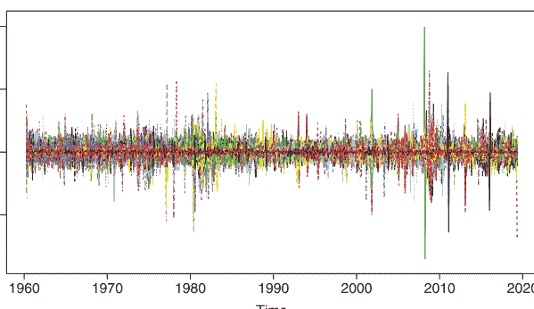

**图 7.1** 122 个月度宏观经济变量的时间图。这些序列已缩放，使每个序列的样本方差均为 1，以便于可视化。


为每个 $\ell_1$ 范数值绘制的线条数量不相同，且随 $\ell_1$ 范数的增加而增加。图上方显示的数字是给定 $\ell_1$ 范数下估计的非零系数个数。例如，图 7.2 显示当 $\ell_1$ 范数为 5 时，有 189 个非零系数估计值。请注意，系数最大数量为 732，而当 $\ell_1 = 15$ 时，只显示了 351 个系数，不到可能数量的一半。包 **glmnet** 允许不同类型的回归系数轮廓图。图 7.3 显示了另一个系数轮廓图，其中 x 轴是惩罚参数 $\lambda$ 的对数，它以不同的方式提供相同的信息。同样，每个系数由一条线表示，但现在随着更重的惩罚减少非零系数估计的数量，图中的线条数量

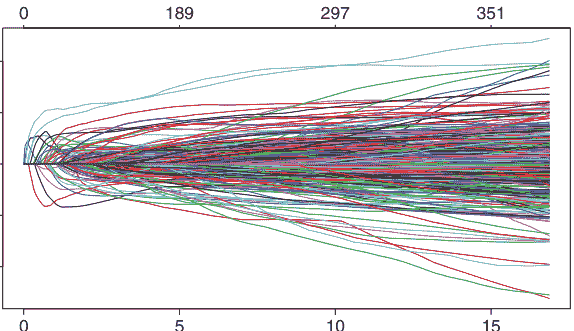

图 7.2 1960 年至 2019 年美国 IPI 月度增长率的 Lasso 线性回归系数与 $\ell_1$-范数对比图。

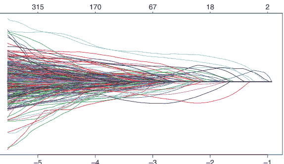

图 7.3 1960 年至 2019 年美国 IPI 增长率的 Lasso 线性回归系数与 log 惩罚值 ln($\lambda$) 对比图。

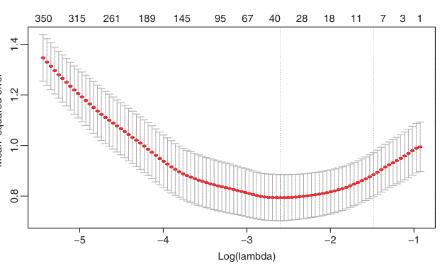

图 7.4 1960 年至 2019 年美国 IPI 增长率的 Lasso 线性回归 10 折交叉验证结果。左侧垂直虚线定位最小 MSE 对应的惩罚值，右侧垂直虚线标记 $\lambda$ 的一个标准误界限。

随 $\lambda$ 增加而减少。图上方显示的数字也是非零系数估计数量。

交叉验证（CV）常用于独立数据的线性回归分析中选择惩罚参数。对于时间序列数据，通常更倾向于使用样本外预测。然而，为了演示 Lasso 的使用，本示例中采用 CV。图 7.4 显示了 10 折 CV（CV）的结果。样本外均方误差（MSE）与惩罚参数 $\lambda$ 的对数绘制对比，两条垂直虚线分别定位对应最小 MSE 的惩罚值和惩罚参数的可能范围。从图中看，选择 $\log(\lambda) \approx -2.6$ 似乎是合理的。事实上，CV 选择的 $\lambda \approx 0.0743$，这与 $\exp(-2.6) = 0.07427$ 很接近。图 7.5 显示当 $\lambda = 0.07429$ 时的估计系数 $\hat{\beta}_j$。根据图示，我们发现有九个预测变量满足 $|\hat{\beta}_j| > 0.04$。这些预测变量为

- 1. IPDMAT：工业生产：耐用材料（滞后 1 期），
- 2. CLAIMX：初请失业金人数（滞后 1 期），
- 3. NDMANEMP：所有雇员：非耐用消费品（滞后 1 期），
- 4. T1YFFM：1 年期国债利率减联邦基金利率（滞后 1 期），
- 5. CES2000000008：平均每小时收入：建筑业（滞后 1 期），
- 6. ISRATIOx：企业总库存与销售比率（滞后 2 期）
- 7. S&P 股息收益率：S&P 综合普通股：股息收益率（滞后 2 期），
- 8. S&P 工业：S&P 普通股价格指数：工业（滞后 3 期），
- 9. TB3SMFFM：3 个月期国债利率减联邦基金利率（滞后 5 期）

因此，Lasso 回归表明，美国 IPI 的增长率取决于多个部门，包括产出、劳动力市场、库存、利率和股票市场。这似乎是合理的。请注意，阈值 0.04 的选择是任意的。由于预测变量已标准化，我们可以直接比较估计系数的大小

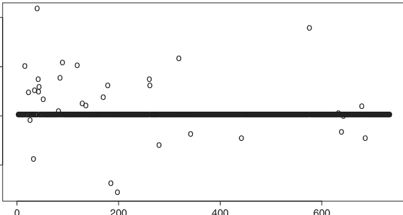

图 7.5 1960 年至 2019 年美国 IPI 增长率的 Lasso 线性回归系数估计值。惩罚参数由 10 折交叉验证选择。

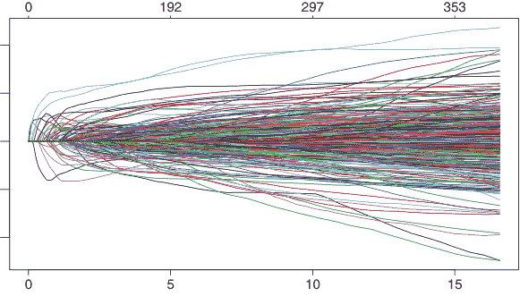

图 7.6 1960 年至 2019 年美国 IPI 月度增长率的弹性网线性回归系数与 $\ell_1$-范数对比图。惩罚为 $0.8\ell_1 + 0.2\ell_2$。

如果选择更高的阈值，例如 0.05，那么我们将选择大约七个预测变量，而不是前面提到的九个。

接下来，转到弹性网，其线性组合由 $\ell_1$- 和 $\ell_2$-惩罚的 $\alpha$ 参数定义。图 7.6 显示了 $\alpha = 0.8$ 时弹性网回归系数估计值与 $\ell_1$ 范数的对比图。该系数轮廓图的工作方式与图 7.2 相同，如预期，它提供了类似的结果。图 7.7 显示了 10 折交叉验证与惩罚参数 $\lambda$ 的对数对比结果。从图中看，选择 $log(\lambda) \approx -2.5$ 似乎是合理的。具体来说，CV 选择的 $\lambda \approx 0.0846$。图 7.8 显示当 $\lambda$ 由 CV 选择时的估计系数 $\hat{\beta}_j$。根据图示，我们发现有 10 个预测变量满足 $|\hat{\beta}_j| > 0.04$。这些预测变量包含与 Lasso 回归所示相同的选择

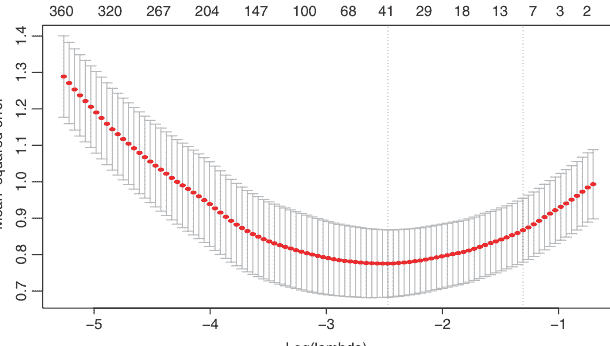

图 7.7 1960 年至 2019 年美国 IPI 增长率的弹性网线性回归 10 折交叉验证结果。使用 α = 0.8 定义惩罚。左侧垂直虚线定位最小 MSE，右侧垂直虚线提供一个标准误界限。

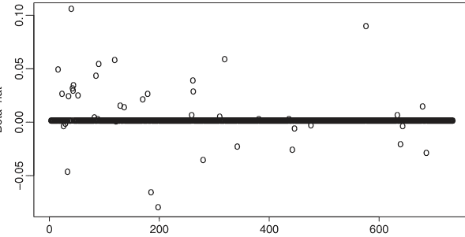

图 7.8 1960 年至 2019 年美国 IPI 月度增长率的弹性网线性回归系数估计值。惩罚参数由 10 折交叉验证选择，且 α = 0.8。

此外还有一个预测变量，即穆迪季节性 Aaa 级公司债券收益率（滞后 1 期）。因此，弹性网表明，美国 IP 指数的月度增长率取决于与 Lasso 回归相同的部门。

#### R 命令：Lasso 和弹性网回归。

```
da <- read.csv( 'FREMDMApril19.csv',header=TRUE)
x <- as.matrix(da)
require(MTS)
y <- scale(x,scale=TRUE) # standardize the data for plotting
tdx <- c(1:710)/12+1960
TSPlot(y,tdx)
```

```r
set.seed(311)
require(glmnet)
Y <- y[7:710, 6]
X <- cbind(y[6:709, ], y[5:708, ], y[4:707, ], y[3:706, ], y[2:705, ], y[1:704, ])
m2 <- glmnet(X, Y, family=c("gaussian"), alpha=1)
plot(m2) #coefficient profile plot (x-axis of ell-1 norm)
plot(m2, xvar='lambda') #coefficient profile plot (x-axis is log penalty)
cv.m2 <- cv.glmnet(X, Y, family=c("gaussian"), alpha=1)
plot(cv.m2)
names(cv.m2)
cv.m2$lambda.min
beta <- coef(m2, s=cv.m2$lambda.min)
beta <- c(beta[-1, 1]) [-1]
plot(1:732,beta,xlab="variable index",ylab="beta-hat",pch="o",cex=0.6)
idx <- c(1:732) [abs(beta) > 0.04]
idx
colnames(X) [idx]
#### glmnet with alpha = 0.8
m3 <- glmnet(X, Y, family=c("gaussian"), alpha=0.8)
plot(m3)
cv.m3 <- cv.glmnet(X, Y, family="gaussian", alpha=0.8)
plot(cv.m3)
cv.m3$lambda.min
betal <- coef(m3, s=cv.m3$lambda.min)
beta1 <- c(betal[-1, 1]) [-1]
plot(1:732,beta,xlab="variable index",ylab="beta-hat",pch="o",cex=0.6)
idx <- c(1:732) [abs(betal) > 0.04]
idx
colnames(X) [idx]
```

### 示例 7.2

对于 HDTS 分析，组 Lasso 可能很有用。在本节中，我们演示如何使用它。我们预期平稳时间序列数据的序列相关性随滞后增加而衰减至零。组 Lasso 使我们能够通过将滞后变量的预测变量分组来实现这一领域知识。考虑第 3 章中使用的六个国家的季度 GDP 增长率。这六个国家是美国、英国、法国（FR）、澳大利亚（AU）、德国（GE）和加拿大（CA）。样本期为 1980 年至 2018 年。假设我们有兴趣预测美国的 GDP 增长率，并将所有国家的滞后 GDP 增长率作为预测变量。这里因变量是 yt，即美国的 GDP 增长率。使用的预测变量包括所有国家的滞后 GDP 增长率。具体来说，我们有 \( x_t = (y_{t-1}, \dots, y_{t-8}, z'_{t-1}, \dots, z'_{t-8})' \)，其中 \( z_t \) 是除美国外所有国家的季度 GDP 增长率。为了利用组 Lasso 的特性，我们考虑以下分组：

- 1. 组 1：美国 GDP 增长率的滞后值，即 \( y_{t-1}, \dots, y_{t-8} \)。
- 2. 组 \( i+1 \)：其他国家滞后 \( i \) 期的 GDP 增长率，即 \( z_{t-i} \)，其中 \( i = 1, \dots, 8 \)。

因此，我们将 48 个预测变量划分为 9 个组。我们的预测变量分组的基本思想是（a）美国 GDP 增长率的滞后值很重要


并且 (b) 对于给定滞后，我们平等对待其他国家的增长率。对预测变量有其他分组方式，我们的分组主要用于说明目的。有多个可用于 Group Lasso 的 R 包，例如 gglasso 和 grplasso。我们在分析中使用 gglasso。使用的 R 命令如下所示，包括分组。图 7.9 显示了 GDP 示例中 Group Lasso 的系数轮廓。此图可类似于 Lasso 的图进行解释。如预期，轮廓显示滞后预测变量在预测美国 GDP 增长率方面很有用。图 7.10 显示了用于选择惩罚参数 \(\lambda\) 的 10 折交叉验证结果。该图显示 LS 损失的最小值大约在 \(ln(\lambda) = -3.4\) 处达到。图 7.11 显示了 \(\lambda\) 处于交叉验证最小值时 \(\hat{\beta}_i\)（包括常数项）的图。从图中可以看到，滞后 1 阶预测变量比高阶滞后预测变量更重要。事实上，对于此特定实例，重要预测变量的预测变量索引为 1、10、14 和 2，分别对应截距以及英国、加拿大和美国的滞后 1 阶 GDP 增长率。考虑到这三个经济体之间的紧密联系，这是合理的。

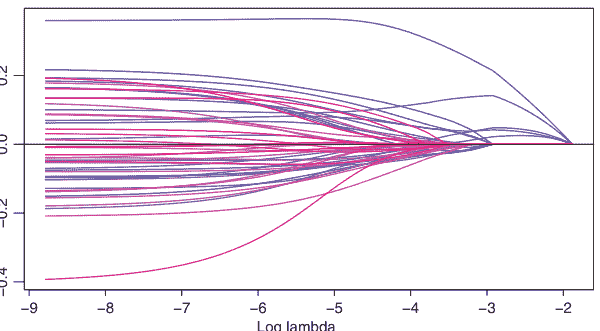

**图 7.9** 1980 至 2018 年六个国家季度 GDP 增长率的 Group Lasso 系数与 ln(lambda) 对比图。因变量为美国 GDP 增长率。

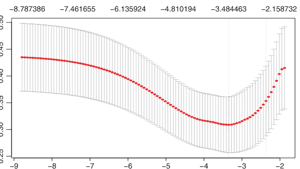

**图 7.10** GDP 增长率序列 Group Lasso 的 10 折交叉验证结果。因变量为美国 GDP 增长率。

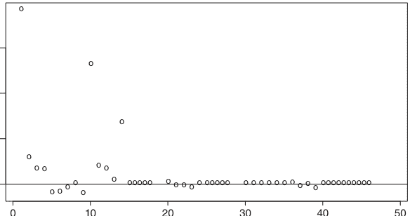

**图 7.11** GDP 数据集 Group Lasso 的系数估计值。因变量为美国 GDP 增长率，惩罚参数为 \(\lambda \approx 0.0353\)。

#### R 演示：GDP 增长率的 Group Lasso。

```
> da <- read.table("gdpsimple6c8018.txt",header=TRUE)
> fix(da)
> dim(da)
[1] 153   6
> da[1:2, ]
      US        UK       FR        AU        GE        CA
1 0.3145153 -0.9719569 1.1197030 0.4478638 0.8012350 0.70678280
2 -0.6064770 -1.9796670 -0.5731772 0.2604569 -0.6438022 -0.03293659
> y <- da[9:153,1] ## Dependent variable
> X <- NULL ## setup predictors
> grp <- NULL ## Grouping
> for (i in 1:8) {
+ X <- cbind(X,da[(9-i):(153-i),1])
+ grp <- c(grp,i)
+ }
> for (i in 1:8) {
+ X <- cbind(X,da[(9-i):(153-i),-1])
+ grp <- c(grp,rep(i+1,5))
+ }
> dim(X)
[1] 145  48
> n1 <- paste("US",1:8,sep="") ## name predictors
> n2 <- colnames(da)[-1]
> n2
[1] "UK" "FR" "AU" "GE" "CA"
> nn1 <- paste(n2,1,sep="")
> nn2 <- paste(n2,2,sep="")
> nn3 <- paste(n2,3,sep="")
> nn4 <- paste(n2,4,sep="")
> nn5 <- paste(n2,5,sep="")
> nn6 <- paste(n2,6,sep="")
> nn7 <- paste(n2,7,sep="")
> nn8 <- paste(n2,8,sep="")
> colnames(X) <- c(n1,nn1,nn2,nn3,nn4,nn5,nn6,nn7,nn8)
> require(gglasso)
> X <- as.matrix(X)
> m1 <- gglasso(X,y,group=grp,loss=c("ls"))
> plot(m1)
> cv.m1 <- cv.gglasso(X,y,group=grp,loss=c("ls"))
> names(cv.m1)
[1] "lambda"       "cvm"          "cvsd"         "cvupper"      "cvlo"
[6] "name"         "gglasso.fit"  "lambda.min"   "lambda.1se"
> plot(cv.m1)
> cv.m1$lambda.min
[1] 0.03526331
> beta <- coef(m1,s=cv.m1$lambda.min)
> length(beta[,1]) ## include the constant term
[1] 49
> plot(1:49,beta[,1],xlab="predictor index",ylab="beta-hat",pch="o",cex=0.6)
> abline(h=c(0))
> idx <- c(1:49)[abs(beta[,1]) > 0.04]
> idx
[1]  1  2 10 14
> pre <- c("cnst",colnames(X))
> pre[idx]
[1] "cnst" "US1"  "UK1"  "CA1"
> grp
[1] 1 1 1 1 1 1 1 1 2 2 2 2 3 3 3 3 4 4 4 4 5 5 5 5
6 6 6 6 7 7 7 7 8 8 8 8 9 9 9 9
```

## 7.2 动态相关对 LASSO 的影响

如前一节所示，惩罚回归模型的大多数性质是在独立性假设下推导得出的。另一方面，在大多数应用中，数据在时间上、空间上或同时都可能存在动态相关。本节首先总结回归分析中动态相关的后果，然后讨论 Lasso 回归的情况。众所周知，见例如 Greene (2003) 或 Griffiths et al. (1985)，当将回归分析应用于时间序列数据时，噪声通常具有自相关。因此，使用普通最小二乘估计代替广义最小二乘估计存在以下缺陷：

- 1. 最小二乘估计量是无偏的，但效率低下；
- 2. 系数估计的最小二乘方差是有偏的，并且通常低估系数的真实方差；
- 3. 残差方差被低估。

最小二乘估计的这些特性可能会产生一些不良影响，例如 *伪回归*，其中与响应变量无关的解释变量可能会因其回归系数方差被低估而与标准 \( t \)-检验一起显得显著。

例如，考虑一个简单回归模型 \( y_t = \beta_t x_t + e_t \)，包含 \( T \) 个数据点，其中解释变量 \( x_t \) 遵循 AR(1) 模型，\( x_t = \phi x_{t-1} + a_t \)，且误差 \( e_t \) 也遵循 AR(1) 模型，\( e_t = \alpha e_{t-1} + \epsilon_t \)。那么，\( \beta \) 的通常最小二乘估计为 \( \widehat{\beta}_{\text{dep}} = \sum_{t=1}^T x_t y_t / \sum_{t=1}^T x_t^2 \)，其方差可近似为（见 Greene, 2003）

\(\text{Var}(\widehat{\beta}_{\text{dep}}) = \text{Var}(\widehat{\beta}_{\text{ind}}) \frac{(1 + \phi \alpha)}{(1 - \phi \alpha)},\) (7.21)

其中 \(\text{Var}(\widehat{\beta}_{\text{ind}}) = \sigma^2 / T \sigma_x^2\) 是应用于独立数据时最小二乘估计的方差，即当 \( \phi = \alpha = 0 \) 时。假设通常情况 \( \phi > 0 \) 且 \( \alpha > 0 \)，我们看到 \( \widehat{\beta}_{\text{dep}} \) 的方差可能远大于假设独立性时计算出的方差。特别是，如果 \( x_t \) 和 \( e_t \) 过程均具有大 AR 系数的序列相关，则 \(\text{Var}(\widehat{\beta}_{\text{dep}})\) 的方差可能非常大，因此，即使 \( \beta = 0 \)，我们也可能以高概率得到一个较大的估计 \( \widehat{\beta}_{\text{dep}} \)，这将被视为使用常规回归公式计算的 \( t \) 统计量下的显著结果。这就是著名的伪回归问题。在存在强序列相关时，这种现象也经常发生。参见第 3.5.1 节的讨论。

在 Lasso 线性回归中，参数估计通常是有偏的，我们没有精确公式来计算其方差，但由于数据中的自相关，一些无关变量可能会出现大系数，且类似的伪回归问题很可能发生。我们在第 1 章中看到，当时间依赖性很强时会出现这种影响。在本节中，我们使用模拟进一步演示序列相关对 Lasso 线性回归的一些影响。我们的目标是表明，当存在动态依赖时，不应忽视数据的动态依赖。

### 示例 7.3

考虑我们写成标量 AR(2) 模型的 ARIMA(1,1,0) 模型

\( y_t = 1.4y_{t-1} - 0.4y_{t-2} + a_t, \quad t=1, \dots, 400, \) (7.22)

其中 \(\{a_t\}\) 是 i.i.d. \( N(0, 1) \)，且若 \( t < 1 \) 则 \( y_t = 0 \)。我们从模型中独立生成了 11 个序列。第一个序列称为 \( y_t \)，其余 10 个序列记为 \( \boldsymbol{x}_t \)。图 7.12 显示了这 11 个实现的时间图，其中 \( y_t \) 用粗线表示。然后，我们考虑以下线性回归

\( y_{t+2} = \boldsymbol{\beta}'_1 \boldsymbol{x}_{t+1} + \boldsymbol{\beta}'_2 \boldsymbol{x}_t + e_{t+2}, \quad t=1, \dots, 398. \) (7.23)

该模型可以写成矩阵形式 \( \boldsymbol{Y} = \boldsymbol{X} \boldsymbol{\beta} + \boldsymbol{E} \)，其中 \( \boldsymbol{X} \) 是设计矩阵，其第 \( i \) 行写为 \( (\boldsymbol{x}'_{t+1}, \boldsymbol{x}'_t) \)，且 \( \boldsymbol{Y} = (y_3, \dots, y_{400})' \)。由于 \( y_t \) 和 \( \boldsymbol{x}_t \) 独立，\( \boldsymbol{\beta} = \mathbf{0} \)。但是，我们将 Lasso 估计应用于模型 (7.23)，假装数据是序列独立的。请注意，在模型拟合中，预测变量 \( \boldsymbol{x}_t \) 的各个分量被标准化，使得每个预测变量序列的样本方差为 1。

图 7.13 显示了模型 (7.23) Lasso 拟合的系数轮廓图。从图中可以看到，若干系数估计值相对较大。例如，当 \( \ell_1 \) 范数为 10 时，有 12 个非零系数估计值。图 7.14 显示了


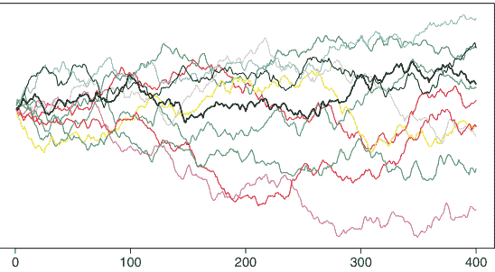

图 7.12 示例 7.3 中使用的 11 个标量时间序列的时间序列图。因变量 $y_t$ 用粗线表示。

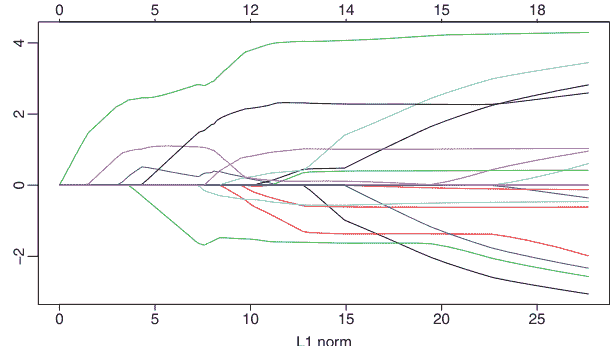

图 7.13 Eq. (7.23) 中模型的 Lasso 拟合系数剖面图。x 轴为拟合系数向量的 $\ell_1$ 范数。

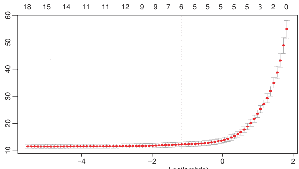

图 7.14 Eq. (7.23) 中模型 Lasso 拟合的 10 折交叉验证结果。

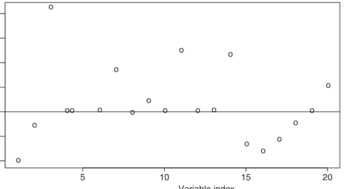

图 7.15 当惩罚参数 \(\lambda\) 由 10 折交叉验证选取时，Eq. (7.23) Lasso 拟合的估计系数 \(\hat{\beta}_i\)。

对模型 (7.23) 进行 Lasso 拟合的 10 折交叉验证结果。该图不具信息性，因为没有明显的极小值，表明惩罚参数 \(\lambda\) 存在广泛的选择范围。`cv.glmnet` 命令选取 \(\lambda \approx 0.00765\)。图 7.15 显示了当 \(\lambda\) 由 10 折交叉验证选取时的 \(\hat{\beta}_i\)。从图中可以看到，尽管所有 \(i\) 的 \(\beta_i = 0\)，但若干估计值 \(\hat{\beta}_i\) 仍然相当大。事实上，图中有九个 \(\hat{\beta}_i\) 的绝对值大于 1。从理论上讲，我们模拟中发现的现象可简要说明如下。首先，由于所用序列为单位根非平稳序列，高效估计值 \(\hat{\beta}_i\) 的极限分布是非标准分布。它们是标准布朗运动的函数，因此 \(\hat{\beta}_i\) 的幅度可能很大，尽管它们不应具有统计显著性。其次，\(\mathbf{x}_{t+1}\) 和 \(\mathbf{x}_t\) 中每个预测变量的标准化加剧了多重共线性问题。利用单位根性质，例如 Tsay (2014, chapter 5) 及其中的参考文献，可以证明，对于任何固定的 \(i\)，当 \(T \to \infty\) 时，\(\sum_{t=i+1}^T y_t y_{t-i} / \sum_{t=1}^T y_t^2\) 以 \(T^{-1}\) 的速率收敛于 1。为加以说明，将 Eq. (7.22) 中的模型改写为 \(y_t = y_{t-1} + 0.4 \nabla y_{t-1} + a_t\)。则，

$$
\sum_t y_t y_{t-1} = \sum_t y_{t-1}^2 + 0.4 \sum_t y_{t-1} \nabla y_{t-1} + \sum_t a_t y_{t-1}.
$$

由于 \(\sum_t y_{t-1} \nabla y_{t-1} = O_p(T)\) 且 \(\sum_t a_t y_{t-1} = O_p(T)\)（因为平稳性），但当 \(T \to \infty\) 时 \(\sum_t y_t^2 = O_p(T^2)\)，可见 \(\sum_t y_t y_{t-1} / \sum_t y_t^2 = 1 + O_p(T^{-1})\)。这意味着，对于大的 \(T\)，与 \(\sum_t y_t^2\) 相比，模型中平稳部分的影响会消失。因此，在存在单位根的情况下，对预测变量进行标准化会增加 Lasso 回归的多重共线性。

这个简单的例子表明，忽视数据中的强序列相关性可能导致 Lasso 回归中模型拟合错误。即使在平稳过程等弱依赖情况下，也可能出现同样的问题，尽管幅度较小。如果我们用系数为 0.8 的 AR(1) 过程生成的序列重复此示例，则会发现四个系数的绝对值在 0.1 到 0.2 之间。如果将这四个变量作为解释变量拟合标准线性回归，其中两个变量的绝对 \(t\) 值大于 3.5，具有显著性。

### 示例 7.3 使用的 R 命令

```
require(SLBDD) ## Package for the book
require(glmnet)
set.seed(123)
Yt <- sim.uarima(T=400,ar=c(0.4),ma=NULL,D=0)
Xt <- NULL
for (i in 1:10) {
xt <- sim.uarima(T=400,ar=c(0.4),ma=NULL,D=0)
Xt <- cbind(Xt,xt)
}
y <- Yt[3:400]
xt <- scale(Xt,scale=TRUE)
colnames(xt) <- paste("xt",1:10,sep="")
X <- cbind(xt[2:399,],xt[1:398,])
m4 <- glmnet(X,y,family="gaussian",alpha=1)
plot (m4)
cv.m4 <- cv.glmnet(X,y,family="gaussian",alpha=1)
plot(cv.m4)
cv.m4$lambda.min
beta <- coef(m4,s=cv.m4$lambda.min)
beta <- c(beta[,1])[-1]
plot(1:20,beta,xlab="variable index",ylab="beta-hat",pch="o",cex=0.6)
abline (h=0)
idx <- c(1:20) [abs(beta) > 1]
idx
```

### 示例 7.4

考虑线性回归

\(y_i = x_i'\beta + \epsilon_i, \quad i=1, \dots, 100,\) (7.24)

其中 \(\mathbf{x}_i\) 是一个 100 维随机向量，其元素独立服从 \(N(0,1)\)，误差项 \(e_i\) 遵循标量 AR(1) 模型 \(e_i = \phi e_{i-1} + \epsilon_i\)，其中 \(\epsilon_i\) 为独立同分布的 \(N(0,1)\)，系数向量 \(\beta\) 定义如下

\(\beta_i = \left\{ \begin{array}{ll} U[-6, 6] & \text{for } i=1, \dots, 10, \\ 0 & \text{for } i>10, \end{array} \right.\)

其中 \(U[a,b]\) 表示从区间 \([a, b]\) 上的均匀分布中进行随机抽取。本示例的目的是研究误差项 \(e_i\) 中的序列相关性对非零系数 Lasso 估计值 \(\hat{\beta}_i\) 置信区间的影响。也就是说，我们关注 \(i=1, \dots, 10\) 的 Lasso 估计值 \(\hat{\beta}_i\)。为此，我们进行以下模拟：

- 1. 随机抽取真实系数 \(\beta_i\)，\(i=1, \dots, 10\)。
- 2. 真实 AR(1) 系数 \(\phi\) 取三个值，即 \(\phi=0\)、\(0.6\) 或 \(-0.6\)。
- 3. 对于给定的 \(\phi\)，执行以下程序 3000 次迭代：
  - (a) 使用具有真实参数的 Eq. (7.24) 模型生成数据。
  - (b) 对数据集应用 Lasso。
  - (c) 使用 10 折交叉验证选取惩罚参数 \(\lambda\)。
  - (d) 存储 \(i=1, \dots, 10\) 的估计值 \(\hat{\beta}_i\)。将得到的 \(\hat{\beta}_i\) 记为 \(\widehat{\boldsymbol{\beta}}(\phi)\)，对于给定的 \(\phi\)，它是一个 3000 行 10 列的矩阵。
- 4. 对每个 \(\phi\)，计算 \(\widehat{\boldsymbol{\beta}}(\phi)\) 的某些列汇总统计量。

计算的列汇总统计量包括 (a) 样本均值、(b) 样本标准差，以及 (c) 常规 95% 置信区间包含真实 \(\beta_i\) (\(i=1, \dots, 10\)) 的经验覆盖概率。图 7.16 显示了 \(\phi = 0, 0.6, -0.6\) 及 \(i=1, \dots, 4\) 时 \(\hat{\beta}_i(\phi)\) 的箱线图。图中还给出了 \(\beta_i\) 的真实值。从图中可以清楚地看出，如果忽视 Eq. (7.24) 中误差项 \(e_i\) 的序列相关性，将显著影响估计值 \(\hat{\beta}_i\) 的变异性。无论序列相关性为正还是负，情况均如此。表 7.1 提供了一些选定 \(\hat{\beta}_i(\phi)\) 的汇总统计量。同样，\(\phi=0\) 是 Lasso 假设成立的情况。从表中可以看出，(a) Lasso 估计值工作

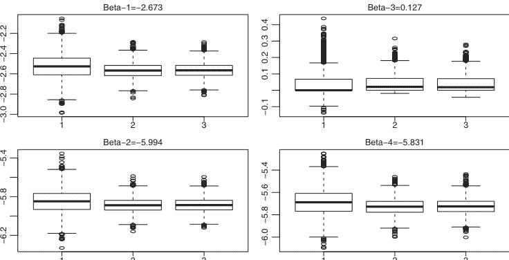

图 7.16 \(i = 1, \dots, 4\) 时 \(\hat{\beta}_i(\phi)\) 的箱线图。左侧箱线图为 \(\phi = 0\)，中间箱线图为 \(\phi = 0.6\)。估计值基于 3000 次迭代，模型为 Eq. (7.24)。

表 7.1 Eq. (7.24) 模型中 Lasso 估计值 \(\hat{\beta}_i(\phi)\) 的选定汇总统计量

| \(\phi\) | 统计量 | \(\hat{\beta}_1\) | \(\hat{\beta}_2\) | \(\hat{\beta}_3\) | \(\hat{\beta}_6\) | \(\hat{\beta}_7\) | \(\hat{\beta}_9\) |
|---|---|---|---|---|---|---|---|
| | 真实值 | -2.673 | -5.994 | 0.127 | 5.458 | -4.962 | 4.568 |
| 0 | 均值 | -2.526 | -5.849 | 0.040 | 5.310 | -4.816 | 4.422 |
| | 标准误 | 0.124 | 0.124 | 0.067 | 0.125 | 0.124 | 0.123 |
| | 覆盖概率 | 0.999 | 0.999 | 0.987 | 0.788 | 0.998 | 0.784 |
| 0.6 | 均值 | -2.566 | -5.889 | 0.042 | 5.351 | -4.857 | 4.462 |
| | 标准误 | 0.075 | 0.074 | 0.051 | 0.075 | 0.074 | 0.075 |
| | 覆盖概率 | 0.999 | 1.000 | **0.465** | 0.716 | 1.000 | 0.716 |
| -0.6 | 均值 | -2.565 | -5.887 | 0.041 | 5.353 | -4.854 | 4.461 |
| | 标准误 | 0.075 | 0.075 | 0.051 | 0.076 | 0.075 | 0.074 |
| | 覆盖概率 | 1.000 | 1.000 | **0.452** | 0.727 | 0.999 | 0.700 |

\(^a\) “C.Prob” 表示 \(\beta_i\) 常规 95% 置信区间的覆盖概率。结果基于 3000 次迭代，\(\phi\) 分别为 \(0\)、\(0.6\) 和 \(-0.6\)。


当线性回归模型的误差不相关时，(b) 当 \(\phi \neq 0\) 时，Lasso 显著低估了 \(\hat{\beta}_i(\phi)\) 的标准误，这意味着忽略误差项中的序列相关性会影响使用 Lasso 进行统计推断，且 (c) 如果忽略序列相关性，95% 置信区间的真实覆盖概率可能远低于 0.95。覆盖概率降低由两个因素引起。首先，残差中的序列相关性会导致系数估计值的变异性被低估（即经验标准误更小）。其次，序列相关性会在系数估计中引入向下偏差，如果真实的 \(\beta_i\) 不是很大，这种负偏差可能非常显著。

## 7.3 用于依赖数据的 LASSO

上一节我们通过模拟证明，序列依赖性会影响 Lasso 方法的统计推断。在文献中，一些研究者在数据的序列依赖性不强时，为 Lasso 提供了某些理论依据。Wang 等人 (2007) 通过对线性回归模型中的回归系数和 AR 系数施加不同惩罚，提出了带 AR 误差的线性回归模型的 Lasso 估计量

\[
y_t = \mathbf{x}'_t \boldsymbol{\beta} + e_t, \quad (7.25)
\]

其中，\(e_t\) 表示误差项，假设其遵循 AR(\(p\)) 模型 \(\phi_p(B)e_t = a_t\)。同前，\(\mathbf{x}_t = (x_{1t}, \dots, x_{kt})'\) 是预测变量的 \(k\) 维随机向量。此处下标改为 \(t\) 以表明是时间序列数据。他们提出了估计方法

\[
\widehat{\boldsymbol{\beta}}_{\text{adapt}}(\lambda) = \arg \min_{\boldsymbol{\beta}} \left\{ \| \mathbf{Y} - \mathbf{X}\boldsymbol{\beta} \|_2^2 / n + \sum_{j=1}^k \lambda_j |\beta_j| + \sum_{i=1}^p \gamma_i |\phi_i| \right\}, \quad (7.26)
\]

并表明，对于所研究的问题，这种修正的 Lasso 比传统的 Lasso 更有效。他们还提出了一种估计此修正 Lasso 估计量的算法。Gupta (2012) 研究了模型 (7.25) 中的 Lasso 估计量，其中 \(e_t\) 是一个弱依赖过程。弱依赖过程具有自相关系数随滞后增大而趋于零的性质。这一条件是独立性的推广，在渐近分析中很有用。ARMA 过程，以及一般来说，平稳和 ergodic 过程都是弱依赖的。参见 DeDecker 等人 (2007)。

上述两篇文章关注样本量 \(n\) 大于预测变量数量 \(k\) 的情况。Basu 和 Michailidis (2015) 研究了高维高斯过程随机设计下 Lasso 估计量的理论性质。Kock 和 Callot (2015) 为平稳 VAR 模型中高斯误差的 Lasso 回归建立了神谕不等式。Wu 和 Wu (2016) 分析了固定设计矩阵下的 Lasso 估计量，并假设满足受限特征值条件。Medeiros 和 Mendes (2016) 研究了误差非高斯且可能存在条件异方差时自适应 Lasso 的渐近性质。Han 和 Tsay (2020) 在弱稀疏性条件下建立了 Lasso 估计量的收敛率，并给出了 Lasso 回归的符号一致性。本文将 Lasso 结果扩展到时间序列分析中的固定设计和精确稀疏性之外，其中真实非零系数的数量是有限的，且不假设样本协方差矩阵或总体协方差矩阵上满足受限特征值条件。下文中，对于 \(k\) 维随机向量 \(z\)，\(q\) 阶范数定义为 \(\|z\|_q = (E|z|^q)^{1/q}\)，其中 \(1 \le q \le k\)。

考虑线性回归模型 (7.25)。设 \(\{\epsilon_t\}\) 为随机向量的独立同分布序列，且 \(F_t = \sigma\{\epsilon_i \mid i \le t\}\) 为由 \(i \le t\) 的 \(\epsilon_i\) 生成的 \(\sigma\)-代数。我们假设 \(x_t\) 的分量和误差 \(e_t\) 是 \(F_t\) 的良好定义的实值可测函数，即，

\[
x_t = (g_1(F_t), \dots, g_k(F_t))' \quad \text{and} \quad e_t = g_e(F_t).
\]

为简单起见，可以将 \(x_{it}\) 和 \(e_t\) 视为 \(F_t\) 的线性函数。为了量化时间序列数据的序列依赖性，我们采用 Wu (2005) 的功能依赖度量。具体地，设

\[
\delta_{t,q,i} = \|x_{it} - x_{it}^*\|_q = \|g_i(F_t) - g_i(F_t^*)\|_q, \quad \text{(7.27)}
\]

\[
\delta_{t,q,e} = \|e_t - e_t^*\|_q = \|g_e(F_t) - g_e(F_t^*)\|_q, \quad \text{(7.28)}
\]

其中，\(x_t^* = (g_1(F_t^*), \dots, g_k(F_t^*))'\) 且 \(e_t^* = g_e(F_t^*)\)，这里 \(F_t^* = \sigma[\{\epsilon_i \mid i \le t \cap i \neq 0\} \cup \epsilon_0^*\]]\)，且 \(\epsilon_0^*\) 是与 \(\{\epsilon_i\}\) 独立但服从与 \(\epsilon_0\) 相同分布的随机向量。粗略地说，对于给定的时间索引 \(t\) 和正整数 \(q\)，式 (7.27) 中的 \(\delta_{t,q,i}\) 以 \(q\) 阶范数衡量将 \(\epsilon_0\) 更改为 \(\epsilon_0^*\) 对 \(x_{it}\) 的影响。同样，式 (7.28) 中的 \(\delta_{t,q,e}\) 量化了将 \(\epsilon_0\) 更改为 \(\epsilon_0^*\) 对误差项 \(e_t\) 的影响。这两个依赖度量在线性时间序列模型的移动平均表示的冲击响应权重 \(\psi_t\) 中起着类似的作用。

对于正整数 \(m\)，定义累积依赖度量为

\[
\Delta_{m,q,i} = \sum_{l=m}^\infty \delta_{t,q,l}, \quad \text{(7.29)}
\]

\[
\Delta_{m,q,e} = \sum_{l=m}^\infty \delta_{t,q,e}. \quad \text{(7.30)}
\]

这两个度量分别量化了将 \(\epsilon_0\) 更改为 \(\epsilon_0^*\) 时对 \(x_{it}\) 和 \(e_t\) 的累积影响。同样，可以将这两个度量视为线性 ARMA 模型的 \(\psi\)-权重的累积和。如果对于某个固定的 \(m\)，\(\Delta_{m,q,i} < \infty\) 且 \(\Delta_{m,q,e} < \infty\)，则我们说序列 \(x_{it}\) 和 \(e_t\) 是短程依赖。从定义可以看出，如果序列是短程依赖，则将 \(\epsilon_0\) 更改为 \(\epsilon_0^*\) 对时间序列的影响是有界的，因为在短程依赖下，\(\delta_{t,q,i}\) 和 \(\delta_{t,q,e}\) 应趋近于零。

在短程依赖下，可以使用累积依赖度量定义依赖调整范数（DAN）如下：

\[
\|x_i\|_{q,a} = \sup_{m \ge 0} (m+1)^\alpha \Delta_{m,q,i}, \quad \alpha \ge 0,
\]

\[
\|e\|_{q,a} = \sum_{m \ge 0} (m+1)^\alpha \Delta_{m,q,e}, \quad \alpha \ge 0.
\]

这些 DAN 用于推导依赖数据上 Lasso 估计量的一致性。

接下来，转向 \(\boldsymbol{x}_t\) 的横截面依赖性。设 \(\boldsymbol{\Sigma} = [\sigma_{ij}]\) 为 \(\boldsymbol{x}_t\) 的协方差矩阵，假设序列是平稳的。定义 \(L^\infty\) 功能依赖度量及其对应的 DAN 为

\[
w_{t,q} = \| \max_{1 \le j \le k} |x_{jt} - x_{jr}^*| \|_q,
\]

\[
\| \| \boldsymbol{x} \|_\infty \|_{q, \alpha} = \sum_{m \ge 0} (m+1)^\alpha \sum_{t=m}^{\infty} w_{t,q}, \quad \alpha \ge 0.
\]

此外，定义

\[
\Psi_{q, \alpha} = \max_{1 \le j \le k} \| \boldsymbol{x}_{\cdot j} \|_{q, \alpha} \quad \text{and} \quad \Upsilon_{q, \alpha} = \left( \sum_{j=1}^k \| \boldsymbol{x}_{\cdot j} \|_{q, \alpha}^q \right)^{1/q} .
\]

这里，\(\Psi_{q, \alpha}\) 和 \(\Upsilon_{q, \alpha}\) 可以分别视为 \(\boldsymbol{x}_t\) 的统一和整体 DAN。

考虑式 (7.25) 中的模型。我们施加以下弱稀疏性条件：存在某个满足 \(0 \le \theta \le 1\) 的常数 \(\theta\) 和一个均匀半径 \(K_\theta，使得

\[
\sum_{j=1}^k |\beta_j|^\theta \le K_\theta. \quad (7.31)
\]

假设弱稀疏性条件成立，且 \(x_{it} \ (i=1, \dots, k)\) 和 \(e_t\) 均满足短程依赖。更具体地，假设 \(\Psi_{y, \alpha_X} = M_X < \infty\)，其中 \(\gamma > 4\) 和 \(\alpha_X > 0\)，且 \(\| e \|_{q, \alpha_e} = M_e < \infty\)，其中 \(q > 2\) 和 \(\alpha_e > 0\)。定义

\[
v = \begin{cases} 1, & \text{if } \alpha_X \ge 1/2 - 2/\gamma, \\ \gamma/4 - \alpha_X \gamma/2, & \text{if } \alpha_X < 1/2 - 2/\gamma. \end{cases}
\]

设 \(\tau = q\gamma/(q+\gamma) > 2\) 且 \(\alpha = \min(\alpha_X, \alpha_e)\)。定义

\[
\rho = \begin{cases} 1, & \text{if } \alpha \ge 1/2 - 1/\tau, \\ \tau/2 - \alpha \tau, & \text{if } \alpha < 1/2 - 1/\tau. \end{cases}
\]

设 \(w = \sqrt{\log(k)/n} M_X^2 + n^{2\nu/\gamma - 1} (\log(k))^{3/2} \| \boldsymbol{x} \|_\infty \|_{\tau, \alpha_X}^2\)。此外，假设 \(\boldsymbol{\Sigma}\) 的最小特征值远离零，即 \(\lambda_{\min}(\boldsymbol{\Sigma}) \ge \kappa > 0\)。在这些假设下，Han 和 Tsay (2020) 推导了式 (7.25) 中线性回归的 Lasso 估计量的一致性，前提是惩罚参数 \(\lambda\) 满足

\[
\lambda \ge \sqrt{\log(k)/n} M_e M_X + n^{\rho/\tau - 1} (\log(k))^{3/2} M_e \| \boldsymbol{x} \|_\infty \|_{\gamma, \alpha_X}
\]

并且量 \(w\) 满足 \(K_\theta w \lambda^{-\theta} < \infty\)。具体地，以高概率，当 \(n \to \infty\) 时，有

\[
|\hat{\boldsymbol{\beta}} - \boldsymbol{\beta} |_2 \le \sqrt{K_\theta} \left( \frac{\lambda}{\kappa} \right)^{1-\theta/2}, \quad (7.32)
\]

\[
|\hat{\boldsymbol{\beta}} - \boldsymbol{\beta} |_1 \le \sqrt{K_\theta} \left( \frac{\lambda}{\kappa} \right)^{1-\theta}. \quad (7.33)


详情见 Han and Tsay (2020) 的定理 1。在强稀疏性条件下，即 \(|\beta|_0 = s < \infty\)，一致性结果可以得到改进。短程相关下 Lasso 估计的一致性条件看起来复杂且缺乏直觉，但核心观点很清晰。Lasso 估计的收敛速度慢于 i.i.d. 情况。可以通过考虑有效样本量来理解依赖数据的收敛速度。在存在序列相关的情况下，\(T\) 个数据点的有效样本量小于 \(T\)。序列相关越强，有效样本量越小。因此，在存在序列相关时，收敛速度更慢。此外，对于模型选择一致性，Han and Tsay (2020) 表明预测变量个数 \(k\) 只能以多项式速率而非指数速率增长。参见 Han and Tsay (2020) 的定理 3。同样，可以使用有效样本量来理解这一问题。由于依赖数据的有效样本量小于 i.i.d. 情况，允许的预测变量个数 \(k\) 应小于 i.i.d. 情况。在时间序列分析中，Lasso 估计的弱依赖假设下的其他应用包括 Nicholson et al. (2017a)（研究大型向量自回归的结构正则化）和 Nicholson et al. (2017b)（用于建模稀疏 HDTS）。

将 Lasso 应用于依赖数据的另一个重要问题是惩罚参数 \(\lambda\) 的选择。序列相关很容易使交叉验证（CV）方法失效。为了克服这一困难，可以将数据分为估计子样本和预测子样本，并使用样本外预测误差来选择惩罚参数，如第 6 章中滚动预测所见。当然，如何将数据分为估计子样本和预测子样本需要仔细研究。一般来说，预测子样本的样本量不应太小，以使预测误差的汇总统计量保持稳定。关于 \(\lambda\) 选择在正则化动态主成分中的应用，参见 Peña et al. (2021)。选择 \(\lambda\) 的另一种方法是使用某些信息准则，例如贝叶斯信息准则（BIC）。关于 Lasso 回归的自由度，读者可参阅 Zou et al. (2007) 和 Tibshirani and Taylor (2012)。

### 示例 7.5

再次考虑示例 7.1 中使用的月度宏观经济变量。因变量是美国 IPI 的月度增长率，预测变量包括所有变量的前六个滞后值。我们的目标是说明使用样本外估计预测来选择惩罚参数。为此，我们将数据分为估计子样本和预测子样本，前者由前 670 个数据点组成，后者包含 34 个观测值。图 7.17 显示了通过命令 `cv.glmnet` 进行的 Lasso 线性回归的 10 折交叉验证结果。选定的值为 \(\lambda \approx 5.956 \times 10^{-4}\)。图 7.18 显示了样本外均方误差与 \(\lambda\) 的关系。选定的值为 \(\lambda \approx 1.777 \times 10^{-4}\)。对于 \(\lambda = 5.956 \times 10^{-4}\) 和 \(1.777 \times 10^{-4}\)，样本外预测的根均方误差分别为 0.00503 和 0.00467。这一差异并不令人意外，因为 CV 没有使用预测子样本中的数据。图 7.19 绘制了两种选择方法的估计值 \(\hat{\beta}_j\)。从图中可以清楚地看出，正如预期的那样，Lasso 选择的非零估计数少于样本外预测。

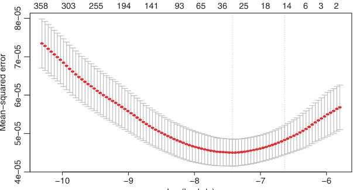

图 7.17 使用前 670 个数据点的月度宏观经济数据的 10 折交叉验证结果。

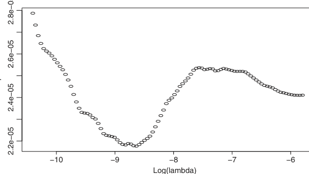

图 7.18 月度宏观经济数据的样本外预测结果。估计子样本包含前 670 个数据点。

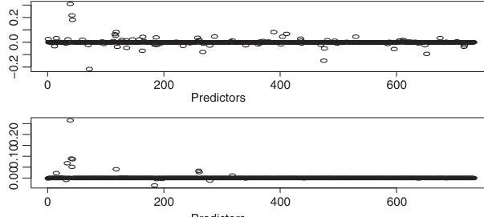

图 7.19 月度宏观经济数据中系数估计值 \(\hat{\beta}_j\) 与 j 的散点图。(a) 样本外预测和 (b) 交叉验证。

### 使用的 R 命令：

```
require(SLBDD); require(glmnet)
da <- read.csv("FREMDApril19.csv",header=TRUE)
x <- as.matrix(da)
dim(da)
[1] 710 122
Y <- x[7:710, 6]
X <- cbind(x[6:709, ], x[5:708, ], x[4:707, ], x[3:706, ], x[2:705, ], x[1:704, ])
dim(X)
m2 <- Lambda.sel(X[1:670,],Y[1:670],X[671:704,],Y[671:704])
m2$lambda.min
[1] 0.0001777053
m3 <- glmnet(X[1:670,],Y[1:670],family="gaussian",alpha=1)
cv.m3 <- cv.glmnet(X[1:670,],Y[1:670],family='gaussian',alpha=1)
plot(cv.m3)
coef <- coef(m3,s=cv.m3$lambda.min)
cv.m3$lambda.min
[1] 0.0005955974
par(mfcol=c(2,1))
plot(1:733,m2$beta,xlab="predictors",ylab="beta-hat",
main="(a) Out-sample")
plot(1:733,coef[,1],xlab="predictors",ylab="beta-hat",
main="(b) Cross-validation")
```

## 7.4 主成分回归与扩散指数

考虑公式 (7.2) 的线性回归模型，包含 \(n\) 个数据点和 \(X\) 中的 \(k\) 个预测变量，其中可以理解为 \(X\) 可能包含一列 1，或者 \(Y\) 和 \(X\) 均已均值调整。在某些应用中，矩阵 \(X'X\) 是奇异的，例如当 \(n < k\) 时，或当 \(X\) 的列高度相关（多重共线性）时，因此 \(\beta\) 的最小二乘估计不是唯一的。文献中已提出许多方法来克服这一困难。主成分回归（PCR）和扩散指数（DI）是其中两种方法。这两种方法的想法很简单。它们对 \(X\) 执行常规主成分分析（PCA），然后使用前几个主成分来预测 \(Y\)。由于主成分彼此正交，多重共线性问题得以克服。剩下的问题是选择要使用的主成分数量，通常通过 CV 或样本外预测来解决。

从数学上看，PCR 可以表述如下：

```
\(X = OP', \quad (7.34)\)
\(Y = F\beta + E, \quad (7.35)\)
```

其中 \(O\) 是 \(n \times k\) *得分矩阵*，\(P\) 是 \(k \times k\) *载荷矩阵*，\(Y\) 是 \(n \times 1\) 响应向量，\(F\) 是由 \(O\) 的前几个 \(r\) 列组成的 \(n \times r\) 矩阵，且为了记号方便，\(E\) 继续表示误差项。载荷 \(k \times k\) 矩阵 \(P\) 是一个正交归一矩阵，满足 \(P'P = PP' = I\)。公式 (7.34) 可通过 X 的奇异值分解得到，即 X = UDP'，其中 U 是 XX' 对应非零特征值的 n x k 特征向量矩阵，D 是一个对角 k x k 矩阵，其元素为 XX' 特征值的平方根，P 是含有 X'X 特征向量的 k x k 矩阵。显然，O = UD。

Stock and Watson (2002) 的 DI 可以被视为 PCR 的推广。它使用第 6 章的因子模型概念并假设

```
X = FL' + \eta, (7.36)
Y = F\beta + Z\gamma + E, (7.37)
```

其中 F 由维度为 n x r 的公共因子（潜变量）组成，且 r << k，\(\eta\) 表示 X 的特征项矩阵，Z 包含因变量 \(y_{t+h}\) 的某些滞后值，h 为预测步长，\(\gamma\) 是 \(y_{t+h}\) 对其滞后值的（部分）依赖。在计量经济学文献中，公式 (7.36) 通常被称为近似因子模型。有关更多细节，请参见第 6 章。在实践中，使用 X 的 PCA 来估计 F 中的公共因子。如果将 X 扩展以包含 Z，则公式 (7.37) 可以替换为公式 (7.35)。从这个意义上说，DI 预测方法可以被视为 PCR 的扩展。

有必要对 PCR 或 DI 方法进行一些讨论。首先，PCR 寻求 k 个预测变量的正交线性组合，以尽可能多地解释 \(x_t\) 的方差，并使用前几个线性组合来预测因变量 \(y_{t+h}\)。然而，没有充分理由表明 \(y_{t+h}\) 确实仅依赖于前几个主成分。选择因子数量的一种方法是在拟合模型时使用 Lasso 回归，参见 Bai and Ng (2008)。其次，由于 PCA 严重依赖于所涉变量的量级，因此在应用 PCR 或 DI 之前标准化预测变量非常重要。第三，文献中已提出用于选择 DI 方法中公共因子数量 r 的方法。详情见第 6 章。第四，有几个 R 包可用于执行 PCR，例如 pls 和 plsdeof。DI 预测方法可通过 MTS 中的命令 SWfore 使用。最后，对于 k > T 的高维情况，可以应用稀疏 PCA 来推广 PCR。稀疏 PCA 可在 Zou et al. (2006) 中找到。

### 示例 7.6

再次考虑示例 7.5 中使用的月度宏观经济数据集。我们的目标是演示 PCR 的用法，并且我们已经标准化了每个 732 个预测变量。为简单起见，我们设置使用的主成分数量为 30。如果使用 CV 来选择主成分数量，则选择 4 个组成部分。参见图 7.20。另一方面，如果将主成分得分视为变量并使用 AIC 来选择主成分数量，则选择 24 个主成分。参见图 7.21，该图显示了 AIC 准则与主成分数量的散点图。在此特定情况下，使用 30 个组成部分的 PCR 解释了 IPI 增长率约 33% 的变异性。图 7.22 显示了使用 30 个组成部分的 PCR 的交叉验证预测。直线指示目标。从图中看，拟合模型似乎合理。


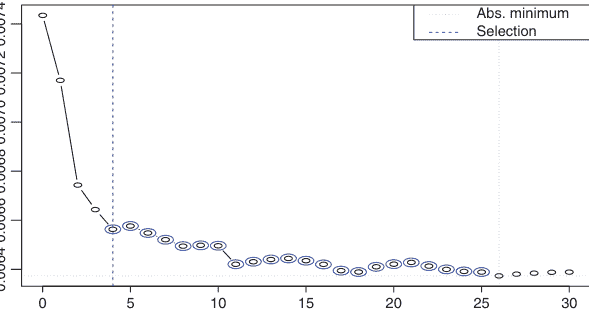

**Figure 7.20** 用于选择月度宏观经济数据集主成分数量的交叉验证残差均方误差。因变量是 IPI 的增长率，预测变量由所有变量的前六个滞后值组成。

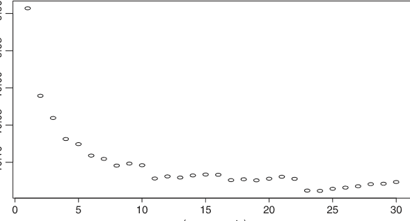

**Figure 7.21** 月度宏观经济数据集主成分数量与赤池信息量准则 (AIC) 的对比。因变量是 IPI 的增长率，预测变量由所有变量的前六个滞后值组成。

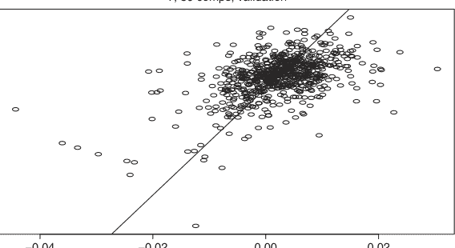

**Figure 7.22** 具有 30 个成分的宏观经济数据集 PCR 回归的交叉验证预测。因变量是 IPI 的增长率，预测变量由所有变量的前六个滞后值组成。

#### pls 包中 PCR 的 R 输出：输出已编辑。

```
> m1 <- read.csv("FREDMSApril19.csv",header=TRUE)
> c <- as.matrix(m1)
> Y <- x[7:710,6]
> X <- cbind(x[6:709,],x[5:708,],x[4:707,],x[3:706,],x[2:705,],x[1:704,])
> name <- paste("V",1:122,sep="") ### create names for predictors
> n1 <- paste(name,"L1",sep=""); n2 <- paste(name,"L2",sep="")
> n3 <- paste(name,"L3",sep=""); n4 <- paste(name,"L4",sep="")
> n5 <- paste(name,"L5",sep=""); n6 <- paste(name,"L6",sep="")
> colnames(X) <- c("n1",n2,n3,n4,n5,n6)
> X <- scale(X,center=TRUE,scale=TRUE) ### Standardize the predictors.
> require(pls)
> m2 <- pcr(Y~.,data=data.frame(X),ncomp=30,validation='CV')
> names(m2)
[1] "coefficients" "scores" "loadings" "Yloadings"
[5] "projection" "Xmeans" "Ymeans" "fitted.values"
[9] "residuals" "Xvar" "Xtotvar" "fit.time"
[13] "ncomp" "method" "call" "terms"
[17] "model"
> dim(m2$coefficients)
[1] 732 1 30
> dim(m2$scores)
[1] 704 30
> dim(m2$loadings)
[1] 732 30
> residuals <- m2$residuals[,1,]
> dim(residuals)
[1] 704 30
> mse <- apply(residuals^2,2,mean)
> npar <- c(1:30)
> aic <- log(mse)+2*npar/704
> which.min(aic)
24 comps
24
> plot(1:30,aic,xlab="n(components)",ylab="aic")
> selectNcomp(m2,"randomization",plot=TRUE)
[1] 4
> summary(m2)
Data: X dimension: 704 732
Y dimension: 704 1
Fit method: svdpc
Number of components considered: 30
VALIDATION: RMSEP
Cross-validated using 10 random segments.
(Intercept) 1 comps 2 comps 3 comps 4 comps 5 comps 6 comps
CV 0.007435 0.007125 0.006725 0.006635 0.006553 0.006572 0.006528
adjCV 0.007435 0.007124 0.006722 0.006632 0.006548 0.006569 0.006522
7 comps 8 comps 9 comps 10 comps 11 comps 12 comps 13 comps
CV 0.006541 0.006532 0.006551 0.006549 0.006480 0.006447 0.006443
adjCV 0.006547 0.006522 0.006546 0.006545 0.006455 0.006436 0.006430
14 comps 15 comps 16 comps 17 comps 18 comps 19 comps 20 comps
CV 0.006448 0.006455 0.006453 0.006417 0.006424 0.006413 0.006412
adjCV 0.006437 0.006448 0.006446 0.006406 0.006413 0.006401 0.006399
21 comps 22 comps 23 comps 24 comps 25 comps 26 comps 27 comps
CV 0.006421 0.006409 0.006373 0.006384 0.006397 0.006410 0.006418
adjCV 0.006414 0.006407 0.006345 0.006360 0.006375 0.006393 0.006400
28 comps 29 comps 30 comps
CV 0.006428 0.006441 0.006449
adjCV 0.006413 0.006423 0.006431

TRAINING: % variance explained
1 comps 2 comps 3 comps 4 comps 5 comps 6 comps 7 comps 8 comps
X 11.157 17.35 21.52 24.02 26.09 28.00 29.80 31.51
Y 8.589 18.96 21.57 23.98 24.71 26.07 26.61 27.48
9 comps 10 comps 11 comps 12 comps 13 comps 14 comps 15 comps
X 33.09 34.62 36.04 37.34 38.57 39.76 40.91
Y 27.48 27.85 29.32 29.33 29.64 29.64 29.75
16 comps 17 comps 18 comps 19 comps 20 comps 21 comps 22 comps
X 42.03 43.10 44.01 44.91 45.74 46.57 47.32
Y 29.97 30.67 30.79 31.08 31.13 31.14 31.53
23 comps 24 comps 25 comps 26 comps 27 comps 28 comps 29 comps
X 48.06 48.77 49.45 50.12 50.77 51.41 52.04
Y 32.80 33.01 33.02 33.10 33.17 33.17 33.32
30 comps
X 52.67
Y 33.36
> plot(m2,line=TRUE)
```

## 7.5 偏最小二乘法

偏最小二乘（PLS）回归由 H. Wold (1966) 提出，并在许多科学领域得到广泛应用，尤其是在计量化学（即计算化学）中。Geladi 和 Kowalski (1986) 提供了一个教程，Abdi (2003) 对 PLS 作了很好的介绍。Ng (2013) 从算法角度考察了 PLS。与 PCR 类似，PLS 也解决了 \(X'X\) 矩阵的奇异性问题，但它可以处理多元因变量。因此，在本节中，我们将 \(Y\) 视为一个 \(n \times m\) 数据矩阵。PLS 回归的目标是从 \(X\) 预测 \(Y\) 并描述它们的共同结构。对于熟悉多元统计分析的读者，PLS 可以被视为 \(Y\) 和 \(X\) 的典型相关分析与 PCR 之间的一种方法。与寻求正交变换以尽可能多地解释 \(X\) 方差的 PCR 不同，PLS 寻找与 \(Y\) 也相关的 \(X\) 的线性组合。具体而言，PLS 寻求一组线性变换，对 \(X\) 和 \(Y\) 进行同时分解，使得这些变换后的成分尽可能多地解释 \(X\) 和 \(Y\) 之间的协方差。从数学上讲，PLS 可表述如下：

\[
X = OP' + \eta, \tag{7.38}
\]
\[
Y = UQ' + E, \tag{7.39}
\]

其中 \(\eta\) 和 \(E\) 表示误差项，且可理解为它们可以为零。与 PCR 情况类似，\(O\) 和 \(U\) 是得分矩阵，\(P\) 和 \(Q\) 是载荷矩阵。P 随后考虑 \(U\) 与 \(O\) 之间的线性回归。PLS 的思想是执行等式 (7.38) 和 (7.39) 中的分解，以最大化 \(X\) 和 \(Y\) 之间的协方差。直观上，在执行分解时必须相互考虑彼此的信息。为了进一步了解，值得考虑等式 (7.34) 中 PCR 的谱分解。该分解可以通过一种称为 *非线性迭代偏最小二乘*（NIPALS）算法的迭代方法实现，该方法类似于用于获取正定矩阵特征值和特征向量的幂法。令 **_p_** 为等式 (7.34) 载荷矩阵 **_P_** 的一列，**_o_** 为其对应的得分向量。从特征值-特征向量分析中，我们有

\[
X'Xp = \lambda p
\]

令

\[
o = Xp
\]

我们有

\[
p = \frac{1}{\lambda} X'o
\]

### _X_ 的 NIPALS 算法：

- I. 初始化：令 **_o_** 为任意 _n_ 维向量，例如 _X_ 的任意一列。
- II. 令 $p = X'o / ||X'o||$，
- III. 更新 $o = Xp$，

其中 \(\|x\|\) 表示 _x_ 的欧几里得范数。迭代步骤 II 和步骤 III，直到 **_o_** 收敛。换句话说，算法从 **_o_** 的初始值开始，然后应用等式 (7.42) 更新 **_p_**，再使用等式 (7.41) 更新 **_o_**。当发生收敛时，得到第一个主成分 **_p_**<sub>1</sub> 及其相关得分 **_o_**<sub>1</sub>。要找到后续成分，令 $Y = X - o_1p'_1$ 并重复该算法。

该算法也适用于 _Y_ 的主成分分析，以获得等式 (7.39) 的得分矩阵 **_U_** 和载荷矩阵 **_Q_**。随后的问题是如何在 _X_ 和 _Y_ 之间相互获取信息以实现 PLS 的目标。一个简单的想法是在更新中交换 **_o_** 和 **_u_**。得到的 NIPALS 算法如下：

### NIPALS 算法：

- 1. 初始化：令 **_u_** 为任意起始向量，例如 **_u_** 为 _Y_ 的任意一列。
- 2. 循环：
  - * $p = X'u / ||X'u||$，
  - * $o = Xp$，
  - * $q = Y'o / ||Y'o||$，
  - * $u = Yq$。
- 3. 直到 **_o_** 收敛。

如果 _Y_ 是向量，可以设置 $q = 1$ 并省略循环的最后两个步骤。该算法给出第一组 PLS 成分和载荷。对于后续成分和载荷，我们定义

\[
X = X - op', \quad Y = Y - uq',
\]

并重复该算法。

经过 $r$ 次迭代后，我们得到两个 $n \times r$ 矩阵 $\mathbf{O}$ 和 $\mathbf{U}$ 以及两个载荷矩阵 $\mathbf{P}$ 和 $\mathbf{Q}$。然后通过线性回归将 $\mathbf{Y}$ 与 $\mathbf{X}$ 关联：

\[
\mathbf{U} = \mathbf{O}\boldsymbol{\beta} + \boldsymbol{\epsilon},
\]

其中 $\boldsymbol{\epsilon}$ 表示误差项。$\mathbf{Y}$ 的拟合值随后为

\[
\widehat{\mathbf{Y}} = \widehat{\mathbf{U}}\mathbf{Q}' = \mathbf{O}\widehat{\boldsymbol{\beta}}\mathbf{Q}' = \mathbf{X}\mathbf{P}\widehat{\boldsymbol{\beta}}\mathbf{Q}', \quad (7.43)
\]

其中使用了 PCA 的 $\mathbf{O} = \mathbf{XP}$。

为了了解 NIPALS 算法，请考虑

\[
\mathbf{p} = \mathbf{X}'\mathbf{u}/\|\mathbf{X}'\mathbf{u}\|
\]
\[
= \mathbf{X}'\mathbf{Y}\mathbf{q}/\|\mathbf{X}'\mathbf{Y}\mathbf{q}\|
\]
\[
= \mathbf{X}'\mathbf{Y}\mathbf{Y}'\mathbf{o}/\|\mathbf{X}'\mathbf{Y}\mathbf{Y}'\mathbf{o}\|
\]
\[
= \mathbf{X}'\mathbf{Y}\mathbf{Y}'\mathbf{X}\mathbf{p}/\|\mathbf{X}'\mathbf{Y}\mathbf{Y}'\mathbf{X}\mathbf{p}\|
\]
\[
= \frac{1}{\lambda}(\mathbf{Y}'\mathbf{X})'(\mathbf{Y}'\mathbf{X})\mathbf{p}. \quad (7.44)
\]

显然，$\mathbf{p}$ 是 $\mathbf{Y}'\mathbf{X}$ 的样本协方差矩阵的特征向量。等式 (7.44) 中的算法正是幂法中用于计算对称矩阵 $\mathbf{X}'\mathbf{Y}\mathbf{Y}'\mathbf{X}$ 最大特征值-特征向量的更新规则。

除了 NIPALS 算法外，还有其他可用于计算 PLS 回归的方法。例如，参见 de Jong (1993)。Helland (1990) 从预测角度对 PLS 进行了解释，当 $\mathbf{Y}$ 是标量因变量时，这很容易遵循。

### PLS 算法 1：（PLS1）

- 1. 定义 $\mathbf{X}$ 残差 $\boldsymbol{\eta}_0$ 和 $y$ 残差 $\mathbf{f}_0$ 的初始值：

\[
\boldsymbol{\eta}_0 = \mathbf{X} - \boldsymbol{\mu}_x,
\]
\[
\mathbf{f}_0 = \mathbf{Y} - \boldsymbol{\mu}_y,
\]

其中 $\boldsymbol{\mu}_X$ 表示由 $\mathbf{x}_t$ 的均值向量组成的矩阵，$\mu_y$ 是由因变量 $y_{t+h}$ 的均值组成的向量。换句话说，$\boldsymbol{\eta}_0$ 和 $\mathbf{f}_0$ 是均值调整后的 $\mathbf{X}$ 和 $\mathbf{Y}$。

对于 $i = 1, 2, \dots$，执行以下步骤 2 至 4：

- 2. 引入 $\mathbf{X}$ 得分 $\mathbf{o}_i$，作为 $\mathbf{X}$ 残差 $\boldsymbol{\eta}_{i-1}$ 的线性组合，使用 $\boldsymbol{\eta}_{i-1}$ 与 $\mathbf{f}_{i-1}$ 之间的协方差作为权重：

\[
\mathbf{o}_i = \boldsymbol{\eta}'_{i-1}\mathbf{w}_i, \quad \text{with } \mathbf{w}_i = \text{Cov}(\boldsymbol{\eta}_{i-1}, \mathbf{f}_{i-1}).
\]

- 3. 通过最小二乘法确定 $\mathbf{X}$ 载荷 $\mathbf{p}_i$ 和 $\mathbf{Y}$ 载荷 $\mathbf{q}_i$：

\[
\mathbf{p}_i = \text{Cov}(\boldsymbol{\eta}_{i-1}, \mathbf{o}_i)/\text{Var}(\mathbf{o}_i),
\]
\[
\mathbf{q}_i = \text{Cov}(\mathbf{f}_{i-1}, \mathbf{o}_i)/\text{Var}(\mathbf{o}_i).
\]

即，对 $\mathbf{o}_i$ 回归 $\boldsymbol{\eta}_{i-1}$ 和 $\mathbf{f}_{i-1}$ 以获得最小二乘估计。


### 4. 寻找新的残差：

```
\(\eta_i = \eta_{i-1} - o_i p'_i, \quad f_i = f_{i-1} - o_i q'_i.\)
```

从步骤 1 和 4 可以清楚地看出，该算法在每一步 m 都给出了两种表示

```
\(X = \mu_X + p_1 o'_1 + \cdots + p_m o'_m + \eta_m, \quad Y = \mu_Y + q_1 o'_1 + \cdots + q_m o'_m + f_m. \quad (7.45)\)
```

从最小二乘回归的性质来看，根据步骤 3 和 4 可以清楚地看出，残差 \(\eta_i\) 与 \(o_i\) 不相关，因此得分 \(o_1, \dots, o_m\) 也不相关。此外，可以证明权重 \(w_1, \dots, w_m\) 也不相关。从算法中也可以清楚地看出，**_Y_** 与残差 \(\eta_i\) 之间的线性依赖关系被用来构建得分 **_X_**，然后用于预测 **_Y_**。

最后，有多个 R 包可用于 PLS 回归。包 **pls** 和 **plsdepot** 提供 PLS 分析。**plsdof** 考虑 PLS 的自由度，**plsRglm** 给出广义线性模型的 PLS 分析，而 **plsVarSel** 提供 PLS 的变量选择。

### 示例 7.7

同样，考虑月度宏观数据集，以美国工业生产指数（IPI）的月度增长率作为因变量，所有变量的前六个滞后值作为预测变量，如我们在示例 7.5 和 7.6 中所做的那样。将 PLS 成分的最大数量设置为 30 并使用交叉验证，如果使用观测到的预测变量，则 PLS 回归为该数据选择 _m_ = 5。参见图 7.23。PLS 回归的摘要表明，使用 30 个成分时，模型解释了约 54% 的 IPI 增长率的方差。图 7.24 显示了带有 30 个成分的 PLS 的交叉验证预测。图中的直线表示目标线。该图显示，带有 30 个成分的 PLS 回归提供了合理的拟合。如果对 732 个预测变量进行标准化，带有交叉验证的 PLS 回归会选择一个 PLS 成分。

### PLS 的 R 演示：使用包 pls.

```
> da <- read.csv("FREMDApril19.csv",header=TRUE)
> x <- as.matrix(da)
> Y <- x[7:710,6]
> X <- cbind(x[6:709,],x[5:708,],x[4:707,],x[3:706,],x[2:705,],x[1:704,])
> name <- paste(name,"Y",1:122,sep="")
> n1 <- paste(name,"L1",sep="")
> n2 <- paste(name,"L2",sep="")
> n3 <- paste(name,"L3",sep="")
> n4 <- paste(name,"L4",sep="")
> n5 <- paste(name,"L5",sep="")
> n6 <- paste(name,"L6",sep="")
> colnames(X) <- c(n1,n2,n3,n4,n5,n6)
> require(pls)
> m.plsr <- plsr(Y~.,data=data.frame(X),ncomp=30,validation="CV")
```

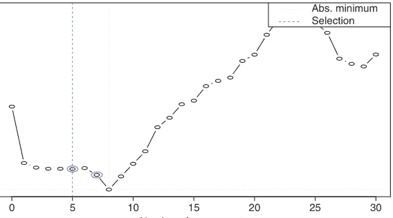

Figure 7.23 PLS 回归的交叉验证结果。因变量是 IPI 的增长率，预测变量由所有变量的前六个滞后值组成。

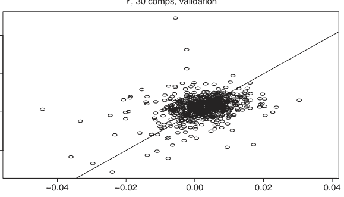

Figure 7.24 宏观数据集中带有 30 个成分的 PLS 回归的交叉验证预测。因变量是 IPI 的增长率，预测变量由所有变量的前六个滞后值组成。

```
> summary(m.plsr)
Data: X dimension: 704 732
Y dimension: 704 1
Fit method: kernelpls
Number of components considered: 30

VALIDATION: RMSEP
Cross-validated using 10 random segments.
(Intercept) 1 comps 2 comps 3 comps 4 comps 5 comps 6 comps
CV 0.007435 0.006880 0.006851 0.006842 0.006843 0.006837 0.006839
adjCV 0.007435 0.006874 0.006846 0.006837 0.006837 0.006832 0.006839
7 comps 8 comps 9 comps 10 comps 11 comps 12 comps 13 comps
CV       0.006778 0.006642 0.006754 0.006878 0.006935 0.007024 0.007057
adjCV    0.006775 0.006633 0.006724 0.006824 0.006873 0.006945 0.006978
14 comps 15 comps 16 comps 17 comps 18 comps 19 comps 20 comps
CV       0.007126 0.007145 0.007226 0.007299 0.007423 0.007653 0.007956
adjCV    0.007031 0.007041 0.007123 0.007195 0.007301 0.007506 0.007779
21 comps 22 comps 23 comps 24 comps 25 comps 26 comps 27 comps
CV       0.008149 0.008298 0.008255 0.008169 0.008145 0.008042 0.007974
adjCV    0.007962 0.008099 0.008053 0.007982 0.007963 0.007866 0.007796
28 comps 29 comps 30 comps
CV      0.007825 0.007891 0.007988
adjCV   0.007658 0.007724 0.007806

TRAINING: % variance explained
1 comps 2 comps 3 comps 4 comps 5 comps 6 comps 7 comps 8 comps
X      15.26   40.45   49.27   72.16   82.47   98.50   99.97   99.98
Y      16.32   17.08   17.43   17.44   17.48   17.69   19.77   26.04
9 comps 10 comps 11 comps 12 comps 13 comps 14 comps 15 comps
X      99.98   99.98   99.98   99.98   99.99   99.99   99.99
Y      31.61   35.26   36.85   38.88   39.81   41.43   42.81
16 comps 17 comps 18 comps 19 comps 20 comps 21 comps 22 comps
X      99.99   99.99   99.99   99.99   99.99   99.99   99.99
Y      43.50   44.18   45.48   46.61   47.43   48.05   48.63
23 comps 24 comps 25 comps 26 comps 27 comps 28 comps 29 comps
X      99.99   99.99   99.99   99.99   99.99   99.99   99.99
Y      49.38   49.94   50.65   51.37   52.14   52.80   53.28
30 comps
X      99.99
Y      53.97
plot(m.plsr,ncomp=30,asp=1,line=TRUE)
> selectNcomp(m.plsr,"randomization",plot=TRUE)
[1] 5
```

## 7.6 提升法

提升算法最初被提出作为集成方法，即结合多个模型（或方法）的预测以获得最优预测的方法。提升的基本思想是从调整后的数据生成多个预测，然后使用线性组合或多数投票将其聚合，以构建最终的估计器或预测。它类似于模型平均。关于提升的良好参考文献是 Bühlmann 和 van de Geer (2011, 第 12 章) 以及 Hastie 等人 (2009)。Friedman 等人 (2000) 和 Friedman (2001) 发展了一个更一般的统计框架，将提升直接解释为函数估计的统计方法。

给定数据 \(\{(\mathbf{x}_t, y_t) | t = 1, \dots, n\}\)，提升包含两个关键要素。第一个要素称为 *弱学习器*，这是一种易于计算的统计预测方法。弱学习器的示例包括简单回归树或简单线性回归。第二个要素是一种数据调整方法，其中要拟合的变量在每次迭代中进行调整，这种调整通常取决于弱学习器。考虑模型

```
\(y_t = f(\mathbf{x}_t) + \epsilon_t,\)  \(\text{(7.46)}\)
```

其中 \(\epsilon_t\) 是误差项，\(f(.)\) 是感兴趣的未知实值函数。提升算法的工作流程如下：

- 调整后的数据 1 \(\rightarrow\) weak learner \(\hat{f}^{(1)}(.)\)
- 调整后的数据 2 \(\rightarrow\) weak learner \(\hat{f}^{(2)}(.)\)
- \(\vdots \quad \vdots\)
- 调整后的数据 \(r\rightarrow\) weak learner \(\hat{f}^{(r)}(.)\)

其中 \(r\) 是预先指定的正整数。然后，聚合结果为

\(\text{聚合} : \hat{f}_A = \sum_{i=1}^r \alpha_i \hat{f}^{(i)}(.), \quad (7.47)\)

其中 \(\alpha_i\) 是合适的系数或权重。显然，弱学习器的选择、迭代次数以及权重 \(\alpha_i\) 的选择是提升在应用中发挥作用的重要问题。

从数学角度来看，为了估计方程 (7.46) 中的函数 \(f(.)\)，我们通常采用适当的损失函数，并在某个可测函数空间上对其进行最小化。即，

\(f_o(.) = \text{arg min}_{f \in S} E[L(f(X), y)] \quad (7.48)\)

其中 \(S\) 表示一个可测函数空间，\(L(f(.), y)\) 是一个假设对 \(f(.)\) 可微且凸的损失函数。对于平方误差损失，\(L(f(.), y) = (y - f(.))^2\)，相关的总体最小化器是 \(f_o(x) = E[Y|X=x]\)。

Friedman (2001) 提出了一种函数梯度下降（FGD）算法来估计 \(f(.)\)。该算法如下：

### FGD 算法：

- 1. 初始化 \(\hat{f}^{(0)}(.)\)，例如 \(\hat{f}^{(0)}(.) \equiv 0\) 或

\(\hat{f}^{(0)} = \text{arg min}_c \frac{1}{n} \sum_{i=1}^n L(c, y_i).\)

设置 \(r=0\)。

- 2. 将 \(r\) 增加 1，即 \(r \leftarrow r+1\)。通过计算负梯度 \(-\frac{dL(f,y)}{df}\) 并在 \(\hat{f}^{(r-1)}(x_t)\) 处对其求值来生成一组新的响应变量。即，计算

\(v_t = -\frac{\partial L(f, y_t)}{\partial f} |_{f=\hat{f}^{(r-1)}(x_t)}, \quad t=1, \dots, n.\)

- 3. 使用解释变量 \(x_1, \dots, x_n\) 通过弱学习器拟合新的响应变量 \(v_1, \dots, v_n\)，即

\((x_t, v_t) \rightarrow \text{弱学习器 } g^{(r)}(.).\)

- 4. 更新 \(\hat{f}^{(r)}(.) = \hat{f}^{(r-1)}(.) + \delta \times \hat{g}^{(r)}(.),\) 其中 \(0 < \delta \le 1\) 是步长参数。

- 5. 重复步骤 2 到 4，直到 \(r = r_o\)，其中 \(r_o\) 是预先指定的正整数。


对于独立数据，\( r_o \) 可通过 CV 选择。结果表明，\( r_o \) 的选择在上述 FGD 算法中很重要。另一方面，只要步长 \( \delta \) 很小，其选取并不关键。在以下内容中，我们关注 \( \ell_2 \) boosting，因为我们的主要关注点是预测。

### 7.6.1 \( \ell_2 \) Boosting

假设 Eq. (7.46) 中的函数 \( f(\mathbf{x}_t) \) 为线性，因此我们得到一个线性回归问题。此时 \( \ell_2 \) boosting 是一种有用的算法，特别是当 \( \mathbf{x}_t \) 的维度较大时。在这里，将平方误差损失函数修改为 \( L(f, y) = \frac{1}{2}(y - f)^2 \) 比较方便，其负梯度就是回归残差。将 FGD 算法应用于这个高维线性回归问题，我们得到以下 \( \ell_2 \) boosting 算法：

*\( \ell_2 \) Boosting 算法：*

- 1. 初始化 \( \hat{f}^{(0)}(.) = \bar{y} \) 并设置 \( r = 0 \)。
- 2. 将 \( r \) 增加 1。即，\( r \leftarrow r + 1 \)。计算残差
  \( v_t = y_t - \hat{f}^{(r-1)}(\mathbf{x}_t), \quad t = 1, \dots, n \)。
- 3. 使用弱学习器将残差 \( v_1, \dots, v_n \) 拟合到 \( \mathbf{x}_1, \dots, \mathbf{x}_n \)：
  \( (\mathbf{x}_t, v_t) \rightarrow_{\text{弱学习器}} \hat{g}^{(r)}(.) \)。
- 4. 更新 \( \hat{f}^{(r)}(.) = \hat{f}^{(r-1)}(.) + \delta \times \hat{g}^{(r)}(.) \)，其中 \( 0 < \delta \le 1 \)。
- 5. 重复步骤 2 到 4，直到 \( r = r_o \)，即预设的正整数迭代次数。

得到的估计量为

\(\hat{f}^{(r_o)}(.) = \delta \sum_{r=1}^{r_o} \hat{g}^{(r)}(.) + \hat{f}^{(0)}(.).\) (7.49)

因此，boosting 估计量 \( \hat{f}^{(r_o)}(.) \) 的性质由 \( \hat{g}^{(r)}(.) \) 的性质决定，而 \( \hat{g}^{(r)}(.) \) 是弱学习器的估计量。有必要讨论弱学习器的选择并研究 \( \hat{g}^{(r)}(.) \) 的性质。

### 7.6.2 弱学习器的选择

在选择弱学习器时，需要考虑的一个重要因素是计算的简便性。文献中已提出几种常用的弱学习器，包括用于（广义）线性模型的分量线性最小二乘法、用于加性模型的分量平滑样条，以及回归树或分类树。参见 Bühlmann 和 van de Geer (2011, 第 12 章)。这里我们使用分量线性最小二乘法。我们的数据集是 \(\{(\mathbf{x}_t, y_t)|t = 1, \dots, n\}\)，假设其满足通常的假设，例如独立性、同方差性和 \( E(y_t|\mathbf{x}_t) = \sum_{i=1}^k \beta_i x_{ti} \)。对于每次 boosting 迭代，数据集是 \(\{(x_t, v_t)|t = 1, \dots, n\}\)，\(\hat{g}^{(r)}(.)\) 由以下公式给出：

\(\hat{g}^{(r)}(x_t) = \hat{y}_{j_r} x_{j_t}, \quad \hat{y}_j = \frac{\sum_{t=1}^n x_{jt} v_t}{\sum_{t=1}^n x_{jt}^2}, \quad \hat{j}_r = \arg \min_{1 \le j \le k} \sum_{t=1}^n (v_t - \hat{y}_j x_{jt})^2. \quad (7.50)\)

换句话说，在每次迭代中，我们在简单线性回归框架内选择最佳预测器，并使用其系数估计值 \(\hat{y}_j\)。这与线性回归分析中变量选择的常规前向过程类似。

上述弱学习器的模型拟合为

\(\hat{f}^{(r)}(x_t) = \hat{f}^{(r-1)}(x_t) + \delta \times \hat{y}_{j_r} x_{t,j_r},\)

其中 \(\hat{j}_r\) 定义于 Eq. (7.50)。就系数估计而言，我们有

\(\hat{\beta}_j^{(r)} = \begin{cases} \hat{\beta}_j^{(r-1)} + \delta \times \hat{y}_{j_r}, & \text{if } j = \hat{j}_r, \\ \hat{\beta}_j^{(r-1)}, & \text{if } j \neq \hat{j}_r. \end{cases}\)

因此，在第 \( r \) 次迭代中，只有 \(\hat{j}_r\) 第个预测器的系数估计值会被更新。显然，使用分量线性最小二乘法弱学习器的 \( \ell_2 \) boosting 在每次 boosting 迭代 \( r \) 都会产生线性模型拟合。文献中已推导出此类用于高维线性回归的 \( \ell_2 \) boosting 算法的渐近一致性。例如，参见 Bühlmann 和 van de Geer (2011) 的定理 12.2。

Bai 和 Ng (2009) 将此算法应用于第 7.4 节中 PCR 和 DI 模型因子的选择。他们比较了两种通过 boosting 计算最终预测器的方法。在第一种情况中，他们将变量的滞后项视为其他任何变量，并使用简单回归来评估其预测。在第二种情况中，他们将所有滞后项一起考虑，并使用多元回归来计算其预测。他们的结果表明，这两种方法中哪种更好取决于未知的数据生成过程。

### 示例 7.8

R 中有多个可用于进行 boosting 的包。在我们的演示中，我们使用 **gbm** 包。**caret** 包也可用。这些包使用基于树的方法，将在下一章中讨论。这里只需说明，回归树由预测器空间的某些划分组成。划分是按顺序进行的，每个划分使用一个选定的预测器和一个阈值。变量和阈值的选择旨在最小化预测器空间每个子区域内残差平方误差之和。

为了说明 boosting，我们将 \( \ell_2 \) boosting 应用于示例 7.5-7.7 的月度宏观经济数据。由于这是一个回归问题，我们在 `gbm` 命令中使用子命令 `distribution='gaussian'`。首先，我们使用 10000 棵树，`interaction.depth`=1（这将树限制为只能进行一次分割），来建模 IPI 的增长率。此外，我们采用一个小的 \( \delta = 0.001 \)。使用五倍交叉验证，该算法进行了 9994 次迭代以达到最小 CV 误差 \( 6.50 \times 10^{-3} \)。

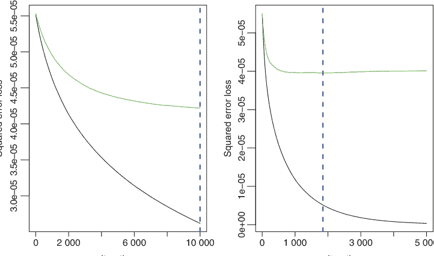

图 7.25 \( \ell_2 \) boosting 算法五倍交叉验证结果。数据由月度宏观经济变量组成。因变量是 IPI 的月度增长率，预测变量是所有可用的 122 个变量的滞后 1 到滞后 6 项。左图对应 10000 棵树且交互深度为 1，右图对应 5000 棵树且深度为 3。

请参见图 7.25 的左图。在 732 个预测变量中，boosting 算法识别出 485 个具有非零影响的变量。其次，我们使用 5000 棵树且 `interaction.depth`=3（这同样限制了树的大小）来建模 IP 增长率。使用的收缩率为 0.01。请参见图 7.25 的右图。在此特定情况下，CV 选择了 1848 次迭代，CV 误差为 \( 6.29 \times 10^{-3} \)。现在，在 732 个预测变量中，有 682 个变量具有非零影响。

最后，我们使用 SLBDD 包中的 `tsBoost` 命令，该命令使用简单线性回归作为弱学习器。使用 \( \delta = 0.01 \) 和 5000 次迭代，程序选择了 124 个预测变量。图 7.26 显示了 IPI 月度增长率及 \( \ell_2 \) boosting 拟合值的时间图。从图中可以看出，boosting 算法效果良好，因为它能很好地描述 IP 增长率的行为。图 7.27 显示了 IP 增长率的样本自相关性和 boosting 拟合的残差。显然，残差没有显著序列相关的迹象。在此特定应用中，如预期，简单线性回归似乎是弱学习器的一个良好选择。

### Boosting 的 R 演示：

```
> da <- read.csv("FREMDApril19.csv",header=TRUE)
> x <- as.matrix(da)
> Y <- x[7:710,6]
> X <- cbind(x[6:709,],x[5:708,],x[4:707,],x[3:706,],x[2:705,],x[1:704,])
> X1 <- scale(X,center=TRUE)
> require(gbm)
> gbm1 <- gbm(Y~,data=data.frame(X1),distribution="gaussian",
```

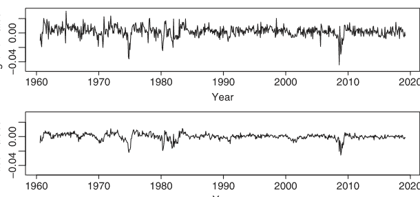

图 7.26 美国 IPI 月度增长率的时间图：上图是观测值，下图是使用简单线性回归、\( \delta = 0.01 \) 和 5000 次迭代的 \( \ell_2 \) boosting 拟合值。

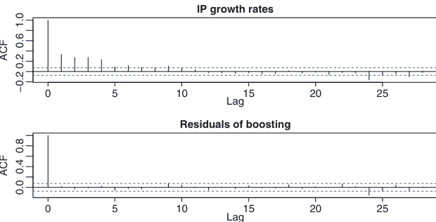

图 7.27 自相关函数 (ACF)：上图为美国 IPI 月度增长率，下图为使用 \( \delta = 0.01 \) 和 5000 次迭代的 \( \ell_2 \) boosting 的残差。

```
n.trees=10000,shrinkage=0.001,cv.folds=5)
> print(gbm1)
gbm(formula = Y ~ ., distribution = "gaussian", data = data.frame(X1),
    n.trees = 10000, shrinkage = 0.001, cv.folds = 5)
A gradient boosted model with gaussian loss function.
10000 iterations were performed.
The best CV iteration was 9994.
There were 732 predictors of which 485 had non-zero influence.
> sqrt(min(gbm1$cv.error))
[1] 0.006497476
> names(gbm1)
[1] "initF"                   "fit"                     "train.error"
[4] "valid.error"             "oobag.improve"           "trees"
[7] "c.splits"                "bag.fraction"            "distribution"
[10] "interaction.depth"       "n.minobsinnode"          "num.classes"
```


```
[13] "n.trees"        "nTrain"         "train.fraction"
[16] "response.name"  "shrinkage"      "var.levels"
[19] "var.monotone"   "var.names"      "var.type"
[22] "verbose"        "data"           "Terms"
[25] "cv.error"       "cv.folds"       "call"
[28] "m"              "cv.fitted"
>
> gbm2 <- gbm(Y~.,data=data.frame(X1),distribution="gaussian",
n.trees=5000,interaction.depth=3,shrinkage=0.01,cv.folds=5)
> print(gbm2)
gbm(formula = Y ~ ., distribution = "gaussian", data = data.frame(X1),
     n.trees = 5000, interaction.depth = 3, shrinkage = 0.01,
     cv.folds = 5)
A gradient boosted model with gaussian loss function.
5000 iterations were performed.
The best CV iteration was 1848.
There were 732 predictors of which 682 had non-zero influence.
> sqrt(min(gbm2$cv.error))
[1] 0.006286221
#SBoot command
> ml <- tsBoost(Y,X,v=0.01,m=5000) #Original X.
L2 boosting via simple linear regression:
Both Y and X are mean-adjusted.
v and m:  0.01 5000
number of predictors selected and number of predictors:  124 732
> names(ml)
[1] "beta"       "residuals"  "m"          "v"          "selection"  "count"
[7] "yhat"
> tdx <- c(1:710)/12+1960
> tdx <- tdx[7:710]
> par(mfcol=c(2,1))
> range(Y)
> plot(tdx,Y,xlab="year",ylab="IP growth rates",type="l",
ylim=c(-0.05,0.031))
> plot(tdx,ml$yhat,xlab="year",ylab="Fitted Values",type="l",
ylim=c(-0.05,0.031))
> acf(Y,main="IP growth rates")
> acf(ml$residuals,main="Residuals of Boosting")
```

### 7.6.3 用于分类的 Boosting

Boosting 的首个应用是使用 Freund 和 Schapire (1996, 1997) 的 AdaBoost 算法进行二元分类。

在统计文献中，Breiman (1998, 1999) 表明 AdaBoost 算法可以表示为函数空间中的最速下降算法。

如第 5 章所述，给定 n 个元素的集合和每个元素的分类变量向量 x，分类器是一个函数 C(x)，它为每个元素分配一个值 C(x_i) \in {-1,1}，其中 1 \le i \le n。

假设我们有一个向量 y = (y_1, ..., y_n)'，其中 y_i \in {-1,1} 为正确分类值，则分类器 C(x) 的误差率由下式给出

\[\text{Err} = \frac{1}{n} \sum_{i=1}^n I(C(\boldsymbol{x}_i) \neq y_i) \quad (7.51)\]

其中 I(x) 是指示函数，即若 x 为真则 I(x) = 1，否则 I(x) = 0。

假设我们选择一个非常简单的分类器，例如 m 最近邻，或者更好的选择，下一章将要研究的分类树。令 \( C(\mathbf{x}) \) 为所选的弱分类器。那么，AdaBoost 算法的工作过程如下：

- 设置权重 \( w_i^{(1)} = 1/n \)。
- 对 \( l = 1, \dots, L \)
  - 使用权重 \( w_i^{(l)} \) 将分类器 \( C_l(\mathbf{x}) \) 拟合到数据上。
  - 使用权重 \( w_i^{(l)} \) 计算误差率，

    \[\text{Err}_l = \frac{\sum_{i=1}^n w_i^{(l)} I(C_l(\mathbf{x}_i) \neq y_i)}{\sum_{i=1}^n w_i^{(l)}}\] (7.52)

  - 计算

    \[\alpha_l = \log((1 - \text{Err}_l) / \text{Err}_l)\] (7.53)

  - 按如下方式修改权重

    \[ w_i^{(l+1)} = w_i^{(l)} \exp\{ \alpha_l I(C_l(\mathbf{x}_i) \neq y_i) \}\] (7.54)

- 最终分类如下

  \[ C(\mathbf{x}_i) = \text{sign} \left[ \sum_{l=1}^L \alpha_l C_l(\mathbf{x}_i) \right] \] (7.55)

请注意，根据公式 (7.54)，每次迭代中每个观测值的权重都会被修改。如果该元素被正确分类，则权重保持不变，\( w_i^{(l+1)} = w_i^{(l)} \)。如果分类错误，则其权重增加为 \( w_i^{(l+1)} = w_i^{(l)} \exp\{ \alpha_l \} \)。因此，正确分类观测值的相对权重降低，而错误分类观测值的相对权重升高。权重的变化取决于 \( \alpha_l \)，即成功率与误差率之比的 logit，参见公式 (7.53)，它是最终解中分类器的权重。图 7.28 显示了分类器误差率与其权重之间的关系。最后，最终分类器是所有分类器的线性组合。在第 8 章中，我们将看到一个使用分类树作为弱分类器的 AdaBoost 示例。

## 7.7 混合频率数据与实时预测

数据丰富的环境也导致了不同频率观测数据广泛可用的情况。例如，考虑预测美国 GDP 季度增长率的问题。有许多可用的月度或周度经济数据可能对美国 GDP 增长有贡献。例如，月度失业率和周度（甚至日度）原油价格可能会影响美国经济，进而影响其 GDP 增长。那么问题就在于如何利用高频数据中蕴含的信息来辅助 GDP 的预测。可以将月度或周度经济数据汇总为季度数据，并使用季度汇总数据来预测 GDP。但汇总往往会因中心极限定理的影响而导致信息丢失。确实，季度数据比其周度或日度对应数据更接近正态分布。因此，直接使用可用的月度或周度数据来辅助季度 GDP 预测似乎是明智的。这种预测问题在计量经济学文献中通常被称为 MIDAS 方法。参见，例如，Andreou et al. (2010)。MIDAS 预测方法特别感兴趣的是使用新可用的高频数据来更新对较低频率因变量的预测。例如，在季度预测起点 t = n 时，可以使用合适的计量经济模型来预测季度 t = n + 1 的 GDP 增长率。这与传统的 1 步先行预测类似。然而，随着时间的推移，例如进入季度 t = n + 1 后的一个月，月度预测变量即可获得。然后可以使用混合频率模型来更新 GDP 预测。这种更新程序在文献中称为 nowcasting。在以下内容中，我们将简要介绍可用于 nowcasting 的 MIDAS 回归和计量经济模型。

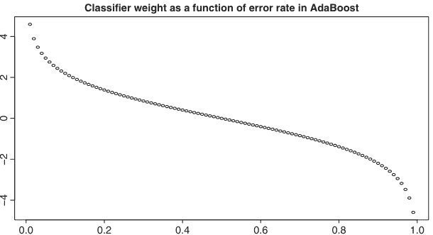

图 7.28 AdaBoost 最终分类器中分类器误差率与其权重之间的关系。

### 7.7.1 MIDAS 回归

要介绍 MIDAS 回归，我们考虑较低频率因变量 \( y_t \) 与单个高预测变量 \( x_{t,j}^{(g)} \) 的简单情况，其中 \( g > 1 \) 是正整数，表示 \( t \) 与 \( t-1 \) 之间预测变量的观测次数，且 \( j = 1, \dots, g \)。例如，如果时间索引 \( t \) 表示季度，则月度变量的 \( g = 3 \)，而日度变量的 \( g = 91 \) 或 \( 66 \)，假设一个月平均有 30.4 天或 22 个交易日。图 7.29 绘制了观测数据的大致时间戳，时间从左向右流逝，\( y(t) \) 是因变量，\( x(t, j) \) 是预测变量。为了记号简洁，在本节中我们将时间序列的下标 \( i \) 视为观测序列的纯索引。可以理解的是，对于低频因变量 \( y_t \)，索引 \( i \) 与时间 \( t \) 相同，但对于高频预测变量 \( x_{t,j} \)，索引 \( i \) 由 \( i = (t-1)g + j = tg - (g-j) \) 给出，这是时间段 \( t \) 中的第 \( j \) 次观测。为了说明，假设 \( y_t \) 为季度数据，\( x_{t,j} \) 为月度数据，且可用数据始于 1980 年。那么，\( y_1 \) 和 \( y_2 \) 分别是 \( y_t \) 在 1980 年第一和第二季度的数据。另一方面，\( x_1 \) 和 \( x_4 \) 分别是 \( x_{t,j} \) 在 1980 年第一和第四个月的数据，其中 \( 4 = (t-1) \times 3 + 1 \) 且 \( t = 2 \)。

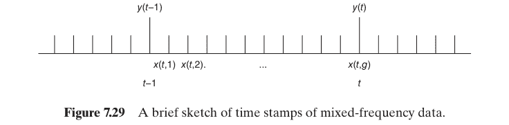

在预测起点 \( t-1 \) 处，混合频率数据的一个朴素模型可以采用如下形式

$y_i = \phi_0 + \sum_{j=1}^p \phi_j y_{i-j} + \sum_{v=1}^q \beta_v \left[ \sum_{j=1}^g w_j x_{(i-1)g-(g-j)} \right] + e_i, \quad (7.56)$

其中 \( p \) 和 \( q \) 为正整数，\( e_i \) 表示误差项。在公式 (7.56) 中，\( \phi_j \) 为 AR 参数，\( \beta_v \) 衡量 \( \{x_{t-i\cdot j}|j=1, ..., g\} \) 的汇总对 \( y_t \) 的影响，\( w_j \) 为权重，假设满足条件 \( 0 \le w_j < 1 \) 和 \( \sum_{j=1}^g w_j = 1 \)。特别是，如果 \( w_j = w \)（非零常数），则采用简单汇总来处理预测变量。当存在许多具有较大 \( g \) 的高频预测变量时，公式 (7.56) 中的模型将使用许多权重系数 \( w_j \)，使得模型难以估计且效率低下。Andreou et al. (2010) 假设权重 \( w_j \) 遵循某些仅由少量参数驱动的众所周知函数，例如指数 Almon 滞后多项式。例如，

$w_j \equiv w_j(\theta_1, \theta_2) = \frac{\exp[\theta_1 j + \theta_2 j^2]}{\sum_{i=1}^g \exp[\theta_1 i + \theta_2 i^2]},$

其中 \( \theta_1 \) 和 \( \theta_2 \) 为底层未知参数。这里定义的权重 \( w_j \) 使得当预测变量远离 \( y_t \) 时权重平滑衰减。也可以使用其他权重函数。Ghysels et al. (2016) 提供了一些权重函数的选择。MIDAS 回归的关键思想是采用一个权重函数，从而为 \( y_t \) 得到一个简洁的回归模型。

在指定权重函数 \( w_j \) 后，公式 (7.56) 中的 MIDAS 回归模型可以通过非线性最小二乘法估计。该模型的一些性质在 Andreou et al. (2010) 中给出。

### 7.7.2 实时预测

公式 (7.56) 中的 MIDAS 回归模型遵循使用时间 \( t-1 \) 时可用信息来预测 \( y_t \) 的传统。这种预测可以看作是


初始预测。有了高频数据 $\{x_{t,j}\}$ 的可用性，可以利用新可用的信息来更新 $y_t$ 的预测。这种预测更新方法被称为 *即时预测*，因为预测中使用了当前时间段 $t$ 的一些信息。

同样，我们使用单一因变量和单一高频预测变量 $\{x_{t,j}|j = 1, ..., g\}$ 来介绍即时预测。考虑季度 $t$ 中已进行 $j_o$ 的情况，其中 $1 \le j_o < g$。即时预测回归可采取以下形式

```
$y_i = \phi_0 + \sum_{j=1}^p \phi_j y_{i-j} + \sum_{v=1}^q \beta_v \left[ \sum_{j=1}^g w_j x_{(i-v)g-(g-j)} \right] + \sum_{j=1}^{j_o} \gamma_j x_{ig-(g-j)} + e_i, \quad (7.57)$
```

其中除新增预测变量 $x_{i,j}$ 的参数外，所有参数均在 Eq. (7.56) 中定义，$\gamma_j$ 表示在存在所有其他预测变量的情况下 $x_{i,j}$ 对 $y_i$ 的条件贡献。如果 $j_o$ 较大，则 $\gamma_j$ 可能遵循与 Eq. (7.56) 中使用的某些权重函数相似。换言之，即时预测的另一种模型是

```
$y_i = \phi_0 + \sum_{j=1}^p \phi_j y_{i-j} + \sum_{v=1}^q \beta_v \left[ \sum_{j=1}^g w_j x_{(i-v)g-(g-j)} \right] + \gamma \sum_{j=1}^{j_o} v_j x_{ig-(g-j)} + e_i, \quad (7.58)$
```

其中 $v_j$ 是用于聚合时间段 $t$ 中预测变量 $\{x_{t,j}|j = 1, ..., j_o\}$ 的权重。

显然，当高频预测变量可用时，即时预测的想法适用于大多数统计预测模型。例如，不使用 MIDAS 回归的权重函数，可以将模型视为带外生变量的高维 AR 模型，并使用之前讨论过的某些正则化估计方法（例如 Lasso 方法）来估计该模型。

MIDAS 回归可通过 R 中的 *midasr* 包使用。该包也可用于计算 Almon 滞后多项式的权重。有关该包的详细信息可参见 Ghysels et al. (2016)。

### 示例 7.9

为了说明 MIDAS 回归，我们考虑美国季度 GDP 从 1986 年第一季度到 2019 年第二季度的增长率。使用的两个高频预测变量是 (a) 月度失业率变化，($x_{t,i}|i=1, 2, 3$)，以及 (b) 每周原油价格（西得克萨斯中间基原油，俄克拉荷马州库欣）的变化，($z_{t,i}|i=1, ..., 12$)。因此，我们有一个月度外生预测变量和一个每周外生预测变量。对于 Eq. (7.56) 的预测模型，AR 部分使用 $p=2$，失业率使用 $q=2$，原油价格使用 $q=4$。此外，我们使用指数 Almon 滞后多项式（*midasr* 中的 *nealmon* 命令）作为权重函数。对于月度失业率，使用的滞后为 3-5，对于每周原油价格，使用的滞后为 12-23。这些滞后涵盖了季度中的高频预测变量。此类 MIDAS 回归使用的 R 命令和相关输出如下所示于 R 演示中。在此特定情况下，输出显示高频预测变量的条件贡献不强。

转向即时预测。考虑了两种情况。在第一种情况中，我们使用季度内一个月的高频数据。在这里，失业率使用 $q=2$，原油价格使用 q = 3。命令的详细信息和相关输出也在下面的 R 演示中给出。有趣的是，对于两个高频预测变量，并发值（即 unrate11 和 coilchg11）在常规 5% 水平上显著。在第二种情况中，我们使用季度内两个月的高频数据。结果与一个月的情况相似，因为并发高频数据有助于解释美国季度 GDP 增长率。

### R 演示：MIDAS 回归。R 脚本由罗格斯大学的 Han Yuefeng 博士提供。

#### (A) 用于预测的 MIDAS 回归。

- (1) R 脚本

```
gdp8619<-read.csv("q-gdp8619.csv", header = TRUE)
gdp<-gdp8619$A191RP1Q027SBEA
unrate8619d.csv<-read.csv("m-unrate8619d.csv", header = TRUE)
unrate<-unrate8619d.csv$ratechg
coilchg.csv<-read.csv("w-coilchg.csv", header = TRUE)
coilchg<-coilchg.csv$coilchg
library(midasr)
t=2 # time lag for gdp
t1=3 # time lag for unrate
t2=12 # time lag for crude oil price
fit<-midas_r(gdp~mls(gdp,1:t,1)+mls(unrate,3:(t1+2),3,nealmon)+
mls(coilchg,12:(t2+11),12,nealmon),
start=list(unrate=c(-1,-1),coilchg=rep(0,4)),
#aggregation within a quarter 2 and 4
method="Nelder-Mead")
#print(fit); print(summary(fit))
```

- (2) 输出

```
> names(fit)
[1] "coefficients"   "midas_coefficients" "model"
[4] "unrestricted"   "term_info"      "fn0"
[7] "rhs"            "gen_midas_coef" "opt"
[10] "argmap_opt"     "start_opt"      "start_list"
[13] "call"           "terms"          "gradient"
[16] "hessian"        "gradD"          "Zenv"
[19] "use_gradient"   "nobs"           "tau"
[22] "lhs"            "lhs_start"      "lhs_end"
[25] "convergence"    "fitted.values"  "residuals"
> summary(fit)
```

带有 "numeric" 数据的 MIDAS 回归模型：
起始 = 3，结束 = 133

```
Formula gdp ~ mls(gdp,1:t,1)+mls(unrate,3:(t1+2),3,nealmon) +
mls(coilchg, 12:(t2 + 11), 12, nealmon)
```

参数：

| 估计值 | 标准误 | t 值 | Pr(>|t|) |
|---|---|---|---|
| (截距) | 2.03136 | 0.51532 | 3.942 | 0.000135 *** |
| gdp1 | 0.34660 | 0.10876 | 3.187 | 0.001826 ** |
| gdp2 | 0.23341 | 0.10295 | 2.267 | 0.025131 * |
| unrate1 | -0.96387 | 3.29969 | -0.292 | 0.770700 |
| unrate2 | 1.18138 | 7.07705 | 0.167 | 0.867700 |
| coilchg1 | 0.52039 | 0.34126 | 1.525 | 0.129871 |
| coilchg2 | 2.07281 | 5.64456 | 0.367 | 0.714089 |
| coilchg3 | -0.29348 | 0.93787 | -0.313 | 0.754873 |
| coilchg4 | 0.01082 | 0.05004 | 0.216 | 0.829154 |

残差标准误：2.316，自由度 122

#### (B) 即时预测：一个月

- (1) R 脚本

```
t=2 # time lag for gdp
t1=3+1 # time lag for unrate
t2=12+4 # time lag for crude oil price
gdp1=c(NA,gdp)
unrate1=c(0,0,unrate,0)
coilchg1=c(rep(0,8),coilchg,rep(0,4))
```

```
fit1<-midas_r(gdp1~mls(gdp1,1:t,1)+mls(unrate1,3:(t1+2),3,nealmon)+
mls(coilchg1,12:(t2+11),12,nealmon),
start=list(unrate1=c(1,-1),coilchg1=rep(0,3)),
method="Nelder-Mead")
#print(fit1); print(summary(fit1))
```

- (2) 输出

```
> fit1

MIDAS regression model with "numeric" data:
Start = 4, End = 134

model: gdp1 ~ mls(gdp1,1:t,1)+mls(unrate1,3:(t1+2),3,nealmon) +
mls(coilchg1, 12:(t2 + 11), 12, nealmon)
(Intercept) gdp11 gdp12 unrate11 unrate12 coilchg11 coilchg12 coilchg13
2.4596 0.3081 0.184 -4.2635 -3.6072 0.7236 0.7873 -0.2933
```

用于拟合的函数为 optim
> summary(fit1)

```
MIDAS regression model with "numeric" data:
Start = 4, End = 134

Formula gdp1 ~ mls(gdp1,1:t,1)+mls(unrate1,3:(t1+2),3,nealmon) +
mls(coilchg1, 12:(t2 + 11), 12, nealmon)

Parameters:
              Estimate Std. Error t value Pr(>|t|)
(Intercept)   2.45959   0.32542   7.558 8.12e-12 ***
gdp11         0.30808   0.08904   3.460 0.000743 ***
gdp12         0.18353   0.09137   2.009 0.046755 *
unrate11     -4.26354   1.75713  -2.426 0.016699 *
unrate12     -3.60720  11.36851  -0.317 0.751556
coilchg11    0.72356   0.09164   7.895 1.37e-12 ***
coilchg12    0.78727   1.47175   0.535 0.593670
coilchg13   -0.29329   0.31563  -0.929 0.354588
```

残差标准误：1.963，自由度 123

#### (C) 即时预测：2 个月

- (1) R 脚本

```
t=2 # time lag for gdp
t1=3+2 # time lag for unrate
t2=12+8 # time lag for crude oil price
gdp2=c(NA,gdp)
unrate2=c(0,unrate,0,0)
coilchg2=c(rep(0,4),coilchg,rep(0,8))
```

```
fit2<-midas_r(gdp2~mls(gdp2,1:t,1)+mls(unrate2,3:(t1+2),3,nealmon)+
mls(coilchg2,12:(t2+11),12,nealmon),
start=list(unrate2=c(1,-1),coilchg2=rep(0,3)),
method="Nelder-Mead")
#print(fit2); print(summary(fit2))
```

- (2) 输出

```
> fit2

MIDAS regression model with "numeric" data:
Start = 4, End = 134

model: gdp2 ~ mls(gdp2, 1:t, 1)+mls(unrate2, 3:(t1+2),3,nealmon) +
mls(coilchg2, 12:(t2 + 11), 12, nealmon)
(Intercept) gdp21 gdp22 unrate21 unrate22 coilchg21 coilchg22 coilchg23
2.8584 0.2575 0.1835 -8.3487 -0.7293 0.7542 3.3481 -0.2915
```

用于拟合的函数为 optim
> summary(fit2)

```
MIDAS regression model with "numeric" data:
Start = 4, End = 134
Formula gdp2 ~ mls(gdp2, 1:t, 1)+mls(unrate2,3:(t1+2),3,nealmon) +
mls(coilchg2, 12:(t2 + 11), 12, nealmon)

Parameters:
              Estimate Std. Error t value Pr(>|t|)
(Intercept)   2.85839   0.44802   6.380 3.26e-09 ***
gdp21         0.25755   0.08463   3.043 0.002863 **
gdp22         0.18347   0.08676   2.115 0.036469 *
unrate21     -8.34869   2.28870  -3.648 0.000389 ***
unrate22     -0.72935   0.41003  -1.779 0.077747.
coilchg21     0.75425   0.16080   4.691 7.12e-06 ***
coilchg22     3.34811   2.95422   1.133 0.259280
coilchg23    -0.29153   0.25830  -1.129 0.261242
```

残差标准误：2.019，自由度 123

### 示例 7.10

为了展示使用高频数据改善对感兴趣低频变量预测的效果，我们考虑一个简单的应用。图 7.30 显示了 2006 年 1 月 1 日至 2015 年 12 月 31 日台湾高雄市某监测站每日最大 PM2.5 测量值的平方根变换的时间图。数据可在文件 TaiwanPM25.csv（监测站 1）中获取，为简单起见，2 月 29 日的数据已被删除。从图中可以看出，如预期，存在明显的年度周期。我们采用平方根变换是因为每日最大 PM2.5 服从非高斯分布。我们保留最后两年作为预测子样本，我们的目标是证明，使用前几个小时的 PM2.5 测量值可以显著提高对 $y_t$ 的预测，相比于仅使用 $y_t$ 滞后值作为预测变量的 AR 模型。


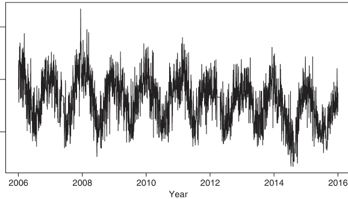

图 7.30 2006 年 1 月 1 日至 2015 年 12 月 31 日台湾高雄市某监测站每日最大 PM$_{2.5}$ 测量值平方根变换的时间序列图。2 月 29 日的数据已被删除。

具体而言，我们将数据分为估计子样本和预测子样本，预测子样本包含最后 730 个观测值。估计子样本有 2920 个数据点。AIC 为 $y_t$ 选择了 AR(22) 模型，该模型确实拟合了数据。参见图 7.31 所示的模型检验统计量。例如，残差 Q-统计量未能拒绝残差中不存在序列相关性的原假设。

对于即时预测（nowcasting），我们采用以下模型

```
$y_t = \phi_0 + \sum_{i=1}^{22} \phi_i y_{t-i} + \sum_{j=1}^{q} \beta_j x_{t,j} + \epsilon_t,$ (7.59)
```

其中 $q = 1, ..., 6$，$x_{t,j}$ 表示每日第 $j$ 小时观测到的 PM$_{2.5}$ 的平方根变换。$q$ 的最大值为 6，表示可以在每天早晨 6 点更新 $y_t$ 的预测。模型 Eq. (7.59) 是一个简单的 ARX 模型，非常容易估计。表 7.2 总结了样本外预测的结果，其中 AR(22) 作为比较基准，AR(22)+q 表示即时预测中使用了前 q 个小时的数据。从表中可以清楚地看出，在即时预测中使用每小时数据确实相对于基准在样本外预测中提供了改进。本示例的 R 脚本如下。

#### 示例 7.10 的 R 脚本：

```
da <- read.csv("TaiwanPM25.csv",header=TRUE)
st1 <- sqrt(da[,4]) # Square-root transformation
y <- NULL; X <- NULL# Find daily maximum and first 6 hours data
for (i in 1:3650){
ist <- (i-1)*24+1
iend <- i*24
y <- c(y,max(st1[ist:iend]))
```

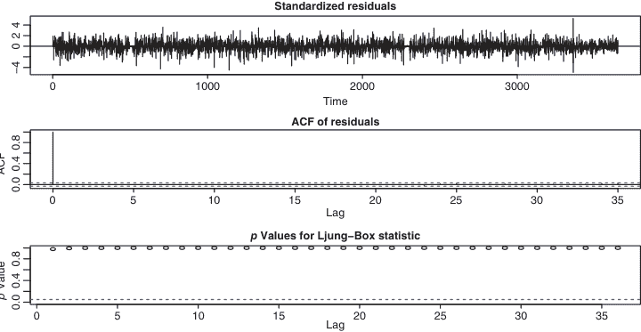

图 7.31 2006 年 1 月 1 日至 2015 年 12 月 31 日台湾高雄市某监测站每日最大 PM$_{2.5}$ 测量值平方根变换的标量 AR(22) 模型检验。2 月 29 日的数据已被删除。

#### 表 7.2 高雄市某站每日最大 PM$_{2.5}$ 平方根变换的样本外预测汇总统计量

| 模型 | 偏差 | RMSE | MAE |
|---|---|---|---|
| AR(22)+0 | −0.0991 | 1.145 | 0.886 |
| AR(22)+1 | 0.0778 | 1.015 | 0.783 |
| AR(22)+2 | 0.0135 | 0.985 | 0.760 |
| AR(22)+3 | −0.0319 | 0.949 | 0.731 |
| AR(22)+4 | −0.0045 | 0.917 | 0.697 |
| AR(22)+5 | 0.0096 | 0.913 | 0.693 |
| AR(22)+6 | −0.0050 | 0.884 | 0.683 |

在表中，AR(22)+q 表示即时预测中使用了前 q 个小时的数据，Bias、RMSE 和 MAE 分别是平均偏差、均方根预测误差和平均绝对预测误差。

```
X <- rbind(X, st1[ist:(ist+5)])
}
m1 <- ar(y)
p <- m1$order
p
ist <- p+1
nT <- 3650
Y <- y[ist:nT]
Z <- NULL
for (i in 1:p) {
Z <- cbind(Z, y[(ist-i):(nT-i)])
}
nobe <- nT-p
nfit <- nobe-730
Zfit <- Z[1:nfit,]
Yfit <- Y[1:nfit]
Ztest <- Z[(nfit+1):nobe,]
Ytest <- Y[(nfit+1):nobe]
m2 <- lm(Yfit~.,data=data.frame(Zfit)) #AR(22) model
pm2 <- predict(m2,newdata=data.frame(Ztest))
s1 <- mean(Ytest-pm2)
s2 <- sqrt(mean((Ytest-pm2)^2))
s3 <- mean(abs(Ytest-pm2))
M <- c(s1,s2,s3)
#### select the corresponding time period.
X1 <- X[ist:nT,] # Nowcasting
for (i in 1:6) {
Zfitnow <- cbind(Zfit,X1[1:nfit,1:i])
Ztestnow <- cbind(Ztest,X1[(nfit+1):nobe,1:i])
m3 <- lm(Yfit~.,data=data.frame(Zfitnow))
pm3 <- predict(m3,newdata=data.frame(Ztestnow))
s1 <- mean(Ytest-pm3)
s2 <- sqrt(mean((Ytest-pm3)^2))
s3 <- mean(abs(Ytest-pm3))
M <- rbind(M,c(s1,s2,s3))
}
print(M)
```

## 7.8 强序列依赖

本章讨论的大多数方法在数据存在强序列相关性的情况下可能失效。例如，参见第 7.1 节关于 Lasso 的讨论以及第 7.3 节中的条件。当存在强序列依赖时必须谨慎处理。但是，如果数据维度较高，处理强序列相关性并没有唯一方法。事实上，当数据具有强时相依赖性时，关于正则化估计性质的许多重要问题仍然悬而未决。理想情况下，基于可用的理论依据，人们希望将具有强序列依赖性的观测数据转换为具有短程依赖性的观测数据，以便本章讨论的方法可加以应用。对于多元时间序列，第 3 章讨论的协整方法和第 6 章的动态因子模型可能有用。然而，在 HDTS 分析中如何分析协整过程仍在研究中。在本节中，我们考虑了两种处理强序列依赖下 HDTS 的方法。第一种方法是对观测序列拟合带有一定正则化的 VAR(1) 模型，然后在后续分析中使用残差。只要任何单位根的重数为一，这种方法应该能够合理地工作。事实上，大多数宏观经济时间序列都是 I(1) 过程，即它们具有一个单位根。我们注意到，通常不是对个别时间序列进行差分以实现边际平稳的好主意，因为如第 3 章所讨论，这可能导致过度差分，进而引入不可逆时间序列。第二种方法是对所使用的任何统计模型进行残差分析。有限经验表明，欠差分和过度差分都容易导致残差中的序列相关性。因此，适当的残差分析可以检测强序列依赖的错误处理。

最后，一些关于高维单位根时间序列建模的最新研究包括 Zhang et al. (2019)，他们通过特征值分析研究识别协整，以及 Gao and Tsay (2020)，他们研究高维单位根时间序列建模。

## 练习

- 1. 考虑第 7.3 节中使用的月度宏观经济数据集。感兴趣的因变量是通胀，即所有项目消费者价格指数 CPIAUCSL。预测变量包括所有 122 个可用变量的前 6 个滞后值。对数据执行 Lasso 线性回归分析，包括系数图和交叉验证（CV）图。使用 CV 选择最佳惩罚参数。绘制 Lasso 回归得到的估计系数 \(\hat{\beta}_i\)。
- 2. 重复问题 1 的分析，但使用带有 \(\alpha = 0.75\) 的 glmnet。
- 3. 再次考虑问题 1 中的月度宏观经济数据集。应用组 Lasso，方法是将 (a) CPIAUCSL 的滞后预测变量作为第 1 组，(b) 具有相同滞后的其他变量的预测变量构成一组。
- 4. 再次考虑问题 1 中的月度宏观经济数据集。对该问题应用提升法，使用子命令 `n.trees = 10000` 和 shrinkage = 0.001。
- 5. 考虑数据文件 `TaiwanPM25.csv` 中站点 2（第 5 列）的每小时 PM$_{2.5}$ 测量值。得到每日最大 PM$_{2.5}$ 平方根变换的序列 $y_t$。将最后两年保留为预测子样本。（a）对 $y_t$ 序列考虑标量 AR 模型。计算 AR 模型 1 步先行预测的均方根误差。（b）将每日前六个小时的 PM$_{2.5}$ 添加到预测变量中。使用即时预测计算 1 步先行预测的均方根误差。在这种情况下即时预测有帮助吗？为什么？

## 参考文献

Abdi, H. (2003). 偏最小二乘（pls）回归。载于 M. Lewis-Beck, A. Bryman, 和 T. Futing（编）。社会科学研究方法百科全书。Sage，千橡市，CA。

Andreou, E., Ghysels, E., and Kourtellos, A. (2010). 具有混合采样频率的回归模型。计量经济学期刊，158: 246–261。

Bai, J. and Ng, S. (2008). 使用目标预测变量预测经济时间序列。计量经济学期刊，146: 304–317。

Bai, J. and Ng, S. (2009). 扩散指数的提升法。应用计量经济学期刊，24: 607–629。

Bartlett, P., Mendelson, S., and Neeman, J. (2012). \(\ell_1\) 正则化线性回归：持久性和神谕不等式。概率理论与相关领域，152: 193–224。

Basu, S. and Michailidis, G. (2015). 稀疏高维时间序列模型中的正则化估计。统计学年刊，43: 1535–1567。


Bertsekas, D. (1995). 非线性规划. Athena Scientific, Belmont, MA.

Bickel, P., Ritov, Y., and Tsybakov, A. (2009). Lasso 和 Dantzig 选择器的同步分析. Annals of Statistics, 37: 1705–1732.

Breiman, L. (1998). Arcing 分类器（附讨论）. Annals of Statistics, 26: 801–849.

Breiman, L. (1999). 预测博弈与 Arcing 算法. Neural Computation, 11: 1493–1517.

Bühlmann, P. and van de Geer, S. (2011). 高维数据统计学. Springer, New York, NY.

Candes, E. J. (2006). 基于 oracle 不等式的现代统计估计. Acta Numerica, 15: 257–325.

de Jong, S. (1993). IMPLS：偏最小二乘回归的一种替代方法. Chemometrics and Intelligent Laboratory Systems, 18: 251–263.

Dedecker, J., Doukhan, P., Lang, G., Rafael, L. R. J., Louhichi, S., and Prieur, C. (2007). 弱相关性：附示例与应用. Springer, New York, NY.

Efron, B., Hastie, T., Johnstone, I., and Tibshirani, R. (2004). 最小角回归（附讨论）. Annals of Statistics, 32: 407–499.

Fan, J. and Li, R. (2001). 基于非可微罚似然的变量选择及其 oracle 性质. Journal of the American Statistical Association, 96: 1348–1360.

Freund, Y. and Schapire, R. (1996). 一种新 boosting 算法的实验. 收录于《第 13 届国际机器学习会议论文集》. Morgan Kaufmann Publishers Inc., San Francisco, CA.

Freund, Y. and Schapire, R. (1997). 在线学习的决策论泛化及其在 boosting 中的应用. Journal of Computer and System Sciences, 55: 119–139.

Friedman, J. (2001). 贪婪函数逼近：梯度提升机. Annals of Statistics, 29: 1189–1232.

Friedman, J., Hastie, T., and Tibshirani, R. (2000). 加性逻辑回归：boosting 的统计学视角（附讨论）. Annals of Statistics, 28: 337–407.

Gao, Z. and Tsay, R. S. (2020). 高维单位根时间序列建模. International Journal of Forecasting (即将发表).

Geladi, P. and Kowalski, B. (1986). 偏最小二乘回归：一个教程. Analytica Chimica Acta, 35: 1–17.

Ghysels, E., Kvedaras, V., and Zemlys, V. (2016). 混合频率数据采样回归模型：R 程序包 midasr. Journal of Statistical Software, 72(4). doi: 10.18637/jss.v072.i04.

Giraud, C. (2015). 高维统计学导论. CRC Press, Boca Raton, FL.

Greene, W. H. (2003). 计量经济学分析. Pearson Education, India.

Greenshtein, E. and Ritov, Y. (2004). 高维预测变量选择中的持续性与超参数化的优点. Bernoulli, 10: 971–988.

Griffiths, W. E., Judge, G. G., Hill, R. C., Lütkepohl, H., and Lee, T. C. (1985). 计量经济学的理论与实践. Wiley, Hoboken, NJ.

Gupta, S. (2012). 关于相关数据 lasso 估计器的渐近分布的一则说明. Sankhya: The Indian Journal of Statistics, Series A, 74: 10–28.

Han, Y. and Tsay, R. S. (2020). 面向依赖数据的高维线性回归及其在即时预测中的应用. Statistica Sinica, 30: 1797–1827.

Hastie, T., Tibshirani, R., and Friedman, J. (2009). 统计学习导论：数据挖掘、推断与预测. Springer Science & Business Media. New York, NY.

Hastie, T., Tibshirani, R., and Wainwright, M. (2015). 带稀疏性的统计学习：Lasso 及其推广. CRC press, Boca Raton, FL.

Helland, I. S. (1990). 偏最小二乘回归与统计方法. Scandinavian Journal of Statistics, 17: 97–114.

Hoerl, A. E. (1962). 岭分析在回归问题中的应用. Chemical Engineering Progress, 58: 54–59.

Kock, A. B. and Callot, L. (2015). 高维向量自回归的 oracle 不等式. Journal of Econometrics, 186: 325–344.

McCracken, M. W. and Ng, S. (2016). FRED-MD：宏观经济研究的月度数据库. Journal of Business & Economic Statistics, 34: 574–589.

Medeiros, M. C. and Mendes, E. F. (2016). 具有非高斯和异方误差的高维时间序列模型的 L1-正则化. Journal of Econometrics, 191: 255–271.

Meinshausen, N. and Bühlmann, P. (2006). 基于 Lasso 的高维图与变量选择. Annals of Statistics, 34: 1436–1462.

Ng, K. S. (2013). 偏最小二乘的简单解释. Penn State University. http://citeseerx.ist.psu.edu/viewdoc/summary?doi=10.1.1.352.4447.

Nicholson, W. B., Matteson, D. S., and Bien, J. (2017a). VARX-L：带外生变量的大型自回归的结构化正则化. International Journal of Forecasting, 33: 627–651.

Nicholson, W. B., Matteson, D. S., and Bien, J. (2017b). Bigvar：稀疏高维多变量时间序列建模工具. arXiv: 1702.07094.

Peña, D., Smucler, E., and Yohai, V. (2021). 高维时间序列预测的动态主成分稀疏估计. International Journal of Forecasting. (即将发表).

Seber, G. A. F. and Lee, A. J. (2003). 线性回归分析，第 2 版. Wiley, Hoboken, NJ.

Stock, J. H. and Watson, M. W. (2002). 基于扩散指数的宏观经济预测. Journal of Business & Economic Statistics, 20: 147–162.

Taddy, M. (2017). 凹正则化的一步估计器路径. Journal of Computational and Graphical Statistics, 26: 525–536.

Tibshirani, R. (1996). 基于 Lasso 的回归缩减与选择. Journal of the Royal Statistical Society, Series B, 58, 267–288.

Tibshirani, R., Saunders, M., Rosset, S., Zhu, J., and Knight, K. (2005). 基于 fused lasso 的稀疏性与平滑性. Journal of the Royal Statistical Society, Series B, 67: 91–108.

Tibshirani, R. J. and Taylor, J. (2012). Lasso 问题中的自由度. Annals of Statistics, 40: 1198–1232.

Tsay, R. S. (2014). 多变量时间序列分析：附 R 与金融应用. Wiley, Hoboken, NJ.

Wang, H., Li, G., and Tsai, C. L. (2007). 基于 lasso 的回归系数与自回归阶数缩减与选择. Journal of the Royal Statistical Society, Series B, 69: 63–78.

Wold, H. (1966). 基于迭代最小二乘的主成分及相关模型估计. 附：P.R. Krishnaiah (编). 《多变量分析》，第 391–420 页. Academic Press, New York.

Wu, W. B. (2005). 非线性系统理论：再探依赖性. 美国国家科学院院刊, 102: 14150–14154.

Wu, W. B. and Wu, Y. N. (2016). 具有相关误差的高维线性模型参数估计的性能界. Electronic Journal of Statistics, 10: 352–379.

Yuan, M. and Lin, Y. (2006). 分组变量回归中的模型选择与估计. Journal of the Royal Statistical Society, Series B, 68: 49–67.

Zhang, R., Robinson, P., and Yao, Q. (2019). 基于特征值分析的协整识别. Journal of the American Statistical Association, 114: 916–927.

Zhao, P. and Yu, B. (2006). 关于 Lasso 模型选择一致性. Journal of Machine Learning Research, 7: 2541–2563.

Zou, H. (2006). 自适应 Lasso 及其 oracle 性质. Journal of the American Statistical Association, 101: 1418–1429.

Zou, H. and Hastie, T. (2005). 基于 Elastic Net 的正则化与变量选择. Journal of the Royal Statistical Society, Series B, 67: 301–320.

Zou, H., Hastie, T., and Tibshirani, R. (2006). 稀疏主成分分析. Journal of Computational and Graphical Statistics, 15: 265–286.

Zou, H., Hastie, T., and Tibshirani, R. (2007). 关于 lasso 的自由度. Annals of Statistics, 35: 2173–2192.
