# 8 大规模依赖数据的机器学习

分类与判别分析是具有众多应用的有用统计工具，如第 5 章所示。它们在传统统计分析和现代机器学习中都被广泛使用。在某些情况下，它们作为简单的统计工具，利用现代计算能力高效处理大型数据集。在本章中，我们关注不仅在预测，而且在分类与判别分析方面都有用的统计学和机器学习方法。在第一部分，介绍了基于树的方法，包括分类与回归树（CART）和随机森林（RF）。这些统计方法本质上是非参数的。它们不对研究数据假设任何特定的统计模型。相反，它们使用递归划分来探索数据集中隐藏的结构。CART 在统计文献中有着悠久的历史。参见 Breiman et al. (1984)。随着集成学习的进步，CART 由 Breiman (2001) 进一步扩展为 RF。近年来，有关贝叶斯 CART 和贝叶斯加法回归树（BART）的文章众多。例如，参见 Chipman et al. (2010) 以及 He et al. (2018) 对 BART 的近期改进。

机器学习或人工智能（AI）当今很流行。它利用大数据（主要来自物联网）的可用性、优化方法的进步以及强大的计算机来处理信息以辅助决策。其目标是让机器（或一组计算机算法）像人脑一样思考和行动。深度学习（DL）是机器学习的一部分。它通常采用具有多层的复杂神经网络（NN）来提取数据中嵌入的有用信息。基本上，DL 机器包含四个部分：（1）用于训练和验证的大型数据集，（2）定义良好的损失函数（或成本函数或目标函数），（3）高效或可行的优化程序，以及（4）一个模型


(或深层网络结构)。在本章第二部分，我们讨论NN和DL的一些基本概念，并使用因变量数据演示它们的应用。这些方法是半参数统计模型，因为NN通常由一些复杂的模型组成，由激活函数的层构成，包含许多未知参数，在机器学习文献中称为偏置和权重。有关DL的更多细节，读者可参阅Schmidhuber (2015)和Goodfellow et al. (2016)等文献。

## 8.1 回归树与随机森林

基于树的方法在机器学习和决策中被广泛使用。它们使用递归分区和简单模型来探索数据的结构。这些树通常称为CART（分类和回归树），由Breiman et al. (1984)提出。我们首先解释它们在回归中的应用，其次是分类中的应用。对于预测，这些方法本质上将预测器空间划分为不重叠的子区域，并使用每个子区域中因变量的样本均值（或多数投票）作为其预测。可以将具有多个预测器的回归树视为多元阶梯函数。应用回归树的关键问题是找到高效的方法来划分预测器空间，以最小化训练样本中的平方预测误差之和（或误分类率）。

我们从二叉树开始，讨论生长和修剪回归树的方法。在文献中，树的大小通常指分区的数量，或预测器空间中生成的子区域数量。树的起点表示整个预测器空间，即没有分区，对于给定数据集，最大的树对应于每个数据点都成为叶子的树。对于预测，最小的树意味着使用样本均值进行预测，而最大的树意味着使用单个数据点进行预测。因此，最小的树和最大的树在实践中都不实用。为了使基于树的方法有用，需要选择一棵合适的树，当解释变量取值于预测器空间的定义区域时，使用响应变量的条件均值进行预测。为此，我们需要讨论生长和修剪回归树的方法。

### 8.1.1 生长树

考虑数据\(\{(x_t, y_t)|t=1, ..., n\}\)，其中\(x_t = (x_{1t}, ..., x_{kt})'\)是预测器\(X_t\)的一个实现，\(y_t\)是因变量\(Y_t\)的一个实现。在本章中，我们遵循传统的统计文献，使用\(n\)表示样本量。_回归树_通常是一个二叉树，通过生长和修剪分支来更好地描述\(Y_t\)和\(X_t\)之间的关系。例如，参见图8.1。它包含一个主干（或树干）、几个分支（或节点）和许多叶子。叶子称为_终端节点_，每个分支对预测器空间进行一次分割。在主干处，预测器空间是\(R^k\)，即空间中没有分割。对于第\(i\)个预测器\(x_{it}\)，设\(x_{i(1)} \le x_{i(2)} \le \cdots \le x_{i(n)}\)为其顺序统计量。任何实数\(\eta \in [x_{i(1)}, x_{i(n)}]\)将\(R^k\)划分为以下两个子区域：

```
\(R_{i,1} = \{x_t | x_{it} \le \eta\}, \quad R_{i,2} = \{x_t | x_{it} > \eta\}.\)
```

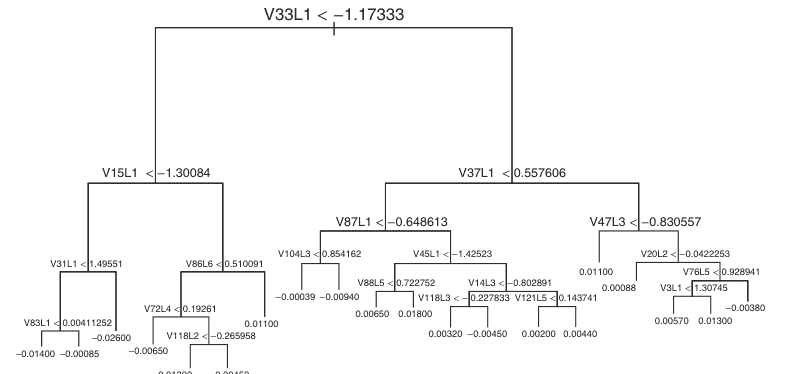

**图8.1** 美国IP指数月增长率的回归树。共有732个预测器。

可以计算分区的\(y_t\)残差平方和为

```
\(SS(i, \eta) = \sum_{x_t \in R_{i,1}} (y_t - \bar{y}_1)^2 + \sum_{x_t \in R_{i,2}} (y_t - \bar{y}_2)^2,\)
```

其中\(\bar{y}_1\)和\(\bar{y}_2\)分别是\(y_t\)在\(R_{i,1}\)和\(R_{i,2}\)中的样本均值。在实践中，\(\eta\)取\(x_{it}\)的顺序统计量，最佳分区由以下方式选择：

```
\(\hat{\eta}_i = \arg \min_{\eta \in \{x_{(i1)}, \dots, x_{(in)}\}} SS(i, \eta),\)
```

其中下标\(i\)表示分区基于第\(i\)个预测器。得到的平方预测误差之和为\(SS(i, \hat{\eta}_i)\)。然后树的第一个分支由第\(i_1\)个预测器及其阈值\(\hat{\eta}_{i_1}\)确定，其中\(i_1\)由以下给出：

```
\((i_1, \hat{\eta}_{i_1}) = \arg \min_{1 \le i \le k} SS(i, \hat{\eta}_i),\)
```

相关的两个子区域是\(R_{i_1,1}\)和\(R_{i_1,2}\)。因此，第一次分割以两个叶子结束，即\(R_{i_1,1}\)和\(R_{i_1,2}\)。

接下来，对\(R_{i_1,1}\)和\(R_{i_1,2}\)分别重复生长过程。对\(R_{i_1,1}\)的唯一修改是\(x_{i_1,t}\)仅取小于或等于\(\hat{\eta}_{i_1}\)的值。对\(R_{i_1,2}\)，\(x_{i_1,t}\)取大于\(\hat{\eta}_{i_1}\)的值。在理论上，这个生长过程可以持续到每个子区域包含单个观测值（或少量预设数据点）。但这样完全生长的树会导致过拟合，在实践中并不有用。用于避免回归树过拟合的方法称为_修剪_，我们将在下一节讨论。需要注意的是，生长树存在一些变体。例如，可以不使用顺序统计量进行分区，而是随机选择每个预测器的一些值来进行分区。

### 8.1.2 修剪

二叉回归树的分割数称为树的*深度*。对于深度大于零的情况，叶子（或终端节点）的数量等于树的深度加一，通常称为树的大小。用$T_m$表示深度为m的给定树。它将预测器空间$R^k$划分为$m+1$个子区域，表示为$\{R_j|j = 1, ..., m + 1\}$，为简化起见，分割中使用的预测器被省略。$T_m$的平方预测误差之和为

```
$$SS(T_m) = \sum_{j=1}^{m+1} \sum_{x_t \in R_j} (y_t - \bar{y}_j)^2,$$
```

其中$\bar{y}_j$表示$y_t$在$R_j$中的样本均值，即当解释变量属于$R_j$时响应变量的观测条件均值。要修剪树，通常采用复杂度代价准则

```
$$C(T_m, \lambda) = SS(T_m) + \lambda |T_m|,$$
```

其中$|T_m|$表示树的大小，$\lambda > 0$是惩罚参数，用于权衡树的复杂度与拟合优度。在实践中，$\lambda$可以通过交叉验证或样本外预测来选择。对于给定的$\lambda$，通过以下方式选择树：

```
$$T_{\hat{m}} = \arg \min_m C(T_m, \lambda).$$
```

显然，较大的$\lambda$倾向于更小的树，$\lambda = 0$对应允许的最大树。

R包**tree**和**rpart**可用于执行回归和分类的基于树的方法。我们在下面的演示中使用**tree**。

### 8.1.3 分类树

当目标是将新观测值分类为G个可能的类别时，分割标准修改如下。在第一次分割中，与之前一样，对于每个预测器$x_{it}$，我们寻找一个实数$\eta \in [x_{i(1)}, x_{i(n)}]$，根据某些标准将数据以最优方式分类。在接下来的分区中，我们继续分割每个子样本，类似于回归树，但现在使用为最优分类选择的标准。这个最优标准可以用几种方式定义。第一种是通过最小化错误分类的观测比例。因此，在每个分区$R_j$中，选择$\eta$的值以产生最小比例的分类错误：

```
$$p_{j\hat{g}} = \arg \max_g p_{j,g},$$
```

其中$p_{j,g}$，对于$g = 1, ..., G$，是分区中属于类别g的观测比例，分类是将分区中的所有观测归类为更频繁的类别。那么，分区j的分类错误比例将为：

```
$$CE_j = 1 - p_{j\hat{g}}.$$
```

另一个标准是最小化分类错误的平均比例。每个类别的相对误差$1 - p_{j,g}$，由观测的比例加权


在类中，$p_{jg}$，其中 $\sum_{g=1}^G p_{j,g} = 1$。该平均值称为划分的基尼指数，定义为

$Gini_j = \sum_{g=1}^G p_{j,g}(1-p_{j,g}).$

类似的准则是最小化交叉熵或偏差，或节点的不纯度，定义为

$Ent_j = - \sum_{g=1}^G p_{j,g} \log p_{j,g}.$ (8.3)

不难看出，当划分导致各组中观测值的比例相等且 $p_{j,g} = 1/G$ 时，节点处的熵取得最大值。如果划分没有分类错误，且对每个组 $g$，要么 $p_{j,g} = 1$ 要么 $p_{j,g} = 0$，则熵取得最小值。当然，只有当待划分的子样本仅包含来自两个组的观测值时，才能达到这个最小值。注意，当 $x$ 很小时，$\log(1-x) \approx -x$，熵准则与基尼指数相似。两个准则均可微分，也是实践中最常用的准则。树的剪枝与之前一样，但在公式 (8.2) 中使用这些最优分类准则之一，而不是 $SS(T_m)$。

### 示例 8.1

再次考虑示例 7.1 中的美国月度宏观经济数据，但使用工业生产（IP）增长率作为因变量。预测变量由所有 122 个变量的滞后 1 期到滞后 6 期的值组成。为了便于图形显示，我们对预测变量进行标准化。基于树的方法选择了一棵具有 20 个叶子（终端节点）的树，残差平均偏差（即平方误差）为 $2.52 \times 10^{-5}$。用于分割的 19 个预测变量如下面的 R 演示所示。第一次分割基于第 33 个预测变量的滞后 1 期值，阈值为 -1.173。输出显示，在根节点处，有 704 个观测值，偏差为 $3.88 \times 10^{-2}$，样本均值为 0.002163。另外，第一个叶子有 5 个观测值，偏差为 $1.128 \times 10^{-4}$，样本均值为 -0.01439。图 8.1 显示了所选回归树。

### R 演示：回归树

```
> require(tree)
> FREMDMApril19 <- read.csv("FREMDMApril19.csv", header=TRUE)
> x=as.matrix(FREMDMApril19)
> Y=x[7:710,6] # dependent variable
> X=cbind(x[6:709,],x[5:708,],x[4:707,],x[3:706,],x[2:705,],x[1:704,])
> X1 <- scale(X, center=TRUE, scale=TRUE)
> tree.fit <- tree(Y~.,data=data.frame(X1),split="deviance")
> tree.fit
node), split, n, deviance, yval
* denotes terminal node

1) root 704 3.880e-02 0.0021630
  2) V33L1 < -1.17333 72 1.144e-02 -0.0056860
    4) V15L1 < -1.30084 20 3.590e-03 -0.0157700
      8) V31L1 < 1.49551 11 8.355e-04 -0.0070080
16) V83L1 < 0.00411252 5 1.128e-04 -0.0143900 *
17) V83L1 > 0.00411252 6 2.230e-04 -0.0008548 *
19) V31L1 > 1.49551 9 8.754e-04 -0.0264900 *
5) V15L1 > -1.30084 52 5.033e-03 -0.0018060
10) V86L6 < 0.510091 44 3.044e-03 -0.0040430
20) V72L4 < 0.19261 34 8.944e-04 -0.0066460 *
21) V72L4 > 0.19261 10 1.273e-03 0.0041860
42) V118L2 < -0.265958 5 4.892e-04 0.0128700 *
43) V118L2 > -0.265958 5 2.915e-05 -0.0044990 *
11) V86L6 > 0.510091 8 5.579e-04 0.0105000 *
3) V33L1 > -1.17333 632 2.242e-02 0.0030570
6) V37L1 < 0.557606 481 1.526e-02 0.0021890
12) V87L1 < -0.648613 67 2.445e-03 -0.0014600
24) V104L3 < 0.854162 59 1.499e-03 -0.0003903 *
25) V104L3 > 0.854162 8 3.799e-04 -0.0093500 *
13) V87L1 > -0.648613 414 1.178e-02 0.0027790
26) V45L1 < -1.42523 14 6.244e-04 0.0106000
52) V88L5 < 0.722752 9 1.797e-04 0.0064910 *
53) V88L5 > 0.722752 5 1.840e-05 0.0180100 *
27) V45L1 > -1.42523 400 1.027e-02 0.0025050
54) V14L3 < -0.802891 34 1.297e-03 -0.00100940
108) V118L3 < -0.227833 15 3.127e-04 0.0032070 *
109) V118L3 > -0.227833 19 4.880e-04 -0.0044890 *
55) V14L3 > -0.802891 366 8.490e-03 0.0028390
110) V121L5 < 0.143741 239 5.161e-03 0.0020070 *
111) V121L5 > 0.143741 127 2.852e-03 0.0044060 *
7) V37L1 > 0.557606 151 5.643e-03 0.0058230
14) V47L3 < -0.830557 30 8.874e-04 0.0110000 *
15) V47L3 > -0.830557 121 3.753e-03 0.0045400
30) V20L2 < -0.0422253 32 8.761e-04 0.0008838 *
31) V20L2 > -0.0422253 89 2.296e-03 0.0058540
62) V76L5 < 0.928941 84 1.580e-03 0.0064280
124) V31L1 < 1.30745 75 1.012e-03 0.0056830 *
125) V31L1 > 1.30745 9 1.804e-04 0.0126400 *
63) V76L5 > 0.928941 5 2.232e-04 -0.0037850 *
> summary(tree.fit)
```

```
Regression tree:
tree(formula = Y ~., data = data.frame(X1), split = "deviance")
Variables actually used in tree construction:
[1] "V33L1" "V15L1" "V33L1" "V83L1" "V86L6" "V72L4" "V118L2" "V37L1"
[9] "V87L1" "V104L3" "V45L1" "V88L5" "V14L3" "V118L3" "V121L5"
[16] "V47L3" "V20L2" "V76L5" "V33L1"
Number of terminal nodes:  20
Residual mean deviance:  2.522e-05 = 0.01725 / 684
Distribution of residuals:
   Min.     1st Qu.      Median       Mean     3rd Qu.        Max.
-2.085e-02 -3.167e-03 -1.751e-05 0.000e+00  3.237e-03  1.993e-02
> plot(tree.fit)
> text(tree.fit, cex=0.5)
```

### 8.1.4 随机森林

RF 是另一种用于分类和回归的集成方法。如在第 7 章中关于提升方法所见，集成方法结合不同的过程或算法，以获得优于任何单一组成算法所得预测的结果，例如在模型平均法中。RF 是对装袋法（自助聚合）的扩展，用于避免基于树的方法中的过拟合。该方法由 Ho (1995) 提出，并由 Breiman (2001) 发展成为合适的统计工具。下面的讨论侧重于预测。基本上，随机森林使用许多简单的树来生成预测，然后结合这些预测以提供一致预测。该方法是非参数的，因为它不对底层数据假设任何特定模型。

再次考虑数据集 \(\{(x_t, y_t)|t = 1, ..., n\}\)，其中 $x_t$ 是预测变量 $X_t = (X_{1t}, ..., X_{kt})'$ 的一个实现，$y_t$ 是因变量 $Y_t$ 的一个实现。目标是预测 $y_{t+h}$，其中 $h$ 为预测步距。在讨论随机森林之前，我们下面给出 _自助聚合_ 方法：

- 1. 从数据集中抽取有放回的随机样本。将自助样本表示为 \(\{(x^*_t, y^*_t)|t = 1, ..., n\}\)。
- 2. 使用自助样本构建回归树，以获得对 $y_{t+h}$ 的预测。

通过多次重复上述自助程序，可得到一组自助预测，进而可用于获取 $y_{t+h}$ 的一致预测。

随机森林通过引入一种新想法来扩展装袋法，以充分探索 $y_{t+h}$ 与 $x_t$ 之间的关系。其思想是，对每个树分割，随机选取 $g$ 个预测变量作为分割的候选变量。令 $g$ 为满足 $1 \leq g \leq k$ 的正整数。通常使用 $g = \lfloor k/3 \rfloor$。为了从自助样本为随机森林构建回归树，从 $\{1, ..., k\}$ 中随机选取 $g$ 个预测变量，作为每次分割的候选变量。这一新步骤服务于多个目的。首先，它降低了计算强度，尤其是在 $k$ 很大时。其次，它缓解了预测变量之间的多重共线性，因为高度相关的预测变量可能不会被共同选中。最后，它避免了在集成中使用相似树的可能性。通常使用自助预测的简单平均值来生成一致预测。在给定损失函数下，也可以使用加权平均值。

**讨论**：有必要对随机森林进行一些讨论。首先，可以使用 R 包 **randomForest** 进行随机森林预测。请参见下面的演示。其次，为了有效地将随机森林应用于相关数据，需要进行一些修改。例如，在时间序列分析中，因变量的滞后 1 期值通常比滞后 2 期值更重要。同样，因变量的季节性滞后在建模季节性时间序列时通常也很重要。因此，可以使用加权随机样本来选择每次分割的 $g$ 个预测变量作为候选变量，而不是使用纯随机样本。第三，在为相关数据绘制自助样本时必须小心，并应使用某种形式的块自助法；例如，参见 Alonso et al. (2004) 和 Lahiri (2013)。

### 示例 8.2

为演示随机森林的用法，我们还使用示例 8.1 中使用的月度宏观经济数据。同样，因变量是美国月度


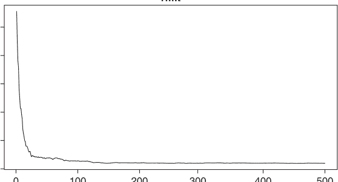

**图 8.2** 将RFs应用于月度宏观经济数据的结果，以IP指数增长率作为因变量。使用了500棵树和 mtry = 20。

IP指数和预测变量均为所有可用变量的滞后1期至滞后6期值。因此，n = 704，k = 732。预测变量已标准化。我们运行两次 randomForest 命令以展示在每棵树分割中选择预测变量数量的影响。子命令 ntree 用于指定使用的树的数量，子命令 mtry 是每次分割中使用的预测变量数量。即，在我们的记法中为 g。我们使用默认选项，使树在生长时受到约束，即每个叶节点中的数据点数不能少于 5。另一种方法是指定树最多可以拥有的叶节点数量。分别参见 randomForest 的子命令 nodesize 和 maxnodes。

使用 500 棵树和 mtry = 20 时，RFs 解释了因变量 23.92% 的变异性。图 8.2 显示了使用的树的数量与 MSE 的关系，而图 8.3 显示了每个预测变量的 MSE 平均下降量。从

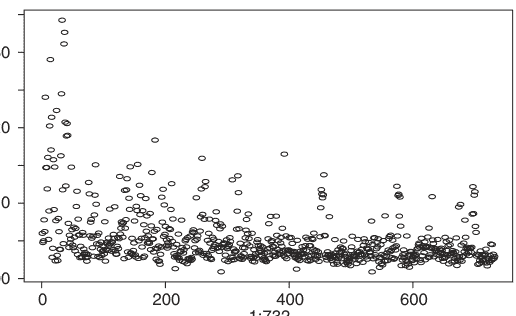

**图 8.3** 月度宏观经济数据中每个预测变量的 MSE 平均下降量，以IP指数增长率作为因变量。使用了500棵树和 mtry = 20。

从图 8.2 可以看出，MSE 随使用的树的数量迅速下降。如果将 mtry 增加到 30，则 RFs 解释了因变量约 24.47% 的变异性。在这个特定示例中，mtry 的选择似乎不敏感。

### R 演示：随机森林

```
> require(randomForest)
> set.seed(117)
> rf.fit <- randomForest(X1,Y,ntree=500,mtry=20,importance=TRUE)
> rf.fit
Call: randomForest(x=X1,y=Y,ntree=500,mtry=20,importance=TRUE)
   Type of random forest: regression
      Number of trees: 500
No. of variables tried at each split: 20

      Mean of squared residuals: 4.19353e-05
         % Var explained: 23.92
> plot(rf.fit)
> dim(rf.fit$importance)
[1] 732   2
> plot(1:732,rf.fit$importance[,2],ylab="mean decrease in MSE")
> set.seed(117)
> rf.fit <- randomForest(X1,Y,ntree=500,mtry=30,importance=TRUE)
> rf.fit
Call: randomForest(x=X1,y=Y,ntree=500,mtry=30,importance=TRUE)
   Type of random forest: regression
      Number of trees: 500
No. of variables tried at each split: 30

      Mean of squared residuals: 4.163187e-05
         % Var explained: 24.47
```

## 8.2 神经网络

NNs（或人工神经网络）是一种半参数学习方法，模仿人脑处理信息。网络由多个节点层组成，这些节点也称为神经元。网络的第一层是输入层，每个预测变量作为一个节点。最后一层是输出层，包含与因变量维度相同数量的节点。所有中间神经元层称为隐藏层。在前馈网络中，信息从输入层流向第一个隐藏层，然后流向第二个隐藏层，依此类推，直到到达输出层。因此，信息只通过每个神经元一次。对于循环网络，允许从后层到前层的反馈，或从一个神经元回到其自身。或者，循环网络意味着信息处理可能多次经过同一层。前馈 NNs 也称为感知机。参见图 8.4，它是一个 P − m − k NN。

NN 试图使用一组解释变量来近似响应函数。它依赖于普逼近理论，该理论指出，在响应函数满足某些光滑性条件下，可以提供适当的

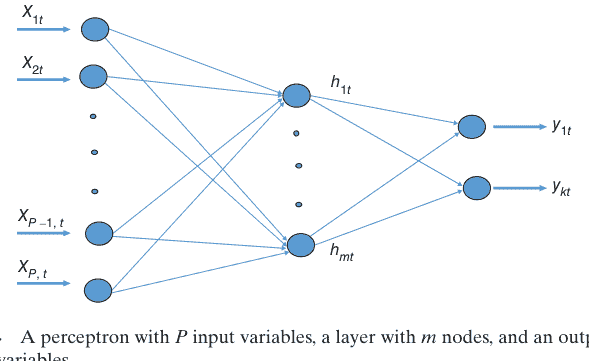

用某些激活函数和网络结构进行近似。确实，已经有许多方法来获得普逼近函数。例如，我们可以使用多项式、根据泰勒定理或正弦函数（如傅里叶分析中）来近似区间上的任何连续函数。Kolmogorov (1957) 表明，m 个变量的所有连续函数都可以用少量单变量函数的有限叠加和复合来很好地近似。NNs 不是寻找每个变量的函数，而是搜索所有输入变量线性组合的函数的近似。Cybenko (1989) 和 Hornik 等人 (1989) 证明，m 个实变量的任何连续函数都可以通过变量的有限线性组合的复合来很好地近似，这意味着，具有单个隐藏层（任意宽度，即大量神经元或节点）的前馈 NN 可以以任何给定精度近似任何连续函数。

用于处理网络中一层到下一层信息的函数称为激活函数。不同层可以使用不同的函数，尽管除了输出层外，通常使用相同的激活函数。单层 NN 的普逼近性质对任何非多项式激活函数都有效。输出层的激活函数由因变量是连续还是离散决定。详情后文介绍。文献中提出了许多激活函数，但以下函数常用于传统 NN。第 8.3.3 节提供了一些用于深度学习或机器学习的其他函数。

- 1. Logistic 函数（或 Sigmoid 函数）：

```
$$g(x) = \frac{1}{1 + \exp(-x)} = \frac{\exp(b + \sum_{i=1}^m w_i x_i)}{1 + \exp(b + \sum_{i=1}^m w_i x_i)},$$
```

其中 \( x = (x_1, \dots, x_m)' \)，m 为前一层的节点数，\( b \) 称为 *偏置*，\( w_i \) 为权重。该函数是逻辑回归中使用的函数，它将实线上的连续变量转换为 0 到 1 之间的变量。

- 2. 双曲正切（tanh）：

$g(x) = \frac{\sinh(x)}{\cosh(x)} = \frac{\exp(x) - \exp(-x)}{\exp(x) + \exp(-x)}$

其中 $\exp(x) = \exp(b + \sum_{i=1}^m w_i x_i)$ 与之前相同，偏置为 $b$，权重为 $w_i$。

- 3. Heaviside 函数：

$g(x) = \begin{cases} 0, & \text{if } b + \sum_{i=1}^m w_i x_i \le 0, \\ 1, & \text{if } b + \sum_{i=1}^m w_i x_i > 0. \end{cases}$

当因变量为二元时，Heaviside 函数用于输出层。另一方面，如果因变量是连续的，则通常使用线性函数作为输出层。我们将 NNs 称为半参数学习方法，因为一旦给定激活函数和网络结构，网络就成为由偏置和权重组成的具有未知参数的非线性统计模型。图 8.5 比较了 sigmoid 和 tanh 激活函数。第一个产生的输出数可以是正或负，而第二个总是给出正数。

### 8.2.1 网络训练

网络训练是估计给定网络的偏置和权重。这通常通过使用可用数据优化某个目标函数（或最小化某个损失函数）来完成。在实践中，人们通常将数据集 $\{(\mathbf{x}_t, y_t)|t = 1, ..., n\}$ 划分为训练子样本和验证子样本。对于独立数据，训练子样本可以通过从数据集中不放回地随机抽取选择，剩余观测值构成验证子样本。例如，设 $n_1$ 为小于 $n$ 的正整数。可以从 $\{1, ..., n\}$ 中不放回地均匀抽取 $n_1$ 个观测值，例如 $\{i_1, ..., i_{n_1}\}$。

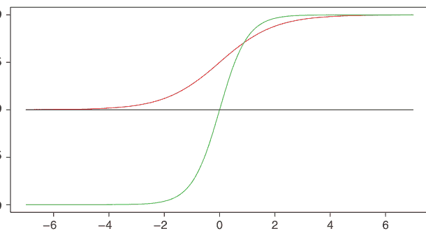

**图 8.5** Logistic（绿色）和 tanh（红色）激活函数。

然后，使用 \(\{(\mathbf{x}_t, y_t)|t=i_1, \dots, i_{n_1}\}\) 作为训练子样本。另一方面，对于序列相关数据，通常使用前 \(n_1\) 个观测值作为训练子样本。

接下来，我们简要讨论前馈 \(P-M-K\) 网络的训练，该网络有 \(P\) 个输入节点、一个包含 \(M\) 个节点的单隐藏层和 \(K\) 个输出节点。参见 Hastie 等人 (2001)。该网络也称为 \(P-M-K\) 感知机。将输入表示为 \(\mathbf{x}_t=(x_{1t}, \dots, x_{Pt})'\)，输出表示为 \(\mathbf{y}_t=(y_{1t}, \dots, y_{Kt})'\)，隐藏层输出向量表示为 \(\mathbf{h}_t=(h_{1t}, \dots, h_{Mt})'\)。我们可以写出网络模型如下：

\(h_{mt}=g(w_{m0}+\boldsymbol{w}'_m\mathbf{x}_t),\quad m=1, \dots, M,\) (8.4)

\(q_{vt}=\beta_{v0}+\boldsymbol{\beta}'_v\mathbf{h}_t,\quad v=1, \dots, K,\) (8.5)

\(y_{vt}\equiv f_v(\mathbf{x}_t)=g_v(\mathbf{q}_t),\quad v=1, \dots, K,\) (8.6)

其中 \(g(.)\) 和 \(g_v(.)\) 是激活函数，\(w_{m0}\) 和 \(\boldsymbol{w}_m=(w_{m1}, \dots, w_{mP})'\) 是与隐藏层第 \(m\) 个神经元相关的偏置和权重，\(\beta_{v0}\) 和 \(\boldsymbol{\beta}_v=(\beta_{v1}, \dots, \beta_{vM})'\) 分别是第 \(v\) 个输出神经元的偏置和权重，\(\boldsymbol{q}_t=(q_{1t}, \dots, q_{Kt})'\)。从统计学角度看，该模型可以解释为非线性因子模型，其中原始的 \(P\) 个解释变量被组合以创建 \(M\) 个线性组合或因子。然后以非线性方式转换每个因子以创建新的解释变量 \(h_{mt}\)，而 \(K\) 个响应变量是这些新变量 \(h_{nt}\) 的线性组合的函数。此外，通过将输入变量重新定义为 \(\mathbf{x}_t=(1, x_{1t}, \dots, x_{Pt})'\) 并将隐藏节点重新定义为 \(\mathbf{h}_t=(1, h_{1t}, \dots, h_{Mt})'\)，可以将偏置并入权重中。Eq. (8.6) 的函数 \(f_{v(.)}\) 用于表示第 \(v\) 个输出变量作为 \(\mathbf{x}_t\) 函数的基础函数。对于连续因变量 \(\mathbf{y}_t\)，\(g_v(.)\) 通常假设为线性函数 \(g_v(\mathbf{q}_t)=q_{vt}=\beta_{v0}+\boldsymbol{\beta}'_v\mathbf{h}_t\)。对于离散变量（如分类），\(g_v(.)\) 通常假设为多元 Logit 模型，即

\(f(\mathbf{x}_t)=\arg \max_{1 \le v \le K} \hat{f}_v(\mathbf{x}_t),\) (8.7)

其中 \(\hat{f}_v(.)\) 表示 \(f_v(.)\) 在训练子样本中的拟合值，\(f(.)\) 表示基础模型。在这种情况下，给定 \(g(.)\) 和 \(g_v(.)\)，网络包含以下参数：

\(\{(\boldsymbol{w}_{m0}, \boldsymbol{w}_m|m=1, \dots, M): M(P+1) \text{ parameters},\) (8.8)

\(\{(\beta_{v0}, \boldsymbol{\beta}_v|v=1, \dots, K): K(M+1) \text{ parameters}.\) (8.9)

设 \(\boldsymbol{\theta}\) 为所有参数（偏置和权重）的集合。对于连续因变量 \(\mathbf{y}_t\)，通常使用平方误差损失函数

\(L(\boldsymbol{\theta})=\sum_{v=1}^K \sum_{t=1}^{n_1} [y_{vt}-f_v(\mathbf{x}_t)]^2,\) (8.10)

其中 \(n_1\) 是训练子样本的样本量。对于分类，通常使用交叉熵（或偏差），如 Eq. (8.3) 定义，来衡量拟合优度


拟合

$L(\boldsymbol{\theta})=\sum_{v=1}^{K} \sum_{t=1}^{n_1} y_{vt} \log[f_v(\boldsymbol{x}_t)],$ (8.11)

分类基于式 (8.7)。
网络训练则相当于在参数空间上对训练子样本中的损失函数进行最小化。这是一个非线性优化问题，可用多种方法求解，从简单的梯度方法到包括遗传算法在内的牛顿法和拟牛顿算法。对于大量变量，梯度算法计算速度快，只需保留一阶导数，而不需要像牛顿法那样保留二阶导数。在神经网络文献中，梯度算法通常称为反向传播。从输入变量开始，应用权重和激活函数计算中间变量 $\boldsymbol{h}_t$ 的过程称为前向传播。将新权重应用于这些中间变量即可得到输出。反向传播是将输出与观测数据进行比较、计算预测误差并利用这些误差修正权重，从而降低预测误差的逆向过程。接下来我们介绍最简单的反向传播算法。其变体之一是带有或不带有权重回溯的弹性反向传播。参见 Riedmiller and Braun (1993)。梯度下降法需要计算激活函数的偏导数，因此实际使用的激活函数都具有简单的导数。

接下来，我们详细说明式 (8.10) 中平方误差损失函数的反向传播。我们假设因变量为连续变量，输出激活函数为恒等函数，$g_v(\boldsymbol{q}_t)=q_{vt}$，隐藏层的激活函数为 Sigmoid 函数。此外，为了简化且不失一般性，我们省略偏置项。问题可以重写为

$L(\boldsymbol{\theta})=\sum_{t=1}^{n_1} L_t \text{ with } L_t=\sum_{v=1}^{K}\left[y_{vt}-\boldsymbol{b}_t^{\prime} \boldsymbol{h}_t\right]^2 .$ (8.12)

对偏导数并使用链式法则，我们得到

$\frac{\partial L_t}{\partial \boldsymbol{\beta}_v}=-2 h_t\left(y_{vt}-\boldsymbol{h}_t^{\prime} \boldsymbol{\beta}_v\right),$ (8.13)

$\frac{\partial L_t}{\partial \boldsymbol{\omega}_m}=-\sum_{v=1}^{K} 2\left(y_{vt}-\boldsymbol{h}_t^{\prime} \boldsymbol{\beta}_v\right) \beta_{vm} g^{\prime}\left(\boldsymbol{\omega}_m^{\prime} \boldsymbol{x}_t\right) \boldsymbol{x}_t,$ (8.14)

可以很容易地看出，Sigmoid 函数 $g(x)$ 的导数为 $g^{\prime}(x)=g(x)[1 - g(x)]$。因此，

$\frac{\partial L_t}{\partial \boldsymbol{\omega}_m}=-\sum_{v=1}^{K} 2\left(y_{vt}-\boldsymbol{h}_t^{\prime} \boldsymbol{\beta}_v\right) \beta_{vm}\left[g\left(\boldsymbol{\omega}_m^{\prime} \boldsymbol{x}_t\right)\left(1-g\left(\boldsymbol{\omega}_m^{\prime} \boldsymbol{x}_t\right)\right)\right] \boldsymbol{x}_t.$ (8.15)

式 (8.13) 表明，对 $t$ 求和后，当 $\boldsymbol{h}_t$ 变量已知时，可得到 $\boldsymbol{\beta}_v$ 的最小二乘估计，表明残差必须与预测变量 $\boldsymbol{h}_t$ 正交。式 (8.15) 在对 $t$ 求和后，给出了在已知 $\boldsymbol{\beta}_v$ 的情况下估计 $\boldsymbol{\omega}_m$ 的方法。对 \(\boldsymbol{\omega}_m\) 的估计必须满足

\(\sum_{t=1}^n \sum_{v=1}^K (y_{vt} - \boldsymbol{h}'_t \boldsymbol{\beta}_v) \beta_{vm} p_m \mathbf{x}_t = \mathbf{0}\),

且加权残差也必须与输入变量正交。

给定导数后，从第 $i$ 次迭代到第 $(i+1)$ 次迭代的梯度下降更新形式为

\(\boldsymbol{\beta}_{vm}^{(i+1)} = \boldsymbol{\beta}_{vm}^{(i)} - \gamma_i \sum_{t=1}^{n_1} \frac{\partial L_t}{\partial \boldsymbol{\beta}_{vm}^{(i)}},\tag{8.17}\)

\(\mathbf{w}_{m\ell}^{(i+1)} = \mathbf{w}_{m\ell}^{(i)} - \gamma_i \sum_{t=1}^{n_1} \frac{\partial L_t}{\partial \mathbf{w}_{m\ell}^{(i)}},\tag{8.18}\)

其中 \(\gamma_i\) 为 *学习率*，必须满足某些条件以确保估计的收敛。例如，当 \(i \rightarrow \infty\) 时，\(\gamma_i \rightarrow 0\)。关于 \(\gamma_i\) 的讨论见 Hastie et al. (2001)。在实践中，可以尝试不同的学习率值，并选择使损失函数最小的那个值。为实现更新，可以将式 (8.13) 和 (8.14) 重写为每个权重的 *反向传播方程*：

\(\frac{\partial L_t}{\partial \beta_{km}} \equiv \delta_{vt} h_{mt},\tag{8.19}\)

\(\frac{\partial L_t}{\partial w_{m\ell}} \equiv s_{mt} x_{\ell t},\tag{8.20}\)

其中

\(\delta_{vt} = -2(y_{vt} - \boldsymbol{h}'_t \boldsymbol{\beta}_v),\)

且

\(s_{mt} = p_m \sum_{v=1}^K \beta_{vm} \delta_{vt}.\tag{8.21}\)

例如，假设 \(K=1\)，即只有一个输出变量，并令 \(e_t^{(i)} = y_t - \boldsymbol{h}'_t \boldsymbol{\beta}_v^{(i)}\)。更新方程为

\(\boldsymbol{\beta}^{(i+1)} = \boldsymbol{\beta}^{(i)} - \gamma_i \sum_{t=1}^{n_1} \mathbf{e}_t^{(i)} \mathbf{h}_t^{(i)},\tag{8.22}\)

\(\mathbf{w}_m^{(i+1)} = \mathbf{w}_m^{(i)} - \gamma_i \beta_m^{(i)} p_m^{(i)} \sum_{t=1}^{n_1} \mathbf{e}_t^{(i)} \mathbf{x}_t,\tag{8.23}\)

并且具有直观的解释：\(\boldsymbol{\beta}^{(i)}\) 权重的更新取决于预测误差与中间解释变量 \(\boldsymbol{h}_t^{(i)}\) 的正交性；神经元 \(m\) 中的 \(\mathbf{w}_{m\ell}^{(i)}\) 权重的更新取决于预测误差与输入变量的正交性、该神经元对响应的重要性（由 \(\beta_m^{(i)}\) 衡量），以及 \(\mathbf{w}_m^{(i)}\) 的变化对 \(\boldsymbol{h}_t^{(i)}\) 的影响（由激活函数的导数 \(p_m^{(i)}\) 衡量）。

神经网络的训练过程如下：

- 1. 初始化：选择参数的初始值并设置训练算法的一些常数，例如 (a) 学习率；(b) 批量大小 $B$，即用于更新神经网络参数或联合处理的观测值块的观测数量；以及 (c) epoch 数，即使用 $n_1$ 个数据通过更新算法进行的迭代次数。
- 2. 前向传播：使用当前权重（参数）输入下一批 $B$ 个输入变量，并使用式 (8.4)–(8.6) 计算神经网络的输出或预测值 $\hat{f}_v(\mathbf{x}_t)$。
- 3. 计算预测误差：计算输出误差 $e_{vt} = y_{vt} - \hat{f}_v(\mathbf{x}_t)$ 以及迄今已处理观测值的损失函数值。
- 4. 反向传播：计算量 $\delta_{vt}$，并通过式 (8.21) 反向传播以求得 $s_{mt}$。随后，$\delta_{vt}$ 和 $s_{mt}$ 均用于计算式 (8.17) 和 (8.18) 中的梯度更新。

步骤 2–4 重复执行，直到分析完训练集的 $n_1$ 个观测值并完成一个 epoch。随后，该过程不断迭代，直到达到预设的 epoch 数量。

关于网络训练，有几点讨论有必要。首先，预测变量的尺度可能会影响网络的实用性。因此，通常会对预测变量（或输入变量）进行标准化，使其均值为零、方差为一。其次，训练需要对偏置和权重进行一些初始估计。在使用标准化预测变量时，可以采用 $U[-w, w]$（其中 $0 < w < 1$）的随机抽样作为初始参数值。由于我们要最小化的函数可能存在多个局部极小值，因此用不同的初始值启动算法并在验证子样本中比较结果非常重要。第三，批量大小 $B$ 取决于样本量。如果子样本 $n_1$ 不大，可以取 $B=1$，在每次输入 $\mathbf{x}_t$ 后更新参数，如在线递归估计中所做（参见第 2.8.2 节）。对于较大的 $n_1$，为加快估计速度，$B$ 通常选取为数据的一部分。将 $B$ 个观测值按批处理以更新参数称为算法的一次迭代，处理 $n_1$ 个观测值一次所需的迭代次数为一个 epoch。（例如，若 $n_1=50000$ 且 $B=100$，则需要 500 次迭代才能完成一个 epoch。）第四，如果网络层数或节点过多，可能会发生过拟合。为了避免过拟合，验证子样本变得非常有价值。可以比较验证子样本中拟合网络的性能，并选择性能最佳的网络作为首选网络。最后，有几个 R 包可用于神经网络分析，包括 **nnet** 和 **neuralnet**。**nnet** 只允许一个隐藏层，而 **neuralnet** 更具灵活性。我们将在下面的演示中使用后者。

反向传播方法的优点包括简单性和局部性。隐藏层的每个神经元仅接收和传递与其有连接的神经元的信息。因此，该算法可以并行执行。另一方面，反向传播可能较慢，因此通常会使用其他一些方法，例如需要二阶导数的方法。


显然，训练思想可以推广到具有多个隐藏层的网络。但是，当隐藏层太多时，可能会出现一些计算困难。我们将在下一节深度学习中回到这个问题。

### 示例 8.3

统计文献中广泛使用的一个数据集是波士顿房价数据集，可从 R 包 MASS 中获得。有关该数据集的详细分析，请参见 Belsley et al. (2005)。此处我们仅将该数据集作为示例。感兴趣的因变量是波士顿郊区自有住房的中位数价值（以千为单位）。共有 13 个预测变量，包括 rm（每套住房的平均房间数）、age（1940 年以前建成的自有住房单位比例）和 lstat（人口的低地位比例）。我们在此处的目标是演示 NN 的用法，因此在以下分析中仅考虑上述三个预测变量。

首先，我们对因变量 medv 进行对数变换，并标准化输入变量，使每个预测变量的均值为 0、方差为 1。然后我们采用两个 NN 模型。第一个模型是 3-2-1 网络，包含 3 个输入变量、1 个具有 2 个节点的单隐藏层和 1 个输出变量。图 8.6 显示了生成的网络，其中与每个箭头关联的数值表示权重，从圆圈 1 出发的箭头关联的数值表示偏置。我们使用默认选项，因此激活函数是逻辑函数。在此特定示例中，隐藏层的第一个节点由以下给出

```
h_1(\boldsymbol{x}_t) = \frac{\exp(2.923 - 0.404\text{rm}_t - 1.373\text{age}_t - 2.08\text{lstat}_t)}{1 + \exp(2.923 - 0.404\text{rm}_t - 1.373\text{age}_t - 2.08\text{lstat}_t)},
```

输出节点为

```
\widehat{\text{medv}}_t = 2.326 + 0.686h_1(\boldsymbol{x}_t) + 0.871h_2(\boldsymbol{x}_t).
```

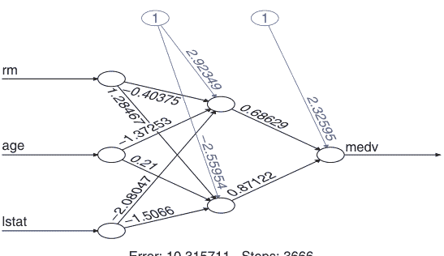

图 8.6 以 rm、age 和 lstat 为预测变量的对数中位房价拟合 3-2-1 NN。数据集为波士顿房价。

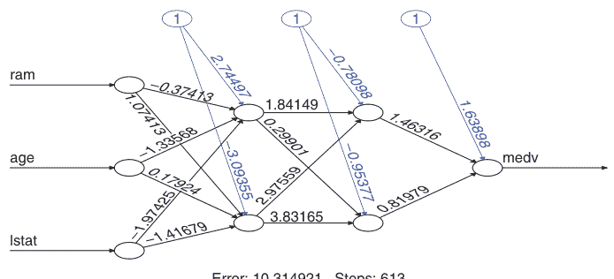

图 8.7 以 rm、age 和 lstat 为预测变量的对数中位房价拟合 3-2-2-1 NN。数据集为波士顿房价。

该网络的残差均方误差为 0.2019，而 log(medv) 的样本标准误为 0.4088。

图 8.7 显示了拟合的 3-2-2-1 网络，该网络有 2 个隐藏层，每个隐藏层有 2 个节点。该网络可以以类似的方式进行解释。该网络的残差均方误差也接近 0.2019。在此特定示例中，额外的隐藏层贡献不大。

### R 演示：使用 neuralnet 包的 NN

```
> require(MASS)
> require(neuralnet)
> fix(Boston)
> names(Boston)
[1] "crim" "zn" "indus" "chas" "nox" "rm" "age"
[8] "dis" "rad" "tax" "ptratio" "black" "lstat" "medv"
> X = cbind (Boston$rm,Boston$age,Boston$lstat) #Input nodes
> X = scale (X,center=TRUE,scale=TRUE) #Standardization
> colnames (X) <- c ("rm", "age", "lstat")
> medv <- log (Boston$medv)
> netw <- neuralnet (medv~.,data=data.frame (X),hidden=c(2) ,
algorithm="rprop+")
> names (netw)
[1] "call" "response" "covariate"
[4] "model.list" "err.fct" "act.fct"
[7] "linear.output" "data" "exclude"
[10] "net.result" "weights" "generalized.weights"
[13] "startweights" "result.matrix"
> plot(netw)
>
> fitted.values <- as.numeric(netw$net.result[[1]])
> rmse <- sqrt(mean((medv-fitted.values)^2))
> rmse
[1] 0.2019246
> sqrt(var(medv))
[1] 0.4087569
> netw1 <- neuralnet(medv~.,data=data.frame (X),hidden=c(2,2) ,
algorithm="rprop+")
> fit1 <- as.numeric(netw1$net.result[[1]])
> rmse1 <- sqrt(mean((medv-fit1)^2))
> rmse1
[1] 0.2019169
```

## 8.3 深度学习

深度学习是基于 NN 的更广泛的 *机器学习* 家族的一部分。它使用 NN 中的多个层来逐步从数据中提取更高级别的特征。DL 中的 *深* 字是指用于处理数据的层数，DL 通常意味着所使用的网络具有两个或多个隐藏层。本节我们简要介绍用于预测和分类的 DL。

与传统 NN 类似，支持深度 NN 的基本理论是 *通用逼近定理*。这一性质适用于任意宽度的单层 NN，也适用于固定宽度但任意深度的多层 NN。此外，一些结果表明，具有多个层的 NN 相比于单层 NN，对任何函数提供了更高效（参数更少）的逼近。参见 Hornik (1991)、Hanin and Sellke (2017) 和 Lu et al. (2017)。

### 8.3.1 深度网络类型

除前馈设计外，文献中为 DL 提出了各种类型的 NN。此处我们简要讨论一些常用的网络。在实践中，这些网络可以混合在一起形成一个复杂的网络。通常，NN 是完全连接的，即一个层中的每个节点都连接到下一层的所有节点。这种网络在变深时训练会遇到各种困难，例如消失梯度问题，并且可能需要大量的计算成本。下一节将给出一些细节。下面讨论的网络结构旨在增强 NN 的能力和适用性，并简化网络训练。

- **卷积神经网络 (CNN)**：它们是受规则化的多层感知机，模拟动物视觉皮层的功能，主要用于计算机视觉。在此，皮层神经元仅在视觉场的受限区域（称为感受野）对刺激作出反应。神经元的感受野相对较小，但可能重叠，从而使整个图像得到适当连接。通常，CNN 的输入是一个或多个矩阵的标准化像素值 [红绿蓝 (RGB) 图像中为三个]。一些滤波器（卷积）应用于图像中小像素组，并重复该过程直到遍历整个图像。这些滤波器旨在提取特征，如边缘、颜色、直线等。该过程使用不同的滤波器重复多次，最终发现的特征是前馈 NN 的输入，用于对图像进行分类。CNN 常用的激活函数是斜坡函数，即整流单元。CNN 广泛用于分类。例如，Lawrence et al. (1997) 使用 CNN 进行人脸识别。它采用自组织映射（一种无监督学习过程，在没有任何类别信息的情况下学习一组模式的分布）和更新算法（采用类似于统计文献中核函数的邻域函数）来执行网络训练。Kalchbrenner et al. (2014) 将 CNN 应用于句子建模。

- **递归 NN**：递归网络是通过对结构化输入递归应用同一组权重来生成结构化预测而创建的深度 NN。它已应用于语音识别，因为句子是单词的总和，因此具有结构。每个单词由一个向量表示并形成一棵二叉树。递归 NN 对任何层次结构进行操作，将两个节点（子节点）中的信息组合为一个新节点（父节点），并采用树型结构处理信息。

- **循环神经网络 (RNN)**：这些网络可以被视为在时间线性进展上运行的递归 NN 表示的特例，它结合前一时间步和隐藏表示以获得当前时间步的输出。RNN 旨在处理序列数据，特别适用于时间序列分析。它们最初是为带有某种序列结构的数据（如手写和语音识别）而创建的。例如，参见 Mikolov et al. (2010)。RNN 已应用于时间序列向量的预测，假设具有外生变量的非线性自回归模型（NARX）。参见 Menezes and Barreto (2008)。RNN 的正则化问题由 Zaremba et al. (2015) 研究，RNN 的特性在文献中已得到调查。例如，参见 Hammer et al. (2005) 和 Hammer (2007)。由于 RNN 关注动态依赖性，我们将在下一节提供更多细节。

### 8.3.2 循环 NN

RNN 是一组旨在处理序列数据的 NN。它们与动态系统相似

```
s_t = f(s_{t-1}, x_t, \theta),
```

其中 $s_t \in \mathbb{R}^d$ 表示时间 $t$ 的状态向量，$x_t \in \mathbb{R}^k$ 是时间 $t$ 的输入，$\theta \in \mathbb{R}^p$ 是一组参数，$f(.)$ 表示从状态 $s_{t-1}$ 到 $s_t$ 并在新数据 $x_t$ 下的转换。动态系统的一个特殊特征是参数向量 $\theta$ 是时不变的。即，所有时间索引 $t$ 共享相同的值。给定输入数据 $\{x_1, ..., x_n\}$，令 $h_t \in \mathbb{R}^d$ 为隐藏层的输出，其中 $h_0 = \mathbf{0}$。然后，简单 RNN 可以符号化地描述为

```
s_t = b + W h_{t-1} + U x_t, \qquad (8.24)

h_t = g(s_t), \qquad (8.25)

\hat{y}_t = g_y(c + V h_t), \qquad (8.26)
```

其中 $g(.)$ 和 $g_y(.)$ 是如 tanh 之类的激活函数，$b$ 和 $c$ 是偏置项，$W$、$U$ 和 $V$ 是参数矩阵，$\hat{y}_t \in \mathbb{R}^m$。在文献中，方程 (8.24)–(8.26) 中的 RNN 被称为 Elman 网络；参见 Elman (1990)。图 8.8 是 RNN 的表示。在每个时间 $t$ 时，可用信息是输入 $x_t$ 和来自 $t-1$ 的内存向量 $h_{t-1}$。这两个向量线性组合以形成时间 $t$ 的状态向量 $s_t$。新的内存向量是一个非线性函数


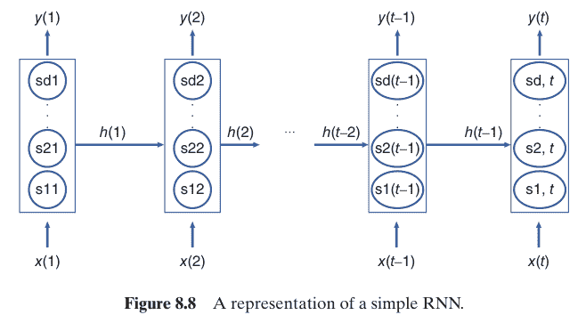

状态向量的预测（或输出）是作为记忆新向量 \(\mathbf{h}_t\) 组件的线性组合构建的，该向量也会馈入下一周期。

例如，考虑最简单的情况：平稳零均值单变量时间序列 \(x_t\)，且 \(k=m=1\)，采用线性激活函数和 \(d=1\)。此时，\(s_t = wh_{t-1} + ux_t = h_t\)，状态也是记忆函数，且 \(\hat{y}_t = \hat{x}_{t+1} = vh_t\)。假设 \((w, u, v) < 1\)，则有 \(s_t = u(1 + wB + w^2B^2 + \cdots + w^tB^t)x_t\)，并且当 \(t\) 很大时，\((1 - wB)s_t = ux_t\) 且 \(\hat{x}_{t+1} = w\hat{x}_t + uwx_t\)。因此，这个简单 RNN 生成的预测对应于 ARMA(1,1) 过程的预测。增大维度 \(d\) 且对于 \(k=1\)，可以生成其他单变量自回归积分滑动平均（ARIMA）预测。对于 \(k > 1\)，输出是一个向量时间序列。RNN 可以为带外生变量的非线性自回归（NARX）模型生成预测。

\(\hat{y}_t = F(\mathbf{y}_{t-1}, \dots, \mathbf{y}_{t-p}, \mathbf{x}_t, \dots, \mathbf{x}_{t-h}).\)

参见 Siegelmann et al. (1997)。另一种类型的 RNN 是 Jordan (1997) 网络，由

\(\mathbf{h}_t = g_h(\mathbf{W}\mathbf{y}_{t-1} + \mathbf{U}\mathbf{x}_t + \mathbf{b}),\) (8.27)

\(y_t = g_y(\mathbf{V}\mathbf{h}_t + c),\) (8.28)

其中 \(g_h(.)\) 和 \(g_y(.)\) 是激活函数。此处省略了状态 \(\mathbf{s}_t\)。

通常，RNN 的输出 \(y_t\) 服从某些概率分布，并使用最大似然函数来估计参数。此外，深度 RNN 可以以多种方式假设反馈。反馈可以是从隐藏层到隐藏层再到隐藏层，也可以是从节点到节点。有关示例，请参见 Goodfellow et al. (2016)。可以将 RNN 视为允许信息多次通过某些神经元的网络。训练 RNN 也可以采用与前馈网络相似的方法。唯一需要的更改是递归计算梯度。

### 8.3.3 深度学习的激活函数

除前面提到的线性、sigmoid 和 tanh 函数外，DL 还可使用其他类型的激活函数，如下所示。

- 1. 整流线性单元（ReLU）：f(x) = max(0, x)。该激活函数计算效率高，梯度函数简单。该函数的一个缺点是，当 x < 0 时其梯度为零，这可能会导致 x < 0 时神经元失效。

- 2. 带泄漏的整流线性单元（Leaky ReLU）：

  $$f(x) = \begin{cases} 0.1x, & \text{if } x < 0, \\ x, & \text{if } x \ge 0. \end{cases}$$

  该函数避免了与 ReLU 相关的失效问题。

- 3. 参数化整流线性单元（Parameterized ReLU）：

  $$f(x, a) = \begin{cases} x, & \text{if } x \ge 0, \\ ax, & \text{if } x < 0, \end{cases}$$

  其中 \(a\) 是常数，表示 \(x < 0\) 时的斜率。通常 \(a\) 是一个小的正数，例如 0.01。在实际应用中，\(a\) 也可以是估计中包含的参数。

- 4. 指数线性单元（ELU）：

  $$f(x, a) = \begin{cases} x, & \text{if } x \ge 0, \\ a[\exp(x) - 1], & \text{if } x < 0. \end{cases}$$

  该函数是带泄漏 ReLU 的一种修改，因为它允许在 \(x < 0\) 时具有非线性导数。

- 5. Swish 函数：

  $$f(x) = x \times \text{sigmoid}(x) = \frac{x}{1 + e^{-x}}.$$

- 6. Softmax：对于 \(\mathbf{x} = (x_1, \dots, x_m)'\),

  $$f(\mathbf{x}) = \frac{\exp(\mathbf{x})}{\sum_{j=1}^m \exp(x_j)}.$$

在有众多激活函数可供选择的情况下，应用中选择激活函数有一些通用准则。下面列出了一些准则：

- ReLU 函数常用于 DL，因为它能缓解梯度消失问题。
- 如果可能存在死亡神经元，则使用 ReLU 函数效果更好。
- ReLU 函数应仅用于隐藏层。输出层要么用于连续输出变量的线性函数，要么用于分类的 softmax 函数。
- Sigmoid 和 softmax 函数及其组合通常对分类器效果良好。

当然，经验可能决定激活函数的选择，或者可以针对特定应用尝试不同类型的激活函数。

### 8.3.4 训练深度网络

传统的反向传播方法在训练深度网络时会遇到各种困难。例如，链式法则被多次使用以获得梯度。然而，对于大多数激活函数，导数小于 1。因此，梯度可能会迅速趋近于零，从而为下一步优化提供不明确的方向。这被称为梯度消失问题。另一个例子是，考虑等式 (8.24) 和 (8.25) 中的 RNN。动态的递归性质意味着 W 的特征值在梯度计算中起着重要作用。设 λ 为 W 的一个特征值。如果 |λ| < 1，则当 \(t \to \infty\) 时 \(\lambda^t \to 0\)。另一方面，如果 |λ| > 1，则随着 \(t\) 增加，\(|\lambda|^t \to \infty\)。因此，我们既有梯度消失问题也有梯度爆炸问题。梯度爆炸会使 DL 不稳定。事实上，较大的梯度本身可能会导致学习困难。最后，当网络较深时，还可能出现局部最小值、鞍点和平坦参数区域。

#### 8.3.4.1 长短期记忆模型

梯度消失或梯度爆炸问题在机器学习中被称为长期依赖问题。这种困难对 RNN 特别相关。文献中提出了许多方法来克服这一困难，包括通过时间添加跳跃连接以及在多个时间尺度上组织 RNN 的状态，以便信息在较慢的时间尺度上更容易地传播长距离。Hochreiter 和 Schmidhuber (1997) 的长短期记忆（LSTM）模型引入了自循环，产生梯度可以长时间流动的路径。LSTM 模型可以缓解梯度消失问题，但不能缓解梯度爆炸问题。考虑等式 (8.24)–(8.25) 中的 RNN。经典的 LSTM 循环网络采用 LSTM 单元，这些单元除了常规的外部递归外还具有内部循环。每个 LSTM 单元具有与普通 RNN 相同的输入和输出，但采用三个调节器（通常称为门）来控制单元内部的信息流。考虑等式 (8.24)。s_t 的状态节点 s_jt 现在伴随三个门。第一个门称为遗忘门，定义为

\(f_{jt} = \sigma \left( b_j^f + \sum_v U_{jv}^f x_{vt} + \sum_v W_{jv}^f h_{v,t-1} \right), \quad (8.29)\)

其中 σ(.) 表示 sigmoid（逻辑）函数，\(x_t\) 是输入向量，\(h_t\) 是包含所有 LSTM 单元输出的当前隐藏层向量，\(b^f\)、\(U^f\) 和 \(W^f\) 分别是遗忘门的偏置、输入权重和循环权重。第二个门是外部输入门 \(i_{jt}\)，它也使用 sigmoid 激活函数，但带有其自身参数，即，

\(i_{jt} = \sigma \left( b_j^i + \sum_v U_{jv}^i x_{vt} + \sum_v W_{jv}^i h_{v,t-1} \right). \quad (8.30)\)

第三个门是*输出门*，通过它可以关闭 LSTM 单元的输出 \( h_{it} \)。同样，常使用 sigmoid 激活函数，我们有

\( o_{jt} = \sigma \left( b_j^o + \sum_v U_{jv}^o x_{vt} + \sum_v W_{jv}^o h_{v,t-1} \right), \) (8.31)

如前所述，\( b^o \)、\( U^o \) 和 \( W^o \) 分别是输出门的偏置、输入权重和循环权重。接下来，状态单元由以下给出：

\( s_{jt} = f_{jt} s_{j,t-1} + i_{jt} \sigma \left( b_j + \sum_v U_{jv} x_{vt} + \sum_v W_{jv} h_{v,t-1} \right), \) (8.32)

其中激活函数 \( \sigma(.) \) 通常采用 tanh 函数，\( b \)、\( U \) 和 \( W \) 分别表示状态节点的偏置、输入权重和循环权重。显然，遗忘门和外部输入门控制状态节点的演化。最后，我们有

\( h_{jt} = \tanh(s_{jt}) o_{jt}, \) (8.33)

当 \( o_{it} \) 接近零时，可以舍弃 \( h_{it} \)。

从描述中可以看出，LSTM 使用更多参数，但三个门可以控制信息流，使得记忆长度变得灵活。同样清楚的是，门可以缓解梯度消失问题，因为它们可以在计算梯度时打破链式法则。上述 LSTM 单元有一些变体，但差异很小。

#### 8.3.4.2 训练算法

深度网络通常包含许多参数，这些参数可能高度相关。因此，通常需要一些正则化。之前针对高维线性回归讨论的 \( \ell_1 \) 或 \( \ell_2\) 罚概念在这里继续适用。

随机梯度下降（SGD）及其变体可能是机器学习和深度学习中最常用的优化算法。SGD 的基本思想是，通过从数据生成分布中随机抽取的 \( \ell \) 个数据点的小批量上取平均梯度，可以获得梯度的无偏估计。换句话说，与其从全部可用数据中计算梯度，不如执行以下操作：

##### 训练迭代 \( j \) 中的 SGD：

- 1. 指定一个学习率，例如 \( \epsilon_j \)。
- 2. 设初始参数为 \( \theta \)。
- 3. 当未满足停止准则时，执行以下操作：
  - 采样一个包含 \( \ell \) 个数据点的小批量，例如 \( \{(\mathbf{x}^{(i)}, y^{(i)})|i = 1, ..., \ell \} \)。
  - 计算梯度估计：
    \( \hat{g} = \frac{1}{\ell} \nabla_\theta \sum_i L(f(\mathbf{x}^{(i)}, \theta), y^{(i)}). \)
  - 更新：\( \theta = \theta - \epsilon_j \hat{g} \).


在该算法中，\(\nabla_\theta\) 表示对 \(\theta\) 的偏导数，\(L(f(.), y)\) 表示 \(f(.)\) 与 \(y\) 之间的损失函数，其中 \(f(.)\) 表示深度网络的输出。SGD 算法收敛的充分条件是

```
\(\sum_{j=1}^\infty \epsilon_j = \infty \quad \text{and} \quad \sum_{j=1}^\infty \epsilon_j^2 < \infty.\)
```

在实践中，可以从初始学习率 \(\epsilon_0\) 开始，并按线性方式降低学习率，直到迭代 \(\tau\)，如下所示

```
\(\epsilon_j = (1 - \alpha)\epsilon_0 + \alpha\epsilon_\tau,\)
```

其中 \(\alpha = j/\tau\)。迭代 \(\tau\) 之后，学习率变为常数。在某些应用中，甚至可以使用 \(\ell = 1\)，即单个数据点。

另一种有用的训练方法是 Polyak (1964) 的 **动量**，可以总结如下：

##### 带动量的 SGD:

- 1. 指定学习率 \(\epsilon\) 和动量参数 \(\alpha\)。
- 2. 设初始参数为 \(\theta\)，初始速度为 \(\mathbf{v}\)。
- 3. 直到满足停止准则，重复以下步骤
    - 抽取一个包含 \(\ell\) 个数据点的小批量，例如 \(\{(\mathbf{x}^{(i)}, y^{(i)})|i = 1, \dots, \ell\}\)。
    - 计算梯度估计：
      \(\hat{\boldsymbol{g}} = \frac{1}{\ell} \nabla_\theta \sum_i L(f(\mathbf{x}^{(i)}, \theta), y^{(i)}).\)
    - 计算速度更新：\(\mathbf{v} = \alpha \mathbf{v} - \epsilon \hat{\boldsymbol{g}}\)。
    - 更新：\(\theta = \theta + \mathbf{v}\)。

训练深度网络还有许多其他可用方法，包括坐标下降、自适应学习率（AdaGrad 算法）、Hinton (2012) 的 RMSProp 算法，以及 Kingma 和 Ba (2014) 的 Adam 方法。同样，有兴趣的读者可参阅 Goodfellow et al. (2016)。

## 8.4 一些应用

我们使用多个真实数据集，演示 RNN 和 DL 的一些应用。对于 RNN 示例，我们使用 R 包 **rnn**；对于其他示例，我们使用包 **keras**，该包可从 RStudio 的 https://keras.rstudio.com 获得。该网站还包含安装信息以及在 R 中运行机器学习的多个示例。有关更多信息，有兴趣的读者可参阅 Chollet 和 Allaire (2020)。另外，R CRAN 上 **keras** 的 vignettes 包含使用该包的多个教程，例如基本分类和基本回归。

### 8.4.1 包：keras

RStudio 中提供的 **keras** 包是一个在 R 中学习 DL 的有用包。它为应用提供了一些内置函数。用户可以使用三种方法之一构建 NN 模型：(a) 顺序模型，(b) 函数式应用程序编程接口 (API)，以及 (c) 自定义模型。对于初学者，顺序模型易于学习。这是本书中使用的方法。一旦读者熟悉该包，就可以使用其他两种方法构建更复杂的 NN 模型。该包包含多种不同类型的网络层，包括 layer_dense（传统 NN 的全连接层）、layer_dropout（控制随机丢弃某些输入节点）、layer_lstm（LSTM 层）等众多层。该包还包含第 8.3.3 节中的各种激活函数。顺序方法允许用户为 NN 指定一层接一层，并选择每一层的激活函数。建议读者通过实验来了解更多关于在 R 中进行 DL 的内容。

### 示例 8.4

在本示例中，我们考虑从 1948 年 1 月到 2020 年 2 月的美国月度失业率。数据已进行季节调整，可直接从 FRED（圣路易斯联邦储备银行的经济数据库）下载。事实上，可以通过 R 包 quantmod 从互联网下载数据。详情见附带的 R 命令和输出。或者，数据也在文件 unrate4820.txt 中。图 8.9 显示了美国月度失业率数据的时间图。

失业率精确到小数点后一位，这使其适用于 R 包 rnn（一个将整数转换为二进制代码的循环神经网络包）。设 u_t 为观测到的失业率。我们使用 z_t = 10u_t，使 z_t 取整数值。然而，在与其他统计方法进行预测比较时，我们使用 u_t。样本量为 866，我们保留最后

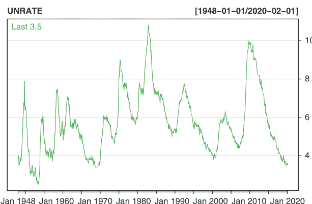

图 8.9 1948 年 1 月至 2020 年 2 月的美国月度失业率。该图由 R 包 quantmod 的 chartSeries 命令生成。

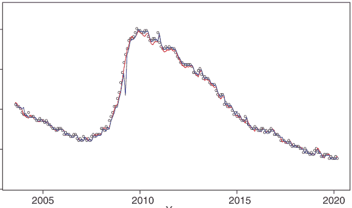

图 8.10 美国月度失业率预测子样本中观测数据（圆圈）、RNN 预测（蓝色）和 AR(13) 模型预测（红色）的时间图。

200 个数据点用于样本外比较。预测子样本从 2003 年 7 月到 2020 年 2 月。

作为基准模型，我们使用标量 AR(13) 模型。因此，我们使用 z_{t-1}, ..., z_{t-13} 作为 RNN 网络的输入变量，此外，我们使用三个大小为 (5,5,5) 的隐藏层。所选激活函数是包含偏置项的 logistic（即 sigmoid）函数。训练以 0.05 的学习率和 20 个 epoch 进行。图 8.10 显示了预测子样本中观测数据（圆圈）、RNN 预测（蓝色）和 AR(13) 预测（红色）的时间图。从图中可以看出，RNN 和标量 AR(13) 模型都能相当好地跟踪观测数据，但 RNN 在 2010 年左右有相对较大的偏差。标量 AR(13) 模型的均方根误差（RMSE）、平均绝对误差和中位绝对误差（MedAE）分别为 0.15、0.12 和 0.11。另一方面，RNN 的三个指标分别为 0.22、0.13 和 0.1。RNN 相对较大的 RMSE 是由前文提到的 2010 年左右的较大误差引起的。

### R 演示：RNN 包

```
> require(quantmod)
> require(rnn)
> getSymbols("UNRATE",src="FRED")
> chartSeries(UNRATE,theme="white")
> rate <- as.numeric(UNRATE[,1])
> x <- rate*100 ### change rate to integers
> require(SLBDD)
> mm <- rnnStream(x,h=13,nfore=200) #A R command to setup the input and
### output for the RNN neural network. See R scripts below.
> names(mm)
[1] "Xfit" "Yfit" "yp" "Xp" "X" "yfit" "newX"
### Xfit, Yfit, and newX are arrays in binary of length 8.
> Xo <- mm$X
```

```
> dim(Xo)
[1] 653 13
> yfit <- mm$yfit
> Xo=data.frame(Xo)
> newX=data.frame(mm$newX)
> m1 <- lm(yfit~.,data=Xo)
> m1
Call:
lm(formula = yfit ~ ., data = Xo) ## output truncated

Coefficients:
(Intercept)       zz        zz.1       zz.2       zz.3       zz.4       zz.5
0.880015    0.984881   0.223721   -0.053961   -0.068886   0.008282  -0.116379
        zz.8       zz.9      zz.10      zz.11      zz.12
-0.027701 -0.108302  0.131595  -0.140236   0.112020

> y1 <- predict (m1,newdata=newX)
> yp <- mm$yp  # observed rates
> mean(abs(yp-y1)) # should be divided by 10
[1] 1.195978
> sqrt(mean((yp-y1)^2))
[1] 1.499084
> median(abs(y1-yp))
[1] 1.076162
#
### > m2 <- trainr(Y=mm$Yfit,X=mm$Xfit,learningrate = 0.05,
###   hidden_dim = c(5,5,5),use_bias=TRUE,numepochs = 20)
Trained epoch: 1 - Learning rate: 0.05
Epoch error: 3.8143465630104
...
...
Trained epoch: 20 - Learning rate: 0.05
Epoch error: 2.12295450909187
> y2 <- predictr(m2,mm$Xp)
> y3 <- bin2int(y2) # convert back to integers
> mean(abs(yp-y3))
[1] 1.305
> sqrt(mean((yp-y3)^2))
[1] 2.164486
> median(abs(y3-yp))
[1] 1

> tdx <- c(6+c(1:200))/12+2003  ## x-axis for plotting
> plot(tdx,yp/10,xlab='year',ylab='rate',ylim=c(2.3,11),pch='o',cex=0.6)
> lines(tdx,y1/10,col="red")
> lines(tdx,y3/10,col="blue")
```

```
### Below is the R script of rnnStream
"rnnStream" <- function(z,h=25,nfore=200){
### z: input in integer values
### h: number of lags used as input
### nfore: data points in the testing subsample.
if(!is.integer(z))z=as.integer(z)
ist <- h+1
nT <- length(z)
y <- c( z[ist:nT] )
X <- NULL
for (i in 1:){
```


```r
zz <- z[(ist-i) : (nt-i)]
X <- cbind(X,zz)
}
### convert to binary
nobe <- length(y)
orig <- nobe-nfore
yp <- y[(orig+1):nobe]
yfit <- y[1:orig]
s <- NULL
for (i in 1:h){
  x1 <- int2bin(X[1:orig,i],length=8)
  s <- c(s,c(x1))
}
Xfit <- array(s,dim=c(orig,8,h))
Yfit <- int2bin(yfit,length=8)
Yfit <- array(Yfit,dim=c(orig,8,1))
##
s <- NULL
for (i in 1:h){
  x2 <- int2bin(X[(orig+1):nobe,i],length=8)
  s <- c(s,c(x2))
}
Xp <- array(s,dim=c(nfore,8,h))
rnnStream <- list(Xfit=Xfit,Yfit=Yfit,yp=yp,Xp=Xp,X=X[1:orig,],
                  yfit=yfit,newX=X[(orig+1):nobe,])
}
```

### 示例 8.5

在本示例中，我们也使用美国月度失业率序列。唯一的区别是，我们将新可用的 2020 年 3 月 1 日数据添加到该序列中。与之前一样，我们保留最后 200 个观测值用于样本外预测比较，并将 AR(13) 模型用作比较的基准模型。因此，训练样本包含 654 个观测值。在此特定实例中，我们尝试了多个 NN 模型，包括 (a) 13-64-32-1 NN、(b) 13-32-16-1 NN、(c) 13-16-4-1 NN 和 (d) 13-8-2-1 NN，其中 N1-N2-N3-1 表示网络具有 N1 个输入变量、第一个隐藏层有 N2 个神经元、第二个隐藏层有 N3 个神经元，以及输出层有一个神经元。在本研究中，我们为隐藏层使用 ReLU 激活函数，为输出层使用线性激活函数 f(x) = x。同样，我们使用均方误差作为损失函数。对于每个 NN 模型，训练设置为 500 个时代，但我们也采用了早停函数，如果损失函数的值下降不多，则提前停止。图 8.11 显示了 13-8-2-1 NN 的平均绝对误差随时代的变化。同时给出了训练和验证结果。在此，验证在每个时代使用训练数据的 20%。图显示训练的收敛相当迅速。

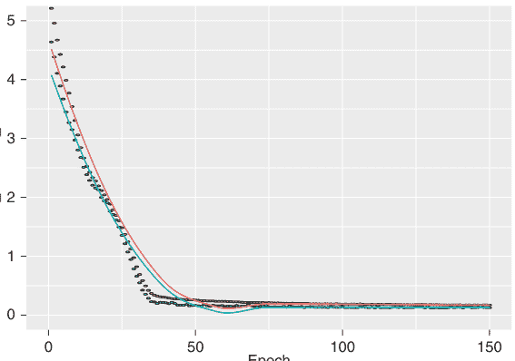

图 8.11 通过 keras 包对美国月度失业率进行 13-8-2-1 NN 训练的收敛情况。

### 表 8.1 月度美国失业率各 NN 模型的样本外表现

| 模型 | RMSE | MAE | MedAE | NP |
|---|---|---|---|---|
| 13-64-32-1 | 0.314 | 0.248 | 0.224 | 3009 |
| 13-32-16-1 | 0.361 | 0.255 | 0.149 | 993 |
| 13-16-4-1 | 0.258 | 0.197 | 0.158 | 369 |
| 13-8-2-1 | 0.169 | 0.130 | 0.108 | 133 |
| AR(13) | 0.161 | 0.123 | 0.107 | 14 |

RMSE、MAE、MedAE 和 NP 分别代表均方根误差、平均绝对误差、中位数绝对误差和参数数量。

使用 keras 包进行深度学习的 R 演示：读者可参阅 https://keras.rstudio.com 以获取更多信息。

```r
rate <- scan("unrate4820.txt") # load data
nT <- length(rate)
nfore <- 200 # number of data in the forecasting subsample
p <- 13
ist=p+1
Y <- rate[ist:nT]
X <- NULL
for (i in 1:p){
X <- cbind(X,rate[(ist-i):(nT-i)])
}
nobe <- nT-p
nfit <- nobe-nfore
x_train <- X[1:nfit,]
```

```r
y_train <- Y[1:nfit]
x_pred <- X[(nfit+1):nobe,]
y_pred <- Y[(nfit+1):nobe]
### Linear regression prediction
m1 <- lm(y_train~.,data=data.frame(x_train))
pm1 <- predict(m1,newdata=data.frame(x_pred))
rmse_lm <- sqrt(mean((y_pred-pm1)^2))
mae_lm <- mean(abs(y_pred-pm1))
med_lm <- median(abs(y_pred-pm1))
cat("lm results: (rmse,mae,med) : ",c(rmse_lm,mae_lm,med_lm),"\n")
```

```r
### standardize predictors for neural networks
x_train <- scale(x_train)
col_means_train <- attr(x_train,"scaled:center")
col_stddevs_train <- attr(x_train,"scaled:scale")
### standardize the predictor accordingly
x_pred <- scale(x_pred,center=col_means_train,scale=col_stddevs_train)
##
library(keras)
```

```r
build_mod <- function(){
model <- keras_model_sequential() %>%
layer_dense(units=8,activation="relu",input_shape=dim(x_train)[2]) %>%
layer_dense(units=2,activation="relu") %>%
layer_dense(units=1) %>%
}
```

```r
model %>% compile(
loss="mse",
optimizer=optimizer_rmsprop(),
metrics=list("mean_absolute_error")
)
```

```r
model
}
summary(model) # print out the model
```

```r
### display training progress by printing a single dot for each
### completed epoch
model <- build_mod()
model %>% summary()
print_dot_callback <- callback_lambda(
on_epoch_end=function(epoch,logs){
if (epoch %% 80==0) cat("\n")
cat(".")
})
```

```r
epochs <- 500 ## set number of training epochs
```

```r
### fit the model and store training stats
historyO <- model %>% fit(
x_train,
y_train,
epochs = epochs,
validation_split=0.2,
verbose = 0,
callbacks = list(print_dot_callback)
)
### visualize the result
library(ggplot2)
plot(historyO,metrics="mean_absolute_error",smooth=FALSE) +
  coord_cartesian(ylim=c(0,5))
### The patience is the amount of epochs to check for improvement
early_stop <- callback_early_stopping(monitor="val_loss",patience=20)
model <- build_mod()
history <- model %>% fit(
  x_train,
  y_train,
  epochs=epochs,
  validation_split=0.2,
  verbose=0,
  callbacks = list(early_stop,print_dot_callback)
)
plot(history,metrics="mean_absolute_error",smooth=FALSE) +
  coord_cartesian(xlim=c(0,150),ylim=c(0,5))
```

```r
### performance at the test
c(loss,mae) %<%- (model %>% evaluate(x_pred,y_pred,verbose=0))
print(paste0("Mean absolute error on test set: ",sprintf("%.2f",mae)))
##
predTest <- model %>% predict(x_pred)
#cat("predictions are in predTest","\n")
yp <- as.numeric(predTest[,1])
rmse_dl <- sqrt(mean((y_pred-yp)^2))
mae_dl <- mean(abs(y_pred-yp))
med_dl <- median(abs(y_pred-yp))
cat("DL model results: (rmse,mae,med): ",c(rmse_dl,mae_dl,med_dl),"\n")
```

### 8.4.2 Dropout 层

如示例 8.5 所示，对于所考虑的简单应用，神经元过多的网络效果可能不佳。另一方面，由于缺乏有关各个变量有效性的先验知识，人们可能希望尽可能多地使用输入变量。作为一种折衷方案，可以构建一些 dropout 层以减轻噪声输入的影响。通常，dropout 层包含一个比率，用于在网络训练中随机丢弃某些输入变量。为说明这一点，我们考虑示例 8.5 中的 13-32-16-1 NN。对于第二个隐藏层，我们添加了一个比率为 0.5 的 dropout 层并重新训练网络。在此特定实例中，我们不进行早停，训练网络 500 个时代。收敛情况如图 8.12 所示。该新网络在预测子样本中的 RMSE、MAE 和 MedAE 分别为 0.229、0.184 和 0.150。虽然结果仍不如简单的 13-8-2-1 网络好，但它们在 RMSE 和 MAE 方面相对于原始网络有了实质性改进。参见表 8.1。

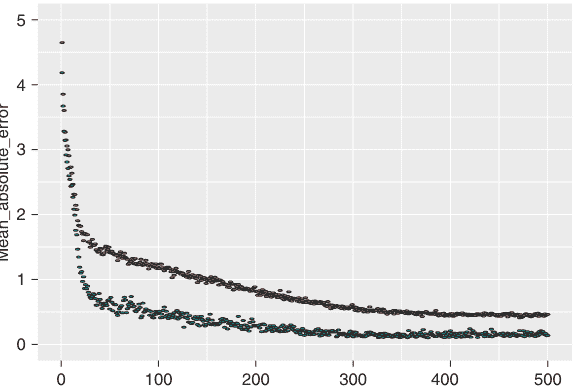

图 8.12 通过 keras 包对美国月度失业率进行带 dropout 的 13-32-16-1 NN 训练的收敛情况。

带 dropout 层的网络的 R 命令：与示例 8.5 使用相同的训练和预测子样本。

```r
build_mod <- function(){
  model <- keras_model_sequential() %>%
  layer_dense(units=32,activation="relu",input_shape=dim(x_train)[2]) %>%
  layer_dense(units=16, activation="relu") %>%
  layer_dropout(rate=0.5) %>% ## newly added dropout layer
  layer_dense(units=1)

model %>% compile(
  loss="mse",
  optimizer=optimizer_rmsprop(),
  metrics=list("mean_absolute_error")
)
model
}
summary(model) # print out the model
```

### 8.4.3 卷积网络的应用

为说明 DL 的另一个应用并考虑卷积 NN，我们考虑常用数据集 `MNIST`，该数据集涉及读取手写数字 {0, 1, ..., 9}。请参见 R 包 **keras** 和 **kerasR** 的文档。该数据集可在 R 包 **keras** 中获得，包含一个训练子样本和一个测试子样本。训练数据包含一个维度为 (60000,28,28) 的数组 X，用作预测变量，以及一个 60000 维向量 y（真实数字），作为响应变量。X 的每个面 X[i, .] 都是一个 28 × 28 矩阵，表示 [0,255] 范围内的灰度级，其中每个


代表一个手写数字。我们以两种方式分析这个分类问题，以评估卷积网络的效果。

首先，我们遵循 Keras 小教程中展示的方法，将每个 28 × 28 矩阵向量化为 784 维向量，并将灰度缩放到 [0,1] 范围。因此，在对 MNIST 数据的第一次分析中，预测变量位于一个 60000 × 784 数据矩阵中，响应是一个来自 {0, ..., 9} 的 60000 维数字向量。响应被视为具有 10 个类别的分类变量。从统计学上讲，响应是一个具有 10 个类别的因子。因此，在第一次分析中，我们将问题视为一维分类问题，深度学习（DL）已被证明对其有用。

我们指定一个具有五层的网络作为我们的第一个模型。第一层是具有 256 个神经元的全连接层，采用 ReLU 作为其激活函数。子命令 `input_shape` 指定输入维度。请注意，输入数据矩阵的第一维是从训练样本中识别出来的，因此 `input_shape` 参数从第二维 784 开始。第二层在我们的应用中是一个丢弃率为 0.4 的 dropout 层。第三层也是一个具有 128 个神经元的全连接层，采用 ReLU 作为其激活函数。随后是另一个丢弃率为 0.3 的 dropout 层。最后，输出层有 10 个神经元对应 10 个数字，并使用 `softmax` 激活函数。生成的 NN 模型拥有 235,146 个参数。

模型使用分类交叉熵作为损失函数进行编译，并将 `rmsprop` 用作训练的准则。然后我们运行 30 个 epoch 的训练，批量大小为 128，验证集分割概率为 0.2，这大约对应于五倍交叉验证。训练使用默认初始参数。图 8.13 显示了 30 个训练 epoch 的收敛情况。一旦网络训练完成，我们将其应用于测试子样本。在此特定情况下，准确率为 0.9811，效果很好。网络的分类结果详情如下：

```
> table(mnist$test$y,yhat)
yhat
  0  1  2  3  4  5  6  7  8  9
0 971  1  1  2  1  0  1  1  2  0
1  0 1125  3  1  0  0  2  1  3  0
2  3  0 1016  2  1  0  1  6  3  0
3  0  0  2 996  0  3  0  6  2  1
4  1  2  4  0 961  0  0  3  3  5
5  2  1  0  8  1 868  5  2  4  1
6  7  2  0  1  4  5 937  0  2  0
7  1  4  8  5  0  0  0 1006  2  2
8  1  1  3  4  4  3  0  4 951  3
9  1  2  0  7 10  2  0  6  1 980
```

```
> mean(mnist$test$y==yhat)
[1] 0.9811
```

从输出中，我们看到 9 和 4 偶尔会被混淆。7 和 2 以及 5 和 3 也是如此。这些误分类在手写数字中似乎是合理的。最后，R 命令及一些选定的输出在附带的 R 演示中给出。

### R 演示：MNIST 数据集的五层全连接网络：

```
> library(keras)
> mnist <- dataset_mnist()
> x_train <- mnist$train$x
> y_train <- mnist$train$y
> x_test <- mnist$test$x
> y_test <- mnist$test$y
> y_observed <- y_test
> observed <- y_test
> ## reshape the training from 28-by-28 images into 784 vectors
> x_train <- array_reshape(x_train,c(nrow(x_train),784))
> x_test <- array_reshape(x_test,c(nrow(x_test),784))
> ## rescale integers between 0 and 1.
> x_train <- x_train/255
> x_test <- x_test/255
>
> y_train <- to_categorical(y_train,10)
> y_test <- to_categorical(y_test,10)
> ## define a model
> mod <- keras_model_sequential()
> mod %>%
+   layer_dense(units=256,activation="relu",input_shape=c(784)) %>%
+   layer_dropout(rate=0.4) %>%
+   layer_dense(units=128,activation="relu") %>%
+   layer_dropout(rate=0.3) %>%
+   layer_dense(units=10,activation="softmax")
```

```
> ### print out mod
> summary(mod)
Model: "sequential_1"
```

| 层 (类型) | 输出形状 | 参数数量 |
|---|---|---|
| dense_2 (全连接层) | (None, 256) | 200960 |
| dropout_2 (Dropout 层) | (None, 256) | 0 |
| dense_3 (全连接层) | (None, 128) | 32896 |
| dropout_3 (Dropout 层) | (None, 128) | 0 |
| dense_4 (全连接层) | (None, 10) | 1290 |

```
===================================
Total params: 235,146
Trainable params: 235,146
Non-trainable params: 0
```

```
> mod %>% compile(
+ loss="categorical_crossentropy",
+ optimizer = optimizer_rmsprop(),
+ metrics=c("accuracy")
+)
```

```
> ### training and evaluation
> history1 <- mod %>% fit(
+ x_train, y_train,
+ epochs = 30, batch_size = 128,
+ validation_split = 0.2
+)
```

```
Train on 48000 samples, validate on 12000 samples
Epoch 1/30
48000/48000 [==============================] - 3s 58us/sample - loss: 0.4323 - acc: 0.8685 - val_loss: 0.1680 - val_acc: 0.9481
Epoch 2/30 ## output shortened.
```

```
> plot(history1)
'geom_smooth()' using formula 'y ~ x'
>
```

```
> mod %>% evaluate(x_test,y_test)
$loss
[1] 0.1094975
$acc
[1] 0.9811
```

```
> ### prediction
> yhat <- mod %>% predict_classes(x_test)
> table(mnist$test$y,yhat)
> mean(mnist$test$y==yhat)
[1] 0.9811
```

接下来，转向卷积神经网络。遵循 kerasR 的小教程，我们将 28 × 28 的灰度矩阵保留为二维 (2D) 图像，以便可以为卷积网络定义内核大小（或邻域）。具体来说，在我们的第二次分析中，我们使用一个八层卷积网络。第一层和第二层是卷积层，包含 32 个滤波器，内核大小为 (3,3)，激活函数为 relu（整线性单元）。由于我们保留了 28 × 28 矩阵，因此使用 input_shape=c (28, 28, 1)。第三层将前两层的输出合并在一起进行池化，池化大小为 (2,2)。第四层是丢弃率为 0.25 的 dropout 层，第五层是展平层，用于展平输入。第六层是具有 128 个神经元的全连接层，激活函数为 relu。第七层是丢弃率为 0.25 的 dropout 层，最后一层是具有 10 个神经元的全连接输出层，激活函数为 softmax，与之前相同。生成的网络拥有 600,810 个参数，其中大部分来自第六层的全连接网络。我们也使用分类交叉熵作为损失函数，准则为 rmsprop，与之前相同。卷积网络的训练在五个 epoch 中进行，验证集分割比例为 0.1。图 8.14 显示了五个训练 epoch 的收敛情况。尽管训练只使用了五个 epoch，但生成的网络表现良好。在测试子样本中，分类准确率为 0.9874，略高于第一次分析中使用的全连接网络。分类结果的详情如下：

```
> table(Y_test, Yhat) # See R commands below
  Yhat
Y_test   0   1   2   3   4   5   6   7   8   9
  0   972 0   0   0   0   0   5   1   1   0   0
  1   0   1133 1   0   0   1   0   0   0   0   0
  2   3   2   1019 0   3   0   2   3   0   0   0
  3   0   0   2   1003 0   2   0   1   2   0   0
  4   0   0   0   0   975 0   3   0   2   2   2
  5   3   1   0   5   0   877 4   0   0   2   2
  6   4   3   0   0   2   2   945 0   2   0   0
  7   1   2   10  2   0   1   0   1007 1   4   4
  8   3   1   2   1   1   0   2   1   962 1   1
  9   2   0   0   14  2   0   6   4   981
> mean(Y_test == Yhat)
[1] 0.9874
```

从结果中，我们看到，再次，9 和 4 偶尔会被混淆。7 和 2 也是如此。对于手写数字，这些错误是合理的。再次，使用的 R 命令和一些选定的结果在下面的 R 演示中给出。

### R 演示：MNIST 数据集的 2D 卷积网络：

```
> require(keras)
> mnist <- dataset_mnist()
> names(mnist)
[1] "train" "test"
> X_train <- array(mnist$train$x, dim = c(dim(mnist$train$x), 1))/255
```

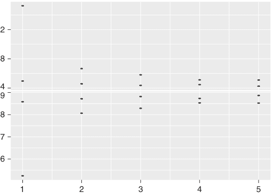

**图 8.14** MNIST 数据集卷积神经网络的收敛图。

```
> Y_train <- to_categorical(mnist$train$y, 10)
> X_test <- array(mnist$test$x, dim = c(dim(mnist$test$x), 1))/255
> Y_test <- mnist$test$y
> mod <- keras_model_sequential()
> mod %>%
+   layer_conv_2d(filters=32,kernel_size=c(3,3),activation="relu",
+     input_shape=c(28,28,1)) %>%
+   layer_conv_2d(filters=32,kernel_size=c(3,3),activation="relu",
+     input_shape=c(28,28,1)) %>%
+   layer_max_pooling_2d(pool_size=c(2,2)) %>%
+   layer_dropout(rate=0.25) %>%
+   layer_flatten() %>%
+   layer_dense(units=128,activation="relu") %>%
+   layer_dropout(rate=0.25) %>%
+   layer_dense(units=10,activation="softmax")
> summary(mod)
Model: "sequential"
```

| 层 (类型) | 输出形状 | 参数数量 |
| :--- | :--- | :--- |
| conv2d (卷积层) | (None, 26, 26, 32) | 320 |
| conv2d_1 (卷积层) | (None, 24, 24, 32) | 9248 |
| max_pooling2d (最大池化层) | (None, 12, 12, 32) | 0 |
| dropout (Dropout 层) | (None, 12, 12, 32) | 0 |


| 层 | 输出形状 | 参数 |
|---|---|---|
| flatten (Flatten) | (None, 4608) | 0 |
| dense (Dense) | (None, 128) | 589952 |
| dropout_1 (Dropout) | (None, 128) | 0 |
| dense_1 (Dense) | (None, 10) | 1290 |
| 总参数: 600,810 | | |
| 可训练参数: 600,810 | | |
| 不可训练参数: 0 | | |

```
> mod %>% compile(
+     loss = "categorical_crossentropy",
+     optimizer = optimizer_rmsprop(),
+     metrics = list("accuracy")
+ )
> history1 <- mod %>% fit(
+     X_train,
+     Y_train,
+     epochs = 5,
+     batch_size=32,
+     verbose=1,
+     validation_split=0.1
+ )
Train on 40000 samples, validate on 6000 samples
Epoch 1/5
54000/54000 [==============================] - 102s 2ms/sample -
loss: 0.1526 - acc: 0.9524 - val_loss: 0.0497 - val_acc: 0.9858
....
Epoch 5/5
54000/54000 [==============================] - 113s 2ms/sample -
loss: 0.0511 - acc: 0.9852 - val_loss: 0.0427 - val_acc: 0.9887
> plot(history1)
> mod %>% evaluate(X_train, Y_train, batch_size=32)
$loss
[1] 0.03316241
$acc
[1] 0.99025
> Yhat <- mod %>% predict_classes(X_test, batch_size=32)
> table(Y_test, Yhat)
> mean(Y_test == Yhat)
```

通过比较本节中使用的两个网络，我们可以看到卷积网络在分类任务中很有用。在这个特定应用中，这似乎是合理的，因为 28×28 矩阵中相邻的单元格包含关于手写数字的信息。事实上，矩阵中大部分单元格将为空（或灰度级为零），不包含任何信息。

**备注。** kerasR 包是 keras 与用户之间的接口。它简化了 keras 中的模型规范。不幸的是，在层规范中使用 input_shape 子命令读取整数时存在一些问题。本章我们使用 keras。

### 8.4.4 LSTM 的应用

为演示 LSTM 的应用，我们考虑著名的电影评论数据集 **IMDB**，该数据集也可从 **keras** 包中获取。因变量是二进制的“1”或“0”（赞成或反对），预测变量由评论者的评论组成。遵循该数据集常用的方法，我们对每条评论使用恰好 100 个单词。如果一条评论少于 100 个单词，则用编码为零的特殊单词进行填充。对预测变量的此类预处理可以使用该包的命令 `pad_sequences` 来完成。由于评论中的单词是相连的，RNN 和 LSTM 似乎很有用。我们首先用 RNN 开始分析。随后使用 LSTM 网络，以便评估 LSTM 的贡献。该数据集包含 5736 条评论，我们使用前 4000 条作为训练子样本，最后 1736 条作为测试子样本。预处理预测变量所使用的命令在附带的 R 演示中给出。

请记住，**keras** 具有许多内置网络层，我们使用顺序方法来构建网络。同样，有关更多细节，读者可参阅该包的文档和 vignettes。对于 RNN，我们首先使用一个嵌入层将数据整理成形状为 (100,32) 的数组。然后我们使用一个 reshape 层，以确保数据能够通过网络被正确处理。接下来是一个丢弃率为 0.25 的 dropout 层，以简化训练。我们使用 flatten 层来嵌入数据。接下来，我们应用一个具有 128 个神经元的 dense 层，激活函数为 `relu`（整流线性单元）。随后是另一个丢弃率为 0.25 的 dropout 层，以简化计算。最后，输出层是一个具有一个神经元和 sigmoid 激活函数的 dense 层。之所以如此，是因为我们的响应变量是二进制的。得到的 RNN 具有 425,857 个参数。

我们使用二元交叉熵作为损失函数、残差均方误差作为准则来训练 RNN。由于不同评论者的措辞各不相同，我们使用较小的学习率 0.00025。该学习率曾被 **kerasR** 包使用，尽管我们无法运行该包。我们以批量大小 32 和 0.1 的验证分割训练网络 30 个 epoch。图 8.15 显示了 30 个 epoch 的收敛情况。从图中可以看出，误差随 epoch 数量递减，但交叉验证表明我们可能应该更早停止。训练后，损失约为 0.075。对于测试子样本，我们得到以下结果：

```
> table(R_test, Rhat)
   Rhat
R_test   0   1
  0  608  193
  1  180  755
```

| | 0 | 1 |
|---|---|---|
| 0 | 608 | 193 |
| 1 | 180 | 755 |

> mean(R_test == Rhat)
[1] 0.7851382

这表明所采用的 RNN 对电影评论的成功率约为 78.5%。

接下来看 LSTM 网络。我们对 RNN 进行了几处修改。(a) 我们用具有 32 个神经元的 LSTM 层替换 flatten 层。(b) 我们将 dense 层增加到 256 个神经元。(c) 我们移除输出层之前的 dropout 层。所得到的

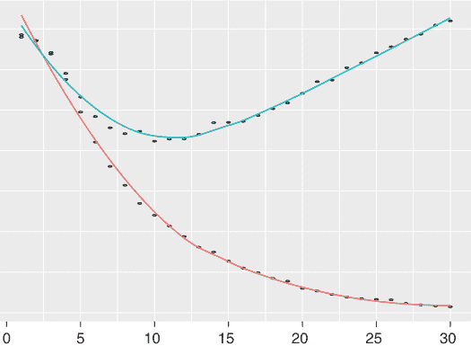

图 8.15 IMDB 数据集训练子样本（由前 4000 条评论组成）中 RNN 的收敛情况。

得到的 LSTM 网络具有 33,025 个参数，远小于 RNN 的参数数量。我们使用相同的损失函数和准则，但仅训练 LSTM 网络 10 个 epoch。图 8.16 显示了 LSTM 网络在 10 个 epoch 中的收敛情况。在此情况下，样本内和交叉验证曲线继续下降，表明我们可以稍微延长训练时间或使用更大的交叉验证率。我们进行了几次实验，但样本外

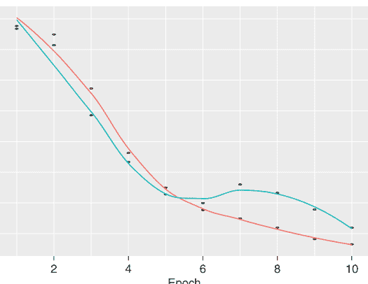

图 8.16 IMDB 数据集训练子样本（由前 4000 条评论组成）中 LSTM 的收敛情况。

预测似乎相似。对于测试子样本，LSTM 网络显示以下结果：

```
> table(R_test,Yhat2)
     Yhat2
R_test  0  1
   0 650 150
   1 135 800
```

| | 0 | 1 |
|---|---|---|
| 0 | 650 | 150 |
| 1 | 135 | 800 |

> mean(R_test==Yhat2)
[1] 0.8358295

这表明成功率为 83.6%，高于 RNN 网络。因此，在这种情况下，LSTM 似乎很有帮助。

### RNN 和 LSTM 网络的 R 命令及输出：

```
>library(keras)
### Load data and split into training and testing
>imdb <- dataset_imdb(num_words=500,maxlen=100)
> Z_train <- pad_sequences(imdb$train$x[1:4000],maxlen=100)
> R_train <- imdb$train$y[1:4000]
> Z_test <- pad_sequences(imdb$train$x[4001:5736],maxlen=100)
> R_test <- imdb$train$y[4001:5736]
### Network specification: RNN
> modi <- keras_model_sequential()
> modi %>%
+   layer_embedding(500,32,input_length=100) %>%
+   layer_reshape(target_shape=c(100,32),input_shape=c(100)) %>%
+   layer_dropout(rate=0.25) %>%
+   layer_flatten() %>%
+   layer_dense(units=128,activation="relu") %>%
+   layer_dropout(rate=0.25) %>%
+   layer_dense(units=1,activation="sigmoid")
> ## print the model
> summary(modi)
```

模型："sequential_9"

| 层 (类型) | 输出形状 | 参数数量 |
|---|---|---|
| embedding (Embedding) | (None, 100, 32) | 16000 |
| reshape (Reshape) | (None, 100, 32) | 0 |
| dropout (Dropout) | (None, 100, 32) | 0 |
| flatten (Flatten) | (None, 3200) | 0 |
| dense (Dense) | (None, 128) | 409728 |
| dropout (Dropout) | (None, 128) | 0 |
| dense (Dense) | (None, 1) | 129 |
| 总参数: 425,857 | | |
| 可训练参数: 425,857 | | |


非可训练参数: 0

```r
> ## compile the model
> mod1 %>% compile(
+   loss="binary_crossentropy",
+   optimizer=optimizer_rmsprop(lr=0.00025),
+ )
```

```r
> ## fit
> history2 <- mod1 %>% fit(
+   Z_train, R_train, batch_size=32, epochs=30, verbose=1,
+   validation_split=0.1
+ )
```

在 3600 个样本上训练，在 400 个样本上验证
轮次 1/30
3600/3600 [==============================] - 2s 529us/样本 - 损失: 0.6861 - 验证损失: 0.6797
.....
轮次 30/30
3600/3600 [==============================] - 1s 337us/样本 - 损失: 0.0144 - 验证损失: 0.7202

```r
> plot(history2)
`geom_smooth()` using formula 'y ~ x'
```

```r
> mod2 %>% evaluate(Z_train, R_train, batch_size=32)
4000/4000 [==============================] - 0s 58us/sample - loss: 0.0748
loss
0.07476683
```

```r
> Rhat <- mod1 %>% predict_classes(Z_test, batch_size=32)
> table(R_test, Rhat)
> mean(R_test == Rhat)
```

### 网络规范：LSTM 网络

```r
> mod2 <- keras_model_sequential()
> mod2 %>%
+   layer_embedding(500, 32, input_length=100) %>%
+   layer_reshape(target_shape=c(100, 32), input_shape=c(100)) %>%
+   layer_dropout(rate=0.25) %>%
+   layer_lstm(units=32) %>%
+   layer_dense(units=256, activation="relu") %>%
+   layer_dense(units=1, activation="sigmoid")
```

```r
> summary(mod2)
Model: "sequential_10"
```

| 层 (类型) | 输出形状 | 参数量 |
|---|---|---|
| embedding_10 (Embedding) | (None, 100, 32) | 16000 |
| reshape_9 (Reshape) | (None, 100, 32) | 0 |
| dropout_18 (Dropout) | (None, 100, 32) | 0 |
| lstm (LSTM) | (None, 32) | 8320 |
| dense_19 (Dense) | (None, 256) | 8448 |
| dense_20 (Dense) | (None, 1) | 257 |

==============================================================
总参数量: 33,025
可训练参数量: 33,025
非可训练参数量: 0
_________________________________________________________________

```r
> mod2 %>% compile(
+ loss="binary_crossentropy",
+ optimizer=optimizer_rmsprop(lr=0.00025),
+)
>
> history3 <- mod2 %>% fit(
+ Z_train, R_train, batch_size=32, epochs=10,
+ verbose=1, validation_split=0.1
+)
Train on 3600 samples, validate on 400 samples
Epoch 1/10
3600/3600 [==============================] - 7s 2ms/sample - loss: 0.6885 - val_loss: 0.6839
> plot(history3)
`geom_smooth()` using formula 'y ~ x'
>
> mod2 %>% evaluate(Z_train, R_train, batch_size=32)
loss
0.3006215
>
> Yhat2 <- mod2 %>% predict_classes(Z_test, batch_size=32)
> table(R_test, Yhat2)
> mean(R_test == Yhat2)
```

### 示例 8.6

为演示深度学习（DL）在经济数据分析中的应用，我们重新使用了来自 FRED 的月度宏观经济数据集。数据跨度为 1959 年 1 月至 2019 年 4 月。由于存在缺失值，且为实现平稳性使用了多种变换（如前文所述），我们使用 710 个观测值和 122 个变量。同样，我们使用 IP 指数的增长率作为因变量，并使用所有变量的滞后 1 至滞后 6 项作为预测变量。因此，我们的有效样本量为 704，预测变量为 732 个。我们进一步将数据分为 (a) 包含 504 个观测值的训练子样本和 (b) 包含 200 个观测值的预测子样本。

首先，作为基准模型，我们使用标量 AR(12) 模型。拟合模型为

```
y_t = 0.0014 + 0.264y_{t-1} + 0.136y_{t-2} + 0.133y_{t-3} + 0.080y_{t-4} - 0.12y_{t-5}
- 0.011y_{t-6} + 0.018y_{t-7} + 0.01y_{t-8} + 0.11y_{t-9} - 0.01y_{t-10}
- 0.002y_{t-11} - 0.089y_{t-12} + a_t, σ_a = 0.0068.
```

该模型对数据拟合效果相当好。例如，残差的 Ljung-Box 统计量显示 Q(24) = 22.55，p 值为 0.55。对于测试子样本，该 AR 模型的 RMSE、平均绝对误差（MAE）和中位数绝对误差（MedAE）分别为 0.0065、0.0046 和 0.0037。

其次，考虑 DL。我们对训练子样本的预测变量进行标准化，使每个预测变量的均值为 0，方差为 1。然后，我们基于训练子样本中预测变量的均值和标准误，对测试子样本的预测变量进行了转换。变换的详细信息见附带的 R 演示。我们尝试了一些 DL 模型，得到的最佳模型如下：这是一个具有六层的神经网络（NN）。第一层是含有 64 个神经元的全连接层，拥有 46,912 个参数。第二层是丢弃率为 0.4 的 Dropout 层，第三层也是含有 16 个神经元的全连接层。其后是另一个丢弃率为 0.25 的 Dropout 层。第五层是含有四个神经元的全连接层，最终输出层具有一个神经元和简单的线性激活函数。其他所有全连接层均采用 ReLU 作为激活函数。总体而言，该网络共有 48,025 个参数。图 8.17 显示了该网络在训练子样本上经过 100 个轮次的收敛图。损失函数和平均绝对误差均以 0.2 的交叉验证率显示。图表表明训练已收敛。对于测试子样本，该网络的 RMSE、MAE 和 MedAE 分别为 0.0070、0.0047 和 0.0036。这些结果与 AR(12) 模型的结果基本相同。我们尝试的其他 DL 模型的结果见表 8.2。从表中可以看出，DL 的性能似乎相对稳定，除了第一个拥有 103,137 个参数的模型外。

### DL 的 R 命令及部分输出：月度宏观经济数据集。

```r
> da <- read.csv("FREDMApril19.csv") #load data
> source("DLdata.R") # R scripts to formulate data, given below
> ml <- DLdata(da, forcerate=c(200/nrow(da), lag=6, locY=6))
> Xtrain <- ml$Xtrain
> Ytrain <- ml$Ytrain
> Xtest <- ml$Xtest
> Ytest <- ml$Ytest
```

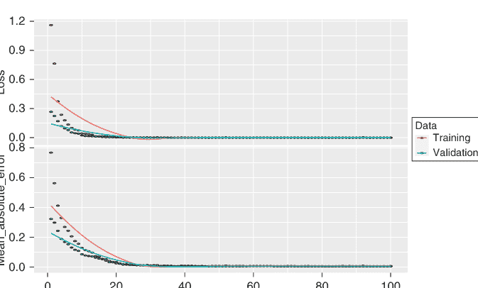

#### 图 8.17 示例 8.6 中六层 DL 网络的收敛情况。所用数据为美国月度宏观经济数据。

#### 表 8.2 月度宏观经济数据集中各六层 NN 的预测性能

| 模型 | 神经元数 | 丢弃率 | 神经元数 | 丢弃率 | 神经元数 | 神经元数 | RMSE | MAE | MedAE |
|---|---|---|---|---|---|---|---|---|---|
| 1 | 128 | 0.3 | 64 | 0.25 | 16 | 1 | 0.0224 | 0.0086 | 0.0040 |
| 2 | 64 | 0.3 | 32 | 0.25 | 4 | 1 | 0.0072 | 0.0049 | 0.0037 |
| 3 | 32 | 0.3 | 16 | 0.25 | 4 | 1 | 0.0073 | 0.0050 | 0.0038 |
| 4 | 64 | 0.4 | 16 | 0.25 | 4 | 1 | 0.0070 | 0.0047 | 0.0036 |
| AR | | | | | | | 0.0065 | 0.0046 | 0.0037 |

在表中，M 表示模型，Nod 表示神经元数量，rate 表示丢弃率，RMSE、MAE、MedAE 分别表示均方根误差、平均绝对误差和中位数绝对误差。

```r
> k <- ncol(Xtrain)
> k
[1] 732
> require(keras)
#### First DL model used.
> ## model specification
> mod <- keras_model_sequential()
> mod %>%
+ layer_dense(units=128, activation="relu", input_shape=c(k)) %>%
+ layer_dropout(rate=0.3) %>%
+ layer_dense(units=64, activation="relu") %>%
+ layer_dropout(rate=0.25) %>%
+ layer_dense(units=16, activation="relu") %>%
+ layer_dense(units=1)
> summary(mod)
Model: "sequential"
_________________________________________________________________
Layer (type) Output Shape Param #
=================================================================
dense (Dense) (None, 128) 93824
_________________________________________________________________
dropout (Dropout) (None, 128) 0
_________________________________________________________________
dense_1 (Dense) (None, 64) 8256
_________________________________________________________________
dropout_1 (Dropout) (None, 64) 0
_________________________________________________________________
dense_2 (Dense) (None, 16) 1040
_________________________________________________________________
dense_3 (Dense) (None, 1) 17
=================================================================
Total params: 103,137
Trainable params: 103,137
Non-trainable params: 0
_________________________________________________________________
> mod %>% compile(
+ loss="mse",
+ optimizer=optimizer_rmsprop(),
+ metrics=list("mean_absolute_error")
+)
```

```r
> print_dot_callback <- callback_lambda(
+   on_epoch_end=function(epoch,logs) {
+     if(epoch %% 80==0) cat("\n")
+     cat(".")
+   }
+ )
> ## train the model
> history <- mod %>% fit(
+ Xtrain,
+ Ytrain,
+ epochs = 100,
+ validation_split=0.2,
+ verbose = 0,
+ callbacks = list(print_dot_callback)
+ )
> ## visualize the training result
> plot(history)
'geom_smooth()' using formula 'y ~ x'
> ## Model evaluation (in sample)
> mod %>% evaluate(Xtrain,Ytrain,verbose=0)
```

$loss
[1] 2.478281e-05
$mean_absolute_error
[1] 0.003508422

```r
> ## prediction
> Yhat <- mod %>% predict(Xtest)
> RMSE <- sqrt(mean((Ytest-Yhat)^2))
> MAE <- mean(abs(Ytest-Yhat))
> MedAE <- median(abs(Ytest-Yhat))
> cat("RMSE, MAE, MedAE: ",c(RMSE,MAE,MedAE),"\n")
RMSE, MAE, MedAE: 0.02237929 0.008638669 0.004014824
> ## 4th model used
```

```r
> mod <- keras_model_sequential() %>%
+   layer_dense(units=64, activation="relu", input_shape=c(k)) %>%
+   layer_dropout(rate=0.4) %>%
+   layer_dense(units=16, activation="relu") %>%
+   layer_dropout(rate=0.25) %>%
+   layer_dense(units=4, activation="relu") %>%
+   layer_dense(units=1)
> ## print out the model
> summary(mod)
```

| 层 (类型) | 输出形状 | 参数量 |
|---|---|---|
| dense_12 (Dense) | (None, 64) | 46912 |
| dropout_6 (Dropout) | (None, 64) | 0 |
| dense_13 (Dense) | (None, 16) | 1040 |
| dropout_7 (Dropout) | (None, 16) | 0 |
| dense_14 (Dense) | (None, 4) | 68 |
| dense_15 (Dense) | (None, 1) | 5 |


总参数：48,025
可训练参数：48,025
非可训练参数：0

```r
#### compile the model
mod %>% compile(
  loss="mse",
  optimizer=optimizer_rmsprop(),
  metrics=list("mean_absolute_error")
)
#### command to show training status
print_dot_callback <- callback_lambda(
  on_epoch_end=function(epoch,logs) {
    if(epoch %% 80==0) cat("\n")
    cat(".")
  }
)
```

```r
#### train the model
history <- mod %>% fit(
  Xtrain,
  Ytrain,
  epochs = 100,
  validation_split=0.2,
  verbose = 0,
  callbacks = list(print_dot_callback)
)
```

```r
plot(history)
#% Model evaluation (in sample)
mod %>% evaluate(Xtrain,Ytrain,verbose=0)
```

$loss
[1] 7.85964e-05
$mean_absolute_error
[1] 0.005820423

```r
#% prediction
Yhat <- mod %>% predict(Xtest)
RMSE <- sqrt(mean((Ytest-Yhat)^2))
```

```r
MAE <- mean(abs(Ytest-Yhat))
MedAE <- median(abs(Ytest-Yhat))
cat("RMSE, MAE, MedAE: ", c(RMSE,MAE,MedAE), "\n")
```

RMSE, MAE, MedAE: 0.007001048 0.004705776 0.003581634

```r
### DLdata R script
"DLdata" <- function(da,forerate=0.2,locY=1,lag=1){
#### Input:
#### da: data matrix T-by-k matrix
#### forerate: fraction of sample size to form testing sample
#### locY: locator for the dependent variable.
#### lag: number of lags to be used to form predictors
#### output:
#### Xtrain: standardized predictors matrix
#### Ytrain: dependent variable in training sample
#### Ytest: predictor in testing sample, standardized according to X_train
#### Ytest: dependent variable in the testing sample
#
if(!is.matrix(da))da <- as.matrix(da)
k <- ncol(da)
nT <- nrow(da)
name <- colnames(da)
if(is.null(name)) name <- paste("Y",1:k,sep="")
nfore <- floor(forerate*nT)
nobe <- nT-lag
ist <- lag:1
if(nfore < nobe) {
ntrain <- nobe-nfore
} else {nfore=0
ntrain=0
cat("Not enough data for testing","\n")
}
Xtrain = Ytrain = Xtest = Ytest <- NULL
if(nfore > 0) {
Y <- da[ist:nT,locY]
X <- NULL
na <- NULL
nb <- paste(name,"L",sep="")
for (i in 1:lag) {
X <- cbind(X,da[(ist-i):(nT-i),])
na <- c(na,paste(nb,1:k,sep=""))
}
colnames(X) <- na
Xtrain <- X[1:ntrain,]
Ytrain <- Y[1:ntrain]
Xtest <- X[(ntrain+1):nobe,]
Ytest <- Y[(ntrain+1):nobe]
#### standardization of predictors in training sample
#### Also, the same standardization of predictors in the test sample.
Xtrain <- scale(Xtrain,center=TRUE,scale=TRUE)
col_means_train <- attr(Xtrain,"scaled:center")
col_sds_train <- attr(Xtrain,"scaled:scale")
Xtest <- scale(Xtest,center=col_means_train,scale=col_sds_train)
}
list(Xtrain=Xtrain,Ytrain=Ytrain,Xtest=Xtest,Ytest=Ytest,nfore=nfore)
}
```

## 8.5 深度生成模型

在文献中，已经为深度学习提出了各种生成模型。它们包括玻尔兹曼机、受限玻尔兹曼机、深度置信网络和深度玻尔兹曼机。不同模型服务于不同目的。例如，玻尔兹曼机是一种随机循环神经网络，已应用于认知科学。参见 Hinton (2007)。通常，网络是对称连接的，每个神经元（状态）都是二进制的。与网络相关联的能量函数，且可见节点与隐藏节点之间的每个连接都被分配一个概率。概率由训练样本中网络的权重和偏差决定。因此，能量函数是统计术语中的目标函数。我们将不讨论这些生成模型，因为我们的重点是对依赖数据进行预测。有兴趣的读者请参阅 Goodfellow et al. (2016)。

## 8.6 强化学习

强化学习（RL）是机器学习的另一个领域，关注程序（或机器或代理）应如何在环境中采取行动（或决策），以最大化某个明确定义的累积奖励。它是三种基本机器学习之一，与监督学习和无监督学习并列。RL 的良好参考文献是 Sutton and Barto (2018)。

强化学习是一种理解和自动化目标导向学习与决策的计算方法。它通过强调代理与环境的直接交互以及专注于实现长期目标，将其与其他机器学习方法区分开来。它使用马尔可夫决策过程，利用状态、行动和奖励的概念来定义代理与其环境之间的交互。它是统计文献中多臂老虎机问题的扩展。举个例子，考虑一名围棋选手。她通过（a）规划和预判可能的回应和反击，以及（b）在特定时刻（环境）可供她选择的特定棋局和走法的可取性来落子。目标是赢得比赛，在过程中她可能会以一定的小概率采取一些次优走法来探索环境，因为她的走法会导致环境的变化，从而影响她后续走法的选择。

可以将 RL 视为一个决策者（或代理），它在一系列观察中与环境交互，并选择行动以最大化随时间变化的奖励。因此，RL 模型由一个有限的环境状态集合（记为 $S$）、一个有限的代理行动集合（记为 $A$）和一组标量奖励（记为 $R$）组成。在时间（或步骤）$t$，代理观察环境的某个表示，例如 $s_t \in S$。然后，代理选择一个动作 $a_t \in A(s_t)$，其中 $A(s_t) \subset A$ 是状态 $s_t$ 下可用动作的集合。在选择动作 $a_t$ 后，代理接收一个奖励 $r_{t+1}$ 并观察一个新状态 $s_{t+1}$。从描述来看，状态序列 $\{s_t\}$ 是动态依赖的。

RL 的目标是采取一系列行动以最大化总奖励

$R = \sum_{t=0}^{\infty} \gamma^t r(s_t, a_t)$，

其中 $\gamma$ 被称为折扣因子，其值介于 0 和 1 之间。在商业和经济学文献中，折扣因子是众所周知的，并与未来奖励的现值相关联。

强化学习已在许多工程领域找到应用，但在商业和经济学中应用较少。一个相关应用是 Jin et al. (2018) 中的展示广告。关于 RL 算法的良好参考，读者请参阅 Szepesvari (2010)。R 中存在一个名为 reinforcementlearning 的近期包用于运行 RL。然而，由于 RL 尚未成为商业和经济学中大规模依赖数据分析的重要领域，我们将该主题的详细讨论推迟到未来。

## 练习

- 1. 考虑示例 8.4 中使用的美国月度宏观经济数据。使用相同的训练和测试子样本，并应用下面的深度学习网络

```r
mod <- keras_model_sequential()
mod %>%
  layer_dense(units=32, activation="relu", input_shape=c(k)) %>%
  layer_dropout(rate=0.4) %>%
  layer_dense (units=16, activation="relu") %>%
  layer_dropout (rate=0.25) %>%
  layer_dense (units=16, activation="relu") %>%
  layer_dropout (rate=0.25) %>%
  layer_dense (units=4, activation="relu") %>%
  layer_dense (units=1)
```

测试子样本中的根平均平方误差、平均绝对误差和中位数绝对误差是多少？将结果与示例 8.4 中的结果进行比较。

- 2. 同样，考虑示例 8.4 中使用的美国月度宏观经济数据集，但使用失业率（UNRATE）作为因变量。应用深度学习网络以获得测试子样本中的预测。计算预测的根平均平方误差、平均绝对误差和中位数绝对误差。将结果与示例 8.3 中的结果进行比较。额外的预测变量对预测失业率是否有帮助？

- 3. 将随机森林应用于示例 8.2 中的月度宏观经济数据集，但使用失业率作为因变量。你可以尝试不同的 mtry 和 ntree 选择。

- 4. 考虑文件 unrate4820.txt 中 1948 年至 2020 年的美国月度失业率序列。使用该序列的滞后 1 到滞后 24 作为预测变量，为美国失业率构建树模型。

- 5. 考虑第 8.4.4 节中使用的 IMDB 数据集。使用前 4500 个观测作为训练子样本，最后 1236 个观测作为测试样本。重复第 8.4.4 节的分析。LSTM 网络对电影评分是否有帮助？

## 参考文献

- Alonso, A. M., Peña, D., and Romo, J. (2004). 引导法中引入模型不确定性. Statistica Sinica, 14: 155–174.
- Belsley, D. A., Kuh, E., and Welsch, R. E. (2005). 回归诊断：识别有影响力的数据和多重共线性来源. Wiley, New York.
- Breiman, L. (2001). 随机森林. Machine Learning, 45: 5–32.
- Breiman, L., Friedman, J. H., Olshen, R. A., and Stone, C. J. (1984). 分类与回归树. Chapman and Hall/CRC, New York.
- Chipman, H. A., George, E. I., and McCulloch, R. E. (2010). BART：贝叶斯加法回归树. The Annals of Applied Statistics, 4: 266–298.
- Chollet, F. and Allaire, J. J. (2020). 使用 R 进行深度学习. Manning, Shelter Island, NY.
- Cybenko, G. (1989). Sigmoidal 函数的叠加逼近. Mathematics of Control, Signals, and Systems, 2: 303–314.
- Elman, J. L. (1990). 时间中的结构发现. Cognitive Science: A Multidisciplinary Journal, 14: 179–211.
- Goodfellow, I., Bengio, Y., and Courville, A. (2016). 深度学习. MIT Press, Boston, MA.
- Hammer, B. (2007). 使用循环神经网络进行学习. Lecture Notes in Control and Information Sciences 254. Springer, London, UK.
- Hammer, B., Micheli, A., and Sperduti, A. (2005). 级联相关的结构通用逼近能力. Neural Computation, 17: 1109–1159.


Hanin, B. 和 Sellke, M. (2017). 用最小宽度ReLU网络逼近连续函数. arXiv:1710.11278.

Hastie, T., Tibshirani, R., 和 Friedman, J. (2001). *统计学习基础*. Springer, New York.

He, J., Yalov, S., 和 Hahn, P. R. (2018). XBART: 加速的贝叶斯加法回归树. arXiv: 1810.02215.

Hinton, G. (2007). 玻尔兹曼机. *Scholarpedia*, **2**: 1668.

Hinton, G. (2012). *机器学习神经网络*. 课程, 视频讲座.

Ho, T. K. (1995). 随机决策森林. 发表于《第3届国际文档分析与识别会议论文集》. 蒙特利尔, QC, 1995年8月14–16日. 页: 278–282.

Hochreiter, S. 和 Schmidhuber, J. (1997). 长短期记忆. *神经计算*, **9**: 1735–1780.

Hornik, K. (1991). 多层前馈网络的逼近能力. *神经网络*, **4**: 251–257.

Hornik, K., Stinchcombe, M., 和 White, H. (1989). 多层前馈网络是通用逼近器. *神经网络*, **2**: 359–366.

Jin, J., Song, C., Li, H., Gai, K., Wang, J., 和 Zhang, W. (2018). 基于多智能体强化学习的展示广告实时竞价. arXiv: 1802.09756.

Jordan, M. I. (1997). 序列顺序: 一种并行分布式处理方法. *心理学进展*, **121**: 471–495.

Kalchbrenner, N., Grefenstette, E., 和 Blunsom, P. (2014). 用于句子建模的卷积神经网络. arXiv: 1404.2188v1.

Kingma, D. 和 Ba, J. (2014). Adam: 一种随机优化方法. arXiv: 1412.6980.

Kolmogorov, A. N. (1957). 关于通过单变量连续函数的叠加和加法来表示多变量连续函数. *苏联科学院院刊（多克拉丁）*, **114**: 953–956.

Lahiri, S. N. (2013). *依赖数据的重采样方法*. Springer Science and Business Media, New York, NY.

Lawrence, S., Giles, C. L., Tsoi, A. C., 和 Back, A. D. (1997). 人脸识别: 一种卷积神经网络方法. *IEEE神经网络汇刊*, **8**: 98–113.

Lu, Z., Pu, H., Wang, F., Hu, Z., 和 Wang, L. (2017). 神经网络的表达能力: 从宽度角度看. 发表于《神经信息处理系统进展》, **30**: 6231–6239. Curran Associates, Inc.

Menezes Jr, J. M. P. 和 Barreto, G. A. (2008). 基于NARX网络的长期时间序列预测: 一种经验评估. *神经计算*, **71**: 3335–3343.

Mikolov, T., Karafiát, M., Burget, L., Cernocky, J., 和 Khudanpur, S. (2010). 基于循环神经网络的语言模型. 发表于《第十一届国际语音通信协会年会》, 页. 1045–1048. 日本千叶县马库哈里.

Polyak, B. T. (1964). 加速迭代方法收敛的一些方法. *苏联计算数学与数学物理*, **4**: 1–17.

Riedmiller, M. 和 Braun, H. (1993). 一种用于更快反向传播学习的直接自适应方法: RPROP算法. *IEEE神经网络国际会议*, **1**: 586–591.

Schmidhuber, J. (2015). 神经网络中的深度学习: 一种概述. *神经网络*, **61**: 85–117.

Siegelmann, H. T., Horne, B. G., 和 Giles, C. L. (1997). 循环NARX神经网络的计算能力. *IEEE系统、人与控制论汇刊, 部分B (控制论)*, **27**: 208–215.

Sutton, R. S. 和 Barto, A. G. (2018). 强化学习: 导论, 第2版. MIT出版社. 剑桥, MA.
Szepesvari, C. (2010). 强化学习算法. Morgan & Claypool, San Rafael, CA.
Zaremba, W., Sutskever, I., 和 Vinyals, O. (2015). 循环神经网络正则化. arXiv: 1409.23329v5.
