# 9 时空相关数据

相关数据以多种方式出现，最常见的是随时间采集的观测数据，这些数据一直是前几章的主要关注点。在这里，我们转向另一种常见的相关数据类型，即在空间不同位置采集的观测数据。空间可以是地理空间、社会经济空间或网络空间。例如，考虑一个给定的地理区域，如加利福尼亚州或美国中西部。2019年10月1日加利福尼亚州各县的日平均气温，以及2020年1月1日上午8:00美国中西部所有监测站的PM2.5测量值，是空间相关数据的两个示例。这些数据被称为空间数据。令 $s_i$ 表示空间中的第 $i$ 个位置，例如 $s_i = (\text{纬度}_i, \text{经度}_i)$，并令 $t_{ij}$ 表示在位置 $s_i$ 处采集的第 $j$ 个数据点的时间。我们可以将数据表示为 $z(s_i, t_{ij})$。

最简单的空间数据是那些对所有位置 $s_i$ 的 $t_{ij}$ 相同的数据，可以写为 $\{z(s_i)|i = 1, ..., m\}$，其中 $m$ 是研究的位置数量。这种数据可以被视为感兴趣变量在空间上的快照。另一方面，假设在每个位置 $s_i$ 上我们有多个观测值，那么观测值采集的时间点就变得重要，我们可以将数据集合表示为 $\{z(s_i, t_{ij})|i = 1, ..., m; j = 1, ..., n_i\}$，其中 $n_i$ 是一个正整数，表示位置 $s_i$ 的样本量。这种数据被称为时空（S-T）数据。如果对所有 $i$ 都有 $t_{ij} = t_j$ 且序列 $\{t_j\}$ 是等距时间点，那么数据 $\{z_{t_i} = [z(s_1, t_j), z(s_2, t_j), ..., z(s_m, t_j)]'\}$ 类似于第3章讨论的m维向量时间序列。总体而言，对于大多数S-T数据，$s_i$ 可以在空间上不规则分布，$\{t_{ij}\}$ 可以在时间上不规则分布。

对S-T数据的分析在文献中有着悠久的历史，该主题有几本优秀的书籍可供参考。有兴趣的读者可参阅 Cressie (1993)、Cressie 和 Wikle (2011)、Diggle (2013) 以及 Wikle et al. (2019)。位置 $s = s_i$ 和时间 $t = t_{ij}$ 处的S-T数据 $\{z(s_i, t_{ij})\}$ 是S-T随机过程 $\{Y(s, t)\}$ 的实现。通常，$s \in \mathbb{R}^d$，其中 $d=2$ 或 $d=3$。在本章中，我们简要研究这些过程的性质及S-T数据的分析。我们的目标是向读者介绍这一重要主题，探索空间和S-T数据的特征，并展示其应用。为此，我们充分利用了 Wikle et al. (2019) 的最近著作及其配套的 R 程序包 STRbook。我们还利用了几个用于空间-时序数据分析的有用 R 程序包，如 sp、gstat、SpatPCA、autoFRK 和 SpatioTemporal。

与多元或高维时间序列分析类似，研究S-T数据的目标包括（a）空间预测（包括平滑和滤波）、（b）时间预测，以及（c）理解各种S-T过程之间的关系。然而，S-T分析与多元时间序列分析之间存在一些差异。在S-T分析中，人们通常希望在没有可用数据的位置对感兴趣变量进行预测。例如，有人可能希望评估一所附近没有监测站的小学附近的PM2.5测量值。另一方面，这两种分析共享相同的基本概念和统计基础。

## 9.1 时空数据的示例与可视化

首先，我们考虑一些S-T数据的示例，包括两个来自 Wikle et al. (2019) 的数据集，可在 Zammit-Mangion (2018a) 的 R 程序包 STRbook 中获得。这些数据集将在本章中用于演示S-T分析。

- 1. NOAA每日天气数据: 原始数据来自美国国家海洋和大气管理局（NOAA）国家气候数据中心，可从哥伦比亚大学的IRI/LDEO气候数据库获取。¹ 遵循 Wikle et al. (2019)，我们考虑四个变量：日最高气温（Tmax）、最低气温（Tmin）和露点温度（TDP），单位均为华氏度（°F），以及美国中部138个气象站（介于32°N–46°N和80°W–100°W之间）的降水量（英寸），记录年份为1990年至1993年（含首尾）。我们将此数据集称为NOAA数据集，可直接从STRbook程序包获取。

- 2. 海表温度异常: 这些海表温度（SST）异常数据来自NOAA气候预测中心，也可从哥伦比亚大学的IRI/LDEO气候数据库获取。² 数据以2°×2°分辨率分格，范围从124°E–70°W到30°S–30°N，表示相对于1970年1月至2003年12月气候学（时间平均）的月度异常值。同样，此数据集来自STRbook程序包。


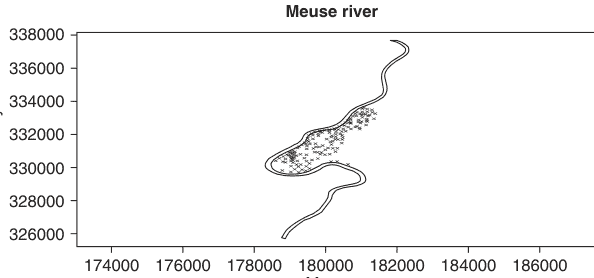

图 9.1 荷兰村庄施泰因附近的默兹河及其观测站。

- 3. 美国中西部臭氧数据：1987年6月3日至8月31日期间，美国中西部153个站点的地表臭氧测量值（单位：十亿分之一，PPB）的每日8小时平均值（上午9点至下午4点），共89天。该数据集可从R包fields获取。另见Nychka et al. (1998)。

- 4. 默兹河数据集：这是空间数据的一个良好示例。观测站的表土重金属浓度，以及若干土壤和地貌变量，均在荷兰村庄施泰因附近的默兹河泛滥平原上采集。重金属浓度来自面积约15米×15米的区域的混合样本。它们包括镉、铜、铅和锌。观测位置的坐标也已给出，x表示Rijksdriehoek（RDH，荷兰地形图坐标）中的东向坐标（米），y表示RDH坐标中的北向坐标（米）。该数据集可在多个R包中获取，如sp和gstat。有关数据的更多详情，请参见Burrough and McDonnell (1998)。共有155个观测值，涉及14个变量。图9.1绘制了部分默兹河及其观测站的位置。

- 5. 空气污染物每小时浓度测量：数据为2006年1月1日至2015年12月31日期间，台湾71个监测站的各种空气污染物每小时浓度测量值。数据可从台湾行政院环境保护署获取。所考虑的空气污染物包括PM2.5、PM10、NO2、SO2和CO。本章重点关注PM2.5浓度（µg/m3）测量。图9.2显示了2019年9月26日上午9点各监测站的快照。在图中，使用不同的符号和颜色来指示每个监测站的空气质量指数，其中绿色（圆圈）、黄色（正方形）和红色（三角形）分别表示良好、中度和差的空气质量。

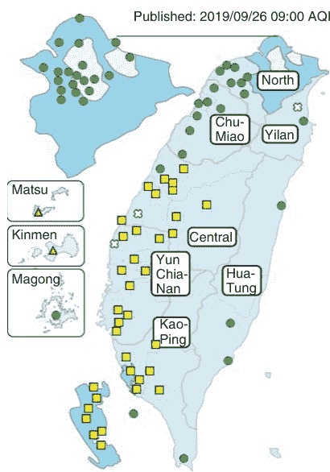

图 9.2 2019年9月26日上午9点，台湾各监测站的空气质量指数。绿色圆圈、黄色正方形和红色三角形分别表示良好、中度和差的空气质量指数。

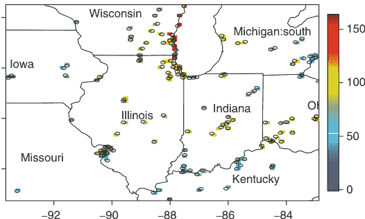

图 9.3 1987年6月18日，美国中西部153个站点的臭氧测量值（PPB）每日8小时平均值（上午9点至下午4点）。圆圈表示站点，臭氧测量值以彩色方块表示。

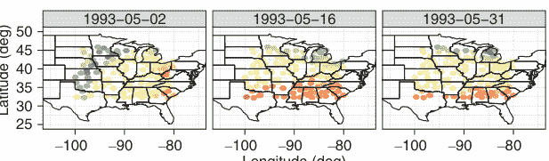

图 9.4 美国中部138个气象站的日最高气温。气温分别为1993年5月2日（左）、5月16日（中）和5月31日（右）。

从图中可以清楚地看出，高臭氧浓度集中在北伊利诺伊州和南威斯康星州密歇根湖西岸沿线城市附近。

图9.4提供了美国中部138个气象站在1993年5月三个选定日期的日最高气温空间图。如预期，图示表明日最高气温在南部较高，北部较低。另一方面，东西方向的日最高气温模式不够明显。图还表明，日最高气温存在显著的时间变化。

图9.2–9.4是空间图的示例。它们代表了所关注空间信息的快照。图9.5显示了10个随机选定气象站的日最高气温时间序列图。这些时间序列图显示了1993年5月1日至9月30日期间日最高气温（°F）的时间演变。每个图的灰色标题中的数字表示站点ID。图9.6显示了台湾高屏地区三个随机选定监测站的每小时PM2.5浓度（μg/m3）时间图。参见图9.2。这些图清晰地展示了PM2.5浓度的季节性模式（或年度周期）。它们还表明，在实证应用中存在缺失值，部分数据呈片段状缺失。图9.5和9.6是时间序列图的示例，显示了数据的时间依赖性，并在前几章中被广泛使用。

图9.7显示了NOAA数据集中1993年5月1日至9月30日期间日最高气温（°F）的经度（左）和纬度（右）坐标的霍夫缪勒图。在图中，数据经过插值，使得经度或纬度具有25个等间距点，而时间具有120个等间距点。霍夫缪勒图（Hovmöller, 1949）是一种二维空间-时间可视化方法，其中空间被折叠到一维，第二维表示时间。从图中可以看出，时间趋势随经度（左图）基本保持不变，但随纬度增加（右图）显著降低。这是可以理解的，因为在美国本土，总体日最高气温随纬度增加而降低。另请参见图9.4中的模式。

最后，本章用于创建S-T图的R包和命令载于附录9.A。另请参见Wikle et al. (2019)中的实验工作。

本章组织如下。第9.2节介绍空间过程和空间数据分析。第9.3节侧重于地统计过程及其

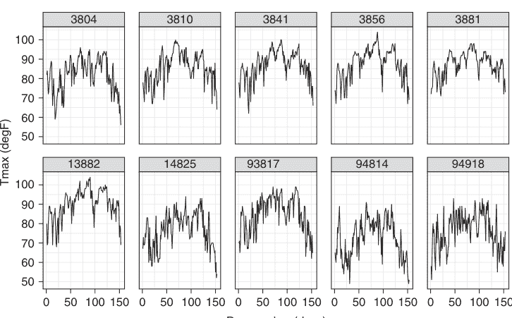

图9.5 NOAA数据集中10个随机选定站点的日最高气温（°F）。x轴表示从1993年5月1日至9月30日的时间序列。每个图的灰色标题中的数字表示站点ID。

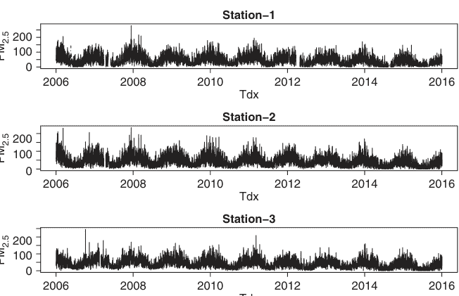

图9.6 2006年1月1日至2015年12月31日期间，台湾高屏地区三个随机选定站点的每小时PM2.5浓度测量值，共87,648个观测值。

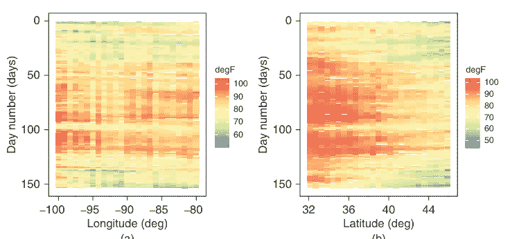

图9.7 NOAA数据集中1993年5月1日至9月30日期间日最高气温（°F）的经度（左）和纬度（右）坐标的霍夫缪勒图。来源：NOAA（美国国家海洋和大气管理局）数据集。

性质。它还介绍了变异函数和三种克里金方法。第9.4节讨论格点过程，而第9.5节介绍空间点过程。第9.6节研究S-T过程并将空间方法扩展到S-T方法。第9.8节为S-T数据提供了各种描述模型，包括使用S-T基函数和空间主成分分析。最后，第9.9节简要讨论动态S-T模型。附录9.A给出了一些用于绘制空间或S-T数据的R命令。

## 9.2 空间过程和数据分析

分层模型（HM）是空间数据分析的一种有用统计框架。参见Cressie and Wikle (2011)。在HM框架下，数据是从具有噪声的底层空间过程观测得到的。然后空间过程取决于带有一些未知参数的一些协变量，并遵循一个明确指定的分布函数。然后可以通过贝叶斯分析或常规最大似然方法进行统计推断。有关更多详情，请参见下文。

令\(D \subset R^d\)为感兴趣的\(R^d\)中的区域，空间过程为\(\{Y(\boldsymbol{s}) | \boldsymbol{s} \in D \}\)。区域\(D\)称为\(Y(\boldsymbol{s})\)的域。假设在已知位置\(\{\boldsymbol{s}_1, \dots, \boldsymbol{s}_m \}\)处观测到带噪声的观测值，数据模型为

```
Z(\boldsymbol{s}_i) = Y(\boldsymbol{s}_i) + \epsilon(\boldsymbol{s}_i), \quad i = 1, \dots, m, \qquad (9.1)
```

其中\(\epsilon(\boldsymbol{s})\)是\(\boldsymbol{s} \in D\)上的白噪声过程，且与\(Y(\boldsymbol{s})\)独立。通常，白噪声意味着\(E[\epsilon(.)] = 0\)，\(\text{Var}[\epsilon(.)] = \sigma_\epsilon^2 > 0\)，且若\(\boldsymbol{s}_1 \neq \boldsymbol{s}_2\)，则\(\text{Cov}[\epsilon(\boldsymbol{s}_1), \epsilon(\boldsymbol{s}_2)] = 0\)。\(\epsilon(\boldsymbol{s})\)过程可被视为测量误差。令\(\boldsymbol{Z} = \{ z(\boldsymbol{s}_i) | i = 1, \dots, m \}\)为数据集。在地统计学中，一个重要的问题是基于平方误差，在已知位置\(\boldsymbol{s}_0\)处获取\(Y(\boldsymbol{s}_0)\)的最优空间预测值。


损失和数据 \(\mathbf{Z}\)。最优预测器是 \(E[Y(\mathbf{s}_0)|\mathbf{Z}]\)。在某些特殊情况下，人们可能对 \(E[Z(\mathbf{s}_0)|\mathbf{Z}]\) 感兴趣。注意 \(E[Y(\mathbf{s}_0)|\mathbf{Z}] = E[Z(\mathbf{s}_0)|\mathbf{Z}]\)，但这两个条件期望具有不同的性质，且用途不同。

在讨论数据分析之前，我们先介绍空间过程 \(Y(\mathbf{s})\) 的一些基本概念，其中 \(\mathbf{s} \in D \subset R^d\)，且假设 \(D\) 在 \(R^d\) 中具有正体积。如果过程 \(Y(\mathbf{s})\) 满足下列条件，则称为二阶平稳：

\(E[Y(\mathbf{s})] = \mu, \quad \text{for all } \mathbf{s} \in D,\)
(9.2)

\(\text{Cov}[Y(\mathbf{s}_1), Y(\mathbf{s}_2)] = C(\mathbf{s}_1 - \mathbf{s}_2), \quad \text{for all } \mathbf{s}_1, \mathbf{s}_2 \in D.\)
(9.3)

Eq. (9.2) 表明 \(Y(\mathbf{s})\) 的期望在 \(D\) 内不变，Eq. (9.3) 中的函数 \(C(\cdot)\) 称为 *协方差图* 或平稳协方差函数。此外，如果 \(C(\mathbf{s}_1 - \mathbf{s}_2)\) 仅是 \(\|\mathbf{s}_1 - \mathbf{s}_2\|\) 的函数，则 \(C(\cdot)\) 称为 *各向同性*。从定义可知，空间过程二阶（或弱）平稳的概念与时间序列相似。唯一的区别是，对于空间过程，若 \(d > 1\)，则位置 \(\mathbf{s}\) 没有明确定义的方向。\(Y(\mathbf{s})\) 的 *渐近性* 概念也以类似于时间序列的方式定义。粗略地说，对于渐近过程 \(Y(\mathbf{s})\)，可以通过空间平均来估计 \(E[Y(\mathbf{s})]\)。

对于二阶平稳空间过程 \(Y(\mathbf{s})\)，定义

\(C_y(\mathbf{h}) = \text{Cov}[Y(\mathbf{s}), Y(\mathbf{s} + \mathbf{h})], \quad \text{for all } \mathbf{s}, \mathbf{s} + \mathbf{h} \in D.\)
(9.4)

为简化起见，我们进一步假设 \(Y(\mathbf{s})\) 和 \(\varepsilon(\mathbf{s})\) 是独立高斯过程，因此前两个矩是感兴趣的。定义 \(\sigma_y^2 = C_y(\mathbf{0})\) 和

\(\sigma_0^2 = \lim_{\mathbf{h} \to \mathbf{0}} [C_y(\mathbf{0}) - C_y(\mathbf{h})],\)
(9.5)

其值非负。注意 \(\sigma_0^2\) 表示 \(Y(\mathbf{s})\) 过程的协方差图在 \(\mathbf{h} = \mathbf{0}\) 处的跳跃。那么，我们有

\(\text{Cov}[Z(\mathbf{s}), Z(\mathbf{s} + \mathbf{h})] \equiv C_z(\mathbf{h}) = \begin{cases} \sigma_y^2 + \sigma_e^2, & \mathbf{h} = \mathbf{0} \\ C_y(\mathbf{h}), & \mathbf{h} \neq \mathbf{0}. \end{cases}\)

下述量

\(\lim_{\mathbf{h} \to \mathbf{0}} [C_z(\mathbf{0}) - C_z(\mathbf{h})] = \sigma_0^2 + \sigma_e^2\)

在地统计学文献中称为 *块肥效应*。参见 Journel and Huijbregts (1978) 等。*块肥* 一词用于表示 \(C_z(\mathbf{h})\) 在 \(\mathbf{h} = \mathbf{0}\) 处的跳跃。根据其定义，块肥是 \(Y(\mathbf{s})\) 在 \(\mathbf{h} = \mathbf{0}\) 处的协方差图跳跃与观测噪声方差之和。在时间序列分析中，如果存在测量误差，则观测到的平稳时间序列变为 \(z_t = y_t + \epsilon_t\)，其中 \(y_t\) 是潜在时间序列，\(\epsilon_t\) 是测量误差，并假设与 \(y_t\) 独立。在这种情况下，可以轻松看出：(a) \(\text{Var}(z_t) = \gamma_z(0) = \gamma_y(0) + \sigma_e^2\)，其中 \(\sigma_e^2\) 是 \(\epsilon_t\) 的方差；以及 (b) 对于整数 \(\ell \neq 0\)，\(\gamma_z(\ell) = \gamma_y(\ell)\)。如果 \(t\) 是连续的，则 \(\gamma_z(0) = \gamma_y(0) + \sigma_e^2\) 且对 \(h > 0\) 有 \(\gamma_z(h) = \gamma_y(h)\)。因此，在存在测量误差时，块肥效应也会出现在时间序列分析中。在空间统计学中，块肥效应还包括空间过程 \(Y(s)\) 协方差函数在 \(h = 0\) 处的任何内在跳跃 \(\sigma_0^2\)。

考虑块肥效应，域 \(D \subset R^d\) 上的简单地统计模型可写为以下层次模型：

- 数据模型：给定 \(\sigma_e^2\) 时，对于 \(i = 1, \dots, m\)，
  $$Z(s_i)|Y(s_i), \sigma_e^2 \sim_{\text{ind}} N[Y(s_i), \sigma_e^2].$$

- 过程模型：给定 \(\mu\) 和 \(C_y(.)\) 时，\(Y(.)\) 是均值为 \(\mu\)、协方差函数为 \(C_y(h)\)（\(h \in D\)）的平稳高斯过程。

根据 \(D\) 的性质，空间过程 \(Y(s)\) 通常分为地统计过程、格点过程、空间点过程和随机集过程。例如，当 \(D\) 由二维网格点组成时，\(Y(s)\) 是格点过程；当 \(D\) 由 \(R^2\) 中的随机点组成时，\(Y(s)\) 是点过程。更多细节见 Cressie and Wikle (2011, chapter 4)。接下来，我们将详细介绍前三类空间过程的统计推断。随机集过程在应用中较少使用。

## 9.3 地统计过程

在应用中，通常可以获得一些协变量，我们假设空间过程 \(Y(s)\) 遵循线性模型

$$Y(s) = x(s)'\beta + \eta(s), \quad s \in D, \qquad (9.6)$$

其中 \(\eta(s)\) 是均值为零、具有平稳协方差函数 \(C_y(.)\) 的高斯过程，\(x(.)\) 是 \(k\) 维协变量向量，在 \(D\) 的每个位置均可获得，\(\beta\) 是 \(k\) 维参数向量。在观测位置 \(s_1, \dots, s_m\) 处，我们得到线性混合模型

$$\boldsymbol{Y} = \boldsymbol{X}\boldsymbol{\beta} + \boldsymbol{\eta}, \qquad (9.7)$$

其中 \(\boldsymbol{Y} = [Y(s_1), \dots, Y(s_m)]'\)，\(\boldsymbol{X}\) 的第 \(j\) 行是 \(x(s_j)'\)，\(\boldsymbol{\eta} = [\eta(s_1), \dots, \eta(s_m)]'\)，表示空间随机效应，且 \(\text{Var}(\boldsymbol{\eta}) = [C_y(s_i - s_j)]\) 是一个 \(m \times m\) 正定矩阵。在 Eq. (9.7) 中，\(\boldsymbol{\beta}\) 是协变量的固定效应，我们假设 \(k < m\)。数据模型变为

$$Z(s_i) = Y(s_i) + \epsilon(s_i), \quad i = 1, \dots, m, \qquad (9.8)$$

其中 \(\{\epsilon(s_i)\}\) 为 iid \(N(0, \sigma_e^2)\)。那么，对于 \(s \in D\)，有 \(\text{Var}[Z(s)] = \sigma_y^2 + \sigma_e^2\)，在地统计学文献中称为台阶。该模型的块肥效应为

$$c_0 = \sigma_0^2 + \sigma_e^2,$$

其中 \(\sigma_0^2 = \lim_{h \to 0} [C_y(0) - C_y(h)]\)。参见 Eq. (9.5)。量 \(\sigma_z^2 - c_0 = \sigma_y^2 - \sigma_0^2\) 称为部分台阶。

### 9.3.1 平稳变差函数

对于 \(D \subset R^d\) 中的空间过程 \(Y(\mathbf{s})\)，假设均值为常数，且相距 \(\mathbf{h}\) 的变量差异的变化方式仅取决于 \(\mathbf{h}\)。那么，函数
$$
2\gamma_y(\mathbf{h}) = \text{Var}[Y(\mathbf{s} + \mathbf{h}) - Y(\mathbf{s})], \quad \text{for all } \mathbf{s}, \mathbf{s} + \mathbf{h} \in D, \quad (9.9)
$$

称为平稳变差函数。如果 \(\text{Var}[Y(\mathbf{s})]\) 存在，则有
$$
2\gamma_y(\mathbf{h}) = 2C_y(\mathbf{0})(1 - C_y(\mathbf{h})/C_y(\mathbf{0})) = 2C_y(\mathbf{0})[1 - \rho_y(\mathbf{h})], \quad (9.10)
$$

其中，若变差函数是各向同性的，\(\rho_y(\mathbf{h})\) 作为空间过程的自相关系数，如下文定义。

变差函数必须满足条件非正定性条件，
$$
\sum_{i=1}^\ell \sum_{j=1}^\ell \alpha_i \bar{\alpha}_j 2\gamma_y(\mathbf{s}_i - \mathbf{s}_j) \le 0, \quad (9.11)
$$

对任何正整数 \(\ell\)、任何空间位置集合 \(\{\mathbf{s}_1, \dots, \mathbf{s}_\ell\}\) 以及任何满足 \(\sum_{i=1}^\ell \alpha_i = 0\) 的复数集合 \(\{\alpha_1, \dots, \alpha_\ell\}\) 成立，其中 \(\bar{\alpha}_i\) 是 \(\alpha_i\) 的复共轭。对于二阶平稳过程 \(Y(\mathbf{s})\)，很容易证明条件 (9.11) 成立。基本上，由于 \(\sum_{i=1}^\ell \alpha_i = 0\)，Eq. (9.11) 的左边变为 \(-2\text{Var}[\sum_{i=1}^\ell \alpha_i Y(\mathbf{s}_i)]\)。该条件很重要，因为它保证了所有基于模型的方差均非负。

如果变差函数可以表示为 \(\|\mathbf{h}\| = (h_1^2 + \dots + h_d^2)^{1/2}\) 的函数，则该变差函数称为 *各向同性*；否则称为 *各向异性*。有时，我们将 \(\|\mathbf{h}\|\) 写作 \(\|\mathbf{h}\|_2\) 以强调 \(\ell_2\) 范数。

在前面的章节中，我们使用自协方差函数来描述二阶平稳时间序列的时序依赖。类似地，人们通常使用变差函数来捕捉二阶平稳空间过程的空间依赖。但是，应注意变差函数比协方差函数更一般。例如，考虑标量情况。对于随机游走过程，变差函数有定义，而其协方差函数未定义。在实践中，文献中常使用仅依赖少数参数 \(\boldsymbol{\theta}\) 的变差函数模型来总结空间依赖。下面给出一些示例。

### 9.3.2 半变差函数示例

Eq. (9.9) 中的函数 \(\gamma_y(\mathbf{h})\) 称为 \(Y(\mathbf{s})\) 的半变差函数，可以写为 \(\gamma_y(\mathbf{h}) = C_y(\mathbf{0}) - C_y(\mathbf{h})\)。如果它依赖于有限维参数 \(\boldsymbol{\theta}\)，则有
$$
\gamma_y(\mathbf{h}, \boldsymbol{\theta}) = C_y(\mathbf{0}, \boldsymbol{\theta}) - C_y(\mathbf{h}, \boldsymbol{\theta}). \quad (9.12)
$$

在本节中，我们考虑一些半变差函数的具体示例。参数模型在空间预测（如克里金法）中很有用。半变差函数的第一个示例是 Matérn 半变差函数，其形式为

$$
C_y(\mathbf{h}, \boldsymbol{\theta}) = \sigma_0^2(\|\mathbf{h}\| = 0) + \sigma_1^2 \{ 2^{\theta_2-1} \Gamma(\theta_2) \}^{-1} \{ \|\mathbf{h}\|/\theta_1 \}^{\theta_2} K_{\theta_2}(\|\mathbf{h}\|/\theta_1), \quad (9.13)
$$

其中 \(K_{\theta_2}(.)\) 是第二类改良贝塞尔函数，阶次为 \(\theta_2\)（例如 Abramowitz and Stegun, 1964, pp. 374-379），\(\Gamma(.)\) 是伽马函数，\(\boldsymbol{\theta} = (\theta_1, \theta_2, \sigma_0^2, \sigma_1^2)'\)，且 \(\theta_1 > 0, \theta_2 > 0, \sigma_0^2 \ge 0, \sigma_1^2 \ge 0\)。Figure 9.8(a) 显示了一个图


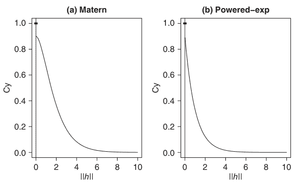

图 9.8 选定半变异方差的 $C_y(\boldsymbol{h}, \boldsymbol{\theta})$ 散点图。(a) 带 $\boldsymbol{\theta} = (1, 1.5, 0.1, 0.9)'$ 的 Matérn 半变异方差。(b) 带 $\boldsymbol{\theta} = (1, 1, 0.1, 0.9)'$ 的指数幂半变异方差。两个图均显示 10% 块头效应。

为 $\boldsymbol{\theta} = (1, 1.5, 0.1, 0.9)'$ 的公式 (9.13) 中 $C_y(\boldsymbol{h}, \boldsymbol{\theta})$ 关于 $\|\boldsymbol{h}\|$ 的图，表明协方差函数随 $\|\boldsymbol{h}\|$ 增加而平滑衰减至零。该图还显示 10% 块头效应。使用的 $\boldsymbol{\theta}$ 值取自 Cressie and Wikle (2011)。对于公式 (9.13) 中的模型，$\sigma_0^2$ 是块头，$\sigma_1^2$ 是方差，$\theta_1$ 称为 *比例尺* 或 *量程* 参数，$\theta_2$ 是 *形状* 或 *平滑度* 参数。这是一个各向同性半变异方差。

常用各向同性半变异方差的另一个例子是由下式给出的指数幂半变异方差

$$C_y(\boldsymbol{h}, \boldsymbol{\theta}) = \sigma_0^2 I(\|\boldsymbol{h}\| = 0) + \sigma_1^2 \exp[-(\|\boldsymbol{h}\|/\theta_1)^{\theta_2}], \quad (9.14)$$

其中 $\boldsymbol{\theta} = (\theta_1, \theta_2, \sigma_0^2, \sigma_1^2)'$，且 $\theta_1 > 0, 0 < \theta_2 \le 2, \sigma_0 \ge 0$，以及 $\sigma_1^2 \ge 0$。图 9.8(b) 显示了带 $\boldsymbol{\theta} = (1, 1, 0.1, 0.9)'$ 的公式 (9.14) 中 $C_y(\boldsymbol{h}, \boldsymbol{\theta})$ 关于 $\|\boldsymbol{h}\|$ 的图。从图中可以看出，协方差函数随 $\|\boldsymbol{h}\|$ 增加而快速平滑地衰减至零。图中也显示了 10% 块头效应。指数幂半变异方差在 Diggle and Ribeiro (2007) 中有讨论。在实践中，常使用 $\theta_2 = 1$。

以下无块头效应的各向同性半变异方差模型也在某些 R 包中可用：

- 1. 线性模型：
$$r_y(\boldsymbol{h}, \boldsymbol{\theta}) = \begin{cases} 0, & \text{若 } \boldsymbol{h} = \boldsymbol{0}, \\ b_0 + b_1 \|\boldsymbol{h}\|, & \text{若 } \boldsymbol{h} \neq \boldsymbol{0}, \end{cases}$$

其中 $\boldsymbol{\theta} = (b_0, b_1)'$，且 $b_0 \ge 0$ 和 $b_1 \ge 0$。

- 2. 球形模型：对 $1 \le d \le 3$ 的 $R^d$ 有效。
$$r_y(\boldsymbol{h}, \boldsymbol{\theta}) = \begin{cases} 0, & \boldsymbol{h} = \boldsymbol{0}, \\ b_0 + b_1 [1.5(\|\boldsymbol{h}\|/b_2) - 0.5(\|\boldsymbol{h}\|/b_2)^3], & 0 < \|\boldsymbol{h}\| \le b_2, \\ b_0 + b_1, & \|\boldsymbol{h}\| \ge b_2, \end{cases}$$

其中 $\boldsymbol{\theta} = (b_0, b_1, b_2)'$，且对 $i=1, 2, 3$ 有 $b_i \ge 0$。

- 3. 指数模型：
$$\gamma_Y(\mathbf{h}, \boldsymbol{\theta}) = \begin{cases} 0, & \mathbf{h} = \mathbf{0}, \\ b_0 + b_1 [1 - \exp(-\|\mathbf{h}\|/b_2)], & \mathbf{h} \neq \mathbf{0}, \end{cases}$$

其中 $\boldsymbol{\theta} = (b_0, b_1, b_2)'$，且对 $i = 1, 2, 3$ 有 $b_i \ge 0$。

在某些应用中，如果底层物理过程在空间中演变方式不同，即过程在空间不同方向上出现不同的动态依赖，则需要各向异性变异方差。例如，空气污染物的空间依赖性可能受监测站周围地理特征的影响，因此在不同方向上可能不同。在某些情况下，可以通过对滞后向量 $\mathbf{h}$ 进行可逆线性变换来纠正各向异性。如果 $2\gamma_Y(.)$ 可表示为

$$2\gamma_Y(\mathbf{h}) = 2\gamma_Y^*(\|\mathbf{A}\mathbf{h}\|), \quad \mathbf{h} \in R^d, \quad (9.15)$$

其中 $\mathbf{A}$ 是一个可逆的 $d \times d$ 矩阵，$\gamma_Y^*(.)$ 的定义域为 $R$，则称其为 *几何各向异性*。

### 9.3.3 静态协方差函数

与使用公式 (9.9) 中的变异方差不同，如果空间过程 $Y(\mathbf{s})$ 满足以下两个条件：

$$C_y(\mathbf{h}) = \text{Cov}[Y(\mathbf{s} + \mathbf{h}), Y(\mathbf{s})], \quad \text{对所有 } \mathbf{s}, \mathbf{s} + \mathbf{h} \in D, \quad (9.16)$$

和

$$E[Y(\mathbf{s})] = \mu, \quad \text{对所有 } \mathbf{s} \in D, \quad (9.17)$$

则称其为在 $D$ 中具有静态协方差函数 $C_y(.)$ 的二阶平稳过程。类似于时间序列分析，也可以使用相关函数

$$\rho_y(.) = C_y(.) / C_y(\mathbf{0})$$

来研究协方差平稳空间过程。协方差函数 $C_y(.)$ 必须满足非负定性条件

$$\sum_{i=1}^{\ell} \sum_{j=1}^{\ell} \alpha_i \bar{\alpha}_j C_y(\mathbf{s}_i - \mathbf{s}_j) \ge 0, \quad (9.18)$$

对任何正整数 $\ell$、任何空间位置集合 $\{\mathbf{s}_1, \dots, \mathbf{s}_\ell\}$ 和任何复数集合 $\{\alpha_1, \dots, \alpha_\ell\}$ 均成立。注意，公式 (9.18) 的非负定性条件必须对所有复数 $\{\alpha_i\}$ 成立，而不仅仅是那些和为零的复数。因此，静态协方差函数比静态变异方差更强。如果 $C_y(\mathbf{h}) = C_y^*(\|\mathbf{h}\|)$，则称其为 *各向同性*，否则为 *各向异性*，其中 $C_y^*(.)$ 的定义域为 $R$。注意，公式 (9.16) 中的条件（意味着过程具有有限且常数的方差）对于过程具有静态变异方差不是必需的。

### 9.3.4 变异方差估计

对于带数据 $\boldsymbol{Z}$ 的二阶平稳空间过程 $Z(\boldsymbol{s}_j) = Y(\boldsymbol{s}_i) + \epsilon(\boldsymbol{s}_i)$，通常使用矩法来估计共变量图或变异方差。Matheron (1962) 提出了估计量

$$2\hat{\gamma}(\boldsymbol{h}) = \frac{1}{|N(\boldsymbol{h})|} \sum_{N(\boldsymbol{h})} [Z(\boldsymbol{s}_i) - Z(\boldsymbol{s}_j)]^2, \quad \boldsymbol{h} \in R^d, \tag{9.19}$$

其中

$$N(\boldsymbol{h}) = \{(\boldsymbol{s}_i, \boldsymbol{s}_j)|\boldsymbol{s}_i - \boldsymbol{s}_j = \boldsymbol{h}; i, j = 1, \dots, m\},$$

且 $|N(\boldsymbol{h})|$ 是 $N(\boldsymbol{h})$ 中不同对数的数量。

当数据在 $R^d$ 中不规则分布时，公式 (9.19) 的变异方差估计量通常通过使用以下内容进行平滑处理：

$$2\gamma^+(\boldsymbol{h}) = \text{ave}\{[Z(\boldsymbol{s}_i) - Z(\boldsymbol{s}_j)]^2|(i,j) \in N(\boldsymbol{h}), \boldsymbol{h} \in U(\boldsymbol{h}(\ell))\}, \tag{9.20}$$

其中区域 $U(\boldsymbol{h}(\ell))$ 是 $R^d$ 中 $\boldsymbol{h}(\ell)$ 附近的某个指定容差区域，$\ell = 1, \dots, g$，$g$ 为正整数。容差区域的选择在 Journel and Huijbregts (1978) 中有讨论。遵循时间序列文献，也可以使用估计量

$$\widehat{C}(\boldsymbol{h}) = \frac{1}{|N(\boldsymbol{h})|} \sum_{N(\boldsymbol{h})} [Z(\boldsymbol{s}_j) - \bar{Z}][Z(\boldsymbol{s}_j) - \bar{Z}], \tag{9.21}$$

其中 $\bar{Z} = \sum_{i=1}^m Z(\boldsymbol{s}_i)/m$，且 $N(\boldsymbol{h})$ 如前所述在公式 (9.19) 中定义。对于 $d=1$ 的情况，估计量 $\widehat{C}(\boldsymbol{h})$ 和 $2\hat{\gamma}(\boldsymbol{h})$ 的渐近特性已在时间序列文献中研究。

### 9.3.5 空间依赖性检验

给定空间数据 $\boldsymbol{Z} = [Z(\boldsymbol{s}_1), \dots, Z(\boldsymbol{s}_m)]'$，一个重要的问题是数据是否具有空间依赖性。即，我们有兴趣检验 $H_0 : Y(\boldsymbol{s})$ 没有空间依赖性 与 $H_a : Y(\boldsymbol{s})$ 具有空间依赖性。假设变异方差是各向同性的，即 $2\gamma_y(\boldsymbol{h}) = 2\gamma^*(\|\boldsymbol{h}\|)$，且 $Z(\cdot)$（以及 $Y(\cdot)$）的均值为常数，Cressie and Wikle (2011) 考虑了变异方差的估计量

$$2\hat{\gamma}_z^*(\boldsymbol{h}) = \text{ave}\{[Z(\boldsymbol{s}_i) - Z(\boldsymbol{s}_j)]^2|\|\boldsymbol{s}_i - \boldsymbol{s}_j\| \in N(h); i,j = 1, \dots, m\}, \tag{9.22}$$

其中 $N(h)$ 是 $h$ 附近的容差区域，例如某个小 $\Delta > 0$ 的 $h \pm \Delta$。该估计量称为 *经验变异方差*。它类似于公式 (9.20) 中的平滑版本。这些作者提出了检验统计量

$$Q = \frac{\hat{\gamma}_z^*(h_1)}{\hat{\sigma}_z^2}, \tag{9.23}$$

其中 $\hat{\sigma}_z^2 = \sum_{i=1}^m [Z(\boldsymbol{s}_i) - \hat{\mu}_z]^2/(m-1)$，$\hat{\mu}_z = \sum_{i=1}^m Z(\boldsymbol{s}_i)/m$，且 $h_1$ 是所有可能滞后量 $h_1, \dots, h_L$ 中的最小滞后量。如果 $|Q - 1|$ 较大，则拒绝 $H_0$。$H_0$ 的基于置换的检验可以在不做任何分布假设的情况下进行。


关于 \( Z \) 的假设；数据位置被置换，然后对所有可能的置换计算 \( Q \)。然后使用置换后的 \( Q \) 值的经验分位数进行推断，例如，如果观察到的 Eq. (9.23) 中的 \( Q \) 大于置换后的 \( Q \) 值的第 97.5 百分位数或小于第 2.5 百分位数，则拒绝 \( H_0 \)。

### 9.3.6 克里金

克里金是一种空间预测方法；参见 Matheron (1963)。遵循 Cressie and Wikle (2011)，我们使用 HM 框架介绍克里金法。感兴趣的空间过程是 \( \{Y(s)|s \in D\} \)，对所有 \( s \in D \) 都有 \( 0 < \text{Var}[Y(s)] < \infty \)。注意 \( Y(s) \) 可能不是二阶平稳的。观测数据 \( Z(s) \) 带有噪声，并遵循 Eq. (9.8) 中的模型。暂时假设 \( Y(s) \) 的前两个矩方程已知并由

\(\mu_y(s) = E[Y(s)], \quad s \in D,\) (9.24)

\(C_y(s_1, s_2) = \text{Cov}[Y(s_1), Y(s_2)], \quad s_1, s_2 \in D.\) (9.25)

此外，测量误差的方差 \(\sigma^2_e\) 也是已知的。在 Eq. (9.25) 中，我们不假设 \( C_y(s_1, s_2) \) 是 \( s_1 - s_2 \) 的函数。\( Y(s) \) 的变差图如下给出

\(2\gamma_y(s_1, s_2) = \text{Var}[Y(s_1) - Y(s_2)] = C_y(s_1, s_1) + C_y(s_2, s_2) - 2C_y(s_1, s_2).\)

克里金是为了在条件为 \( \boldsymbol{Z} = \{Z(s_1), \dots, Z(s_m)\}\) 时获得 \( Y(s_0) \) 的最优空间预测，其中 \( s_0 \in D \) 是感兴趣的位置。文献中考虑了三种类型的克里金，取决于对 \( Y(s) \) 均值方程的假设。第一种是简单克里金，其中 \( E[Y(s)] \) 是已知的。第二种是普通克里金，其中 \( E[Y(s)] = \mu \) 是未知常数，最后一种是通用克里金，其中 \( E[Y(s)] \) 依赖于带有未知参数的一些协变量。

#### 9.3.6.1 简单克里金

称为 *简单克里金* 的方法是搜索所有异质线性预测器，\( \{\boldsymbol{a}'\boldsymbol{Z} + u | \boldsymbol{a} \in R^m, u \in R\} \)，以获得 \( Y(s_0) \) 的最优空间预测器。与时间序列分析中最小化均方预测误差（MSPE）类似，人们通过对

\(\text{MSPE}(\boldsymbol{a}, u) = E[Y(s_0) - \boldsymbol{a}'\boldsymbol{Z} - u]^2,\) (9.26)

对 \( \boldsymbol{a} \) 和 \( u \) 求偏导数来寻找 \( \boldsymbol{a} \) 和 \( u \)。方程 (9.26) 可以写成

\(\text{MSPE}(\boldsymbol{a}, u) = \text{Var}[Y(s_0) - \boldsymbol{a}'\boldsymbol{Z} - u] + \{E[Y(s_0) - \boldsymbol{a}'\boldsymbol{Z} - u]\}^2.\)

第二项是 \([\mu_y(s_0) - \boldsymbol{a}'\mu_y - u]^2\)，其中 \( \mu_y = [\mu_y(s_1), \dots, \mu_y(s_m)]'\)，如果 \( u \) 满足

\(u = \mu_y(s_0) - \boldsymbol{a}'\mu_y.\) (9.27)

则该项为零。

给定 Eq. (9.27) 中的 \( u \)，MSPE 的第一项为

\(C_y(s_0, s_0) - 2\boldsymbol{a}' \text{Cov}[Y(s_0), \boldsymbol{Z}] + \boldsymbol{a}'\Sigma_z \boldsymbol{a},\) (9.28)

其中 \( m \times m \) 协方差矩阵 \( \Sigma_z = [C_z(s_i, s_j)] \) 由

\(\begin{array}{ c }
C_z(u, v) = \left\{ \begin{array}{ c c }
C_y(v, v) + \sigma_\epsilon^2, & \text{if } u = v, v \in D, \\
C_y(u, v), & \text{if } u \neq v, 
\end{array} \right. \\
\end{array}\)

给出，并且

\(\text{Cov}[Y(s_0), Z] = [C_y(s_0, s_1), \dots, C_y(s_0, s_m)]' \equiv c_y(s_0). \quad (9.29)\)

对 Eq. (9.28) 关于 \( a \) 求偏导数并令结果等于 \( \mathbf{0} \)，我们得到

\( -2c_y(s_0) + 2\Sigma_z a = \mathbf{0}. \)

因此，最优系数向量是 \( a_* = \Sigma_z^{-1}c_y(s_0) \)，因此 \( u_* = \mu_y(s_0) - c_y(s_0)'\Sigma_z^{-1}\mu_y \)。基于先前的推导，简单克里金预测器是

\( Y^*(s_0) = \mu_y(s_0) + c_y(s_0)'\Sigma_z^{-1}(Z - \mu_y), \quad (9.30) \)

其中 \( c_y(s_0) \) 由 Eq. (9.29) 给出，\( \mu_y \) 在 Eq. (9.27) 中定义。将 \( u_* \) 和 \( a_* \) 代入 Eq. (9.26)，最小化的 MSPE 是

\( \sigma_{y,sk}^2(s_0) = \text{MSPE}(a_*, u_*) = C_y(s_0, s_0) - c_y(s_0)'\Sigma_z^{-1}c_y(s_0), \quad (9.31) \)

其中下标 \( sk \) 用于表示简单克里金。Eq. (9.31) 中的量 \( \sigma_{y,sk}^2(s_0) \) 经常被称为简单克里金方差。

当协变量可用且模型遵循 Eqs. (9.6) 到 (9.8) 时，我们有 \( \mu_y(s) = x(s)'\beta \)，简单克里金预测器变为

\( Y^*(s_0) = x(s_0)'\beta + c_y(s_0)'\Sigma_z^{-1}(Z - X\beta). \quad (9.32) \)

Eq. (9.31) 中的简单克里金方差保持不变。

请注意，简单克里金解和方差也可以在以下 HM 下得到：

- Data model: Conditional on \( \sigma_\epsilon^2 \),

\( Z(s_i)|Y(s_i), \sigma_\epsilon^2 \sim_{ind} N[Y(s_i), \sigma_\epsilon^2], \quad s_i \in D, \quad i = 1, \dots, m. \)

- Process model: Conditional on \( \beta \) and \( C_y(\cdot, \cdot) \), \( Y(\cdot) \) is a Gaussian process satisfying

\( E[Y(s)] = x(s)'\beta, \quad \text{Cov}[Y(s_i, s_j)] = C_y(s_i, s_j), \quad s_1, s_2 \in D. \)

来自数据模型，我们有 \( Z|Y \sim N(Y, \sigma_\epsilon^2 I) \)，其中 \( Y \) 在 Eq. (9.7) 中给出，\( I \) 是 \( m \times m \) 单位矩阵。来自过程模型，我们有

\(\begin{bmatrix} Y(s_0) \\ Y \end{bmatrix} \sim N \left( \begin{bmatrix} x(s_0)' \\ X \end{bmatrix} \beta, \begin{bmatrix} C_y(s_0, s_0) & c_y(s_0)' \\ c_y(s_0) & \Sigma_y \end{bmatrix} \right), \quad (9.33)\)

其中 \(\Sigma_y = \text{Var}(Y)\)。因此，根据多元正态分布的性质，

\(Y(s_0)|Y \sim N[x(s_0)'\beta + c_y(s_0)'\Sigma_y^{-1}(Y - X\beta), C_y(s_0, s_0) - c_y(s_0)'\Sigma_y^{-1}c_y(s_0)].\) (9.34)

接下来，根据贝叶斯定理，\([Y|Z] \propto [Z|Y][Y]\)，其中 \([A|C]\) 表示给定 \(C\) 时 \(A\) 的条件分布，\([Y]\) 表示 \(Y\) 的边缘分布。根据高斯分布的共轭性质，我们可以得到后验分布 \([Y|Z]\) 为

\(Y|Z \sim N[D^{-1}(\sigma_\epsilon^{-2}Z + \Sigma_y^{-1}X\beta), D^{-1}],\) (9.35)

其中 \(D = \sigma_\epsilon^{-2}I + \Sigma_y^{-1}\) 是两个精度矩阵之和。使用众所周知的 Sherman-Morrison-Woodbury 矩阵恒等式，我们可以将条件分布重写为

\(Y|Z \sim N(X\beta + K(Z - X\beta), (I - K)\Sigma_y),\) (9.36)

其中 \(K = \Sigma_y\Sigma_z^{-1}\) 与 \(\Sigma_z = \Sigma_y + \sigma_\epsilon^2 I\)。现在，使用迭代期望和事实 \([Y(s_0)|Y, Z] = [Y(s_0)|Y]\)，我们有

\(E[Y(s_0)|Z] = E[\{E[Y(s_0)|Y, Z]\}|Z]\)
\(= E[x(s_0)'\beta + c_y(s_0)'\Sigma_y^{-1}(Y - X\beta)|Z]\)
\(= x(s_0)'\beta + c_y(s_0)'\Sigma_y^{-1}K(Z - X\beta) \quad \text{[Equation (9.36)]}\)
\(= x(s_0)'\beta + c_y(s_0)'\Sigma_z^{-1}(Z - X\beta)\)
\(= Y^*(s_0).\) (9.37)

对于后验方差，我们有

\(\text{Var}[Y(s_0)|Z] = E\{\text{Var}[Y(s_0)|Y]|Z\} + \text{Var}\{E[Y(s_0)|Y]|Z\}\)
\(= C_y(s_0, s_0) - c_y(s_0)'\Sigma_y^{-1}c_y(s_0) + \text{Var}[c_y(s_0)'\Sigma_y^{-1}Y|Z]\)
\(= C_y(s_0, s_0) - c_y(s_0)'\Sigma_y^{-1}Kc_y(s_0) \quad \text{[Equation (9.36)]}\)
\(= C_y(s_0, s_0) - c_y(s_0)'\Sigma_z^{-1}c_y(s_0)\)
\(= \sigma^2_{y.sk}(s_0).\) (9.38)

这完成了在 HM 框架下的推导。

#### 9.3.6.2 普通克里金

简单克里金的推导假设均值和协方差函数已知。这里我们放松假设，允许均值函数未知，但强加某些无偏性，导致在空间预测中使用数据的齐次线性组合。普通克里金是指 \(Y(s)\) 的均值是常数但未知的情况。

普通克里金预测器是数据 \(Z\) 的线性组合，记为 \(b'Z\)，它最小化 MSPE

\( MSPE(b) = E[Y(s_0) - b'Z]^2, \quad (9.39) \)

受无偏性条件 \( E(b'Z) = E[Y(s_0)] = \mu \) 对所有 \( \mu \in R \) 的约束。由于 \( E[Z(s)] = E[Y(s)] = \mu \)，我们有 \( E(Z) = \mu 1 \)，其中 \( 1 \) 是 1 组成的 \( m \)-维向量。无偏性条件则意味着

\( b'1 = 1, \quad (9.40) \)

即普通克里金系数的和为 1。然后使用拉格朗日乘数法来最小化目标函数

\( \ell(b) = MSPE(b) - 2\lambda(b'1 - 1). \)

更具体地说，目标函数是

\( \ell(b, \lambda) = C_y(s_0, s_0) - 2b'c_y(s_0) + b'\Sigma_z b - 2\lambda(b'1 - 1), \quad (9.41) \)

其中，再次，\( \Sigma_z = Var(Z) \)。对 \( b \) 和 \( \lambda \) 求偏导数并令它们等于零，我们有

\( -c_y(s_0) + \Sigma_z b = \lambda 1, \\ b'1 = 1. \quad (9.42) \)

求解上述方程，我们得到

\( b_* = \Sigma_z^{-1}[c_y(s_0) + k_* 1], \)

和 \( k_* = [1 - 1'\Sigma_z^{-1}c_y(s_0)] / (1'\Sigma_z^{-1}1) \)。因此，普通克里金预测器是

\( \widehat{Y}(s_0) = b_*'Z = \{c_y(s_0) + 1(1 - 1'\Sigma_z^{-1}1) / (1'\Sigma_z^{-1}1)\}'\Sigma_z^{-1}Z, \quad (9.43) \)

和最小化的 MSPE 是

\( \sigma_{y,ok}^2 = C_y(s_0, s_0) - c_y(s_0)'\Sigma_z^{-1}c_y(s_0) + [1 - 1'\Sigma_z^{-1}c_y(s_0)]^2 / (1'\Sigma_z^{-1}1), \quad (9.44) \)

其中下标 \( ok \) 表示普通克里金。\( \sigma_{y,ok}^2 \) 称为普通克里金方差。

#### 9.3.6.3 通用克里金

通用克里金是指 \( E[Y(s)] = x(s)'\beta \) 且 \( \beta \) 未知的情况。这里 \( \beta \) 由广义最小二乘法（gls）估计


方法，并且可以证明通用克里金预测器为

\[
\widehat{Y}(s_0) = x(s_0)'\widehat{\beta}_{gls} + c_y(s_0)'\Sigma_z^{-1}(Z - X\widehat{\beta}_{gls}), \tag{9.45}
\]

其中 \(\widehat{\beta}_{gls} = (X'\Sigma_z^{-1}X)^{-1}X'\Sigma_z^{-1}Z\) 是 \(\beta\) 的广义最小二乘估计量。通用克里金方差为

\[
\sigma^2_{y,uk}(s_0) = c_y(s_0)'\Sigma_z^{-1}c_y(s_0)
+ [x(s_0) - X\Sigma_z^{-1}c_y(s_0)]'(X'\Sigma_z^{-1}X)^{-1}[x(s_0) - X\Sigma_z^{-1}c_y(s_0)], \tag{9.46}
\]

其中下标 _uk_ 表示通用克里金。

在实际应用中，当存在一些协变量时，人们使用通用克里金。在没有协变量的情况下，可以使用普通克里金。实际上，大多数空间软件包都使用通用克里金。

## 9.4 格点过程

格点过程 \(\{Y(s)|s \in D\}\) 定义在有限或可数子集 \(D \subset R^d\) 上。它们用于研究并建模格点数据 **Z** = {_Z_(**_s_**<sub>1</sub>)_,...,Z_(**_s_**_<sub>m</sub>_)}，其中 {**_s_**<sub>1</sub>_,...,**s**<sub>m</sub>_} 是定义在离散空间特征（如网格节点或像素）上的数据位置。通常定义一个 \(m \times m\) 空间邻域矩阵 **W** = [_w<sub>ij</sub>_]，其对角元素为零，如果位置 **_s_**_<sub>i</sub>_ 被视为位置 **_s_**_<sub>j</sub>_ 的邻居，则 _w<sub>ij</sub>_ = 1。术语 _邻居_ 由数据分析师基于其领域知识定义。例如，如果 \(\|s_i - s_j\| \le r\) 对于某个正实数 _r_ 成立，则可将 **_s_**_<sub>i</sub>_ 和 **_s_**_<sub>j</sub>_ 定义为邻居。

Moran (1950) 考虑了实直线的简单情况，其中 _s<sub>i</sub>_ = _i_ 且 _i_ = 1_,...,m_，并定义如果 \(0 < |s_i - s_j| \le 1\) 则 _w<sub>ij</sub>_ = _w<sub>ji</sub>_ = 1。对于去趋势数据 **Z** 且 _E_(**Z**) = **0**，他提出了统计量

\[
I = \frac{Z'WZ}{Z'Z}, \tag{9.47}
\]

用于检验原假设 _H_<sub>0</sub>:_Z_(**_s_**<sub>1</sub>)_,...,Z_(**_s_**_<sub>m</sub>_) 是 _iid_。由于数据已进行均值调整，Eq. (9.47) 的分子和分母分别是该过程的邻域协方差和方差。因此，该检验属于相关检验。Cliff and Ord (1981) 提议使用更一般的 **W**，其中 **W** 可能不是对称的，且其非对角元素不必为 1，并创造了检验统计量 _Moran’s I_。该统计量在文献中被广泛用于检验 **Z** 中不存在空间自相关的原假设。类似于 Eq. (9.23) 中经验变异函数的 _F_-统计量，基于置换的参考分布可用于 Moran’s I 检验。

### 9.4.1 马尔可夫类型模型

空间过程与时间序列过程之间的一个关键区别在于，空间过程在 _R<sup>d</sup>_（其中 _d_ > 1）中没有自然的排序。在文献中，已为 _R<sup>d</sup>_ 中的空间过程开发了各种统计模型。其中许多利用具有特定邻域系统的马尔可夫性质。参见，例如，Besag (1974)。在本节中，我们简要介绍一些空间数据的马尔可夫类型模型。

格点过程最简单的马尔可夫模型是在 \(R^1\) 中的一阶单侧空间过程，其中 \(D = \{1, 2, \dots, n\}\)，\(n\) 为样本量。该模型为

\[
Y(s) = \phi Y(s-1) + \epsilon(s), \quad s = 2, \dots, n, \tag{9.48}
\]

其中 \(|\phi| < 1\)，\(\{\epsilon(s)\} \sim^{iid} N(0, \sigma^2)\)，且 \(\epsilon(s)\) 与 \(Y(s-1)\) 独立，这类似于一阶自回归模型，即第 2 章的 AR(1) 模型。由于样本量 \(n\) 是有限的，需要一个初始条件使空间过程成为平稳高斯过程。初始条件为

\[
Y(1) \sim N[0, \sigma^2/(1 - \phi^2)]. \tag{9.49}
\]

可以轻易看出 \(\text{cor}(Y(s), Y(s-1)) = \phi\)，并且对于 \(\mathbf{Y} = [Y(1), \dots, Y(n)]'\)，有 \(E(\mathbf{Y}) = \mathbf{0}\) 以及

\[
\text{Var}(\mathbf{Y}) = \frac{\sigma^2}{1 - \phi^2} \left[ \begin{array}{cccc} 1 & \phi & \cdots & \phi^{n-1} \\ \phi & 1 & \cdots & \phi^{n-2} \\ \vdots & \vdots & \ddots & \vdots \\ \phi^{n-1} & \phi^{n-2} & \cdots & 1 \end{array} \right]_{n \times n}. \tag{9.50}
\]

\(\mathbf{Y}\) 的联合分布是高斯分布，并且可以轻易看出

\[
[\text{Var}(\mathbf{Y})]^{-1} = \frac{1}{\sigma^2} \left[ \begin{array}{cccccccc} 1 & -\phi & 0 & 0 & \cdots & 0 & 0 & 0 \\ -\phi & 1 + \phi^2 & -\phi & 0 & \cdots & 0 & 0 & 0 \\ 0 & -\phi & 1 + \phi^2 & -\phi & \cdots & 0 & 0 & 0 \\ \vdots & \vdots & \vdots & \vdots & & \vdots & \vdots & \vdots \\ 0 & 0 & 0 & 0 & \cdots & -\phi & 1 + \phi^2 & -\phi \\ 0 & 0 & 0 & 0 & \cdots & 0 & -\phi & 1 \end{array} \right].
\]

在空间统计中，该模型属于条件自回归（CAR）模型类。

通常，假设 \(D = \{s_1, \dots, s_n\} \subset R^d\)。令 \(\mathbf{Y} = [Y(s_1), \dots, Y(s_n)]'\)，对于 \(i = 1, \dots, n\)，令 \(\mathbf{Y}_{-i} = [Y(s_1), \dots, Y(s_{i-1}), Y(s_{i+1}), \dots, Y(s_n)]'\)。也就是说，\(\mathbf{Y}_{-i}\) 由 \(\mathbf{Y}\) 中除 \(Y(s_i)\) 之外的所有数据组成。此外，令 \(N(s_i)\) 为定义 \(s_i\) 的 _邻域_ 的一组预设位置，\(i = 1, \dots, n\)。那么，\(D\) 上的 CAR 模型可以如下指定：条件分布序列 \(\{[Y(s_i) | \mathbf{Y}_{-i}] | i = 1, \dots, n\}\) 中的每个都服从具有均值和方差的高斯分布

\[
E[Y(s_i) | \mathbf{Y}_{-i}] = \sum_{s_j \in N(s_i)} c_{ij} Y(s_j), \tag{9.51}
\]

\[
\text{Var}[Y(s_i) | \mathbf{Y}_{-i}] = \tau_i > 0, \tag{9.52}
\]

其中系数 \(c_{ij}\) 必须满足某些条件以保证 \(\mathbf{Y}\) 的联合分布存在。参见，例如，下面的条件。

由于 \( s_i \ni N(s_i) \)，我们定义 \( c_{ii} = 0 \)。此处我们使用符号 \(\ni\) 表示 *不在*。此外，如果 \( s_j \ni N(s_i) \)，则令 \( c_{ij} = 0 \)。那么，Eq. (9.51) 可以写成

\[
E[Y(s_i)|\boldsymbol{Y}_{-i}] = \sum_{j=1}^n c_{ij} Y(s_j), \quad i=1, \dots, n.
\]

令 \(\boldsymbol{C} = [c_{ij}]\) 为 \( n \times n \) 系数矩阵，\(\boldsymbol{M} = \text{diag}\{\tau_1^2, \dots, \tau_n^2\}\)。Besag (1974) 表明，如果 \(\boldsymbol{M}^{-1}(\boldsymbol{I} - \boldsymbol{C})\) 是正定的，则 CAR 模型的联合分布为

\[
\boldsymbol{Y} \sim N[\boldsymbol{0}, (\boldsymbol{I} - \boldsymbol{C})^{-1}\boldsymbol{M}].
\]

在此 HM 框架下，给出了此类马尔可夫模型的一个示例：

- 数据模型：对于 \( i=1, \dots, n \)，
  \( Z(s_i)|Y(s_i) \sim_{\text{ind}} \text{Po}[\exp\{Y(s_i)\}] \)，
  其中 \(\text{Po}(u)\) 表示均值为 \( u \) 的泊松分布。

- 过程模型：在 \( \boldsymbol{\beta}, \tau^2, \phi \) 条件下，对于 \( \boldsymbol{Y} = [Y(s_1), \dots, Y(s_n)]' \)，
  \( \boldsymbol{Y} | \boldsymbol{\beta}, \tau^2, \phi \sim N[\boldsymbol{X}\boldsymbol{\beta}, \tau^2(\boldsymbol{I} - \phi\boldsymbol{H})^{-1}] \)，
  其中 \(\boldsymbol{X} = [x_j(s_i)]\) 是从 \( k \) 维协变量 \( x(s_i) \) 得到的 \( n \times k \) 矩阵，\(\boldsymbol{H}\) 是一个已知的邻域矩阵，其对角元素为零，且如果 \( s_j \in N(s_i) \) 则 \( h_{ij} = 1 \)，并且 \( \phi \) 的参数空间确保矩阵逆存在。

格点过程 \( Y(s_i) \) 的邻域 \( N(s_i) \) 通常定义为所有其他位置 \( s_j \ (j \neq i) \) 的集合，使得

\[
[Y(s_i)|\boldsymbol{Y}_{-i}] = [Y(s_i)|\boldsymbol{Y}[N(s_i)]], \quad i=1, \dots, n,
\]

其中 \( \boldsymbol{Y}[N(s_i)] = [Y(s_j) : s_j \in N(s_i)] \)。如果 Eq. (9.55) 的条件分布定义了 \( \boldsymbol{Y} \) 的联合分布，则过程 \( \{Y(s)|s \in D\} \) 称为 *马尔可夫随机场*（MRF）。如果进一步假设

\[
Y(s_i)|Y[N(s_i)] \sim \text{Po} \left( \exp \left\{ \alpha_i + \sum_{s_j \in N(s_i)} \theta_{ij} Y(s_j) \right\} \right), \quad i=1, \dots, n,
\]

其中 \( \theta_{ij} = \theta_{ji} \)，则该模型称为 *自泊松模型*；参见 Besag (1974)。在文献中，图用于表示 Eq. (9.55) 的条件依赖性。有兴趣的读者请参阅 Cressie and Wikle (2011, chapter 4)。如果数据是二进制的，Besag (1974) 表明，在某些条件下，

\[
[Y(s_i)|\boldsymbol{Y}[N(s_i)]] = \frac{\exp\{\alpha_i Y(s_i) + \sum_{s_j \in N(s_i)} \theta_{ij} Y(s_i) Y(s_j)\}}{1 + \exp\{\alpha_i Y(s_i) + \sum_{s_j \in N(s_i)} \theta_{ij} Y(s_j)\}}, \quad Y(s_i) \in \{0, 1\},
\]

\( \theta_{ij} = \theta_{ji} \)。这称为 *自逻辑模型*。


最后，考虑 \(D = \{(u,v)|u,v = 0,\pm 1,\pm 2, ...\} \subset R^2\)，即 \(\mathbf{s} = (u,v)\)。*Ising 模型*由公式 (9.56) 定义，假设 (a) 参数 \(\alpha(u,v) = \alpha\)（一个常数）和 (b) \(N(u,v) = \{(u-1,v),(u+1,v),(u,v-1),(u,v+1)\}\)，即 *最近邻* 结构。在这种情况下，公式 (9.56) 的分子变为
\[\exp[Y(u,v)\{\alpha + \theta_1[Y(u-1,v) + Y(u+1,v)] + \theta_2[Y(u,v-1) + Y(u,v+1)]\}]\]
其中 \(\theta_1\) 和 \(\theta_2\) 是两个参数。参见 Ising (1925)，其中 \(\theta_1 = \theta_2\)。

## 9.5 空间点过程

另一类空间过程是空间点过程，它关注感兴趣事件在域 \(D \subset R^d\) 中的随机位置 \(\mathbf{s}_i\)。此外，此类事件的数量也是随机的。例如，考虑一个给定区域，如伊利诺伊州 Cook 县的一个森林保护区。设 \(n\) 为森林保护区中白蜡树的数量，\(\mathbf{s}_i\) 为第 \(i\) 棵树的位置。对于任何给定区域 \(A \subset D\) 及其 \(d\) 维面积 \(|A|\)。在我们的特定示例中，\(|A|\) 是 \(A\) 在森林保护区中的二维面积。设 \(Z(A)\) 为 A 中白蜡树的数量。那么，\(Z(.)\) 是一个定义在 \(D\) 的勒贝格可测子集上的随机过程。由于 \(D\) 是有界的，因此对于所有 \(A \subset D\)，\(Z(.)\) 都是有限的。这样的过程 \(Z(.)\) 是一个计数点过程。

点过程的一个特殊但重要的例子是 *Poisson 点过程* \(Z(.)\)，对于该过程，
\[Z(A)|\lambda(\mathbf{s}) \sim \text{Poi}(\lambda(\mathbf{s})|A|), \quad A \subset D, \quad (9.57)\]

其中 \(\lambda(\mathbf{s})\) 是强度函数，单位为每 \(d\) 维体积，用于衡量事件在任何位置 \(\mathbf{s} \in D\) 出现的潜在可能性。设 \(d\mathbf{s}\) 表示位于 \(\mathbf{s}\) 处、体积为 \(|d\mathbf{s}|\) 的小区域。那么，点过程 \(Z(.)\) 的一阶强度函数定义为
\[\lambda(\mathbf{s}) = \lim_{|d\mathbf{s}|\to 0} \frac{E[Z(d\mathbf{s})]}{|d\mathbf{s}|}, \quad \mathbf{s} \in D, \quad (9.58)\]

前提是极限存在。因此，
\[E[Z(A)] = \int_A \lambda(\mathbf{s}) d\mathbf{s}, \quad A \subset D. \quad (9.59)\]

空间点过程的统计推断关注 \(\lambda(\mathbf{s})\) 在 \(\mathbf{s} \in D\) 上的演变。如果 \(\lambda(\mathbf{s}) = \lambda_0\) 是一个常数，则该点过程是齐次的。在这种情况下，\(\lambda\) 可以通过某些非参数核方法进行估计。例如，参见 Diggle (1985)。另一方面，如果 \(\lambda(\mathbf{s})\) 是 \(\mathbf{s}\) 处可用的某些协变量 \(\mathbf{x}(\mathbf{s})\) 的函数，那么我们就有一个 *非齐次 Poisson 点过程*。

例如 Poisson 点过程的空间点过程推断可以以与 HM 下先前讨论的其他空间过程类似的方式进行。

- 数据模型：给定 \(\lambda(.)\) 时，\(Z(.)\) 是强度为 \(\lambda(.)\) 的非齐次 Poisson 点过程。
- 过程模型：给定 \(\beta\) 和 \(C_Y(\cdot, \cdot)\) 时，\(Y(\cdot) = \log(\lambda(\cdot))\) 是一个高斯过程，使得

\(E[Y(\boldsymbol{s})] = \boldsymbol{x}(\boldsymbol{s})' \boldsymbol{\beta}, \quad C_Y(\boldsymbol{s}_1, \boldsymbol{s}_2) = \text{Cov}[Y(\boldsymbol{s}_1), Y(\boldsymbol{s}_2)],\)

其中，如同之前一样，\(\boldsymbol{x}(\boldsymbol{s})\) 表示 \(\boldsymbol{s}\) 处的协变量向量。

### 9.5.1 二阶强度

为建模空间点过程的空间相互作用，通常使用二阶强度函数。参见 Cressie (1993)。对于 \(\boldsymbol{u}, \boldsymbol{v} \in D\)，二阶强度定义为

\(\lambda_2(\boldsymbol{u}, \boldsymbol{v}) = \lim_{|d\boldsymbol{u}| \to 0, |d\boldsymbol{v}| \to 0} \frac{E[Z(d\boldsymbol{u})Z(d\boldsymbol{v})]}{|d\boldsymbol{u}||d\boldsymbol{v}|}, \quad \boldsymbol{u}, \boldsymbol{v} \in D, \quad (9.60)\)

前提是极限存在。当 \(\lambda(\boldsymbol{u}, \boldsymbol{v})\) 存在时，由以下定义的双点相关函数

\(g(\boldsymbol{u}, \boldsymbol{v}) = \frac{\lambda_2(\boldsymbol{u}, \boldsymbol{v})}{\lambda(\boldsymbol{u})\lambda(\boldsymbol{v})}, \quad (9.61)\)

通常用于描述空间点过程的空间相关性。

假设 \(Z(.)\) 是平稳且各向同性的，则 \(\lambda(\boldsymbol{s}) = \lambda_*\) 是一个常数，并且

\(\lambda_2(\boldsymbol{u}, \boldsymbol{v}) = \lambda_*^2(||\boldsymbol{u} - \boldsymbol{v}||), \quad \boldsymbol{u}, \boldsymbol{v} \in D.\)

在这种情况下，双点相关函数变为

\(g^*(h) = \frac{\lambda_*^2(h)}{\lambda_*^2}, \quad h > 0.\)

Stoyan 和 Stoyan (1994) 表明，当相距 \(h\) 的事件很少发生时，\(g^*(h)\) 取较小值；当相距 \(h\) 的事件频繁出现时，\(g^*(h)\) 取较大值。对于齐次点泊松过程，\(g^*(h) = 1\)。

对于平稳且各向同性的空间点过程，还有另一种空间依赖度量，称为 \(K\) 函数。参见 Bartlett (1964) 和 Ripley (1976)。有兴趣的读者可参阅 Cressie and Wikle (2011) 以获取更多讨论。

### 示例 9.1

本节使用 R 包 gstat。该包可用于执行变函数建模、本章讨论的各种克里金方法以及空间绘图。使用的命令包括 variogram（用于从数据或拟合线性模型的残差中计算样本变函数）、fit.variogram（用于将参数变函数拟合到样本变函数）和 krige（用于执行克里金）。有关详细信息，请参见附带的 R 命令，其中我们省略了一些输出以节省空间。该包的一个良好参考是 R vignette (Pebesma, 2019)。考虑包 sp 中的 Meuse 河数据集。参见第 9.1 节中的示例。图 9.9 显示了锌浓度的气泡图。与图 9.1 中的 Meuse 河图相比，可以清楚地看出，位置越靠近河流，锌浓度越高。图 9.10(a) 显示了 log(zinc) 的样本半变函数，

锌浓度 (ppm)

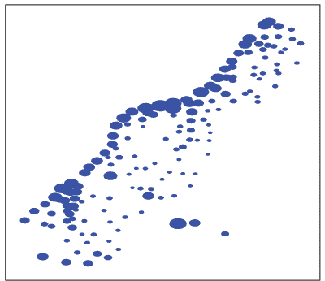

图 9.9 Meuse 数据集锌浓度的气泡图。

样本

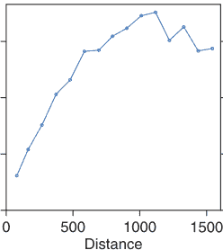

残差

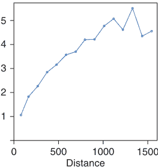

图 9.10 Meuse 数据集 log(zinc) 的半变函数。部分 (a) 是样本半变函数，部分 (b) 是拟合线性趋势后的残差半变函数。

而图 9.10(b) 显示了在带有坐标的线性模型拟合后残差的半变函数。log(zinc) 及其线性模型残差的方差分别为 0.521 和 0.382，表明线性模型在解释锌沉积的变异性方面是有效的。这并不令人惊讶，因为如图 9.9 的气泡图清楚地所示，锌浓度与河流与位置之间的距离成反比关系。从两个半变函数图中，我们可以看到，正如预期的那样，log(zinc) 表现出一定的空间依赖性，并且对于残差来说，这种依赖似乎以更快的速度衰减。

如果需要，可以将参数半变函数模型拟合到经验半变函数。图 9.11 显示了 log(zinc) 残差的残差半变函数，实线表示使用 Matérn 半变函数模型拟合的曲线。拟合似乎是合理的。

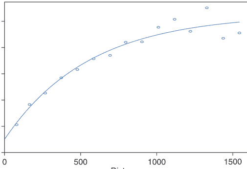

图 9.11 Meuse 数据集 log(zinc) 线性模型残差的半变函数。实线表示 Matérn 半变函数模型的拟合值。

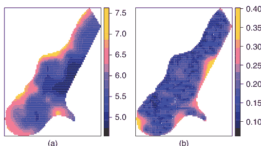

图 9.12 基于拟合的 Matérn 模型对 log(zinc) 数据线性模型残差进行的通用克里金结果。新的感兴趣位置在 meuse.grid 中给出。部分 (a) 是锌浓度的预测值，部分 (b) 给出相应的方差。

转到克里金。图 9.12(a) 显示了基于拟合线性模型残差的通用克里金结果。此处，感兴趣的位置由 meuse.grid 中的坐标给出，使用的模型是拟合的 Matérn 模型。该图表明，在这种情况下通用克里金效果良好，因为它表现出观察到的锌浓度的一般模式。图 9.12(b) 显示了通用克里金的方差。有趣的是，当观测位置密集时方差较小，而当位置远离河流时方差较高。

```
R packages and commands used: Spatial data analysis.
> require(gstat)
> require(sp)
```


```
> data(meuse)
> names(meuse)
> var(log(meuse$zinc)) ## 0.521
> coordinates(meuse) = ~x+y # x- and y-coordinate are in meuse data set.
> bubble(meuse, "zinc", col=c("blue", "blue"), main=' Zinc concentrations (ppm) ')
> v1 <- variogram(log(zinc)~1, meuse) # sample variogram
> plot(v1,type="b",main="(a) Sample")
> v2 <- variogram(log(zinc)~x+y,meuse) #variogram after fitting
##
#### plot(v2,type="b",main="(b) Residual")
#### Fit a spherical semivariogram
> v2.fit <- fit.variogram(v2,vgm(1,"Sph",700,1))
> v2.fit
   model    psill   range
1   Nug 0.08234213   0.000
2   Sph 0.38866509 1098.571
#### psill is the partial sill and range is the range parameter
#### of the variogram model.
#### Fit a Matern semi-variogram
> v2.fit <- fit.variogram(v2,vgm(1,"Mat",900,1))
> v2.fit
   model    psill   range   kappa
1   Nug 0.05029822   0.0000   0.0
2   Mat 0.47614480 555.3679   0.5
#### psill is the partial sill (variance), range is the range parameter of
#### the variogram model, and kappa is the smoothness parameter.
#### See Equation (9.12).
> plot(v2,v2.fit)
#### Universal kriging
> data(meuse.grid)
> coordinates(meuse.grid) = ~x+y
> gridded(meuse.grid) = TRUE
> lz.krig <- krig(log(zinc)~x+y,meuse,meuse.grid,model=v2.fit)
[using universal kriging]
> spplot(lz.krig["var1.pred"])
> spplot(lz.krig["var1.var"])
```

## 9.6 S-T 过程与分析

转向 S-T 数据。考虑 STRbook 包中可用的海面温度（SST）异常数据。这些月度异常数据收集自东经 124° 至 290° 和南纬 29° 至 29°，分辨率为 2° × 2°，因此每月有 2520（= 84 × 30）个观测值。令 Z(s,t) 为位置 s = (lon,lat)' 和时间 t 处的观测异常值。那么 Zt = {Z(s, t) | s ∈ D} 是上一节讨论的空间数据点。可用时间段为 1970 年 1 月至 2002 年 12 月，因此我们拥有的数据集为 Z = {Z(t, s) | s ∈ D; t = 1, ..., 396}，其中 t = 1 对应 1970 年 1 月。这是 S-T 数据的一个示例。由于存在缺失值，我们使用 1996 年 1 月至 2002 年 12 月的数据。所用数据在文件 SSTdf1.csv 中。图 9.13 显示了 SST 异常子集的 Hovmöller 图，Y 轴为日历时间（从 1996 年 1 月到 2002 年 12 月），X 轴为经度（从 124° 到 280°）。该图显示了沿经度方向平均异常值（随纬度平均）随时间的演变（从上到下）。然而

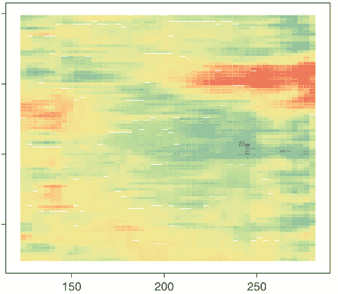

图 9.13 1996 年 1 月至 2002 年 12 月海面温度异常的经度 Hovmöller 图（°C）。

该图提供了数据的某些信息，例如，在给定年份内异常值似乎从东向西移动，但它无法揭示数据的许多其他特征。事实上，探索数据的方法有很多。首先，它们可以被视为具有 84 个观测值（7 年）的 2520 维时间序列。其次，它们也可以被视为具有 84 个观测值的 84×30 矩阵变量时间序列。本节的目的是研究此类 S-T 数据。

### 9.6.1 基本性质

考虑 S-T 过程 {Z(s, t) | s ∈ D; t ∈ Dt}，其中 D ⊂ R^d 且 d > 0，Dt ⊂ R。在实际中，我们只在有限个地点（例如 {s_i | i = 1, ..., m}）和有限个时间点（例如 {t_j | j = 1, ..., T}）处观测数据，其中 m 和 T 为正整数。为方便起见，我们写 Z'_{tj} = [Z(s_1, t_j), ..., Z(s_m, t_j)]′ 和 Z(s_i) = [Z(s_i, t_1), ..., Z(s_i, t_T)]′。也就是说，Z_{tj} 是时间 t_j 处的 m 维观测向量，Z(s_i) 是位置 s_i 处的 T 维观测向量。我们从一些基本概念开始。与观测过程 Z(s, t) 相关，存在一个底层 S-T 过程 Y(s, t)，即 Z(s, t) = Y(s, t) + ϵ(s, t)，其中 ϵ(s, t) 为独立同分布的测量误差。

令 D 为感兴趣的域。对于空间过程，D ⊂ R^d。对于时间序列，若时间离散则 D 为整数集，若时间连续则 D ⊂ R。对于 S-T 过程，D ⊂ R^d × R 或 D ⊂ R^d × {..., -1, 0, 1, ...}。定义在 D × D 上的函数 {g(u, v) | u, v ∈ D} 称为非负定的，如果对于任意复数 {b_i | i = 1, ..., m}、D 中的任意位置 {u_i | i = 1, ..., m} 及任意正整数 m，我们有

\[
\sum_{i=1}^{m} \sum_{j=1}^{m} b_i \bar{b}_j g(u_i, u_j) \ge 0, \tag{9.62}
\]

其中 \(\bar{b}_i\) 是 \(b_i\) 的共轭复数。如果不等式在公式 (9.62) 中对任何非零 \(b = (b_1, ..., b_m)'\) 成立，则 \(g(\cdot, \cdot)\) 称为 *正定的*。我们将关注协方差函数（即将定义）为正定的 S-T 过程。

如果函数 \(g(u, v)\) 满足公式 (9.62) 的条件，并且可以写成如下形式，则称其为 \(R^d \times R\) 上的 *静态 S-T 协方差函数*：

\[
g((s_1, t_1), (s_2, t_2)) = C(s_1 - s_2, t_1 - t_2), \quad s_i \in R^d, t_i \in R. \tag{9.63}
\]

如果 \(E[Y(s, t)] = \mu\) 为常数且 \(Y(s, t)\) 具有静态协方差函数，则称 S-T 过程 \(Y(s, t)\) 为 *二阶平稳*。更精确地说，\(Y(s, t)\) 是二阶平稳的，当 \(E[Y(s, t)] = \mu\) 且

\[
\sum_{i=1}^m \sum_{j=1}^m b_i \bar{b}_j C_y(s_i - s_j, t_i - t_j) \ge 0, \tag{9.64}
\]

对于任意 \(b = (b_1, ..., b_m)'\)、任意 \(\{(s_i, t_i) | i = 1, ..., m\}\) 及任意 \(m\) 成立，其中 \(C_y(\cdot, \cdot)\) 是 \(Y(s, t)\) 的协方差函数。

\(Y(s, t)\) 的静态 S-T 相关函数定义为

\[
\rho_y(h, \tau) = \frac{C_y(h, \tau)}{C_y(0, 0)}, \quad h \in R^d, \tau \in R. \tag{9.65}
\]

该概念继续适用于连续空间和离散时间模型。协方差函数的一些相关概念如下：

- 空间平稑性：
  \(\text{Cov}[Y(s_1, t_1), Y(s_2, t_2)] = C_y(s_1 - s_2, t_1, t_2).\)

- 时间平稑性：
  \(\text{Cov}[Y(s_1, t_1), Y(s_2, t_2)] = C_y(s_1, s_2, t_1 - t_2).\)

- 空间各向同性：
  \(\text{Cov}[Y(s_1, t_1), Y(s_2, t_2)] = C_y(\|s_1 - s_2\|, t_1, t_2).\)

- 几何空间各向异性：
  \(\text{Cov}[Y(s_1, t_1), Y(s_2, t_2)] = C_y(\{h_1(s_{11} - s_{21})^2 + \cdots + h_d(s_{1d} - s_{2d})^2\}^{1/2}, t_1, t_2),\)
  其中 \(s_i = (s_{i1}, ..., s_{id})'\) 且对于 \(i = 1, ..., d\) 有 \(h_i > 0\)。

- 几何 S-T 各向异性：
  \(\text{Cov}[Y(s_1, t_1), Y(s_2, t_2)] = C_y(\{h_1(s_{11} - s_{21})^2 + \cdots + h_d(s_{1d} - s_{2d})^2 + h(t_1 - t_2)^2\}^{1/2}),\)
  其中 \(s_i = (s_{i1}, ..., s_{id})'\)，对于 \(i = 1, ..., d\) 有 \(h_i > 0\)，且 \(h > 0\)。

另一个重要概念是 S-T 相关的可分性。如果对于所有 \(s_i \in R^d\) 和 \(t_i \in R (i = 1, 2)\)，随机过程 \(Y(s, t)\) 满足

\[
\text{Cov}[Y(\boldsymbol{s}_1, t_1), Y(\boldsymbol{s}_2, t_2)] = C^{(s)}(\boldsymbol{s}_1, \boldsymbol{s}_2) \times C^{(t)}(t_1, t_2), \tag{9.66}
\]

其中 \(C^{(s)}\) 和 \(C^{(t)}\) 分别为空间和时间协方差函数。对于静态函数，公式 (9.66) 变为

\[
C_y(\boldsymbol{h}, \tau) = C^{(s)}(\boldsymbol{h}) \times C^{(t)}(\tau), \quad \boldsymbol{h} \in R^d, \tau \in R. \tag{9.67}
\]

可分性还意味着 S-T 相关函数可以写成

\[
\rho(\boldsymbol{h}, \tau) = \rho^{(s)}(\boldsymbol{h}, \mathbf{0}) \times \rho^{(t)}(\mathbf{0}, \tau), \quad \boldsymbol{h} \in R^d, \tau \in R. \tag{9.68}
\]

在实际中，可分性意味着过程 \(Y(\boldsymbol{s}, t)\) 的空间效应和时间效应相互正交，并可由分开的函数参数化。反之，如果 S-T 相关是空间相关函数和时间相关函数的乘积，则该过程是可分的。因此，公式 (9.68) 是二阶平稳过程中可分性的一种表征。因而，该方程提供了一种通过将 \(C_y(\boldsymbol{h}, \tau)\) 与 \(C_y(\boldsymbol{h}, \mathbf{0}) \times C_y(\mathbf{0}, \tau)\) 进行比较来检验可分性假设的方法。

图 9.14 显示了 Cressie and Wikle (2011) 公式 (6.3) 给出的一个不可分 S-T 相关的等值线图。从图中可以看出，相关性是空间距离 \(h\) 和时间滞后 \(\tau\) 的非线性函数。在文献中，已为 S-T 过程提出了许多模型。这些模型在其 S-T 协方差函数中具有各种特征。例如，Reinsel et al. (1981) 的区域效应模型和 Oehlert (1993) 的混合模型等。

### 9.6.2 一些不可分协方差函数

接下来，我们介绍两个特定的不可分且灵活的 S-T 协方差函数家族。第一个家族由 Cressie and Huang (1999) 提出

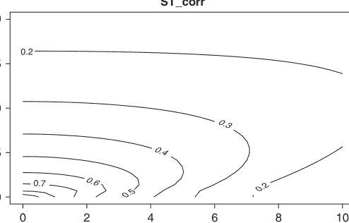

图 9.14 Cressie and Wikle (2011) eq. (6.3) 给出的不可分 S-T 相关函数的等值线图。参数为 \(\alpha = 1\) 和 \(\beta = 20\)。来源：Cressie and Wikle (2011)。©2011 John Wiley & Sons。


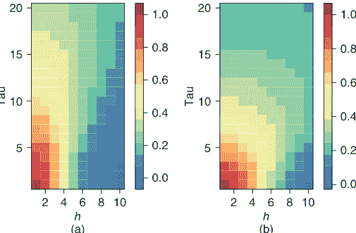

**Figure 9.15** 不可分离 S-T 协方差函数 Eq. (9.69) 在 $d = 1$ 时的水平图。部分 (a) 中 $\sigma=1, a=1.5, b=0.3$，部分 (b) 中 $\sigma=1, a=2.3, b=0.2$。

and given by

$$C_y(\boldsymbol{h}, \tau) = \frac{\sigma^2 \exp\{-b^2 \|\boldsymbol{h}\|^2 / (a^2 \tau^2 + 1)\}}{(a^2 \tau^2 + 1)^{d/2}}, \quad \boldsymbol{h} \in R^d, \tau \in R, \quad (9.69)$$

where $\sigma^2 = C_y(\boldsymbol{0}, 0)$ and $a \ge 0$ and $b \ge 0$ are scaling parameters for time and space, respectively. Figure 9.15 shows two examples of the nonseparable covariance function in Eq. (9.69), where $d=1$, $\sigma=1$, and $(a, b) = (1.5, 0.3)$ and $(2.5, 0.2)$, respectively, for part (a) and (b). The effects of $(a, b)$ on the covariance functions are clearly seen. This family of covariance function seems flexible.

The second family is proposed by Gneiting (2002) and given by

$$C_y(\boldsymbol{h}, \tau) = \frac{\sigma^2 \phi(\|\boldsymbol{h}\|^2 / \psi(\tau^2))}{(\psi(\tau^2))^{d/2}}, \quad \boldsymbol{h} \in R^2, \tau \in R, \quad (9.70)$$

where $\{\phi(x)|x \ge 0\}$ is a completely monotone function and $\{\psi(x)|x \ge 0\}$ is a positive function with completely monotone derivative. For instance, assuming

$$\phi(x) = \exp(-px^v), \quad x \ge 0, p > 0, 0 < v \le 1,$$
$$\psi(x) = (qx^a + 1)^\beta, \quad x \ge 0, q > 0, 0 < a, \beta \le 1,$$

we have

$$C_y(\boldsymbol{h}, \tau) = \frac{\sigma^2 \exp\{-p \|\boldsymbol{h}\|^{2v} / (q \|\tau\|^{2a} + 1)^\beta\}}{(q \|\tau\|^{2a} + 1)^{\beta d / 2}}. \quad (9.71)$$

Separable covariance functions can be obtained by using the product of marginal models of nonseparable functions.

### 9.6.3 S-T Variogram

The S-T variogram of the process $Y(\boldsymbol{s}, t)$ is defined as

$$\text{Var}[Y(\boldsymbol{s}_1, t_1) - Y(\boldsymbol{s}_2, t_2)] = 2\gamma(\boldsymbol{s}_1, \boldsymbol{s}_2, t_1, t_2), \quad (9.72)$$

where \(s_i \in D\) and \(t_i \in R\). If \(Y(s,t)\) is stationary, then Eq. (9.72) becomes \(\text{Var}[Y(s_1, t_1) - Y(s_2, t_2)] = 2\gamma(h, \tau)\), where \(h = s_1 - s_2\) and \(\tau = t_1 - t_2\). The function \(\gamma(\cdot, \cdot)\) is called the *semivariogram*. The process \(Y(s,t)\) is said to be *intrinsically stationary* if \(E[Y(s,t)] = \mu\) and its variogram is stationary. If \(Y(s,t)\) is second-order stationary with covariance function \(C_y(h, \tau)\), then

\(\gamma(h, \tau) = C_y(0, 0) - C_y(h, \tau), \quad h \in D, \tau \in R.\) (9.73)

### 9.6.4 S-T Kriging

As in the spatial case, the goal of kriging is to predict \(Y(s_0, t_0)\) from observed noisy data \(\{Z(s_i, t_{ij})|i=1, \dots, m; j=1, \dots, T_i\}\), where

\(Z(s_i, t_{ij}) = Y(s_i, t_{ij}) + \epsilon(s_i, t_{ij}), \quad i=1, \dots, m; j=1, \dots, T_i,\) (9.74)

where \(T_i > 0\) and \(\{\epsilon(s_i, t_{ij})\}\) is independent of \(Y(s,t)\) and represents the measurement error that is assumed to be *iid* with mean zero and variance \(\sigma_e^2\). As before, \(s_0\) is a new location of interest and \(t_0\) the time point of interest.

Let \(Z_i = [Z(s_i, t_{i1}), \dots, Z(s_i, t_{iT_i})]'\) be the \(T_i\)-dimensional data vector at location \(s_i\) and \(Z = (Z'_1, \dots, Z'_m)'\) be the observed data vector. Kriging is to find the optimal linear combination of \(Z\), say \(Y^*(s_0, t_0)\), that minimizes the expected squared error \(E[Y^*(s_0, t_0) - Y(s_0, t_0)]^2\). Similar to the spatial kriging discussed in the previous section, different types of S-T kriging can be derived under different assumptions concerning the mean \(\mu(s,t) = E[Y(s,t)]\). For simple kriging, \(\mu(s,t)\) is assumed to be known. For ordinary kriging, \(\mu(s,t) = \mu\), an unknown constant, and for universal-kriging, \(\mu(s,t)\) is a linear function of some covariates with unknown coefficient vector \(\beta\).

Assume that \(Y(s,t)\) and \(\epsilon(s,t)\) are both normal and write \(\Sigma_z = \text{Var}(Z)\), \(c_0 = \text{Cov}[Y(s_0, t_0), Z]\), and \(C_{0,0} = \text{Var}[Y(s_0, t_0)]\). Also, write \(Z = Y + \epsilon\) with \(\text{Cov}(Y) = \Sigma_y\) and \(\text{Cov}(\epsilon) = \Sigma_e\). We have

\(\begin{bmatrix} Y(s_0, t_0) \\ Z \end{bmatrix} \sim N\left( \begin{bmatrix} \mu(s_0, t_0) \\ \mu \end{bmatrix}, \begin{bmatrix} C_{0,0} & c'_0 \\ c_0 & \Sigma_z \end{bmatrix} \right),\) (9.75)

where \(\mu = E(Z)\) and \(\Sigma_z = \Sigma_y + \Sigma_e\). By Bayes' Theorem and properties of Gaussian distribution, we have

\(Y(s_0, t_0)|Z \sim N[\mu(s_0, t_0) + c'_0\Sigma_z^{-1}(Z - \mu), C_{0,0} - c'_0\Sigma_z^{-1}c_0].\) (9.76)

Since the simple-kriging predictor of \(Y(s_0, t_0)\) assumes the form \(Y^*(s_0, t_0) = a'Z + c\), where \(a\) and \(c\) are chosen to minimize the MSPE, \(E[Y(s_0, t_0) - a'Z - c]^2\), we can use joint-Gaussian distribution in Eq. (9.75) to see that

\(Y^*(s_0, t_0) = E[Y(s_0, t_0)|Z] = \mu(s_0, t_0) + c'_0\Sigma_z^{-1}(Z - \mu).\) (9.77)

Furthermore, the minimized MSPE is the posterior variance of Eq. (9.76), i.e.

\(\sigma_{sk}^2(s_0, t_0) = E[Y(s_0, t_0) - Y^*(s_0, t_0)]^2 = C_{0,0} - c'_0\Sigma_z^{-1}c_0.\) (9.78)

Note that the joint Gaussian assumption is not critical for the above results of simple kriging to hold. In practice, calculating the S-T simple kriging could be time-consuming when the dimension of \(\mathbf{Z}\) is large as it involves computing the inverse of \(\Sigma_z\). Some simplifications can be achieved with further assumptions. For instance, separability implies that \(\Sigma_z\) has block structure which can be used to simplify the computation. More specifically, under separability and assuming \(T_i = T\) for all \(i\),

\(\Sigma_z = \Sigma_z^{(s)} \otimes \Sigma_z^{(t)}\)

where \(\otimes\) is the Kronecker product of two matrices, \(\Sigma_z^{(s)}\) is an \(m \times m\) purely spatial covariance matrix, and \(\Sigma_z^{(t)}\) is a \(T \times T\) purely temporal covariance matrix. In this case, instead of inverting an \(mT \times mT\) matrix, we only invert \(\Sigma_z^{(s)}\) and \(\Sigma_z^{(t)}\) because \(\Sigma_z^{-1} = [\Sigma_z^{(s)}]^{-1} \otimes [\Sigma_z^{(t)}]^{-1}\).

Turn to ordinary kriging for which \(E[Y(\mathbf{s}, t)] = \mu\), an unknown constant. Let \(\mathbf{1}\) be a \(T\)-dimensional vector of ones, where \(T = \sum_{i=1}^m T_i\), which is the dimension of \(\mathbf{Z}\). As the pure spatial case, the generalized least squares estimator of \(\mu\) is

\(\widehat{\mu}_{\text{gls}} = \frac{\mathbf{1}'\Sigma_z^{-1}\mathbf{Z}}{\mathbf{1}'\Sigma_z^{-1}\mathbf{1}}. \quad (9.79)\)

Therefore, the ordinary-kriging predictor is

\(\widehat{Y}(\mathbf{s}_0, t_0) = \widehat{\mu}_{\text{gls}} + \mathbf{c}'_0\Sigma_z^{-1}(\mathbf{Z} - \widehat{\mu}_{\text{gls}}\mathbf{1}) = \{\mathbf{c}_0 + \mathbf{1}(1 - \mathbf{1}'\Sigma_z^{-1}\mathbf{c}_0)/(\mathbf{1}'\Sigma_z^{-1}\mathbf{1})\}'\Sigma_z^{-1}\mathbf{Z}. \quad (9.80)\)

and the associated minimized MSPE is the ordinary-kriging variance

\(\sigma^2_{ok}(\mathbf{s}_0, t_0) = C_{0,0} - \mathbf{c}'_0\Sigma_z^{-1}\mathbf{c}_0 + (1 - \mathbf{1}'\Sigma_z^{-1}\mathbf{c}_0)^2/(\mathbf{1}'\Sigma_z^{-1}\mathbf{1}). \quad (9.81)\)

The results of universal kriging also extend easily to the S-T setting.

### Example 9.2

Consider the daily maximum temperature of the NOAA data set mentioned in Section 9.1. Here we only employ that data of August 1993, which are available from the package STRbook. The data contains 10,168 observations and 12 variables. The variables include longitude, latitude, year, month, day, location ID, and maximum daily temperature, among others. There are 328 locations and each location has 31 observations. Our goal here is to use the August 1993 data to demonstrate S-T universal kriging using the semivariogram with the package gstat. Following Wikle et al. (2019), we also use the package RColorBrewer to color some of the surfaces in plotting. The empirical semivariogram of the August maximum temperature is given in Figure 9.16, which is produced by the command variogram with a fixed latitude effect (i.e. using latitude as an explanatory variable), spatial bin of 80 km, points less than 1000 km apart, and time lags from 0 to 6 days. Details of the R commands are given below.


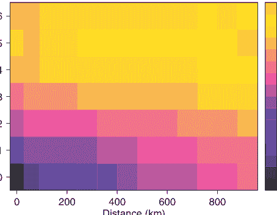

**图 9.16** 1993 年 8 月 NOAA 数据集中日最高气温的经验时空半变异图，使用 **gstat** 中的命令 `variogram` 计算。来源：NOAA（美国国家海洋和大气管理局）数据集。

对于时空克里金法，我们需要将参数模型拟合到经验半变异图。为此，我们采用形式的可分协方差函数

$$\gamma(\boldsymbol{h}, \tau) = s \times (\bar{\gamma}^{(s)}(\|\boldsymbol{h}\|) + \bar{\gamma}^{(t)}(|\tau|) - \bar{\gamma}^{(s)}(\|\boldsymbol{h}\|)\bar{\gamma}^{(t)}(|\tau|)),$$

其中，标准化半变异图 $\bar{\gamma}^{(s)}$ 和 $\bar{\gamma}^{(t)}$ 具有独立的块缘效应，且 $s = 1$ 表示基准差。作为第二个模型，我们还采用协方差函数

$$c_{st}(\|v_a\|) = b_1 \exp(-\phi \|v_a\|) + b_2 I(\|v_a\| = 0),$$

其中 $\boldsymbol{v}_a = (\boldsymbol{h}', a\tau)'$，参数 $a$ 表示用于生成时空各向异性的缩放因子。事实证明，对于此特定实例，两个模型提供相似的拟合。可分模型的均方误差为 1.72，而各向异性模型的均方误差为 1.69。图 9.17 显示了两个模型的拟合半变异图。

由于我们将纬度视为协变量，在以下演示中使用通用克里金法。首先，我们为预测创建一个时空网格。对于空间网格，我们考虑 100°W 至 80°W 之间的 20 个空间位置以及 32°N 至 46°N 之间的 20 个空间位置。对于时间网格，我们考虑 1993 年 8 月中等间隔的六天。然后，使用空间网格和时间网格在 **gstat** 中构建一个 STF 对象，用于我们的时空预测网格。最后，我们省略 1993 年 8 月 9 日的数据，以展示时空克里金法跨时预测的能力。

图 9.18 显示了使用拟合可分模型的通用克里金法的预测值及其相关标准误差。从图中可以看出，8 月 9 日的高标准误差是可以理解的，因为数据被省略了。

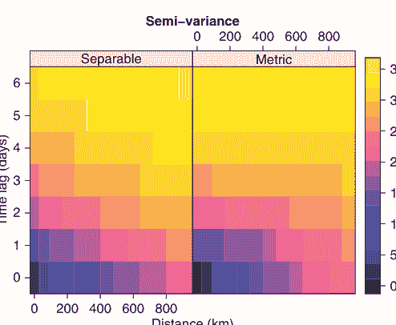

图 9.17 NOAA 数据集 1993 年 8 月日最高气温的参数模型拟合半变异图。所用模型为 (a) 可分模型和 (b) 带各向异性的度量模型。来源：NOAA（美国国家海洋和大气管理局）数据集。

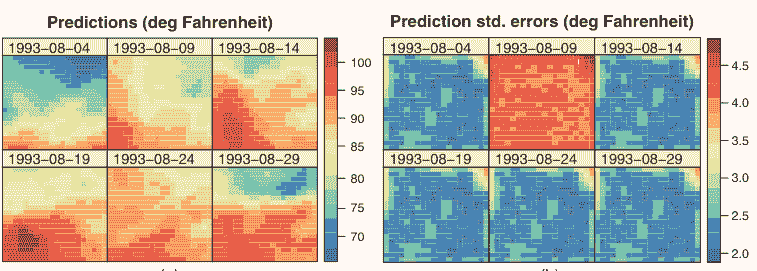

图 9.18 使用可分协方差函数对 1993 年 8 月日最高气温进行时空克里金预测。部分 (a) 为预测值，部分 (b) 为相关标准误差。8 月 9 日的数据被省略。

### R 演示：时空克里金法。

```
> require(sp)
> require(spacetime)
> require(ggplot2)
> require(dplyr)
> require(gstat)
> require(RColorBrewer)
> require(tidyr)
> require(STRbook)
##
> data("STObj3", package = "STRbook")
> STObj4 <- STObj3["1993-08-01::1993-08-31"]
> da <- as.data.frame(STObj4)
> names(da) ## show lon, lat, sp.ID, time, ..., z.
> dim(da) ## show 10168-by-12.
> length(unique(da$id)) ## show 328.
> v <- variogram(object = z ~ 1 + lat, data = STObj4,
     width = 80, cutoff = 1000, tlags = 0.01:6.01)
> plot(v)
> print(v)
> sepVGM <- vgmST(stModel = "separable", space = vgm(10, "Exp", 400, nugget = 0.1),
     time = vgm(10, "Exp", 1, nugget = 0.1), sill = 30)
> sepVGM <- fit.StVariogram(v, sepVGM)
> metricVGM <- vgmST(stModel = "metric",
     joint = vgm(100, "Exp", 400, nugget = 0.1), sill = 20, stAni = 100)
> metricVGM <- fit.StVariogram(v, metricVGM)
> metricMSE <- attr(metricVGM, "optim")$value
> sepMSE <- attr(sepVGM, "optim")$value
> metricMSE
#### [1] 1.697554
> sepMSE
#### [1] 1.723087
> plot(v, list(sepVGM, metricVGM), main = "Semi-variance")
> spat_pred_grid <- expand.grid(lon = seq(-100, -80, length = 20),
     lat = seq(32, 46, length = 20)) %>%
     SpatialPoints(proj4string = CRS(proj4string(STObj3)))
> gridded(spat_pred_grid) <- TRUE
> temp_pred_grid <- as.Date("1993-08-01") + seq(3, 28, length = 6)
> DE_pred <- STF(spat_pred_grid, time = temp_pred_grid)
> STObj5 <- as(STObj4[, -9], "STIDF")
> STObj5 <- subset(STObj5, !is.na(STObj5$z))
> pred_kriged <- krigeST(z ~ 1 + lat, data = STObj5, newdata = DE_pred,
     modelList = sepVGM, computeVar = TRUE)
> color_pal <- rev(colorRampPalette(brewer.pal(11, "Spectral"))(16))
> stplot(pred_kriged, main = "Predictions (deg Fahrenheit)",
     layout = c(3, 2), col.regions = color_pal)
> pred_kriged$sse <- sqrt(pred_kriged$var1.var)
> stplot(pred_kriged[, , "se"], main = "Prediction std. errors (deg Fahren.)",
     layout = c(3, 2), col.regions = color_pal)
```

## 9.7 描述性时空模型

分析时空数据的一大困难在于，直接对观测序列 \( Z_t = [Z(s_1, t), \dots, Z(s_m, t)]' \) 进行建模会遇到大量参数，尤其是当位置数量 \( m \) 很大时。为克服这一困难，常常使用降维和/或参数约束。然而，无论是降维还是参数约束，利用空间和时间结构的知识都很重要。邻域系统是空间结构的一个例子，季节性模式是时间结构的一个例子。本节讨论文献中可用的某些方法，以对数据提供良好的描述。

### 9.7.1 带时空基函数的随机效应

空间-时间建模的一种广泛使用的方法是采用带随机效应的加性模型。当协变量 x(s, t) 可用时，我们可以将模型写为

$$Y(s, t) = x(s, t)' \beta + \sum_{i=1}^{n_a} \phi_i(s, t) a_i + \nu(s, t), \qquad (9.82)$$

其中，$\beta$ 表示协变量的固定效应，$\{\phi_i(s, t) \mid i = 1, \dots, n_a\}$ 是在位置 $s$ 和时间 $t$ 处计算的预设时空基函数，$n_a$ 是正整数，$\{\alpha_i\}$ 是随机效应，$\nu(s, t)$ 是一个时空（残差）过程，用于表示基函数未捕获的小尺度时空随机效应。

假设数据在 $m$ 个位置可用，例如 $\{s_1, \dots, s_m\}$。那么，在每个时间点 $t$，我们可以用矩阵形式表示模型为

$$Y_t = X_t \beta + \Phi \alpha + \nu_t, \qquad (9.83)$$

其中，$Y_t = [Y(s_1, t), \dots, Y(s_m, t)]'$，$\Phi$ 是一个 $m \times n_a$ 矩阵，其第 $i$ 行为 $[\phi_1(s_i, t), \dots, \phi_{n_a}(s_i, t)]$，$\alpha = (\alpha_1, \dots, \alpha_{n_a})'$，$\nu_t$ 定义的位置顺序与 $Y_t$ 相同。该模型的一个特殊特征是 $\beta$ 和 $\alpha$ 均在空间和时间上不变。通常，我们假设 $E(Y(s, t) \mid x_t) = x_t'\beta$ 且随机效应 $\alpha$ 服从分布 $N(0, \Sigma_a)$。此外，在假设 (a) $\nu(s, t)$ 无时间依赖性和 (b) $\nu_t \sim N(0, \Sigma_v)$ 下，则有 $Y_t \sim N(X_t \beta, \Sigma_{y,t})$，其中 $\Sigma_{y,t} = \Phi_t \Sigma_a \Phi_t' + \Sigma_v$。

对于带有测量误差的观测数据 $Z(s, t) = Y(s, t) + \epsilon(s, t)$，我们有 $Z_t \sim N(X_t \beta, \Sigma_{z,t})$，其中 $\Sigma_{z,t} = \Sigma_{y,t} + \Sigma_\epsilon = \Phi_t \Sigma_a \Phi_t' + \Sigma_v + \Sigma_\epsilon$。如果 $n_a \ll m$，即所谓的行秩表示，则公式 (9.82) 中的模型相对容易估计，因为其似然函数可以使用矩阵反演公式有效评估

$$\Sigma_{z,t}^{-1} = V^{-1} - V^{-1} \Phi_t (\Phi_t' V^{-1} \Phi_t + \Sigma_a^{-1})^{-1} \Phi_t' V^{-1},$$

其中 $V = \Sigma_v + \Sigma_\epsilon$。当 $\Sigma_v$ 和 $\Sigma_\epsilon$ 均遵循某些简单结构（例如对角矩阵）时，情况尤其如此。

假设数据在 $t = 1, \dots, T$ 处观测得到。那么，我们可以将所有数据放在一个矩阵形式中

$$Z = X \beta + \Phi \alpha + \nu + \epsilon,$$

其中，$Z = [Z_1', \dots, Z_T']'$ 是一个 $mT$ 维向量，$X$ 和 $\Phi$ 是 $X_t$ 和 $\Phi_t$ ($t = 1, \dots, T$) 的堆叠矩阵，顺序与 $Z$ 相同。

对于 $m = n_a$（满秩）和 $n_a > m$（过完备）情况，如果在随机效应的协方差矩阵 $\Sigma_a$ 中引入稀疏性，该模型仍可享受一些计算优势。

基函数的选择和基函数的数量在应用公式 (9.83) 中的模型时起着作用。文献中有许多可用的基函数。例如，R 包 FRK 中可用的基函数


Zammit-Mangion (2018b) 和 Tseng 等人 (2019) 的 **autoFRK**。另请参见下一节的讨论。通常，S-T 基函数是所选空间基函数与时间基函数的张量积。此外，在应用中，人们通常假设 $\Sigma_a$ 取决于少量未知参数。例如，$\alpha_i$ 之间的协方差随基函数中心之间距离的指数衰减。

### 9.7.2 带空间基函数的随机效应

通过简化基函数，但增加随机效应的灵活性，可以假设 S-T 模型为

$$
Y(\mathbf{s}, t) = \mathbf{x}(\mathbf{s}, t)' \boldsymbol{\beta} + \sum_{i=1}^{n_a} \phi_i(\mathbf{s}) \alpha_i(t) + \nu(\mathbf{s}, t), \quad (9.84)
$$

其中 $\{\phi_i(\mathbf{s}) | i = 1, \dots, n_a; \mathbf{s} \in D\}$ 是预先指定的空间基函数，$\{\alpha_i(t) | i = 1, \dots, n_a\}$ 是时间随机过程，其他组件如前文在 Eq. (9.82) 中定义。文献中有许多可用的空间基函数，例如双平方函数，

$$
b(\mathbf{s}_1, \mathbf{s}_2) = \begin{cases} [1 - (\|\mathbf{s}_1 - \mathbf{s}_2\|/a)^2]^2, & \|\mathbf{s}_1 - \mathbf{s}_2\| \le a, \\ 0, \text{ otherwise,} \end{cases} \quad (9.85)
$$

其中 $a > 0$ 且 $\mathbf{s}_i \in D$。空间基函数的其他选择包括小波、高斯函数、傅里叶函数和 Wendland 函数。图 9.19 展示了 $a = 0.5$ 时的一维和二维双平方函数。在应用中，基函数的选择并不关键，只要基函数的类型和数量足够灵活且足够多，以捕捉 $Y(\mathbf{s}, t)$ 中的依赖性。

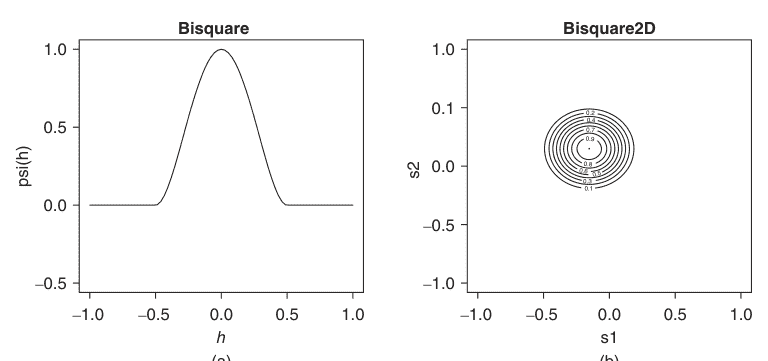

图 9.19 $a = 0.5$ 时的双平方基函数。部分 (a) 为一维，部分 (b) 为二维函数的等高线图。

假设数据在位置 \(\{s_i|i=1, ..., m\}\) 和时间点 \(\{t_1, ..., t_T\}\) 处观测到，其中 \(m > 0\) 且 \(T > 0\)。那么，在时间 \(t = t_j\) 时，模型变为

\(Y_{t_j} = X_{t_j}\beta + \Phi\alpha_{t_j} + \nu_{t_j},\) (9.86)

如前所述，\(Y_{t_j} = [Y(s_1, t_j), ..., Y(s_m, t_j)]'$ 是一个 \(m\) 维向量过程，\(\nu_{t_j} \sim N(0, \Sigma_\nu)\)，\(\Phi = [\phi(s_1), ..., \phi(s_m)]'$，对于 \(j = 1, ..., m\)，\(\phi(s_j) = [\phi_1(s_j), ..., \phi_{n_a}(s_j)]'$，且 \(\alpha_{t_j} = [\alpha_1(t_j), ..., \alpha_{n_a}(t_j)]'$。对于该模型，对 \(\alpha_{t_j}\) 的规范需要仔细考虑。

如果 \(\{\alpha_{t_j}|j=1, ..., T\}\) 在时间上相互独立且 \(\alpha_j \sim N(0, \Sigma_a)\)，则 \(Y_{t_j}\) 的边缘分布为 \(N(X_{t_j}\beta, \Phi\Sigma_a\Phi' + \Sigma_\nu)\)，且 \(Y_{t_1}, ..., Y_{t_T}\) 在时间上相互独立。因此，\(Y = [Y'_{t_1}, ..., Y'_{t_T}]'\) 的联合分布为多元高斯分布，协方差矩阵为 \(\Sigma_Y = I_T \otimes (\Phi\Sigma_a\Phi' + \Sigma_\nu)\)，其中 \(I_T\) 是一个 \(T \times T\) 的单位矩阵。通常，\(\alpha_{t_j}\) 在时间上相关，以便模型能更好地建模 \(Y(s, t)\) 中的 S-T 依赖性。例如，如果 \(n_a\) 不大且时间点 \(\{t_j\}\) 等距，则可以使用第 3 章中的向量自回归移动平均 (VARMA) 或向量自回归 (VAR) 模型。

### 9.7.3 固定秩克里金

为了使随机效应模型在实践中可应用，尤其是当位置数量 \(m\) 很大时，会仔细简化数据的逆协方差矩阵 \(\Sigma_z^{-1}\) 的计算。模型简化的一种方法是采用少量空间基函数，从而得到固定秩克里金方法。参见 Cressie 和 Johannesson (2008)。它在 Zammit-Mangion (2018b) 的 R 包 FRK 中可用。我们简要描述如下。

考虑 Eq. (9.86)。为简化起见，假设时间点等距，因此 \(t = 1, ..., T\) 且没有协变量。此外，假设 \(Y_t\) 是序列不相关的，S-T 噪声 \(\nu_t\) 服从协方差矩阵 \(\Sigma_\nu = \sigma^2 I\) 的高斯分布。在这种情况下，观测数据 \(Z_t\) 的协方差矩阵为 \(\Sigma_z = \Phi\Sigma_a\Phi' + (\sigma_v^2 + \sigma_e^2)I\)，其中 \(\Phi\Sigma_a\Phi'\) 的秩至多为 \(n_a\)。由此产生的克里金称为固定秩克里金 (Cressie and Johannesson, 2008)。在此特定情况下，令 \(\sigma^2 = \sigma_v^2 + \sigma_e^2\)，我们有

\(\Sigma_z^{-1} = \frac{1}{\sigma^2}I - \frac{1}{\sigma^2}\Phi\left(\Sigma_a^{-1} + \frac{1}{\sigma^2}\Phi'\Phi\right)^{-1}\Phi',\)

只要 \(\Sigma_a^{-1}\) 相对容易计算（例如当维度 \(n_a\) 不大时），这就可以处理。

FRK 的一个潜在弱点是，空间基函数的选择没有考虑观测数据的特征。因此，对于某些应用，可能需要较大的 \(n_a\) 来对样本协方差矩阵提供良好近似，从而导致估计耗时。为克服这一困难，Tseng 和 Huang (2018) 提出了一类分辨率自适应的新基函数，并使用赤池信息量准则 (AIC) 来选择基函数的数量。特别值得注意的是，基于所提议的新基函数，\(\Sigma_a\) 和 AIC 的最大似然估计有闭式表达式。新基函数从薄板样条中提取，并按其平滑度级别排序，高阶

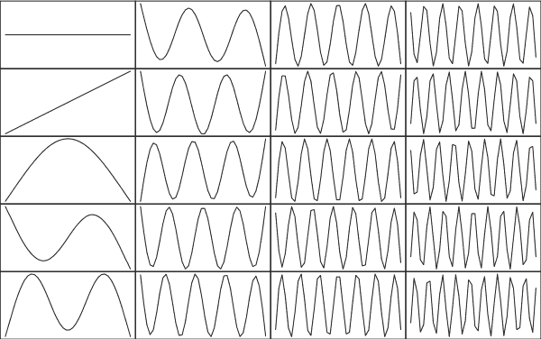

图 9.20 单位区间 [0,1] 上带有 40 个等距节点的前 20 个基函数图。这些基函数是 Tseng 和 Huang (2018) 的多分辨率薄板样条。来源：基于 Tseng 和 Huang (2018)。

函数对应较大尺度的特征，而低阶函数对应较小尺度的细节。因此，所使用的基函数数量决定了空间分辨率。新基函数还避免了节点分配的需要。有兴趣的读者可参阅 Tseng 和 Huang (2018) 以获取更多细节。图 9.20 绘制了 Tseng 和 Huang (2018) 所提方法在单位区间 [0,1] 上带有 40 个等距节点的一维情况下生成的前 20 个基函数。从图中可以清楚地看到，第一个基函数只是一个常数，第二个基函数是线性的，第三个基函数是二次的，依此类推。

### 示例 9.3

考虑美国中西部臭氧数据集。参见图 9.3。这里我们有 T = 89 和 m = 153。为消除时间趋势的可能性，我们使用 x_t = (1, t)' 作为协变量，并专注于分析去趋势后的数据。此外，数据中存在一些缺失值，因此我们只使用没有缺失值的监测站。结果，在此示例中我们有 m = 67。我们的分析通过 Tseng 等人 (2019) 的 autoFRK 包进行。为便于阅读，autoFRK 考虑的随机效应模型为

$$
Z_t = \mu + G w_t + \eta_t + \epsilon_t, \quad t = 1, \dots, T, \qquad (9.87)
$$

其中 Z_t 是 n 个位置处观测数据的 n 维向量，\(\mu\) 是确定性均值的 n 维向量，\(\epsilon_t \sim N(0, sD)\)，其中 D 是给定的 \(n \times n\) 矩阵，s 是尺度参数，G 是给定的基函数 \(n \times K\) 矩阵，K 是基函数数量，\(w_t\) 是不可观测随机权重的 K 维向量，满足 \(w_t \sim N(0, M)\)，\(\eta_t\) 是空间平稳过程的 n 维向量。这里

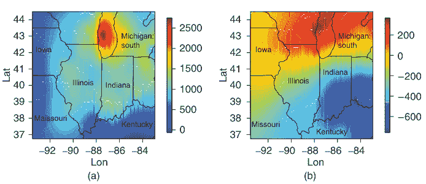

图 9.21 美国中西部经纬度上 100 × 100 等距网格点处臭氧预测的特征函数。部分 (a) 是第一个特征函数，部分 (b) 是第二个特征函数。

**_G_** 的列是一个有序的薄板样条函数类，而 **_η_**_<sub>t</sub>_ 被称为更细尺度的空间效应。

在我们的演示中使用默认选项，因此 \(\mu = \mathbf{0}\)，\(\eta_t = \mathbf{0}\)，且 \(\mathbf{D} = \mathbf{I}\)。基函数数量 _K_ 由 AIC 选择。在此特定情况下，选择了 _K_ = 60，这相对较大，因为我们有 _n_ = 67，且 \(\hat{\zeta} = 721\)。程序提供 **_G_**，它是一个 \(67 \times 60\) 矩阵，以及 \(\hat{\mathbf{M}}\) 的估计，它是 **_w_**_<sub>t</sub>_ 的 \(60 \times 60\) 协方差矩阵。因此，展示结果并非易事。但是，我们可以计算 \(\hat{\mathbf{G}}\hat{\mathbf{M}}'\) 矩阵两个最大特征值所对应的两个特征向量，对于所考虑的模型，该矩阵表示 _Y_(**_s_**_, t_) 的协方差矩阵。这两个特征向量可以与新位置处 _Y_(**_s_**_, t_) 的预测一起使用，以展示基于所考虑随机效应模型的预测的前两个特征函数。图 9.21 绘制了美国中西部经纬度上 \(100 \times 100\) 等距网格点处预测的前两个特征函数。从图中，第一个特征函数证实了位于南威斯康星州和北伊利诺伊州附近密歇根湖西岸的高臭氧读数。第二个特征函数标志了研究区域内西北与东南地区之间的差异。

### 固定秩克里金的 R 演示：autoFRK 包。

```
>require(fields)
>require(pracma)
> require(autoFRK)
> require(maps)
>data(ozone2)
>names(ozone2)
>loc <- ozone2$lon.lat
>Y <- ozone2$y
>date <- as.Date(ozone2$date,format='%y%m%d')
>good <- !colSums(is.na(Y))
>YY <- matrix(Y[,good],nrow=nrow(Y))
>YY <- detrend(YY,"linear")
>loc1 <- loc[good,]
>A1 <- autoFRK(t(YY),loc1)
```


```
>names (A1)
>A1$s
#[1] 7.210554
>dim(A1$G)
#[1] 67 60
>dim(A1$M)
#[1] 60 60
>new <- 100
>x_lon <- seq(min(loc1[,1]) , max(loc1[,1]) , length=new)
>x_lat <- seq(min(loc1[,2]) , max(loc1[,2]) , length=new)
>newloc <- as.matrix(expand.grid(x=x_lon,y=x_lat))
>Gpred <- predict(A1$G,newx=newloc)
>G <- A1$G
>Mhat <- A1$M
>dd <- eigen(G %*% Mhat %*% t(G) )
>fhat <- Gpred %*% Mhat %*% t(G) %*% dd$vector[,1:2]
>quilt.plot(newloc , -fhat[,1] , nx=new , ny=new , xlab="lon" , ylab="lat")
>map("state" , xlim=range(loc1[,1]) , ylim=range(loc1[,2]) , add=T)
>map.text("state" , xlim=range(x_lon) , ylim=range(x_lat) , add=T)
#
>quilt.plot(newloc , -fhat[,2] , nx=new , ny=new , xlab="lon" , ylab="lat")
>map("state" , xlim=range(loc1[,1]) , ylim=range(loc1[,2]) , add=T)
>map.text("state" , xlim=range(x_lon) , ylim=range(x_lat) , add=T)
```

### 9.7.4 空间主成分分析

与使用预设空间基函数不同，可以使用经验主成分分析（PCA）来为空间数据的随机效应建模选择合适的基函数。Wang 和 Huang (2017) 提出了一种正则化 PCA 方法，该方法相对易于使用且具有数据自适应性。

为简化起见，假设没有协变量，且 \(Y(\mathbf{s}, t)\) 均值为零，具有共同的空间协方差函数 \(C_y(\mathbf{s}_1,\mathbf{s}_2) = \text{Cov}[Y(\mathbf{s}_1, t), Y(\mathbf{s}_2, t)]\) 对所有 \(t = 1, \dots, T\) 均成立。如前所述，我们假设数据在空间域 \(D \subset R^d\) 上的位置 \(\mathbf{s}_1, \dots, \mathbf{s}_m\) 处观测，并伴有独立的测量误差。此外，假设 \(\{Y(\mathbf{s}, t)\}\) 在时间上互不相关。考虑 \(Y(\mathbf{s}, t)\) 的秩 \(K\) 空间随机效应模型：

```
Y(\mathbf{s}, t) = [\psi_1(\mathbf{s}), \dots, \psi_K(\mathbf{s})]\boldsymbol{\xi}_t = \sum_{i=1}^K \xi_{ti}\psi_i(\mathbf{s}), \quad \mathbf{s} \in D; t = 1, \dots, T, \quad (9.88)
```

其中 \(\{\psi_i(\mathbf{s})\}\) 为未知正交归一基函数，\(\boldsymbol{\xi}_t = (\xi_{t1}, \dots, \xi_{tK})' \sim (\mathbf{0}, \boldsymbol{\Lambda})\) (\(t = 1, \dots, T\)) 为不相关的随机变量，且 \(\boldsymbol{\Lambda}\) 为未知的对称半正定矩阵。

记 \(\boldsymbol{\Lambda} = [\lambda_{ij}]_{K \times K}\)。\(Y(\mathbf{s}, t)\) 的空间协方差函数为

```
C_Y(\mathbf{s}_1, \mathbf{s}_2) = \sum_{i=1}^K \sum_{j=1}^K \lambda_{ij} \psi_i(\mathbf{s}_1)\psi_j(\mathbf{s}_2). \quad (9.89)
```

设 \(\boldsymbol{\Lambda} = \mathbf{V} \boldsymbol{\Lambda}^* \mathbf{V}'\) 为 \(\boldsymbol{\Lambda}\) 的特征值分解，其中 _V_ 由 _K_ 个正交归一特征向量组成，\(\boldsymbol{\Lambda}^* = \text{diag}\{\lambda_1^*, \dots, \lambda_K^*\}\)，其中 \(\lambda_1^* \ge \cdots \ge \lambda_K^*\) 为相应的特征值。设 \(\boldsymbol{\xi}_t^* = \mathbf{V}' \boldsymbol{\xi}_t\) 且 \([\psi_1^*(\mathbf{s}), \dots, \psi_K^*(\mathbf{s})] = [\psi_1(\mathbf{s}), \dots, \psi_K(\mathbf{s})]\mathbf{V}\)。

不难看出 \(\{\psi_i^*(\mathbf{s})\}\) 也是正交归一的，且 \(\xi_{ti}^* \sim (0, \lambda_i^*)\) 对 \(t = 1, \dots, T\) 和 \(i = 1, \dots, K\) 互不相关。因此，有

```
Y(s, t) = [\psi_1^*(\mathbf{s}), \dots, \psi_K^*(\mathbf{s})]\boldsymbol{\xi}_t^* = \sum_{i=1}^K \xi_{ti}^*\psi_i^*(\mathbf{s}), \quad \mathbf{s} \in D. \quad (9.90)
```

该展开式称为带有 \(K\) 个非零特征值的 \(Y(s, t)\) 的 Karhunen-Loève 展开式，其中 \(\psi_i^*(\mathbf{s})\) 为 \(C_y(\cdot, \cdot)\) 的第 \(i\) 个特征函数，\(\lambda_i^*\) 为相应的特征值。参见 Karhunen (1947) 和 Loève (1978)。

观测数据 \(\mathbf{Z}_t = [Z(s_1, t), \dots, Z(s_m, t)]'\) 可写成

```
\mathbf{Z}_t = \mathbf{Y}_t + \boldsymbol{\epsilon}_t = \boldsymbol{\Psi}\boldsymbol{\xi}_t + \boldsymbol{\epsilon}_t, \quad t = 1, \dots, T, \quad (9.91)
```

其中 \(\boldsymbol{\epsilon}_t\) 表示独立测量误差向量，\(\boldsymbol{\epsilon}_t \sim (0, \sigma^2\mathbf{I})\)，\(\mathbf{Y}_t\) 由潜在 S-T 过程 \([Y(s_1, t), \dots, Y(s_m, t)]'\) 组成，\(\boldsymbol{\Psi} = [\psi_1, \dots, \psi_K]\) 是一个 \(m \times K\) 矩阵，其 \((i, j)\) 个元素为 \(\psi_j(s_i)\)，且 \(\boldsymbol{\xi}_t\) 与 \(\boldsymbol{\epsilon}_t\) 不相关。此处目标是找到前 \(p \le K\) 个占优势模式 \(\psi_1, \dots, \psi_p\)，其具有较大的 \(\lambda_1^*, \dots, \lambda_p^*\)，并估计协方差函数 \(C_y(\cdot, \cdot)\) 用于空间预测。公式 (9.91) 采用潜在因子模型形式，PCA 提供了一种实现我们目标的方法。然而，如果样本量 \(T\) 相对于维度 \(m\) 不够大，潜在因子和载荷的 PCA 估计将变化较大。为克服这一困难，Wang 和 Huang (2017) 提议在估计中使用正则化并施加某些平滑性约束。根据光滑样条理论（Green 和 Silverman, 1994），估计 \(\hat{\boldsymbol{\Psi}}(\mathbf{s})\) 在 \(d=1\) 时为自然三次样条，在 \(d=2\) 或 \(3\) 时为薄板样条，节点位于 \(\{s_1, \dots, s_m\}\)。更具体地，令 \(\mathbf{Z} = (\mathbf{Z}_1, \dots, \mathbf{Z}_T)'\) 为 \(T \times m\) 数据矩阵，且默认 \(\mathbf{Z}_t\) 的均值为零。样本协方差矩阵记为 \(\mathbf{S} = \mathbf{Y}'\mathbf{Y} / T\)。Wang 和 Huang (2017) 按如下方式估计 \(\boldsymbol{\Psi}\)：

```
\hat{\boldsymbol{\Psi}}_{\tau_1,\tau_2} = \arg \min_{\boldsymbol{\Psi}:\boldsymbol{\Psi}'\boldsymbol{\Psi}=\mathbf{I}_K} \|\mathbf{Z} - \mathbf{Z}\boldsymbol{\Psi}\boldsymbol{\Psi}'\|_F^2 + \tau_1 \sum_{i=1}^K \boldsymbol{\psi}_i'\boldsymbol{\Omega}_i\boldsymbol{\psi}_i + \tau_2 \sum_{i=1}^K \sum_{j=1}^m |\psi_{ji}|, \quad (9.92)
```

受约束于 \(\boldsymbol{\psi}_1'\mathbf{S}\boldsymbol{\psi}_1 \ge \boldsymbol{\psi}_2'\mathbf{S}\boldsymbol{\psi}_2 \ge \dots \ge \boldsymbol{\psi}_K'\mathbf{S}\boldsymbol{\psi}_K\)，其中 \(\tau_1\) 和 \(\tau_2\) 为惩罚参数，其值由交叉验证确定，\(\|\mathbf{M}\|_F = (\sum_{i,j} m_{ij}^2)^{1/2}\) 为矩阵 \(\mathbf{M} = [m_{ij}]\) 的 Frobenius 范数。此外，为估计协方差函数 \(C_y(\cdot, \cdot)\)，还需要估计 \(\sigma^2\) 和 \(\boldsymbol{\Lambda}\)。为此，Wang 和 Huang 应用 Tzeng 和 Huang (2015) 的正则化最小二乘法：

```
(\hat{\sigma}^2, \hat{\boldsymbol{\Lambda}}) = \arg \min_{\sigma^2, \boldsymbol{\Lambda} \mid \sigma^2 \ge 0, \boldsymbol{\Lambda} \ge 0} \left\{ \frac{1}{2} \|\mathbf{S} - \hat{\boldsymbol{\Psi}}\hat{\boldsymbol{\Lambda}}\hat{\boldsymbol{\Psi}}' - \sigma^2\mathbf{I}\|_F^2 + \gamma \|\hat{\boldsymbol{\Psi}}\hat{\boldsymbol{\Lambda}}\hat{\boldsymbol{\Psi}}'\|_* \right\}, \quad (9.93)
```

其中 \(\gamma \ge 0\) 为调整参数，\(\|\mathbf{A}\|_* = \text{tr}[(\mathbf{A}'\mathbf{A})^{1/2}]\) 为 \(\mathbf{A}\) 的核范数。\(\hat{\boldsymbol{\Lambda}}\) 和 \(\hat{\sigma}^2\) 均可得到解析解。详情见 Wang 和 Huang (2017, 提议 1)。最后，本节讨论的分析可通过 R 包 SpatPCA 进行。

#### 示例 9.4

再次考虑美国中西部的臭氧测量数据。在此例中，我们有 \(T = 89\) 和 \(m = 153\)，因此样本协方差矩阵

#### 第一特征函数

#### 第二特征函数

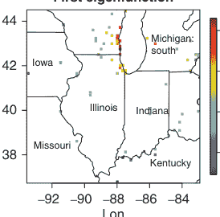

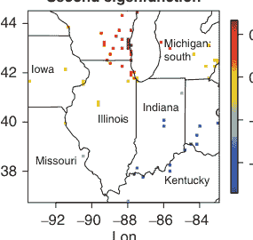

图 9.22 美国中西部趋势调整后臭氧数据的特征函数。部分 (a) 为第一特征函数，部分 (b) 为第二特征函数。

为奇异矩阵，常规 PCA 并不实用。如同示例 9.2，我们关注趋势调整后的数据。图 9.22 展示了趋势调整后臭氧数据的前两个特征函数。从图中不难看出，第一特征函数在北伊利诺伊州和南威斯康星州密歇根湖西岸沿线具有较大权重。另一方面，第二特征函数显示出某些地理效应，因为它在北部各州（威斯康星州、密歇根州、北伊利诺伊州）上权重较重，在南部各州（俄亥俄州和肯塔基州）上权重较轻。图 9.23 展示了前两个主成分的时间图。这些图表明，这些成分在时间上似乎是平稳的。最后，应用估计的协方差函数，我们可以对臭氧数据进行空间预测。为演示，我们使用 200 个

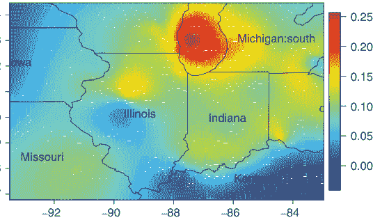

#### 图 9.24 基于正则化空间 PCA 的美国中西部臭氧测量值空间预测的第一个特征函数。

沿使用的经度方向等距点和沿使用的纬度方向 200 个等距点。换言之，我们为美国中西部构建了一个 \(200 \times 200\) 的新网格。图 9.24 绘制了预测臭氧测量值（趋势调整后）的第一个特征函数。令人欣慰的是，臭氧的主要集中区域位于北伊利诺伊州和南威斯康星州附近的密歇根湖西岸。

#### 空间 PCA：R 的 SpatPCA 包

```
>require(fields)
>require(SpatPCA)
>require(pracma)
>data(zone2)
>x <- ozone2$lon.lat
>Y <- ozone2$y
>date <- as.Date(zone2$date,format='%y%m%d')
>rmma <- !colSums(is.na(Y))
>YY <- matrix(Y[,rmma],nrow=nrow(Y))
>YY <- detrend(YY,"linear")
>xx <- x[rmma,]
>cv <- spatpca(x=xx,Y=YY)
>quilt.plot(xx,cv$eigenfn[,1])
>map("state",xlim=range(xx[,1]),ylim=range(xx[,2]),add=T)
>map.text("state",xlim=range(xx[,1]),ylim=range(xx[,2]),cex=1,add=T)
>title(main="First Eigen Function")
>quilt.plot(xx,cv$eigenfn[,2])
>map("state",xlim=range(xx[,1]),ylim=range(xx[,2]),add=T)
>map.text("state",xlim=range(xx[,1]),ylim=range(xx[,2]),cex=1,add=T)
>title(main="Second Eigen Function")
#### Time plots
>par(mfcol=c(2,1))
>plot(date,YY%*%cv$eigenfn[,1],type="l",ylab="1st PCA")
>plot(date,YY%*%cv$eigenfn[,2],type="l",ylab="2nd PCA")
>par(mfcol=c(1,1))
```


#### 预测
```
>new_loc <- 200
>x_lon <- seq(min(xx[, 1]), max(xx[, 1]), length=new_loc)
>x_lat <- seq(min(xx[, 2]), max(xx[, 2]), length=new_loc)
>xx_new <- as.matrix(expand.grid(x=x_lon,y=x_lat))
>eof <- spatpca(xx=xx, Y=YY,K=cv$Khat,tau1=cv$stau1,tau2=cv$stau2,
      x_new=xx_new)
>quilt.plot(xx_new,eof$eigenfn[,1],nx=new_loc,ny=new_loc,xlab="lon",
      ylab="lat")
>map("state",xlim=range(x_lon),ylim=range(x_lat),add=T)
>map.text("state",xlim=range(x_lon),ylim=range(x_lat),cex=1,add=T)
```

### 9.7.5 具有时间基函数的随机效应

或者，如果有人使用时间基函数并将随机效应扩展为空间，则公式 (9.82) 中的 S-T 模型变为

\(Y(\boldsymbol{s}, t) = \boldsymbol{x}(\boldsymbol{s}, t)' \boldsymbol{\beta} + \sum_{i=1}^{n_a} \phi_i(t)\alpha_i(\boldsymbol{s}) + \upsilon(\boldsymbol{s}, t),\) (9.94)

其中 \(\{\phi_i(t)|i=1, \dots, n_a\}\) 是时间基函数，\(\{\alpha_i(\boldsymbol{s})\}\) 是带空间索引的随机效应。设 \(\boldsymbol{\alpha}(\boldsymbol{s}) = [\alpha_1(\boldsymbol{s}), \dots, \alpha_{n_a}(\boldsymbol{s})]'\) 表示 \(n_a\) 维空间过程。可以为 \(\boldsymbol{\alpha}(\boldsymbol{s})\)（其中 \(\boldsymbol{s} \in D\)）指定之前讨论过的空间模型。有许多可用的时间基函数，包括傅里叶函数和其他正交函数。也可以使用数据驱动的时间基函数。

#### 示例 9.5

再次考虑 1993 年 8 月 NOAA 数据集中的每日最高气温。这里我们考虑一个具有时间基函数的随机效应模型。具体来说，所考虑的模型形式为

\(Y(\boldsymbol{s}, t) = \sum_{i=1}^{3} \phi_i(t)\alpha_i(\boldsymbol{s}) + \upsilon(\boldsymbol{s}, t),\) (9.95)

其中 \(\{\phi_i(t)|i=1,2,3\}\) 是数据驱动的时间基函数，\(\{\alpha_i(\boldsymbol{s})\}\) 是作为多元空间随机场处理的时间基函数系数，而 \(\upsilon(\boldsymbol{s}, t)\) 是空间相关但时间独立的随机过程。在此演示中，我们不使用任何协变量，因此项 \(\boldsymbol{x}(\boldsymbol{s}, t)' \boldsymbol{\beta}\) 被省略。

公式 (9.95) 中模型的实证分析可以通过 R 包 **SpatioTemporal** 进行。所用 R 命令的详细信息如下。另见 Wikle et al. (2019, 第 4 章)。**SpatioTemporal** 使用的时空对象为类 `STdata`，由函数 `createSTdata` 创建。此外，该包假设 \(\upsilon(\boldsymbol{s}, t)\) 在时间上不相关。因此，时间依赖性应由协变量或时间基函数中的任一者来处理。由于公式 (9.95) 中的模型不使用任何协变量，每日最高气温中的时间依赖性必须由基函数捕获。我们进行一些初步数据分析以检查此类假设的有效性。

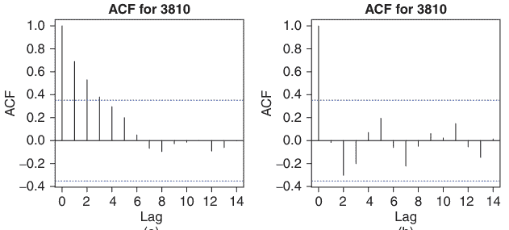

图 9.25 1993 年 8 月选定系列每日最高气温的样本自相关函数（ACF）。部分 (a) 是观测系列的 ACF，部分 (b) 是调整时间基函数效应后残差的 ACF。

图 9.25(a) 显示了选定系列（ID = 3810）的样本自相关函数（ACF）。从图中可以看出，观测数据系列具有显著的序列相关性。图 9.25(b) 提供了调整时间基函数效应后同一系列的样本 ACF。现在，图表明没有显著的序列依赖性。所使用的三个时间基函数在图 9.26 中显示。第一个基函数只是一个常数。

使用指定的时间基函数，公式 (9.95) 中的空间系数 \(\alpha_i(s)\) 可以通过命令 `estimateBetaFields` 估计。估计结果提供两个数量。第一个数量包含参数估计，在程序中称为 beta，第二个是估计的标准误差，称为 beta.sd。图 9.27 显示了 \(\alpha_1(s)\)、\(\alpha_2(s)\) 和 \(\alpha_3(s)\) 在

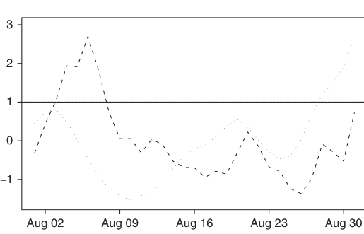

图 9.26 1993 年 8 月每日最高气温的前三个时间基函数时间图。第二个和第三个基函数分别以虚线和点线显示。

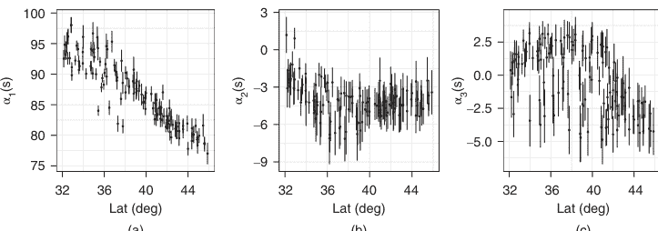

**图 9.27** 每个地点处 \(\alpha_1(\mathbf{s})\)、\(\alpha_2(\mathbf{s})\) 和 \(\alpha_3(\mathbf{s})\) 的实证估计值及 95% 置信区间，按纬度绘制。

各地点处的每个 \(\alpha_i(\mathbf{s})\) 的实证估计值及 95% 置信区间，按纬度绘制。从图中可以容易看出，\((a)\) 如预期，\(\widehat{\alpha}_1(\mathbf{s})\) 随纬度呈递减趋势。\((b)\) \(\widehat{\alpha}_2(\mathbf{s})\) 在纬度较低时显示出较弱的趋势，但随着纬度增加，趋势会趋于平缓，\((c)\) \(\widehat{\alpha}_3(\mathbf{s})\) 除纬度较大时外，对纬度没有明确的依赖关系。基于这些发现，将 \(\alpha_i(\mathbf{s})\) 视为具有指数协方差函数的随机场是合理的。具体来说，我们假设模型：

\(E[\alpha_1(\mathbf{s})] = \alpha_{11} + \alpha_{12}s_2, \quad \text{Cov}[\alpha_1(\mathbf{s}), \alpha_1(\mathbf{s}+\mathbf{h})] = \sigma_1^2 \exp \left( \frac{-\|\mathbf{h}\|}{r_1} \right), \quad (9.96)\)

\(E[\alpha_2(\mathbf{s})] = \alpha_{21} + \alpha_{22}s_2, \quad \text{Cov}[\alpha_2(\mathbf{s}), \alpha_2(\mathbf{s}+\mathbf{h})] = \sigma_2^2 \exp \left( \frac{-\|\mathbf{h}\|}{r_2} \right), \quad (9.97)\)

\(E[\alpha_3(\mathbf{s})] = \alpha_{31}, \quad \text{Cov}[\alpha_3(\mathbf{s}), \alpha_3(\mathbf{s}+\mathbf{h})] = \sigma_3^2 \exp \left( \frac{-\|\mathbf{h}\|}{r_3} \right), \quad (9.98)\)

其中 \(s_2\) 是地点 \(\mathbf{s} = (\text{lon}, \text{lat})' = (s_1, s_2)'\) 的纬度，\(r_i (i=1,2,3)\) 是尺度参数，\(\sigma_i^2 (i=1,2,3)\) 是平稳方差。我们进一步假设，当 \(i \neq j\) 时，\(\text{Cov}[\alpha_i(\mathbf{s}), \alpha_j(\mathbf{s})] = 0\)。后一个假设相对较强，我们使用它是为了演示方便。最后，仍需指定时间独立残差过程 \(\nu(\mathbf{s}, t)\) 的空间协方差函数。遵循 Wikle et al. (2019)，我们使用带有块头效应的指数协方差函数来考虑测量误差。指定的整体模型可以通过包 **SpatioTemporal** 的命令 `createStmodel` 创建。需要估计的模型参数可以使用命令 `loglikeStnames` 找到。

然后，拟合模型可用于预测每日最高气温。为了演示，我们创建一个 20 乘 20 的网格，包含从 \(-100^\circ\) 到 \(-80^\circ\) 的 20 个等间距经度和从 \(32^\circ\) 到 \(46^\circ\) 的 20 个等间距纬度。我们还创建从 1993 年 8 月 1 日开始的六个时间天。预测可以通过命令 `predict` 获得。图 9.28(a) 显示新网格上 8 月 14 日以华氏度为单位的点预测，而图 9.28(b) 显示相应的预测标准误差。

#### R 演示和使用的命令：包 SpatioTemporal

```
`> require(dplyr)`
`> require(ggplot2)`
```

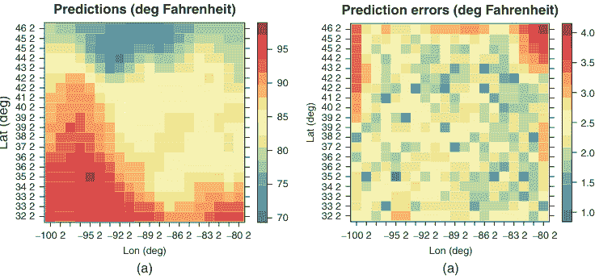

图 9.28 基于公式 (9.95) 中拟合的 S-T 模型对 1993 年 8 月 14 日每日最高气温的预测。部分 (a) 表示点预测，部分 (b) 表示相应的预测标准误差。

```
>require(gstat)
>require(RColorBrewer)
>require(sp)
>require(spacetime)
>require(SpatioTemporal)
>require(STRbook)
>require(tidyverse)
>data("NOAA_df_1990",package="STRbook") # load NOAA data
>### Filter the data for those in August 1993 and just Tmax
>NOAA_aug <- filter(NOAA_df_1990,year==1993&month==8 & proc=="Tmax")
>NOAA_aug_for_STdata <- NOAA_aug %>% ### Create ID as character var.
+ transmute(ID = as.character(id), obs = z, date=date)
>covars <- dplyr::select(NOAA_aug, id, lat, lon) %>% 
+ unique() %>% 
+ dplyr::rename(ID = id) ### createSTdata expects "ID"
>STdata <- createSTdata(NOAA_aug_for_STdata, covars=covars)
>plot(STdata, "acf", ID="3810")
>### found temporal basis functions
>STdata <- updateTrend(STdata, n.basis=2)
>names(STdata)
#[1] "obs" "covars" "SpatioTemporal" "trend"
>#[5] "trend.fn"
>range(STdata$trend[,1:2])
#[1] -1.523513 2.692456
>trend <- STdata$trend
>plot(trend[,3],trend[,1],type="l",lty=2,lwd=2,ylim=c(-1.6,3.0),
+ xlab="date",ylab="trend components")
> abline(h=1)
> lines(trend[,3],trend[,2],lty=3,lwd=2)
>##
>plot(STdata,"acf",ID="3810")
>alpha.lm<- estimateBetaFields(STdata)#estimate alpha (called beta in R)
>names(alpha.lm)
```


#[1] "beta" "beta.sd"

#### 使用 plotrix 包准备绘图。
>require(plotrix)
>head(row.names(alpha.lm$beta))
#[1] "13865" "13866" "13871" "13873" "13874" "13876"
>head(covars$ID)
#[1] 3804 3810 3811 3812 3813 3816
#### 正确匹配数据
>alpha.lm$beta <- data.frame(alpha.lm$beta)
>alpha.lm$beta.sd <- data.frame(alpha.lm$beta.sd)
>alpha.lm$beta$ID <- as.integer(row.names(alpha.lm$beta))

>ALPHA <- cbind(alpha.lm$beta,alpha.lm$beta.sd)
>colnames(ALPHA) <- c("alpha1", "alpha2", "alpha3", "ID",
 "alpha1_CI", "alpha2_CI", "alpha3_CI")
>ALPHA <- left_join(ALPHA,covars,by="ID")

>ggplot(ALPHA)+geom_point(aes(x=lat,y=alpha1))+
 geom_errorbar(aes(x=lat,ymin=alpha1-1.96*alpha1_CI,
 ymax=alpha1+1.96*alpha1_CI)) +
 ylab(expression(alpha[1](s))) +
 xlab("lat (deg)")+theme_bw()
#### alpha2 和 alpha3 的命令已省略。

#### Sigma_a
>cov.beta <- list(covf = "exp", nugget=FALSE)
#### Sigma_nu
>cov.nu <- list(covf = "exp", nugget=~1,random.effect=FALSE)
>locations <- list(coords=c("lon","lat"))
>LUR <- list(~lat, ~lat, ~1)
>STmodel <- createSTmodel(STdata, LUR=LUR,
 cov.beta=cov.beta,cov.nu=cov.nu,locations=locations)
>parnames <- loglikeSTnames(STmodel, all=FALSE)
>print(parnames)
#[1] "log.range.const.exp"      "log.sill.const.exp"
#[3] "log.range.V1.exp"         "log.sill.V1.exp"
#[5] "log.range.V2.exp"         "log.sill.V2.exp"
#[7] "nu.log.range.exp"         "nu.log.sill.exp"
#[9] "nu.log.nugget.(Intercept).exp"
>x.init <- matrix(3,9,1)
>rownames(x.init) <- loglikeSTnames(STmodel, all=FALSE)
>SpatioTemporalfit <- estimate(STmodel, x.init)
#Optimisation using starting value 1/1
#N = 9, M = 5 machine precision = 2.22045e-16
#At X0, 0 variables are exactly at the bounds
#At iterate   0 f =    7480.2 |proj g|=        18
#At iterate  10 f =    5615.8 |proj g|=       16.617
#At iterate  20 f =    5611.3 |proj g|=        8.3644
#At iterate  30 f =    5603.3 |proj g|=        4.4537

#Iterations 36
#function evaluations 58
#segments explored during Cauchy searches 43
#BFGS updates skipped 0
#active bounds at final generalized Cauchy point 0
#norm of the final projected gradient 1.1482
#final function value 5602.96

#F = 5602.96
#final value 5602.958497
#converged

#### 预测
>x.final <- coef(SpatioTemporalfit,pars="cov")$par
>spat_pred_grid <- expand.grid(lon=seq(-100, -80, length=20),
lat=seq(32,46,length=20))
>spat_pred_grid$id <- 1:nrow(spat_pred_grid)
>temp_pred_grid <- as.Date("1993-08-01")+seq(3,28,length=6)
>obs_pred_wide <- matrix(0,6,400)
>rownames(obs_pred_wide) <- as.character(temp_pred_grid)
>colnames(obs_pred_wide) <- spat_pred_grid$id
>covars_pred <- spat_pred_grid
>STdata_pred <- createSTdata(obs=obs_pred_wide,covars=covars_pred)
>E <- predict(STmodel,x.final,STdata=STdata_pred)
>names(E)
#### 1993年8月14日预测值和预测误差的水平图
>t1 <- E$EX
>t2 <- E$VX.pred
>E1 <- matrix(t1[3,],20,20)
>E2 <- matrix(sqrt(t2[3,]),20,20)
>k1 <- seq(32,46,length=20)
>k2 <- seq(-100,-80,length=20)
>colnames(E2) <- colnames(E1) <- paste(round(k1,2))
>rownames(E2) <- rownames(E1) <- paste(round(k2,2))
>require(lattice)
#### 定义调色板
>color_pal <- rev(colorRampPalette(brewer.pal(11,"Spectral"))(16))
>levelplot(E1,col.regions=color_pal,xlab="lon (deg) ",ylab="lat (deg) ",
main="Predictions (deg Fahrenheit) ")
>levelplot(E2,col.regions=color_pal,xlab="lon (deg) ",ylab="lat (deg) ",
main="Prediction errors (deg Fahrenheit) ")

我们的讨论集中在高斯分布上。实际应用中存在许多非高斯 S-T 数据。例如，在流行病学研究中，S-T 计数数据（如特定地区在指定时间段内特定疾病的病例数）很常见。我们针对高斯数据讨论的分析可以推广到对非高斯 S-T 数据建模。有兴趣的读者可参阅 Cressie 和 Wikle (2011) 以及 Diggle (2013)。

## 9.8 动态 S-T 模型

在本节中，我们考虑动态 S-T 统计模型。鉴于其复杂性，文献中存在许多此类模型，无法在此全部讨论。相反，我们仅提供一些可根据特定应用需求进行定制的通用模型。

### 9.8.1 空间-时间自回归移动平均模型

假设位置为 s1, ..., sm，并将过程表示为 Yt = [Y(s1, t), ..., Y(sm, t)]'，其中时间索引假设为离散且等距。那么，模型

$$
Y_t = \sum_{i=0}^p \left( \sum_{j=1}^{p_i} f_{ij} U_{ij} \right) Y_{t-i} + \sum_{\ell=0}^q \left( \sum_{j=1}^{q_\ell} g_{\ell j} V_{\ell j} \right) W_{t-\ell} \quad (9.99)
$$

其中 {U_ij} 和 {V_{\ell j}} 为已知权重矩阵，p 和 q 为非负整数，{p_i} 和 {q_\ell} 分别表示 AR 部分和移动平均部分的阶数的非负整数，{f_ij} 和 {g_{\ell j}} 为模型参数，{W_t} 为均值为 0 且协方差矩阵为 Sigma_w（假设为正定）的 iid 随机向量。Eq. (9.99) 中的模型称为空间-时间自回归移动平均（STARMA）模型。例如，参见 Ali (1979)、Pfeifer and Deutsch (1980) 和 Cressie (1993, 第 450 页)。该模型需要一些额外假设才能被良好定义。使用权重矩阵 {U_ij} 和 {V_{\ell j}} 可以指定 S-T 过程 Y_t 的子结构，但代价是可能在 {f_ij} 和 {g_{\ell j}} 中使用许多参数，尤其是当 p_i 和 q_l 较大时。

Eq. (9.99) 中的 STARMA 模型可以重写为

$$
Y_t = \sum_{i=0}^p \Phi_i Y_{t-i} + \sum_{j=0}^q \Theta_j W_{t-j}, \quad (9.100)
$$

其中，不失一般性，我们假设 Cov(W_t) = sigma_w^2 I，并且为了可识别性，Phi_0 的对角元素为零。此外，我们假设 (I - Phi_0) 可逆。与第 3 章讨论的 VARMA 模型类似，Eq. (9.100) 中的 STARMA 模型可能难以应用，因为它可能包含过多参数，尤其是当 m、p 或 q 较大时。Eq. (9.100) 中 Y_t 的弱平稳性条件可以以类似于第 3 章 VARMA 模型的方式获得。

如果 q = 0，则模型简化为空间-时间 AR 模型。如果 p = q = 0，则模型变为

$$
Y_t = \Phi_0 Y_t + \Theta W_t,
$$

可写成

$$
Y_t = (I - \Phi_0)^{-1} \Phi_0 W_t.
$$

由于 W_t 在时间上不相关，Y_t 则成为一个空间过程。如果 Theta_0 = I，则上述模型称为同时自回归（SAR）模型。

如果 p = 1 且 q = 0，则 Eq. (9.100) 中的模型变为

$$
Y_t = (I - \Phi_0)^{-1} \Phi_1 Y_{t-1} + (I - \Phi_0)^{-1} \Theta_0 W_t,
$$

可写成

$$
Y_t = M Y_{t-1} + \eta_t,
$$

其中 M = (I - Phi_0)^-1 Phi_1，且 {eta_t} 是均值为零、协方差矩阵为 Cov(eta_t) = sigma_w^2 (I - Phi_0)^-1 Phi_0 Phi_0' (I - Phi_0)^-1 的 iid 随机变量序列。

文献中已提出一些特定的 S-T AR 模型。例如，Gao et al. (2019) 考虑带有带状 AR 系数矩阵的模型。

### 9.8.2 S-T 分量模型

S-T 过程 \(\{Y(\mathbf{s}, t)|\mathbf{s} \in D \subset R^d, t \in D_t \subset R\}\) 的一般可加分量模型为
\(Y(\mathbf{s}, t) = \mu(\mathbf{s}, \theta_t) + \gamma(t, \theta_s) + \kappa(\mathbf{s}, t, \theta_{s,t}) + \eta(\mathbf{s}, t),\quad (9.101)\)

其中 \(\mu(\mathbf{s}, \theta_t)\) 表示带有参数向量 \(\theta_t\) 的*空间*趋势面，\(\theta_t\) 可能随时间 \(t\) 变化，\(\gamma(t, \theta_s)\) 表示带有参数向量 \(\theta_s\) 的*时间*趋势，\(\theta_s\) 可能随位置 \(\mathbf{s}\) 变化，\(\kappa(\mathbf{s}, t, \theta_{s,t})\) 表示带有参数向量 \(\theta_{s,t}\) 的 S-T 随机过程，\(\theta_{s,t}\) 可能同时依赖于位置 \(\mathbf{s}\) 和时间 \(t\)，\(\eta(\mathbf{s}, t)\) 表示微尺度 S-T 随机过程，其在 \(D \times D_t\) 中遵循零均值不相关过程。该模型由 Wikle (2003) 考虑。第一个分量 \(\mu(\mathbf{s}, \theta_t)\) 可能包含协变量（如 \(\mathbf{x}(\mathbf{s}, t)'\beta\)）的影响。第二个分量 \(\gamma(t, \theta_s)\) 可能包含季节性（如年度周期的三角级数）的影响，其参数依赖于位置 \(\mathbf{s}\)。Eq. (9.101) 的第三和第四个分量可能是随机的，因此 \(Y(\mathbf{s}, t)\) 的模型是一个随机效应模型。通常，为便于模型识别，假设随机分量相互独立。

Eq. (9.101) 中的分量模型灵活且适用于许多情况。然而，估计在计算上可能较为密集，特别是当位置数 \(m\) 和/或样本量 \(T\) 较大时。Deb and Tsay (2019) 采用此类模型对台湾南部 13 个监测站观测到的 PM\(_{2.5}\) 数据进行了建模。

### 9.8.3 S-T 因子模型

与其他统计分析类似，也可以向 S-T 建模引入因子结构以降维并简化分析。然而，在假设因子模型时必须小心，因为需要尊重空间结构。一种自然的方法是让公共因子描述时间依赖性，而载荷矩阵仅依赖于空间。例如，参见 Lopes et al. (2011) 的广义空间动态因子（GSDF）模型。如前所述，令 \(\mathbf{Y}_t = [Y(\mathbf{s}_1, t), \dots, Y(\mathbf{s}_m, t)]'\)，位置为 \(\{\mathbf{s}_i \in D \subset R^d \text{ for } i = 1, \dots, m\}\)。在 GSDF 模型下，\(Y(\mathbf{s}_i, t)\) 遵循一参数自然指数分布，如下

\(p(Y(\mathbf{s}_i, t)|\eta_{ii}, \psi) = \exp\{\psi[Y(\mathbf{s}_i, t)\eta_{ii} - b(\eta_{ii})] + c[Y(\mathbf{s}_i, t), \psi]\},\quad (9.102)\)

其中 \(\eta_{ii}\) 是自然参数，\(\psi\) 是已知离散参数。\(Y(\mathbf{s}_i, t)\) 的均值和方差分别为第一和第二导数 \(b'(\eta_{ii})\) 和 \(b''(\eta_{ii})/\psi\)。该自然参数通过链接函数 \(\eta_{ii} = v(\theta_{ii})\) 定义为空间和时间分量的线性组合，其中 \(\theta_{ii}\) 是一个 S-T 过程。

令 \(\theta_t = (\theta_{t1}, \dots, \theta_{tm})'\)。GSDF 模型使用以下两级层次结构来描述 \(\mathbf{Y}_t\) 的时间行为：

\(\theta_t = \mu_t + \mathbf{L}\mathbf{f}_t,\quad (9.103)\)

\(\mathbf{f}_t = \mathbf{\Phi}\mathbf{f}_{t-1} + \epsilon_t,\quad (9.104)\)

其中 \(\mu_t\) 是空间-时间过程的均值，\(\mathbf{f}_t = (f_{t1}, \dots, f_{tr})'\) 是公共因子向量（\(r \ll m\)），\(\mathbf{L}\) 是稍后定义的载荷矩阵，\(\mathbf{\Phi}\) 是转移


公共因子的协方差矩阵，\(\epsilon_t\) 是一个 \(r \times r\) 独立同分布的高斯过程，均值为零，协方差为 \(\Sigma_e > 0\)，且 \(f_0 \sim N(m_0, C_0)\)，其中超参数 \(m_0\) 和 \(C_0\) 已知。在应用中，\(\mu_t\) 和 \(\Phi\) 均可考虑季节性，且 \(\mu_t\) 还可包含协变量的影响。

\(Y_t\) 的空间变异通过载荷矩阵 \(L\) 的列来建模。将 \(L\) 的第 \(j\) 列记为 \(L_j = (L_{1j}, \dots, L_{mj})'\)，\(j=1, \dots, r\)。GSDF 模型假设 \(L_j\) 是条件独立的、基于距离的高斯过程（或高斯随机场）。即，

\(L_j \sim N(\kappa_j, \tau_j^2 R_j), \quad j=1, \dots, r,\quad (9.105)\)

其中 \(\kappa_j\) 是 \(m\) 维均值向量，\(\tau_j\) 是缩放参数，\(R_j = [r_{uv}(\phi_j)]\)，且 \(r_{uv}(\phi_j) = \rho_{\phi_j}(||s_u - s_v||)\)，\(u, v = 1, \dots, m\)，其中 \(\rho_{\phi}(.)\) 为适当定义的相关函数，\(j=1, \dots, r\)。为简化起见，参数 \(\phi_j\) 通常是标量或低维向量。例如，若 \(\rho_{\phi}\) 为指数函数 \(\rho_{\phi_j}(h) = \exp(-h/\phi_j)\) 或球形函数 \(\rho_{\phi_j}(h) = [1 - 1.5(h/\phi_j) + 0.5(h/\phi_j)^3]I_{h/\phi_j \le 1}\)，则 \(\phi_j\) 为标量，其中 \(h\) 表示距离。

GSDF 模型（公式 (9.103)-(9.105)）的估计可采用马尔可夫链蒙特卡罗方法，结合扩展卡尔曼滤波和 Metropolis-Hastings 算法的技术。当然，使用 GSDF 模型时需考虑的重要问题包括公共因子个数 \(r\) 的选择以及因子过程 \(f_t\) 的估计。这些问题可通过信息准则或在贝叶斯框架下加以解决。更多细节及应用请参见 Lopes et al. (2011)。

### 9.8.4 S-T HMs

假设地点 \(\{s_1, \dots, s_m\}\) 固定，其中 \(s_i \in D \subset R^d\)，且时间点为离散且等距的，设为 \(t=1, \dots, T\)。分析 S-T 数据的一般框架是层次动态 S-T 模型（DSTM），该模型在 Cressie and Wikle (2011) 和 Wikle et al. (2019) 中有所讨论。另见综述文章 Harvill (2010)。

在此框架下，数据模型为

\(Z_t = H_t(Y_t, \theta_{h,t}, \epsilon_t), \quad t=1, \dots, T,\quad (9.106)\)

其中 \(Z_t\) 表示时间 \(t\) 的观测数据，\(Y_t\) 是感兴趣的潜在 S-T 过程，\(H_t\) 是连接数据与潜在过程的线性或非线性映射，\(\epsilon_t\) 是数据误差，代表测量误差和/或某些小规模时间变异性。模型参数记为 \(\theta_{h,t}\)，可能随空间（由距离 \(h\) 表示）和/或时间变化。

在该模型下，假设数据 \(\{Z_t\}\) 在给定潜在过程 \(Y_t\) 和参数 \(\theta_{h,t}\) 的条件下在时间上独立。因此，数据的联合分布可写成乘积形式

\(p[\{Z_t\}_{t=1}^T | \{Y_t\}_{t=1}^T, \{\theta_{h,t}\}_{t=1}^T] = \prod_{t=1}^T p[Z_t | Y_t, \theta_{h,t}].\quad (9.107)\)

通常，\(Z_t\) 的条件分布假设为正态分布，但也可使用指数族的其他成员。参见上一节。

应用 DSTM 的另一个重要问题是对潜在 S-T 过程 \(\{Y_t\}\) 的联合分布进行分解。为此，可使用时间序列分析技术，我们有

\( p[Y_1, ..., Y_T] = \prod_{t=2}^T p[Y_t|Y_{t-1}, ..., Y_1] \times p(Y_1),\) (9.108)

为简化起见，分布函数中省略了参数。公式 (9.108) 提供了一种自然方式来引入假设，从而使 \(\{Y_t\}\) 的联合分布易于计算。例如，若假设一阶马尔可夫性质成立，则

\( p[Y_t|Y_{t-1}, ..., Y_1, \{\theta_{h,t}\}_{t=1}^T] = p[Y_t|Y_{t-1}, \theta_{h,t}],\) (9.109)

同样为简化起见，我们将所有参数（包括 \(Y_t\) 的时间演化参数）都放入参数向量 \(\theta_{h,t}\) 中。因此，假设 \(Y_t\) 是一阶马尔可夫过程，则有

\( p[Y_T, ..., Y_1|\{\theta_{h,t}\}] = \left( \prod_{t=2}^T p[Y_t|Y_{t-1}, \theta_{h,t}] \right) p[Y_1|\theta_{h,1}].\) (9.110)

在一阶马尔可夫性质下，我们可将 \(Y_t\) 的模型表示为

\( Y_t = M(Y_{t-1}, \theta_{h,t}, \eta_t),\) (9.111)

其中 \(M\) 表示时间转移，\(\eta_t\) 是时间上不相关的空间噪声过程。公式 (9.111) 中的转移 \(M\) 可以是线性或非线性的。例如，\(Y_t\) 可能遵循 VAR(1) 模型或多状态阈值 VAR(1) 模型。有兴趣的读者可参阅 Tsay (2014) 和 Tsay and Chen (2019)，分别了解 VAR(1) 和阈值 VAR 模型的性质，以及其他多元时间序列书籍。上述模型可推广到任何有限阶马尔可夫过程，只要阶数足够小，使得计算仍可处理。

估计 DSTM 有两种一般方法。第一种方法是使用 Dempster et al. (1977) 的期望-最大化（EM）算法，第二种方法是马尔可夫链蒙特卡罗（MCMC）方法。在某些非线性情况下，也可使用序列蒙特卡罗方法或粒子滤波，尤其是当维度 \(m\) 较小时。详情见 Cressie and Wikle (2011)。

## 附录 9.A：一些 R 包和命令

在本附录中，我们展示了用于生成本章中部分图表（尤其是第 9.1 节中的图表）的 R 命令。所使用的许多 R 命令也可在 http://spacetimewithr.org 上获取。

```
### S-T plots
### Figure 9.1
>library(sp)
>library(gstat)
>data(meuse)
>data(meuse.riv)
>plot(meuse.riv,type="l",asp=1,xlab="meuse.x",ylab="meuse.y",
main="Meuse river")
>points(meuse$xy,meuse$y,pch="x",cex=0.6)
### Figure 9.3
>require(fields)
>data(ozone2)
> good <- !is.na(ozone2$y[16,]) # day 16 and remove missing values
> out <- as.image(ozone2$y[16,good],x=ozone2$lon.lat[good,])
> image.plot(out)
> map("state",xlim=range(ozone2$lon.lat[good,1]),
ylim=range(ozone2$lon.lat[good,2]),add=T)
> map.text("state",xlim=range(ozone2$lon.lat[good,1]),
ylim=range(ozone2$lon.lat[good,2]),cex=1,add=T)
> points(ozone2$lon.lat[good,])
#
```

```
#library("animation")
>require("dplyr")
>require("ggplot2")
>require("maps")
>require("STbook")
>set.seed(1)
>data("NOAA_df_1990",package="STRbook") ## Load data
>Tmax=filter(NOAA_df_1990,proc=="Tmax" & month %in% 5:9 & year==1993)
>Tmax %>% select(lon,lat,date,julian,z) %>% head()
```

```
>Tmax$t <- Tmax$Julian - 728049
>Tmax_1 <- subset(Tmax, t %in% c(2,16,31))
>NOAA_plot<-ggplot(Tmax_1)+geom_point(aes(x=lon,y=lat,colour=z),size=2)+
col_scale(name = "degF")+xlab("Longitude (deg)")+
ylab("Latitude (deg)") +
geom_path(data = map_data("state"), aes(x=long,y=lat,group=group)) +
facet_grid(~date)+coord_fixed(xlim=c(-105,-75),ylim=c(25,50)) +
theme_bw()
>print(NOAA_plot)
```

```
### Time Series plot
>set.seed(11)
>UIDs <- unique(Tmax$id)
>UIDs_sub <- sample(UIDs,10)
>Tmax_sub <- filter(Tmax, id %in% UIDs_sub)
>TmaxTS <- ggplot(Tmax_sub) +
geom_line(aes(x = t,y=z))+
facet_wrap(~id,ncol=5) +
xlab("Day number (days)") +
ylab("Tmax (degF)") +
theme_bw() +
theme(panel.spacing = unit(1,"lines"))
>print(TmaxTS)
```

```
### ##################### Hovmoller plot
>lim_lat <- range(Tmax$lat)
>lim_t <- range(Tmax$t)
>lat_axis <- seq(lim_lat[1],lim_lat[2],length=25)
>t_axis <- seq(lim_t[1],lim_t[2],length=120)
>lat_t_grid <- expand.grid(lat=lat_axis,t=t_axis)
>Tmax_grid <- Tmax
>dists <- abs(outer(Tmax$lat,lat_axis,"-"))
>Tmax_grid$lat <- lat_axis[apply(dists,1,which.min)]
>Tmax_lat_hov <- group_by(Tmax_grid,lat,t) %>% summarise(z=mean(z))
>Hovller_lat <- ggplot(Tmax_lat_hov) +
  geom_tile(aes(x=lat,y=t,fill=z)) +
  fill_scale(name = "degF") +
  scale_y_reverse() +
  ylab("Day number (days)") +
  xlab("Latitude (deg)") +
  theme_bw()
>print(Hovller_lat)
```

```
>lim_long <- range(Tmax$lon)
>lim_t <- range(Tmax$t)
>long_axis <- seq(lim_long[1],lim_long[2],length=25)
>t_axis <- seq(lim_t[1],lim_t[2],length=120)
>long_t_grid <- expand.grid(lon=long_axis,t=t_axis)
>Tmax_grid <- Tmax
>dists <- abs(outer(Tmax$lon,long_axis,"-"))
>Tmax_grid$lon <- long_axis[apply(dists,1,which.min)]
>Tmax_lon_hov <- group_by(Tmax_grid,lon,t) %>% summarise(z=mean(z))
>Hovller_long <- ggplot(Tmax_long_hov) +
  geom_tile(aes(x=lon,y=t,fill=z)) +
  fill_scale(name = "degF") +
  scale_y_reverse() +
  ylab("Day number (days)") +
  xlab("Longitude (deg)") +
  theme_bw()
>print(Hovller_long)
```

## 练习

- 1. 考虑美国中西部臭氧数据。获取与图 9.3 类似的图表，针对 1987 年 6 月 25 日的数据。
- 2. 再次考虑美国中西部臭氧数据。获取练习 1 对趋势调整数据的对应图表。
- 3. 对 1993 年 7 月的日最高气温执行示例 9.4 的分析。
- 4. 执行与示例 9.2 相同的通用 S-T 克里金法，但使用 1993 年 7 月的日最高气温。

## 参考文献

Abramowitz, M. and Stegun, I. A. (1964). Handbook of Mathematical Functions with Formulas, Graphs, and Mathematical Tables. National Bureau of Standards, Washington, DC.
Ali, M. M. (1979). Analysis of stationary spatial-temporal processes: Estimation and prediction. Biometrika, 66: 513–518.


Bartlett, M. S. (1964). 二维点过程的谱分析。_生物统计学_, **51**: 299–311。

Besag, J. E. (1974). 空间交互与格系统的统计分析。_皇家统计学会杂志，B系列_, **36**: 192–225。

Burrough, P. A. and McDonnell, R. A. (1998). _地理信息系统原理_. 牛津大学出版社, 牛津, 英国。

Cliff, A. D. and Ord, J. K. (1981). _空间过程：模型与应用_. Pion, 伦敦, 英国。

Cressie, N. (1993). _空间数据统计学_, 修订版. Wiley, 纽约。

Cressie, N. and Huang, H. C. (1999). 非可分时空平稳协方差函数类。_美国统计学会杂志_, **94**: 1330–1340。

Cressie, N. and Johannesson, G. (2008). 用于非常大的空间数据集的固定秩克里金法。_皇家统计学会杂志，B系列_, **70**: 208–226。

Cressie, N. and Wikle, C. K. (2011). _时空数据统计学_. Wiley, 霍博肯, 新泽西。

Deb, S. and Tsay, R. S. (2019). 具有时空交互作用及其在空气污染数据中应用的时空模型。_统计学汇刊_ **29**: 1181–1207。

Dempster, A. P., Laird, N. M., and Rubin, D. B. (1977). 基于 EM 算法的不完全数据最大似然估计。_皇家统计学会杂志，B系列_, **39**: 1–38。

Diggle, P. J. (1985). 点过程数据平滑的核方法。_应用统计学_, **34**: 138–147。

Diggle, P. J. (2013). _空间和时空点模式的统计分析_. Chapman & Hall/CRC, 博卡拉顿, 佛罗里达。

Diggle, P. J. and Ribeiro, P. J. (2007). _基于模型的地统计学_. Springer, 纽约, 纽约。

Gao, Z., Ma, Y., Wang, H., and Yao, Q. W. (2019). 带状时空自回归。_计量经济学杂志_, **208**: 211–230。

Gneiting, T. (2002). 时空数据的非可分平稳协方差函数。_美国统计学会杂志_, **97**: 590–600。

Green, P. J. and Silverman, B. W. (1994). _非参数回归与广义线性模型：粗糙度惩罚方法_. Chapman & Hall: 博卡拉顿, 佛罗里达。

Harvill, J. L. (2010). 时空过程。_WIREs: 计算统计学_, **2**: 375–382。

Hovmöller, E. (1949). 槽脊图。_泰利斯_, **1**: 62–66。

Ising, E. (1925). 铁磁性理论的贡献。_物理杂志_, **31**: 253–258。

Journel, A. G. and Huijbregts, C. J. (1978). _矿产地统计学_. Academic Press, 伦敦, 英国。

Karhunen, K. (1947). 概率计算中的线性方法。_芬兰科学院年刊，A系列_, **37**: 1–79。

Loève, M. (1978). _概率论_. Springer-Verlag, 纽约。

Lopes, H. F., Gamerman, D., and Salazar, E. (2011). 广义空间动态因子模型。_计算统计与数据分析_, **55**: 1319–1330。

Matheron, G. (1962). _应用地统计学论文，I卷_. 地质与矿产研究局备忘录，No. **14**, Technip, 巴黎。

Matheron, G. (1963). _应用地统计学论文，II卷：克里金法_. 地质与矿产研究局备忘录，No. **24**, 巴黎。

Moran, P. A. P. (1950). 连续随机现象笔记。_生物统计学_, **37**: 17–23。

Nychka, D., Cox, L., and Piegorsch, W. (1998). 环境统计学案例研究。载于 _统计学讲义_. Springer-Verlag, 纽约, 纽约。

Oehlert, G. W. (1993). 硫酸盐湿沉降的区域趋势。美国统计学会杂志, 88: 390–399。

Pebesma, E. (2019). Meuse 数据集：gstat R 包简明教程。www.r-project.org（访问于 2019 年 9 月 26 日）。

Pfeifer, P. E. and Deutsch, S. J. (1980). 时空建模的三阶段迭代方法。技术计量学, 22: 35–47。

Reinsel, G., Tiao, G. C., Wang, N. W., Lewis, R., and Nychka, D. (1981). 用于趋势检测的平流层臭氧数据统计分析。大气环境, 15: 1569–1577。

Ripley, B. D. (1976). 稳态点过程的二阶分析。应用统计学杂志, 13: 255–266。

Stoyan, D. and Stoyan, H. (1994). 分形、随机形状与点场：几何统计学方法。Wiley, 奇切斯特, 英国。

Tsay, R. S. (2014). 基于 R 及金融应用的多元时间序列分析。Wiley, 霍博肯, 新泽西。

Tsay, R. S. and Chen, R. (2019). 非线性时间序列分析。Wiley, 霍博肯, 新泽西。

Tseng, S. and Huang, H. C. (2015). 基于低阶正则化的非平稳多元空间协方差估计。统计学汇刊, 26: 151–172。

Tseng, S. and Huang, H. C. (2018). 分辨率自适应固定秩克里金法。技术计量学, 60: 198–208。

Tseng, S. L., Huang, H. C., Wang, W. T., Nychka, D., and Gillespie, C. (2019). autoFRK，R 包。www.r-project.org（访问于 2019 年 3 月 29 日）。

Wang, W. T. and Huang, H. C. (2017). 空间数据的正则化主成分分析。计算与图形统计学杂志, 26: 14–25。

Wikle, C. K. (2003). 环境科学中的层次模型。国际统计评论, 71: 181–199。

Wikle, C. K., Zammit-Mangion, A., and Cressie, N. (2019). 基于 R 的时空统计学。Chapman & Hall/CRC, 博卡拉顿, 佛罗里达。

Zammit-Mangion, A. (2018a). STRbook：基于 R 时空建模图书的补充包，R 包。https://github.com/andrewzm/STRbook（访问于 2019 年 9 月 25 日）。

Zammit-Mangion, A. (2018b). 固定秩克里金法：用于具有时空基函数的时空数据建模的 FRK 包。参见 R 核心网。
