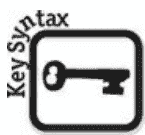

## 前言

如今，面向绝对初学者的 Python 书籍已成为一种小产业。似乎每个人和他们的狗都想追逐 Python。

我们稍有偏见，但我们特别推荐一本书，即《Python Without Fear》。它会牵着你的手，一次介绍一个主要特性。但是，当你对这门语言了解一点，但还不足以自称“专家”时，你该怎么办？如何学到足够的知识来找到工作或编写主要应用程序？

这就是这本书的用途：它是你购买的关于 Python 的第二本书，也可能是最后一本。

## 什么让 Python 与众不同？

可以肯定地说，许多人被 Python 吸引，是因为它看起来比 C++ 更容易。这可能是事实（至少在开始阶段），但在这种所谓的易学语言下面，是一个功能强大的工具，拥有许多快捷方式和称为“包”的软件库——在某些情况下，它们为你完成大部分工作。这些工具让你能够创建一些非常出色的软件，输出精美的图表并处理大量数据。

对于大多数人来说，学习所有快捷方式和高级功能可能需要数年时间。本书是为那些想要立即获得这些知识、更快地接近 Python 专家的人而写的。

## 学习路径：我从哪里开始？

本书为不同的人提供了不同的学习路径。

- **你生疏了**：如果你尝试过 Python 但有点生疏，你可能想看看第 1 章“基础回顾”。否则，你可能想跳过第 1 章，或者只是简要浏览一下。

- **你了解基础知识但仍在学习**：从第 2 章和第 3 章开始，它们概述了字符串和列表的功能。这个概述包括人们第一次学习 Python 时经常错过的这些数据结构的一些高级功能。

- **你对 Python 的理解很强，但还不了解一切**：从第 4 章开始，它列出了 22 个 Python 独有的编程快捷方式，大多数人需要很长时间才能完全掌握。

- **你想掌握特殊功能**：你可以从某个专业领域开始。例如，第 5、6 和 7 章涉及文本格式化和正则表达式。关于正则表达式语法的两个章节，第 6 章和第 7 章，从基础开始，然后涵盖这种模式匹配技术的更精细之处。其他章节涉及其他专业领域。例如，第 8 章描述了处理文本和二进制文件的不同方式。

- **你想学习高级数学和绘图软件**：如果你想进行绘图、金融或科学应用，请从第 12 章“‘numpy’（数值 Python）包”开始。这是提供许多在第 13 章到第 15 章中描述的更高级功能的基础的基本包。

## 清晰度和示例是一切

即使有先进的技术，我们的重点仍然是清晰度、简短示例、更多清晰度和更多示例。我们强调交互式方法，特别是使用 IDLE 环境，鼓励你输入语句并查看它们的作用。粗体文本代表你要输入的行，或者要添加或更改的行。

```
>>> print('Hello', 'my', 'world!')
Hello my world!
```

本书中的几个应用程序是高级软件，包括一个 Deck 对象、一个功能齐全的“RPN”语言解释器，以及一个多方面的股票市场程序，它为用户提供许多选择。使用这些应用程序，我们从简单的示例开始，最终在上下文中展示所有部分。这种方法与许多书籍不同，那些书籍给你几十个无序的函数，没有架构感。在这本书中，架构是一切。

你可以从 **brianoverland.com/books** 下载示例。

## 学习辅助：图标

本书大量使用表格以方便参考，以及概念艺术（图形）。我们的经验是，设计不佳的图形可能会分散注意力，但最好的图形可能非常宝贵。一图胜千言。有时，更多。

我们还相信，在讨论绘图和图形软件时，没有什么比展示所有相关屏幕截图更能替代的了。

本书本身使用了几个重要的排版手段。文本中使用了三个特殊图标。

> **注意**
>
> 我们有时会使用注释来指出你最终会想知道但偏离主讨论的事实。你第一次阅读某个部分时可能想跳过注释，但稍后回去阅读它们是个好主意。



关键语法图标引入一般语法显示，你可以在其中提供一些或所有元素。这些元素称为“占位符”，它们以斜体显示。语法的一些部分——尤其是关键字和标点符号——以粗体显示，并旨在按所示输入。最后，方括号，当不加粗时，表示可选项。例如：

```
set([iterable])
```

这个语法显示意味着 _iterable_ 是一个可迭代对象


(such as a list or a generator object) that you supply. And it’s optional.
Square brackets, when in bold, are intended literally, to be typed in as shown. For example:

```
`list_name = [obj1, obj2, obj3, ...]`
```

Ellipses (...) indicate a language element that can be repeated any number of times.

> > **Performance Tip**
> >
> > Performance tips are like Notes in that they constitute a short digression from the rest
> of the chapter. These tips address the question of how you can improve software
> performance. If you're interested in that topic, you'll want to pay special attention to
> these notes.

## WHAT YOU'LL LEARN

The list of topics in this book that are not in _Python Without Fear_ or other “beginner” texts is a long one, but here is a partial list of some of the major areas:

- List, set, and dictionary comprehension.
- Regular expressions and advanced formatting techniques; how to use them in lexical analysis.
- Packages: the use of Python’s advanced numeric and plotting software. Also, special types such as `Decimal` and `Fraction`.
- Mastering all the ways of using binary file operations in Python, as well as text operations.
- How to use multiple modules in Python while avoiding the “gotchas.”
- Fine points of object-oriented programming, especially all the “magic methods,” their quirks, their special features, and their uses.

## HAVE FUN

When you master some or all of the techniques of this book, you should make a delightful discovery: Python often enables you to do a great deal with a relatively small amount of code. That’s why it’s dramatically increasing in popularity every day. Because Python is not just a time-saving device, it’s fun to be able to program this way . . . to see a few lines of code do so much.

We wish you the joy of that discovery.

Register your copy of _Supercharged Python_ on the InformIT site for convenient access to updates and/or corrections as they become available. To start the registration process, go to informit.com/register and log in or create an account. Enter the product ISBN (9780135159941) and click Submit. Look on the Registered Products tab for an Access Bonus Content link next to this product, and follow that link to access any available bonus materials. If you would like to be notified of exclusive offers on new editions and updates, please check the box to receive email from us.

## Acknowledgments

### FROM BRIAN

I want to thank my coauthor, John Bennett. This book is the result of close collaboration between the two of us over half a year, in which John was there every step of the way to contribute ideas, content, and sample code, so his presence is there throughout the book. I also want to thank Greg Doench, acquisitions editor, who was a driving force behind the concept, purpose, and marketing of this book.

This book also had a wonderful supporting editorial team, including Rachel Paul and Julie Nahil. But I want to especially thank copy editor Betsy Hardinger, who showed exceptional competence, cooperation, and professionalism in getting the book ready for publication.

### FROM JOHN

I want to thank my coauthor, Brian Overland, for inviting me to join him on this book. This allows me to pass on many of the things I had to work hard to find documentation for or figure out by brute-force experimentation. Hopefully this will save readers a lot of work dealing with the problems I ran into.

## About the Authors

**Brian Overland** started as a professional programmer back in his twenties, but also worked as a computer science, English, and math tutor. He enjoys picking up new languages, but his specialty is explaining them to others, as well as using programming to do games, puzzles, simulations, and math problems. Now he’s the author of over a dozen books on programming.

In his ten years at Microsoft he was a software tester, programmer/writer, and manager, but his greatest achievement was in presenting Visual Basic 1.0, as lead writer and overall documentation project lead. He believes that project changed the world by getting people to develop for Windows, and one of the keys to its success was showing it could be fun and easy.

He’s also a playwright and actor, which has come in handy as an instructor in online classes. As a novelist, he’s twice been a finalist in the Pacific Northwest Literary Contest but is still looking for a publisher.

**John Bennett** was a senior software engineer at Proximity Technology, Franklin Electronic Publishing, and Microsoft Corporation. More recently, he’s developed new programming languages using Python as a prototyping tool. He holds nine U.S. patents, and his projects include a handheld spell checker and East Asian handwriting recognition software.
