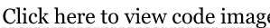

## 1. Review of the Fundamentals

You and Python could be the start of a beautiful friendship. You may have heard that Python is easy to use, that it makes you productive fast. It’s true. You may also find that it’s fun. You can start programming without worrying about elaborate setups or declarations.

Although this book was written primarily for people who’ve already had an introduction to Python, this chapter can be your starting point to an exciting new journey. To download Python, go to python.org.

If you’re familiar with all the basic concepts in Python, you can skip this chapter. You might want to take a look at the global statement at the end of this chapter, however, if you’re not familiar with it. Many people fail to understand this keyword.


### 1.1 PYTHON QUICK START

Start the Python interactive development environment (IDLE). At the prompt, you can enter statements, which are executed; and expressions, which Python evaluates and prints the value of.

You can follow along with this sample session, which shows input for you to enter in bold. The nonbold characters represent text printed by the environment.

```
>>> a = 10
>>> b = 20
>>> c = 30
>>> a + b + c
60
```

This “program” places the values 10, 20, and 30 into three variables and adds them together. So far, so good, but not amazing.

If it helps you in the beginning, you can think of variables as storage locations into which to place values, even though that’s not precisely what Python does.

What Python really does is make `a`, `b`, and `c` into names for the values 10, 20, and 30. By this we mean “names” in the ordinary sense of the word. These names are looked up in a symbol table; they do not correspond to fixed places in memory! The difference doesn’t matter now, but it will later, when we get to functions and global variables. These statements, which create `a`, `b`, and `c` as names, are _assignments_.

In any case, you can assign new values to a variable once it’s created. So in the following example, it looks as if we’re incrementing a value stored in a magical box (even though we’re really not doing that).

```
>>> n = 5
>>> n = n + 1
>>> n = n + 1
>>> n
7
```

What’s really going on is that we’re repeatedly reassigning n as a name for an increasingly higher value. Each time, the old association is broken and n refers to a new value.

Assignments create variables, and you can’t use a variable name that hasn’t yet been created. IDLE complains if you attempt the following:

```
>>> a = 5
>>> b = a + x  # ERROR!
```

Because x has not yet been assigned a value, Python isn’t happy. The solution is to assign a value to x before it’s used on the right side of an assignment. In the next example, referring to x no longer causes an error, because it’s been assigned a value in the second line.

```
>>> a = 5
>>> x = 2.5
>>> b = a + x
>>> b
7.5
```

Python has no data declarations. Let us repeat that: _There are no data declarations_. Instead, a variable is _created by an assignment_. There are some other ways to create variables (function arguments and **for** loops), but for the most part, a variable must appear on the left of an assignment before it appears on the right.

You can run Python programs as scripts. From within IDLE, do the following:

- From the Files menu, choose New File.
- Enter the program text. For this next example, enter the following:

Click here to view code image

```
side1 = 5
side2 = 12
hyp = (side1 * side1 + side2 * side2) ** 0.5
print(hyp)
```

Then choose Run Module from the Run menu. When you’re prompted to save the file, click OK and enter the program name as `hyp.py`. The program then runs and prints the results in the main IDLE window (or “shell”).

Alternatively, you could enter this program directly into the IDLE environment, one statement at a time, in which case the sample session should look like this:

Click here to view code image

```
>>> side1 = 5
>>> side2 = 12
>>> hyp = (side1 * side1 + side2 * side2) ** 0.5
>>> hyp
13.0
```


让我们逐条或逐句地讲解这个示例。首先，值 5 和 12 被分别赋给变量 `side1` 和 `side2`。然后，通过对两个值分别求平方、将它们相加，再对结果开平方根，来计算直角三角形的斜边。这就是 `** 0.5` 的作用。它将一个值提升到 0.5 次方，这与开平方根是一样的。

（最后这个小知识点是你在代数课上没睡着才能学到的小贴士。）

程序打印的答案应该是 13.0。最好能编写一个程序，计算用户输入的任意两个值的斜边；不过，通过考察 `input` 语句，我们很快就能做到这一点。

在继续之前，你应该了解 Python 注释。注释是 Python 本身忽略的文本，但你可以使用它来为自己或可能需要维护程序的其他程序员提供有用的信息。

从井号（#）到行尾的所有文本都是注释。这是 Python 本身忽略的文本，但仍可能有助于人类可读性。例如：

Click here to view code image

```
side1 = 5    # Initialize one side.
side2 = 12   # Initialize the other.
hyp = (side1 * side1 + side2 * side2) ** 0.5
print(hyp)   # Print results.
```

## 1.2 变量与命名

### 名称

虽然 Python 在选择变量名称方面给你一定的自由度，但有一些规则。

- 第一个字符必须是字母或下划线（_），但其余字符可以是下划线、字母和数字的任意组合。

- 但是，以下划线开头的名称旨在对类私有，而以双下划线开头的名称可能具有特殊含义，例如 `__init__` 或 `__add__`，因此请避免使用以双下划线开头的名称。

- 避免使用任何关键字作为名称，例如 `if`、`else`、`elif`、`and`、`or`、`not`、`class`、`while`、`break`、`continue`、`yield`、`import` 和 `def`。

- 另外，虽然如果你愿意可以使用大写字母（名称区分大小写），但全大写开头的名称通常保留给特殊类型，例如类名。Python 的通用惯例是大多数变量名称都使用全小写。

在这些规则范围内，仍然有很大的灵活性。例如，我们可以使用 `i`、`thou` 和 `a jug_of_wine`，而不是使用 `a`、`b` 和 `c` 这样枯燥的名称——因为这样更有趣（向奥马尔·海亚姆致歉）。

Click here to view code image

```
i = 10
thou = 20
a_jug_of_wine = 30
loaf_of_bread = 40
inspiration = i + thou + a_jug_of_wine +
loaf_of_bread
print(inspiration, 'percent good')
```

这将打印以下内容：

```
100 percent good
```

## 1.3 复合赋值运算符

根据上一节的观点，你应该能看出以下语句是有效的。

Click here to view code image

```
n = 10    # n is a name for 10.
n = n + 1  # n is a name for 11.
n = n + 1  # n is a name for 12.
```

像 `n = n + 1` 这样的语句非常常见，以至于 Python 提供了快捷方式，就像 C 和 C++ 一样。Python 为赋值中许多不同运算符的组合提供了快捷 _赋值运算符_。

Click here to view code image

```
n = 0    # n must exist before being modified.
n += 1   # Equivalent to n = n + 1
n += 10  # Equivalent to n = n + 10
n *= 2   # Equivalent to n = n * 2
n -= 1   # Equivalent to n = n - 1
n /= 3   # Equivalent to n = n / 3
```

这些语句的效果是将 n 从值 0 开始。然后它们给 n 加 1，再加 10，然后将其加倍，得到值 22，之后减去 1，得到 21。最后，n 除以 3，得到最终结果 n 设置为 7.0。

## 1.4 Python 算术运算符摘要

表 1.1 摘要了 Python 算术运算符，按优先级排列，并列出了相应的快捷方式（复合赋值操作）。

### 表 1.1. 算术运算符摘要

| 语法 | 描述 | 赋值 OP | 优先级 |
|---|---|---|---|
| a ** b | 幂运算 | **= | 1 |
| a * b | 乘法 | *= | 2 |
| a / b | 除法 | /= | 2 |
| a // b | 地板除 | //= | 2 |
| a % b | 取余运算 | %= | 2 |
| a + b | 加法 | += | 3 |
| a - b | 减法 | -= | 3 |

表 1.1 显示，幂运算的优先级高于乘法、除法和取余运算，而这些运算的优先级又高于加法和减法。

因此，在以下语句中需要括号才能得到所需的结果：

Click here to view code image

```
hypot = (a * a + b * b) ** 0.5
```

该语句将 a 的平方加上 b 的平方，然后对和开平方根。

## 1.5 基本数据类型：整数和浮点数

由于 Python 没有数据声明，变量的类型就是关联数据对象的类型。

例如，以下赋值使 x 成为 5 的名称，其类型为 int。这是整数类型，即没有小数点的数字。

Click here to view code image

```
x = 5   # x names an integer.
```

但在以下重新赋值之后，`x` 成为浮点数的名称，从而将变量的类型更改为 **float**。

Click here to view code image

```
x = 7.3   # x names a floating-pt value.
```

与其他语言一样，在数字后面加上小数点会使其具有浮点类型，即使小数点后的数字是 0：

```
x = 5.0
```

Python 整数是“无限整数”，因为 Python 支持任意大的整数，仅受系统物理限制。例如，你可以存储 10 的 100 次方，因此 Python 可以处理：

Click here to view code image

```
google = 10 ** 100   # Raise 10 to the power of 100.
```

整数精确存储数量。与浮点值不同，它们没有舍入误差。

但系统容量最终会施加限制。戈戈尔普勒克斯是 10 的 googol 次方（！）。这对于 Python 来说也太大了。如果每个 0 都画在边长为一厘米的木块上，物理宇宙也远远不足以容纳该数字的打印输出。

（至于尝试创建戈戈尔普勒克斯；嗯，就像电视上说的，“请勿在家中尝试。”你将不得不按 Ctrl+C 来阻止 Python 停止响应。这就像柯克船长对计算机说的，“计算圆周率的最后一位数字。”）


Python 解释整数和浮点数除法（/）的方式取决于所使用的 Python 版本。

在 Python 3.0 中，除法规则如下：

- 任何两个数字（整数和/或浮点数）相除的结果始终为浮点数。例如：

```python
4 / 2          # Result is 2.0
7 / 4          # Result is 1.75
```

- 如果你想将一个整数除以另一个整数并得到整数结果，请使用 _地板除_（//）。这也适用于浮点值。

```python
4 // 2         # Result is 2
7 // 4         # Result is 1
23 // 5        # Result is 4
8.0 // 2.5     # Result is 3.0
```

- 你可以使用 _取余_（或 _模运算_）除法来获取余数。

```
23 % 5    # Result is 3
```

请注意，在取余除法中，先进行除法并丢弃商。结果是除法后剩下的部分。所以 5 可以进入 23 四次，但余数为 3。

在 Python 2.0 中，规则如下：

- 两个整数之间的除法自动为地板除，因此余数被丢弃：

```
7 / 2    # Result is 3 (in Python 2.0)
```

- 要强制得到浮点结果，请将其中一个操作数转换为浮点格式。

```
7 / 2.0    # Result is 3.5
7 / float(2) # Ditto
```

- 请记住，你始终可以使用取模除法（%）来获取余数。

Python 还支持 **divmod** 函数，该函数将商和余数作为 *元组*（即两个值的有序组）返回。例如：

```
quot, rem = divmod(23, 10)
```


执行后，`quot` 和 `rem` 中返回的值将分别为 2 和 3。这意味着 23 除以 10 等于 2 余 3。

## 1.6 基本输入和输出

在前面的 1.1 节中，我们承诺过会展示如何提示用户输入公式所需的值。现在我们要兑现这个承诺。（你不会以为我们在撒谎吧？）

Python 的 `input` 函数是一种易于使用的输入机制，包含一个可选的提示文本。用户输入的文本将作为字符串返回。


在 Python 2.0 中，`input` 函数的工作方式不同：它会将输入的字符串当作 Python 语句来求值。要实现与 Python 3.0 `input` 语句相同的结果，请在 Python 2.0 中使用 `raw_input` 函数。

`input` 函数会打印提示字符串（如果指定了的话）；然后返回用户输入的字符串。输入字符串会在用户按下 Enter 键后立即返回；但不会追加换行符。


```
input(prompt_string)
```

要将返回的字符串存储为数字，需要将其转换为整数（**int**）或浮点数（**float**）格式。例如，要获取整数，请使用以下代码：

> Click here to view code image

```
n = int(input('Enter integer here: '))
```

或者使用以下代码来获取浮点数：

> Click here to view code image

```
x = float(input('Enter floating pt value here: '))
```

提示文本打印时不会添加空格，因此你通常需要自己提供该空格。

为什么需要 **int** 或 **float** 转换？请记住，当你想要获取数字时，这些转换是必要的。当你使用 **input** 函数获取任何输入时，你得到的是一个字符串，例如“5”。这样的字符串对于许多用途都没问题，但在进行转换之前，你无法对其执行算术运算。

Python 3.0 还支持 **print** 函数——在其最简单的形式中，它按给定顺序打印所有参数，并在每个参数之间插入一个空格。


```
print(arguments)
```

Python 2.0 有一个 **print** 语句，功能相同，但不使用括号。

**print** 函数有一些可以通过名称输入的特殊参数。

- **sep**=_string_ 指定一个分隔符字符串，用于替代默认分隔符（即一个空格）。如果你选择，这可以是一个空字符串：sep=' '。
- **end**=_string_ 指定在打印完最后一个参数后打印什么（如果有的话）。默认值为换行符。如果你不想打印换行符，请将此参数设置为空字符串或其他字符串，例如 end=' '。

有了这些基本函数——**input** 和 **print**——你就可以创建一个完整的 Python 脚本。例如，你可以将以下语句输入到文本文件中，并将其作为脚本运行。

> Click here to view code image

```
side1 = float(input('Enter length of a side: '))
side2 = float(input('Enter another length: '))
hyp = ((side1 * side1) + (side2 * side2)) ** 0.5
print('Length of hypotenuse is:', hyp)
```

## 1.7 函数定义

在 Python 交互式开发环境中，如果你先将程序作为函数定义（例如 `main`）输入，然后再调用该函数，可以更轻松地输入程序。Python 提供 `def` 关键字用于定义函数。

Click here to view code image

```
def main():
    side1 = float(input('Enter length of a side:
' ))
    side2 = float(input('Enter another length: '))
    hyp = (side1 * side1 + side2 * side2) ** 0.5
    print('Length of hypotenuse is: ', hyp)
```

请注意，第一行必须按以下方式输入。`def` 关键字、括号和冒号（`:`）是严格要求的。

```
def main():
```

如果你在 IDLE 中正确输入此内容，环境会自动为你缩进后续行。保持此缩进。如果你将函数作为脚本的一部分输入，则必须选择一种缩进方案，并且必须保持一致。当你有选择时，建议使用四个空格的缩进。

> **Note**
> 将制表符与实际空格混合使用可能会导致错误，即使看起来没有问题。所以要小心制表符！

因为没有“开始块”和“结束块”语法，
Python 依赖缩进来知道语句块在哪里开始和结束。关键规则如下：

> *
> 在任何给定的代码块中，所有语句（即处于相同嵌套级别）的缩进必须相同。

例如，以下块是无效的，需要修订。

Click here to view code image

```
def main():
    side1 = float(input('Enter length of a side:
'))
    side2 = float(input('Enter another length:
'))
    hyp = (side1 * side1 + side2 * side2) ** 0.5
    print('Length of hypotenuse is: ', hyp)
```

如果你在嵌套块中有嵌套块，则每个级别的缩进必须保持一致。这是一个示例：

Click here to view code image

```
def main():
    age = int(input('Enter your age: '))
    name = input('Enter your name: ')
    if age < 30:
        print('Hello', name)
        print('I see you are less than 30.')
        print('You are so young.')
```

在这个函数定义中，前三个语句处于相同的嵌套级别；最后三个语句处于更深的级别。但每个级别都是一致的。

尽管我们还没有讲到 **if** 语句（我们马上就要讲了），但你应该能够看到，下一个示例中的控制流与前一个示例不同。

Click here to view code image

```
def main():
    age = int(input('Enter your age: '))
    name = input('Enter your name: ')
    if age < 30:
        print('Hello', name)
print('I see you are less than 30.')
print('You are so young.')
```

希望你能看出区别：在这个版本的函数中，最后两行不依赖于你的年龄是否小于 30。这是因为 Python 使用缩进来确定控制流。

由于最后两个语句只有在年龄小于 30 时才有意义，因此可以合理地得出结论：这个版本有一个错误。修正方法是缩进最后两个语句，使它们与第一个 **print** 语句对齐。

定义函数后，你可以使用函数名后跟括号来调用该函数（即使其执行）。（如果你不包含括号，则无法成功执行函数！）

```
main()
```

那么让我们回顾一下。要定义函数（即创建一种小型程序），你需要输入 def 语句，并继续输入函数中的行，直到完成——之后，输入一个空行。然后通过输入函数名后跟括号来运行函数。定义函数后，你可以随意多次执行它。

因此，下面的示例会话在 IDLE 环境中展示了定义函数并调用它两次的过程。为清晰起见，用户输入使用粗体显示。



```
>>> def main():
    side1 = float(input('Enter length of a side:
'))
    side2 = float(input('Enter another length: '))
    hyp = (side1 * side1 + side2 * side2) ** 0.5
    print('Length of hypotenuse is: ', hyp)
>>> main()
Enter length of a side: 3
Enter another length: 4
Length of hypotenuse is: 5.0
>>> main()
Enter length of a side: 30
Enter another length: 40
Length of hypotenuse is: 50.0
```

如你所见，定义函数后，你可以随意多次调用它（使其执行）。

Python 的理念是这样的：因为你无论如何都应该进行这种缩进，那么为什么不让 Python 依赖缩进，从而省去你额外添加括号的工作呢？


## 1.8 PYTHON“IF”语句

与所有 Python 控制结构一样，缩进在 if 语句中很重要，第一行末尾的冒号也很重要。

Click here to view code image

```python
if a > b:
    print('a is greater than b')
    c = 10
```

if 语句有一个包含可选 else 子句的变体。

Click here to view code image

```python
if a > b:
    print('a is greater than b')
    c = 10
else:
    print('a is not greater than b')
    c = -10
```

if 语句也可以有任意数量的可选 elif 子句。虽然下面的示例每个语句块只有一行，但它们可以更大。

Click here to view code image

```python
age = int(input('Enter age: '))
if age < 13:
    print('You are a preteen.')
elif age < 20:
    print('You are a teenager.')
elif age <= 30:
    print('You are still young.')
else:
    print('You are one of the oldies.')
```

你不能有空语句块；要有一个不执行任何操作的语句块，请使用 **pass** 关键字。

以下是语法摘要，其中方括号表示可选项，省略号表示可以重复任意次的语法部分。


```python
if condition:
    indented_statements
[ elif condition:
    indented_statements]...
[ else:
    indented_statements]
```

## 1.9 PYTHON“WHILE”语句

Python 具有一个基本结构的 **while** 语句。（没有“do while”版本，尽管有一个可选的 **else** 子句，如第 4 章中所述。）

这种限制有助于保持语法简单。**while** 关键字创建一个循环，该循环测试条件，就像 **if** 语句一样。但是在执行缩进语句后，程序控制返回到循环顶部，并再次测试 _condition_。


```python
while condition:
    indented_statements
```

下面是一个简单示例，打印 1 到 10 的所有数字。

Click here to view code image

```python
n = 10    # This may be set to any positive integer.
i = 1
while i <= n:
    print(i, end=' ')
    i += 1
```

让我们尝试将这些语句输入到函数中。但这次，函数接受一个参数 _n_。每次执行时，函数可以为 _n_ 采用不同的值。

```python
>>> def print_nums(n):
    i = 1
    while i <= n:
        print(i, end=' ')
        i += 1

>>> print_nums(3)
1 2 3
>>> print_nums(7)
1 2 3 4 5 6 7
>>> print_nums(8)
1 2 3 4 5 6 7 8
```

应该清楚这个函数的工作原理。变量 `i` 初始为 1，并且每次执行循环时增加 1。只要 `i` 等于或小于 `n`，循环就会再次执行。当 `i` 超过 `n` 时，循环停止，不再打印任何值。

可选地，**break** 语句可用于退出最近的封闭循环。而 **continue** 语句可用于立即继续循环的下一次迭代（转到循环顶部），但不像 **break** 那样退出。


```python
break
```

例如，可以使用 **break** 退出原本无限的循环。**True** 是一个关键字，与 Python 中的所有单词一样，区分大小写。大小写很重要。

Click here to view code image

```python
n = 10    # Set n to any positive integer.
i = 1
while True: # Always executes!
    print(i)
    if i >= n:
        break
    i += 1
```

注意 `i += 1` 的用法。如果你一直在注意，这意味着与以下内容相同：

Click here to view code image

```python
i = i + 1 # Add 1 to the current value and reassign.
```

## 1.10 两个酷炫的小应用

到此为止，你可能会想，如果这些语法什么都不做，那有什么用？但是，如果你一直在跟随学习，你已经掌握了足够的知识来做很多事情。本节展示了两个很酷的小应用程序，它们能做一些令人印象深刻的事情……尽管我们需要添加一些功能。

以下是一个打印斐波那契数列任意数量项的函数：

```python
def pr_fibo(n):
    a, b = 1, 0
    while a < n:
        print(a, sep=' ')
        a, b = a + b, a
```

你可以通过在 IDLE 中运行它，或在其下方添加这些模块级行，将其变成一个完整的程序：

```python
n = int(input('Input n: '))
pr_fibo(n)
```

顺便说一句，新功能包含在函数定义的以下行中：

```python
a, b = 1, 0
a, b = a + b, a
```

这两个语句是 _元组赋值_ 的示例，我们将在后面的章节中再次讨论。本质上，它允许一组值用作输入，一组变量用作输出，而不会相互干扰。这些赋值可以写成

```python
a = 1
b = 0
...
temp = a
a = a + b
b = temp
```

简单来说，`a` 和 `b` 分别初始化为 1 和 0。然后，稍后，`a` 被设置为总和 `a + b`，同时，`b` 被设置为 `a` 的旧值。

第二个应用（自己试试！）是一个完整的计算机游戏。它秘密地在 1 到 50 之间选择一个随机数，然后要求你，玩家，通过反复猜测来找到答案。

程序首先使用 **random** 包；我们将在第 11 章中介绍更多关于该包的信息。目前，按所示输入前两行，知道它们将在书中后面解释。

Click here to view code image

```python
from random import randint
n = randint(1, 50)
while True:
    ans = int(input('Enter a guess: '))
    if ans > n:
        print('Too high! Guess again. ')
    elif ans < n:
        print('Too low! Guess again. ')
    else:
        print('Congrats! You got it!')
        break
```

要运行，将所有这些输入到 Python 脚本中（从文件菜单中选择新建），然后像往常一样从运行菜单中选择运行模块。祝你玩得开心。

## 1.11 Python 布尔运算符摘要

布尔运算符返回特殊值 **True** 或 **False**。请注意，逻辑运算符 **and** 和 **or** 使用短路逻辑。表 1.2 总结了这些运算符。

## 表 1.2. Python 布尔和比较运算符

| 运算符 | 含义 | 计算结果 |
|---|---|---|
| == | 测试相等 | True 或 False |
| != | 测试不相等 | True 或 False |
| > | 大于 | True 或 False |
| < | 小于 | True 或 False |
| >= | 大于或等于 | True 或 False |
| <= | 小于或等于 | True 或 False |
| and | 逻辑“与” | 第一个或第二个操作数的值 |
| or | 逻辑“或” | 第一个或第二个操作数的值 |
| not | 逻辑“非” | True 或 False，反转其单个操作数的值 |

表 1.2 中的所有运算符都是二元运算符——也就是说，它们接受两个操作数——除了 `not`，它接受一个操作数并反转其逻辑值。以下是一个示例：

Click here to view code image

```python
if not (age > 12 and age < 20):
    print('You are not a teenager.')
```

顺便说一句，另一种写法——使用 Python 快捷方式——是写以下内容：

Click here to view code image

```python
if not (12 < age < 20):
    print('You are not a teenager.')
```

据我所知，这是一个独特的 Python 编码快捷方式。至少在 Python 3.0 中，这个示例不仅有效，而且在 `if` 和 `not` 关键字后面甚至不需要括号，因为逻辑 `not` 作为运算符具有低优先级。

## 1.12 函数参数和返回值

函数语法足够灵活，可以支持多个参数和多个返回值。


```python
def function_name(arguments):
    indented_statements
```

在此语法中，_arguments_ 是参数名称列表，如果有多个，则用逗号分隔。以下是 **return** 语句的语法：

```python
return value
```

你也可以返回多个值：

```python
return value, value ...
```

最后，你可以省略返回值。如果你这样做，效果与语句 **return None** 相同。

Click here to view code image

```python
return     # Same effect as return None
```

执行 **return** 语句会导致立即退出并返回到函数的调用者。到达函数末尾会导致隐式返回——默认返回 **None**。（因此，使用 **return** 完全是可选的。）

从技术上讲，Python 参数传递更接近“按引用传递”而不是“按值传递”；然而，它两者都不完全是。当一个值传递给 Python 函数时，该函数接收到对命名数据的引用。但是，每当函数为参数变量赋予新值时，它就会断开与传递的原始变量的连接。

因此，以下函数不会按你可能期望的方式工作。它不会更改传递给它的变量的值。


```python
def double_it(n):
    n = n * 2

x = 10
double_it(x)
print(x)    # x is still 10!
```

乍一看，这似乎是一个局限，因为有时程序员需要创建多个“输出”参数。
然而，你可以在 Python 中直接返回多个值来实现这一点。调用语句必须期望接收这些值。

```python
def set_values():
    return 10, 20, 30
a, b, c = set_values()
```

变量 a、b 和 c 分别被设置为 10、20 和 30。

由于 Python 没有数据声明的概念，Python 中的参数列表只是一系列用逗号分隔的名称——除了每个名称可以选择性地指定一个默认值。以下是一个带有两个参数但没有默认值的函数定义示例：

```python
def calc_hyp(a, b):
    hyp = (a * a + b * b) ** 0.5
    return hyp
```

这些参数在没有类型声明的情况下列出；Python 函数不进行类型检查，除非你自己进行类型检查！（不过，你可以使用 type 或 isinstance 函数来检查变量的类型。）

虽然参数没有类型，但它们可以被赋予默认值。

使用默认值使你能够编写一个函数，在该函数中并非所有参数都必须在每次函数调用时都指定。默认参数具有以下形式：

```python
argument_name = default_value
```

例如，以下函数打印一个值多次，但默认打印次数为 1：

```python
def print_nums(n, rep=1):
    i = 1
    while i <= rep:
        print(n)
        i += 1
```

这里，rep 的默认值为 1；因此，如果最后一个参数没有给出值，则它被赋值为 1。因此，此函数调用将数字 5 打印一次：

```python
print_nums(5)
```

输出如下：

```
5
```

> Note
> 因为刚才所示的函数使用 n 作为参数名，自然会认为 n 必须是一个数字。然而，由于 Python 没有变量或参数声明，没有什么强制执行这一点；n 同样可以被传递一个字符串。
> 但是，Python 中的数据类型会有后果。在这种情况下，如果你向第二个参数 rep 传递一个非数字，可能会出现问题。这里传递的值会反复与一个数字进行比较，因此如果给出了这个值，它需要是数字。否则，将引发一个表示运行时错误的异常。

默认参数，如果出现在函数定义中，必须位于所有其他参数之后。
另一个特殊功能是使用命名参数。这些不应与默认值混淆，默认值是一个独立的问题。默认参数是在函数定义中指定的。命名参数是在函数调用期间指定的。
一些示例应该能澄清这一点。通常，参数值按给定的顺序分配给参数。例如，假设一个函数被定义为有三个参数：

```python
def a_func(a, b, c):
    return (a + b) * c
```

但以下函数调用直接指定了 c 和 b，将第一个参数留给 a，根据其位置分配。

Click here to view code image

```python
print(a_func(4, c = 3, b = 2))
```

此函数调用的结果是打印值 18。值 3、4 和 2 被按无序分配，因此 `a`、`b` 和 `c` 分别得到 4、2 和 3。

如果使用命名参数，它们必须位于参数列表的末尾。

# 1.13 前向引用问题

在大多数计算机语言中，每个程序员都必须处理一个令人恼火的问题：前向引用问题。问题在于：我应该以什么顺序定义我的函数？

这是一个问题，因为一般规则是函数必须在调用之前存在。在某种程度上，它与变量的规则类似，即变量必须在用于计算值之前存在。

那么，你如何确保每个函数都存在——即必须已定义——在你调用它之前？如果，天哪，你有两个需要互相调用的函数怎么办？如果你遵循两条规则，这个问题很容易解决：

- 在调用任何函数之前，先定义所有函数。
- 然后，在源文件的末尾，放入你的第一个模块级函数调用。（模块级代码是指位于任何函数之外的代码。）

这个解决方案之所以有效，是因为 def 语句创建一个可调用对象作为函数，但尚未执行它。因此，如果 funcA 调用 funcB，你可以先定义 funcA——只要在执行 funcA 时，funcB 也已定义。

# 1.14 Python 字符串

Python 有一个文本字符串类 `str`，它使你能够使用可打印文本字符。该类具有许多内置功能。如果你想获取它们的列表，请在 IDLE 中输入以下内容：

```
>>> help(str)
```

你可以使用多种引号来指定 Python 字符串。唯一的规则是它们必须匹配。在内部，引号不作为字符串本身的一部分存储。这是一个编码问题；表示某些字符串的最简单方法是什么？

Click here to view code image

```
s1 = 'This is a string.'
s2 = "This is also a string."
s3 = '''This is a special literal quotation string.'''
```

最后一种形式——使用三个连续引号来界定字符串——创建一个文本引用字符串。你也可以重复三个双引号来达到相同的效果。

Click here to view code image

```
s3 = """This is a special literal
quotation string."""
```

如果字符串由单引号界定，你可以轻松嵌入双引号。

Click here to view code image

```
s1 = 'Shakespeare wrote "To be or not to be."'
```

但是，如果字符串由双引号界定，你可以轻松嵌入单引号。

Click here to view code image

```
s2 = "It's not true, it just ain't!"
```

你可以打印这两个字符串。

```
print(s1)
print(s2)
```

这将产生以下输出：

Click here to view code image

```
Shakespeare wrote "To be or not to be."
It's not true, it just ain't!
```

文本引用语法的好处是它使你能够嵌入两种引号，以及嵌入换行符。

Click here to view code image

```
'''You can't get it at "Alice's Restaurant."'''
```

或者，你可以通过使用反斜杠 (\) 作为转义字符来将嵌入引号放入字符串中。

Click here to view code image

```
s2 = 'It\'s not true, it just ain\'t!'
```

第 2 章“高级字符串功能”提供了对字符串功能的几乎详尽的介绍。

你可以在 Python 中解构字符串，就像在 Basic 或 C 中一样，通过索引单个字符，使用从 0 到 N–1 的索引，其中 N 是字符串的长度。以下是一个示例：

```
s = 'Hello'
s[0]
```

这将产生

```
'H'
```

但是，你不能为现有字符串中的字符赋予新值，因为 Python 字符串是不可变的：它们不能被更改。

那么，如何构建新字符串呢？你可以通过结合使用连接和赋值来实现。以下是一个示例：

```
s1 = 'Abe'
s2 = 'Lincoln'
s1 = s1 + ' ' + s2
```

在这个示例中，字符串 s1 最初的值为 'Abe'，但最终它包含 'Abe Lincoln'。
此操作是允许的，因为变量只是一个名称。因此，你可以通过连接来“修改”字符串，而不会实际违反字符串的不可变性。为什么？这是因为每个赋值在变量和数据之间创建一个新的关联。以下是一个示例：

```
my_str = 'a'
my_str += 'b'
my_str += 'c'
```

这些语句的效果是创建字符串 'abc' 并将其（或者更准确地说，重新赋值）分配给变量 my_str。尽管表面上看，没有字符串数据被实际修改。这个示例中实际发生的是，名称 my_str 被反复使用，用来命名一个越来越大的字符串。
你可以这样想：每条语句都会创建一个更大的字符串，然后将其分配给名称 my_str。
在处理 Python 字符串时，还有一条重要的规则需要牢记：在 Python 中索引字符串会产生一个单个字符。在 Python 中，单个字符不是一个单独的类型（如在 C 或 C++ 中），而只是一个长度为 1 的字符串。The


## 1.15 PYTHON LISTS (AND A COOL SORTING APP)

Python 最常用的集合类称为 _list_ 集合，它非常灵活且功能强大。


```
[ items ]
```

这里的方括号是字面意思，而 _items_ 是零个或多个项目的列表，如果有多个项目，则用逗号分隔。下面是一个示例，表示夏季周末的一系列华氏度高温：

```
[78, 81, 81]
```

列表可以包含任何类型的对象（包括其他列表！），并且与 C 或 C++ 不同，Python 允许你混合类型。例如，你可以有字符串列表：

Click here to view code image

```
[ 'John', 'Paul', 'George', 'Ringo' ]
```

你还可以有混合类型的列表：

```
['John', 9, 'Paul', 64 ]
```

但是，在 Python 3.0 中，具有混合类型的列表不能自动排序，而排序是一个重要功能。与其他一些 Python 集合类（字典和集合）不同，列表中的顺序很重要，并且允许重复值。但是，正是内置功能的长列表（全部在第 3 章中介绍）使 Python 列表非常出色。在本节中，我们使用两个功能：**append**，它动态地向列表添加元素，以及前面提到的 **sort** 功能。

下面是一个简洁的小程序，展示了 Python 列表排序功能。将以下内容输入 Python 脚本并运行它。

```
a_list = []

while True:
    s = input('Enter name: ')
    if not s:
        break
    a_list.append(s)
a_list.sort()
print(a_list)
```

哇，这太短了！但它有效吗？下面是一个示例会话：
Click here to view code image

```
Enter name: John
Enter name: Paul
Enter name: George
Enter name: Ringo
Enter name: Brian
Enter name:
['Brian', 'George', 'John', 'Paul', 'Ringo']
```

看到了什么吗？Brian（我相信他是经理）被添加到组中，现在所有人都按字母顺序打印出来。

你应该看到，这个小程序提示用户一次输入一个名字；每输入一个名字，它就通过 **append** 方法添加到列表中。最后，当输入空字符串时，循环中断。之后，它被排序并打印。

## 1.16 THE “FOR” STATEMENT AND RANGES

当你查看上一节中的应用程序时，你可能会想知道是否有一种更优雅的方法，或者至少是一种更灵活的方法，来打印列表的内容。是的，有。在 Python 中，`for` 语句的中心（虽然不是唯一）目的是遍历集合并对每个元素执行相同的操作。

其中一种用法是打印每个元素。上一节应用程序的最后一行可以替换为以下内容，让你更好地控制如何打印输出。

```
for name in a_list:
    print(name)
```

现在输出是

```
Brian
George
John
Paul
Ringo
```

在示例 **for** 语句中，_iterable_ 最常是一个集合，例如列表，但也可以是对 **range** 函数的调用，它是一个生成器，用于生成一系列值的迭代。（你将在第 4 章中了解更多关于生成器的内容。）


```
for var in iterable:
    indented_statements
```

请再次注意缩进的重要性，以及冒号 (:)。

值以类似于函数参数传递的方式发送到 **for** 循环。因此，给循环变量赋值对原始数据没有影响。

```
my_lst = [10, 15, 25]
for thing in my_lst:
    thing *= 2
```

看起来这个循环应该将 my_lst 的每个元素加倍，但它没有。要以这种方式处理列表，原地更改值，有必要使用索引。

```
my_lst = [10, 15, 25]
for i in [0, 1, 2]:
    my_lst[i] *= 2
```

这产生了预期的效果：将 my_lst 的每个单独元素加倍，因此现在列表数据是 [20, 30, 50]。

要以这种方式索引列表，你需要创建一个形式为

```
0, 1, 2, ... N-1
```

的索引序列，其中 N 是列表的长度。你可以通过使用 **range** 函数来自动生成这样的索引序列。例如，要将长度为 5 的数组中的每个元素加倍，请使用此代码：

Click here to view code image

```
my_lst = [100, 102, 50, 25, 72]
for i in range(5):
    my_lst[i] *= 2
```

这段代码片段不是最优的，因为它将列表长度（即 5）硬编码到代码中。下面是编写此循环的更好方法：

Click here to view code image

```
my_lst = [100, 102, 50, 25, 72]
for i in range(len(my_lst)):
    my_lst[i] *= 2
```

执行此循环后，my\_lst 包含 [200, 204, 100, 50, 144]。

**range** 函数生成一系列整数，如表 1.3 所示，具体取决于你指定一个、两个还是三个参数。

# Table 1.3. Effects of the Range Function

| Syntax | Effect |
|--------|--------|
| `range(end)` | 生成一个从 0 开始，直到但不包括 `end` 的序列。 |
| `range(beg, end)` | 生成一个从 `beg` 开始，直到但不包括 `end` 的序列。 |
| `range(beg, end, step)` | 生成一个从 `beg` 开始，直到但不包括 `end` 的序列；但是，元素每次增加 `step` 的值。如果 `step` 为负，则 range 倒计时。 |

**range** 的另一个用途是创建一个遍历一系列整数的循环。例如，下面的循环计算一个阶乘数。

Click here to view code image

```
n = int(input('Enter a positive integer: '))
prod = 1
for i in range(1, n + 1):
    prod *= i
print(prod)
```

这个循环之所以有效，是因为 `range(1, n + 1)` 生成从 1 开始，直到但不包括 `n + 1` 的整数。因此，这个循环的效果是执行以下计算：

```
1 * 2 * 3 * ... n
```

## 1.17 TUPLES

Python 中的 _tuple_ 概念与列表密切相关；如果说有什么不同的话，元组的概念甚至更基本。下面的代码返回一个整数列表：

```
def my_func():
    return [10, 20, 5]
```

此函数以列表形式返回值。

```
my_lst = my_func()
```

但是，下面的代码返回一系列简单的值，实际上返回一个元组：

```
def a_func():
    return 10, 20, 5
```

它可以这样调用：

```
a, b, c = a_func()
```

请注意，即使元组为了清晰起见被括在括号中，它仍然是一个元组。

Click here to view code image

```
return (10, 20, 5)  # Parens have no effect in
                    # this case.
```

元组和列表的基本属性几乎相同：每个都是有序集合，允许任意数量的重复值。

但是，与列表不同，元组是不可变的；元组值不能原地更改。元组不支持列表支持的所有方法或函数；特别是，元组不支持任何修改元组内容的方法。

## 1.18 DICTIONARIES

Python _dictionary_ 是一个包含一系列键值对关联的集合。与列表不同，字典使用花括号指定，而不是方括号。


Click here to view code image

```
{ key1: value1, key2: value2, ... }
```

用大白话说，字典就像数据库中的一个平面的两列表。它缺乏现代数据库管理系统的高级功能；它只是一个表。但它仍然可以作为 Python 程序中的丰富数据存储对象。

字典的键是一系列唯一的值；键不能重复。对于每个键，都有一个关联的数据对象，称为值。例如，你可以按以下方式创建一个用于给一班学生评分的字典：

Click here to view code image

```
grade_dict = { 'Bob':3.9, 'Sue':3.9, 'Dick':2.5 }
```

此语句创建一个包含三个条目的字典——字符串“Bob”、“Sue”和“Dick”——它们分别具有关联值 3.9、3.9 和 2.5。请注意，重复值 3.9 完全没问题，因为它不是键。

像往常一样，grade_dict 只是一个名称，你可以给字典起几乎任何你想要的名称（只要名称遵守前面列出的规则）。我选择 grade_dict 这个名称，因为它暗示了这个对象是什么。

创建字典后，你可以随时通过类似下面的语句添加一个值：


这条语句添加键“Bill G”并将其与值 4.0 关联。这些数据会被添加到名为 grade_dict 的字典中。如果键“Bill G”已经存在，该语句仍然有效；但它的效果是替换与“Bill G”关联的值，而不是将 Bill 作为新条目添加。

你可以打印或以其他方式引用字典中的值，使用类似下面的语句。注意它的作用：它使用字符串（“Bill G”）作为键，一种索引值，来查找与该键关联的数据。

Click here to view code image

```python
print(grade_dict['Bill G']) # Print the value 4.0
```

请注意，你可以从空字典开始，然后向其中添加数据。

```python
grade_dict = { }
```

为字典选择类型时，还适用以下规则：

- 在 Python 3.0 版本中，所有键必须共享相同的类型，或者至少是兼容的类型，例如整数和浮点数，这些类型可以进行比较。
- 键类型应该是不可变的（即无法“原地”更改的数据）。字符串和元组是不可变的，但列表不是。
- 因此，像 [1, 2] 这样的列表不能用作键，但像 (1, 2) 这样的元组可以。
- 值可以是任何类型；但是，如果可能，为所有值对象使用相同的类型通常是个好主意。

有一点需要注意。如果你尝试获取特定键的值，而该键不存在，Python 会引发异常。为了避免这种情况，请使用 **get** 方法来确保指定的键存在。


Click here to view code image

```python
dictionary.get(key [,default_value])
```

在此语法中，方括号表示可选项。如果 _key_ 存在，则返回字典中对应的值。否则，如果指定了 _default_value_，则返回该值；如果没有这样的默认值，则返回 **None**。第二个参数使你能够编写高效的直方图代码，例如下面的代码，用于统计单词频率。

Click here to view code image

```python
s = (input('Enter a string: ')).split()
wrd_counter = {}
for wrd in s:
    wrd_counter[wrd] = wrd_counter.get(wrd, 0) + 1
```

这个示例的作用如下：当它找到一个新单词时，该单词会被加入字典，值为 0 + 1，即 1。如果找到一个已存在的单词，则由 `get` 返回该单词的频率，然后在其基础上加 1。因此，如果找到某个单词，其频率计数将加 1。如果未找到该单词，则将其添加到字典中，起始计数为 1。这正是我们想要的。

在此示例中，字符串类的 `split` 方法被用于将字符串分割为单个单词的列表。有关 `split` 的更多信息，请参见第 2.12 节，“使用 ‘split’ 分解输入”。

## 1.19 集合

_集合_ 与字典类似，但没有关联的值。实际上，集合只是一组唯一的键，这使得集合与列表在以下方面有所不同：

- 所有成员必须唯一。尝试将现有值添加到集合中会被简单地忽略。
- 所有成员都应该是不可变的，与字典键一样。
- 顺序永远无关紧要。

例如，考虑以下两个集合定义：

Click here to view code image

```python
b_set1 = { 'John', 'Paul', 'George', 'Pete' }
b_set2 = { 'John', 'George', 'Pete', 'Paul' }
```

这两个集合被认为完全相等，以下两个集合也是如此：

```python
set1 = {1, 2, 3, 4, 5}
set2 = {5, 4, 3, 2, 1}
```

创建集合后，可以使用 **add** 和 **remove** 方法来操作其内容。例如：

```python
b_set1.remove('Pete')
b_set1.add('Ringo')
```

（你是不是总是为 Pete 感到难过？）

请注意，创建新集合时，不能简单地使用一对空花括号，因为该语法用于创建空字典。相反，请使用以下语法：

```python
my_set = set()
```

集合集合还支持 **union** 和 **intersection** 方法，以及使用以下运算符：

Click here to view code image

```python
setA = {1, 2, 3, 4}
setB = {3, 4, 5}
setUnion = setA | setB    # Assign {1, 2, 3, 4, 5}
setIntersect = setA & setB  # Assign {3, 4}
setXOR = setA ^ setB    # Assign {1, 2, 5}
setSub = setA - setB    # Assign {1, 2}
```

在这些示例中，`setUnion` 和 `setIntersect` 分别是并集和交集操作的结果。`setXOR` 是异或操作的结果；它包含出现在一个集合或另一个集合中但不同时出现在两个集合中的所有元素。`setSub` 包含在第一个集合中（在此例中为 `setA`）但不在第二个集合中（`setB`）的元素。附录 C，“集合方法”列出了 `set` 类支持的所有方法，并为其中大多数方法提供了示例。

## 1.20 全局变量和局部变量

Python 变量可以是全局变量或局部变量，与其他语言一样。一些程序员不鼓励使用全局变量，但当你需要它们时，你就需要它们。什么是 _全局变量_？它是一个在函数调用之间保留其值且对所有函数可见的变量。因此，在一个函数中对 `my_global_var` 的更改会反映到另一个函数中的 `my_global_var` 的值。

如果在函数定义中引用变量 `x`，则使用 `x` 的局部版本——前提是该变量在局部级别存在。否则，如果存在全局版本的变量，则使用全局版本。

_局部作用域_，与全局作用域相对，意味着对变量的更改不会影响函数定义外部同名变量。在这种情况下，该变量是私有的。但全局变量在所有地方都可见。

例如，以下语句创建了两个版本的 count：一个局部版本和一个全局版本。但默认情况下，函数使用其自身（局部）版本的变量。

Click here to view code image

```python
count = 10
def funcA() :
    count = 20
    print(count) # Prints 20, a local value.

def funcB() :
    print(count) # Prints 10, the global value.
```

你看到这是如何工作的吗？示例中的第一个函数使用其自身的局部版本的 count，因为该变量是在该函数内创建的。

但是第二个函数 funcB 没有创建这样的变量。因此，它使用全局版本，该版本是在示例的第一行创建的（count = 10）。

困难在于，当你想要引用变量的全局版本，但将其作为赋值语句的目标时。Python 没有数据声明的概念，因此添加赋值语句的效果是创建一个新变量。这是一个问题，因为当它创建变量时，默认情况下，如果变量在函数内部，则该变量将是局部变量。

例如，假设你希望 funcB 更改 count 的值。你可以这样做，但现在 funcB 只引用其自身的 count 的私有副本。如果你依赖函数来更改在所有地方都被识别的 count 的值，那你就没办法了。

```python
def funcB():
    count = 100  # count now is local, no effect
                  # on global version of count.
    print(count)  # Prints 100, the local value.
```

解决方案是使用 **global** 语句。该语句告诉 Python 避免使用变量的局部版本；因此它必须引用全局版本，假设它存在。这是一个示例：

```python
count = 10    # Variable created as global.

def my_func():
    global count
    count += 1

my_func()    # Call my_func.
print(count)  # Prints 11.
```

现在，调用 my_func 会导致 count 的值被更改，并且这会影响函数本身之外的程序代码，如你所见。如果 my_func 引用了 count 的局部副本，那么它将对函数外部的 count 没有影响。

**global** 语句本身不会创建任何东西；你需要一个赋值来完成。在前面的示例中，count 是在函数定义之前的语句中创建的。_模块级代码_，由函数和类定义之外的所有语句组成，使你能够创建全局


variables. But so does the following code, which—upon being executed—creates a variable `foo` if it does not already exist.

单击此处查看代码图片

```python
def my_func():
    global foo
    foo = 5     # Create foo if it does not already
                # exist (as a global).
    print(foo)
```

Assuming `foo` does not already exist, the effect of this function is to create `foo` and set it to 5. It cannot be created as a local—because of the statement **global `foo`**—and therefore `foo` is created as a global variable. This works even though the assignment to `foo` is not part of module-level code.

In general, there is a golden rule about global and local variables in Python. It’s simply this:

> If there’s any chance that a function might attempt to assign a value to a global variable, use the `global` statement so that it’s not treated as local.

## 第 1 章总结

第 1 章介绍了 Python 的基础知识，但不包括类定义、集合的高级操作以及库中专门的部分（例如文件操作）。此处介绍的信息足以编写许多 Python 程序。

恭喜你！如果你理解了本章的所有内容，你就已经踏上成为熟练 Python 程序员的道路了。接下来的几章将深入探讨列表和字符串的细节，这是两种最重要的集合类型。

第 3 章介绍了 Python 中称为“推导式”的内容（不要与人工智能混淆），并解释了推导式不仅适用于列表，还适用于集合、字典和其他集合。它还展示了如何使用 lambda 函数。

## 第 1 章复习题

- 1 考虑到 Python 中没有数据声明，理论上是否有可能存在未初始化的数据？

- 2 Python 整数在什么意义上是“无限”的，又在什么意义上根本不是无限的？

- 3 一个具有无限范围的类在理论上是否可能？

- 4 Python 中的缩进比大多数其他编程语言更关键，具体是如何体现的？

- 5 最佳策略是在整个 Python 程序中使用完全一致的缩进方案，但 Python 是否给你一些灵活性？程序中必须在哪些地方保持缩进一致？在哪些地方可以不同？如果可能，请展示示例。

- 6 请准确解释为什么制表符字符会导致 Python 程序中使用的缩进出现问题（从而引入语法错误）？

- 7 在 Python 中如此依赖缩进有什么好处？

- 8 一个 Python 函数最多可以向调用者返回多少个不同的值？

- 9 复述本章解决函数前向引用问题的方案。这种问题最初是如何产生的？

- 10 编写 Python 文本字符串时，什么（如果有的话）应该指导你选择使用哪种引号（单引号、双引号或三引号）？

- 11 列举至少一种 Python 列表与其他语言（如 C）中的数组的不同之处，后者是连续存储的单一基类型集合。

## 第 1 章建议问题

1. 编写一个小程序，询问你的姓名、年龄和地址，然后打印你刚刚输入的所有信息。但是，不要将其放在名为 main 的函数中，而是放在名为 test_func 的函数中。然后调用 test_func 来运行它。

2. 编写一个程序，获取球体的半径，计算体积，然后打印答案。如果需要，请在网上查找体积公式。
