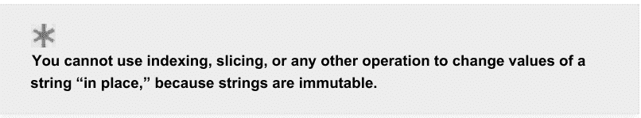
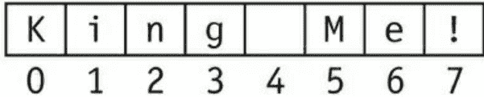
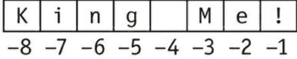
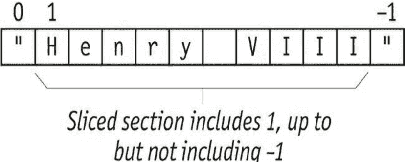
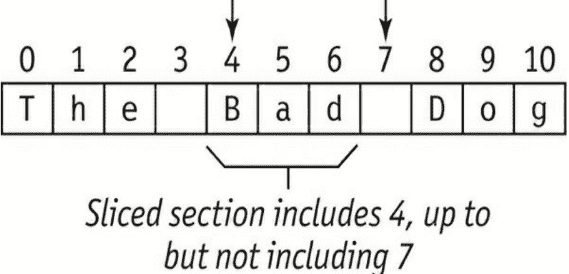

# 2. 高级字符串功能

计算机如何向人类传递消息？通过手势、烟雾信号，还是（如 1950 年代的科幻电影中那样）一个闪烁的红灯？

不。即使是使用语音或语音识别（有些超出本书范围）的程序，也依赖于称为文本字符串或简称字符串的可打印字符组。每个程序员都需要掌握提示、搜索和打印这些字符串的艺术。幸运的是，Python 擅长这项任务。

即使你以前使用过 Python 文本字符串，你可能也希望浏览本章，以确保你使用了 Python 字符串的所有内置功能。

## 2.1 字符串是不可变的

Python 中的数据类型要么是可变的（可更改），要么是不可变的。

可变类型的优点很明显。数据可以“原地”更改，这意味着你不必在每次更改时都从头重建对象。可变类型包括列表、字典和集合。

不可变类型的优点不那么明显，但很重要。不可变类型可以用作字典的键；这样的键通常是字符串。例如，你可能有一个评分字典，用于列出一组评论家的平均评分。

```python
movie_dict = { 'Star Bores': 5.0,
	'The Oddfather': 4.5,
	'Piranha: The Revenge': 2.0 }
```

不可变类型的另一个优点是，由于它们不能更改，因此其使用在内部经过优化。例如，使用元组比使用列表效率稍高。不可变类型的局限性是，此类数据不能原地更改。例如，以下语句无效。

```python
my_str = 'hello, Dave, this is Hal.'
my_str[0] = 'H' # ERROR!
```

本示例中的第二条语句无效，因为它试图获取第一条语句中创建的字符串并修改数据本身。结果，Python 引发 **TypeError** 异常。但以下语句是有效的。

```python
my_str = 'hello'
my_str = 'Hello'
```

这些语句有效，因为每次都会创建一个全新的字符串，并重新分配名称 `my_str`。

在 Python 中，变量只不过是一个名称，可以反复重复使用。这就是为什么这些最后的语句可能看起来违反了字符串的不可变性，但实际上并没有。在最后一个示例中，没有现有字符串被更改；相反，创建了两个不同的字符串，并重复使用了名称 `my_str`。

这种行为源于 Python 中赋值的性质及其缺乏数据声明。你可以随意重复使用名称。

## 2.2 数值转换，包括二进制

Python 中的类型名称在支持此类转换的地方会隐式调用类型转换。


```python
type(data_object)
```

该操作是获取指定的 `data_object`，并在转换为指定的 `type` 后生成结果——如果存在适当的转换。如果不存在，Python 会引发 **ValueError** 异常。

以下是一些示例：

```python
s = '45'
n = int(s)
x = float(s)
```

如果你随后打印 `n` 和 `x`，你会得到以下结果：

```
45
45.0
```

`int` 转换与大多数转换不同，它接受一个可选的第二个参数。此参数使你能够将字符串转换为数字，同时以不同的基数（例如二进制）进行解释。以下是一个示例：

单击此处查看代码图片

```python
n = int('10001', 2)  # Interpret in binary radix.
```

打印 `n` 显示它被赋予了十进制值 17。同样，你可以将其他基数与 `int` 转换一起使用。以下代码使用八进制（8）和十六进制（16）基数。

单击此处查看代码图片

```python
n1 = int('775', 8)
n2 = int('1E', 16)
print('775 octal and 1E hex:', n1, n2)
```

这些语句打印以下结果：

```
775 octal and 1E hex: 509 30
```

因此，我们可以将 **int** 转换总结为接受一个可选的第二个参数，其默认值为 10，表示十进制基数。


```python
int(data_object, radix=10)
```

当你从键盘获取输入（通常通过使用 **input** 语句）或从文本文件获取输入，并需要将数字字符转换为实际数值时，**int** 和 **float** 转换是必需的。

**str** 转换的作用方向相反。它将数字转换为其字符串表示形式。实际上，它适用于任何类型的数据，只要该类型定义了字符串表示形式。

将数字转换为字符串使你能够执行诸如计算可打印数字的数量或计算特定数字出现次数等操作。例如，以下语句打印数字 1007 的长度。

单击此处查看代码图片

```python
n = 1007
s = str(n)    # Convert to '1007'
print('The length of', n, 'is', len(s), 'digits.')
```

此示例打印以下输出：

单击此处查看代码图片


The length of 1007 is 4 digits.

There are other ways to get this same information. You could, for example, use the mathematical operation that takes the base-10 logarithm. But this example suggests what you can do by converting a number to its string representation.

> **注意**
>
> Converting a number to its string representation is not the same as converting a number to its ASCII or Unicode number. That's a different operation, and it must be done one character at a time by using the `ord` function.

## 2.3 字符串运算符（+、=、*、> 等）

字符串类型 `str` 支持数值类型支持的一些相同运算符，但对其解释方式不同。例如，当应用于字符串而不是数字时，加法（+）变为字符串连接。

以下是一些有效字符串运算符的示例：赋值和相等性测试。

Click here to view code image

```
dog1_str = 'Rover'          # Assignment
dog2_str = dog1_str       # Create alias for.

dog1_str == dog2_str      # True!
dog1_str == 'Rover'       # True!
```

在此示例中，第二条语句为 `dog1_str` 引用的相同数据创建了一个引用或别名。（但是，如果 `dog1_str` 后来被赋予新数据，`dog2_str` 仍然引用 'Rover'。）由于 `dog1_str` 和 `dog2_str` 引用相同的数据，第一个相等性测试必须产生值 **True**。

但是第二个相等性测试也返回 **True**。只要两个字符串具有相同的内容，它们就被视为相等。它们不一定必须是内存中相同数据的别名。

所有基于运算符的 Python 字符串比较都区分大小写。有几种方法可以忽略大小写。你可以将两个操作数都转换为大写或都转换为小写（通过使用 **upper** 或 **lower** 字符串方法），这对于仅包含 ASCII 字符的字符串效果良好。

但是，如果你正在处理使用更广泛 Unicode 字符集的字符串，执行不区分大小写比较的最安全方法是使用专门为此目的提供的 **casefold** 方法。

Click here to view code image

```
def compare_no_case(str1, str2):
    return str1.casefold() == str2.casefold()

print(compare_no_case('cat', 'CAT'))  # Return True.
```

表 2.1 列出了 **str** 类型可用的运算符。

# 表 2.1. 字符串运算符

| 运算符 | 描述 |
|---|---|
| `+` | 连接 |
| `*` | 重复 |
| `[]` | 切片 |
| `in` | 成员 |
| `not in` | 非成员 |
| `%` | 格式化 |
| `==` | 相等 |
| `!=` | 不相等 |
| `<` | 小于 |
| `<=` | 小于或等于 |
| `>` | 大于 |
| `>=` | 大于或等于 |

| 运算符或语法 | 描述 |
|---|---|
| `name = str` | 将字符串数据分配给指定的变量名。 |
| `str1 == str2` | 如果 `str1` 和 `str2` 具有相同的内容，则返回 **True**。（与所有比较运算符一样，这区分大小写。） |
| `str1 != str2` | 如果 `str1` 和 `str2` 具有不同的内容，则返回 **True**。 |
| `str1 < str2` | 如果 `str1` 在字母顺序中早于 `str2`，则返回 **True**。例如，`'abc' < 'def'` 返回 **True**，但 `'abc' < 'aaa'` 返回 **False**。（有关顺序的说明，请参见注释。） |
| `str1 > str2` | 如果 `str1` 在字母顺序中晚于 `str2`，则返回 **True**。例如，`'def' > 'abc'` 返回 **True**，但 `'def' > 'xyz'` 返回 **False**。 |
| `str1 <= str2` | 如果 `str1` 在字母顺序中早于 `str2`，或者字符串具有相同的内容，则返回 **True**。 |
| `str1 >= str2` | 如果 `str1` 在字母顺序中晚于 `str2`，或者字符串具有相同的内容，则返回 True。 |
| `str1 + str2` | 生成两个字符串的连接，即将 str2 的内容简单地粘贴到 str1 末尾的结果。例如，'Big' + 'Deal' 生成连接字符串 'BigDeal'。 |
| `str1 * n` | 生成字符串自身连接 n 次的结果，其中 n 是整数。例如，'Goo' * 3 生成 'GooGooGoo'。 |
| `n * str1` | 与 str1 * n 相同的效果。 |
| `str1 in str2` | 如果子字符串 str1 完整地包含在 str2 中，则生成 True。 |
| `str1 not in str2` | 如果子字符串 str1 不包含在 str2 中，则生成 True。 |
| `str is obj` | 如果 str 和 obj 引用内存中的同一对象，则返回 True；有时在与 None 或未知对象类型进行比较时需要。 |
| `str is not obj` | 如果 str 和 obj 不引用内存中的同一对象，则返回 True。 |

> **注意**
>
> 比较字符串时，Python 使用一种字母顺序；更具体地说，它使用 _code point_ 顺序，该顺序查看字符的 ASCII 或 Unicode 值。在此顺序中，所有大写字母都在所有小写字母之前，但除此之外，字母涉及字母顺序比较，正如你所期望的那样。数字比较也按你期望的方式工作，因此 `'1'` 小于 `'2'`。

字符串的连接运算符（+）可能很熟悉，因为它在许多具有某种字符串类的语言中都受到支持。
连接不会自动在两个单词之间添加空格。你必须自己添加。但是，所有字符串（包括像 `' '` 这样的字面量字符串）都具有相同的类型 **str**，因此 Python 没有问题执行以下操作：

Click here to view code image

```
first = 'Will'
last = 'Shakespeare'
full_name = first + ' ' + last
print(full_name)
```

此示例打印

```
Will Shakespeare
```

字符串乘法运算符（*）在进行面向字符的图形处理并希望初始化一条长行（例如分隔符）时很有用。

```
divider_str = '_' * 30
print(divider_str)
```

这将打印以下内容：

```
------------------------------
```

此操作的结果，'_' * 30，是由 30 个下划线组成的字符串。

> **性能提示**
> 有其他方法可以创建包含连续 30 个下划线的字符串，但使用乘法运算符（*）是效率最高的。

小心不要滥用 `is` 和 `is not` 运算符。这些运算符测试两个值是否是内存中的 _同一对象_。例如，你可能有两个字符串变量，它们都包含值 "cat"。在这种情况下，使用相等性（==）测试它们将始终返回 **True**，但 `obj1 is obj2` 可能不会。

你应该何时使用 `is` 或 `is not`？你应该主要在比较不同类型的对象时使用它们，因为适当的相等性测试（==）可能未定义。这种情况的一个例子是测试某个值是否等于特殊值 **None**，它是唯一的，因此适合使用 `is` 进行测试。

## 2.4 索引和切片

从字符串中提取数据的两种方式包括索引和切片：

- *索引* 使用数字根据字符在字符串中的位置来引用单个字符。
- *切片* 是 Python 更独特的功能。它使你能够使用紧凑的语法引用整个子字符串。

列表支持类似的功能，因此“第 3 章，高级列表功能”应该看起来相似。但是，存在一些差异。最大的差异是：



你可以以任何组合使用正数（非负）和负索引。图 2.1 说明正索引如何从 0 运行到 N–1，其中 N 是字符串的长度。





# 图 2.1. Python 中的字符串索引

此图还说明了负索引，它们从 –1（表示最后一个字符）向后运行到 –N。

除了不可变性之外，字符串和列表之间还有另一个区别。索引字符串始终生成一个单字符字符串，假设索引有效。单字符字符串具有 str 类型，就像较大的字符串一样。

因此，例如，假设你索引 'Hello' 的第一个字符；结果是字符串 'H'。尽管其长度为 1，但它仍然是字符串。

```
s = 'Hello'
ch = s[0]
print(type(ch))
```

如果执行此代码，将打印以下结果——证明 ch 虽然只包含一个字符，但仍然具有 str 类型：

```
<class 'str'>
```

Python 没有单独的“字符”类型。


切片是 Python 字符串、列表和元组共有的一种特殊能力。表 2.2 总结了字符串切片支持的语法，切片会产生子字符串。请记住，你不能对字符串的切片进行赋值。

## 表 2.2. Python 字符串切片语法

| 语法 | 获取的子字符串 |
|---|---|
| `string[beg:end]` | 从 _beg_ 开始的所有字符，直到但不包括 _end_。 |
| `string[:end]` | 从字符串开头开始的所有字符，直到但不包括 _end_。 |
| `string[beg:]` | 从 _beg_ 开始直到字符串末尾的所有元素。 |
| `string[:]` | 字符串中的所有字符；此操作会复制整个字符串。 |
| `string[beg:end:step]` | 从 _beg_ 开始的所有字符，直到但不包括 _end_，每次移动 _step_ 个项目。 |

假设你想要从字符串中删除开头和结尾的字符。在这种情况下，你需要结合使用正索引和负索引。先从一个包含开头和结尾双引号的字符串开始。

```python
king_str = '"Henry VIII"'
```

如果直接打印此字符串，你会得到以下结果：

```
"Henry VIII"
```

但是，如果你想要打印不带引号的字符串该怎么办？一种简单的方法是执行以下代码：

```python
new_str = king_str[1:-1]
print(new_str)
```

输出现在是

```
Henry VIII
```

图 2.2 说明了此过程的工作原理。在切片操作中，切片从第一个参数开始，**直到但不包括**第二个参数。

# king_str[1:-1]



图 2.2. 字符串切片示例 1

这里有另一个示例。假设我们想要从短语“The Bad Dog”中提取第二个单词“Bad”。如图 2.3 所示，正确的切片应从索引 4 开始，并延伸到所有直到但不包括索引 7 的字符。因此，该字符串可以通过 `string[4:7]` 访问。

# string[4:7]



图 2.3. 字符串切片示例 2

# 切片规则有一些有趣的后果。

- 如果 _beg_ 和 _end_ 都是正索引，_beg_-_end_ 给出切片的最大长度。
- 要获取包含字符串前 N 个字符的字符串，请使用 _string_[:_N_]。
- 要获取包含字符串最后 N 个字符的字符串，请使用 _string_[-_N_:]。
- 要制作字符串的完整副本，请使用 _string_[:]。

切片允许第三个可选的 _step_ 参数。当为正时，_step_ 参数指定每次向前移动多少个字符。_step_ 参数为 2 表示“获取每隔一个字符。”_step_ 参数为 3 表示“获取每隔三个字符。”例如，以下语句从 'RoboCop' 的第二个字符开始，然后每次通过两个字符遍历字符串。

单击此处查看代码图片

```python
a_str = 'RoboCop'
b_str = a_str[1::2]   # Get every other character.
print(b_str)
```

此示例打印以下内容：

```
ooo
```

这里有另一个示例。步长值为 3 表示“获取每隔三个字符。”这次，切片默认从第一个位置开始。

单击此处查看代码图片

```python
a_str = 'AbcDefGhiJklNop'
b_str = a_str[::3]   # Get every third character.
print(b_str)
```

此示例打印以下内容：

```
ADGJN
```

你甚至可以使用负的 _step_ 值，这会导致切片在字符串中向后执行。例如，以下函数返回作为参数传递给它的字符串的精确反转。

单击此处查看代码图片

```python
def reverse_str(s):
    return s[::-1]

print(reverse_str('Wow Bob wow!'))
print(reverse_str('Racecar'))
```

此示例打印以下内容：

```
!wow boB woW
racecaR
```

切片时，Python 对超出范围的索引不会引发异常。它只是尽可能多地获取输入。在某些情况下，这可能会导致空字符串。

```python
a_str = 'cat'
b_str = a_str[10:20]  # b_str assigned an empty string.
```

# 2.5 单字符函数（字符代码）

有两个函数旨在与长度为 1 的字符串一起使用。实际上，这些是单字符函数，尽管它们操作的是字符串。

```python
ord(str)   # Returns a numeric code
chr(n)     # Converts ASCII/Unicode to a one-char str.
```


ord 函数期望一个字符串参数，但如果字符串长度大于 1，则会引发 TypeError 异常。你可以使用此函数返回与字符对应的 ASCII 或 Unicode 值。例如，以下示例确认字母 A 的 ASCII 代码是十进制 65。

```python
print(ord('A'))  # Print 65.
```

chr 函数是 ord 函数的逆函数。它接受一个字符代码，并返回其 ASCII 或 Unicode 等效值，作为长度为 1 的字符串。因此，使用参数 65 调用 chr 应该打印字母 A，它确实如此。

```python
print(chr(65))  # Print 'A'
```

`in` 和 `not in` 运算符，虽然不限于与单字符字符串一起使用，但通常会这样使用。例如，以下语句测试字符串的第一个字符是否是元音：

> 单击此处查看代码图片

```python
s = 'elephant'
if s[0] in 'aeiou':
    print('First char. is a vowel.')
```

相反，你可以编写一个辅音测试。

> 单击此处查看代码图片

```python
s = 'Helephant'
if s[0] not in 'aeiou':
    print('First char. is a consonant.')
```

一个明显的缺点是，这些示例不能正确处理大写字母。以下是一种修复方法：

> 单击此处查看代码图片

```python
if s[0] in 'aeiouAEIOU':
    print('First char. is a vowel.')
```

或者，你可以在测试前将字符转换为大写；这会产生不区分大小写的比较效果。

单击此处查看代码图片

```python
s = 'elephant'
if s[0].upper() in 'AEIOU':
    print('First char. is a vowel.')
```

你还可以使用 `in` 和 `not in` 来测试包含多个字符的子字符串。在这种情况下，必须找到整个子字符串才能产生 **True**。

```python
'bad' in 'a bad dog'  # True!
```

坏狗里有 bad 吗？是的，有。请注意，`in` 运算符，如果被测试，总是表现得好像所有字符串都包含空字符串 `''`，这与列表的工作方式不同。如果你询问列表是否包含空列表，Python 不会返回 **True**。

单击此处查看代码图片

```python
print('' in 'cat')   # Prints True
print([] in [1, 2, 3]) # Prints False
```

单字符操作重要的另一个领域是 `for` 循环和迭代。如果你遍历列表，你可以访问每个列表元素。但是，如果你遍历字符串，你会得到单个字符：同样，这些都是长度为 1 的字符串，而不是单独的“字符”类型的对象。

单击此处查看代码图片

```python
s = 'Cat'
for ch in s:
    print(ch, ',', 'type:', type(ch))
```

此代码打印以下内容：

```
C, type: <class 'str'>
a, type: <class 'str'>
t, type: <class 'str'>
```

因为这些字符中的每一个都是长度为 1 的字符串，我们可以打印相应的 ASCII 值：

```python
s = 'Cat'
for ch in s:
    print(ord(ch), end=' ')
```

此示例打印以下内容：

```
67 97 116
```

# 2.6 使用“JOIN”构建字符串

考虑到字符串是不可变的，你可能会问以下问题：如何构建或创建新字符串？

再次，Python 赋值的特殊性来解救。例如，以下语句构建字符串“Big Bad John”：

```python
a_str = 'Big '
a_str = a_str + 'Bad '
a_str = a_str + 'John'
```

这些是完全有效的语句。它们重复使用名称 `a_str`，每次将一个新字符串赋值给该名称。最终结果是创建以下字符串：

```
'Big Bad John'
```

以下语句也是有效的，即使它们似乎违反了不可变性，但实际上并没有。

```python
a_str = 'Big '
a_str += 'Bad '
a_str += 'John'
```

这种使用 =、+ 和 += 构建字符串的技术，对于涉及少数对象的简单情况是足够的。例如，你可以按照以下方式构建一个包含字母表中所有字母的字符串，使用在第 2.5 节“单字符操作（字符代码）”中介绍的 `ord` 和 `chr` 函数。

```python
n = ord('A')
s = ''
```


for i in range(n, n + 26):
    s += chr(i)

这个示例的优点是简洁。但它会导致 Python 在内存中一次又一次地创建全新的字符串。一个稍好一些的替代方案是使用 join 方法。


separator_string.join(list)

该方法将列表中的所有字符串连接起来，形成一个大字符串。如果该列表包含多个元素，则 separator_string 的文本会放在每对相邻字符串之间。空列表是一个有效的分隔符字符串；在这种情况下，列表中的所有字符串都会简单地连接在一起。在运行时，使用 join 通常比连接更高效，尽管除非元素数量非常多，否则你可能看不到执行时间的差异。

n = ord('A')
a_lst = [ ]
for i in range(n, n + 26):
    a_lst.append(chr(i))
s = ''.join(a_lst)

join 方法将 a_lst（一个字符串列表）中的所有字符串连接成一个大字符串。在这种情况下，分隔符字符串为空。

> **Performance Tip**
>
> `join` 相对于简单连接的优势可以在涉及数千次操作的大型案例中看到。在这些情况下，连接的缺点在于 Python 必须创建数千个不断增大的字符串，这些字符串只使用一次，然后通过“垃圾回收”被丢弃。但垃圾回收会带来执行时间的代价，前提是它运行得足够频繁以产生影响。

下面是一个使用 `join` 方法更优的案例：假设你想编写一个函数，该函数接收一个名称列表，并逐个打印，名称之间用逗号优雅地分隔。下面是编写代码的困难方式：

Click here to view code image

```
def print_nice(a_lst):
    s = ''
    for item in a_lst:
        s += item + ', '
    if len(s) > 0:     # Get rid of trailing
                        # comma+space
        s = s[:-2]
    print(s)
```

给定此函数定义后，我们可以对字符串列表调用它。

Click here to view code image

```
print_nice(['John', 'Paul', 'George', 'Ringo'])
```

该示例打印以下内容：

Here's the version using the **join** 方法：

```
```python
def print_nice(a_lst):
    print(', '.join(a_lst))
```
```

这少了不少代码！

# ## 2.7 重要的字符串函数

本章中描述的许多“函数”实际上是 _methods_：使用“点”语法调用的类的成员函数。

但除了方法之外，Python 语言还有一些重要的内置函数，这些函数是为与语言的基本类型一起使用而实现的。此处列出的函数特别适用于字符串。


Click here to view code image

```
```python
input(prompt_str)    # Prompt user for input string.
len(str)             # Return num. of chars in str.
max(str)             # Return char with highest code val.
min(str)             # Return char with lowest code val.
reversed(str)   # Return iter with reversed str.
sorted(str)     # Return list with sorted str.
```
```

最重要的函数之一是 **len**，它可以与任何标准集合类一起使用来确定元素的数量。对于字符串，此函数返回字符的数量。下面是一个示例：

Click here to view code image

```
dog1 = 'Jaxx'
dog2 = 'Cutie Pie'
print(dog1, 'has', len(dog1), 'letters.')
print(dog2, 'has', len(dog2), 'letters.')
```

这将打印以下字符串。请注意，“Cutie Pie”有九个字母，因为它计算了空格。

```
Jaxx has 4 letters.
Cutie Pie has 9 letters.
```

**reversed** 和 **sorted** 函数分别生成一个迭代器和一个列表，而不是字符串。但是，可以通过使用 **join** 方法将这些数据对象的输出转换回字符串。下面是一个示例：

Click here to view code image

```
a_str = ''.join(reversed('Wow,Bob,wow!'))
print(a_str)
b_str = ''.join(sorted('Wow,Bob,wow!'))
print(b_str)
```

这将打印以下内容：

```
!wow,boB,woW
!,BWbooowww
```

# 2.8 二进制、十六进制和八进制转换函数

除了 **str** 转换函数之外，Python 还支持三个函数，这些函数接受数字输入并生成字符串结果。这些函数中的每一个都生成适当基数（2、16 和 8，分别对应二进制、十六进制和八进制）的数字字符串。


Click here to view code image

```
bin(n) # Returns a string containing n in binary:
# For example, bin(15) -> '0b1111'
hex(n) # Returns a string containing n in hex:
# For example, hex(15) -> '0xf'
oct(n) # Returns a string containing n in octal:
# For example, oct(15) -> '0o17'
```

下面是另一个示例，展示了如何将十进制数 10 打印为二进制、八进制和十六进制。

Click here to view code image

```
print(bin(10), oct(10), hex(10))
```

这将打印以下内容：

```
0b1010 0o12 0xa
```

如你所见，这三个函数会自动使用前缀“ob”、“oo”和“ox”。

# ## 2.9 简单布尔（“is”）方法

这些方法——名称中都以单词“is”开头——返回 **True** 或 **False**。它们通常与单字符字符串一起使用，但也可以用于更长的字符串；在这种情况下，只有当字符串中的每个字符都通过测试时，它们才返回 **True**。表 2.3 显示了字符串的布尔方法。

# ### Table 2.3. 字符串的布尔方法

| Method name/syntax | Returns True if string passes this test |
|---|---|
| str.isalnum() | 所有字符都是字母或数字，并且至少有一个字符。 |
| str.isalpha() | 所有字符都是字母表中的字母，并且至少有一个字符。 |
| str.isdecimal() | 所有字符都是十进制数字，并且至少有一个字符。与 isdigit 类似，但旨在与 Unicode 字符一起使用。 |
| str.isdigit() | 所有字符都是十进制数字，并且至少有一个字符。 |
| str.isidentifier() | 字符串包含一个有效的 Python 标识符（符号）名称。第一个字符必须是字母或下划线；其他每个字符必须是字母、数字或下划线。 |
| str.islower() | 字符串中的所有字母都是小写，并且至少有一个字母。（但是，可能存在非字母字符。） |
| str.isprintable() | 字符串中的所有字符（如果有）都是可打印字符。这不包括 \n 和 \t 等特殊字符。 |
| str.isspace() | 字符串中的所有字符都是“空白”字符，并且至少有一个字符。 |
| str.istitle() | 字符串中的每个单词都是有效的标题，并且至少有一个字符。这要求每个单词都大写，并且除了单词开头之外，任何地方都不出现大写字母。单词之间可能存在空白和标点字符。 |
| str.isupper() | 字符串中的所有字母都是大写，并且至少有一个字母。（但是，可能存在非字母字符。） |

这些函数既适用于单字符字符串，也适用于更长的字符串。以下代码说明了两者的用法。

Click here to view code image

```
h_str = 'Hello'
if h_str[0].isupper():
    print('First letter is uppercase.')
if h_str.isupper():
    print('All chars are uppercase.')
else:
    print('Not all chars are uppercase.')
```

此示例打印以下内容：

```
First letter is uppercase.
Not all chars are uppercase.
```

这个字符串也会通过标题测试，因为首字母是大写，其余字母不是。

Click here to view code image

```
if h_str.istitle():
    print('Qualifies as a title.')
```

# ## 2.10 大小写转换方法

上一节中的方法用于测试大写字母与小写字母。本节中的方法执行转换以生成一个新字符串。


Click here to view code image

```
str.lower() # Produce all-lowercase string
str.upper() # Produce all-uppercase string
str.title() # 'foo foo'.title() => 'Foo Foo'
str.swapcase() # Upper to lower, and vice versa
```

**lower** 和 **upper** 方法的效果非常直观。前者将字符串中的每个大写字母转换为小写字母；后者则相反，将每个小写字母转换为大写字母。非字母字符不会被改变，而是保持原样保留在字符串中。

转换后的结果作为一个新字符串返回。由于原始字符串数据是不可变的，因此不会“原地”更改。但以下语句能达到你的预期效果。

Click here to view code image

```
my_str = "I'm Henry VIII, I am!"
new_str = my_str.upper()
my_str = new_str
```

最后两步可以高效地合并为：

```
my_str = my_str.upper()
```

如果你随后打印 `my_str`，将得到以下结果：

```
I'M HENRY VIII, I AM!
```

**swapcase** 方法很少使用。它生成的字符串中，原字符串为小写字母的位置变为大写字母，反之亦然。例如：

```
my_str = my_str.swapcase()
print(my_str)
```

这将打印以下内容：

```
i'm hENRY viii, i AM!
```

## 2.11 查找和替换方法

查找和替换方法是 `str` 类中最有用的方法之一。在本节中，我们首先介绍 **startswith** 和 **endswith**，然后介绍其他查找和替换函数。


Click here to view code image

```
str.startswith(substr) # Return True if prefix found.
str.endswith(substr) # Return True if suffix found.
```

其中一位作者曾编写过一本名为《Python Without Fear》（Addison-Wesley, 2018）的早期著作，其中包含一个将罗马数字转换为十进制数的程序。该程序需要检查输入字符串开头处的某些字母组合——即以任意数量的罗马数字 M 开头。

Click here to view code image

```
while romstr.startswith('M'):
    amt += 1000    # Add 1,000 to running total.
    romstr = romstr[1:]    # Strip off first character.
```

相反，**endswith** 方法查找目标子字符串是否作为后缀存在。例如：

Click here to view code image

```
me_str = 'John Bennett, PhD'
is_doc = me_str.endswith('PhD')
```

这些方法，`startswith` 和 `endswith`，可以在空字符串上使用而不会引发错误。如果子字符串为空，返回值始终为 **True**。

现在让我们来看看 Python 字符串的其他查找和替换方法。


Click here to view code image

```
str.count(substr [, beg [, end]])
str.find(substr [, beg [, end]])
str.index()     # Like find, but raises exception
str.rfind()     # Like find, but starts from end
str.replace(old,new [, count])# count is optional; limits no. of replacements
```

在此语法中，方括号并非字面意思，而是表示可选项。

**count** 方法报告目标子字符串出现的次数。其工作原理如下。

Click here to view code image

```
frank_str = 'doo be doo be doo...'
n = frank_str.count('doo')
print(n)    # Print 3.
```

你可以在同一方法调用中可选地使用 _start_ 和 _end_ 参数。

Click here to view code image

```
print(frank_str.count('doo', 1))    # Print 2
print(frank_str.count('doo', 1, 10))    # Print 1
```

_start_ 参数为 1 表示计数从第二个字符开始。如果同时使用 _start_ 和 _end_，则计数范围是从 _start_ 位置开始，直到但不包括 `end` 位置的目标字符串。这些参数和往常一样是基于零的索引。

如果参数（`begin`、`end`）中的一个或两个超出范围，`count` 方法不会引发异常，而是尽可能处理尽可能多的字符。

**find** 方法适用类似规则。对该方法的简单调用会查找子字符串参数的第一次出现，并返回该实例的非负索引；如果未找到子字符串，则返回 –1。

Click here to view code image

```
frank_str = 'doo be doo be doo...'

print(frank_str.find('doo'))   # Print 0
print(frank_str.find('doob'))  # Print -1
```

如果你想查找子字符串所有出现的位置，可以在循环中调用 **find** 方法，如以下示例所示。

Click here to view code image

```
frank_str = 'doo be doo be doo...'
n = -1
while True:
    n = frank_str.find('doo', n + 1)
    if n == -1:
        break
    print(n, end=' ')
```

此示例打印出可以找到 'doo' 实例的每个索引。

此示例的工作原理是利用 _start_ 参数。在每次成功调用 **find** 方法后，初始搜索位置 n 会设置为上一次成功的查找索引，然后向上调整 1。这保证了下一次调用 **find** 方法必须查找子字符串的新实例。

如果 **find** 操作未找到任何出现，则返回值为 –1。

**index** 和 **rfind** 方法与 **find** 方法几乎相同，只有少数区别。**index** 函数在未找到子字符串出现时不会返回 –1。相反，它会引发 **ValueError** 异常。

**rfind** 方法查找子字符串参数的最后一次出现。默认情况下，该方法从末尾开始向左搜索。但这并不意味着它查找的是子字符串的逆序。相反，它查找的是子字符串的常规副本，并返回最后一次出现的起始索引号——即最后一次出现的起始位置。

Click here to view code image

```
frank_str = 'doo be doo be doo...'
print(frank_str.rfind('doo'))  # Prints 14.
```

该示例打印 14，因为 'doo' 最右侧的出现位于基于零的位置 14 处开始。

最后，**replace** 方法将旧子字符串的每一次出现都替换为新子字符串。和往常一样，该方法生成结果字符串，因为它无法原地更改原始字符串。

例如，假设我们有一组书籍标题，但想要将单词“Grey”的拼写更改为“Gray”。以下是示例：

Click here to view code image

```
title = '25 Hues of Grey'
new_title = title.replace('Grey', 'Gray')
```

打印 new_title 会产生以下结果：

```
25 Hues of Gray
```

下一个示例说明 **replace** 如何处理同一子字符串的多次出现。

Click here to view code image

```
title = 'Greyer Into Grey'
new_title = title.replace('Grey', 'Gray')
```

新字符串现在为

```
Grayer Into Gray
```

## 2.12 使用“SPLIT”拆分输入

在处理字符输入时，最常见的编程任务之一是*分词化*——将一行输入拆分为单个单词、短语和数字。Python 的 **split** 方法提供了一种简单便捷的方式来完成此任务。


Click here to view code image

```
`input_str.split(delim_string=None)`
```

对该方法的调用将返回一个子字符串列表，这些子字符串取自 *input_string*。*delim_string* 指定一个作为分隔符的字符串；这是一个用于将一个标记与另一个标记分开的子字符串。

如果省略 *delim_string* 或其为 **None**，则 **split** 的行为实际上是使用任意一个或多个空白字符（空格、制表符和换行符）来区分一个标记和下一个标记。

例如，**split** 方法——使用默认分隔符空格——可以用于拆分包含多个名字的字符串。

Click here to view code image

```
`stooge_list = 'Moe Larry Curly Shemp'.split()`
```

如果打印结果列表，则如下所示：


**split** 的行为，当参数为 **None** 或使用默认参数时，会将**任意数量**的连续空格作为分隔符。下面是一个示例：

```python
stooge_list = 'Moe   Larry Curly   Shemp'.split()
```

但是，如果指定了分隔符字符串，则必须精确匹配才能识别一个字符与下一个字符之间的分隔符。

```python
stooge_list = 'Moe   Larry Curly   Shemp'.split(' ')
```

在这种情况下，**split** 方法会识别一个额外的字符串——尽管它是空的——只要有多余的空格就存在。这可能不是你想要的行为。刚才展示的示例会产生以下结果：

```python
['Moe', '', '', '', 'Larry', 'Curly', '', '', 'Shemp']
```

另一个常见的分隔符字符串是逗号，或者可能是逗号加上空格。在后一种情况下，分隔符字符串必须精确匹配。下面是一个示例：

```python
stooge_list = 'Moe, Larry, Curly, Shemp'.split(', ')
```

相比之下，下面的示例使用简单的逗号作为分隔符。这个示例会导致令牌包含多余的空格。

```python
stooge_list = 'Moe, Larry, Curly, Shemp'.split(',')
```

在这种情况下，结果在四个字符串元素中的最后三个元素中包含一个前导空格：

```python
['Moe', ' Larry', ' Curly', ' Shemp']
```

如果你不想要这些前导空格，一个简单的解决方案是使用去除（stripping），如下所示。

## 2.13 去除（STRIPPING）

一旦你从用户或文本文件中检索到输入，你可能希望通过去除前导和尾随空格将其放置在正确的格式中。你可能还想要去除前导和尾随的“0”数字或其他字符。`str` 类提供了几种方法来让你执行这种去除操作。

```python
str.strip(extra_chars=' ')  # Strip leading & trailing.
str.lstrip(extra_chars=' ')  # String leading chars.
str.rstrip(extra_chars=' ')  # String trailing chars.
```

这些方法调用中的每一个都会生成一个字符串，其中包含要去除的尾随或前导字符（或两者）。

**lstrip** 方法仅去除前导字符，而 **rstrip** 方法仅去除尾随字符，但除此之外，所有三种方法执行相同的工作。**strip** 方法去除前导和尾随字符。

对于每种方法，如果指定了 *extra_chars* 参数，则该方法会去除 *extra_chars* 字符串中每个字符的所有出现。例如，如果字符串包含 `+0`，则该方法会去除所有前导或尾随星号（*）以及所有前导或尾随“0”数字和加号（+）。

要去除的字符的内部实例保持不变。例如，下面的语句去除前导和尾随空格，但不去除中间的空格。

```python
name_str = '  Will Shakes  '
new_str = name_str.strip()
```

图 2.4 说明了此方法调用的工作原理。

图 2.4. Python 去除操作

## 2.14 对齐方法（JUSTIFICATION METHODS）

当你需要进行复杂的文本格式化时，通常应该使用第 5 章“精确格式化文本”中描述的技术。但是，str 类本身带有用于对齐文本的基本技术：要么在打印字段中左对齐，要么右对齐，要么居中文本。

```python
str.ljust(width [, fillchar])   # Left justify
str.rjust(width [, fillchar])   # Right justify
str.center(width [, fillchar])   # Center the text.
digit_str.zfill(width)   # Pad with 0’s.
```

在这些方法的语法中，每对方括号表示一个可选项，不应按字面意思解释。这些方法返回的字符串格式如下：

- `str` 的文本被放置在由 `width` 指定的大小的更大打印字段中。
- 如果字符串文本短于指定长度，则文本将按适当方式左对齐、右对齐或居中。如果 `center` 方法无法完美居中，则略微偏向左对齐。
- 结果的其余部分用填充字符填充。如果未指定此填充字符，则默认值为空格。

下面是一个示例：

```python
new_str = 'Help!'.center(10, '#')
print(new_str)
```

此示例打印

```
###Help!###
```

另一个常见的填充字符（空格以外）是数字字符“0”。数字字符串通常是右对齐而不是左对齐。下面是一个示例：

```python
new_str = '750'.rjust(6, '0')
print(new_str)
```

此示例打印

```
000750
```

zfill 方法提供了一种更短、更紧凑的方式来做同样的事情：用前导“0”字符填充数字字符串。

```python
s = '12'
print(s.zfill(7))
```

但是 zfill 方法不仅仅是 rjust 的快捷方式；相反，使用 zfill 时，零填充成为数字本身的一部分，因此零会打印在数字和符号之间：

```python
>>> '-3'.zfill(5)
'-0003'
>>> '-3'.rjust(5, '0')
'000-3'
```

## 第 2 章总结

Python 字符串类型（str）是一个异常强大的数据类型，即使与其他语言中的字符串相比也是如此。字符串方法包括对输入进行标记化（拆分）；去除前导和尾随空格（去除）；转换为数字格式；以及以任何基数打印数字表达式的能力。

内置的搜索功能包括用于计数和查找子字符串（count、find 和 index）的方法，以及执行文本替换的能力。

然而，你可以用字符串做的事情还有很多。

第 5 章“精确格式化文本”探讨了使用格式字符以及用于复杂打印输出的 format 方法的细节。

第 6 章“正则表达式，第一部分”在匹配、搜索和替换文本模式方面更进一步，因此你可以通过指定任何复杂程度的模式来执行灵活的搜索。

## 第 2 章复习问题

1. 对字符串的索引字符进行赋值是否违反了 Python 对字符串不可变性的规定？

2. 使用 += 运算符进行字符串连接是否违反了 Python 对字符串不可变性的规定？为什么或为什么不？

3. 在 Python 中，索引给定字符有多少种方式？

4. 索引和切片是如何精确相关的？

5. 索引字符的确切数据类型是什么？从切片生成的子字符串的数据类型是什么？

6. 在 Python 中，字符串和字符“类型”之间是什么关系？

7. 至少列出两个运算符和一个方法，它们使你能够从一个或多个较小的字符串构建一个更大的字符串。

8. 如果你打算使用 index 方法来定位子字符串，那么先使用 `in` 或 `not in` 测试目标字符串有什么优势？

9. 哪些内置字符串方法和哪些运算符会产生简单的布尔（真/假）结果？

## 第 2 章建议问题

1. 编写一个程序，提示输入一个字符串并计算元音和辅音的数量，打印结果。（提示：使用 `in` 和 `not in` 运算符来减少你可能需要编写的代码量。）

2. 编写一个函数，高效地去除字符串的前两个字符和最后两个字符。返回空字符串应是可接受的返回值。使用一系列不同的输入测试此函数。
