## 3. 高级列表功能

> “我有一份小小的名单……”
> ——吉尔伯特和苏利文，《米卡多》

要意译《米卡多》中的大法官刽子手，我们有一份小小的名单……实际上，在 Python 中我们有相当多的列表。一种强大编程语言的基础之一是 _数组_ 或 _列表_ 的概念——这些对象持有潜在的大量其他对象，全部集合在一起。

Python 最基本的集合类是列表，它做其他语言中数组所做的一切，但更多。本章探讨 Python 列表的基本、中级和高级功能。

### 3.1 创建和使用 Python 列表

Python 没有数据声明。那么，你如何创建像列表这样的集合呢？你以创建其他数据的相同方式来做。

- 在赋值语句的右侧指定数据。列表就是在这里实际创建或构建的。


## 3.2 复制列表与复制列表变量

在 Python 中，变量更像 C++ 中的引用，而不是“值”变量。从实际角度来看，这意味着将一个集合复制到另一个集合需要一些额外的工作。

你认为下面的代码有什么作用？

```
a_list = [2, 5, 10]
b_list = a_list
```

第一条语句通过在赋值号（=）右侧构建列表来创建一个列表。但本示例中的第二条语句不会创建任何数据。它只是执行以下操作：

_将“b_list”设为“a_list”所引用对象的别名。_

因此，变量 b_list 成为 a_list 所引用对象的别名。结果，如果对其中任何一个变量进行更改，两者都会反映该更改。

```
b_list.append(100)
a_list.append(200)
b_list.append(1)
print(a_list) # This prints [2, 5, 10, 100, 200, 1]
```

如果你想创建列表中所有元素的独立副本，则需要执行逐个成员的复制。最简单的方法是使用切片。

```
my_list = [1, 10, 5]
yr_list = my_list[:] # Perform member-by-member copy.
```

现在，由于 my_list 和 yr_list 引用的是 [1, 10, 5] 的独立副本，你可以更改其中一个列表而不会更改另一个列表。

## 3.3 索引

Python 支持非负索引和负索引。

非负索引从零开始，因此在以下示例中，`list_name[0]` 引用第一个元素。（第 3.3.2 节介绍负索引。）

```
my_list = [100, 500, 1000]
print(my_list[0])   # Print 100.
```

由于列表是可变的，它们可以“原地”更改，而无需创建全新的列表。因此，你可以通过将某个元素设为赋值的目标来更改单个元素——这是字符串无法做到的。

```
my_list[1] = 55   # Set second element to 55.
```

### 3.3.1 正索引

正（非负）索引数字与其他语言（如 C++）中使用的类似。索引 0 表示列表中的第一个元素，1 表示第二个元素，以此类推。这些索引范围从 0 到 N-1，其中 N 是元素的数量。

例如，假设已执行以下语句，创建了一个列表。

```
a_list = [100, 200, 300, 400, 500, 600]
```

这些元素由 0 到 5 的数字索引，如图 3.1 所示。

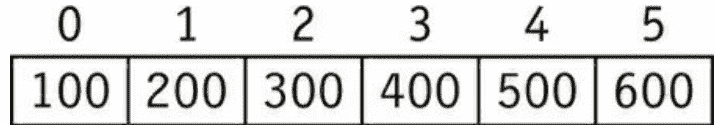

**图 3.1.** 非负索引

以下示例使用非负索引来访问单个元素。

```
print(a_list[0]) # Prints 100.
print(a_list[1]) # Prints 200.
print(a_list[2]) # Prints 300.
```

虽然列表可以无限增长，但在使用索引号时，它必须在范围内。否则，Python 会引发 **IndexError** 异常。

性能提示
此处以及其他地方，我们使用了单独的 print 函数调用，因为这样便于说明。但请记住，重复调用 print 会减慢程序速度，至少在 IDLE 中是这样。打印这些值的更快方法是只使用一次 print 调用。

```
print(a_list[0], a_list[1], a_list[2], sep='\n')
```

## 3.3.2 负索引

你也可以使用负索引来引用列表中的项目，负索引通过元素距列表末尾的距离来引用该元素。

索引值 -1 表示列表中的最后一个元素，-2 表示倒数第二个元素，以此类推。值 -N 表示列表中的第一个元素。负索引范围从 -1 到 -N，其中 N 是列表的长度。

上一节中的列表可以如图 3.2 所示进行索引。

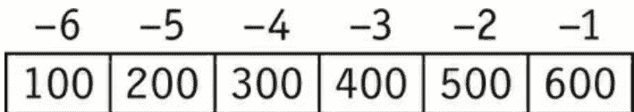

**图 3.2.** 负索引

以下示例演示了负索引。

```
a_list = [100, 200, 300, 400, 500, 600]
print(a_list[-1])        # Prints 600.
print(a_list[-3])        # Prints 400.
```

超出范围的负索引可能会引发 IndexError 异常，就像非负索引一样。

## 3.3.3 使用 "enumerate" 生成索引号

“Pythonic”的做法是避免使用 range 函数，除非必要。以下是编写打印列表元素的循环的正确方法：

```
a_list = ['Tom', 'Dick', 'Jane']
for s in a_list:
    print(s)
```

这将打印以下内容：

```
Tom
Dick
Jane
```

这种方法比依赖索引更自然、更高效，而依赖索引效率低下且速度较慢。

```
for i in range(len(a_list)):
    print(a_list[i])
```

但是，如果你想在项目旁边列出数字，该怎么办？你可以使用索引号（如果希望索引从 1 开始，则加 1），但更好的技术是使用 enumerate 函数。


```
enumerate(iter, start=0)
```

在此语法中，`start` 是可选的。其默认值为 0。

该函数接受一个可迭代对象（例如列表），并生成另一个可迭代对象，该对象是一系列元组。每个元组的形式如下：

```
(num, item)
```

其中 `num` 是从 `start` 开始的一系列整数。以下语句显示了一个示例，使用上一示例中的 `a_list` 并将系列从 1 开始：

```
list(enumerate(a_list, 1))
```

这将生成以下内容：

```
[(1, 'Tom'), (2, 'Dick'), (3, 'Jane')]
```

我们可以将其与 **for** 循环结合起来，以产生所需的结果。

```
for item_num, name_str in enumerate(a_list, 1):
    print(item_num, '. ', name_str, sep='')
```

此循环调用 **enumerate** 函数来生成形式为 `(num, item)` 的元组。每次迭代都会打印数字，后跟一个句点 (".") 和一个元素。


## 3.4 从切片中获取数据

索引一次引用一个元素，而切片技术则从指定范围生成一个子列表。子列表的大小可以从空列表到包含原始列表所有内容的新列表不等。

表 3.1 显示了使用切片的各种方式。

# 表 3.1 在 Python 中切片列表

| 语法 | 生成的新列表 |
|---|---|
| `list[beg :end]` | 从 `beg` 开始的所有列表元素，直到但不包括 `end`。 |
| `list[:end]` | 从列表开头开始的所有元素，直到但不包括 `end`。 |
| `list[beg : ]` | 从 `beg` 开始直到列表末尾的所有元素。 |
| `list[:]` | 列表中的所有元素；此操作逐个元素复制整个列表。 |

`list[beg :end:step]` 从 `beg` 开始的所有元素，直到但不包括 `end`；但是列表遍历每次移动 `step` 个元素。

使用此语法时，三个值中的任何一个或全部都可以省略。每个值都有一个合理的默认值；`step` 的默认值为 1。

以下是列表切片的一些示例：

单击此处查看代码图片

```
a_list = [1, 2, 5, 10, 20, 30]

b_list = a_list[1:3] # Produces [2, 5]
c_list = a_list[4:] # Produces [20, 30]
```

这些示例使用正索引，索引号从 0 到 N –1。您也可以同样轻松地使用负索引来帮助指定切片。以下是一个示例：

单击此处查看代码图片

```
d_list = a_list[-4:-1] # Produces [5, 10, 20]
e_list = a_list[-1:] # Produces [30]
```

无论哪种情况，一个重要的原则是 end 参数指定切片的结束方式：复制元素直到但不包括 end 参数。正索引和负索引可以混合使用。

**注意**

当 Python 执行切片操作时，该操作始终至少包含一个冒号。

图 3.3 显示了切片工作原理的示例。请记住，Python 从 _beg_ 开始选择元素，直到但不包括 _end_ 引用的元素。因此，切片 `a_list[2:5]` 复制子列表 `[300, 400, 500]`。

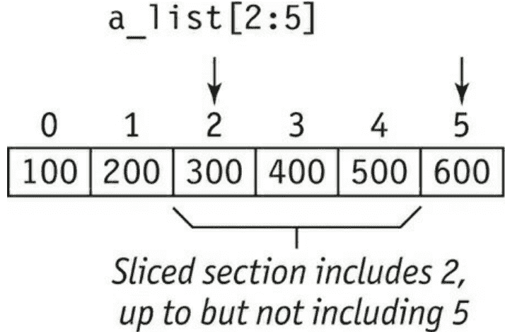

最后，为第三个参数 _step_ 指定一个值，可以影响生成的数据。例如，值为 2 会导致 Python 从范围 [2:5] 中获取每个 _其他_ 元素。

单击此处查看代码图片

```
a_list = [100, 200, 300, 400, 500, 600]
b_list = a_list[2:5:2]  # Produces [300, 500]
```

负 _step_ 值会反转访问列表元素的方向。因此，步长值为 –1 会通过一次向后遍历列表一个元素来生成切片中的值。步长值为 –2 会通过一次向后遍历列表两个元素来生成切片中的值。

以下示例从最后一个元素开始并向后工作；因此它生成列表的精确副本——所有元素都反转！

```
rev_list = a_list[::-1]
```

以下是一个示例：

单击此处查看代码图片

```
a_list = [100, 200, 300]
rev_list = a_list[::-1]
print(rev_list)    # Prints [300, 200, 100]
```

_step_ 参数可以是正数或负数，但不能为 0。如果 _step_ 为负，则其他值的默认值会按以下方式更改：

- _beg_ 的默认值变为列表中的最后一个元素（索引为 –1）。
- _end_ 的默认值变为列表的开头。因此，切片表达式 [::-1] 生成原始列表的反转。

## 3.5 向切片赋值

由于列表是可变的，您可以就地向元素赋值。这也适用于切片。以下是一个示例：

单击此处查看代码图片

```
my_list = [10, 20, 30, 40, 50, 60]
my_list[1:4] = [707, 777]
```

此示例的效果是删除范围 [20, 30, 40] 并将列表 [707, 777] 插入到其位置。结果列表为

```
[10, 707, 777, 50, 60]
```

您甚至可以向长度为 0 的位置赋值。效果是在不删除现有元素的情况下插入新的列表项。以下是一个示例：

单击此处查看代码图片

```
my_list = [1, 2, 3, 4]
my_list[0:0] = [-50, -40]
print(my_list) # prints [-50, -40, 1, 2, 3, 4]
```

向切片赋值的能力适用以下限制：

- 当您向列表的切片赋值时，赋值的来源必须是另一个列表或集合，即使它有零个或一个元素。
- 如果在要赋值的切片中包含 _step_ 参数，则两个集合的大小——被赋值的切片和提供数据的序列——必须大小匹配。如果未指定 _step_，则大小不需要匹配。

## 3.6 列表运算符

表 3.2 总结了适用于列表的内置运算符。

# 表 3.2 Python 中的列表运算符

| 运算符/语法 | 描述 |
|---|---|
| `list1 + list2` | 通过执行连接操作，生成一个包含 `list1` 和 `list2` 内容的新列表。 |
| `list1 * n, or n * list1` | 生成一个包含 `list1` 内容并重复 `n` 次的列表。例如，`[0] * 3` 生成 `[0, 0, 0]`。 |
| `list[n]` | 索引。请参见第 3.3 节。 |
| `list[beg :end:step]` | 切片。请参见第 3.4 节。 |
| `list1 = list2` | 使 `list1` 成为 `list2` 所引用对象的别名。因此，`list1` 成为 `list2` 的别名。 |
| `list1 = list2[: ]` | 在执行 `list2` 的逐个成员复制后，将 `list1` 赋值为一个新列表。（请参见第 3.4 节。） |

| 运算符 | 描述 |
|----------|-------------|
| `list1 == list2` | 如果 `list1` 和 `list2` 内容相等（在执行逐个成员比较后），则生成 **True**。 |
| `list1 != list2` | 如果 `list1` 和 `list2` 内容相等，则生成 **False**；否则生成 **True**。 |
| `elem in list` | 如果 `elem` 是 `list` 的元素，则生成 **True**。 |
| `elem not in list` | 如果 `elem` 不是 `list` 的元素，则生成 **True**。 |
| `list1 < list2` | 执行逐个成员的“小于”比较。 |
| `list1 <= list2` | 执行逐个成员的“小于或等于”比较。 |
| `list1 > list2` | 执行逐个成员的“大于”比较。 |
| `list1 >= list2` | 执行逐个成员的“大于或等于”比较。 |

*list
将 list 替换为一系列单个的“解包”值。此运算符与 *args 的用法在第 4.8 节“变长参数列表”中有所解释。

前两个运算符（+ 和 *）涉及复制列表项。但这些是浅拷贝。（第 3.7 节“浅拷贝与深拷贝”将更详细地讨论此问题。）到目前为止，浅拷贝工作良好，但当我们在第 3.18 节讨论多维数组时，此问题将会显现出来。

请考虑以下语句：

单击此处查看代码图片

```
a_list = [1, 3, 5, 0, 2]
b_list = a_list		# Make an alias.
c_list = a_list[:]		# Member-by-member copy
```

创建 b_list 后，变量名 b_list 只是 a_list 的别名。但是本示例中的第三条语句创建了数据的新副本。如果稍后修改 a_list，c_list 将保留原始顺序。

乘法运算符（*）在处理大列表时特别有用。如何创建大小为 1,000 的数组并将所有元素初始化为零？以下是最方便的方法：

```
big_array = [0] * 1000
```

相等性测试（==）和不等性测试（!=）适用于任何列表；会比较内容，且所有成员必须相等，== 才会生成 **True**。但是，不等性运算符（<、> 等）要求兼容的数据类型，支持大于和小于比较。并且，只有在定义了 a < b 以及 b < a 时，元素之间才能进行排序，如第 9.10.3 节“比较方法”中所述。

空列表或值 **None** 应用于 **in** 运算符时，不一定返回 **True**。

单击此处查看代码图片

```
a = [1, 2, 3]
None in a
[] in a

# This produces False
# So does this.

b = [1, 2, 3, [], None]
None in b
[] in b

# This produces True
# So does this.
```

当您回想起 '' in 'Fred'（其中 'Fred' 可以是您想要的任何字符串）生成 **True** 时，这些结果可能看起来令人惊讶。在这种情况下，Python 对列表和字符串的行为有所不同。

## 3.7 浅拷贝与深拷贝

浅拷贝与深拷贝之间的区别是 Python 中的一个重要主题。首先，让我们看看 _浅拷贝_。给定以下列表赋值，我们期望 `a_list` 为


a separate copy from `b_list`, so that if changes are made to `b_list`, then `a_list` would be unaffected.

Click here to view code image

```python
a_list = [1, 2, [5, 10]]
b_list = a_list[:]   # Member-by-member copy.
```

Now, let's modify `b_list` through indexing, setting each element to 0:

```python
b_list[0] = 0
b_list[1] = 0
b_list[2][0] = 0
b_list[2][1] = 0
```

You’d probably expect none of these assignments to affect `a_list`, because that’s a separate collection from `b_list`. But if you print `a_list`, here’s what you get:

```python
>>> print(a_list)
[1, 2, [0, 0]]
```

This may seem impossible, because `a_list` had the last element set to `[5, 10]`. Changes to `b_list` shouldn’t have any effect on the contents of `a_list`, but now the latter’s last element is `[0, 0]`! What happened?

The member-by-member copy, carried out earlier, copied the values 1 and 2, followed by a reference to the list-within-a-list. Consequently, changes made to `b_list` can affect `a_list` if they involve the second level.

Figure 3.4 illustrates the concept. Shallow copying makes new copies of top-level data only.

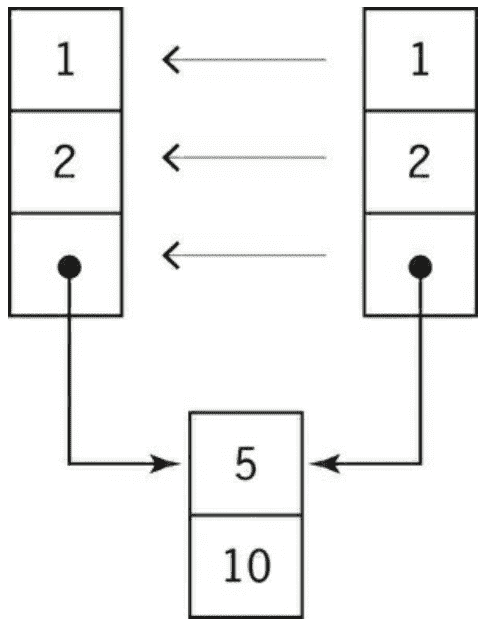

# Figure 3.4. Shallow copying

And now you can see the problem. A member-by-member copy was carried out, but the list within the list was a *reference*, so both lists ended up referring to the same data in the final position.

The solution is simple. You need to do a *deep copy* to get the expected behavior. To get a deep copy, in which even embedded list items get copied, import the **copy** package and use **copy.deepcopy**.

Click here to view code image

```python
import copy
```

```python
a_list = [1, 2, [5, 10]]
b_list = copy.deepcopy(a_list)  # Create a DEEP COPY.
```

After these statements are executed, b_list becomes a new list completely unconnected to a_list. The result is illustrated in Figure 3.5, in which each list gets its own, separate copy of the list-within-a-list.

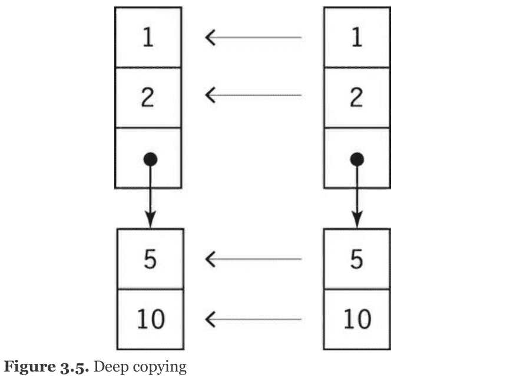

With deep copying, the depth of copying extends to every level. You could have collections within collections to any level of complexity.

If changes are now made to b_list after being copied to a_list, they will have no further effect on a_list. The last element of a_list will remain set to [5, 10] until changed directly. All this functionality is thanks to deep copying.

# 3.8 LIST FUNCTIONS

When you work with lists, there are several Python functions you’ll find useful: These include **len**, **max**, and **min**, as well as **sorted**, **reversed**, and **sum**.

These are functions, not methods. The main difference is that methods use the dot (.) syntax; the other difference is that methods represent built-in abilities, whereas the functions here implement abilities that are useful with collections generally. Admittedly, this is sometimes a very fine distinction.


Click here to view code image

```python
len(collection)         # Return length of the collection
max(collection)         # Return the elem with maximum value.
min(collection)         # Return the elem with minimum value.
reversed(collection)    # Produce iter in reversed order.
sorted(collection)      # Produce list in sorted order.
sum(collection)         # Adds up all the elements, which must be numeric.
```

The **len** function returns the number of elements in a collection. This includes lists, strings, and other Python collection types. In the case of dictionaries, it returns the number of keys.

You’ll often use **len** when working with lists. For example, the following loop doubles every item in a list. It’s necessary to use **len** to make this a general solution.

```python
for i in range(len(a_list)):
    a_list[i] *= 2
```

The **max** and **min** functions produce maximum and minimum elements, respectively. These functions work only on lists that have elements with compatible types, such as all numeric elements or all string elements. In the case of strings, alphabetical order (or rather, _code point order_) enables comparisons.

Here’s an example:

> Click here to view code image

```python
a_list = [100, -3, -5, 120]
print('Length of the list is', len(a_list))
print('Max and min are', max(a_list), min(a_list))
```

This prints the following:

```
Length of the list is 4
Max and min are 120 -5
```

The **sorted** and **reversed** functions are similar to the **sort** and **reverse** methods, presented in Section 3.11. But whereas those methods reorganize a list in place, these functions produce new lists.

These functions work on tuples and strings as well as lists, but the **sorted** function always produces a list. Here's an example:

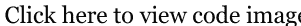

```python
a_tup = (30, 55, 15, 45)
print(sorted(a_tup))   # Print [15, 30, 45, 55]
```

The **reversed** function is unusual because it produces an iterable but not a collection. In simple terms, this means you need a **for** loop to print it or else use a **list** or **tuple** conversion. Here's an example:

```python
a_tup = (1, 3, 5, 0)
for i in reversed(a_tup):
    print(i, end=' ')
```

This prints

```
0 5 3 1
```

Alternatively, you can use the following:

```python
print(tuple(reversed(a_tup)))
```

This produces

```
(0, 5, 3, 1)
```

Finally, there is the **sum** function, which is extremely convenient. You could write a loop yourself to perform this function, but it’s nice not to have to do so. The **sum** function is supported for those arrays that are made up only of numeric types, such as **int** and **float**.

One possible use is to quickly and easily figure the average for any list of numbers. Here’s an example:

Click here to view code image

```python
>>> num_list = [2.45, 1, -10, 55.5, 100.03, 40, -3]
>>> print('The average is ', sum(num_list) / len(num_list))
The average is 26.56857142857143
```

# 3.9 LIST METHODS: MODIFYING A LIST

The largest single group of list methods includes those that modify list data in place, modifying data in place rather than creating a new list.


Click here to view code image

```python
list.append(value) # Append a value
list.clear() # Remove all contents
list.extend(iterable) # Append a series of values
list.insert(index, value) # At index, insert value
list.remove(value) # Remove first instance of value
```

The **append** and **extend** methods have a similar purpose: to add data to the end of a list. The difference is that the **append** method adds a single element to the end of the list in question, whereas the **extend** method appends a series of elements from a collection or iterable.

Click here to view code image

```python
a_list = [1, 2, 3]
a_list.append(4)
a_list.extend([4]) # This has the same effect.
a_list.extend([4, 5, 6]) # Adds 3 elements to the list.
```

The **insert** method has a purpose similar to **append**. However, **insert** places a value at the position indicated by the _index_ argument; that is, the method places the new value just before whichever element is specified by the _index_ argument.

If the index is out of range, the method places the new value at the end of the list if the index is too high to be in range, and it inserts the new value at the beginning of the list if the index is too low. Here’s an example:

```python
a_list = [10, 20, 40] # Missing 30.
a_list.insert(2, 30 ) # At index 2 (third), insert 30.
print(a_list) # Prints [10, 20, 30, 40]
a_list.insert(100, 33)
print(a_list) # Prints [10, 20, 30, 40, 33]
a_list.insert(-100, 44)
print(a_list) # Prints [44, 10, 20, 30, 40, 33]
```

The **remove** method removes the first occurrence of the specified argument from the list. There must be at least one occurrence of this value, or Python raises a **ValueError** exception.

```python
my_list = [15, 25, 15, 25]
my_list.remove(25)
print(my_list) # Prints [15, 15, 25]
```

You may want to use **in**, **not in**, or the **count** method to verify that a value is in a list before attempting to remove it. Here’s a practical example that combines these methods. In competitive gymnastics, winners are determined by a panel of judges, each of whom submits a score. The highest and lowest scores are thrown out, and then the average of the remaining scores is taken. The following function performs these tasks:


## 3.10 LIST METHODS: GETTING INFORMATION ON CONTENTS

下一组列表方法返回关于列表的信息。其中前两个，`count` 和 `index`，不改变内容，并且元组也支持。


```
list.count(value)
list.index(value[, beg[, end]])
list.pop([index])
default.
# Get no. of
# instances.
# Get index of
# value.
# Return and
# indexed item:
# last by
```

在此语法中，方括号并非字面意思，而是表示可选项。

**count** 方法返回指定元素出现的次数。它仅返回顶层匹配项的数量。示例如下：

```
yr_list = [1, 2, 1, 1,[3, 4]]
print(yr_list.count(1)) # Prints 3
print(yr_list.count(2)) # Prints 1
print(yr_list.count(3)) # Prints 0
print(yr_list.count([3, 4])) # Prints 1
```

**index** 方法返回指定值第一次出现的基于零的索引。你可以选择性地指定 _start_ 和 _end_ 索引；搜索从 _start_ 位置开始，直到但不包括 _end_ 位置的子范围内进行。如果未找到该项，则会引发异常。

例如，对 **index** 方法的以下调用返回 3，表示第四个元素。

```
beat\_list = ['John', 'Paul', 'George', 'Ringo']
print(beat\_list.index('Ringo')) # Print 3.
```

但如果列表定义为以下内容，也会打印 3：

```
beat\_list = ['John', 'Paul', 'George', 'Ringo',
'Ringo']
```

## 3.11 LIST METHODS: REORGANIZING

本章中最后两个列表方法通过更改元素的顺序来修改列表，并在原地进行。


```
list.sort([key=None] [, reverse=False])
list.reverse() # Reverse existing order.
```

这些方法中的每一个都会在原地更改所有元素的顺序。在 Python 3.0 中，列表中的所有元素（无论哪种方法）都必须具有兼容类型，例如全部为字符串或全部为数字。**sort** 方法默认将所有元素按从低到高的顺序排列——或者，如果指定 `reverse` 并将其设置为 **True**，则按从高到低的顺序排列。如果列表由字符串组成，则字符串按字母顺序（代码点顺序）排列。

以下示例程序提示用户输入一系列字符串，直到用户按 Enter 键且不输入任何其他内容而输入空字符串。然后，程序按字母顺序打印字符串。

```
def main():
    my_list = []   # Start with empty list
    while True:
        s = input('Enter next name: ')
        if len(s) == 0:
            break
        my_list.append(s)
    my_list.sort()   # Place all elems in order.
    print('Here is the sorted list:')
    for a_word in my_list:
        print(a_word, end=' ')
main()
```

以下是该程序的示例会话，显示用户输入为粗体。

```
Enter next name: **John**
Enter next name: **Paul**
Enter next name: **George**
Enter next name: **Ringo**
Enter next name: **Brian**
Enter next name:
Here is the sorted list:
```

**sort** 方法有一些可选参数。第一个是 **key** 参数，默认设置为 **None**。如果指定了此参数，它是一个函数（一个 *callable*），在每个元素上运行以获取该元素的 _key value_。这些键被比较以确定新顺序。因此，例如，如果一个三元列表产生的键值为 15、1 和 7，则它们将按中间-最后-第一的顺序排序。

例如，假设你想要一个字符串列表，按不区分大小写的比较进行排序。一种简单的方法是编写一个函数，返回全部大写、全部小写或使用 **casefold** 方法转换的字符串，该方法基本上执行相同的操作（转换为全部小写）。

```
def ignore_case(s):
    return s.casefold()
a_list = [ 'john', 'paul', 'George', 'brian',
'Ringo' ]
b_list = a_list[:]
a_list.sort()
b_list.sort(key=ignore_case)
```

如果你现在在 IDLE 会话中打印 `a_list` 和 `b_list`，你将得到以下结果（用户输入显示为粗体）：

```
>>> a_list
['George', 'Ringo', 'brian', 'john', 'paul']
>>> b_list
['brian', 'George', 'john', 'paul', 'Ringo']
```

注意 `a_list` 和 `b_list`（它们最初内容相同）是如何排序的。第一个按普通的区分大小写的比较进行排序，其中所有大写字母都“小于”小写字母。第二个列表按不区分大小写的比较进行排序，将可怜的旧 `'Ringo'` 排到了最后。

第二个参数是 _reversed_ 参数，默认值为 **False**。如果包含此参数且为 **True**，则元素按从高到低的顺序排序。

`reverse` 方法按预期更改列表的顺序，但不进行任何排序。示例如下：

```
my_list = ['Brian', 'John', 'Paul', 'George',
 'Ringo']
my_list.reverse() # Reverse elems in place.
for a_word in my_list:
 print(a_word, end=' ')
```

调用 `reverse` 的效果是产生一个反向排序：最后的将成为第一个，第一个将成为最后一个。现在 Ringo 成为主唱。

```
Ringo Paul John George Brian
```

# Note

## 3.12 LISTS AS STACKS: RPN APPLICATION

**append** 和 **pop** 方法有特殊用途。你可以将这些方法用于列表，就像列表是一个堆栈机制，一个后进先出（LIFO）设备一样。

图 3.6 说明了堆栈的操作，使用一叠盘子或编号块的视觉图像。注意它如何作为后进先出机制运作。

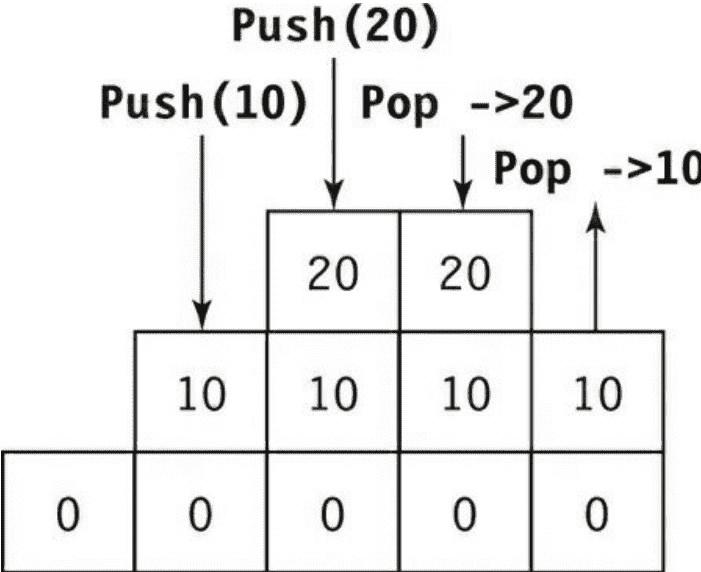

**Figure 3.6.** Operation of a hypothetical stack

传统堆栈上的 **push** 和 **pop** 函数被 Python 列表的 `append` 和 `pop` 方法所取代。

需要做出的关键变化——概念上，至少——是思考对列表末尾添加的最后一个元素进行操作，而不是对堆栈的字面顶部进行操作。

这种列表末尾的方法在功能上等同于堆栈。图 3.7 说明了 10 和 20 被压入，然后从用作堆栈的列表中弹出。结果是，项目按逆序弹出。

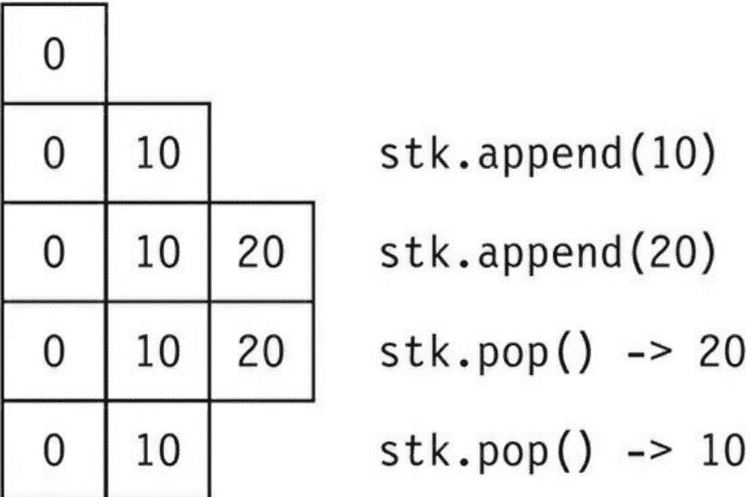

**Figure 3.7.** Stack operation with a Python list

堆栈设备最有用的演示之一是反向波兰表示法（RPN）语言的解释器。我们将在本书结束时开发一个复杂的语言解释器，但目前我们从一个简单的计算器开始。

RPN 语言在 _postfix_ 语言中评估运算符，其中两个表达式后跟一个运算符。大多数语言使用 _infix_ 表示法。在后缀表示法中，操作数首先出现，后跟运算符。例如，要将 7 和 3 相加，你先写数字，然后再写加号（+）。

```
7 3 +
```

这将 7 加到 3，产生 10。或者，要将 10 乘以 5，产生 50，你使用这个：

```
10 5 *
```

然后——这就是 RPN 如此有用的原因——你可以以清晰、无歧义的方式将这两个表达式组合在一起，而不需要任何括号：

```
10 5 * 7 3 + /
```

这个表达式等价于以下标准表示法，它产生 5.0：

```
(10 * 5) / (7 + 3)
```

这里是另一个示例：

```
1 2 / 3 4 / +
```

这个示例翻译为 (1/2) + (3/4)，因此产生 1.25。这里是另一个示例：

```
2 4 2 3 7 + + + *
```


这将翻译为

```
2 * (4 + (2 + (3 + 7)))
```

其结果为 32。逆波兰表达式（RPN）的妙处在于不再需要括号。最棒的是，解释器只遵循几条简单规则：

- 如果下一项是数字，则将其压入栈中。
- 如果下一项是运算符，则从栈顶弹出两个元素，执行运算，并将结果压入栈。

以下是该应用程序的伪代码：

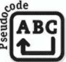

```
Get an input string.
Split it into tokens and store in a list.
For each item in the list,
    If item is an operator,
        Pop stack into op2
        Pop stack into op1
        Carry out operation and push the result onto
the stack.
    Else
        Push item onto the stack as a float value.
Pop stack and print the value.
```

# 以下是实现该程序逻辑的 Python 代码：

单击此处查看代码图片

```
the__stack = []

def push(v):
    the__stack.append(v)

def pop():
    return the__stack.pop()

def main():
    s = input('Enter RPN string: ')
    a__list = s.split()
    for item in a__list:
        if item in '+-*/':
            op2 = pop()
            op1 = pop()
            if item == '+':
                push(op1 + op2)
            elif item == '-':
                push(op1 - op2)
            elif item == '*':
                push(op1 * op2)
            else:
                push(op1 / op2)
        else:
            push(float(item))
    print(pop())

main()
```

这个应用程序虽然不长，但可以更加紧凑。我们包含了操作全局变量 `the__stack` 的专用 push 和 pop 函数。如果直接使用 `the__stack` 的方法，可以节省几行代码。

```
op1 = the_stack.pop()
...
the_stack.append(op1 + op2)  # Push op1 + op2.
```

将示例修改为直接使用这些方法留作练习。请注意，目前没有错误检查，例如在执行操作前检查栈的长度是否至少为两个元素。错误检查也留作练习。

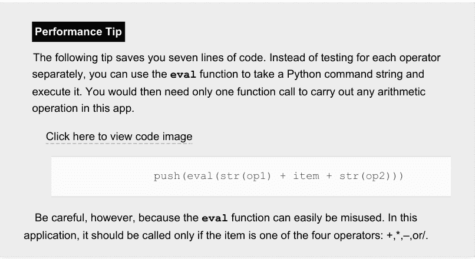

# 3.13 “REDUCE” 函数

Python 列表更有趣的特性之一是能够使用自定义函数处理列表的所有元素。这包括 `map` 和 `filter` 列表方法。`map` 方法通过转换源列表中的所有元素来生成一个新列表。`filter` 函数根据指定条件（例如仅选择正数）生成源列表的子列表。

但是，列表推导式（将在第 3.15 节“列表推导式”中详细讨论）通常比 **map** 和 **filter** 做得更好。

但是，**functools** 包提供了使用列表处理小函数的理由。要使用 **functools** 包，首先导入它。

```
import functools
```

然后可以使用 **functools.reduce** 函数对数组的所有元素应用你选择的函数。


```
functools.reduce(function, list)
```

**reduce** 的作用是将指定的 _function_ 应用于 _list_ 中每一对相邻元素，累积结果，传递下去，最后返回总体答案。_function_ 参数——一个可调用对象——本身必须接受两个参数并产生一个结果。假设列表（或其他序列）至少有四个元素，其效果如下。

- 将前两个元素作为函数的参数。记住结果。
- 将步骤 1 的结果和第三个元素作为函数的参数。记住这个结果。
- 将步骤 2 的结果和第四个元素作为函数的参数。
- 以此方式继续到列表末尾。

在加法和乘法的情况下，结果很容易理解。

单击此处查看代码图片

```
import functools

def add_func(a, b):
    return a + b

def mul_func(a, b):
    return a * b

n = 5
a_list = list(range(1, n + 1))

triangle_num = functools.reduce(add_func, a_list)
fact_num   = functools.reduce(mul_func, a_list)
```

如果你记得 **range** 函数的工作原理，那么你会发现，只要 `n` 设置为 5，`a_list` 就等于以下序列。

- 1, 2, 3, 4, 5

该示例计算 n 的三角数，即序列中所有数字的和；以及 n 的阶乘，即序列中所有数字的乘积。

单击此处查看代码图片

```
`triangle_num = 1 + 2 + 3 + 4 + 5
fact_num   = 1 * 2 * 3 * 4 * 5`
```

> **注意**
>
> 通过计算和来生成三角数的结果，更容易通过调用 **sum** 函数来实现，如第 3.8 节“列表函数”中所述。

在这个示例中应用减法函数会很奇怪，但合法。它将产生以下结果。

```
`((((1 - 2) - 3) - 4) - 5`
```

同样，应用除法函数将产生以下结果：

```
`((((1 / 2) / 3) / 4) / 5`
```

# ## 3.14 LAMBDA 函数

在像上一节所示那样对列表进行操作时，你可能希望使用一个仅用于一次性的简单函数。

这就是 _lambda 函数_ 的含义：一个即时创建、通常仅用一次的函数。Lambda 是一个没有名称的函数，除非你选择将其分配给变量。


单击此处查看代码图片

```
lambda arguments: return_value
```

在此语法中，_arguments_ 由零个或多个变量名组成，用作函数的参数，如果有多个，则用逗号分隔。

结果是一个可调用对象，既不能保存，也不能直接在接受可调用对象的表达式中使用。以下是通过命名来保存 lambda 的示例：

```
my_f = lambda x, y: x + y
```

有了这个赋值，它使 _my_\_f 成为这个小函数的名称，该名称现在可以作为可调用对象使用。以下是一个示例：

单击此处查看代码图片

```
sum1 = my_f(3, 7)
print(sum1)        # Print 10.
sum2 = my_f(10, 15)
print(sum2)        # Print 25.
```

但这种用法虽然值得注意，却通常不是 lambda 的使用方式。更实际的用法是与 **reduce** 函数一起使用。例如，以下是计算 5 的三角数的方法：

单击此处查看代码图片

```
`t5 = functools.reduce(lambda x, y: x + y,
[1, 2, 3, 4, 5])`
```

以下是计算 5 的阶乘的方法：

单击此处查看代码图片

```
`f5 = functools.reduce(lambda x, y: x * y,
[1, 2, 3, 4, 5])`
```

程序在运行时动态创建数据，如果你想再次引用它们，会为数据对象分配名称。函数（可调用对象）也是如此；它们在运行时创建，并要么分配名称——如果你想再次引用它们——要么匿名使用，如上述两个示例所示。

# ## 3.15 列表推导式

Python 在 2.0 版本中引入的最重要特性之一是 _列表推导式_。它提供了一种使用 **for** 语法从列表生成一系列值的紧凑方式。它也可以应用于字典、集合和其他集合。

列表推导式的最简单示例是逐个复制列表中的所有元素。以下语句使用切片创建副本：

```
b__list = a__list[:]
```

以下是另一种逐个复制的方法：

```
b__list = []
for i in a__list:
    b__list.append(i)
```

这样的代码非常常见，以至于 Python 2.0 引入了一种执行相同操作的紧凑方式。（我使用了间距来使其更易于理解。）

单击此处查看代码图片

```
b__list = [i   for i in a__list]
```

这个示例清楚地展示了列表推导式表达式的两个部分，但一旦你理解了它，你可能希望不带额外空格地编写它。

单击此处查看代码图片

```
b__list = [i for i in a__list]
```

以下是一个变体。假设你想创建一个包含 `a__list` 中每个元素平方的列表：

```
b__list = [ ]
for i in a__list:
```


b_list.append(i * i)

如果 `a_list` 包含 `[1, 2, 3]`，那么这些语句的结果是创建一个包含 `[1, 4, 9]` 的列表，并将该列表赋值给变量 `b_list`。在这种情况下，相应的列表推导式表达式如下所示：

Click here to view code image

```
b_list = [i * i for i in a_list]
```

也许到现在你已经能看出规律了。在这个第二个示例中，方括号内的元素可以分解如下：

- _value_ 表达式 `i * i`，即要生成并放入新列表的值；`i * i` 指定将每个元素的平方放入新列表。
- **for** 语句头，`for i in a_list`，提供要操作的一系列值。因此，值的来源是 `a_list`。

图 3.8 说明了这种列表推导式语法。

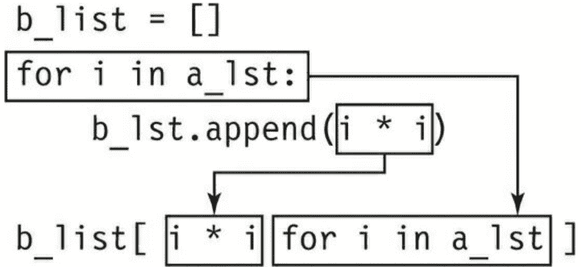

# Figure 3.8. 列表推导式

从语法上讲，列表推导式是一种通过使用值表达式，紧随其后的 **for** 语句头来创建列表的方式，该语句头提供一系列数据。但是请记住，列表推导式表达式中的 **for** 语句头不使用其终止冒号 (:)。


_for_statement_header_ 可以来自任意层级的嵌套循环。下面是一个涉及两个此类循环的示例：

Click here to view code image

```
mult_list = [ ]
for i in range(3):
    for j in range(3):
        mult_list.append(i * j)
```

这个嵌套循环生成列表 [0, 0, 0, 0, 1, 2, 0, 2, 4]。这个循环等效于以下列表推导式语句：

Click here to view code image

```
mult_list = [i * j for i in range(3) for j in range(3)]
```

在这种情况下，i * j 是循环每次迭代产生的值，而行的其余部分由嵌套循环的语句头组成。

列表推导式还有另一个可选特性。从语法上讲，它放置在表达式的末尾，但在右方括号之前。


Click here to view code image

```
[ value for_statement_header if_expression ]
```

作为一个简单的示例，假设你想只选择列表中为正的元素。如果你手动写出循环，可以这样写：

Click here to view code image

```
my_list = [10, -10, -1, 12, -500, 13, 15, -3]
new_list = []
for i in my_list:
    if i > 0:
        new_list.append(i)
```

在这种情况下，结果是将值 [10, 12, 13, 15] 放入 new_list。以下使用列表推导式的语句做同样的事情：

> Click here to view code image

```
new_list = [i for i in my_list if i > 0]
```

在这种情况下，右侧方括号内的列表推导式语句分解为三个部分：

- *value* 表达式 i；直接从列表中获取一个值。
- **for** 语句头，`for i in my_list`，提供要操作的一系列值。
- 最后，**if** 条件，`if i > 0`，选择哪些项目被包含。

同样，一旦你理解了工作原理，通常习惯于不使用我为清晰起见而使用的额外空格来编写它。

> Click here to view code image

```
new_list = [i for i in my_list if i > 0]
```

相比之下，下面的示例创建一个仅包含负值的列表。

> Click here to view code image

```
my_list = [1, 2, -10, -500, 33, 21, -1]
neg_list = [i for i in my_list if i < 0 ]
```

在这种情况下，结果是生成以下列表并将其命名为 `neg_list`：

```
[-10, -500, -1]
```

# ## 3.16 字典和集合推导式

列表推导式的原理扩展到集合和字典。通过集合来看这一点最容易，因为集合是一组简单的值，其中重复项被忽略且顺序无关紧要。

例如，假设我们想从 `a_list` 中仅获取正值，并将其放入集合而不是列表中。你可以使用普通循环来编写此操作：

> Click here to view code image

```
a_list = [5, 5, 5, -20, 2, -1, 2]
my_set = set( )
for i in a_list:
    if i > 0:
        my_set.add(i)
```

你也可以通过集合推导式来实现这一点，使用集合大括号（“花括号”）而不是方括号。

Click here to view code image

```
my_set = {i for i in a_list if i > 0}
```

无论哪种情况，结果都是创建集合 {5, 2} 并将其赋值给变量 my_set。没有重复值。重复值的消除是自动发生的，因为你正在生成一个集合。

请注意，这里正在执行集合推导式（创建集合），因为使用了花括号（“集合大括号”）而不是方括号，方括号会创建列表。

或者，假设你想生成相同的集合，但由 `a_list` 中正值的平方组成，结果为 {25, 4}。在这种情况下，你可以使用以下语句：

Click here to view code image

```
my_set = {i * i for i in a_list if i > 0}
```

字典推导式稍微复杂一些，因为为了工作，有必要创建一个生成键值对的循环，使用以下语法：

```
key : value
```

假设你有一个元组列表，希望将其作为数据字典的基础。

Click here to view code image

```
vals_list = [ ('pi', 3.14), ('phi', 1.618) ]
```

# 字典可以按如下方式创建：

> Click here to view code image

```
my_dict = { i[0]: i[1] for i in vals_list }
```

请注意键值表达式中冒号 (:) 的用法，i [0] : i [1]。你可以通过引用或打印以下表达式来验证字典是否成功生成，该表达式应产生数字 3.14：

> Click here to view code image

```
my_dict['pi'] # Produces 3.14.
```

下面是另一个示例，它将两个列表的数据合并到一个字典中。它假设这两个列表长度相同。

> Click here to view code image

```
keys = ['Bob', 'Carol', 'Ted', 'Alice' ]
vals = [4.0, 4.0, 3.75, 3.9]
grade_dict= { keys[i]: vals[i] for i in
range(len(keys)) }
```

# 此示例创建一个初始化为以下内容的字典：

> Click here to view code image

```
grade_dict = { 'Bob':4.0, 'Carol':4.0, 'Ted':3.75,
'Alice':3.9 }
```

# 性能提示

你可以通过使用内置的 zip 函数来合并列表，从而提高此最后示例中代码的性能。推导式如下所示：

+   Click here to view code image

```
grade_dict = { key: val for key, val in zip(keys,
vals)}
```

总结，以下语法生成一个集合：


+   Click here to view code image

```
{ value for_statement_header optional_if_cond }
```

# 以下语法生成一个字典：

+   Click here to view code image

```
{ key : value for_statement_header
optional_if_cond }
```

使用字典推导式最巧妙的方法之一是反转字典。例如，你可能想要获取一个电话簿，其中使用名称来查找号码，并将其反转，以便可以使用号码来查找名称。

# Click here to view code image

```
idict = {v : k for k, v in phone_dict.items() }
```

数据字典的 **items** 方法生成一组 k, v 对，其中 k 是键，v 是值。对于每个这样的对，值表达式 v : k 在生成新字典 idict 时反转键值关系。

# 3.17 通过列表传递参数

Python 中的参数值既不是按引用传递也不是按值传递。相反，Python 参数作为数据字典条目传递，其中参数名称在函数调用时与值相关联。

从实际意义上讲，这意味着你不能简单地给出一个变量名作为参数，并编写一个修改该变量的函数。

```
double_it(n)
```

假设当 double_it 执行时，传递给 n 的值为 10。函数接收键值对 n : 10。但是对 n 的新赋值——被视为局部变量——对函数外部 n 的值没有影响，因为此类赋值会打破 n 与数据之间的连接。


你可以，然而，将列表传递给函数，并编写函数，使函数修改该列表中的一些或所有值。之所以可能，是因为列表（与字符串和元组不同）是可变的。下面是一个示例：

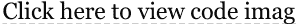

```python
def set_list_vals(list_arg):
    list_arg[0] = 100
    list_arg[1] = 200
    list_arg[2] = 150

a_list = [0, 0, 0]
set_list_vals(a_list)
print(a_list)  # Prints [100, 200, 150]
```

这种方法之所以有效，是因为列表的值是原地修改的，无需创建新列表，也不需要重新赋值变量。但是，下面的示例无法更改传递给它的列表。


```python
def set_list_vals(list_arg):
    list_arg = [100, 200, 150]

a_list = [0, 0, 0]
set_list_vals(a_list)
print(a_list)  # Prints [0, 0, 0]
```

采用这种方法，函数返回后，列表 `a_list` 的值并未更改。发生了什么？

答案是，列表参数 `list_arg` 被重新赋值，指向了一个完全新的列表。变量 `list_arg` 与原始数据 `[0, 0, 0]` 之间的关联被打破了。

但是，切片和索引是不同的。为列表的索引项或切片赋值不会改变名称所指向的对象；它仍然指向同一个列表，只是该列表的第一个元素被修改了。

> 单击此处查看代码图片

```python
my_list[0] = new_data  # This really changes list data.
```

## 3.18 多维列表

列表元素本身可以是列表。因此，你可以编写如下代码：

> 单击此处查看代码图片

```python
weird_list = [ [1, 2, 3], 'John', 'George' ]
```

但更常见的是真正的 _多维列表_，或 _矩阵_。下面的赋值创建一个 3 × 3 列表，并将其赋给变量 `mat`：

> 单击此处查看代码图片

```python
mat = [[10, 11, 21], [20, 21, 22], [25, 15, 15]]
```

赋值的右侧创建三行，每行有三个值：

```python
[10, 11, 12],
[20, 21, 22],
[25, 15, 15]
```

你可以像下面这样索引二维列表中的单个元素：

> 单击此处查看代码图片

```python
list_name[row_index][column_index]
```

像往常一样，Python 中的索引从 0 到 N–1，其中 N 是维度的长度。你可以使用负索引，像往常一样。因此，`mat[1][2]`（第二行，第三列）产生值 22。

> Note
> 本章描述了如何使用核心 Python 语言创建多维列表。第 12 章描述了 **numpy** 包的使用，它能够使用高度优化的例程来操作多维数组，尤其是数字数组（或矩阵）。

### 3.18.1 不规则矩阵

虽然你可能最常创建矩形矩阵，但你可以使用 Python 创建 _不规则矩阵_。下面是一个示例：

> 单击此处查看代码图片

```python
weird_mat = [[1, 2, 3, 4], [0, 5], [9, 8, 3]]
```

程序代码可以通过检查来确定 Python 矩阵的确切大小和形状。获取这样的列表（在这里是矩阵）的长度，可以得到顶层元素的数量。下面是一个示例：

> 单击此处查看代码图片

```python
len(weird_mat)   # Equal to 3.
```

这个结果告诉你有三行。然后你可以像下面这样获取矩阵中每一行的长度：

> 单击此处查看代码图片

```python
len(weird_mat[0])   # Equal to 4.
len(weird_mat[1])   # Equal to 2.
len(weird_mat[2])   # Equal to 3.
```

这个过程可以重复到任意深度。

### 3.18.2 创建任意大小的矩阵

在 Python 中创建任意大小的多维列表是一个挑战。幸运的是，本节提供了最简单的解决方案（除了使用第 12 章描述的专用 **numpy** 包之外）。

请记住，Python 没有数据声明的概念。因此，Python 矩阵不能声明；它们必须构建。

看起来列表乘法似乎可以解决问题。在一维列表的情况下，确实如此。

```python
big_list = [0] * 100  # Create a list of 100 elements each initialized to 0.
```

这工作得如此之好，你可能会想将其推广到二维。

```python
mat = [[0] * 100] * 200
```

但是，虽然这个语句是合法的，但它并没有做你想要的事。内部表达式 `[0] * 100` 创建一个包含 100 个元素的列表。但是代码重复了该数据 200 次——不是通过创建 200 个独立的行，而是通过创建 200 个指向同一行的引用。

其效果是创建了 200 个不独立的行。这是一个浅拷贝；你得到了 200 个指向同一行的冗余引用。这令人沮丧。解决方法是一次追加一行，共 200 行，你可以在 for 循环中完成：

```python
mat = [ ]
for i in range(200):
    mat.append([0] * 100)
```

在这个示例中，`mat` 开始是一个空列表，就像任何其他列表一样。

每次循环时，都会追加一行包含 100 个零。执行此循环后，`mat` 将引用一个真正的二维矩阵，由 20,000 个完全独立的单元格组成。然后可以索引到 `mat[199][99]`。下面是一个示例：

```python
mat[150][87] = 3.141592
```

与其他将数据追加到列表的 **for** 循环一样，前面的示例非常适合使用列表推导式。

> 单击此处查看代码图片

```python
mat = [ [0] * 100 for i in range(200) ]
```

表达式 `[0] * 100` 是此列表推导式表达式的 _值_ 部分；它指定一个由 100 个元素组成的一维列表（或“行”），每个元素都设置为 0。顺便说一句，此表达式不应放在额外的一对括号中，否则效果将是创建一个额外且不必要的索引层级。

表达式 `for i in range(200)` 导致 Python 创建并追加这样的行……200 次。


> 单击此处查看代码图片

```python
matrix_name = [[init] * ncols for var in range(nrows)]
```

在此语法显示中，`init` 是你想要分配给每个元素的初始值，`ncols` 和 `nrows` 分别是列数和行数。

因为 `var` 不重要且无需再次使用，你可以将其替换为无关紧要的名称“_”（仅下划线），它基本上是一个占位符。例如，要声明一个 30 × 25 矩阵，你将使用此语句：

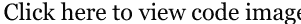

```python
mat2 = [ [0] * 25 for _ in range(30) ]
```

你可以使用此技术构建更高维度的矩阵，每次添加一个列表推导式层级。下面是一个 30×20 × 25 三维列表：

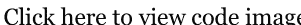

```python
mat2 = [ [ [0] * 25 for _ in range(20) ]
for _ in range(30) ]
```

下面是一个 10 × 10 × 10 × 10 四维列表：

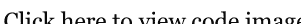

```python
mat2 = [[[ [0] * 10 for _ in range(10) ]
for _ in range(10) ]
for _ in range(10) ]
```

你可以构建更高维度的矩阵，但请记住，随着维度增加，事物会变得非常大！

# 第 3 章 小结

本章展示了 Python 列表有多么强大。许多相同的功能也体现在函数中，例如 `len`、`count` 和 `index`，它们也适用于其他集合类，包括字符串和元组。但是，由于列表是可变的，因此有一些列表功能不被其他类型支持，例如 `sort` 和 `reverse`，它们会“原地”修改列表数据。

本章还介绍了一些异国情调的功能，例如使用 `functools` 和 lambda 函数。它还解释了创建多维列表的技术，第 12 章为此提供了高效且更优的替代方案；不过，了解如何使用核心语言创建多维列表仍然很有用。

# 第 3 章 复习问题

+ 1 你能编写一个程序或函数，同时使用正索引和负索引吗？这样做有任何代价吗？

+ 2 创建一个初始包含 1,000 个元素的 Python 列表，最有效的方法是什么？假设每个元素都应初始化为相同的值。

+ 3 如何使用切片获取列表中每隔一个元素，而忽略其余元素？（例如，你想创建一个新列表，包含第一个、第三个、第五个、第七个等等元素。）

+ 4 描述索引和切片之间的一些区别。


# 5 当切片表达式中使用的索引之一超出范围时会发生什么？

# 6 如果将列表传递给函数，并且希望函数能够更改列表的值——即函数返回后列表内容发生变化——应该避免什么操作？

# 7 什么是不平衡矩阵？

# 8 为什么创建任意大小的矩阵需要使用列表推导式或循环？

# CHAPTER 3 建议问题

1 使用 `reduce` 列表处理函数来帮助计算随机选择的一组数字的平均值。正确答案不应超过一两行代码。然后，通过从平均值（也称为“均值”）中减去每个元素并对每个结果求平方，来计算每个元素的偏差。最后，返回结果列表。

2 编写一个程序，使用户可以输入一组数字，列表长度可以任意指定。然后找到 _中位数_ 值，而不是平均值或均值。中位数是指与列表中其余值相比，大于它的值和小于它的值数量相同的值。如果将整个列表从低到高排序，且元素个数为偶数，则中位数为中间两个值的平均值。
