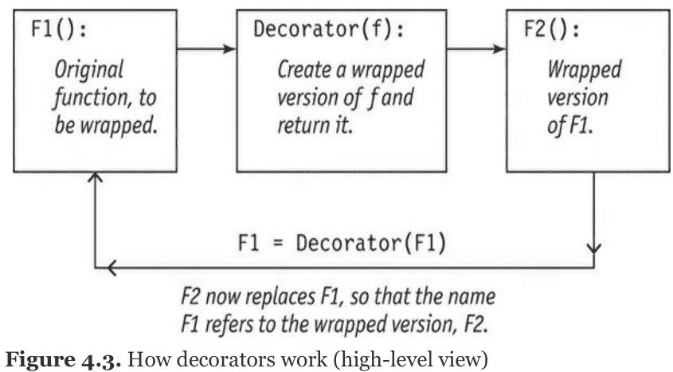
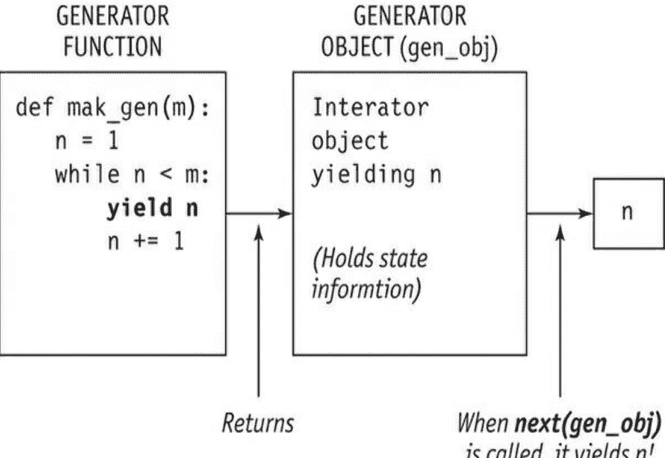
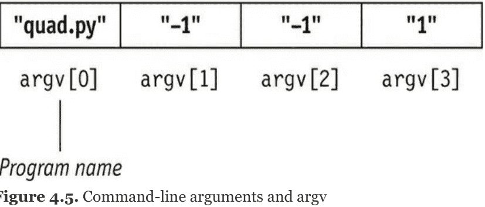

# # 4. 快捷方式、命令行和软件包

大师级工匠需要许多东西，但最重要的是，他们需要掌握专业工具。本章介绍了一些工具，即使你是一位经验丰富的 Python 程序员，可能也尚未学习过。这些工具将提高你的工作效率，并提升程序的效率。

准备好学习一些新技巧和窍门吧。

# ## 4.1 概述

Python 在快捷方式和节省时间的编程技巧方面异常出色。本章首先讨论其中二十二种技巧。

另一种加速某些程序的方法是利用 Python 提供的众多软件包。其中一些——例如 `re`（正则表达式）、`system`、`random` 和 `math`——随标准 Python 下载一起提供，你只需包含一条 `import` 语句即可。其他软件包可以使用合适的工具轻松下载。

# ## 4.2 二十二种编程快捷方式

本节列出了缩短和精简 Python 代码的最常用技巧。其中大多数是本书中新增的，尽管少数几种之前已介绍过，并在此更深入地展示。

+   - 根据需要使用 Python 行续。
+   - 明智地使用 `for` 循环。
+   - 理解组合运算符赋值（+= 等）。
+   - 使用多重赋值。
+   - 使用元组赋值。
+   - 使用高级元组赋值。
+   - 使用列表和字符串“乘法”。
+   - 返回多个值。
+   - 使用循环和 `else` 关键字。
+   - 利用布尔值和 `not`。
+   - 将字符串视为字符列表。
+   - 使用 `replace` 消除字符。
+   - 不要编写不必要的循环。
+   - 使用链式比较。
+   - 使用函数表模拟“switch”。
+   - 正确使用 `is` 运算符。
+   - 使用一行 `for` 循环。

+   - 将多条语句挤在一行上。
+   - 编写一行 if/then/else 语句。
+   - 使用 `range` 创建 Enum 值。
+   - 减少 IDLE 中 `print` 函数的低效性。
+   - 在大数字内部放置下划线。

让我们详细了解这些想法。

# ## 4.2.1 根据需要使用 Python 行续

在 Python 中，正常的语句终止符只是物理行的末尾（尽管请注意第 3.18 节中的例外）。这使得编程更容易，因为你可以自然地假设每行一条语句。

但是，如果你需要编写一条超过一行物理行的语句怎么办？这种困境可能以多种方式出现。例如，你可能有一个要打印的字符串，无法放在一行上。你可以使用字面引号，但在这种情况下，行换行会被转换为换行符——这可能不是你想要的。首先，解决方案是认识到，位于其他字面字符串旁边的字面字符串会自动连接。

Click here to view code image

```
>>> my_str = 'I am Hen-er-y the Eighth,' ' I am!'
>>> print(my_str)
I am Hen-er-y the Eighth, I am!
```

如果这些子字符串太长，无法放在单个物理行上，你有几种选择。一种是使用行续字符，即反斜杠（\(\\\)）。

Click here to view code image

```
my_str = 'I am Hen-er-y the Eighth,' \
' I am!'
```

另一种技巧是观察，任何打开且目前未匹配的圆括号、方括号或花括号都会自动导致续行到下一行物理行。因此，你可以输入任意长的语句——并且可以输入任意长度的字符串——而不一定要插入换行符。

Click here to view code image

```
my_str = ('I am Hen-er-y the Eighth,' \
'I am! I am not just any Henry VIII,' \
'I really am!')
```

此语句将所有文本放在一个字符串中。你也可以将打开的圆括号与其他类型的语句一起使用。

Click here to view code image

```
length_of_hypotenuse = ( (side1 * side1 + side2 * \
side2) \
** 0.5 )
```

直到所有打开的圆括号 [(] 都被闭合括号 [)] 匹配，语句才被视为完整。

花括号和方括号也是如此。因此，此语句将自动续行到下一行物理行。

# ## 4.2.2 明智地使用“for”循环

如果你来自 C/C++ 世界，可能会过度使用 **range** 函数来打印列表成员。以下是使用 **range** 和索引操作的 C 语言风格 **for** 循环示例。

Click here to view code image

```
beat_list = ['John', 'Paul', 'George', 'Ringo']
for i in range(len(beat_list)):
    print(beat_list[i])
```

如果你曾经编写过这样的代码，应该尽快改掉这个习惯。最好直接打印列表或迭代器的内容。

Click here to view code image

```
beat_list = ['John', 'Paul', 'George', 'Ringo']
for guy in beat_list:
    print(guy)
```

即使你需要访问循环变量，最好也使用 **enumerate** 函数来生成这些数字。以下是示例：

Click here to view code image

```
beat_list = ['John', 'Paul', 'George', 'Ringo']
for i, name in enumerate(beat_list, 1):
    print(i, '. ', name, sep='')
```

这将打印

```
1. John
2. Paul
3. George
4. Ringo
```

当然，有些情况下需要使用索引。这种情况最常见于你试图原地更改列表内容时。

# ## 4.2.3 理解组合运算符赋值（+= 等）

组合运算符赋值运算符在第 1 章中介绍过，因此此处仅简要回顾。请记住，赋值 (=) 可以与以下任何运算符组合：+、-、/、//、%、**、&、^、|、<<、>>。

运算符 &、| 和 ^ 分别表示按位“与”、“或”和“异或”。运算符 << 和 >> 执行向左和向右的位移。

本节介绍运算符赋值用法的一些细节。首先，任何赋值运算符的优先级都很低，并且最后执行。

其次，赋值运算符是否原地执行，取决于操作对象的类型是否可变。_原地_ 指的是对内存中现有数据进行操作，而不是创建完全新对象的操作。此类操作速度更快、效率更高。

整数、浮点数和字符串是不可变的。与这些类型一起使用的赋值运算符不会导致原地赋值；相反，它们必须生成一个完全新的对象，然后重新赋值给变量。以下是示例：

```
s1 = s2 = 'A string.'
s1 += '...with more stuff!'
print('s1:', s1)
print('s2:', s2)
```

在这种情况下，print 函数会产生以下输出：

```
s1: A string...with more stuff!
s2: A string.
```

当 s1 被赋予新值时，它并没有原地更改字符串数据；而是将一个全新的字符串赋给 s1。但 s2 是一个仍然引用原始字符串数据的名称。这就是为什么 s1 和 s2 现在包含不同字符串的原因。

但是列表是可变的，因此对列表的更改可以原地发生。

```
a_list = b_list = [10, 20]
a_list += [30, 40]
print('a_list:', a_list)
print('b_list:', b_list)
```


## 4.2.4 使用多重赋值

多重赋值是 Python 中最常用的编码快捷方式之一。例如，你可以一次性创建五个不同的变量，并将它们都赋予相同的值——在这里，即 0：

```python
a = b = c = d = e = 0
```

因此，以下语句返回 **True**：

```python
a is b
```

如果这些变量中的任何一个后来被赋予了不同的对象，则该语句将不再返回 **True**。

尽管这种编码技巧看起来像是从 C 和 C++ 借来的，但你不应假设 Python 在大多数方面都遵循 C 语法。在 Python 中，赋值是一条语句而不是表达式，而 C 语言中则不同。

## 4.2.5 使用元组赋值

当你想要给一组变量赋予相同的初始值时，多重赋值很有用。

但是，如果你想给不同的变量赋予不同的值呢？例如，假设你想给 a 赋值 1，给 b 赋值 0。显而易见的方法是使用以下语句：

```python
a = 1
b = 0
```

但是，通过 *元组赋值*，你可以将这些合并为一条语句。

```python
a, b = 1, 0
```

在这种形式的赋值中，等号（=）的一侧是一系列值，另一侧是另一系列值。它们的数量必须匹配，只有一个例外：你可以将任意大小的元组赋给一个单独的变量（该变量本身现在作为操作的结果代表一个元组）。

Click here to view code image

```python
a = 4, 8, 12 # a is now a tuple containing three values.
```

元组赋值可以用来更紧凑地编写一些代码段。考虑一下在 Python 中生成斐波那契数列的函数可以多么紧凑。

```python
def fibo(n):
    a, b = 1, 0
    while a <= n:
        print(a, end=' ')
        a, b = a + b, a
```

在最后一条语句中，变量 `a` 获得一个新值：`a + b`；变量 `b` 获得一个新值——即 `a` 的旧值。

大多数编程语言无法同时设置 `a` 和 `b`。设置 `a` 的值会改变放入 `b` 的内容，反之亦然。因此，通常需要一个临时变量。如果你愿意，也可以在 Python 中这样做：

Click here to view code image

```python
temp = a    # Preserve old value of a
a = a + b   # Set new value of a
b = temp    # Set b to old value of a
```

但是，使用元组赋值，就不需要临时变量了。

```python
a, b = a + b, a
```

下面是元组赋值的一个更简单的示例。有时，交换两个值很有用。

```python
x, y = 1, 25
print(x, y)   # prints 1 25
x, y = y, x
print(x, y)   # prints 25 1
```

这个示例中有趣的部分是执行交换的语句：

```python
x, y = y, x
```

在另一种语言中，这样的操作需要三条独立的语句。但 Python 不需要这样做，因为——正如刚才所示——它可以一次性完成交换。下面是另一种语言会要求你执行的操作：

```python
temp = x
x = y
y = temp
```

## 4.2.6 使用高级元组赋值

元组赋值具有一些高级特性。例如，你可以解包元组以赋值给多个变量，如下例所示。

Click here to view code image

```python
tup = 10, 20, 30
a, b, c = tup
print(a, b, c) # Produces 10, 20, 30
```

重要的是，左侧的输入变量数量必须与右侧元组的大小匹配。以下语句会产生运行时错误。

Click here to view code image

```python
tup = 10, 20, 30
a, b = tup # Error: too many values to unpack
```

另一种偶尔有用的技术是创建只有一个元素的元组。使用列表可以很容易地做到这一点。

```python
my_list = [3]
```

这是一个包含一个元素 3 的列表。但是，同样的方法对元组不起作用。

```python
my_tup = (3)
print(type(my_tup))
```

这个 **print** 语句显示，在这种情况下，`my_tup` 产生了一个简单的整数。

```python
<class 'int'>
```

这不是本例中想要的结果。括号被视为无操作，任何数量的包围括号也是如此。但是，以下语句会产生一个只有一个元素的元组，尽管，公平地说，只有一个元素的元组使用得并不多。

Click here to view code image

```python
my_tup = (3,)   # Assign tuple with one member, 3.
```

星号（*）的使用为元组赋值提供了很大的额外灵活性。你可以使用它来拆分元组的一部分，并让一个（且只有一个）变量成为剩余元素的默认目标，这些元素随后被放入列表中。一些示例应该能说明这一点。

```python
a, *b = 2, 4, 6, 8
```

在这个示例中，`a` 获得值 2，而 `b` 被赋值为一个列表：

```python
2
[4, 6, 8]
```

```python
a, *b, c = 10, 20, 30, 40, 50
```

在这种情况下，执行该语句后，`a` 和 `c` 分别引用 10 和 50，而 `b` 被赋值为列表 `[20, 30, 40]`。

当然，你可以将星号放在末尾的变量旁边。

Click here to view code image

```python
big, bigger, *many = 100, 200, 300, 400, 500, 600
```

打印这些变量会产生以下结果：

Click here to view code image

```python
>>> print(big, bigger, many, sep='\n')
100
200
[300, 400, 500, 600]
```

## 4.2.7 使用列表和字符串“乘法”

严肃的程序通常处理大型数据集——例如，一组全部初始化为 0 的 10,000 个整数。在 C 和 Java 等语言中，做到这一点的方法是首先声明一个具有大维度的数组。

由于 Python 中没有数据声明，创建大列表的唯一方法是在赋值的右侧构建它。但是，手动构建一个超长列表是不切实际的。想象一下，尝试以这种方式构建一个超长列表：

Click here to view code image

```python
my_list = [0, 0, 0, 0, 0, 0, 0, 0...]
```

你可以想象，将 10,000 个零输入程序代码将非常耗时！而且会让你的手感到酸痛。

应用乘法运算符提供了一个更实用的解决方案：

```python
my_list = [0] * 10000
```

此示例创建一个包含 10,000 个整数的列表，全部初始化为 0。

在 Python 中，此类操作经过良好优化，因此即使在交互式开发环境（IDLE）中，此类交互也能快速处理。


## 4.2.8 返回多个值

你不能将一个简单的变量传递给 Python 函数，在函数内部更改其值，并期望原始变量能反映出这种变化。下面是一个示例：

```python
def double_me(n):
    n *= 2

a = 10
double_me(a)
print(a)  # a 的值没有被加倍!!
```

当 n 被赋予一个新值时，该变量与传递的值之间的关联就被打断了。实际上，n 是一个局部变量，现在与内存中的不同位置相关联。传递给函数的变量不受影响。

但你可以始终这样使用返回值：

```python
def double_me(n):
    return n * 2

a = 10
a = double_me(a)
print(a)
```

因此，要获得输出参数，只需返回一个值。但如果你想要多个输出参数呢？

在 Python 中，你可以返回任意多个值。例如，下面的函数通过返回两个值来执行二次方程计算。

```python
def quad(a, b, c):
    determin = (b * b - 4 * a * c) ** .5
    x1 = (-b + determin) / (2 * a)
    x2 = (-b - determin) / (2 * a)
    return x1, x2
```

这个函数有三个输入参数和两个输出变量。在调用函数时，重要的是要同时接收这两个参数：

```python
x1, x2 = quad(1, -1, -1)
```

如果在这种情况下将多个值返回给单个变量，该变量将把这些值存储为元组。下面是一个示例：

```python
>>> x = quad(1, -1, -1)
>>> x
(1.618033988749895, -0.6180339887498949)
```

请注意，此功能——返回多个值——实际上是 Python 中元组用法的一种应用。

## 4.2.9 使用循环和“else”关键字

`else` 关键字最常与 `if` 关键字结合使用。但在 Python 中，它也可以与 `try-except` 语法和循环一起使用。

在循环中，如果循环在没有提前退出（例如 **break**）的情况下完成，则会执行 `else` 子句。此功能适用于 **while** 循环和 **for** 循环。

下面的示例尝试查找 n 的一个偶数除数，范围包括上限 max。如果未找到这样的除数，则会报告该事实。

```python
def find_divisor(n, max):
    for i in range(2, max + 1):
        if n % i == 0:
            print(i, 'divides evenly into', n)
            break
    else:
        print('No divisor found')
```

下面是一个示例：

```python
>>> find_divisor(49, 6)
No divisor found
>>> find_divisor(49, 7)
7 divides evenly into 49
```

## 4.2.10 利用布尔值和“not”

Python 中的每个对象都会求值为 **True** 或 **False**。例如，Python 中的每个空集合在作为布尔值测试时都会求值为 **False**；特殊值 **None** 也是如此。下面是一种测试字符串长度是否为零的方法：

```python
if len(my_str) == 0:
```

但是，你可以使用以下方式来测试输入字符串：

```python
if not s:
    break
```

以下是布尔值转换的一般准则。

- 非空集合和非空字符串求值为 **True**；非零数值也是如此。
- 零长度集合和零长度字符串求值为 **False**；任何等于 0 的数字以及特殊值 **None** 也是如此。

## 4.2.11 将字符串视为字符列表

在对单个字符进行复杂操作并构建字符串时，构建一个字符列表（每个字符都是长度为 1 的字符串），然后使用列表推导式加上 **join** 将所有内容组合起来，有时会更高效。

例如，要测试一个字符串是否为回文，最好省略所有标点符号和空格字符，并将字符串的其余部分转换为全大写或全小写。列表推导式可以高效地完成此操作。

```python
test_str = input('Enter test string: ')
a_list = [c.upper() for c in test_str if c.isalnum()]
print(a_list == a_list[::-1])
```

本示例的第二行使用了列表推导式，该功能在第 3.15 节“列表推导式”中介绍。本示例的第三行使用了切片来获取列表的逆序。现在，我们可以通过将 test_str 与其自身的逆序进行比较来测试它是否为回文。这三行代码可能是测试字符串是否为回文的最短程序。说到紧凑！

```python
Enter test string: A man, a plan, a canal, Panama!
True
```

## 4.2.12 使用 "replace" 消除字符

要快速从字符串中删除特定字符的所有实例，请使用 replace 并将空字符串指定为替换项。

例如，第 10 章中的一个代码示例要求用户输入表示分数的字符串，例如“1/2”。但是，如果用户输入了额外的空格，例如“1 / 2”，这可能会导致问题。下面是一些代码，它接收一个输入字符串 s，并快速删除其中的所有空格（因此超出了简单的去除首尾空格）：

```python
s = s.replace(' ', '')
```

使用类似的代码，你可以以同样的方式快速删除所有冒犯性的字符或子字符串——但一次只能删除一种。但是，假设你想一次性删除所有元音。在这种情况下，列表推导式可以帮助你。

```python
a_list = [c for c in s if c not in 'aeiou']
s = ''.join(a_list)
```

## 4.2.13 不要编写不必要的循环

确保你不要忽略 Python 的所有内置功能，尤其是在处理列表和字符串时。在大多数计算机语言中，你可能需要编写一个循环来计算列表中所有数字的总和。但 Python 可以直接执行求和。例如，下面的函数计算 1 + 2 + 3 ... + N：

```python
def calc_triangle_num(n):
    return sum(range(n+1))
```

使用 **sum** 函数的另一种方法是快速获取任意数字列表的平均值（均值）。

```python
def get_avg(a_list):
    return sum(a_list) / len(a_list)
```

## 4.2.14 使用链式比较 (n < x < m)

这是一个巧妙的小捷径，可以在某些时候节省你的工作量，同时也能让你的代码更具可读性。

编写如下 **if** 条件是很常见的：

```python
if 0 < x and x < 100:
    print('x is in range.')
```

但在这种情况下，你可以使用以下方式节省几个按键：

```python
if 0 < x < 100:        # 使用“链式”比较。
    print('x is in range.')
```

这种能力可能更进一步。你可以链式连接任意数量的比较，并且可以包含任何标准比较运算符，包括 ==、<、<=、> 和 >=。箭头甚至不需要指向同一方向，也不需要按任何顺序组合！因此，你可以做这样的事情：

```python
a, b, c = 5, 10, 15
if 0 < a <= c > b > 1:
    print('All these comparisons are true!')
    print('c is equal or greater than all the rest!')
```

你甚至可以使用此技术来测试一系列变量是否相等。下面是一个示例：

```python
a = b = c = d = e = 100
if a == b == c == d == e:
```


## 4.2.15 用函数表模拟“switch”

下面这种技巧不错，因为它可能节省不少代码行数。

第 15.12 节为用户提供一个选择菜单，提示输入一个整数，然后使用该整数来决定调用哪个函数。实现这种逻辑的明显方法是使用一系列 **if/elif** 语句，因为 Python 没有“switch”语句。

```
if n == 1:
    do_plot(stockdf)
elif n == 2:
    do_highlow_plot(stockdf)
elif n == 3:
    do_volume_subplot(stockdf)
elif n == 4:
    do_movingavg_plot(stockdf)
```

这样的代码很冗长。它能工作，但比必要的长。不过 Python 函数是对象，可以像其他任何对象一样放入列表中。因此，你可以获取其中一个函数的引用并调用它。

> Click here to view code image

```
fn = [do_plot, do_highlow_plot, do_volume_subplot,
    do_movingavg_plot][n-1]
fn(stockdf)    # Call the function
```

例如，计算 n-1，如果该值为 0（即 n 等于 1），则执行列出的第一个函数 do_plot。

这段代码通过根据 n 的值调用不同的函数，创建了 C++ switch 语句的紧凑版本。（顺便说一句，在这种情况下，值 0 被排除在外，因为该值用于退出。）

你可以使用字典结合函数来创建更灵活的控制结构。例如，假设“load”、“save”、“update”和“exit”都是菜单函数。我们可以这样实现 switch 语句的等价物：

> Click here to view code image

```
menu_dict = {'load':load_fn, 'save':save_fn,
    'exit':exit_fn, 'update':update_fn}
(menu_dict[selector])()    # Call the function
```

现在，将根据 `selector` 中包含的字符串调用相应的函数，该字符串 presumably 包含 'load'、'save'、'update' 或 'exit'。

## 4.2.16 正确使用“is”运算符

Python 支持测试相等运算符（`==`）和 `is` 运算符。这些测试有时返回相同的结果，有时则不相同。如果两个字符串具有相同的值，相等性测试总是产生 **True**。

```
a = 'cat'
b = 'cat'
a == b  # This must produce True.
```

但是，`is` 运算符在字符串比较中不保证产生 **True**，依赖它是有风险的。如果使用 `is` 而不是测试相等（`==`），构造的字符串不保证与另一个字符串匹配。例如：

Click here to view code image

```
>>> s1 = 'I am what I am and that is all that I am.'
>>> s2 = 'I am what I am' + ' and that is all that I am.'
>>> s1 == s2
True
>>> s1 is s2
False
```

这个示例表明，仅仅因为两个字符串内容相同，并不意味着它们对应内存中的同一个对象，因此 **is** 运算符产生 **False**。

如果 **is** 运算符在这种情况下不可靠，为什么它还会出现在语言中呢？答案是 Python 有一些独特的对象，例如 **None**、**True** 和 **False**。当你确定正在将一个值与唯一对象进行比较时，**is** 关键字工作可靠；此外，在这些情况下它更可取，因为这种比较更高效。

Click here to view code image

```
a_value = my_function()
if a_value is None:
    # Take special action if None is returned.
```

## 4.2.17 使用一行“for”循环

如果 **for** 循环足够短，循环内只有一条语句（即循环 _body_），你可以将整个 **for** 循环压缩到单个物理行上。


Click here to view code image

```
for var in sequence: statement
```

并非所有程序员都偏爱这种编程风格。然而，它作为一种使程序更紧凑的方式很有用。例如，下面的一行语句打印从 0 到 9 的所有数字：

Click here to view code image

```
>>> for i in range(10): print(i, end=' ')
0 1 2 3 4 5 6 7 8 9
```

请注意，当你在 IDLE 中时，这个 **for** 循环与其他循环一样：你需要输入一个额外的空行来终止它。

## 4.2.18 将多条语句压缩到一行

如果你有很多语句想要压缩到同一行，你可以这样做——如果你足够决心并且语句足够短的话。

技术是使用分号（;）将物理行上的一条语句与另一条语句分开。下面是一个示例：

Click here to view code image

```
>>> for i in range(5): n=i*2; m = 5; print(n+m, end=' ')
5 7 9 11 13
```

你可以用这种方式将其他类型的循环压缩到一行。此外，你不必使用循环，可以放置任何你能塞进那一行的语句。

Click here to view code image

```
>>> a = 1; b = 2; c = a + b; print(c)
3
```

在这一点上，有些人可能会反对：“但是有了那些分号，这看起来像 C 代码！”（哦，不——千万别那样！）也许确实如此，但它节省了空间。请记住，分号是语句分隔符，而不是终止符，如旧的 Pascal 语言中那样。

## 4.2.19 编写一行 if/then/else 语句

此功能也称为内联 **if** 条件。考虑下面的 if/else 语句，这并不罕见：

```
turn = 0
...
if turn % 2:
    cell = 'X'
else:
    cell = 'O'
```

书籍《Python Without Fear》使用这种程序逻辑来帮助操作井字游戏。在轮流进行时，要添加的单元格要么是“X”，要么是“O”。每次加 1 的回合计数器导致两个玩家“X”和“O”之间来回切换（一个 _toggle_）。那本书将上面所示的 if/else 块替换为更紧凑的版本：

Click here to view code image

```
cell = 'X' if turn % 2 else 'O'
```

```
true_expr if conditional else false_expr
```


如果 _conditional_ 为真，则计算并返回 _true_expr_；否则计算并返回 _false_expr_。

## 4.2.20 使用“range”创建枚举值

许多程序员喜欢使用枚举（或“enum”）类型来代替所谓的魔术数字。例如，如果你有一个 _color_indicator_ 变量，其中值 1 到 5 分别代表红色、绿色、蓝色、黑色和白色，那么如果你可以使用颜色名称而不是使用 1 到 5 的字面数字，代码会更具可读性。

你可以通过为每个变量名分配一个数字来实现这一点。

```
red = 0
blue = 1
green = 2
black = 3
white = 4
```

这工作良好，但能找到一种方法来自动化这段代码就好了。Python 中有一个简单的技巧允许你这样做，创建一个枚举。你可以利用多重赋值以及使用 **range** 函数：

Click here to view code image

```
red, blue, green, black, white = range(5)
```

在这种情况下传递给 **range** 的数字是设置的数量。或者，如果你想从 1 而不是 0 开始编号，可以使用以下内容：

Click here to view code image

```
red, blue, green, black, white = range(1, 6)
```

> **Note**
>
> 要对枚举类型的创建和规范进行更复杂的控制，可以导入并检查 **enum** 包。
> ```
> import enum
> help(enum)
> ```
>
> 你可以在 https://docs.python.org/3/library/enum.html 上找到有关此功能的信息。

## 4.2.21 减少 IDLE 中“print”函数的低效性

在 IDLE 中，对 **print** 语句的调用非常慢。如果你在该环境中运行程序，可以通过减少对 **print** 的单独调用次数来显著提高性能。


例如，假设你想要打印一个 40 × 20 的星号（*）块。迄今为止，最慢的方法是逐个字符地打印。在 IDLE 中，这段代码运行得非常缓慢。

```
for i in range(20):
    for j in range(40):
        print('*', end='')
    print()
```

你可以一次打印一整行星号，从而获得更好的性能。

```
row_of_asterisks = '*' * 40
for i in range(20):
    print(row_of_asterisks)
```

但最佳性能是通过修改代码来实现的，即仅在组装好一个大的多行输出字符串后，只调用一次 print 函数。

单击此处查看代码图片

```
row_of_asterisks = '*' * 40
s = ''
for i in range(20):
    s += row_of_asterisks + '\n'
print(s)
```

这个示例还可以进一步改进，利用字符串类的 join 方法。这段代码之所以更好，是因为它使用了列表的原地追加，而不是追加到字符串（字符串每次都必须创建一个新字符串）。

单击此处查看代码图片

```
row_of_asterisks = '*' * 40
list_of_str = []
for i in range(20):
    list_of_str.append(row_of_asterisks)
print('\n'.join(list_of_str))
```

更棒的是，下面是一行代码版本！

单击此处查看代码图片

```
print('\n'.join(['*' * 40] * 20))
```

## 4.2.22 在大数字内部使用下划线

在编程中，你有时需要处理大型数字字面量。下面是一个示例：

```
CEO_salary = 15000000
```

这样的数字在编程代码中难以阅读。你可能希望使用逗号作为分隔符，但逗号被保留用于其他目的，例如创建列表。幸运的是，Python 提供了另一种技术：你可以在数字字面量内部使用下划线（_）。

```
CEO_salary = 1_500_000
```

根据以下规则，下划线可以放在数字内部的任何位置。其效果是 Python 读取数字时，就好像没有下划线一样。这种技术涉及几条规则。

- 不能连续使用两个下划线。
- 不能使用前导或后置下划线。如果使用前导下划线（如 \_1），则该数字被视为变量名。
- 可以在小数点的两侧使用下划线。

这种技术仅影响数字在代码本身中的显示方式，而不影响任何内容的打印方式。要打印带有千位分隔符的数字，请使用第 5 章“精确格式化文本”中描述的 `format` 函数或方法。

## 4.3 从命令行运行 Python

如果你一直在 IDLE 中运行 Python 程序——无论是一次输入一条命令，还是作为脚本——一种提高执行速度的方法是改为从命令行运行程序；特别是，这样做大大缩短了执行 `print` 函数调用所需的时间。

命令行操作的一些特性取决于你使用的操作系统。本节介绍两种最常见的操作系统：Windows 和 Macintosh。

### 4.3.1 在基于 Windows 的系统上运行

与 Macintosh 不同，Windows 系统通常不预装 Python 2.0 版本，只要你自己安装 Python 3，这种做法实际上可以为你省去不少麻烦。

要从命令行使用 Python，首先启动 DOS Box 应用程序，它是所有 Windows 系统上的主要应用程序。Python 应该很容易获得，因为它应该位于 PATH 设置包含的目录中。在运行 Windows DOS Box 时，检查此设置很容易。

在 Windows 中，你还可以通过打开控制面板，选择系统，然后选择高级选项卡来检查 PATH 设置。然后单击环境变量。

然后，只要程序在你的 PATH 中，你就应该能够直接运行 Python 程序。要从命令行运行程序，请输入 `python` 和源文件名（主模块），包括 `.py` 扩展名。

```
python test.py
```

### 4.3.2 在 Macintosh 系统上运行

Macintosh 系统通常预装了 Python 版本；不幸的是，在较新的系统中，版本是 Python 2.0 而不是 Python 3.0。

要确定已安装哪个版本用于命令行使用，首先在 Macintosh 系统上启动终端应用程序。你可能需要先单击启动台图标。你应该会发现自己处于默认目录中，无论它是什么。你可以使用以下命令来确定你拥有哪个命令行版本的 Python：

```
python -v
```

如果 Python 版本是 2.0+，你会收到类似下面的消息：

```
python 2.7.10
```

但如果你下载了某个 Python 3.0 版本，你也应该加载了该版本的 Python。但是，要运行它，你必须使用命令 **python3** 而不是 **python**。如果你加载了 **python3**，你可以从命令行按如下方式验证确切版本：

```
python3 -v
python 3.7.0
```

例如，如果文件 `test.py` 在当前目录中，并且你想将其作为 Python 3.0 程序编译，那么请使用以下命令：

```
python3 test.py
```

Python 命令（无论是 **python** 还是 **python3**）有一些有用的变体。如果你输入 `-h`，“帮助”标志，你会得到所有可以与该命令一起使用的可能标志的打印输出，以及相关的环境变量。

```
python3 -h
```

### 4.3.3 使用 pip 或 pip3 下载包

本书中的某些包要求你在使用这些包之前先从 Internet 下载并安装它们。第一个要求这样做的章节是第 12 章，它介绍了 **numpy** 包。

本书中提到的所有包都完全免费（就像大多数 Python 包一样）。更棒的是，**pip** 实用程序（包含在 Python 3 下载中）会去查找你命名的包；因此你只需要一个 Internet 连接！

在基于 Windows 的系统上，使用以下命令下载并安装所需的包。

```
pip install package_name
```

顺便说一句，包名不使用文件扩展名：

```
pip install numpy
```

在 Macintosh 系统上，你可能需要使用 **pip3** 实用程序，它是在你安装 Python 3 时随之下载的。（你可能也继承了一个 pip 版本，但它可能已过时且无法使用。）

```
pip3 install package_name
```

## 4.4 编写和使用文档字符串

Python _文档字符串_ 使你能够利用编写注释所做的工作来获得免费的在线帮助。当你使用 IDLE 运行时，以及从命令行使用 **pydoc** 实用程序时，该帮助都可供你使用。

你可以为函数和类编写文档字符串。虽然本书尚未介绍如何编写类，但原理是相同的。下面是一个带有文档字符串的函数示例。

单击此处查看代码图片

```
def quad(a, b, c):
    '''Quadratic Formula function.

    This function applies the Quadratic Formula
    to determine the roots of x in a quadratic
    equation of the form ax^2 + bx + c = 0.
    '''
    determin = (b * b - 4 * a * c) ** .5
    x1 = (-b + determin) / (2 * a)
    x2 = (-b - determin) / (2 * a)
    return x1, x2
```

当此文档字符串在函数定义中输入时，你可以在 IDLE 中获得帮助：

单击此处查看代码图片

```
>>> help(quad)
Help on function quad in module __main__:

quad(a, b, c)
    Quadratic Formula function.

    This function applies the Quadratic Formula
    to determine the roots of x in a quadratic
    equation of the form ax^2 + bx + c = 0.
```

编写文档字符串的机制遵循若干规则。

- 文档字符串本身必须紧跟在函数标题之后。
- 它必须是一个使用三引号特性的字面量字符串。（你实际上可以使用任何样式的引号，但如果你想跨多行，则需要字面量引号。）
- 文档字符串还必须与函数标题下的“级别 1”缩进对齐：例如，如果函数标题下紧随其后的语句缩进四个空格，那么文档字符串的开头也必须缩进四个空格。
- 文档字符串的后续行可以按你选择的方式缩进，因为字符串是一个字面量字符串。你可以将后续行左对齐，或者继续你开始使用文档字符串时的缩进。无论哪种情况，Python 在线帮助都会以有用的方式对齐文本。


这一最后一点需要一些澄清。前面示例中显示的文档字符串也可以这样写：

Click here to view code image

```
def quad(a, b, c):
    ''"Quadratic Formula function.

    This function applies the Quadratic Formula
    to determine the roots of x in a quadratic
    equation of the form ax^2 + bx + c = 0.
    ''"
    determine = (b * b - 4 * a * c) ** .5
    x1 = (-b + determine) / (2 * a)
    x2 = (-b - determine) / (2 * a)
    return x1, x2
```

你可能期望这个文档字符串能产生所需的行为——即打印出对齐的帮助文本——而且你是对的。但你也可以插入额外的空格，使得行在程序代码中也能对齐。这看起来似乎不应该奏效，但实际上是可以的。

出于风格原因，程序员被鼓励这样编写文档字符串，即引号内的后续行与引用字符串的开头对齐，而不是从第 1 列开始左对齐：

Click here to view code image

```
def quad(a, b, c):
    ''"Quadratic Formula function.

    This function applies the Quadratic Formula
    to determine the roots of x in a quadratic
    equation of the form ax^2 + bx + c = 0.
```

作为风格指南的一部分，建议你先写一个简短的函数摘要，然后加一个空行，再写更详细的描述。

在命令行运行 Python 时，你可以使用 `pydoc` 实用程序来获取前面所示的相同在线帮助。例如，你可以获取名为 `queens.py` 的模块的帮助。`pydoc` 实用程序会通过为每个函数打印帮助摘要来响应。请注意，在这种情况下，“py”不作为模块名称的一部分输入。

```
python -m pydoc queens
```

## 4.5 导入包

本章后面的部分，以及本书后面的章节，都会使用包来扩展 Python 语言的功能。

一个 _包_ 本质上是一组执行服务的对象和函数的软件库。包分为两种类型：

- 包含在 Python 下载本身中的包。这包括 **math**、**random**、**sys**、**os**、**time**、**datetime** 和 **os.path**。这些包特别方便，因为不需要额外下载。
- 你可以从 Internet 下载的包。

这里显示的语法是导入包的推荐方式。这种语法有一些变体，我们稍后会展示。


```
import package_name
```

例如：

```
import math
```

导入包后，你可以在 IDLE 中获取其内容的帮助。下面是一个示例：

```
>>> import math
>>> help(math)
```

如果你在 IDLE 中输入这些命令，你会发现 math 包支持大量函数。但使用这种方法，每个函数都需要使用点（.）语法进行限定。例如，支持的函数之一是 **sqrt**（平方根），它接受整数或浮点数输入。

```
>>> math.sqrt(2)
1.4142135623730951
```

如果你选择，可以使用 **math** 包来计算 **pi** 的值。但是，math 包也直接提供这个数字。

```
>>> math.atan(1) * 4
3.141592653589793
>>> math.pi
3.141592653589793
```

让我们来看看 **import** 语法的一种变体。


Click here to view code image

```
import package_name [as new_name]
```

在这种语法中，方括号表示 **as** _new_name_ 子句是可选的。如果你选择，可以使用它来给包另起一个名字，即 _别名_，在源文件中引用。

如果完整的包名很长，此功能可提供短名称。例如，第 13 章介绍了 **matplotlib.pyplot** 包。

Click here to view code image

```
import matplotlib.pyplot as plt
```

现在，你想使用前缀 **matplotlib.pyplot**，还是想用 **plt** 作为函数名的前缀？不错。我们也是这么想的。

Python 支持 **import** 语法的其他形式。使用这两种方法，都不需要使用包名和点语法。

Click here to view code image

```
from package_name import symbol_name
from package_name import *
```


在这种语法的第一种形式中，只导入 _symbol_name_，而不导入包的其余部分。但是，指定的符号（例如下一个示例中的 **pi**）可以不加限定地引用。

```
>>> from math import pi
>>> print(pi)
3.141592653589793
```

这种方法只导入一个符号——或一系列用逗号分隔的符号——但它使符号名可以更直接地使用。要导入整个包，同时又能直接引用其所有对象和函数，请使用语法的最后一种形式，其中包含星号（*）。

```
>>> from math import *
>>> print(pi)
3.141592653589793
>>> print(sqrt(2))
1.4142135623730951
```

使用这种版本的 `import` 的缺点是，在非常大且复杂的程序中，很难跟踪你正在使用的所有名称，并且当你导入包而不需要包名限定符时，可能会出现名称冲突。

因此，除非你知道自己在做什么，或者正在导入一个非常小的包，否则建议导入特定符号，而不是使用星号（*）。

## 4.6 Python 包导览

如果你访问 **python.org**，还有成千上万个其他包可用，而且它们都可以免费使用。表 4.1 中的包组是所有可用于 Python 的包中最有用的一些，所以你一定要看看。

`re`、`math`、`random`、`array`、`decimal` 和 `fractions` 包都包含在标准 Python 3 下载中，因此你不需要单独下载它们。

**numpy**、**matplotlib** 和 **pandas** 包需要使用 `pip` 或 `pip3` 实用程序单独安装。后面的章节（从第 12 章开始）将深入介绍这些实用程序。

# 表 4.1 本书涵盖的 Python 包

| 包 | 描述 |
|---------|-------------|
| re | 正则表达式包。此包允许你创建文本模式，这些模式可以匹配许多不同的单词、短语或句子。这种模式规范语言可以高效地进行复杂搜索。此包非常重要，因此在第 6 章和第 7 章中都有探讨。 |
| math | 数学包。包含有用且标准的数学函数，因此你不必自己编写。这些包括三角函数、双曲函数、指数函数和对数函数，以及常数 e 和 pi。此包在第 11 章中探讨。 |
| random | 一组用于生成伪随机值的函数。伪随机数表现得像随机数——意味着，其中之一是，用户几乎不可能预测它们。这个随机数生成包包括生成请求范围内的随机整数的能力，以及浮点数和正态分布。后者围绕均值聚集，形成“钟形曲线”的频率。此包在第 11 章中探讨。 |
| decimal | 此包支持 **Decimal** 数据类型，（与 **float** 类型不同）它使你能够精确表示美元和美分数字，而不会出现任何舍入错误。**Decimal** 通常优先用于会计和金融应用程序。此包在第 10 章中探讨。 |
| fractions | 此包支持 **Fraction** 数据类型，它以绝对精度存储任何分数，前提是它可以表示为两个整数的比率。例如，此数据类型可以绝对表示比率 1/3，而 **float** 或 **Decimal** 类型都无法在没有舍入错误的情况下做到这一点。此包在第 10 章中探讨。 |
| array | 此包支持 **array** 类，它与列表不同，在连续存储中保存原始数据。这并不总是更快，但有时有必要将数据打包到连续存储中，以便与其他进程交互。但是，此包的好处远远被 **numpy** 包超越，后者为你提供相同的能力，但更多。此包在第 12 章中简要介绍。 |
| numpy | 此包支持 **numpy**（数值 Python）类，进而支持对一维、二维和更高维数组的高速批量操作。该类不仅本身有用，作为处理大量数据的程序的加速方式，而且作为处理其他类的基础。 |


This package is explored in Chapters 12 and 13. **numpy** needs to be installed with **pip** or **pip3**.

**numpy.random** Similar to **random**, but designed especially for use with **numpy**, and ideally suited to situations in which you need to generate a large quantity of random numbers quickly. In head-to-head tests with the standard **random** class, the **numpy** random class is several times faster when you need to create an array of such numbers. This package is also explored in Chapter 12.

**matplotlib.pyplot** This package supports sophisticated plotting routines for Python. Using these routines, you can create beautiful looking charts and figures—even three-dimensional ones. This package is explored in Chapter 13. It needs to be installed with **pip** or **pip3**.

**pandas** This package supports _data frames_, which are tables that can hold a variety of information, as well as routines for going out and grabbing information from the Internet and loading it. Such information can then be combined with the **numpy** and plotting routines to create impressive-looking graphs. This package is explored in Chapter 15. It also needs to be downloaded.

## 4.7 FUNCTIONS AS FIRST-CLASS OBJECTS

Another productivity tool—which may be useful in debugging, profiling, and related tasks—is to treat Python functions as _first-class_ objects. That means taking advantage of how you can get information about a function at run time. For example, suppose you’ve defined a function called `avg`.

Click here to view code image

```python
def avg(a_list):
    """This function finds the average val in a
    list."""
    x = (sum(a_list) / len(a_list))
    print('The average is:', x)
    return x
```

The name `avg` is a symbolic name that refers to a function, which in Python lingo is also a callable. There are a number of things you can do with `avg`, such as verify its type, which is **function**. Here’s an example:

```python
>>> type(avg)
<class 'function'>
```

We already know that `avg` names a function, so this is not new information. But one of the interesting things you can do with an object is assign it to a new name. You can also assign a different function altogether to the symbolic name, `avg`.

Click here to view code image

```python
def new_func(a_list):
    return (sum(a_list) / len(a_list))

old_avg = avg
avg = new_func
```

The symbolic name `old_avg` now refers to the older, and longer, function we defined before. The symbolic name `avg` now refers to the newer function just defined.

The name `old_avg` now refers to our first averaging function, and we can call it, just as we used to call `avg`.

```python
>>> old_avg([4, 6])
The average is 5.0
5.0
```

The next function shown (which we might loosely term a “metafunction,” although it’s really quite ordinary) prints information about another function—specifically, the function argument passed to it.

Click here to view code image

```python
def func_info(func):
    print('Function name:', func.__name__)
    print('Function documentation:')
    help(func)
```

If we run this function on `old_avg`, which has been assigned to our first averaging function at the beginning of this section, we get this result:

Click here to view code image

```
Function name: avg
Function documentation:
Help on function avg in module __main__:

avg(a_list)
    This function finds the average val in a list.
```

We’re currently using the symbolic name old_avg to refer to
the first function that was defined in this section. Notice that
when we get the function’s name, the information printed uses
the name that _the function was originally defined with_.

All of these operations will become important when we get to
the topic of “decorating” in Section 4.9, “Decorators and
Function Profilers.”

## 4.8 VARIABLE-LENGTH ARGUMENT LISTS

One of the most versatile features of Python is the ability to
access variable-length argument lists. With this capability, your
functions can, if you choose, handle any number of arguments—
much as the built-in print function does.

The variable-length argument ability extends to the use of
named arguments, also called “keyword arguments.”

### 4.8.1 The *args List

The *args syntax can be used to access argument lists of any
length.


Click here to view code image

```python
def func_name([ordinary_args,] *args):
    statements
```

The brackets are used in this case to show that *args may optionally be preceded by any number of ordinary positional arguments, represented here as ordinary_args. The use of such arguments is always optional.

In this syntax, the name args can actually be any symbolic name you want. By convention, Python programs use the name args for this purpose.

The symbolic name args is then interpreted as a Python list like any other; you expand it by indexing it or using it in a for loop. You can also take its length as needed. Here’s an example:

Click here to view code image

```python
def my_var_func(*args):
    print('The number of args is', len(args))
    for item in args:
        print(item)
```

This function, my_var_func, can be used with argument lists of any length.

Click here to view code image

```python
>>> my_var_func(10, 20, 30, 40)
```

```
The number of args is 4
10
20
30
40
```

A more useful function would be one that took any number of numeric arguments and returned the average. Here’s an easy way to write that function.

```python
def avg(*args) :
    return sum(args)/len(args)
```

Now we can call the function with a different number of arguments each time.

```python
>>> avg(11, 22, 33)
22.0
>>> avg(1, 2)
1.5
```

The advantage of writing the function this way is that no brackets are needed when you call this function. The arguments are interpreted as if they were elements of a list, but you pass these arguments without list syntax.

What about the ordinary arguments we mentioned earlier? Additional arguments, not included in the list `*args`, must either precede `*args` in the argument list or be keyword arguments.

For example, let’s revisit the `avg` example. Suppose we want a separate argument that specifies what units we’re using.

Because `units` is not a keyword argument, it must appear at the beginning of the list, in front of `*args`.

Click here to view code image

```python
def avg(units, *args):
    print (sum(args)/len(args), units)
```

Here’s a sample use:

Click here to view code image

```python
>>> avg('inches', 11, 22, 33)
22.0 inches
```

This function is valid because the ordinary argument, `units`, precedes the argument list, `*args`.

> Note
> The asterisk (*) has a number of uses in Python. In this context, it’s called the _splat_
> or the _positional expansion_ operator. Its basic use is to represent an “unpacked list”; more specifically, it replaces a list with a simple sequence of separate items.
> The limitation on such an entity as `*args` is that there isn’t much you can do with it. One thing you can do (which will be important in Section 4.9, “Decorators and Function Profilers”) is pass it along to a function. Here’s an example:
> Click here to view code image
> >>> ls = [1, 2, 3] # Unpacked list.
> >>> print(*ls) # Print unpacked version
> 1 2 3
> >>> print(ls) # Print packed (ordinary list).
> [1, 2, 3]
> The other thing you can do with `*args` or `*ls` is to pack it (or rather, _repack_ it) into a standard Python list; you do that by dropping the asterisk. At that point, it can be manipulated with all the standard list-handling abilities in Python.

### 4.8.2 The "**kwargs" List

The more complete syntax supports keyword arguments, which are named arguments during a function call. For example, in the following call to the print function, the end and sep arguments are named.

Click here to view code image

```python
print(10, 20, 30, end='.', sep=',')
```

The more complete function syntax recognizes both unnamed and named arguments.


Click here to view code image

```python
def func_name([ordinary_args,] * args, **kwargs):
 statements
```

As with the symbolic name args, the symbolic name kwargs can actually be any name, but by convention, Python programmers use kwargs.

Within the function definition, kwargs refers to a dictionary in which each key-value pair is a string containing a named argument (as the key) and a value, which is the argument value passed.

An example should clarify. Assume you define a function as


follows:

```python
def pr_named_vals( **kwargs ):
    for k in kwargs:
        print(k, ':', kwargs[k])
```

该函数遍历由 **kwargs** 表示的字典，打印键值（对应参数名）以及传递给参数的相应值。

例如：

```python
>>> pr_named_vals(a=10, b=20, c=30)
a : 10
b : 20
c : 30
```

函数定义可以将任意数量的命名参数（即 **kwargs**）与任意数量的未命名参数（即 **args**）结合起来。下面是一个正是这样做的函数定义。以下示例定义了这样的函数，然后调用它。

```python
def pr_vals_2( *args, **kwargs ):
    for i in args:
        print(i)
    for k in kwargs:
        print(k, ':', kwargs[k])
pr_vals_2(1, 2, 3, -4, a=100, b=200)
```

这个小程序作为脚本运行时，将打印以下内容：

```
1
2
3
-4
a : 100
b : 200
```

> 注意
> 虽然 args 和 kwargs 分别被展开为列表和字典，
> 但这些符号可以传递给另一个函数，如下一节所示。

# 4.9 装饰器和函数分析器

当你开始改进 Python 程序时，最有用的事情之一就是计时单个函数的运行速度。你可能想知道，当程序执行一个生成一千个随机数的函数时，会经过多少秒和秒的分数。

装饰后的函数可以分析代码的运行速度，并提供其他信息，因为函数是一等对象。装饰概念的核心是包装函数，它执行原函数的所有操作，但还会添加其他要执行的语句。

下面是一个示例，如图 4.3 所示。装饰器以函数 F1 作为输入，并返回另一个函数 F2 作为输出。第二个函数 F2 是通过包含对 F1 的调用并添加其他语句生成的。F2 是一个包装函数。



下面是一个装饰器函数的示例，它将函数作为参数，并通过添加对 time.time 函数的调用来包装它。请注意，time 是一个包，必须在调用 time.time 之前导入它。

```python
import time

def make_timer(func):
    def wrapper():
        t1 = time.time()
        ret_val = func()
        t2 = time.time()
        print('Time elapsed was', t2 - t1)
        return ret_val
```

这个简单示例涉及几个函数（顺便说一句，它还不完整！），让我们回顾一下。

- 有一个函数作为输入；我们将其称为 _原始_ 函数（本例中为 F1）。我们希望能够输入任何想要的函数，并对其进行装饰——即获取一些额外的语句。
- _包装_ 函数是将这些额外语句添加到原始函数的结果。在本例中，这些添加的语句报告原始函数执行所花费的秒数。
- _装饰器_ 是执行创建包装函数并返回它的工作的函数。装饰器能够做到这一点，是因为它在内部使用 **def** 关键字来定义一个新函数。
- 最终，包装后的版本旨在替换原始版本，如你将在本节中看到。这是通过重新分配函数名来完成的。

如果你查看这个装饰器函数，应该注意到它有一个重要的遗漏：原始函数 _func_ 的参数被忽略了。因此，包装函数如果涉及参数，将无法正确调用 _func_。

解决方案涉及上一节中引入的 **\*args** 和 **\*\*kwargs** 语言特性。下面是完整的装饰器：

```python
import time

def make_timer(func):
    def wrapper(*args, **kwargs):
        t1 = time.time()
        ret_val = func(*args, **kwargs)
        t2 = time.time()
        print('Time elapsed was', t2 - t1)
        return ret_val
    return wrapper
```

请记住，新函数将是 wrapper。正是 wrapper（或者更准确地说，暂时命名为 wrapper 的函数）最终将替代 func 被调用；因此，这个包装函数必须能够接受任意数量的参数，包括任意数量的关键字参数。正确的做法是将所有这些参数传递给原始函数 func。具体做法如下：

```python
ret_val = func(*args, **kwargs)
```

返回值也在此处处理；包装函数返回与 func 相同的值，正如它应该做的那样。如果 func 不返回值怎么办？这不是问题，因为 Python 函数默认返回 None。因此，在这种情况下，值 None 会被简单地传递。（你不需要测试返回值是否存在；总是存在一个！）

定义了这个装饰器 make_timer 后，我们可以对任何函数生成一个包装后的版本。然后——这几乎是最后的技巧——我们重新分配函数名，使其指向函数的包装版本。

```python
def count_nums(n):
    for i in range(n):
        for j in range(1000):
            pass

count_nums = make_timer(count_nums)
```

由 `make_timer` 生成的包装函数定义如下（除了标识符 `func` 将被重新分配，如你稍后将看到）。

```python
def wrapper(*args, **kwargs):
    t1 = time.time()
    ret_val = func(*args, **kwargs)
    t2 = time.time()
    print('Time elapsed was', t2 - t1)
    return ret_val
```

我们现在重新分配名称 `count_nums`，使其指向 *这个* 函数——`wrapper`——它将调用原始的 `count_nums` 函数，但还会做其他事情。

感到困惑了吗？诚然，起初这有点绕脑子。但实际发生的事情是：(1) 在运行时创建原始函数的一个更复杂的版本，以及 (2) 这个更复杂的版本就是名称 `count_nums` 今后将指向的对象。Python 符号可以引用任何对象，包括函数（可调用对象）。因此，我们可以随意重新分配函数名。

```python
count_nums = wrapper
```

或者，更准确地说，

```python
count_nums = make_timer(count_nums)
```

所以现在，当你运行 `count_nums`（它现在指向函数的包装版本）时，你会得到类似以下的输出，报告以秒为单位的执行时间。

```python
>>> count_nums(33000)
Time elapsed was 1.063697338104248
```

`count_nums` 的原始版本除了进行一些计数之外什么也不做；这个包装版本除了调用 `count_nums` 的原始版本之外，还会报告时间的流逝。

作为最后一步，Python 提供了一小段方便的语法来自动化函数名的重新分配。


```python
@decorator
def func(args):
    statements
```

此语法被翻译为以下内容：

```python
def func(args):
    statements
    func = decorator(func)
```

在任一情况下，都假设 _decorator_ 是一个已经定义的函数。这个装饰器必须将函数作为其参数，并返回函数的包装版本。假设所有这些都已正确完成，下面是一个使用 @ 符号的完整示例。

```python
@make_timer
def count_nums(n):
    for i in range(n):
        for j in range(1000):
            pass
```

在 Python 执行此定义后，_count_num_ 可以被调用，它将按定义执行 _count_num_，但还会添加（作为包装的一部分）一个 **print** 语句，告诉经过的秒数。

请记住，这个技巧的部分（实际上是最后的技巧）是让名称 _count_nums_ 指向 _count_nums_ 的 _新_ 版本，在通过装饰过程添加了新语句之后。

# 4.10 生成器

关于 Python 的主题，没有哪个比生成器更容易引起困惑的了。


abounds than generators. It’s not a difficult feature once you understand it. Explaining it’s the hard part.

But first, what does a generator do? The answer: It enables you to deal with a sequence one element at a time.

Suppose you need to deal with a sequence of elements that would take a long time to produce if you had to store it all in memory at the same time. For example, you want to examine all the Fibonacci numbers up to 10 to the 50th power. It would take a lot of time and space to calculate the entire sequence. Or you may want to deal with an infinite sequence, such as all even numbers.

The advantage of a generator is that it enables you to deal with one member of a sequence at a time. This creates a kind of “virtual sequence.”

## 4.10.1 What’s an Iterator?

One of the central concepts in Python is that of _iterator_ (sometimes confused with _iterable_). An iterator is an object that produces a stream of values, one at a time.

All lists can be iterated, but not all iterators are lists. There are many functions, such as `reversed`, that produce iterators that are not lists. These cannot be indexed or printed in a useful way, at least not directly. Here’s an example:

Click here to view code image

```
>>> iter1 = reversed([1, 2, 3, 4])
>>> print(iter1)
<list_reverseiterator object at 0x1111d7f28>
```

However, you can convert an iterator to a list and then print it, index it, or slice it:

```
>>> print(list(iter1))
[4, 3, 2, 1]
```

Iterators in Python work with **for** statements. For example, because `iter1` is an iterator, the following lines of code work perfectly well.

Click here to view code image

```
>>> iter1 = reversed([1, 2, 3, 4])
>>> for i in iter1:
    print(i, end=' ')
4 3 2 1
```

Iterators have _state information_; after reaching the end of its series, an iterator is exhausted. If we used `iter1` again without resetting it, it would produce no more values.

## 4.10.2 Introducing Generators

A generator is one of the easiest ways to produce an iterator. But the generator function is not itself an iterator. Here’s the basic procedure.

- Write a generator function. You do this by using a **yield** statement anywhere in the definition.
- Call the function you completed in step 1 to get an iterator object.
- The iterator created in step 2 is what yields values in response to the **next** function. This object contains state information and can be reset as needed.

Figure 4.4 illustrates the process.

A generator function is really a generator factory!



Figure 4.4. Returning a generator from a function

Here’s what almost everybody gets wrong when trying to explain this process: It looks as if the **yield** statement, placed in the generator function (the thing on the left in Figure 4.4), is doing the yielding. That’s “sort of” true, but it’s not really what’s going on.

The generator function defines the behavior of the iterator. But the iterator object, the thing to its right in Figure 4.4, is what actually executes this behavior.

When you include one or more **yield** statements in a function, the function is no longer an ordinary Python function; **yield** describes a behavior in which the function does not return a value but sends a value back to the caller of **next**. State information is saved, so when **next** is called again, the iterator advances to the next value in the series without starting over. This part, everyone seems to understand.

But—and this is where people get confused—it isn’t the generator function that performs these actions, even though that’s where the behavior is _defined_. Fortunately, you don’t need to understand it; you just need to use it. Let’s start with a function that prints even numbers from 2 to 10:

```
def print_evens():
    for n in range(2, 11, 2):
        print(n)
```

Now replace `print(n)` with the statement `yield n`. Doing so changes the nature of what the function does. While we’re at it, let’s change the name to `make_evens_gen` to have a more accurate description.

Click here to view code image

```
def make_evens_gen():
    for n in range(2, 11, 2):
        yield n
```

The first thing you might say is “This function no longer returns anything; instead, it yields the value n, suspending its execution and saving its internal state.” But this revised function, `make_evens_gen`, does indeed have a return value! As shown in Figure 4.4, the value returned is not n; the return value is an iterator object, also called a “generator object.” Look what happens if you call `make_evens_gen` and examine the return value.

Click here to view code image

```
>>> make_evens_gen()
<generator object make_evens_gen at 0x1068bd410>
```

What did the function do? Yield a value for n? No! Instead, it returned an iterator object, and that’s the object that yields a value. We can save the iterator object (or generator object) and then pass it to next.

Click here to view code image

```
>>> my_gen = make_evens_gen()
>>> next(my_gen)
2
>>> next(my_gen)
4
>>> next(my_gen)
6
```

Eventually, calling next exhausts the series, and a StopIteration exception is raised. But what if you want to reset the sequence of values to the beginning? Easy. You can do that by calling `make_evens_gen` again, producing a new instance of the iterator. This has the effect of starting over.

Click here to view code image

```
>>> my_gen = make_evens_gen()  # Start over
>>> next(my_gen)
2
>>> next(my_gen)
4
>>> next(my_gen)
6
>>> my_gen = make_evens_gen()  # Start over
>>> next(my_gen)
2
>>> next(my_gen)
4
>>> next(my_gen)
6
```

What happens if you call `make_evens_gen` every time? In that case, you keep starting over, because each time you’re creating a new generator object. This is most certainly not what you want.

```
>>> next(make_evens_gen())
2
>>> next(make_evens_gen())
2
>>> next(make_evens_gen())
2
```

Generators can be used in `for` statements, and that’s one of the most frequent uses. For example, we can call `make_evens_gen` as follows:

```
for i in make_evens_gen():
    print(i, end=' ')
```

This block of code produces the result you’d expect:

```
2 4 6 8 10
```

But let’s take a look at what’s really happening. The **for** block calls `make_evens_gen` one time. The result of the call is to get a generator object. That object then provides the values in the **for** loop. The same effect is achieved by the following code, which breaks the function call onto an earlier line.

```
>>> my_gen = make_evens_gen()
>>> for i in my_gen:
    print(i, end=' ')
```

Remember that `my_gen` is an iterator object. If you instead referred to `make_evens_gen` directly, Python would raise an exception.

Click here to view code image

```
for i in make_evens_gen:     # ERROR! Not an iterable!
    print(i, end=' ')
```

Once you understand that the object returned by the generator function is the generator object, also called the iterator, you can call it anywhere an _iterable_ or _iterator_ is accepted in the syntax. For example, you can convert a generator object to a list, as follows.

Click here to view code image

```
>>> my_gen = make_evens_gen()
>>> a_list = list(my_gen)
>>> a_list
[2, 4, 6, 8, 10]
>>> a_list = list(my_gen)  # Oops! No reset!
>>> a_list
[]
```

The problem with the last few statements in this example is that each time you iterate through a sequence using a generator object, the iteration is exhausted and needs to be reset.

Click here to view code image

```
>>> my_gen = make_evens_gen()  # Reset!
>>> a_list = list(my_gen)
>>> a_list
[2, 4, 6, 8, 10]
```

You can of course combine the function call and the **list** conversion. The list itself is stable and (unlike a generator object) will retain its values.

Click here to view code image

```
>>> a_list = list(make_evens_gen())
>>> a_list
[2, 4, 6, 8, 10]
```

One of the most practical uses of an iterator is with the **in** and **not in** keywords. We can, for example, generate an iterator that produces Fibonacci numbers up to and including N, but not larger than N.


**yield** 语句将此函数从普通函数转换为生成器函数，因此它返回一个生成器对象（迭代器）。我们现在可以使用以下测试来确定一个数字是否为斐波那契数：

> Click here to view code image

```
n = int(input('Enter number: '))
if n in make_fibo_gen(n):
    print('number is a Fibonacci. ')
else:
    print('number is not a Fibonacci. ')
```

此示例之所以有效，是因为生成的迭代器不会产生无限序列（否则会导致问题）。相反，如果在确认该数字为斐波那契数之前达到 n，则迭代器终止。

请记住——我们最后再说一次——通过将 **yield** 放入函数 make_fibo_gen 中，它就变成了生成器函数，并返回我们需要的生成器对象。前面的示例可以写成如下形式，以便函数调用在单独的语句中进行。效果相同。

> Click here to view code image

```
n = int(input('Enter number: '))
my_fibo_gen = make_fibo_gen(n)
if n in my_fibo_gen:
    print('number is a Fibonacci. ')
else:
    print('number is not a Fibonacci. ')
```

与往常一样，请记住，生成器函数（包含 **yield** 语句的函数）根本不是生成器对象，而是一个生成器工厂。这令人困惑，但你只需要习惯它。无论如何，图 4.4 显示了实际发生的情况，你应该经常参考它。

## 4.11 访问命令行参数

从命令行运行程序可以让你为程序提供额外的灵活性。你可以让用户指定 _命令行参数_；这些是可选参数，在程序启动时直接向程序提供信息。或者，你可以让程序提示用户输入所需的信息。但使用命令行参数通常更高效。

命令行参数始终以字符串形式存储。因此——就像 input 函数返回的数据一样——你可能需要将这些字符串数据转换为数字格式。要在 Python 程序中访问命令行参数，首先需要导入 **sys** 包。

```
import sys
```

然后，你可以通过引用名为 **argv** 的列表来引用完整的命令行参数集，包括函数名称本身。


```
argv   # If 'import sys.argv' used
sys.argv   # If sys imported as 'import sys'
```

无论哪种情况，**argv** 都引用一个命令行参数列表，所有参数均存储为字符串。列表中的第一个元素始终是程序本身的名称。该元素的索引为 **argv[0]**，因为 Python 使用基于零的索引。例如，假设你正在运行 `quad`（一个二次方程求值器）并输入以下命令行：

```
python quad.py -1 -1 1
```

在这种情况下，**argv** 将被实现为一个包含四个字符串的列表。图 4.5 说明了这些字符串的存储方式，强调第一个元素 **argv[0]** 引用包含程序名称的字符串。



在大多数情况下，你可能会忽略程序名称，专注于其他参数。例如，这里有一个名为 `silly.py` 的程序，它只打印传递给它的所有参数，包括程序名称。

```
import sys
for thing in sys.argv:
    print(thing, end=' ')
```

现在假设我们输入以下命令行：

```
python silly.py arg1 arg2 arg3
```

终端程序（在 Mac 上）或 DOS 窗口将打印以下内容：

```
silly.py arg1 arg2 arg3
```

下面的示例提供了一种更复杂的使用这些字符串的方法，即将它们转换为浮点格式并将数字传递给 `quad` 函数。

> Click here to view code image

```
import sys

def quad(a, b, c):
    '''Quadratic Formula function.'''
    determin = (b * b - 4 * a * c) ** .5
    x1 = (-b + determin) / (2 * a)
    x2 = (-b - determin) / (2 * a)
    return x1, x2

def main():
    '''Get argument values, convert, call quad.'''
    s1, s2, s3 = sys.argv[1], sys.argv[2],
    sys.argv[3]
    a, b, c = float(s1), float(s2), float(s3)
    x1, x2 = quad(a, b, c)
    print('x values: {}, {}'.format(x1, x2))

main()
```

这里有趣的一行是：

> Click here to view code image

```
s1, s2, s3 = sys.argv[1], sys.argv[2],
sys.argv[3]
```

同样，`sys.argv` 列表与任何其他 Python 列表一样是基于零的，但程序名称（称为 `sys.argv[0]`）通常不会在程序代码中使用。 presumably 你已经知道你的程序名称是什么，所以不需要去查找。

当然，从程序内部，你不能总是确定命令行上是否指定了参数值。如果未指定，你可能希望提供替代方案，例如提示用户输入这些相同的值。

请记住，参数列表的长度始终是 N+1，其中 N 是命令行参数的数量——当然，不包括程序名称。

因此，我们可以按以下方式修改前面的示例：

> Click here to view code image

```
import sys

def quad(a, b, c):
    '''Quadratic Formula function.'''
    determin = (b * b - 4 * a * c) ** .5
    x1 = (-b + determin) / (2 * a)
    x2 = (-b - determin) / (2 * a)
    return x1, x2

def main():
    '''Get argument values, convert, call quad.'''
    if len(sys.argv) > 3:
        s1, s2, s3 = sys.argv[1], sys.argv[2],
        sys.argv[3]
    else:
        s1 = input('Enter a: ')
        s2 = input('Enter b: ')
        s3 = input('Enter c: ')
    a, b, c = float(s1), float(s2), float(s3)
    x1, x2 = quad(a, b, c)
    print('x values: {}, {}'.format(x1, x2))

main()
```

此版本中的关键行位于以下 **if** 语句中：

> Click here to view code image

```
if len(sys.argv) > 3:
    s1, s2, s3 = sys.argv[1], sys.argv[2],
        sys.argv[3]
else:
    s1 = input('Enter a: ')
    s2 = input('Enter b: ')
    s3 = input('Enter c: ')
a, b, c = float(s1), float(s2), float(s3)
```

如果 **sys.argv** 中至少有四个元素（因此除了程序名称本身之外还有三个命令行参数），程序将使用这些字符串。否则，程序将提示输入这些值。

因此，从命令行，你可以运行以下内容：

```
python quad.py 1 -9 20
```

程序将打印以下结果：

```
x values: 4.0 5.0
```

# 第 4 章 总结

本章的大部分内容介绍了通过编写更好、更高效的 Python 代码来提高效率的方法。除此之外，如果你尽可能少地在 IDLE 中调用 `print` 函数——或者仅从命令行运行程序——可以让你的 Python 程序运行得更快。

一种有助于提高代码效率的技术是使用 `time` 和 `datetime` 包对其进行性能分析，以计算给定不同算法时代码的相对速度。编写装饰器在这方面很有帮助，因为你可以使用它们来分析函数性能。

在许多情况下，超级充电应用程序的最佳方法之一是使用许多可用于 Python 的免费包之一。其中一些是内置的；而其他包，例如 `numpy` 包，则需要下载。

# 第 4 章 复习问题

- 1. 赋值运算符（如 `+=`）仅仅是一种便利吗？它实际上能在运行时带来更快的性能吗？

- 2. 在大多数计算机语言中，你需要编写多少条语句才能替代 Python 语句 `a, b = a + b, a`？

- 3. 在 Python 中，将 100 个整数初始化为 0 的最有效方法是什么？

- 4. 将 99 个整数初始化为 1、2、3 重复模式的最有效方法是什么？如果可能，请精确展示如何操作。

- 5. 如果你在 IDLE 中运行 Python 程序，请描述如何最有效地打印多维列表。

- 6. 你可以对字符串使用列表推导式吗？如果可以，如何操作？

- 7. 你如何从命令行获取用户编写的 Python 程序的帮助？如何从 IDLE 内部获取帮助？

- 8. 函数在 Python 中被称为“一等对象”，但在大多数其他语言（如 C++ 或 Java）中不是。你可以对 Python 函数（可调用对象）做些什么，而在 C 或 C++ 中无法做到？

- 9. 包装器、被包装函数和装饰器之间有什么区别？

- 10. 当函数是生成器函数时，它返回什么（如果有的话）？

- 11. 从 Python 语言的角度来看，要将函数转换为生成器函数，需要做哪一项更改？

- 12. 至少列出生成器的一个优点。

# 第 4 章 建议问题


1 打印一个 20 × 20 的星号或星号（*）矩阵。在 IDLE 中，演示完成此任务的最慢方式和最快方式。（提示：最快的方式是否使用字符串拼接或 join 方法？）进行比较和对比。然后使用装饰器来分析打印星号的两种方式的速度。

2 编写一个生成器，打印直到指定限制的所有整数的完全平方数。然后编写一个函数，判断一个整数参数是否是完全平方数，如果它落在这个序列中——也就是说，如果 n 是一个整数参数，短语 n in square_iter(n) 应该返回 True 或 False。
