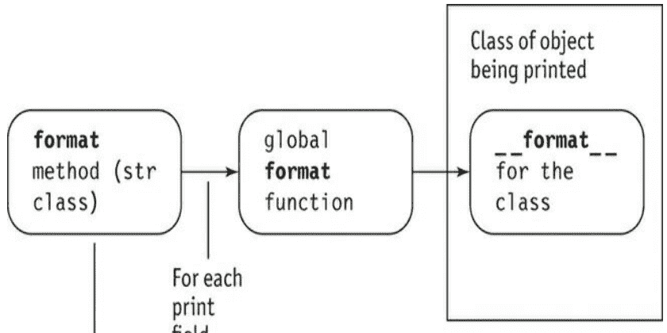
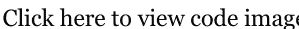
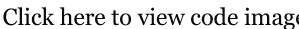

## 5. 精确格式化文本

在为商业和专业用途编程时，你希望格式化文本以创建外观精美的表格和演示文稿。在这方面，Python 拥有丰富的资源。它有几种方式来修改和增强以文本字符形式打印的信息。

本章详细介绍了所有三种方法，从字符串格式化运算符 %s 开始，它通常提供最快速、最简单的解决方案。为了获得最完整的控制，你可能希望使用 format 函数或 format 方法，它们支持许多选项，甚至允许你打印带有千位分隔符（,）的大数字。

### 5.1 使用百分号运算符（%）进行格式化

这是一个格式化输出的简单问题。假设你想以以下形式打印一个句子，其中 a、b 和 c 当前分别等于 25、75 和 100，但它们可以有任何值。你希望通过引用变量来得到以下结果。

```
25 plus 75 equals 100.
```

这应该很容易。但是，如果你使用 **print** 函数，它会在数字 100 和点（.）之间放置一个空格，因此你会得到以下结果：

```
25 plus 75 equals 100.
```

你如何处理那个不需要的空格？**print** 函数允许你通过将 **sep** 参数设置为空字符串来关闭打印字段之间默认的空格放置。但是在这种情况下，你必须自己放置所有空格。

Click here to view code image

```
print(a, ' plus ', b, ' equals ', c, '.', sep='')
```

这有效，但很丑陋。

更好的方法是使用 **str** 类格式化运算符（%）来格式化输出，使用类似于 C 语言“printf”函数的格式说明符。以下是修改示例的方法：

Click here to view code image

```
print('%d plus %d equals %d.' % (a, b, c))
```

这不是更好吗？

表达式 `(a, b, c)` 实际上是一个包含三个参数的元组，每个参数分别对应格式字符串中 `%d` 的每个出现。`(a, b, c)` 中的括号是严格要求的——除非只有一个参数，否则不需要。

Click here to view code image

```
>>> 'Here is a number: %d.' % 100
'Here is a number: 100.'
```

当然，这些元素可以通过编程方式拆分。以下是一个示例：

```
n = 25 + 75
fmt_str = 'The sum is %d.'
print(fmt_str % n)
```

此示例打印以下内容：

```
The sum is 100.
```

字符串格式化运算符，%，可以出现在以下两个版本之一中。


Click here to view code image

```
format_str % value    # Single value
format_str % (values)   # One or more values
```

如果有多个 _value_ 参数，则与打印字段（由类型字符和百分号 % 标记）对应的参数必须放在元组内。以下两个语句都是有效的：

```
print('n is %d' % n)
print('n is %d and m is %d' % (n, m))
```

下一个示例也有效，因为它将三个数字组织成一个元组。

```
tup = 10, 20, 30
print('Answers are %d, %d, and %d.' % tup)
```

这些语句打印以下内容：

```
Answers are 10, 20, and 30.
```

### 5.2 百分号（%）格式说明符

格式说明符 %d 代表十进制整数。它是一种常见格式，但格式化运算符（%）也适用于其他格式，如表 5.1 所示。

# Table 5.1. Percent-Sign Specifiers

| Specif | Meaning | Example |
|--------|---------|---------|
| %d | Decimal integer. | 199 |
| %i | Integer. Same meaning as %d. | 199 |
| %s | Standard string representation of the input. This field says, “Produce a string,” but it can be used to print the standard string representation of any data object. So this can actually be used with integers if you choose. | Thomas |
| %r | Standard %r representation of the input, which is often the same as %s but uses the canonical representation of the object as it appears in Python code. (For more information, see Section 5.7, “‘Repr’ Versus String Conversion.”) | 'Bob' |
| %x | Hexadecimal integer. | ff09a |
| %X | Same as %x, but letter digits A–F are uppercase. | FF09A |
| %o | Octal integer. | 177 |
| %u | Unsigned integer. (But note that this doesn’t reliably change signed integers into their unsigned equivalent, as you’d expect.) | 257 |

| 格式说明符 | 描述 | 示例输出 |
|---|---|---|
| `%f` | Floating-point number to be printed in fixed-point format | `3.1400` |
| `%F` | Same as `%f`. | `33.1400` |
| `%e` | Floating-point number, printing exponent sign (e). | `3.1400e+00` |
| `%E` | Same as `%e` but uses uppercase `E`. | `3.1400E+00` |
| `%g` | Floating point, using shortest canonical representation. | `7e-06` |
| `%G` | Same as `%g` but uses uppercase `E` if printing an exponent. | `7E-06` |
| `%%` | A literal percent sign (`%`). | `%` |

以下是一个示例，使用 `int` 转换和十六进制输出来添加两个十六进制数：e9 和 10。

```
h1 = int('e9', 16)
h2 = int('10', 16)
print('The result is %x.' % (h1 + h2))
```

该示例打印

```
The result is f9.
```

因此，将十六进制 e9 和十六进制 10 相加得到十六进制 f9，这是正确的。
此示例中 h1 和 h2 周围的括号是必要的。否则，示例将使用 h1 作为数据创建格式化字符串，然后尝试将该字符串与数字 h2 连接，从而导致错误。

```
print('The result is %x.' % h1 + h2) # ERROR!
```

当你打印十六进制或八进制数字时，格式化运算符（%）不会在数字前面添加前缀。如果你想打印带有前缀的十六进制数字，你需要自己指定它们。

```
print('The result is 0x%x.' % (h1 + h2))
```

该语句打印以下内容：

```
The result is 0xf9.
```

在较大的字符串中打印子字符串（%s）是格式化运算符的另一种常见用法。以下是一个示例：

Click here to view code image

```
s = 'We is %s, %s, & %s.' % ('Moe', 'Curly',
'Larry')
print(s)
```

这打印

```
We is Moe, Curly, & Larry.
```

这些格式的行为可以通过使用宽度和精度数字来更改。每个打印字段的格式如下所示，其中 c 代表表 5.1 中的一个格式字符。


```
%[-][width][.precision]c
```

在此语法中，方括号表示可选项，并非字面意思。减号（–）指定打印字段内的左对齐。使用此技术，默认情况下所有数据类型均为右对齐。
但是，以下示例使用左对齐，这不是默认值，方法是将减号（–）作为说明符的一部分。

Click here to view code image

```
>>> 'This is a number: %-6d.' % 255
'This is a number: 255 .'

```

至于语法的其余部分，格式说明符可以采用以下任何一种格式。

```
%c
%widthc
%width.precisionc
%.precisionc

```

对于字符串值，如果指定了 _width_，则文本将放置在大小为 _width_ 的打印字段中。子字符串默认右对齐，并用空格填充。如果打印字段小于子字符串的长度，则忽略 _width_。如果包含 _precision_，则指定字符串的最大大小，如果更长则会被截断。

以下是使用 10 空格打印字段宽度的示例。

Click here to view code image

```
print('My name is %10s.' % 'John')

```

这打印以下内容，包括六个空格的填充。

```
My name is     John.

```


在要打印的整数的情况下，_width_ 数字的解释方式相同。但除此之外，_precision_ 指定一个较小的字段，数字在其中右对齐并用前导零填充。下面是一个示例：

```
print('Amount is %10d.' % 25)
print('Amount is %.5d.' % 25)
print('Amount is %10.5d.' % 25)
```

这些语句打印

```
Amount is         25.
Amount is 00025.
Amount is         00025.
```

最后，_width_ 和 _precision_ 字段控制浮点数的打印字段宽度和精度。精度是小数点右边的数字位数；如果需要，该数字包含尾随零。
下面是一个示例：

```
print('result:%12.5f' % 3.14)
print('result:%12.5f' % 333.14)
```

这些语句打印以下内容：

```
result:     3.14000
result:   333.14000
```

在这种情况下，数字 3.14 被填充了尾随零，
因为指定了 5 位精度。当
精度字段小于要打印的值的精度时，数字会适当地向上或向下舍入。

```
print('% .4f' % 3.141592)
```

这个函数调用打印以下内容——在这种情况下，通过舍入产生了 4
位精度：

```
3.1416
```

使用 %s 和 %r 格式字符使您能够处理任何类的数据。这些说明符会导致调用
支持类字符串表示的类的内部方法之一，如第 9 章“类和魔术方法”中所述。

在许多情况下，%s 和 %r 说明符的效果没有区别。例如，用于 int 或
float 对象时，任一说明符都会导致该数字被转换为您期望的字符串表示。

您可以在以下 IDLE 会话中看到这些结果，其中用户输入为 **粗体**。

```
>>> 'The number is %s.' % 10
The number is 10.
>>> 'The number is %r.' % 10
The number is 10.
```

从这些示例中，您可以看到 %s 和 %r 都只打印整数的标准字符串表示。
在某些情况下，%s 和 %r 所指示的字符串表示之间存在差异。后者旨在
获取对象在 Python 代码中出现的规范表示。
这两种表示形式之间的主要区别之一是，%r 表示在字符串周围包含引号，
而 %s 不包含。

```
>>> print('My name is %r.' % 'Sam')
My name is 'Sam'.
>>> print('My name is %s.' % 'Sam')
My name is Sam.
```

## 5.3 百分号（%）可变长度打印字段

使用格式运算符（%）一段时间后，您可能会想知道是否有方法为打印字段创建可变长度的宽度。例如，您可能希望在确定所需的最大宽度后打印一个表格，将其设置为所需宽度（例如，N = 6，其中 N 是所需的最大尺寸），然后为每个打印字段赋予相同的大小。
幸运的是，百分号格式化（%）提供了一种简单的方法来做到这一点。要创建可变宽度字段，请在通常放置指定固定宽度的整数的位置放置一个星号（*）。下面是一个示例：

```
>>> 'Here is a number: %*d' % (3, 6)
'Here is a number:   6'
```

以这种方式使用的每个星号都会创建对额外参数的需求。该参数首先出现，位于它应用于的数据对象之前。因此，元组中两个参数的顺序是（1）打印字段宽度和（2）要打印的数据。
您可以打印其他类型的数据，例如字符串。

```
>>> 'Here is a number: %*s' % (3, 'VI')
'Here is a number:  VI'
```

同样，第一个参数是打印字段宽度——在此示例中为 3。第二个参数是要打印的数据——在此示例中为字符串 'VI'。
您可以在格式字符串中包含多个可变宽度打印字段的使用。请记住，格式字符串中出现的每个星号都必须有额外的参数。因此，如果您想一次格式化 **两个** 这样的数据对象，则总共需要 **四个** 参数。下面是一个示例：

```
>>> 'Item 1: %*s, Item 2: %*s' % (8, 'Bob', 8,
'Suzanne')
'Item 1:      Bob, Item 2:   Suzanne'
```

这些参数——全部放在参数后面的元组中（顺便说一句，需要括号）——是 8、'Bob'、8 和 'Suzanne'。
这四个参数的含义如下：

- 第一个打印字段宽度为 8。
- 第一个要打印的数据对象是 'Bob'（即按原样打印字符串）。
- 第二个打印字段宽度为 8。
- 第二个要打印的数据对象是 'Suzanne'。

如前所述，这个数字可以是一个变量，其值在运行时确定。下面是一个示例：

```
>>> n = 8
>>> 'Item 1: %*s, Item 2: %*s' % (n, 'Bob', n,
'Suzanne')
'Item 1: Bob, Item 2: Suzanne'
```

所有参数——包括字段宽度参数（在此示例中为 n）——都放在百分号运算符（%）后面的元组中。
可变长度宽度功能可以与其他功能结合使用。例如，您可以使用 %r 说明符而不是 %s；这对要打印的数字没有影响，但会导致字符串带引号打印。

```
>>> n = 9
>>> 'Item 1: %*r, Item 2: %*r' % (n, 'Bob', n,
'Suzanne')
"Item 1:  'Bob', Item 2: ' Suzanne'"
```

您还可以创建可变长度精度指示器。格式运算符（%）的一般规则如下：

> 通常在格式代码中放置整数的地方，您可以改为放置一个星号（*）；并且对于每个这样的星号，您必须在参数列表中放置一个相应的整数表达式。

例如，下面的语句将数字格式化为如果说明符是 `'%8.3f'`：

```
>>> '%*.*f' % (8, 3, 3.141592)
' 3.142'
```

## 5.4 全局“FORMAT”函数

Python 的两个密切相关的功能为您提供了更大的控制力来规范规格。全局 `format` 函数允许指定一个打印字段。例如，它提供了一种简单的方法来添加千位分隔符的逗号。

```
>>> big_n = 10 ** 12  # big_n 是 10 的 12 次方
>>> format(big_n, ',')
'1,000,000,000,000'
```

这只是您可以使用 **format** 函数所做事情的一个提示。本节仅介绍了该函数功能的入门。第 5.8 节“‘format’函数和方法的‘spec’字段”描述了您可以与该函数一起使用的格式规范（或 **_spec_**）的其他语法元素。

**format** 函数与字符串类（**str**）的 **format** 方法密切相关。

当 **format** 方法处理字符串时，它会分析格式说明符以及用作输入的数据对象。它通过为每个单个字段调用全局 **format** 函数来执行此分析。

**format** 函数随后为数据对象的类调用 `__format__` 方法，如第 9 章中所述。此过程的优点在于，它允许每种类型（包括您可能编写的任何新类）与所有格式说明符语法交互，或者选择忽略它。

图 5.1 显示了涉及的各个函数之间的控制流：字符串类的 **format** 方法、全局 **format** 函数，以及最后每个类中的 `__format__` 方法。



# 图 5.1. 格式化例程之间的控制流

该类可以选择直接处理此方法，也可以不选择。默认情况下，如果未定义 `__format__`，则调用该类的 `__str__` 方法。


```
format(data, spec)
```

此函数在评估数据并根据规范字符串 `spec` 进行格式化后返回一个字符串。后一个参数是包含打印单个项目的规格的字符串。

下面显示的语法提供了 `spec` 语法的简化视图。它省略了一些功能，例如填充和对齐


characters, as well as the use of o in right justifying and padding
a number. To see the complete syntax of _spec_, see Section 5.8,
“The ‘spec’ Field of the ‘format’ Method.”


In this syntax, the brackets are not intended literally but
signify optional items. Here is a summary of the meaning.
The function attempts to place the string representation of
the data into a print field of _width_ size, justifying text if
necessary by padding with spaces. Numeric data is right
justified by default; string data is left justified by default.
The comma ( , ) indicates insertion of commas as thousands
place separators. This is legal only with numeric data;
otherwise, an exception is raised.
The _precision_ indicates the total number of digits to print
with a floating-point number, or, if the data is not numeric, a
maximum length for string data. It is not supported for use with
integers. If the _type_char is `f`, then the precision indicates a
fixed number of digits to print to the right of the decimal point.
The _type_char is sometimes a radix indicator, such as `b` or
`x` (binary or hexadecimal), but more often it is a floating-point
specifier such as `f`, which indicates fixed-point format, or `e` and
`g`, as described later in Table 5.5.
Table 5.2 gives some examples of using this specification. You
can figure out most of the syntax by studying these examples.

# Table 5.2. Sample Format Specifiers for the “format” Function

| Format specification | Meaning |
|---|---|
| ' , ' | Displays thousands place separators as part of a number—for example, displaying 1000000 as 1,000,000. |
| ' 5 ' | Specifies a minimum print-field width of 5 characters. If the information to be displayed is smaller in size, it is justified by being padded. Numbers are right justified by default; strings are left justified by default. |
| ' 1 0 ' | Specifies a minimum print-field width of 10 characters. If the representation of the object is smaller than 10 characters, it is justified within a field that wide. |
| ' 1 0 , ' | Specifies a minimum print-field width of 10 characters and also displays thousands place separators. |

Specifies a minimum print-field width of 10. If the data is a string, 5 characters is a print-field maximum and anything larger is truncated. If the data is floating point, the field displays at most 5 digits total to the left and right of the decimal point; rounding is performed, but if the display size still exceeds the space allowed, the number is displayed in exponential format, such as `3+010e`. The precision field (5 in this case) is not valid for integers.

Same as above, but print-field width is 8 and precision is 4.

Specifies a minimum print-field width of 10 and precision of 7, (total number of digits to the left and right), **and** it displays thousands place separators.

Fixed-point display. Uses a print-field width of 10 and displays exactly 3 digits to the right of the decimal point. Rounding up or down, or putting in trailing zeros, is performed as needed to make the number of digits come out exactly right.

Uses a print-field width of 10 and displays exactly 5 digits to the right of the decimal point.

Displays exactly 3 digits to the right of the decimal point. There is no minimum width in this case.

| 'b | Uses binary radix. |
| ' | |
| '6 | Uses binary radix; right justifies numbers within a field of 6 |
| b' | characters. |
| 'x | Uses hexadecimal radix. |
| ' | |
| '5 | Uses hexadecimal radix; right justifies numbers within a field of 5 |
| x' | characters. |
| 'o | Uses octal radix. |
| ' | |
| '5 | Uses octal radix; right justifies numbers within a field of 5 |
| o' | characters. |

The remainder of this section discusses the features in more detail, particularly width and precision fields.
The thousands place separator is fairly self-explanatory but works only with numbers. Python raises an exception if this specifier is used with data that isn’t numeric.
You might use it to format a large number such as 150 million.

```
>>> print(format(n, ', '))
150,000,000
```

The width character is used consistently, always specifying a minimum print-field width. The string representation is padded —with spaces by default—and uses a default of left justification for strings and right justification for numbers. Both the padding character and justification can be altered, however, as explained later in this chapter, in Section 5.8.2, “Text Justification: ‘fill’ and ‘align’ Characters.”

Here are examples of justification, padding, and print fields. The single quotation marks implicitly show the extent of the print fields. Remember that numeric data (150 and 99, in this case) are right justified by default, but other data is not.

```
>>> format('Bob', '10')
'Bob '
>>> format('Suzie', '7')
'Suzie '
>>> format(150, '8')
' 150'
>>> format(99, '5')
' 99'
```

The width is always a print-field minimum, not a maximum. A width field does not cause truncation.

The precision specifier works differently, depending on the kind of data it’s applied to. With string data, the precision is a print-field maximum, and it can cause truncation. With floating-point fields, precision specifies the maximum number of total characters to the left and right of the decimal point—not counting the decimal point itself—and thereby rounds up or down as needed. Here’s an example:

```
>>> format('Bobby K.', '6.3')
'Bob   '
>>> format(3.141592, '6.3')
' 3.14'
```

But if the `f` type specifier is also used, it specifies fixed-point display format, and that changes the rules for floating point. With fixed-point format, the precision specifies the number of digits to the right of the decimal point, unconditionally.

The `format` function uses rounding or padding with trailing zeros, as needed, to achieve the fixed number of digits to the right of the decimal point. Here’s an example:

```
>>> format(3.141592, '9.3f')
'   3.142'
>>> format(100.7, '9.3f')
' 100.700'
```

As you can see, the fixed-point format is useful for placing numbers in columns in which the decimal point lines up nicely. As mentioned earlier, Section 5.8 discusses the complete syntax for _spec_, which is used by both the global `format` function and the `format` method.

## 5.5 INTRODUCTION TO THE “FORMAT” METHOD

To get the most complete control over formatting, use the **format** method. This technique contains all the power of the global **format** function but is more flexible because of its ability to handle multiple print fields.

Let’s return to the example that started this chapter. Suppose you have three integer variables (a, b, and c) and you want to print them in a sentence that reads as follows:

```
25 plus 75 equals 100.
```

The **format** method provides a smooth, readable way to produce this print string.

Click here to view code image

```
print('{} plus {} equals {}'.format(25, 75, 100))
```

Each occurrence of {} in the format string is filled in with the string representation of the corresponding argument.


Click here to view code image

```
format_specifying_str.format(args)
```

Let’s break down the syntax a little. This expression passes through all the text in _format_specifying_str_ (or just “format string”), except where there’s a print field. Print fields

are denoted as “{}.” Within each print field, the value of one of
the _args_ is printed.

If you want to print data objects and are not worried about
the finer issues of formatting, just use a pair of curly braces, {},
for each argument. Strings are printed as strings, integers are
printed as integers, and so on, for any type of data. Here’s an
example:

Click here to view code image

```
fss = '{} said, I want {} slices of {}.'

name = 'Pythagoras'
pi = 3.141592
print(fss.format(name, 2, pi))
```

This prints

Click here to view code image

```
Pythagoras said, I want 2 slices of 3.141592.
```

The _arg_ values, of course, either can be constants or can be
supplied by variables (such as _name_ and _pi_ in this case).
Curly braces are special characters in this context. To print
**literal** curly braces, not interpreted as field delimiters, use {{ and
}}. Here’s an example:

Click here to view code image

```
print('Set = {{({{}}, {{}})}}'.format(1, 2))
```


## 5.6 按位置排序

### （名称或编号）


Click here to view code image

```
{ [position] [!|r|s|a] [: spec ] }
```

在 **format** 字符串中打印字段的语法中，方括号并非字面意思，而是表示可选项。对于第二个项，语法表示感叹号后跟 **r**、**s** 或 **a**，但不超过其中一个；我们将在下一节中介绍该语法。

_spec_ 是一系列可能复杂的格式化参数。本章从第 5.8 节开始介绍 _spec_，并解释所有可能的子字段。

这种语法最简单的应用之一是使用单个 _position_ 指示符。

```
{ position }
```

_position_ 指示符通过使用数字或名称来指示所引用的参数。使用 _position_ 指示符可以让你按任意顺序引用参数。

_position_ 指示符本身可以是索引编号或命名位置：

```
pos_index | pos_name
```

我们将逐一介绍这些内容。位置索引是指根据其基于零的索引引用 `format` 方法参数列表中的某个项的数字。位置名称需要与命名参数匹配，我们稍后会再提到。首先，让我们来看看位置索引，因为它们相对容易理解。

关于 `format` 方法参数的一般规则如下：

> *
> 对 format 方法的调用必须至少拥有与格式说明字符串中的打印字段数量一样多的参数，除非字段像本节末尾所示那样重复。但如果出现的参数多于打印字段，则多余的参数（最后给出的参数）将被忽略。

例如，请考虑以下 `print` 语句：

Click here to view code image

```
print('{}; {}; {}!'.format(10, 20, 30))
```

这将打印

```
10; 20; 30!
```

你可以在位置字段中使用整数常量以逆序打印。这些是基于零的索引，因此编号为 0、1 和 2。

Click here to view code image

```
print('The items are {2}, {1}, {0}'.format(10, 20, 30))
```

# 此语句打印

```
The items are 30, 20, 10.
```

你也可以使用基于零的索引编号来引用多余参数，即参数多于打印字段的情况。以下是一个示例：

Click here to view code image

```
fss = 'The items are {3}, {1}, {0}.'
print(fss.format(10, 20, 30, 40))
```

# 这些语句打印

```
The items are 40, 20, 10.
```

请注意，引用超出范围的参数会引发错误。在此示例中有四个参数，因此它们的索引为 0、1、2 和 3。在此示例中，没有索引编号是超出范围的引用。

打印字段也可以根据参数名称与参数匹配。以下是一个示例：

Click here to view code image

```
fss = 'a equals {a}, b equals{b}, c equals {c}.'
print(fss.format(a=10, c=100, b=50))
```

# 此示例打印

```
a equals 10, b equals 50, c equals 100.
```

你也可以使用定位技术在输出中重复值。以下是一个示例：

```
print('{0}, {0}, {1}, {1}'.format(100, 200))
```

此示例打印

```
100, 100, 200, 200
```

位置排序具有一个高级功能，偶尔对某些应用很有用。通过更改格式字符串本身，你可以更改哪些部分的参数被选中以包含在打印字符串中。

例如，{0[0]:} 表示“选择第一个参数的第一个元素”。{0[1]:} 表示“选择第一个参数的第二个元素”。以此类推。

以下是一个更完整的示例。请记住，像往常一样使用基于零的索引。

```
>>> a_list = [100, 200, 300]
>>> '{0[1]:}, {0[2]:}'.format(a_list)
'200, 300'
```

此技术也适用于命名位置。

```
>>> '{a[1]:}, {a[2]:}'.format(a=a_list)
'200, 300'
```

那么，保持对位置顺序的这种控制有什么意义呢？许多应用永远不需要它，但它使你能够根据需要使用格式字符串重新排序数据。例如，当你翻译成另一种自然语言且语言语法可能要求重新排序时，这特别有用。

一种情况可能涉及日语，如下示例所示：

```
if current_lang == 'JPN':
    fss = '{0}はいつ{2}の{1}と会うのだろうか？'
else:
    fss = "When will {0} meet {1} at {2}'s?"
print(fss.format('Fred', 'Sam', 'Joe'))
```

根据 `current_lang` 的值，这可能会打印以下内容：

```
When will Fred meet Sam at Joe's?
```

或者它会打印以下内容。请注意，名称的位置已更改，符合日语语法，该语法更改了某些名称的顺序。

FredはいつJoeのSamと会うのだろうか？

## 5.7 “REPR” 与字符串转换

在 Python 中，每种类型最多可能有两种不同的字符串表示形式。这可能看起来有些过度，但偶尔很有用。这源于 Python 是一种解释型语言。

本节讨论 `str` 和 `repr` 转换之间的区别。但是，此处的所有信息同样适用于 `str` 和 `repr` 的其他用途，例如 `%s` 和 `%r` 格式说明符。

当你应用 `str` 转换时，该转换将返回数据的字符串等效形式，与 `print` 函数打印时完全相同。

```
print(10)  # This prints 10.
print(str(10))  # So does this!
```

但是，对于某些类型的数据，存在单独的 `repr` 转换，它与 `str` 不同。`repr` 转换将数据对象转换为其在源代码中的 _规范表示_——即，它在 Python 程序中的样子。

以下是一个示例：


```
print(repr(10))  # This ALSO prints 10.
```

在这种情况下，打印的内容没有区别。但是字符串方面存在区别。字符串在内存中存储时没有引号；引号是通常只出现在源代码中的分隔符。此外，转义序列（如 \n，即换行符）在存储时会被转换为特殊字符；同样，\n 是源代码表示，而非实际存储内容。

请看以下字符串 `test_str`：

```
test_str = 'Here is a \n newline! '
```

直接打印此字符串会显示以下内容：

```
Here is a
newline!
```

但是，对字符串应用 **repr** 然后再打印会产生不同的结果，本质上是说“显示源代码的规范表示”。这包括引号，尽管它们本身不是字符串的一部分，除非它们被嵌入。但是 **repr** 函数包含引号，因为它们是 Python 源代码中表示字符串所会出现的内容。

```
print(repr(test_str))
```

此语句打印

```
'Here is a \n newline.'
```

%s 和 %r 格式说明符以及 format 方法使你能够控制使用哪种表示样式。不带 repr 打印字符串参数的效果与直接打印它相同。以下是一个示例：

Click here to view code image

```
>>> print('{}'.format(test_str))
Here is a
newline!
```

使用 !r 修饰符会导致使用参数的 repr 版本——即，对数据应用 repr 转换。

Click here to view code image

```
>>> print('{!r}'.format(test_str))
'Here is a \\n newline! '
```

!r 的使用与位置排序正交。两者可以相互独立使用，不会相互干扰。那么，你能看出以下示例的作用吗？

Click here to view code image

```
>>> print('{1!r} loves {0!r}'.format('Joanie',
'ChaCha'))
'ChaCha' loves 'Joanie'
```

在此示例中，花括号内的格式字符起两个作用。首先，它们使用位置索引将“Joanie loves ChaCha”反转；然后，!r 格式导致两个名称带引号打印，这是规范表示的一部分。


## 5.8 “FORMAT” 函数和方法中的“SPEC” 字段

本节及其所有子节均适用于全局 format 函数和 format 方法。但是，本章其余部分中的大多数示例都假设使用 format 方法，这就是为什么它们在打印字段 { } 和冒号 (:) 的上下文中显示 spec 的原因。

spec（格式说明符）的语法是 format 方法语法中最复杂的部分。每个部分都是可选的，但如果使用，必须遵循所示的顺序。（方括号表示这些项目均为可选。）

```
[ [ fill ]align ][ sign ][ # ][ 0 ][ width ][ , ][ .prec ][ type ]
```

这里的项目大多相互独立。Python 根据位置和上下文解释每个项目。例如，_prec_（精度）如果出现，则紧跟在小数点 (.) 之后。

查看示例时，请记住，只有在将 _spec_ 与全局 **format** 函数一起使用时，才使用花括号和冒号，而不与 **format** 方法一起使用。使用 **format** 函数时，您可以包含 _align_、_sign_、`0`、_width_、_precision_ 和 _type_ 说明符，但不包含花括号或冒号。以下是一个示例：

```
s = format(32.3, '<+08.3f')
```

### 5.8.1 打印字段宽度

常用项目之一是打印字段 _width_，指定为整数。要打印的文本将以此大小的字段显示。如果文本短于此宽度，则默认情况下，它将被对齐，并用空格填充额外的空格。

**位置**：如语法显示所示，_width_ 项目位于 _spec_ 语法的中间。与 **format** 方法一起使用时，_width_ 始终紧跟在冒号 (:) 之后，_spec_ 语法的其余部分也是如此。

以下示例展示了宽度规范如何应用于两个数字：777 和 999。该示例使用星号 (*) 来帮助说明打印字段的开始和结束位置，但除此之外，这些星号只是为了说明而添加的普通字符。

```
n1, n2 = 777, 999
print('**{:10}**{:2}**'.format(n1, n2))
```

这将打印

```
** 777**999**
```

数字 777 在较大的打印字段（10）内右对齐。这是因为，默认情况下，数值数据右对齐，字符串数据左对齐。

数字 999 超过了其打印字段大小（2）的长度，因此它按原样打印。不会执行截断。

宽度规范在表格中经常很有用。例如，假设您想打印一个整数表，但希望它们对齐。

```
10
2001
2
55
144
2525
1984
```

打印这样的表格很容易。只需使用 `format` 方法，并设置一个比您预期的最长数字更宽的打印字段宽度。由于数据是数值，默认情况下它是右对齐的。

```
'{:5}'.format(n)
```

打印字段宽度与大多数其他功能正交。上一节中的“ChaCha loves Joanie”示例可以修订为：

```
fss = '{1!r:10} loves {0!r:10}!!'
print(fss.format('Joanie', 'ChaCha'))
```

这将打印

```
'ChaCha' loves 'Joanie' !!
```

此处的输出与先前的“ChaCha and Joanie”示例类似，但为两个参数添加了 10 的打印字段宽度。请记住，宽度规范必须出现在冒号右侧；否则，它将作为位置号起作用。

### 5.8.2 文本对齐：“fill” 和 “align” 字符

_fill_ 和 _align_ 字符是可选的，但 _fill_ 字符只有在 _align_ 字符存在时才能出现。

```
[[fill]align]
```

**位置**：如果这些项目出现在打印字段规范中，则位于语法的所有其他部分之前，包括 _width_。以下是包含 _fill_、_align_ 和 _width_ 的示例：

```
{:->24}
```

下一个示例在上下文中使用此规范：

```
print('{:->24}'.format('Hey Bill G, pick me!'))
```

这将打印

```
----Hey Bill G, pick me!
```

让我们检查此打印字段 `{:->24}` 的每个部分。以下是分解。

- 当使用 **format** 方法（但不是全局 **format** 函数）时，冒号 (:) 是打印字段规范中出现的第一个项目。
- 冒号之后，出现 _fill_ 和 _align_ 字符。减号 (-) 是此处的填充字符，对齐方式是右对齐 (>).
- 指定 _fill_ 和 _align_ 后，给出了打印字段 _width_ 24。

由于要打印的参数 ('Hey Bill G, pick me! ') 长度为 20 个字符，但打印字段宽度为 24 个字符，因此使用四个填充字符（在此情况下为减号）进行填充。

填充字符可以是花括号以外的任何字符。请注意，如果您想用零填充数字，也可以使用第 5.8.4 节“前导零字符 (0)”中描述的 '0' 说明符。

_align_ 字符必须是表 5.3 中列出的四个值之一。

| 对齐字符 | 含义 |
|---|---|
| < | 左对齐。这是字符串数据的默认值。 |
| > | 右对齐。这是数字的默认值。 |
| ^ | 将文本居中于打印字段中间。（当文本无法完美居中时，这会略微偏向左对齐。） |
| = | 将所有填充字符放在符号字符 (+ 或 -) 和要打印的数字之间。此规范仅对数值数据有效。 |

只有在填充字符后紧跟 `align` 字符 (<, >, ^, 或 =) 时，填充（或补齐）字符才被识别为填充字符。

```
print('{:>7}'.format('Tom'))   # Print '   Tom'
print('{:@>7}'.format('Lady'))   # Print '@@@Lady'
print('{:*>7}'.format('Bill'))   # Print '***Bill'
```

在这些示例的第一个中，未指定 _fill_ 字符，因此使用默认值空格来填充打印字段。在第二和第三种情况下，分别使用了填充字符和号 (@) 和星号 (*)。

如果我们改用 < 来指定左对齐，填充将放在右侧（尽管请注意，左对齐是字符串的默认值）。因此，前面的示例将修订为：

```
print('{:<7}'.format('Tom'))   # Print 'Tom   '
print('{:@<7}'.format('Lady'))   # Print 'Lady@@@'
print('{:*<7}'.format('Bill'))   # Print 'Bill***'
```

接下来的几个示例演示了使用 ^ 来指定数据居中；填充出现在文本的两侧。

```
fss = '{:^10}Jones'
print(fss.format('Tom'))   # Print '   Tom Jones'
fss = '{:@^10}'
print(fss.format('Lady'))   # Print '@@Lady@@@'
```

```
fss = '{:*^10}'
print(fss.format('Bill'))  # Print '***Bill***'
```

最后，接下来的示例展示了使用 = 来指定符号字符 (+ 或 -) 与数值数据之间的填充。第二种情况使用零作为填充字符。

```
print('{:=8}'.format(-1250))   # Print '-   1250'
print('{:=08}'.format(-1250))  # Print '-0001250'
```

> Note
> 请记住（如果我们对此有点啰嗦，抱歉），spec 语法的所有示例也适用于全局 format 函数。但是，与 format 方法不同，format 函数不使用花括号来创建多个打印字段。它一次只处理一个打印字段。以下是一个示例：

```
print(format('Lady', '@<7'))   # Print 'Lady@@@'
```

### 5.8.3 “sign” 字符

_sign_ 字符（如果使用，通常是加号 (+)）有助于确定是否在数值字段中打印加号或减号。

**位置：** _sign_ 字符位于 _fill_ 和 _align_ 字符之后（如果包含），但在 _spec_ 的其他部分之前。


特别是，它位于 _width_ 之前。表 5.4 列出了此字符的可能值。

# 表 5.4. “format” 方法的“符号”字符

| Character   | Meaning   |
|-------------|-----------|
| +           | 对非负数打印加号（+）；对负数打印减号（−），与往常一样。   |
| -           | 仅对负数打印减号。这是默认行为。   |
| (blank space) | 对非负数，在加号应出现的位置打印空格；对负数打印减号，与往常一样。这对于在制表符中对齐数字非常有用，无论是否存在负号。   |

一个简单的示例说明了符号字符的用法。

Click here to view code image

```
print('results>{: },{:+},{:-}'.format(25, 25, 25))
```

此示例打印

```
results> 25,+25,25
```

请注意，即使第一个 25 是非负数，它前面也有一个额外的空格；但是，如果打印字段有确定的宽度（本例中没有），则该字符不会产生任何差异。

下一个示例将相同的格式应用于三个负值（−25）。

Click here to view code image

```
print('results>{: },{:+},{:-}'.format(-25, -25,
-25))
```

此示例打印以下输出，说明负数始终带有减号打印。

```
results>-25,-25,-25
```

## 5.8.4 前导零字符 (0)

该字符指定为数字填充 0 数字字符，导致使用“0”代替空格。虽然您可以通过指定对齐和填充字符来实现类似效果，但此技术略显简洁。

**放置：** 如果使用，此字符紧跟在 _width_ 规范之前。本质上，它相当于在宽度本身前添加前导零前缀 (0)。

例如，以下语句会在要显示的文本小于打印字段宽度时打印前导零。

Click here to view code image

```
i, j = 125, 25156
print('{:07} {:010}.'.format(i, j))
```

这将打印

```
0000125 0000025156.
```

这里是另一个示例：

Click here to view code image

```
print('{:08}'.format(375)) # This prints 00000375
```

也可以通过使用 _fill_ 和 _align_ 字符来实现相同的结果，但由于您不能在不显式指定 _align_ 的情况下指定 _fill_，因此该方法略显冗长。

```
fss = '{:0>7} {:0>10}'
```

尽管这两种方法——将 0 指定为填充字符和指定前导零——在效果上通常相同，但存在两者产生不同结果的情况。填充字符不是数字本身的一部分，因此不受下一节中描述的逗号的影响。

还有与加号/减号的交互作用。如果您尝试以下内容，您会看到加号 (+) 打印位置的差异。

Click here to view code image

```
print('{:0>+10} {:+010}'.format(25, 25))
```

此示例打印

```
0000000+25 +000000025
```

## 5.8.5 千位分隔符

**format** 方法最方便的功能之一是能够在数字输出中使用千位分隔符。您有多少次见过如下输出？

Click here to view code image

```
The US owes 21035786433031 dollars.
```

这到底是多少？人们会眼花缭乱，这对大多数政治家来说可能是个好结果。它看起来只是“一个大数字”。
如果按以下方式打印，这个数字会更易读——尽管对于大多数凡人来说仍然太大，难以理解。但如果您有一点数字天赋，您会看到这不仅仅是 2100 万或 210 亿，而是 **21 万亿**。

Click here to view code image

```
The US owes 21,035,786,433,031 dollars.
```

**放置**：逗号跟在 _width_ 说明符之后，并在 _precision_ 说明符之前（如果存在）。逗号应为除 _precision_ 和 _type_（如果存在）之外的最后一项。

您可能希望参考第 5.8.1 节开头的语法显示。

以下示例使用 `{:,}` 打印字段。这是一个简单的规范，因为它只是在冒号右侧紧跟一个逗号——全部位于打印字段内。

Click here to view code image

```
fss1 = 'The USA owes {:,} dollars.'
print(fss1.format(21000000000))
fss2 = 'The sun is {:,} miles away.'
print(fss2.format(93000000))
```

这些语句打印

Click here to view code image

```
The USA owes 21,000,000,000 dollars.
The sun is 93,000,000 miles away.
```

下一个示例将逗号与 _fill_ 和 _align_ 字符 `*` 和 `>` 结合使用。_width_ 说明符是 `12`。请注意，逗号 (`,`) 紧跟在 _width_ 之后；它是右花括号之前的最后一项。

```
n = 4500000
print('The amount on the check was
${:*>12,}'.format(n))
```

此示例打印

```
The amount on the check was $****4,500,000
```

打印宽度为 12，包括打印的数字（包括逗号，共九个字符）的空间；因此，此示例使用三个填充字符。此处的填充字符是星号 (*)。美元符号 ($) 不包含在此计算中，因为它是一个字面字符，原样打印。

如果存在如第 5.8.4 节中描述的前导零字符（与 0 填充字符不同），则零也会与逗号分组。这里是一个示例：

```
print('The amount is {:011,}'.format(13000))
```

此示例打印

```
The amount is 000,013,000
```

在这种情况下，前导零与逗号分组，因为所有零都被视为数字本身的一部分。

打印字段大小为 12（或任何其他 4 的倍数）会与逗号产生冲突，因为初始逗号不能是有效数字的一部分。因此，Python 在该特殊情况下会添加一个额外的前导零。

Click here to view code image

```
n = 13000
print('The amount is {:012,}'.format(n))
```

这将打印

```
The amount is 0,000,013,000
```

但是，如果将 0 指定为填充字符而不是前导零，则零不被视为数字的一部分，并且不会与逗号分组。请注意此处 0 相对于右对齐 (>) 符号的位置。这次它位于该符号的左侧。

Click here to view code image

```
print('The amount is {:0>11,}'.format(n))
```

这将打印

```
The amount is 0000013,000
```

## 5.8.6 控制精度

_precision_ 说明符是一个数字，主要用于浮点值，尽管也可以用于字符串。它会导致舍入和截断。浮点数的精度是要打印的最大位数，包括小数点左右两侧。

精度也可以用于定点格式（具有 **f** 类型说明符），以确保始终在小数点 *右* 侧打印精确的位数，帮助浮点值在表格中对齐。

**放置**：精度始终是小数点 (.) 紧右侧的一个数字。它是 *spec* 字段中的最后一项，除了下一节中描述的单字母 *type* 说明符之外。


.precision

以下是一些简单示例，其中精度用于限制打印的总位数。

Click here to view code image

```
pi = 3.14159265
phi = 1.618

fss = '{:.2} + {:.2} = {:.2}'
print(fss.format(pi, phi, pi + phi))
```

这些语句打印以下结果。请注意，每个数字恰好有两个总位数：

```
3.1 + 1.6 = 4.8
```

由于舍入错误，此语句看起来不准确。对于每个数字，只打印两个总位数。为每个数字打印三位数会产生更好的结果。

Click here to view code image

```
pi = 3.14159265
phi = 1.618

fss = '{:.3} + {:.3} = {:.3}'
print(fss.format(pi, phi, pi + phi))
```

这将打印

```
3.14 + 1.62 = 4.76
```

在所有有限精度的情况下，出现的最后一位数字都会适当舍入。

如果要使用 _precision_ 以定点格式打印数字，请将 _width_ 和 _precision_ 与打印字段末尾的 `f` 类型说明符结合使用。这里是一个示例：

Click here to view code image

```
fss = ' {:10.3f}\n {:10.3f}'
print(fss.format(22.1, 1000.007))
```

这将打印


注意，在这种情况下，内容对齐得多么整齐。在此上下文中（使用 `f` 类型说明符时），精度指定的不是总位数，而是 _小数点右侧的位数_——如果需要，这些位数会用尾随零填充。

该示例可以与其他功能结合使用，例如千位分隔符，它位于宽度之后但精度之前。因此，在此示例中，每个逗号都紧跟在宽度说明符 10 之后。

> Click here to view code image

```
fss = ' {:10,.3f}\n {:10,.3f}'
print(fss.format(22333.1, 1000.007))
```

此示例打印

```
22,333.100
1,000.007
```

定点格式 `f` 与 _宽度_ 和 _精度_ 结合使用，对于创建数字对齐的表格非常有用。下面是一个示例：

> Click here to view code image

```
fss = ' {:10.2f}'
for x in [22.7, 3.1415, 555.5, 29, 1010.013]:
    print(fss.format(x))
```

此示例打印

```
22.70
3.14
555.50
29.00
1010.01
```

# ## 5.8.7 与字符串一起使用的“精度”（截断）

当与字符串一起使用时，_精度_ 说明符可能会导致截断。如果要打印的字符串长度大于 _精度_，则文本会被截断。下面是一个示例：

> Click here to view code image

```
print('{:.5}'.format('Superannuated.')) # Prints
'Super'
print('{:.5}'.format('Excellent!')) # Prints
'Excel'
print('{:.5}'.format('Sam')) # Prints
'Sam'
```

在这些示例中，如果要打印的字符串短于 _精度_，则没有影响。但下一个示例使用了 _填充_ 字符、_对齐_、_宽度_ 和 _精度_ 的组合。

```
fss = '{:*<6.6}'
```

# 让我们分解一下这些符号的含义。

- _填充_ 和 _对齐_ 字符分别是 `*` 和 `<`。`<` 符号指定左对齐，因此如果需要，星号用于右侧填充。
- _宽度_ 字符是 6，因此任何短于 6 个字符的字符串在左对齐后都会进行填充。
- _精度_（小数点后的字符）也是 6，因此任何长于 6 个字符的字符串都会被截断。

# 让我们将此格式应用于多个字符串。

```
print(fss.format('Tom'))
print(fss.format('Mike'))
print(fss.format('Rodney'))
print(fss.format('Hannibal'))
print(fss.format('Mortimer'))
```

这些语句很容易使用全局 `format` 函数来编写。请注意相似之处和差异；之前的示例涉及格式字符串 `'{ :*<6.6 }'`。

```
print(format('Tom', '*<6.6'))
print(format('Mike', '*<6.6'))
print(format('Rodney', '*<6.6'))
print(format('Hannibal', '*<6.6'))
print(format('Mortimer', '*<6.6'))
```

无论哪种情况——即，对于刚显示的任一代码块——输出均为

```
Tom***
Mike**
Rodney
Hannib
Mortim
```

_宽度_ 和 _精度_ 不必相同。例如，以下格式指定宽度为 5，因此任何短于 5 的字符串都会被填充；但精度为 10，因此任何长于 10 的字符串都会被截断。

```
fss = '{:*<5.10}'
```

# ## 5.8.8 “类型”说明符

_spec_ 语法中的最后一项是 _类型_ 说明符，它影响要打印的数据的解释方式。它限于一个字符，并且具有表 5.5 中列出的值之一。

**位置**：使用 _类型_ 说明符时，它是 _spec_ 语法中的最后一项。

# ### 表 5.5. 格式方法识别的“类型”说明符

| 类型字符 | 说明 |
|---|---|
| b | 以二进制显示数字。 |
| c | 将数字转换为其 ASCII 或 Unicode 字符。 |
| d | 以十进制格式显示数字（默认值）。 |
| e | 使用指数格式显示浮点值，使用小写 e——例如，12e+20 。 |
| E | 与 e 相同，但使用大写 E 显示——例如，12E+20。 |
| f 或 F | 以定点格式显示数字。 |
| g | 使用格式 e 或 f，以较短者为准。 |
| G | 与 g 相同，但使用大写 E。 |
| n | 使用本地格式显示数字。例如，不要打印 1,200.34（美国格式），而使用欧洲格式：1.200,34 。 |
| o | 以八进制格式（基数 8）显示整数。 |
| x | 以十六进制格式显示整数，使用小写字母表示大于 9 的数字。 |
| X | 与 x 相同，但十六进制数字使用大写字母。 |

将数字显示为百分比：乘以 100 然后添加百分号（%）。

接下来的五个部分说明了 _类型_ 说明符的特定用途。

# ## 5.8.9 以二进制基数显示

要以二进制基数（基数 2）打印整数，请使用 `b` 说明符。结果是一系列 1 和 0。例如，以下语句以二进制基数显示 5、6 和 16：

> Click here to view code image

```
print('{:b} {:b} {:b}'.format(5, 6, 16))
```

这将打印以下内容：

```
101  110  10000
```

您可以选择使用 # 说明符自动添加基数前缀，例如二进制的 **0b**。如果出现，此格式字符位于 _填充_、_对齐_ 和 _符号_ 字符之后，但在 _类型_ 说明符之前。（它也位于 _宽度_ 和 _精度_ 之前。）下面是一个示例：

```
print('{:#b}'.format(7))
```

这将打印

# # 5.8.10 以八进制和十六进制基数显示

八进制（基数 8）和十六进制（基数 16）基数由 `o`、`x` 和 `X` 类型说明符指定。后两个分别指定大于 9 的数字的小写和大写十六进制。

以下示例说明每种格式如何显示十进制 63：

> Click here to view code image

```
print('{:o}, {:x}, {:X}'.format(63, 63, 63))
```

这也可以写成

> Click here to view code image

```
print('{0:o}, {0:x}, {0:X}'.format(63))
```

无论哪种情况，这都打印

```
77, 3f, 3F
```

同样，您可以使用 # 说明符让 `format` 方法自动插入基数前缀，如果出现，它位于 _填充_、_对齐_ 和 _符号_ 字符之后。下面是一个示例：

> Click here to view code image

```
print('{0:#o}, {0:#x}, {0:#X}'.format(63))
```

此语句打印

```
0o77, 0x3f, 0X3F
```

# ## 5.8.11 显示百分比

格式化的常见用途是将数字转换为百分比——例如，将 0.5 显示为 50%，将 1.25 显示为 125%。您可以自己执行此任务，但 % 类型说明符会自动化该过程。

百分号格式字符 (%) 将值乘以 100 然后追加百分号。下面是一个示例：

> Click here to view code image

```
print('You own {:%} of the shares.'.format(.517))
```

此示例打印

> Click here to view code image

```
You own 51.700000% of the shares.
```

如果与 % 类型说明符结合使用 _精度_，则 _精度_ 控制小数点右侧的位数，与往常一样——但在先乘以 100 之后。下面是一个示例：

> Click here to view code image

```
print('{:.2%} of {:.2%} of 40...'.format(0.231,
0.5))
```

这将打印

```
23.10% of 50.00% of 40...
```

与定点格式一样，如果要打印百分比以便在表格中整齐对齐，请同时指定 _宽度_ 和 _精度_ 说明符。

# ## 5.8.12 二进制基数示例

`format` 方法提供了以二进制、八进制或十六进制基数打印数值输出的工具。您可以将此功能与 `int` 转换结合使用，创建一个同时使用二进制输入和输出的二进制计算器——也就是说，其输入和输出功能是 1 和 0 的字符串。

下一个示例执行二进制加法，并以十进制和二进制显示结果。

> Click here to view code image

```
def calc_binary():
    print('Enter values in binary only!')
    b1 = int(input('Enter b1:'), 2)
    b2 = int(input('Enter b2:'), 2)
    print('Total is: {:#b}'.format(b1 + b2))
    print('{} + {} = {}'.format(b1, b2, b1 + b2))
```

下面是一个示例会话，用户输入为粗体。


>>> calc_binary()
Enter values in binary only!
Enter b1: 101
Enter b2: 1010
Total is: 0b1111
5 + 10 = 15

关键的格式说明字符串位于以下语句中：

点击此处查看代码图片

```
print('Total is: {:#b}'.format(b1 + b2))
```

冒号右侧有两个字符：井号（#），它会导致打印基数符号 0b；以及类型说明符 b，它会导致使用二进制基数，即基数为 2。

```
'{:#b}'
```

第二行输出使用简单的打印字段，默认输出十进制。

```
'{} + {} = {}'
```

## 5.9 可变大小字段

第 5.3 节解释了如何使用格式化操作符（%）来使用可变宽度打印字段。format 方法提供了相同的，甚至更多的灵活性。你可以将说明符语法的任何部分留空，以便稍后填充。

在 **format** 方法中，可变字段的一般规则是：在打印字段中放置一对嵌套的花括号 {}，通常你会在其中放置固定值。然后该方法扫描格式字符串并执行替换，将嵌套的 {} 小字段替换为参数列表中的相应项。最后，字符串按常规方式应用格式化。

要填充的值是从参数列表中读取的。

点击此处查看代码图片

```
>>> 'Here is a num: {{:{}.{}}}'.format(1.2345, 10, 4)
'Here is a num:         1.234'
```

这个示例的效果就好像写成如下形式，其中数字 10 和 4 分别替换了两组内部花括号（因此前一个示例与这个示例效果相同）：

点击此处查看代码图片

```
'Here is a num: {:10.4}'.format(1.2345)
```

在这种情况下，参数是整数表达式，因此可变长度示例也可以使用变量引用来编写：

点击此处查看代码图片

```
a, b = 10, 4
'Here is a num: {{:{}.{}}}'.format(1.2345, a, b)
```

使用此方法应用参数的方式与格式化操作符（第 5.3 节）的工作方式略有不同。

区别在于：当你以这种方式使用 **format** 方法时，数据对象在参数列表中排在 _第一_ 位；改变格式的表达式紧随其后。即使有多个打印字段也是如此。例如：



```
>>> '{:{} {:}}!'.format('Hi', 3, 'there', 7)
'Hi   there   !'
```

请注意，使用此技术时，字符串默认左对齐。

建议使用位置数字来澄清顺序。使用这些数字有助于使表达式的含义更清晰、更可预测。刚才显示的示例可以修改为使用以下表达式：



```
>>> '{0:{1}} {2:{3}}!'.format('Hi', 3, 'there', 7)
'Hi   there   !'
```

使用位置数字后，格式的含义更容易解释。通过查看本示例中数字的位置，你应该能够看出，位置索引 0 和 2（分别对应第一个和第三个参数位置）指的是传递给 **format** 的第一个和第三个参数。

同时，位置索引 1 和 3（分别对应第二个和第四个参数）指的是整数表达式 3 和 7，它们分别成为相应字段的打印字段宽度。

同样，下面的示例展示了如何使用位置索引来显示数字 3.141592，使用打印字段宽度为 8，并在小数点右侧固定显示 3 位小数。请注意，数字默认右对齐。

点击此处查看代码图片

```
>>> 'Pi is approx. {0:{1}.{2}f}'.format(3.141592, 8,
3)
'Pi is approx.     3.142'
```

请记住，在这种情况下，8 和 3 都可以替换为任何整数表达式，包括变量，这正是此功能的全部意义所在。

点击此处查看代码图片

```
>>> a, b = 8, 3
>>> 'Pi is approx. {0:{1}.{2}f}'.format(3.141592, a,
b)
'Pi is approx.     3.142'
```

这个示例在效果上等同于以下内容：

点击此处查看代码图片

```
'Pi is approx. {0:8.3f}'.format(3.141592)
```

位置名称在此上下文中也非常有用，作为一种使格式化意图特别清晰的方式。以下是一个示例：

点击此处查看代码图片

```
>>> 'Pi is {pi:{fill}{align}{width}.
{prec}f}'.format(
... pi=3.141592, width=8, prec=3, fill='0',
... align='>')
```

同样，参数的值可以用数值和字符串变量填充，从而允许在代码执行期间调整这些值。

# 第 5 章 小结

Python 核心语言提供了三种格式化输出字符串的技术。一种是在显示字符串上使用字符串类格式化操作符（%）；这些字符串包含类似于 C 语言中“printf”函数所使用的打印字段说明符。

第二种技术涉及 **format** 函数。这种方法允许你不仅指定宽度和精度，还可以指定千位分组和百分比处理。

第三种技术是字符串类的 **format** 方法，它基于全局 **format** 函数，但提供了最多的灵活性，支持多个打印字段。

接下来的两章将利用正则表达式包，将文本处理能力提升到更高水平。

# 第 5 章复习问题

+   1 使用第一种主要技术——字符串类格式化操作符（%）有什么优点（如果有的话）？

+   2 使用全局 `format` 函数有什么优点（如果有的话）？

+   3 与使用全局 `format` 函数相比，字符串类的 `format` 方法有什么优点（如果有的话）？

+   4 这两种技术——`format` 函数和字符串类的 `format` 方法——究竟有何关联（如果有的话）？

+   5 反过来，这两种技术如何涉及单个类的 `__format__` 方法（如果有的话）？

+   6 要将浮点数整齐地排列成一列打印表格，至少需要格式化操作符（%）的哪些功能？

+   7 要将浮点数整齐地排列成一列打印表格，至少需要 `format` 方法的哪些功能？

+   8 举出至少一个示例，说明 `repr` 和 `str` 对某段数据提供了不同的表示。为什么 `repr` 版本会打印更多字符？

+   9 `format` 方法允许你将零（0）指定为填充字符 `or` 作为数值表达式的前导零。这是否完全是冗余的语法？或者你能否举出至少一个示例，说明结果可能不同？

**10** 在三种技术——**format** 操作符（%）、全局 **format** 函数和 **string** 类的 **format** 方法中，哪些支持指定可变长度打印字段？

# 第 5 章建议练习题

+   1 编写一个十六进制计算器程序，它接受任意数量的十六进制数（当用户输入空字符串时停止），然后再次以十六进制数输出总和。（提示：记住第 1 章“基础回顾”中解释的 **int** 转换，它支持使用十六进制基数转换字符串。）

+   2 编写一个二维数组程序，执行以下操作：以五行五列的形式获取整数输入。然后，通过查看整个集合所需的最大打印宽度（即最大数字的位数），确定表格中每个单元格的理想打印宽度。这应该是一个统一的宽度，但要包含表格中最大的条目。使用可变长度打印字段来打印此表格。

+   3 对浮点数执行与刚才描述的相同应用程序。表格的打印应将所有数字以整齐的列形式输出。


