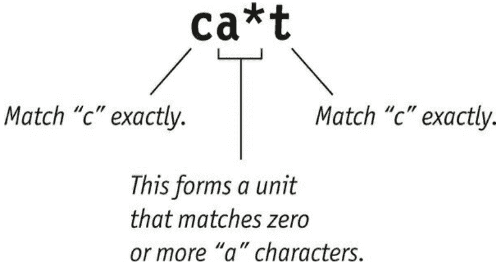
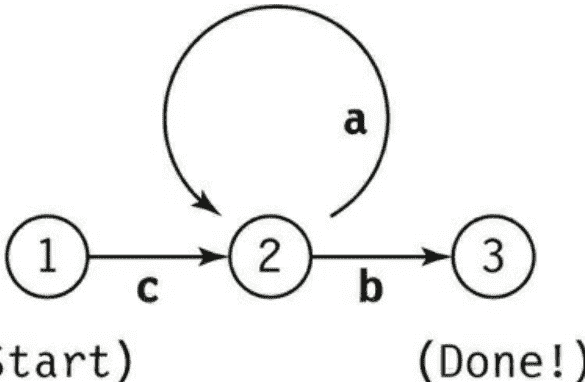
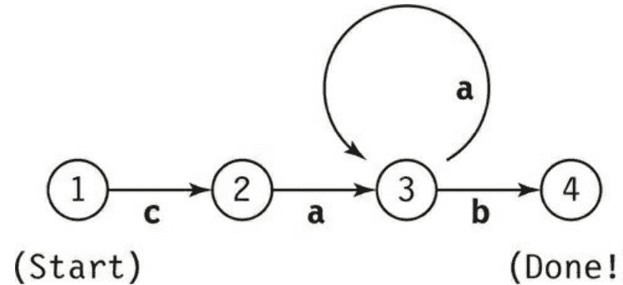
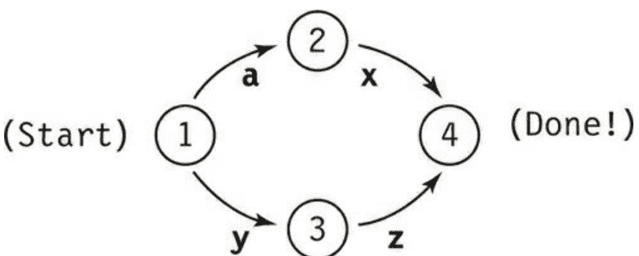
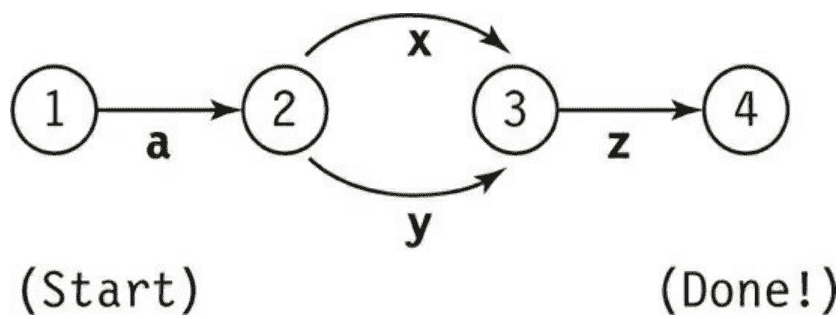
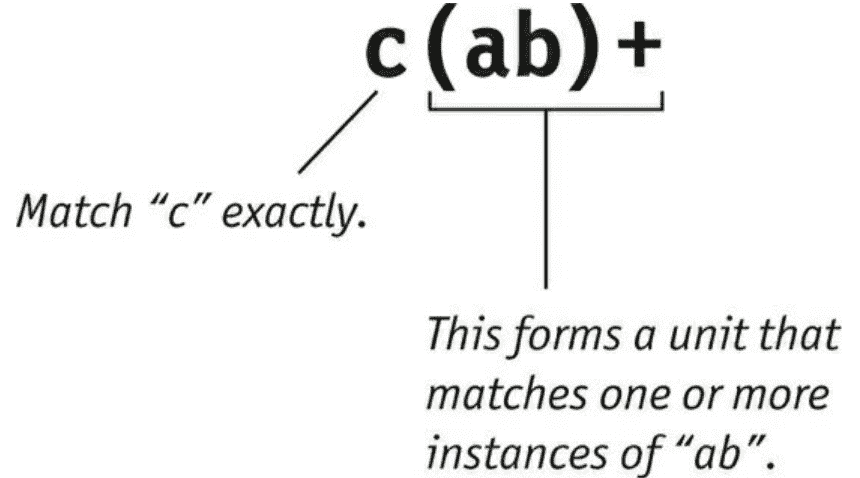

## 6. 正则表达式，第一部分

越来越多，最复杂的计算机软件都在处理 _模式_——例如，语音模式和图像识别。本章讨论的是前者：如何识别单词和字符的模式。虽然你不能仅凭这些技术构建一个人类语言翻译器，但它们是一个开始。

这就是正则表达式的用途。_正则表达式_ 是你指定的模式，使用特殊字符来表示指定字符、数字和单词的组合。它相当于学习一门新语言，但它是一门相对简单的语言，一旦你学会了，这项技术就能让你在很小的空间内完成大量工作——有时只需一两条语句——而否则可能需要很多行。

> 正则表达式语法有多种变体。Python 正则表达式包符合 Perl 标准，这是一个高级且灵活的版本。

### 6.1 正则表达式简介

正则表达式可以简单到只是一系列匹配给定单词的字符。例如，以下模式匹配单词“cat”；这并不奇怪。

```
cat
```

但是，如果你想匹配更大的一组单词呢？例如，假设你想匹配以下字母组合：

- 匹配“c”字符。
- 匹配任意数量的“a”字符，但至少一个。
- 匹配“t”字符。

以下是实现这些条件的正则表达式：

```
ca+t
```

与正则表达式（如同上一章中的格式说明符一样），字面字符和特殊字符之间存在根本区别。

字面字符，例如本例中的“c”和“t”，必须完全匹配，否则结果是匹配失败。大多数字符都是字面字符，你应该假设一个字符是字面字符，除非特殊字符改变了它的含义。所有字母和数字本身都是字面字符；相比之下，标点字符通常是特殊的；它们改变附近字符的含义。

加号（+）是一个特殊字符。它不会导致正则表达式处理器查找加号。相反，它与“a”一起形成一个子表达式，意思是“匹配一个或多个‘a’字符。”因此，模式 `ca+t` 匹配以下任何一个：

```
cat
caat
caaat
caaaat
```

如果你想匹配 _实际的_ 加号呢？在这种情况下，你会使用反斜杠（`\`）来创建转义序列。转义序列的功能之一是将特殊字符转换回字面字符。因此，以下正则表达式精确匹配 `ca+t`：

```
ca\+t
```

另一个重要的运算符是乘号（`*`），它表示“前面表达式的 _零次或多次_ 出现。”因此，表达式 `ca*t` 匹配以下任何一个：

```
ct
cat
caat
caaaaaaat
```

值得注意的是，此模式匹配“ct”。请记住，星号是表达式修饰符，不应单独求值。相反，请遵守此规则。

> 星号（*）修改紧随其后的表达式的含义，因此 a 与 * 一起匹配零个或多个“a”字符。

你可以像图 6.1 所示那样从语法上分解它。字面字符“c”和“t”各匹配一个字符，但 a* 形成一个单元，意思是“匹配零次或多次出现的‘a’。”



前面介绍的加号（+）的工作方式类似。加号与其前面的字符或组一起，意思是“匹配此表达式的一个或多个实例。”

### 6.2 实际示例：电话号码

假设你想为电话号码编写一个验证函数。我们可以将模式视为以下形式，其中 # 代表一个数字：

```
###-###-####
```

使用正则表达式语法，你可以这样写模式：

```
\d\d\d-\d\d\d-\d\d\d\d
```

在这种情况下，反斜杠（\）继续充当转义字符，但它在这里的作用不是将“d”变为字面字符，而是创建一个特殊含义。子表达式 \d 表示匹配任何一个数字字符。表示数字字符的另一种方法是使用以下子表达式：

```
[0-9]
```

但是，\d 只有两个字符长，而不是五个字符，因此更简洁。以下是一个完整的 Python 程序，它实现了用于验证电话号码的此正则表达式模式。

Click here to view code image

```
import re
pattern = r'\d\d\d-\d\d\d-\d\d\d\d'

s = input('Enter tel. number: ')
if re.match(pattern, s):
    print('Number accepted.')
else:
    print('Incorrect format.')
```

示例首先要做的是导入正则表达式包。对于每个使用正则表达式功能的模块（源文件），只需执行一次此操作。

```
import re
```

接下来，示例指定正则表达式模式，编码为 *原始字符串*。使用原始字符串时，Python 本身不会翻译任何字符；例如，它不会将 `\n` 翻译为换行符，也不会将 `\b` 翻译为响铃。相反，原始字符串中的所有文本都直接传递给正则表达式求值器。


```
r''string'' or
r"string"
```

提示用户输入后，程序调用 *match* 函数，该函数限定为 `re.match`，因为它从 `re` 包导入。

```
re.match(pattern, s)
```

如果模式参数与目标字符串（本例中为 `s`）匹配，则该函数返回一个匹配对象；否则返回值 **None**，它转换为布尔值 **False**。因此，你可以将返回的值当作布尔值使用。如果确认匹配，则返回 **True**；否则，返回 **False**。

> 注意
> 如果忘记包含 `r`（原始字符串指示符），这个特定示例仍然有效，但如果你始终在指定正则表达式模式时使用 `r`，你的代码会更可靠。Python 字符串解释的工作方式与 C/C++ 字符串解释不完全相同。在这些语言中，除非使用原始字符串，否则每个反斜杠都会自动被视为具有特殊含义。（较新版本的 C++ 也支持原始字符串功能。）使用 Python 时，某些子表达式（例如 `\n`）具有特殊含义。但除此之外，反斜杠被视为字面字符。由于 Python 有时将反斜杠解释为字面字符，有时不这样做，除非你养成始终使用原始字符串的习惯，否则结果可能不可靠且不可预测。因此，安全的策略是始终在正则表达式规范字符串前面放置一个 `r`。

### 6.3 细化匹配

尽管前一节中介绍的电话号码示例有效，但它有一些局限性。`re.match` 函数在模式匹配目标字符串开头时任何时候都返回“真”值。它不必匹配整个字符串。因此，代码确认了以下电话号码模式的匹配：

```
555-123-5000
```

但它也匹配以下内容：

```
555-345-5000000
```

如果你想将正结果限制为精确匹配——即整个字符串必须匹配模式且没有剩余内容——你可以添加特殊字符 $，它表示“字符串结尾”。如果在指定模式之外检测到任何其他文本，此字符会导致匹配失败。

Click here to view code image

```
pattern = r'\d\d\d-\d\d\d-\d\d\d\d$'
```

还有其他方式可以细化正则表达式模式。例如，你可能希望允许输入匹配以下任一格式：

```
555-123-5000
555 123 5000
```

为了适应这两种模式，你需要创建一个字符集，它允许特定位置有多个可能的值。例如，以下表达式表示匹配“a”或“b”，但不能同时匹配：

```
[ab]
```

可以在字符集中放入许多字符。但一次只能匹配其中一个字符。例如，以下范围精确匹配一个字符：an


"a", "b" "c", 或 "d" 出现在下一个位置。

```
[abcd]
```

同样，下面的表达式表示可以匹配一个空格或一个减号（-）——这正是我们在这种情况下想要的：

```
[ -]
```

在这种情况下，方括号是唯一的特殊字符；括号内的两个字符是字面量，且最多只能匹配其中一个。减号在方括号内通常有特殊含义，但当它出现在括号内字符的最前面或最后面时则不是这样。下面是我们需要的完整正则表达式：

Click here to view code image

```
pattern = r'\d\d\d[ -]\d\d\d[ -]\d\d\d\d$'
```

现在，将本节中提出的完善模式全部结合起来，下面是完整的示例：

Click here to view code image

```
import re
pattern = r'\d\d\d[ -]\d\d\d[ -]\d\d\d\d$'
s = input('Enter tel. number: ')
if re.match(pattern, s):
    print('Number accepted.')
else:
    print('Incorrect format.')
```

回顾一下，给定这个模式，Python 正则表达式求值器的工作原理如下。

+   - 它尝试匹配三个数字：\\d\\d\\d。
+   - 然后它读取字符集 [ -] 并尝试匹配一个空格或一个减号，但不能两者都匹配——也就是说，这两个字符中只有一个会在此处被匹配。
+   - 它尝试再匹配三个数字：\\d\\d\\d。
+   - 同样，它尝试匹配一个空格或一个减号。
+   - 它尝试再匹配四个数字：\\d\\d\\d\\d。
+   - 它必须匹配字符串末尾，$。这意味着在目标字符串中，匹配完最后四个数字后，不能再有任何输入。

另一种强制精确匹配、不允许有尾随数据的方法是使用 `re.fullmatch` 方法而不是 `re.match`。你可以使用以下语句来匹配电话号码模式；在这种情况下，使用 `fullmatch` 使得字符串末尾字符变得多余。

Click here to view code image

```
import re

pattern = r'\d\d\d[ -]\d\d\d[ -]\d\d\d\d'

s = input('Enter tel. number: ')
if re.fullmatch(pattern, s):
    print('Number accepted.')
else:
    print('Incorrect format.')
```

到目前为止，本章仅涉及了正则表达式语法所能做到的表面内容。第 6.5 节将更详细地解释语法。但在掌握这种语法时，有几条原则需要牢记。

+   - 许多字符在放置于正则表达式模式中时具有特殊含义。熟悉所有这些字符是个好主意。这些包括大多数标点字符，例如 + 和 *。
+   - 任何对 Python 正则表达式解释器没有特殊含义的字符都被视为字面量字符。正则表达式解释器尝试精确匹配这些字符。
+   - 反斜杠可以用于“转义”特殊字符，使其变成字面量字符。反斜杠也可以为某些普通字符添加特殊含义——例如，使 \d 表示“任何数字”而不是字符“d”。

诚然，起初这可能有点令人困惑。如果一个字符（如 *）本身就是特殊的，那么转义它（在其前面加上反斜杠）会取消该特殊含义。但在其他情况下，转义一个字符会_赋予_它特殊含义。

是的，这两点都是真的！但如果你看过足够多的示例，就应该能明白。

下面是一个用于测试社会安全号码有效性的简短程序。它与用于检查电话号码格式的程序类似，但不完全相同。这个模式查找三个数字、一个减号、两个数字、另一个减号，然后是四个数字。

Click here to view code image

```
import re

pattern = r'\d\d\d-\d\d-\d\d\d\d$'

s = input('Enter SSN: ')
if re.match(pattern, s):
    print('Number accepted.')
else:
    print('Incorrect format.')
```

## 6.4 正则表达式的工作原理：编译与运行

正则表达式看起来像魔术。但其实现是计算机科学中一个标准（尽管相对高级）的主题。正则表达式的处理分为两个主要步骤。

+   - 正则表达式模式被分析，然后编译成一系列统称为“状态机”的数据结构。
+   - 实际的匹配过程被视为正则表达式求值器的“运行时”，与“编译时”相对。在运行时，程序在查找匹配项时遍历状态机。

除非你打算自己实现一个正则表达式包，否则没有必要了解如何创建这些状态机，只需了解它们的作用即可。但理解编译时与运行时之间的这种二分法很重要。

让我们再看一个简单的例子。正如修饰符 + 表示“匹配前一个表达式的一个或多个实例”，修饰符 * 表示“匹配前一个表达式的零个或多个实例”。所以请考虑这个：

```
ca*b
```

这个表达式匹配“cb”以及“cab”、“caab”、“caaab”等等。当这个正则表达式被编译时，它会产生图 6.2 所示的状态机。



下面的列表描述了程序在运行时如何遍历这个状态机来找到匹配项。位置 1 是起点。

+   - 读取一个字符。如果是“c”，机器进入状态 2。读取任何其他字符都会导致失败。
+   - 从状态 2，可以读取“a”或“b”。如果读取“a”，机器保持在状态 2。它可以这样做任意次。如果读取“b”，机器转移到状态 3。读取任何其他字符都会导致失败。
+   - 如果机器到达状态 3，则完成，并报告成功。

这个状态机说明了一些基本原理，尽管它很简单。特别是，状态机必须先被编译，然后在运行时被遍历。

> > **注意**
> >
> > 本章中的状态机图假设为 DFA（确定有限自动机），而 Python 实际使用的是 NFA（非确定有限自动机）。除非你要实现一个正则表达式求值器（这很可能永远不需要做），否则这对你没有区别。
> > 所以如果是这种情况，你可以忽略 DFA 和 NFA 之间的区别！不客气。

你需要知道的是：如果你打算多次使用同一个正则表达式模式，最好将该模式编译成一个正则表达式对象，然后反复使用该对象。regex 包为此目的提供了一个名为 **compile** 的方法。


Click here to view code image

```
regex_object_name = re.compile(pattern)
```

下面是一个使用 **compile** 函数创建名为 reg1 的正则表达式对象的完整示例。

Click here to view code image

```
import re

reg1 = re.compile(r'ca*b$') # Compile the pattern!

def test_item(s):
    if re.match(reg1, s):
        print(s, 'is a match.')
    else:
        print(s, 'is not a match!')

test_item('caab')
test_item('caaxxb')
```

这个小程序打印以下内容：

```
caab is a match.
caaxxb is not a match!
```

你可以不预编译正则表达式对象来执行这些任务。但是，如果你打算多次使用同一个模式，编译可以节省执行时间。否则，Python 可能不得不多次重建状态机，而本可以只构建一次。

作为比较，图 6.3 显示了一个实现加号（+）的状态机，它表示“一个或多个”

而不是“零个或多个”。



**图 6.3.** `ca+b` 的状态机

给定这个模式，“cb”不是成功的匹配，但“cab”、“caab”和“caaab”是。这个状态机要求至少读取一个“a”。之后，匹配更多的“a”字符是可选的，但它可以匹配找到的尽可能多的连续“a”实例。

另一个基本运算符是 _替换_ 运算符（`|`），它表示“二选一”。

下面的模式匹配竖线两侧的表达式之一。那么你认为下面的意思到底是什么？

```
ax|yz
```

替换运算符 `|` 的优先级在语法的任何部分中都大致最低。因此，这个表达式匹配“ax”和“yz”，但不匹配“axyz”。如果没有使用括号，该表达式的求值就好像写成这样：

```
(ax) | (yz)
```


Figure 6.4 shows the state machine that implements this expression.



**Figure 6.4.** State machine for `(ax) | (yz)`

Now consider following expression, which uses parentheses to change the order of evaluation. With these parentheses, the alteration operator is interpreted to mean “either x or y but not both.”

```
a (x|y) z
```

The parentheses and the `|` symbol are all special characters. Figure 6.5 illustrates the state machine that is compiled from the expression `a (x|y) z`.



**Figure 6.5.** State machine for `a (x|y) z`

This behavior is the same as that for the following expression, which uses a character set rather than alteration:

```
a[xy]z
```

Is there a difference between alteration and a character set?
Yes: A character set always matches one character of text (although it may be part of a more complex pattern, of course). Alteration, in contrast, may involve groups longer than a single character. For example, the following pattern matches either “cat” or “dog” in its entirety—but not “catdog”:

```
cat|dog
```

# 6.5 IGNORING CASE, AND OTHER FUNCTION FLAGS

When a regular-expression pattern is compiled or being interpreted directly (through a call to a function such as re.match), you can combine a series of regex flags to influence behavior. A commonly used flag is the re.IGNORECASE flag. For example, the following code prints “Success.”

Click here to view code image

```
if re.match('m*ack', 'Mack the Knife', re.IGNORECASE):
    print('Success.')
```

The pattern 'm*ack' matches the word “Mack,” because the flag tells Python to ignore the case of the letters. Watch out for Mack the Knife even if he doesn’t know how to use uppercase!
The following does the same thing, because it uses the I abbreviation for the IGNORECASE flag, so re.IGNORECASE and re.I mean the same thing.

Click here to view code image

```
if re.match('m*ack', 'Mack the Knife', re.I):
    print('Success.')
```

Binary flags may be combined using the binary OR operator (|). So you can turn on both the I and DEBUG flags as follows:

Click here to view code image

```
if re.match('m*ack', 'Mack the Knife', re.I | re.DEBUG):
    print('Success.')
```

Table 6.1 summarizes the flags that can be used with regular-expression searching, matching, compiling, and so on.

# Table 6.1. Regular-Expression Flags

| Flag | Abbreviation | Description |
|---|---|---|
| ASCII | A | Assume ASCII settings. |
| IGNORECASE | I | All searches and matches are case-insensitive. |
| DEBUG | | When the operation is carried out within IDLE, debugging information is printed. |
| LOCALE | L | Causes matching of alphanumeric characters, word boundaries, and digits to recognize LOCALE settings. |
| MULTILINE | M | Causes the special characters ^ and $ to match beginnings and ends of lines as well as the beginning and end of the string. |
| DOTALL | S | The dot operator (.) matches all characters, including end of line (\n). |
| UNICODE | U | Causes matching of alphanumeric characters, word boundaries, and digits to recognize characters that UNICODE classifies as such. |
| VERBOSE | X | White space within patterns is ignored except when part of a character class. This enables the writing of prettier expressions in code. |

# 6.6 REGULAR EXPRESSIONS: BASIC SYNTAX SUMMARY

Learning regular-expression syntax is a little like learning a new language; but once you learn it, you’ll be able to create patterns of endless variety. As powerful as this language is, it can be broken down into a few major elements.

- Meta characters: These are tools for specifying either a specific character or one of a number of characters, such as “any digit” or “any alphanumeric character.” Each of these characters matches one character at a time.
- Character sets: This part of the syntax also matches one character at a time—in this case, giving a set of values from which to match.
- Expression quantifiers: These are operators that enable you to combine individual characters, including _wildcards_, into patterns of expressions that can be repeated any number of times.
- Groups: You can use parentheses to combine smaller expressions into larger ones.

# 6.6.1 Meta Characters

Table 6.2 lists meta characters, including wildcards that can be matched by any of a group, or range, of characters. For example, a dot (. ) matches any one character, subject to a few limitations.

These meta characters match exactly one character at a time. Section 6.6.3, “Pattern Quantifiers,” shows how to match a variable number of characters. The combination of wildcards, together with quantifiers, provides amazing flexibility.

Meta characters include not only those shown in the table but also the standard escape characters: These include \t (tab), \n (newline), \r (carriage return), \f (form feed), and \v (vertical tab).

# Table 6.2. Regular-Expression Meta Characters

| Special character | Name/Description |
|---|---|
| . | Dot. Matches any one character except a newline. If the **DOTALL** flag is enabled, it matches any character at all. |
| ^ | Caret. Matches the beginning of the string. If the **MULTILINE** flag is enabled, it also matches beginning of lines (any character after a newline). |
| $ | Matches the end of a string. If the **MULTILINE** flag is enabled, it matches the end of a line (the last character before a newline or end of string). |
| \A | Matches beginning of a string. |
| \b | Word boundary. For example, r'ish\b' matches 'ish is' and 'ish)' but not 'ishmael'. |
| \B | Nonword boundary. Matches only if a new word does _not_ begin at this point. For example, r'al\B' matches 'always' but not 'al '. |
| \d | Any digit character. This includes the digit characters 0 through 9. If the **UNICODE** flag is set, then Unicode characters classified as digits are also included. |
| \s | Any whitespace character; may be blank space or any of the following: \t, \n, \r, \f, or \v. **UNICODE** and **LOCALE** flags may have an effect on what is considered a whitespace character. |
| \S | Any character that is not a white space, as defined just above. |
| \w | Matches any alphanumeric character (letter or digit) or an underscore (_). The **UNICODE** and **LOCALE** flags may have an effect on what characters are considered to be alphanumeric. |
| \W | Matches any character that is not alphanumeric as described just above. |
| \z | Matches the end of a string. |

For example, the following regular-expression pattern matches any string that begins with two digits:

r'\d\d'

The next example matches a string that consists of a two-digit string and nothing else:

```
r'\d\d$'
```

# 6.6.2 Character Sets

The character-set syntax of Python regular expressions provides even finer control over what character is to be matched next.


Click here to view code image

```
[char_set] // Match any one character in the set.
[^char_set] // Match any one character NOT in the set.
```

You can specify character sets by listing characters directly, as well as by ranges, covered a few paragraphs later. For example, the following expression matches any vowel (except, of course, for “y”).

```
[aeiou]
```

For example, suppose you specify the following regular-expression pattern:

```
r'c[aeiou]t'
```

This matches any of the following:

```
cat
cet
cit
cot
cut
```

We can combine ranges with other operators, such as +, which retains its usual meaning outside the square brackets. So consider

```
c[aeiou]+t
```

This matches any of the following, as well as many other possible strings:

```
cat
ciot
ciiaaet
caaauuuut
ceeit
```

Within a range, the minus sign (-) enables you to specify ranges of characters when the minus sign appears between two other characters in a character range. Otherwise, it is treated as a literal character. For example, the following range matches any character from lowercase “a” to lowercase “n”:

```
[a-n]
```

This range therefore matches an “a”, “b”, “c”, up to an “l”, “m”, “n”.


"m"，或 "n"。如果启用了 `IGNORECASE` 标志，它还匹配这些字母的大写形式。

以下匹配任何大写或小写字母，或数字。与 "\\w" 不同，不过，此字符集不匹配下划线 (_)。

```
[A-Za-z0-9]
```

以下匹配任何十六进制数字：0 到 9 之间的数字，或范围 “A”、“B”、“C”、“D”、“E” 和 “F” 内的大写或小写字母。

```
[A-Fa-f0-9]
```

字符集遵循一些特殊规则。

+   - 方括号 (`[]`) 内的几乎所有字符都失去其特殊含义，除非在此处特别提及。因此，几乎所有内容都按字面解释。

+   - 右方括号具有特殊含义，用于终止字符集；因此，右方括号必须用反斜杠转义才能按字面解释：“\\]”

+   - 减号 (-) 具有特殊含义，除非它出现在字符集的最开头或最末尾，在这种情况下它被解释为字面减号。同样，插入符号 (^) 在范围开头具有特殊含义，但在其他位置则没有。

+   - 反斜杠 (`\\`)，即使在此上下文中，也必须转义才能按字面表示。使用 “\\\\” 来表示反斜杠。

例如，在字符集规范之外，算术运算符 `+` 和 `*` 具有特殊含义。然而，它们在方括号内失去含义，因此你可以指定一个匹配这些字符中任意一个的范围：

```
`[+*/-]`
```

此范围规范包含一个减号 (`-`)，但它没有特殊含义，因为它出现在字符集的末尾而不是中间。

以下字符集规范使用插入符号来匹配不是四个运算符 `+`、`*`、`/` 或 `-` 中任何一个的字符。插入符号在此处具有特殊含义，因为它出现在开头。

```
`[^+*/-]`
```

但以下规范，其中插入符号 (`^`) 出现在不同位置，匹配五个运算符中的任何一个，`^`、`+`、`*`、`/` 或 `-`。

```
`[+*^/ -]`
```

因此，以下 Python 代码在运行时打印 “Success！”。

```
```python
import re
if re.match(r'[+*^/ -]', '^'):
    print('Success!')
```
```

然而，以下 Python 代码不打印 “Success”，因为字符集开头的插入符号反转了字符集的含义。

```
import re
if re.match(r'[^+*/-]', '^'):
    print('Success!')
```

# ## 6.6.3 模式量词

表 6.3 中的所有量词都是表达式修饰符，而不是表达式扩展符。第 6.6.4 节详细讨论了“贪婪”匹配的含义。

# ### 表 6.3. 正则表达式量词（贪婪）

| 语法 | 描述 |
|---|---|
| `expr*` | 修改表达式 `expr` 的含义，使其匹配零次或多次出现，而不是一次。例如，`a*` 匹配 “a”、“aa” 和 “aaa”，以及空字符串。 |
| `expr+` | 修改表达式 `expr` 的含义，使其匹配一次或多次出现，而不是仅一次。例如，`a+` 匹配 “a”、“aa” 和 “aaa”。 |
| `expr?` | 修改表达式 `expr` 的含义，使其匹配零次或一次 expr 出现。例如，`a?` 匹配 “a” 或空字符串。 |
| `expr1` \| `expr2` | 选择。匹配 expr1 的单次出现，或 expr2 的单次出现，但不匹配两者。例如，`a\|b` 匹配 “a” 或 “b”。请注意，此运算符的优先级非常低，因此 `cat\|dog` 匹配 “cat” 或 “dog”。 |
| `expr{n}` | 修改表达式，使其匹配 expr 的恰好 n 次出现。例如，`a{3}` 匹配 “aaa”；但虽然 `sa{3}d` 匹配 “saad”，它不匹配 “saaaad”。 |
| `expr{m,n}` | 匹配 expr 的至少 m 次出现和最多 n 次出现。例如，`x{2,4}y` 匹配 “xxy”、“xxxy” 和 “xxxxy”，但不匹配 “xxxxxyy” 或 “xy”。 |
| `expr{m,}` | 匹配 expr 的至少 m 次出现，且匹配次数没有上限。例如，`x{3,}` 如果能在任何位置匹配模式 “xxx”，则找到匹配项。但如果可以，它将匹配超过三次。因此 `zx{3,}y` 匹配 “zxxxxy”。 |
| `expr{,n}` | 匹配表达式 expr 的至少零次和最多 n 次实例。例如，`ca{,2}t` 匹配 “ct”、“cat” 和 “caat”，但不匹配 “caaat”。 |
| `(expr)` | 导致正则表达式求值器将 expr 的全部视为单个组。这样做有两个主要目的。首先，量词应用于紧随其后的表达式；但如果该表达式是一个组，则引用整个组。例如，`(ab)+` 匹配 “ab”、“abab”、“ababab” 等等。其次，组很重要，因为它们可以在后续引用，无论是在匹配还是文本替换中。 |
| `\n` | 引用之前已匹配的组；引用的是运行时实际找到的文本，而不仅仅是模式本身的重复。`\1` 引用第一个组，`\2` 引用第二个组，以此类推。 |

表 6.3 中列出的倒数第二个量词是使用括号创建组。分组可以显著影响模式的含义。将项目放在括号中还会创建用于后续引用的标记组。

使用表 6.3 中的数值量词使某些表达式更容易呈现，或者至少更紧凑。例如，考虑前面介绍的电话号码验证模式。

```
r'\\d\\d\\d-\\d\\d\\d-\\d\\d\\d\\d'
```

这可以修订为

```
r'\d{3}-\d{3}-\d{4}'
```

此示例节省了几个按键，但其他情况可能节省更多。使用这些功能还会创建更易读、更易维护的代码。

括号除了清晰之外还有重大意义。其最重要的作用是指定组，而组又可以影响模式的解析方式。例如，考虑以下两个模式：

```
pat1 = r'cab+'
pat2 = r'c(ab)+'
```

第一个模式匹配以下任何字符串，其中 “b” 被重复。

```
cab
cabb
cabbb
cabbbb
```

但第二个模式——得益于分组的优点——匹配以下任何字符串。这些字符串重复 “ab” 而不是 “b”。

```
cab
cabab
cababab
cabababab
```

在这种情况下，分组非常重要。图 6.6 显示 Python 正则表达式求值器如何因为括号而以不同方式解释模式的含义；具体来说，是组 “ab” 被重复。



# 图 6.6. 在正则表达式中解析组

# 6.6.4 回溯、贪婪和非贪婪

Python 正则表达式在许多微妙方面都很灵活。特别是，正则表达式求值器总是倾向于匹配而非不匹配，即使这需要一种称为回溯的技术。

考虑以下示例。

```
import re
pat = r'c.*t'
if re.match(pat, 'cat'):
    print('Success!')
```

问问自己：模式 `c.*t` 是否匹配目标字符串 "cat"？它应该匹配，不是吗？因为 “c” 匹配 “c”，“t” 匹配 “t”，而模式 “ .*” 说，“匹配任意数量的字符。” 所以它应该匹配 “cat”。

但请等一下。如果你按字面意思理解 “ .*” 模式，它不应该执行以下操作吗？

+   - 匹配 “c”。
+   - 通过匹配所有剩余字符（即 “at”）来匹配一般模式 “ .*”。
+   - 然后到达字符串末尾。正则表达式求值器尝试匹配 “t” 但无法匹配，因为它现在位于字符串末尾。结果？看起来像是失败。

幸运的是，正则表达式求值器比这更复杂。在未能匹配字符串后，它会回溯并根据 “ .*” 尝试匹配更少的字符；回溯一个字符后，它发现它确实匹配目标字符串 “cat”。

关键在于，正则表达式语法很灵活，并且可以正确匹配它合法能够匹配的任何模式，即使必须使用回溯。

一个相关问题是贪婪量词与非贪婪量词的问题。Python 正则表达式中的所有类型的模式规范都遵循黄金法则：如果可能匹配，则报告匹配，即使必须回溯。但在该规则内，有时会有多个可能的结果。“贪婪与非贪婪”是当存在多个可能字符串时，选择哪个字符串的问题。


## 6.7 正则表达式实用示例

本节使用前面展示的元素进行一个实用示例。假设你被指派编写软件，用于验证密码是否足够强。

我们说的不是密码加密。那是另一个话题。但在接受密码之前，你可以测试它是否具有足够的强度。

不久以前，在软件开发的“西部荒野”时代，任何至少包含一个字符的单词都可能被接受。这样的密码很容易被破解。如今，只有难以破解的密码才会被接受。否则，系统会自动提示用户重新输入。以下是一些典型的标准：

- 每个字符都必须是大写或小写字母、数字或下划线（_），或者是以下标点字符之一：@、#、$、%、^、&、* 或 !。
- 最小长度为八个字符。
- 它必须至少包含一个字母。
- 它必须至少包含一个数字。
- 它必须包含一个可接受的标点字符。

现在假设你受雇编写这些测试。如果你使用正则表达式，这项工作对你来说将轻而易举——一块美味的蛋糕。

下面的验证函数执行必要的测试。我们可以使用四个模式，并对每个模式执行 `re.match` 来实现这五条规则。

```python
import re

pat1 = r'(\w|[@#$%^&*!]){8,}$'
pat2 = r'.*\d'
pat3 = r'.*[a-zA-Z]'
pat4 = r'.*[@#$%^&*]'

def verify_passwd(s):
    b = (re.match(pat1, s) and re.match(pat2, s) and
         re.match(pat3, s) and re.match(pat4, s))
    return bool(b)
```

`verify_passwd` 函数对目标字符串 `s` 应用四种不同的匹配条件。`re.match` 函数分别使用四个不同的模式（`pat1` 到 `pat4`）进行调用。如果所有四个匹配都成功，结果为“真”。

第一个模式接受任何是字母、字符或下划线 _或_ 范围 @#$%^&*! 中的字符……然后要求匹配八个或更多这样的字符。

`\w` 元字符的意思是“匹配任何字母数字字符”。因此，当括号内的表达式组合在一起时，它的意思是“匹配一个字母数字字符 _或_ 列出的标点字符之一。”

```
(\w|[@#$%^&*!]){8, }
```

让我们稍微拆解一下。在括号内，我们找到这个表达式：

```
\w|[@#$%^&*!]
```

这里使用了选择，由竖线 `|` 指示。这个子模式的意思是“匹配 `\w` 或匹配集合 [@#$%^&*!] 中的字符。”

方括号内的字符失去了它们在括号外原本具有的特殊含义。因此，范围规范内的所有内容都被视为字面量，而不是特殊字符。

将所有这些组合起来，这个子表达式的意思是“匹配一个字母数字字符（`\w`），或匹配列出的标点字符之一。” 模式的下一部分 `{ 8, }` 表示这样做至少八次。

因此，我们匹配八个或更多字符，其中每个字符都是字母数字字符或所示的标点字符之一。

最后，有一个字符串结束指示符 `$`。因此，不能有例如任何尾随空格。附加一个行结束符 `$` 要求字符串在读取最后一个字符后终止。

```
(\w|[@#$%^&*!]){8, }$
```

其余使用 `re.match` 实现的测试（每个使用不同的字符串）检查某种字符的存在。例如，`pat2` 匹配任意数量的任何类型的字符（ `.`*`）`）然后匹配一个数字。作为正则表达式模式，这表示“匹配零个或多个字符，然后匹配一个数字。”

```
.*\d
```

下一个模式 `pat3` 匹配零个或多个字符（ `.`*`）`）然后匹配一个大写或小写字母。

```
.*[a-zA-Z]
```

最后一个模式匹配零个或多个字符，然后匹配范围 `@#$%^&*!` 中的字符。

```
.*[@#$%^&*!]
```

其效果是测试以下各项：一个字母、一个数字和一个标点字符。每种至少要有一个。当然，拥有多个任何这些字符（数字、字母、下划线、标点字符）也是可以的。

## 6.8 使用匹配对象

`re.match` 函数返回一个 `match` 对象（如果成功）或特殊对象 `None`（如果失败）。到目前为止，我们一直将此值（对象或 `None`）当作布尔值（真/假）来使用，这在 Python 中是一种有效的技术。

但是，如果你得到一个 **match** 对象，你可以使用它来获取关于匹配的信息。例如，正则表达式模式可以选择使用括号分为子组。一个 **match** 对象可以用来确定每个子组中匹配了什么文本。

例如，考虑以下内容：

```python
import re
pat = r'(a+) (b+) (c+)'
m = re.match(pat, 'abbcccee')
print(m.group(0))
print(m.group(1))
print(m.group(2))
print(m.group(3))
```

此示例打印以下内容：

```
abbccc
a
bb
ccc
```

如你从本示例中所见，**group** 方法返回全部或部分匹配的文本，如下所示。

- **group(0)** 返回正则表达式匹配的整个文本。
- **group(_n_)**，从 1 开始，返回一个匹配的组，其中组由括号分隔。第一个这样的组可以作为 `group(1)` 访问，第二个作为 `group(2)`，依此类推。

**match** 对象的另一个属性是 **lastindex**。这是一个整数，包含匹配过程中找到的最后一个组的编号。因此，前面的示例可以用一个更通用的循环来编写。

```python
import re
pat = r'(a+) (b+) (c+)'
m = re.match(pat, 'abbcccee')
for i in range(m.lastindex + 1):
    print(i, '. ', m.group(i), sep='')
```

此示例生成以下输出：

```
0. abbccc
1. a
2. bb
3. ccc
```

在此示例的代码中，必须向 `m.lastindex` 加 1。这是因为 **range** 函数生成一个从 0 开始、直到但不包括参数值的迭代器。在此示例中，组编号为 1、2、3，因此范围需要延伸到 3；而你可以通过在范围末尾加 1 来实现这一点。

表 6.4 总结了 **match** 对象的属性。

# 表 6.4. 匹配对象属性

| 语法 | 描述 |
|--------|-------------|
| group(n) | 返回与指定组对应的文本，从 1 开始作为第一个组；默认值为 0，返回整个匹配字符串的文本。 |
| groups() | 返回一个元组，包含匹配文本中的所有组，从组 1（第一个子组）开始。 |
| groupdict() | 返回一个字典，包含所有命名组，格式为 name:text。 |
| start(n) | 返回目标字符串中由 n 引用的组的起始位置。字符串中的位置从 0 开始，但组编号从 1 开始，因此 start(1) 返回第一个组的起始字符串索引。start(0) 返回所有匹配文本的起始字符串索引。 |
| end(n) | 类似于 **start(n)**，但 **end(n)** 获取已识别组的结束位置，相对于整个目标字符串。在此字符串中，文本由目标字符串中的所有字符组成，从“起始”索引开始，直到但不包括“结束”索引。例如，起始和结束值为 0 和 3 表示匹配了前三个字符。 |
| span(n) | 返回 **start(n)** 和 **end(n)** 提供的信息，但以元组形式返回。 |
| lastindex | 组中最高的索引编号。 |

## 6.9 在字符串中搜索模式

一旦你理解了基本的正则表达式语法，就可以以许多有用的方式应用它。到目前为止，我们已使用它来查找


exact matches of a pattern.

But another basic usage for regular expressions is to do searches: not to require the entire string to match but only part of it. This section focuses on finding the first substring that matches a pattern. The `re.search` function performs this task.


Click here to view code image

```
match_obj = re.search(pattern, target_string,
flags=0)
```

In this syntax, _pattern_ is either a string containing a regular-expression pattern or a precompiled regular-expression object; _target_string_ is the string to be searched. The _flags_ argument is optional and has a default value of 0.

The function produces a **match** object if successful and **None** otherwise. This function is close to `re.match` in the way that it works, except it does not require the match to happen at the beginning of the string.

For example, the following code finds the first occurrence of a number that has at least two digits.

Click here to view code image

```
import re
m = re.search(r'\d{2,}', '1 set of 23 owls, 999
doves.')
print("''", m.group(), "'' found at ", m.span(),

sep='')
```

In this case, the search string specifies a simple pattern: two
or more digits. This search pattern is easy to express in regular-
expression syntax, using the special characters introduced
earlier in this chapter.

```
\d{2,}
```

The rest of the code uses the resulting match object, assigning
that object a variable name of m. Using the **group** and **span**
methods of this object, as described in Section 6.8, “Using the
Match Object,” you can get information about what was
matched and where in the target string the match occurred.
The code in this example prints the following:

```
"23" found at (9, 11)
```

This successfully reports that the substring “23” was found by
the search: m.group() produced the substring that was
matched, “23,” while m.span() produced the starting and
ending positions within the target string as the tuple (9, 11).
Here, as elsewhere, the starting position is a zero-based index
into the target string, so the value 9 means that the substring
was found starting at the tenth character. The substring
occupies all positions **up to but not including** the ending
position, 11.

## 6.10 ITERATIVE SEARCHING ("FINDALL")

One of the most common search tasks is to find _all_ substrings matching a particular pattern. This turns out to be easy, because there is such a function and it produces a Python list.


Click here to view code image

```
list = re.findall(pattern, target_string, flags=0)
```

In this syntax, most of the individual items have the meaning described in the previous section: _pattern_ is a regular-expression string or precompiled object, _target_string_ is the string to be searched, and _flags_ is optional.

The return value of `re.findall` is a list of strings, each string containing one of the substrings found. These are returned in the order found.

Regular-expression searches are _non-overlapping_. This means, for example, that once the string “12345” is found, the search will not then find “2345,” “345,” “45,” and so on. Furthermore, all the quantifiers in this chapter are greedy; each will find as long a string as it can.

An example should help clarify. Let’s take an example from the previous section and search for all digit strings, and not only the first one. Also, let’s look for digit strings that have at least

one digit.

Click here to view code image

```
import re
s = '1 set of 23 owls, 999 doves.'
print(re.findall(r'\d+', s))
```

The code prints the following list of strings:

```
['1', '23', '999']
```

This is almost certainly the result you want. Because the search is both non-overlapping and greedy, each string of digits is fully read but read only once.

What if you want to extract a digit string that optionally contains any number of thousands place separators (a comma, in the American nomenclature), decimal points, or both? The easiest way to do this is to specify that the first character must be a digit, but it can be followed by another digit, a comma (,), or a dot(.)—and that such a character (digit, comma, or dot) can appear zero or more times.

Click here to view code image

```
import re
s = 'What is 1,000.5 times 3 times 2,000?'
print(re.findall(r'\d[0-9,.]*', s))
```

This example prints the following list:

```
['1,000.5', '3', '2,000']
```

In looking back at this example, keep in mind that the regular-expression pattern is

```
\d[0-9,.]*
```

This means “Match a digit (\d), followed by any character in the range [0–9, .], zero or more times.”

Here’s another example. Suppose we want to find all occurrences of words six or more characters in length. Here’s some code that implements that search.

Click here to view code image

```
s = 'I do not use sophisticated, multisyllabic
words!'
print(re.findall(r'\w{6,}', s))
```

This code prints the following list:

Click here to view code image

```
['sophisticated', 'multisyllabic']
```

In this case, the regular expression pattern is

```
\w{6,}
```

The special character \w matches any of the following: a letter, a digit, or an underscore. Therefore, the pattern matches any word at least six characters long.

Finally, let’s write a function useful for the Reverse Polish

Notation calculator introduced in Section 3.12. We’d like to break down input into a list of strings, but we’d like operators (+, *, /, −) to be recognized separately from numbers. In other words, suppose we have the input

```
12 15+3 100-*
```

We’d like 12, 15, 3, 100, and the three operators (+, −, and \*) to each be recognized as separate substrings, or _tokens_. The space between “12” and “15” is necessary, but extra spaces shouldn’t be required around the operators. An easy solution is to use the `re.findall` function.

Click here to view code image

```
import re
s = '12 15+3 100-*'
print(re.findall(r'[+*/-]|\\w+', s))
```

This example prints the following:

Click here to view code image

```
['12', '15', '+', '3', '100', '-', '*']
```

This is exactly what we wanted.
This example has a subtlety. As explained in Section 6.6.2, “Character Sets,” the minus sign (−) has a special meaning within square brackets _unless_ it appears at the very beginning or end of the range, as is the case here. In this case, the minus sign is at the end of the range, so it’s interpreted literally.

```
[+*/-] | \w+
```

What this pattern says is “First, match one of the four
operator characters if possible (+, *, /, or -). Failing that, try to
read a word, which is a series of one or more “w” characters:
Each of these characters is a digit, letter, or underscore ( _ ).” In
this case, the strings “12,” “15,” “3,” and “100” are each read as
words.

But the previous expression used both the alternation
operator and plus sign (| and +). How does precedence work in
this case? The answer is that | has low priority, so the
expression means “Match one of the operators _or_ match any
number of digit characters.” That’s why the return value is

Click here to view code image

```
['12', '15', '+', '3', '100', '-', '*']
```

Each of these substrings consists of either an operator or a
word: the word ends when a white space or operator is read
(because white spaces and operators are not matched by \w).

## 6.11 THE “FINDALL” METHOD AND
THE GROUPING PROBLEM

The `re.findall` method has a quirk that, although it creates
useful behavior, can also produce frustrating results if you don’t
anticipate it.

One of the most useful tools in regular-expression grammar

is grouping. For example, the following regular-expression
pattern captures all instances of well-formed numbers in the
standard American format, including thousands place
separators (,):

Click here to view code image

```
num_pat = r'\d{1,3} (, \d{3}) * (\. \d*) ? '

```

To summarize, this pattern looks for the following:

+   - Between one and three digits. Not optional.
+   - A group of characters beginning with a comma (,) followed by
+   exactly three digits. This group can appear zero or more times.
+   - A decimal point (.) followed by zero or more digits. This group is
+   optional.

You can use this pattern effectively to match valid digit
strings, such as any of the following:

```
10.5
5,005
12, 333, 444.0007

```

But a problem occurs when you use this pattern to search for
all occurrences of numbers. When the `re.findall` function is
given a regular-expression pattern containing parenthesized
groups, it returns a list of tuples in which each tuple contains all
the text found in that subgroup.
Here’s an example:


这些语句打印出以下内容：

```
[(',000', ''), ('', '.5')]
```

但这不是我们想要的！

哪里出了问题？在这种情况下，问题在于如果在搜索字符串中使用分组，`findall` 函数返回一个列表，其中包含每个匹配字符串内部找到的子组，而不是返回与整体模式匹配的字符串，而这正是我们想要的。

因此，在这种情况下，结果是错误的。

要得到想要的结果，请使用两部分解决方案。

+ 1. 通过将整个表达式放在括号中，将整个表达式放在一个分组中。
+ 2. 打印表达式 `item[0]`。

以下是实现此解决方案的代码：

```
pat = r'(\d{1,3}(,\d{3})*(.\d*)?)'
lst = re.findall(pat, '12,000 monkeys on 55.5 cats.')
for item in lst:
    print(item[0])
```

这将产生以下输出：

```
12,000
55.5
```

这正是我们想要的。

## 6.12 SEARCHING FOR REPEATED PATTERNS

最复杂的模式涉及对 _标记组_ 的引用。当括号内的模式匹配时，正则表达式会记录运行时实际匹配的字符，并通过 _标记_ 该组来记住它们——即实际匹配的字符。

一个示例应该能说明这一点。作家常见的错误之一是重复单词。例如，你写“the the”而不是“the”，或者写“it it”而不是“it”。以下是一个查找重复单词的搜索模式：

```
(w+) \1
```

此模式匹配一个单词，即一个或多个“w”字符（字母、数字或下划线），后跟一个空格，然后是相同字符的重复。此模式不匹配以下内容：

```
the dog
```

虽然“the”和“dog”都符合单词标准（`\w+`），但第二个单词与第一个不相同。单词“the”被标记了，但在这种情况下没有重复。

但以下内容匹配该模式，因为它重复了标记的子字符串“the”：

```
the the
```

以下是在更完整的上下文中使用的模式，目标字符串中包含“the the”。

```
import re

s = 'The cow jumped over the the moon.'
m = re.search(r'(\w+) \1', s)
print(m.group(), '...found at', m.span())
```

运行此代码时，将打印以下内容：

```
the the ...found at (20, 27)
```

以下模式表示：“匹配由一个或多个字母数字字符组成的单词。标记它们，然后匹配一个空格，然后匹配标记字符的重复。”

```
(\w+) \1
```

以下是使用相同模式的另一个示例，应用于包含“of of”的字符串。

```
s = 'The United States of of America.'
m = re.search(r'(\w+) \1', s)
print(m.group(), '...found at', m.span())
```

此示例打印结果：

```
of of ...found at (18, 23)
```

与所有其他正则表达式匹配和搜索一样，Python 实现使得进行不区分大小写的比较变得容易，这在这种情况下可能很有用。考虑以下文本字符串：

```
s = 'The the cow jumped over the the moon.'
```

我们能否进行搜索，以指示句子开头处是否有重复单词，或者没有？可以，因为我们所要做的就是指定 **re.IGNORECASE** 标志，或简称为 **re.I**。

```
m = re.search(r'(\w+) \1', s, flags=re.I)
print(m.group(), '...found at', m.span())
```

此示例打印：

```
The the ...found at (0, 7)
```

`re.search` 函数报告找到的第一个成功匹配。

## 6.13 REPLACING TEXT

另一个工具是替换文本的能力，即文本替换。我们可能希望将模式的所有出现替换为其他模式。这几乎总是涉及前一节中描述的组标记。

`re.sub` 函数执行文本替换。

```
re.sub( find_pattern, repl, target_str, count=0,
flags=0)
```

在此语法中，`find_pattern` 是要查找的模式，`repl` 是正则表达式替换字符串，`target_str` 是要搜索的字符串。最后两个参数均为可选。

返回值是新字符串，由进行请求的替换后的目标字符串组成。

以下是一个简单的示例，将每个“dog”替换为“cat”：

```
import re
s = 'Get me a new dog to befriend my dog.'
s2 = re.sub('dog', 'cat', s)
print(s2)
```

此示例打印：

```
Get me a new cat to befriend my cat.
```

然而，这并不那么有趣，因为它没有使用任何正则表达式特殊字符。下一个示例使用了。

```
s = 'The the cow jumped over over the moon.'
s2 = re.sub(r'(\w+) \1', r'\1', s, flags=re.I)
print(s2)
```

这将打印以下字符串，该字符串修复了重复单词问题——实际上两个都修复了，尽管第一个需要设置不区分大小写的标志。

```
The cow jumped over the moon.
```

在此输出中，“The the”已被替换为“The”，“over over”已被替换为“over”。之所以有效，是因为正则表达式搜索模式指定了任何重复单词。它在此处呈现为原始字符串：

```
r'(\w+) \1'
```

下一个字符串，替换字符串，仅包含对该模式前半部分的引用。这是一个标记字符串，因此指示正则表达式求值器记录该标记字符串并将其用作替换字符串。

```
r'\1'
```

此示例说明了一些关键点。首先，替换字符串应指定为原始字符串，就像搜索字符串一样。Python 字符串处理给 `\1` 附加了特殊含义；因此，如果不将替换文本指定为原始字符串，则无法工作——除非使用指定文字反斜杠的另一种方式：

```
\\1
```

但最好坚持使用原始字符串。其次，对“The the”的重复单词测试除非将 flags 参数设置为 re.I（或 re.IGNORECASE），否则会失败。在此示例中，flags 参数必须明确命名。

```
s2 = re.sub(r'(\w+) \1', r'\1', s, flags=re.I)
```

# CHAPTER 6 SUMMARY

本章探讨了 Python 正则表达式包的基本功能：如何使用它来验证数据输入的格式，如何搜索与指定模式匹配的字符串，如何将输入拆分为标记，以及如何使用正则表达式进行复杂的搜索和替换操作。

理解正则表达式语法是理解范围和通配符（一次匹配一个字符）以及量词（表示可以匹配零个、一个或任意数量的字符组重复）的问题。结合这些能力，使您能够使用正则表达式表达无限复杂的模式。

在下一章中，我们将探讨更多正则表达式用法示例，以及非贪婪运算符和 Scanner 接口，后者构建在 Python 正则表达式包之上。

# # CHAPTER 6 REVIEW QUESTIONS

+ 1 表达式“x*”可以匹配的最少字符数和最多字符数是多少？

+ 2 解释“(ab)c+”和“a(bc)+”之间结果的差异。哪一个（如果有的话）等同于无修饰模式“abc+”？

+ 3 使用正则表达式时，您需要多频繁地使用以下语句？

```
import re
```

4 当您使用方括号表示范围时，哪些字符具有特殊含义，在什么情况下？

5 编译正则表达式对象有哪些优势？

6 使用 re.match 和 re.search 等函数返回的匹配对象有哪些使用方法？

7 使用涉及竖线（|）的变体与使用涉及方括号的字符集有什么区别？

8 为什么在正则表达式搜索模式中使用原始字符串指示符（r）很重要？在替换字符串中呢？

9 替换字符串中哪些字符（如果有）具有特殊含义？

# CHAPTER 6 SUGGESTED PROBLEMS

1 编写一个验证函数，识别旧格式下的电话号码，其中区号（前三位数字）是可选的。（当省略时，意味着电话号码是本地号码。）

2 编写此电话号码验证的另一个版本。


