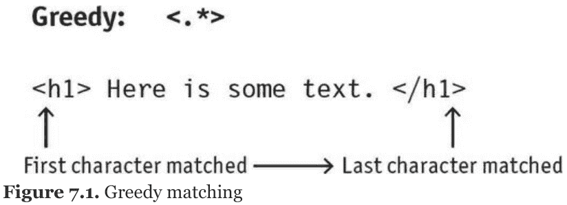
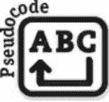

## 7. 正则表达式，第二部分

正则表达式在 Python 中是一个非常庞大的主题，很难在一个章节中全部讲完。本章将探讨 Python 正则表达式语法的细微之处。

Python 最有用的高级功能之一是 Scanner 类。它鲜为人知，文档也很少。本章最后几个部分将详细解释该功能的用法。一旦你理解了它，就会发现它是一个非常有用的工具。它是一种将特定模式与特定类型的标记关联起来，然后采取相应操作的方法。

### 7.1 高级正则表达式语法摘要

表 7.1 总结了本章介绍的高级语法。后续部分将更详细地解释每个功能的工作原理。

#### 表 7.1. 高级正则表达式语法

| 语法 | 描述 |
|---|---|
| `(?:expr)` | 非标记组。将 _expr_ 视为一个单元，但不标记运行时匹配的字符。这些字符被识别用于匹配，但不会作为组被记录。 |
| `expr??` | ? 运算符的非贪婪版本。 |
| `expr*?` | 使用非贪婪匹配匹配零个或多个 _expr_ 实例。（例如，模式 `<.*?>` 在看到第一个尖括号时停止匹配，而不是最后一个。） |
| `expr+?` | 使用非贪婪匹配匹配一个或多个 _expr_ 实例；如果有多种有效方式匹配目标字符串，则尽可能少地匹配字符。 |
| `expr{m}?`<br>`expr{m,n}?` | {_m_} 和 {_m,n_} 运算符的非贪婪版本。第一种语法 `expr{m}?` 的非贪婪版本不太可能与贪婪版本表现不同，但为了完整性，这里将其包含在内。 |
| `(?=expr)` | 正向先行断言。如果 _expr_ 匹配即将读取的下一个字符，则整个表达式匹配；但是，这些字符既不被“消耗”也不被标记；它们被视为尚未读取，这意味着下一个正则表达式操作会再次读取它们。 |
| `(?!expr)` | 负向先行断言。如果 _expr_ 未能匹配即将读取的下一个字符，则整个表达式匹配。但是，这些字符既不被消耗也不被标记，因此它们保留给下一个正则表达式匹配或搜索操作读取。 |
| `(?<=expr)` | 正向后行断言。如果紧随其后是 expr（必须为固定长度），则整个表达式匹配。效果是暂时回退适当数量的字符并尽可能重新读取它们。以这种方式重新读取的字符不会被标记。<br><br>例如，给定表达式 `(?<=abc) def`，`abcdef` 中的字符 `def` 被匹配；但是，只有字符 `def` 实际被匹配；字符 `abc` 不是匹配本身的一部分。模式的意思是，“匹配 def，但前提是前面有 abc。” |
| `(?<!expr)` | 负向后行断言。如果不紧随其后是 expr（必须为固定长度），则整个表达式匹配。效果是暂时回退适当数量的字符并重新读取它们。重新读取的字符不会被标记。 |
| `(?P<name>expr)` | 命名组。如果 expr 匹配，则整个表达式匹配。结果是，组被标记，并且还被赋予一个名称，以便可以在其他表达式中通过该名称引用它。 |
| `(?P=name)` | 测试命名组。如果命名组之前出现过并已匹配，则此表达式为正“匹配”。 |
| `(#text)` | 注释。此文本可以出现在正则表达式中，但正则表达式求值器本身会忽略它。 |
| `(?(name)yes_pat\|no_pat)`<br>`(?(name)yes_pat)`<br>`(?(id)yes_pat\|no_pat)`<br>`(?(id)yes_pat)` | 条件匹配。如果命名组之前出现过并被识别为该组，则此表达式将尝试匹配“是”模式 yes_pat；否则，将尝试匹配“否”模式 no_pat。id 是标识组的数字。<br><br>在此表中，_name_ 可以是你选择的任何非冲突名称，需遵循形成符号名称的标准规则。 |

### 7.2 非捕获组

高级正则表达式操作之一是将表达式放入组中而不标记它们。你可能有很多理由想要将字符放入组中。但是标记——捕获运行时匹配的字符组——是一项单独的能力。有时你需要在不进行另一项操作的情况下执行其中一项。

#### 7.2.1 规范数字示例

第 6 章“正则表达式，第一部分”末尾的一个示例展示了如何创建一个接受所有美国格式有效数字的模式，包括千位分隔符（,），但拒绝其他所有内容。

```
r'\d{1,3} (,\d{3})* (\.\d*)? '
```

如果附加行尾符号 ($)，此模式将正确匹配单个数字。同时，它拒绝任何不包含有效数字的字符串。

```
r'\d{1,3} (,\d{3})* (\.\d*)? $'
```

使用此模式应用 `re.match` 函数，对于所有这些字符串都会得到正（真）结果：

```
12,000,330
1,001
0.51
0.99999
```

但是对于以下任何字符串都不会返回 true：

```
1,00000
12,,1
```

要成功使用此正则表达式模式配合 `re.findall`，以便可以查找多个数字，需要做两件事。

首先，模式需要以单词边界 (\b) 结尾。否则，它会匹配粘在一起的两个数字，不幸的是，这会损害一个无效的长数字。

这个数字会被错误地接受，因为 `findall` 接受 1,200，然后接受 10，给定当前模式。

解决方案是使用 \b，即单词结束元字符。要获得正确匹配，正则表达式求值器必须找到单词结束转换：这可以是空格、标点符号、行尾或字符串末尾。

还有标记组的问题。问题是，对于以下字符串（现在包含单词边界），分组是表达所有子模式所必需的。

Click here to view code image

```
r'\d{1,3} (,\d{3})* (\.\d*)?\b'
```

让我们回顾一下这意味着什么。

- 字符 `\d{1,3}` 表示，“匹配 1 到 3 个数字。”
- 字符 `(,\d{3})*` 表示，“匹配一个逗号后跟恰好三个数字。” 这必须是一个组，因为整个表达式，而不仅仅是其中一部分，被匹配零次或多次。
- 字符 `(\.\d*)?` 表示，“匹配一个点（`.`）后跟零个或多个数字……然后使整个组成为可选匹配。” 也就是说，匹配此表达式零次或一次。它也必须是一个组。

#### 7.2.2 修复标记问题

问题是，分组默认会导致运行时匹配的字符被标记。这通常不是问题。但是，标记的字符组会改变 `re.findall` 的行为。

第 6 章末尾展示了一种解决方案：标记整个模式。另一种解决方案是完全避免标记。


```
(? :expr)
```

此语法将 _expr_ 视为一个单元，但在匹配模式时不标记字符。

另一种看待此问题的方式是说，“要创建一个不标记的组，保持其他一切不变，但在左括号后立即插入字符 `?:`。”

以下是此非标记语法在数字识别示例中的工作原理：

Click here to view code image

```
pat = r'\d{1,3} (?:, \d{3})* (?:\.\.\d*)?\\b'
```

在此示例中，需要插入的字符以粗体显示，仅供说明之用。正则表达式模式中的其他内容保持不变。

现在，此非标记模式可以与 **re.findall** 顺畅配合使用。以下是一个完整示例。

Click here to view code image

```
import re
pat = r'\d{1,3} (?:, \d{3})* (?:\.\.\d*)?\\b'
s = '12,000 monkeys on 100 typewriters for 53.12
days.'
lst = re.findall(pat, s)
for item in lst:
    print(item)
```

此示例打印

```
12,000
100
53.12
```

> ### 性能提示
> 如第 6 章所述，如果你打算多次搜索或匹配特定的正则表达式模式，请记住，使用 **re.compile** 函数对其进行编译更高效。然后可以使用生成的正则表达式对象，而不是导致 Python 每次都重新编译正则表达式搜索字符串（否则它将不得不这样做）：
>
> Click here to view code image


# 7.3 贪婪匹配与非贪婪匹配

正则表达式语法中的一个细微之处是贪婪匹配与非贪婪匹配的问题。第二种技术也被称为“懒惰”。（哦，多么奇妙的世界，每个人要么贪婪，要么懒惰！）

差异通过一个简单的例子来说明。假设我们正在搜索或匹配 HTML 标题中的文本，而正则表达式求值器到达如下的一行文本：

Click here to view code image

```python
the_line = '<h1>This is an HTML heading.</h1>'
```

假设，我们还想要匹配由两个尖括号括起来的字符串。尖括号不是特殊字符，因此构建正则表达式搜索模式应该很容易。这是我们的第一次尝试。

```python
pat = r'<.*>'
```

现在让我们将其放入完整的示例中，看看它是否有效。

Click here to view code image

```python
import re
pat = r'<.*>'
the_line = '<h1>This is an HTML heading.</h1>'
m = re.match(pat, the_line)
print(m.group())
```

我们可能期望打印的文本是 `<h1>`。相反，打印出的内容如下：

Click here to view code image

```python
<h1>This is an HTML heading.</h1>
```

如你所见，正则表达式操作匹配了整行文本！发生了什么？为什么表达式 `<.*>` 匹配了整行文本，而不是仅匹配前四个字符？

答案是星号（*）匹配零个或多个字符，并且使用贪婪匹配而非非贪婪（懒惰）匹配。贪婪匹配表示：“在有多种成功匹配文本的方式时，我将尽可能多地匹配文本。” 再看一下目标字符串。

Click here to view code image

```python
'<h1>This is an HTML heading.</h1>'
```

搜索模式中的第一个字符是 `<`，一个字面字符，它匹配目标字符串中的第一个尖括号。表达式的其余部分表示：“匹配任意数量的字符，之后匹配一个右尖括号（>）。” 但是有两种有效的方法可以做到这一点。

- 匹配行上的所有字符直到最后一个字符，然后匹配第二个也是最后一个右尖括号（>）（贪婪）。
- 匹配两个字符 `h1`，然后匹配第一个右尖括号（>）（非贪婪）。

在这种情况下，两种匹配方法都成功。当只有一种匹配可能时，正则表达式求值器将回退或继续，直到找到有效匹配。但是当存在多个匹配子字符串时，贪婪和非贪婪匹配有不同的效果。

图 7.1 说明了贪婪匹配如何在此示例中标记整行文本。它匹配第一个左尖括号，并且不停止匹配字符，直到到达最后一个右尖括号。



贪婪匹配的问题在于——尽管我们将其呈现为更基本的操作——它可能会匹配比你预期的更多字符，至少在这个示例中是这样。

图 7.2 说明了非贪婪匹配的工作原理，仅标记四个字符。与贪婪匹配一样，它匹配第一个左尖括号；但是，一旦到达第一个右尖括号，它就停止匹配字符。

# 非贪婪：`<.*?>`

<h1> Here is some text. </h1>
↑ ↑
 Last character matched
↑
First character matched

图 7.2. 非贪婪匹配

要指定非贪婪匹配，请使用在星号或加号后面紧跟问号（?）的语法。

Click here to view code image

```python
expr??  # Non-greedy zero-or-one matching
expr*?  # Non-greedy zero-or-more matching
expr+?  # Non-greedy one-or-more matching
```

例如，模式 `expr*?` 匹配零个或多个表达式 `expr` 的实例，但使用非贪婪匹配而非贪婪匹配。

如果你想要在这种情况下使用非贪婪匹配，以便只匹配四个或五个字符而不是整个字符串，正确的模式是

```python
pat = r'<.*?>'
```

注意星号后面出现的问号（?），为了说明而加粗。否则，它看起来与贪婪匹配模式相同。

以下是上下文中的示例：

Click here to view code image

```python
import re
pat = r'<.*?>   # Use NON-GREEDY matching!
the_line = '<h1>This is an HTML heading.</h1>'
m = re.match(pat, the_line)
print(m.group())
```

这个示例（非贪婪）打印

```python
<h1>
```

此时，这有什么区别？无论哪种方式，字符串都匹配。但是存在许多实际有区别的情况。在文本被标记和替换的情况下（例如，使用 `re.sub`），最终结果存在显著差异。但是差异也可能仅仅在统计文件中的文本模式时出现。

假设你想要统计 HTML 文本文件中标签的数量——形式为 `<text>` 的表达式。你可以通过设置 **DOTALL** 标志来实现这一点，该标志使点元字符（.）将行尾读取为单个字符而不是字符串结尾，并使用 **re.findall** 扫描所有文本。函数返回的列表长度将给出 HTML 标签的数量。

如果你使用贪婪匹配，程序将报告整个文件只有一个标签，无论实际上有多少个！

以下是一个示例。下面的字符串同时使用原始字符串和字面字符串约定来表示多行文本文件内容。

Click here to view code image

```python
s = r'''<h1>This is the first heading.</h1>
<h1>This is the second heading.</h1>
<b>This is in bold.</b>'''
```

假设我们想要统计 HTML 标签的数量。方法是使用非贪婪匹配与 **re.findall**。

Click here to view code image

```python
pat = r'<.*?>    # Notice use of NON-GREEDY
    # because of the ?.
lst = re.findall(pat, s, flags=re.DOTALL)
print('There are', len(lst), 'tags.')
```

这个示例打印

```python
There are 6 tags.
```

但是请注意，如果我们使用标准（贪婪）匹配而不是非贪婪匹配会发生什么。请记住，贪婪匹配是通过使用 `<.*>` 而不是 `<.*?>` 来启用的。

Click here to view code image

```python
pat = r'<.*>'    # Notice use of GREEDY here!
lst = re.findall(pat, s, flags=re.DOTALL)
print('There are', len(lst), 'tags.')
```

这个示例打印

```python
There are 1 tags.
```

这不是正确答案。正则表达式匹配了第一个左尖括号 `<`，然后一直匹配字符直到到达最后一个右尖括号 `>`，因为使用了贪婪匹配。

作为本节的最后一个示例，你可以使用非贪婪匹配来帮助统计文本文件中的句子数量。要正确统计句子，你需要匹配字符直到到达最近的句号（.）或其他句末标点符号。

以下是一个示例字符串，表示可能包含多个句子的文本文件的多行内容。

Click here to view code image

```python
s = '''Here is a single sentence. Here is another sentence, ending in a period. And here is yet another.'''
```

在这个示例中，我们想要统计三个句子。以下示例代码产生正确结果，因为它使用非贪婪匹配来搜索和统计句子。（与其他示例一样，加粗用于强调需要添加的问号，以将贪婪匹配转换为非贪婪匹配。）

Click here to view code image

```python
pat = r'. *?[.?!]' # Notice use of NON-GREEDY
# because of the first "?".
lst = re.findall(pat, s, flags=re.DOTALL)
print('There are', len(lst), 'sentences.')
```

这个示例打印

```python
There are 3 sentences.
```

如果使用贪婪查找但其余代码保持不变，示例将报告只找到了 1 个句子。

正则表达式模式中的第一个问号（?）表示非贪婪匹配而不是贪婪匹配。相比之下，方括号内的问号被解释为字面字符。如第 6 章中所述，几乎所有特殊字符在放入字符集时都会失去其特殊含义，字符集的形式为

```python
[chars]
```


## 7.4 预查功能

如果你仔细检查上一节末尾的句子计数示例，可能会注意到缩写可能会造成问题。并非所有句点（.）的使用都表示句子的结束；有些是缩写的一部分，如下例所示：

```
The U.S.A. has many people.
```

这里只有一个句子，尽管上一节末尾的代码会将此文本计为四个句子！另一个潜在的麻烦来源是小数点：

Click here to view code image

```
The U.S.A. has 310.5 million people.
```

我们需要一套新的标准来读取字符模式作为句子。此标准将使用预查规则，没有它就无法正确读取句子。

> **Note**
> re.DOTALL 标志导致点元字符（.）识别换行符（\n），而不是将其解释为字符串的结束。为了使代码更简洁，可以使用该标志的缩写版本：re.S。


```
(?=expr)
```

正则表达式求值器通过将 _expr_ 与当前位置后紧跟的字符进行比较来响应预查模式。如果 _expr_ 匹配这些字符，则匹配成功。否则，不匹配。

_expr_ 中的字符不会被标记。此外，它们不会被“消耗”；这意味着它们保留下来，以便正则表达式求值器再次读取，仿佛被“放回”到字符串数据中。

以下是我们需要的标准，用于从较长的文本字符串中正确读取句子。

首先，通过查找大写字母来开始读取字符。

然后读取到下一个句点，使用非贪婪匹配，前提是以下条件之一为真。

- 此句点后面跟着一个空格，然后是另一个大写字母。
- 它后面是字符串的结尾。

如果正则表达式求值器扫描到一个句点，但这两个条件都不为真，那么它不应得出已到达句子结尾的结论。该句点可能是缩写或小数点。我们需要预查能力来实现此规则。

因此，正确的正则表达式搜索模式是

```
r'[A-Z].*?[.!?](?= [A-Z]|$)'
```

此语法变得复杂，因此让我们一次看一部分。

子表达式 `[A-Z]` 意味着必须先读取一个大写字母。这将成为我们要查找的模式——句子——的第一个字符。

子表达式 `.*?` 表示“匹配任意数量的字符”。由于在 .* 后添加了问号，因此使用非贪婪匹配。这意味着句子将尽可能早地终止。

字符集 `[.!?]` 指定句子结束条件。正则表达式求值器在遇到这些标记中的任何一个时停止读取句子，但需满足下一部分考虑的预查条件。请注意，所有这些字符在方括号（字符集）内都失去其特殊含义，并被解释为字面字符。

模式的最后部分是预查条件：`(?= [A-Z]|$)`。如果不满足此条件，则句子不完整，正则表达式求值器继续读取。此表达式表示，“此字符之后的 _下一个_ 字符必须由一个空格后跟一个大写字母组成，_或_ 由行末或字符串末尾组成。否则，我们尚未到达句子的结束。”

> **Note**
> 正如您将在即将出现的示例中看到的，预查行末需要 `re.MULTILINE` 标志才能在所有情况下正确。

句子中读取的最后一个字符（在此情况下将是标点符号）与预查条件中的字符之间存在重要区别。后者不会成为句子本身的一部分。

一个上下文中的示例应该说明此工作原理。考虑以下文本字符串。同样，这可能是从文本文件中读取的。

Click here to view code image

```
s = '''See the U.S.A. today. It's right here, not
a world away. Average temp. is 66.5.'''
```

使用我们之前给出的模式——将非贪婪匹配与预查能力相结合——可以搜索此字符串以查找并隔离每个句子。

Click here to view code image

```
import re
pat = r'[A-Z].*?[.!?](?= [A-Z]|$)'
m = re.findall(pat, s, flags=re.DOTALL |
re.MULTILINE)
```

变量 m 现在包含找到的每个句子的列表。一种方便的打印方式如下：

```
for i in m:
    print('-->', i)
```

这将打印以下结果：

```
-> See the U.S.A. today.
-> It's right here, not
a world away.
-> Average temp. is 66.5.
```

正如我们所期望的，结果是恰好读取了三个句子，尽管其中一个包含嵌入的换行符。（当然，有办法去掉该换行符。）但除此之外，结果完全符合我们的期望。

现在，让我们回顾标志设置 `re.DOTALL` 和 `re.MULTILINE`。`DOTALL` 标志表示“将换行符作为 ‘.’ 表达式的一部分进行匹配，如 ‘.*’ 或 ‘.+.’”。`MULTILINE` 标志表示“启用 $ 匹配换行符以及字符串结束条件。”我们设置这两个标志，以便换行符（\n）可以同时匹配这两个条件。如果未设置 `MULTILINE` 标志，那么当句点后紧跟换行符时，模式将无法读取完整句子，如下例所示：

```
To be or not to be.
That is the question.
So says the Bard.
```

如果未设置 `MULTILINE` 标志，则预查条件在这种情况下会失败。预查将意味着，“在句子结束后查找空格后跟大写字母，_或匹配字符串的结尾。”_ 该标志使预查能够匹配行末以及字符串结尾。如果结束句子的最终条件不是作为预查条件编写，而是作为普通正则表达式模式编写，会怎样？也就是说，如果模式是这样编写的：

```
r'[A-Z].*?[.!?] [A-Z]|$'
```

这与相同的模式相同，只是最后一部分不是作为预查条件编写的。

问题在于：因为最终条件（查找空格后跟大写字母）不是预查条件，所以它被读取为句子本身的一部分。考虑此字符串的开头：

Click here to view code image

```
See the U.S.A. today. It's right here, not
```

如果不使用预查，那么 _It’s_ 中的 _I_ 将被读取为第一个句子的一部分。它不会被放回字符序列以开始第二个句子，导致一切失败。

但理论就此为止；让我们尝试一下。

Click here to view code image

```
pat = r'[A-Z].*?[.!?] [A-Z]|$'
m = re.findall(pat, s, flags=re.DOTALL)
for i in m:
    print('->', i)
```

这个示例——请记住，不使用预查——产生以下结果：

```
-> See the U.S.A. today. I
```

读取第一个句子时，它应该对后面的空格和大写字母进行预查。相反，这两个字符——空格和大写字母 I——被视为第一个句子的一部分。这些字符被“消耗”了，因此没有保留下来供下一次查找句子时读取。这会打乱一切。结果，后续句子都无法正确读取。

因此，存在需要使用预查功能的情况。预查避免消耗您希望保留以供读取的字符。

## 7.5 检查多个模式（预查）

某些问题可能要求您检查多个条件；例如，用户输入的字符串可能需要通过一系列测试。只有通过所有测试，数据输入才被验证。

第 6 章提出了这样的问题：测试足够强的密码。只有满足所有标准的密码才会被接受。让我们再次列出这些标准。密码必须具有以下特征：

- 8 到 12 个字符，其中每个字符是字母、数字或标点字符。
- 至少有一个字符必须是字母。


## 7.6 负向前瞻

前瞻能力的替代方案是负向前瞻能力。

前者的意思是，“只有当接下来要读取的字符（当前位置之后）匹配某个子模式时，才将此模式视为匹配；但在任何情况下，都不要消耗这些前瞻字符，而是留给后续读取。”

负向前瞻能力做同样的事情，但检查接下来的字符是否**不匹配**某个子模式。只有在匹配失败时，整体匹配才会成功。

这听起来可能比实际更复杂。


```
(?!expr)
```

这个负向前瞻语法的意思是，“只有当接下来要读取的字符**不被** expr 匹配时，才允许匹配；但在任何情况下，都不要消耗前瞻字符，而是留给下一次匹配尝试再次读取。”

下面是一个简单示例。以下模式匹配 abc，但仅当其后**不**跟另一个 abc 实例时才匹配。

```
pat = r'abc(?!abc)'
```

如果使用 `re.findall` 在以下字符串中搜索，它将找到恰好一个 abc 的副本：

```
s = 'The magic of abcabc.'
```

在这种情况下，第二个 abc 实例会被找到，但第一个不会。还要注意，由于这是前瞻操作，第二个 abc 实例**不会**被消耗，而是保留以供后续读取；否则，该实例也不会被找到。

以下是实现该示例的代码：

```
import re
pat = r'abc(?!abc)'
s = 'The magic of abcabc.'
m = re.findall(pat, s)
print(m)
```

记住这个（诚然很奇怪）模式的含义：
“匹配 ‘abc’，但仅当其后**不**紧跟另一个 ‘abc’ 实例时才匹配。”
正如预期，此示例打印出仅包含一个 “abc” 实例的组，而不是两个。

```
['abc']
```

下面是一个更清晰的演示。我们可以通过将第二个 abc 实例大写并开启 IGNORECASE 标志（`re.I`）来区分 abc 的不同实例。

```
pat = r'abc (?!abc)'
s = 'The magic of abcABC.'
m = re.findall(pat, s, flags=re.I)
print(m)
```

请注意，表示负向前瞻的关键字符为**粗体**。
以下文本被打印出来，确认只有第二个 “abc” 实例（这个大写的）被匹配。第一组匹配失败不是因为它是小写，而是因为存在负向前瞻条件（“不要在当前实例后立即查找另一个 ‘abc’ 出现”）。因此，此示例打印

```
['ABC']
```

现在让我们回到上一节中正向前瞻的用法，看看它如何用于读取完整句子，同时区分缩写和小数点，而不是将它们误认为句号。下面是句子扫描器需要正确读取的一些示例测试数据：

```
s = '''See the U.S.A. today. It's right here, not
a world away. Average temp. is 70.5.'''
```

与其在句子末尾查找正向前瞻条件，不如指定一个负向条件来达到类似效果。要表示句子的结束，句号（.）后面**不能**跟以下任一内容：

- 一个空格，然后是一个小写字母或数字
- 任何字母数字字符

使用负向前瞻条件的句子模式可以写成如下形式，其中关键字符（表示负向前瞻）为**粗体**：

```
r'[A-Z].*?[.!?](?! [a-z0-9]|\w)'
```

此模式的负向前瞻组件是 `(?! [a-z0-9]|\w)`，意思是，“在当前位置之后，不要匹配一个空格后跟小写字母或数字，也不要匹配任何字母数字字符。”

我们可以在完整示例的上下文中使用此模式。为了更好地测试模式，我们添加了另一个句子。

```
import re # Use if you haven't put this in
 # the source file yet.
pat = r'[A-Z].*?[.!?](?! [a-z]|\w)'
s = """See the U.S.A. today. It's right here, not
a world away. Average temp. is 70.5. It's fun!"""
m = re.findall(pat, s, flags=re.DOTALL)
for i in m:
 print('->', i)
```

此示例打印以下结果：

```
-> See the U.S.A. today.
-> It's right here, not
a world away.
-> Average temp. is 70.5.
-> It's fun!
```

这些与使用正向前瞻得到的结果相同，尽管当然，前瞻条件是以负向而非正向的方式表述的。

如果不需要换行符，有多种方法可以去除它。例如，如果你刚刚将文本文件的所有内容读入一个字符串，可以使用以下语句删除所有换行符：

```
s = re.sub(r'\n', '', s)
```

如果以这种方式删除换行符并再次运行示例，你将得到以下输出：

```
-> See the U.S.A. today.
-> It's right here, not a world away.
-> Average temp. is 70.5.
-> It's fun!
```

## 7.7 命名组

如第 6 章所述，标记组可以通过编号访问。整体匹配字符串可通过匹配对象访问，如下所示：

```
match_obj.group(0)
```

单个标记组可以通过使用数字 1、2、3 等来访问。例如，以下引用第一个标记组：

```
match_obj.group(1)
```

但是，如果你正在处理一个特别复杂的正则表达式，你可能希望按名称而不是编号引用标记组。在这种情况下，你可能希望使用命名组。


```
(?P<name>expr) # Tags the matching group, using name.
(?P=name) # Attempt to match repeat of named group.
```

让我们看一个实用但简单的示例。程序的常见操作是将以一种格式输入的名称保存为另一种格式。例如，名称可能以以下方式输入：

```
Brian R. Overland
John R. Bennett
John Q. Public
```

常见操作是将这些名称按姓氏（surname）而不是名字存储，这样你就得到

```
Overland, Brian R.
Bennett, John R.
```


Public, John Q.

如果需要，按姓氏字母顺序排列它们则是一件轻而易举的事。但如果有人输入的名字中没有中间名缩写，该怎么办呢？

Jane Austen
Mary Shelley

理想情况下，我们希望也能处理这类情况。我们需要一个模式，能够平滑地处理这两种情况——有中间名缩写或没有。

Austen, Jane
Shelley, Mary

那么，让我们从简单的情况开始：只有名和姓。将两个组分别标记为 `first` 和 `last` 尤其方便，如下面的模式所示。

Click here to view code image

pat = r'(?P<first>\w+) (?P<last>\w+)'

我们可以在程序中成功应用这个模式，让用户输入全名，然后对其进行拆解和分析。

import re
s = 'Jane Austen'
m = re.match(pat, s)

运行这段代码后，我们就可以打印姓名的两个部分了。请注意，在将组名传递给 **print** 函数之前，组名必须是字符串格式——因此必须用单引号括起来。

Click here to view code image

```
print('first name = ', m.group('first'))
print('last name = ', m.group('last'))
```

这将打印

```
first name = Jane
last name = Austen
```

有了这种划分，就可以轻松地以“姓，名”的顺序打印或存储姓名：

Click here to view code image

```
print(m.group('last') + ', ' + m.group('first'))
```

这将打印

```
Austen, Jane
```

识别中间名缩写并将其放在正确位置的模式要复杂一些。让我们将这个中间名缩写设为可选。

Click here to view code image

```
pat = r'(?P<first>\w+) (?P<mid>\w\. )?(?P<last>\w+)'
```

请注意，名字后面的空格是强制性的，但中间名缩写后面只有在匹配到中间名时才会跟随一个空格。如果将此模式与姓名进行匹配，它会可选地识别中间名缩写，但不会强制要求。因此，以下所有姓名都能成功匹配：

```
Brian R. Overland
John R. Bennett
John Q. Public
Jane Austen
Mary Shelley
```

在每种情况下，都可以访问 group(name)，其中 name 为 'first'、'mid' 或 'last'。但是，在某些情况下（即未匹配到该命名组时），group('mid') 会返回特殊值 None。不过，我们可以对其进行测试。因此，我们可以编写以下函数来拆解姓名并重新格式化。

Click here to view code image

```
pat = r'(?P<first>\w+) (?P<mid>\w\. )?(?P<last>\w+)'

def reorg_name(in_s):
    m = re.match(pat, in_s)
    s = m.group('last') + ', ' + m.group('first')
    if m.group('mid'):
        s += ' ' + m.group('mid')
    return s
```

通过将此函数应用于输入的每个姓名，将结果放入列表中，然后对列表进行排序，我们就可以将所有姓名以字母顺序（姓在前，名在后）的格式存储：

```
Austen, Jane
Bennett, John R.
Overland, Brian R.
Public, John Q.
Shelley, Mary
```

在这种情况下，使用命名组很有帮助，因为它给了我们一种方式来引用一个组——即中间名缩写和点号——而这个组可能根本不会被匹配。无论如何，能够将组称为“first”、“mid”和“last”，使代码更清晰，也更易于维护。

作为本节的最后一个示例，你可以使用命名组来要求重复先前标记的字符序列。第 6 章展示了如何使用数字来引用命名组的重复。

```
pat = r'(\w+) \1'
```

这个模式的命名组版本是

Click here to view code image

```
pat = r'(?P<word>\w+) (?P=word)'
```

这个模式在以下函数调用中能得到正匹配：

Click here to view code image

```
m = re.search(pat, 'The the dog.', flags=re.I)
```

## 7.8 “RE.SPLIT” 函数

考虑前面章节中介绍的逆波兰表示法（RPN）解释器。使用正则表达式帮助将文本分析为标记的另一种方法是使用 `re.split` 函数。


Click here to view code image

```
list = re.split(pattern, string, maxsplit=0, flags=0)
```

在这个语法中，_pattern_ 是一个正则表达式模式，支持到目前为止展示的所有语法；然而，它指定的不是要查找的模式，而是要跳过的模式。中间的所有文本都被视为一个标记。因此，_pattern_ 实际上代表的是标记分隔符，而不是标记本身。

_string_ 与往常一样，是要拆分为标记的目标字符串。_maxsplit_ 参数指定要查找的标记的最大数量。如果将此参数设置为 0（默认值），则没有最大数量限制。

`re.split` 函数的操作是返回一个字符串列表，其中每个字符串都是一个标记，在此情况下，标记是出现在指定搜索模式出现之间的一段文本。

通常，将搜索模式设为空格、一系列空格或逗号。使用正则表达式的一个优点是，你可以将这些组合起来：

```
pat = r', *| +'
```

这个模式实际上是说，“如果一个子字符串由逗号后跟零个或多个空格组成，或者由一个或多个空格组成，则它是一个分隔符。” 如果你仔细想想，这个条件会创造一种情况，即分隔符可以是以下任何一种：一个逗号、一系列至少一个空格，或两者兼有。让我们在目标字符串上尝试这个模式。

Click here to view code image

```
import re
lst = re.split(pat, '3, 5 7 8,10, 11')
```

如果你现在打印列表，你会得到

Click here to view code image

```
['3', '5', '7', '8', '10', '11']
```

这正是我们希望得到的结果。在这种情况下，所有生成的标记都是数字，但它们也可以是任何不包含逗号或内部空格的子字符串。让我们将这个模式应用于 RPN 解释器。你可以使用 `re.split` 函数来拆分如下文本：

```
s = '3 2 * 2 15 * + 4 +'
```

如果你记得 RPN 的工作原理，你会认识到这是以下内容的 RPN 表示：

```
(3 * 2) + (2 * 15) + 4
```

让我们将正则表达式函数应用于目标字符串 s：

```
toks = re.split(pat, s)
```

打印 toks（标记列表）会产生

Click here to view code image

```
['3', '2', '*', '2', '15', '*', '+', '4', '+']
```

这正是我们所期望的。

但是，在对如下字符串进行标记化时会出现问题，该字符串在某些情况下使用数字到运算符的转换来划分标记：

```
s = '3 2* 2 15*+ 4 +'
```

## 7.9 SCANNER 类和 RPN 项目

分析 RPN 应用程序输入的另一种方法是使用 Python 正则表达式包中一个方便的部分，截至撰写本文时，该部分在极少数地方有文档记录。

`re.Scanner` 类使你能够创建自己的 Scanner 对象。你需要通过给它一系列元组来初始化该对象。每个元组包含以下内容：

- 描述要搜索的标记的正则表达式模式。
- 在找到标记时要调用的函数。该函数本身被列为一个对象（它确实是；它是一个可调用对象）。但此函数不是作为调用列出的，并且不包含参数。（但是，调用时会传递两个参数。）该函数可以返回任何类型的对象，并且该对象会连同找到的其他标记一起返回。

然后，通过调用 `scan` 在目标字符串上运行扫描器时，它会按照编程返回一系列对象。这种方法的优点，正如你将看到的，是你不必担心分隔符；你只需查找想要找到的标记即可。

在这里，我们总结了这部分语法。除非你使用 lambda 函数，否则这部分语法应该出现在函数定义之后。


```
scanner_name = re.Scanner([
    (tok_pattern1, funct1),
    (tok_pattern2, funct2),
    ...
])
```

在这个语法中，每个 `tok_pattern` 实例都是描述某种要识别的标记的正则表达式。每个 _funct_ 是先前定义的可调用对象或 lambda。如果指定 **None** 作为函数，则对于关联的模式不采取任何操作；它会被跳过。

在展示如何编写标记处理函数之前，这里有一个为 RPN 项目编写的示例：

```
scanner = re.Scanner([
    (r'[*/-]', sc_oper),
    (r'\d+\.\d*', sc_float),
    (r'\d+', sc_int),
    (r'\s+', None)
])
```

这个示例表示，“识别三种类型的标记——运算符、整数和浮点数——并通过调用相应的函数来处理每个标记。”

> **注意**
>
> 在这个示例中，重要的是浮点数模式应列在整数模式之前。否则，像 11.502 这样的浮点数会被读作整数 11，后跟一个点（.），再后跟另一个整数。

稍后，在第 8 章中，我们将向 RPN 语言添加变量名（也称为 _标识符_ 或 _符号_）。这些是 RPN 语言中的变量。

Click here to view code image

```
scanner = re.Scanner([
    (r'[a-zA-Z\w*', sc_ident),
    (r'[*/-]', sc_oper),
])
```


现在，让我们看看每个函数是如何使用的。


Click here to view code image

```
function_name(scanner, tok_str)
```

第一个参数 `scanner` 是对扫描器对象本身的引用。你不需要对该参数做更多处理，尽管可以用它来传递额外信息。

第二个参数 `tok_str` 是对包含令牌的子字符串的引用。

下面是一个完整示例，用于创建一个简单的 RPN 解释器的扫描器。

Click here to view code image

```
import re
def sc_oper(scanner, tok): return tok
def sc_int(scanner, tok): return int(tok)
def sc_float(scanner, tok): return float(tok)
scanner = re.Scanner([
(r'[*/-]', sc_oper),
(r'\d+\.\d*', sc_float),
(r'\d+', sc_int),
(r'\s+', None)
])
```

有了这些定义后，我们现在可以调用函数 `scanner.scan`。该函数返回一个包含两个输出的元组：第一个是所有由函数返回的令牌列表；第二个是包含未成功扫描的文本的字符串。以下是一些示例：

```
print(scanner.scan('3 3+'))
```

这将打印

```
([3, 3, '+'], '')
```

请注意，数字被返回为整数，而运算符 `*` 被返回为一个单字符字符串。下面是一个更复杂的示例：

> Click here to view code image

```
print(scanner.scan('32 6.67+ 10 5- *'))
```

这将打印

> Click here to view code image

```
([32, 6.67, '+', 10, 5, '-', '*'], '')
```

如你所见，扫描器对象返回一个令牌列表，每个令牌都具有适当的类型。然而，它尚未对 RPN 字符串进行求值。我们还需要做一点工作。记住，求值 RPN 的逻辑如下：



_如果令牌是整数或浮点数，_
_将该数字放在栈顶。_
_否则，如果令牌是运算符，_
_按顺序弹出栈顶的两个项目到 op2 和 op1。_
_执行相应的操作。_
_将结果放在栈顶。_

在下一节中，我们将展示如何在 Scanner 对象内部最好地实现此程序逻辑。

## 7.10 RPN：用 SCANNER 做更多事情

上一节开发了一个 **re.Scanner** 对象，它能识别整数、浮点数和运算符。应用程序的 Scanner 部分是

```
import re

scanner = re.Scanner([
    (r'[*/+-]', sc_oper),
    (r'\d+\.\d*', sc_float),
    (r'\d+', sc_int),
    (r'\s+', None)
])
```

为了扩展 RPN 解释器应用程序，我们需要让三个函数 sc_oper、sc_float 和 sc_int 各尽其职。最后两个函数需要将数字放入栈中。然而，sc_oper 函数需要做更多工作：它需要调用一个函数，该函数弹出栈顶的两个操作数，执行操作，并将结果压入栈中。

其中一些函数可以通过编写为 lambda 函数来缩短。Lambda 函数最初在第 3 章中介绍，是即时创建的匿名函数。

但第一行将需要一个更复杂的函数，用于弹出操作数并执行操作；这个 lambda 函数的作用是调用那个更复杂的函数 bin_op。因此，代码现在是

Click here to view code image

```
scanner = re.Scanner (
    (r'[*/+-]', lambda s, t: bin_op(t)),
    (r'\d+\.\d*', lambda s, t:
    the_stk.append(float(t))),
    (r'\d+', lambda s, t:
    the_stk.append(int(t))),
    (r'\s+', None)
])

def bin_op(tok):
    op2, op1 = the_stk.pop(), the_stk.pop()
    if tok == '+':
        the_stk.append(op1 + op2)
    elif tok == '*':
        the_stk.append(op1 * op2)
    elif tok == '/':
        the_stk.append(op1 / op2)
    elif tok == '-':
        the_stk.append(op1 - op2)
```

`bin_op` 函数由扫描器对象的第一行调用，每当扫描器找到运算符时：`*`、`+`、`/` 或 `-`。该运算符随后作为参数（`tok`）传递，进而用于决定执行哪四种操作之一。

这些 lambda 函数，应该清楚，除了调用其他函数外，做的事情相对较少。第一行（识别运算符令牌）只是调用 `bin_op` 函数，并传递运算符令牌本身。第二行和第三行分别追加整数或浮点数。

这里有一个微妙之处。每个 lambda 函数都接收两个参数，`s` 和 `t`（分别代表扫描器和令牌），但每个 lambda 函数在调用其他函数时只传递一个参数。

现在，有了合适的扫描器对象和一个用于完成大部分工作的 `bin_op` 函数，我们只需要一个 `main` 函数，它获取一行输入，扫描它，然后完成。

下面是完成的应用程序：

> Click here to view code image

```
# File scanner_rpn.py -------------------------------------------
-
import re
the_stk = [ ]

scanner = re.Scanner (
    (r'[*/+-]',  lambda s, t: bin_op(t)),
    (r'\d+\.\d*', lambda s, t:
    the_stk.append(float(t))),
    (r'\d+',       lambda s, t:
    the_stk.append(int(t))),
    (r'\s+',       None)
)

def bin_op(tok):
    op2, op1 = the_stk.pop(), the_stk.pop()
    if tok == '+':
        the_stk.append(op1 + op2)
    elif tok == '*':
        the_stk.append(op1 * op2)
    elif tok == '/':
        the_stk.append(op1 / op2)
    elif tok == '-':
        the_stk.append(op1 - op2)

def main():
    input_str = input('Enter RPN string: ')
    tokens, unknown = scanner.scan(input_str)
    if unknown:
        print('Unrecognized input:', unknown)
    else:
        print('Answer is', the_stk.pop())

main()
```

下面是动作序列。

+   • `main` 函数调用 `scanner.scan`，它尽可能多地找到令牌（运算符或数字或两者）。

+   • 每当扫描器对象找到这样的令牌时，它会调用相应的函数：`bin_op` 或 `the_stk` 的 **append** 方法（实际上是一个列表）。

我们可以修改这段代码，使其更加简洁清晰，通过传递操作而不是分别执行每个操作。

要理解这个版本中发生的事情，重要的是要记住，在 Python 中，函数是一等对象——也就是说，它们就像其他任何对象一样。因此，它们可以直接作为参数传递。

我们可以利用这一事实，使用 **operator** 包中为我们定义的函数对象（可调用对象）。要使用这些，我们需要导入 **operator** 包本身。

```
import operator
```

然后我们可以引用定义加法、减法等的可调用对象，用于两个二元操作数。操作数不是参数列表的一部分，参数列表只包含一个可调用对象。相反，操作数将由 `bin_op` 函数提供——通过从栈中弹出值。

```
operator.add
operator.sub
operator.mul
operator.truediv
```

修改后的应用程序现在更加精简，更易于维护，尽管它与之前完全相同。添加或更改的行在此处以粗体显示。

Click here to view code image

```
# File scanner_rpn2.py ----
-
import re
import operator

the_stk = []

scanner = re.Scanner([
    (r'[+]', lambda s, t:
     bin_op(operator.add)),
    (r'[*]', lambda s, t:
     bin_op(operator.mul)),
    (r'[-]', lambda s, t:
     bin_op(operator.sub)),
    (r'[/]', lambda s, t:
     bin_op(operator.truediv)),
    (r'\d+\.\d*', lambda s, t:
     the_stk.append(float(t))),
    (r'\d+', lambda s, t:
     the_stk.append(int(t))),
    (r'\s+', None)
])

def bin_op(oper):
    op2, op1 = the_stk.pop(), the_stk.pop()
    the_stk.append(oper(op1, op2))

def main():
    input_str = input('Enter RPN string: ')
    tokens, unknown = scanner.scan(input_str)
    if unknown:
        print('Unrecognized input:', unknown)
    else:
        print('Answer is', the_stk.pop())

main()
```

这一组最后的更改，你应该能够看到，减少了几行代码。

让我们回顾一下。通过采用这种方法，使用扫描器对象，我们获得了什么？

我们本可以直接使用正则表达式函数 **re.findall** 将一行输入拆分为令牌，然后作为列表逐个处理令牌，检查令牌并决定调用哪个函数。

通过创建扫描器对象，我们做的是类似的事情，但它给了我们更多控制权。这个 RPN 解释器应用程序由扫描器对象在找到特定类型的令牌时直接调用的函数来控制。

## 第 7 章总结

在本章中，我们已经看到了 Python 正则表达式功能的许多高级特性的用途。

其中两个更有用的特性是非捕获组和前瞻功能。非捕获组在你想要形成语法单元（一个组）但不想存储字符以供以后使用时很有用。事实证明，在某些情况下，**re.findall** 函数如果不标记组会更容易使用。非捕获组的语法如下：

```
(?:expr)
```

正则表达式的前瞻功能在许多情况下都很有用。它提供了一种查看即将到来的字符的方法，


match them or fail to match them, but not consume any of them. This simply means that the next regular-expression match attempt (after the look-ahead is completed) will start from the current position. The look-ahead characters are put back into the string to be read again.

This feature is so powerful that it enables you to use matching to check for multiple conditions using a single call to `re.match` or other matching function.

The look-ahead feature has the following syntax:

```
(?=expr)
```

Finally, this chapter introduced the Scanner class. Use of this feature gives you maximum flexibility in reading tokens from a file or input string, transforming each one into the desired type of data.

In Chapter 8, “Text and Binary Files,” we’ll reuse much of this grammar in the context of the ongoing RPN interpreter project.

# CHAPTER 7 REVIEW QUESTIONS

- 1 用尽可能少的词语，说明贪婪语法和非贪婪语法在视觉上的区别。也就是说，将贪婪模式改为非贪婪模式，你最少需要付出多少努力？你需要更改或添加哪些字符或字符？

- 2 贪婪与非贪婪究竟在什么情况下会产生差异？如果你使用非贪婪，但唯一可能的匹配是贪婪匹配，会怎样？

- 3 在简单的字符串匹配中，只查找一个匹配且不执行任何替换，使用非捕获组是否可能产生实际差异？

- 4 描述一种情况，其中使用非捕获组会对程序结果产生重大影响。

- 5 先行断言条件与标准正则表达式模式的行为不同，因为先行断言不会消耗它所查看的字符。描述一种情况，其中这可能会对程序结果产生影响。

- 6 在正则表达式中，正向先行断言和负向先行断言之间的精确区别是什么？

- 7 在正则表达式中使用命名组而不是仅通过数字引用组有什么优势？

- 8 你能否使用命名组来识别目标字符串中的重复元素，例如在“The cow jumped over the the moon”中？

- 9 当解析字符串时，Scanner 接口至少能为你做一件 `re.findall` 函数做不到的事情是什么？

- 10 扫描器对象必须命名为 `scanner` 吗？

# CHAPTER 7 SUGGESTED PROBLEMS

- 1 第 7.4 节“先行断言功能”中的正则表达式示例是为读取多个句子——并确定句子数量——而开发的，用于处理复杂文本。修改此代码以处理更复杂的模式，例如句子之间有多个空格，以及以数字开头的句子。

- 2 进一步修改此代码，以便如果读取到换行符（\n），则将其替换为单个空格。
