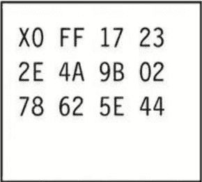
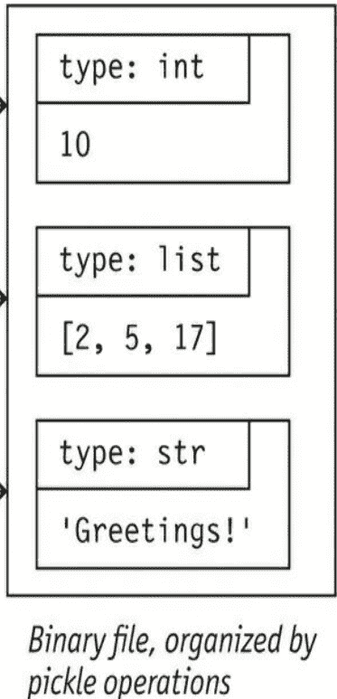

# 8. Text and Binary Files

最早的个人计算机使用老式的、慢速的磁带驱动器——相当于马车。但世界已经改变了。

没有改变的是文件和设备的重要性，它们都与持久存储有关。Python 提供了许多读写文件的方式。《Python Without Fear》介绍了文本 I/O 的基本技术。本章在这些技术的基础上，还探讨了读写原始或二进制数据的方法。

准备进入持久数据的精彩世界吧！但首先，回顾一下基础知识：具体到 Python，文本模式和二进制模式有什么区别？

# 8.1 TWO KINDS OF FILES: TEXT AND BINARY

Python 在文本文件和二进制文件之间做出了重大区别，如图 8.1 所示。




# Binary File

# Text File

(Hex code representation)

(Character representation)

**Figure 8.1.** Binary and text files

首先，文件访问模式存在低级差异。在文本模式下，会自动对换行符进行转换，替换为换行-回车对（顺序因系统而异）。使用正确的模式至关重要。

其次，在文本文件模式下，Python 要求读写标准 Python 字符串，这些字符串支持 ASCII 和 Unicode 编码。但二进制操作需要使用 **bytes** 类，它保证使用原始字节。

最后，写入文本涉及将数值数据转换为字符串格式。

# 8.1.1 Text Files

一个 _文本文件_ 是其中所有数据（大部分）都由文本字符组成的文件。所有数据——即使是数值数据——都旨在文本编辑器中查看和编辑。

这并不是说你不能将数字写入此类文件，但它们通常被写为可打印的数字字符。

文本文件的优势在于它们符合相对通用且简单的格式——由换行符分隔的文本行——而二进制文件没有普遍认可的格式。然而，后者在性能方面具有优势。

> performance Tip
> 如果数据文件包含大量数据且全部为数值，那么使用二进制格式处理它（与文本格式（默认）相反）的程序通常可以快几倍运行。这是因为它们不花费时间在昂贵的数值到文本或文本到数值的转换上。

# 8.1.2 Binary Files

二进制文件可以包含可打印数据，但不必如此。最大的区别发生在读写数字时。

如图 8.2 所示，文本文件操作将所有数据写为人类可读的字符，包括数字（即它们被写为十进制字符）。因此，数字 1,000 被写为字符“1”后跟三个“0”字符。

| 1 | , | 0 | 0 | 0 | (sp) | - | 1 | 0 | (sp) |
|---|---|---|---|---|---|---|---|---|---|

Text File: each byte contains a character.

| 1000 | -10 |
|---|---|

Binary File: structured into fixed-length interger fields.

**Figure 8.2.** Text versus binary operations

在计算机编程的最早时期，当程序员假设使用英语语言时，通常假设使用严格的 ASCII 格式，即每个字符一个字节。在当今环境中，通常使用 Unicode，它将一个字符映射到两个或多个字节而不是一个字节，以便能够表示其他人类语言。这就是为什么你不能再假设一个字节对应一个字节的原因。

在二进制模式下，数字 1,000 被直接写为数值——在此例中为四字节整数。人类语言对二进制表示没有影响。

二进制模式的优势包括速度提高和尺寸减小。然而，对二进制文件的操作需要了解正在使用的特定格式。

# 8.2 APPROACHES TO BINARY FILES: A SUMMARY

二进制文件对 Python 程序员来说可能很棘手，因为 Python 处理高级对象，而二进制文件由原始数据组成。

例如，Python 语言可能存储天文数字般的整数并占用许多字节的存储空间。但当你将整数写入文件时，你需要精确决定向文件写入多少字节。这对于文本字符串甚至浮点值也是一个问题，它们可以使用短格式或长格式。

Python 提供了帮助解决这些问题的包。至少有四种读写二进制文件的方法不需要下载任何额外软件。这些包都随标准 Python 下载一起提供。

- 通过将它们编码为 **bytes** 字符串来直接读写字节。
- 使用 **struct** 包来标准化数字和字符串的存储，以便可以一致地读取和写入。
- 使用 **pickle** 包以高级 Python 对象的形式读写项目。（试着快速说十遍“Python pickle package”。）
- 使用 **shelve** 包将整个数据文件视为一个由 Python 对象组成的大数据字典。

你可以直接读写字节，使用包含嵌入式十六进制代码的 **bytes** 字符串。这类似于进行机器语言编程。

或者，你可以使用 **struct** 包将常见的 Python 内置类型（整数、浮点数和字符串）转换为“C”类型，将它们放入字符串中并写入。这种技术——与写入原始字节不同——处理诸如将 Python 变量打包到特定大小的数据字段等困难。这样一来，当它们被读回时，会读取正确数量的字节。当你与现有二进制文件交互时，这种方法很有用。

当你创建新的二进制文件，以供其他 Python 程序读取时，可以使用 **pickle** 包将 Python 对象“腌制”。然后让包的例程来担心对象在存储到文件时如何精确表示。

最后，你可以使用 **shelve** 包，它建立在 pickle 之上，并且级别更高。搁置操作


pickles data but treats an entire file as one big dictionary. The location of any desired object, according to its key, is looked up, and the object is found quickly through random access.

## 8.3 文件/目录系统

Python 下载包附带了一个 **os**（操作系统）包，它使你能够检查文件/目录系统以及控制进程。你可以通过导入该包并获取其帮助来获得完整摘要。

```python
import os
help(os)
```

**os** 包支持的函数数量众多，无法在此处完全列出或描述。但是，以下列表提供了概述。

- 启动、结束或重复进程的函数：这些包括 **spawn**、**kill**、**abort** 和 **fork**。**fork** 函数基于现有进程生成一个新进程。
- 对文件/目录系统进行更改或导航的函数：这些包括 **rename**、**removedirs**、**chroot**、**getcwd**（获取当前工作目录）和 **rmdir**（删除目录）。还包括 **listdir**、**makedir** 和 **mkdir**。
- 修改文件标志和其他属性的函数：这些包括 **chflags**、**chmod** 和 **chown**。
- 获取或更改环境变量的函数：这些包括 `getenv`、`getenvb` 和 `putenv`。
- 执行新系统命令的函数：这些包括以名称 `exec` 开头的函数。
- 提供对文件 I/O 低级访问的函数：Python 读/写函数是基于这些构建的。这些包括 `open`、`read` 和 `write`。

`os` 和 `os.path` 包可以在尝试打开文件之前有效地检查文件是否存在，并为你提供从磁盘删除文件的能力。你可能需要谨慎使用该功能。

以下 IDLE 会话检查工作目录，切换到 Documents 子目录，然后再次检查当前工作目录。接着它检查名为 `pythag.py` 的文件是否存在，确认该文件存在。最后，该会话删除此文件并确认文件已被删除。


```python
>>> import os
>>> os.getcwd()
'/Users/brianoverland'
>>> os.chdir('Documents')
>>> os.path.isfile('pythag.py')
True
>>> os.remove('pythag.py')
>>> os.path.isfile('pythag.py')
False
```

通过调用 `os.path.isfile` 函数来检查文件是否存在通常是个好主意。另一个有用的函数是 `os.listdir`，它返回当前目录（默认情况下）或指定目录中所有文件名的列表。

```python
os.listdir()
```

## 8.4 处理文件打开异常

每当你打开文件时，都可能发生多个运行时错误（异常）。如果你优雅地处理异常，而不是让程序“直接崩溃”，你的程序将始终更加专业且易于使用。

最常见的异常之一是尝试打开不存在的文件进行读取时引发的。这很容易发生，因为用户可能会输入错误的字符。结果是引发 FileNotFoundError 异常。


```python
try:
    statement_block_1
except exception_class:
    statement_block_2
```

如果在执行 statement_block_1 期间引发异常，该异常会导致程序突然终止，除非 **except** 子句通过指定匹配的 _exception_class_ 捕获该异常。如果你希望程序查找多种类型的异常，可以使用多个 **except** 子句。

```python
try:
    statement_block_1
except exception_class_A:
    statement_block_A
[ except exception_class_B:
    statement_block_B ]...
```

在这种情况下，括号并非字面意思，而是表示可选项。省略号 (. .) 表示可能有任意数量的此类可选子句。还有另外两个可选子句：**else** 和 **finally**。你可以使用其中一个或两个。


```python
try:
    statement_block_1
except exception_class_A:
    statement_block_A
[ except exception_class_B:
    statement_block_B ]...
[ else:
    statement_block_2 ]
[ finally:
    statement_block_3 ]
```

可选的 **else** 子句在第一个语句块执行完毕且未引发异常时执行。**finally** 子句（如果存在）在所有其他块执行完毕后无条件执行。

以下是你可能使用这些功能以文本模式打开文件进行读取的方法：

Click here to view code image

```python
try:
    fname = input('Enter file to read:')
    f = open(fname, 'r')
    print(f.read())
except FileNotFoundError:
    print('File', fname, 'not found. Terminating.')
```

在这种情况下使用 **except** 处理找不到文件时引发的异常。通过处理此异常，你可以优雅地终止或执行其他操作。但是，它不会自动提示用户输入正确的文件名，而这通常是你想要的。

因此，你可能希望设置一个循环，直到 (1) 用户输入成功找到的文件名，或 (2) 用户通过输入空字符串表示想要退出时才终止。

因此，为了更灵活，你可以将 **try/except** 语法与 **while** 循环结合使用。该循环具有 **break** 条件，因此并非真正的无限循环。它会提示用户，直到用户输入有效的文件名或通过输入空字符串退出。

Click here to view code image

```python
while True:
    try:
        fname = input('Enter file name: ')
        if not fname:     # Quit on empty string.
            break
        f = open(fname)   # Attempt file open here.
        print(f.read())
        f.close()
        break
    except FileNotFoundError:
        print('File could not be found. Re-enter.')
```

以下是使用 **else** 子句的代码版本。此版本仅在未引发异常时调用 **close** 函数。代码在运行时的行为应相同，但此版本更有选择地使用关键字。

> Click here to view code image

```python
while True:
    fname = input('Enter file name: ')
    if not fname:
        break
    try:
        f = open(fname)   # Attempt file open here.
    except FileNotFoundError:
        print('File could not be found. Re-enter.')
    else:
        print(f.read())
        f.close()
        break
```

## 8.5 使用“WITH”关键字

执行文件操作最明显的方法是打开文件、执行文件 I/O，然后关闭文件。但是，如果在文件 I/O 读取过程中引发异常怎么办？程序会突然结束，而没有善后和优雅地关闭资源。

一个不错的快捷方式是使用 **with** 语句。该操作打开文件并通过变量允许访问。如果在执行块期间引发异常，文件会自动关闭，因此不会有文件句柄保持打开状态。


Click here to view code image

```python
with open(filename, mode_str) as file_obj:
    statements
```

在此语法中，*filename* 和 *mode_str* 参数与下一节中描述的 **open** 语句中的含义相同。*file_obj* 是你提供的变量名；该变量将被分配由 **open** 语句返回的文件对象。然后执行这些语句，直到（当然）引发异常。

以下是使用 **with** 关键字读取文本文件的示例：

Click here to view code image

```python
with open('stuff.txt', 'r') as f:
    lst = f.readlines()
    for thing in lst:
        print(thing, end='')
```

## 8.6 读/写操作摘要

表 8.1 总结了读取和写入文本、二进制和 pickle 文件的基本语法。

# Table 8.1. Syntax for Reading and Writing to Files

| Function or method | Description |
|---|---|
| `file = open(name, mode)` | Opens a file so that it can be written to or read. Common modes include text modes “w” and “r”, as well as binary modes “wb” and “rb”. Text-file mode (whether read or write) is the default. Also note that adding a plus sign (+) to the “r” or “w” mode specifies read/write mode. |
| `str = file.read()` | Text-file read operation. Reads the next line of text by reading up to the newline and returning the string that was read. The trailing newline is read as part of the string returned; therefore at least a newline is returned, except for one situation: If and |


| dline | e(si | ze = | -1) | 只有在已到达文件末尾（EOF）的情况下，此方法才返回空字符串。在读取文件最后一行的特殊情况下，此函数将返回不带换行符的字符串——除非换行符本身作为最后一个字符存在。 |
| --- | --- | --- | --- | --- |
| list | = | file | .rea | dlin | es () | 文本文件读取操作。通过返回一个列表来读取文件中的所有文本，列表中的每个成员都是一个包含一行文本的字符串。你可以假设，每一行文本（最后一行除外）都以换行符结尾。 |
| str | = | file | .rea | d(si | ze=-1 ) | 二进制文件读取，但也可用于文本文件。读取文件内容并将其作为字符串返回。size 参数控制读取的字节数，但如果设置为 -1（默认值），则读取所有内容并返回。在文本模式下，size 参数指的是字符数，而不是字节数。在二进制模式下，返回的字符串应被视为字节容器，而不是真正的文本字符串。 |
| file | .wri | te(t | ext) | 文本或二进制写入操作。返回写入的字节数（在文本模式下为字符数），这始终等于字符串的长度。在二进制模式下，字符串通常包含非字节字符串的数据；此类数据在写入前必须转换为字节字符串或 bytearray 格式。在文本模式下，此方法和 writelines 都不会自动追加换行符。 |

| `file.writelines(str_list)` | 主要用于文本模式的写入操作。写入一系列字符串。参数包含要写入的文本字符串列表。此方法不会向写入的数据追加换行符。因此，如果你希望列表中的每个元素都被视为单独的一行，则需要自行追加换行符。 |
| --- | --- |
| `file.writable()` | 如果文件可写入，则返回 **True**。 |
| `file.seek(pos, origin)` | 将文件指针移动到文件中的指示位置。如果支持随机访问，则此方法将文件指针移动到相对于原点（_orig_）的正或正负偏移量（_pos_），_orig_ 有三个参数：0 – 文件开头 1 – 当前位置 2 – 文件末尾 |
| `file.seekable()` | 如果文件系统支持随机访问，则返回 **True**。否则，使用 `seek` 或 `tell` 会引发 `UnsupportedOperation` 异常。 |
| `file.tell()` | 返回当前文件位置：从文件开头开始的字节数。 |

| 1() |
| --- |
| file .close() 关闭文件并刷新 I/O 缓冲区，以便所有挂起的读取或写入操作都在文件中实现。其他程序和进程现在可以自由访问该文件。 |
| pickle.dump(obj, file) 用于 pickle 操作。此方法创建 obj（一个对象）的二进制表示，并将该表示写入指定的文件。 |
| pickle.dumps(obj) 用于 pickle 操作。此方法返回 obj 的二进制表示，以字节形式，用于前一个方法 pickle.dump。此方法实际上不会写出对象，因此其用途有限。 |
| pickle.load(file) 用于 pickle 操作。此方法返回之前使用 pickle.dump 方法写入文件的对象。 |

请注意，pickle 函数要求你在使用其功能之前导入 **pickle** 包。

# 8.7 文本文件操作深入探讨

文本文件成功打开后，你几乎可以像在控制台上读写文本一样读写它。

> > 注意
> > 控制台交互由三个特殊文件支持——sys.stdin、sys.stdout 和 sys.stderr——这些文件永远不需要打开。通常不需要直接引用这些文件，但 input 和 print 函数实际上是通过与这些文件交互来工作的，尽管你通常看不到这一点。

有三种方法可用于从文件读取；它们都可以用于文本文件。


```python
str = file.read(size=-1)
str = file.readline(size=-1)
list = file.readlines()
```

read 方法读取文件的全部内容并将其作为单个字符串返回。如果需要，该字符串可以直接打印到屏幕上。如果有换行符，它们会嵌入到此字符串中。

可以指定 size 作为要读取的最大字符数。-1 的默认值会导致该方法读取整个文件。

**readline** 方法读取直到第一个换行符，或者直到达到指定的 _size_（如果指定）。如果读取了换行符，它会作为字符串的一部分返回。

最后，**readlines** 方法读取文件中的所有文本行，并将其作为字符串列表返回。与 **readline** 一样，读取的每个字符串（如果存在）都包含尾随换行符。（因此，所有字符串都会有换行符，最后一个除外。）

有两种方法可用于向文本文件写入。


Click here to view code image

```
file.write(str)
file.writelines(str | list_of_str)
```

**write** 和 **writelines** 方法不会自动追加换行符，因此如果你想将文本作为一系列独立的行写入文件，则需要自行追加这些换行符。

两种方法之间的区别在于，**write** 方法返回写入的字符数或字节数。**writelines** 方法接受两种参数：你可以传递单个字符串或字符串列表。

一个简单的示例说明了文件读取和写入之间的交互。

Click here to view code image

```
with open('file.txt', 'w') as f:
    f.write('To be or not to be\n')
    f.write('That is the question.\n')
    f.write('Whether tis nobler in the mind\n')
    f.write('To suffer the slings and arrows\n')

with open('file.txt', 'r') as f:
    print(f.read())
```

此示例将一系列字符串作为单独的行写出，然后直接打印内容，包括换行符。

> Click here to view code image


使用 **readline** 或 **readlines** 读取同一文件——它们都将换行符视为分隔符——同样会读取每个字符串末尾的换行符。下面是一个一次读取一行并打印的示例。

> Click here to view code image

```
with open('file.txt', 'r') as f:
    s = ' ' # Set to a blank space initially
    while s:
        s = f.readline()
        print(s)
```

**readline** 方法返回文件中的下一行，其中“行”定义为直到下一个换行符或文件末尾的文本。只有在已达到文件末尾条件（EOF）时，它才返回空字符串。但是，**print** 函数会自动打印一个额外的换行符，除非你使用 **end** 参数来抑制该行为。在这种情况下，输出为


```
```
To be or not to be.

That is the question.

Whether tis nobler in the mind

To suffer the slings and arrows
```
```

**print** 函数参数 `end=' '` 将避免打印额外的换行符。或者，你可以从读取的字符串中删除换行符，如下所示。


```
```
with open('file.txt', 'r') as f:
    s = ' '    # Set to a blank space, initially
    while s:
        s = f.readline()
        s = s.rstrip('\n')
        print(s)
```
```

尽管这应该是一个简单的操作，但这看起来开始变得复杂。更简单的解决方案可能是使用 **readlines** 方法（注意使用了复数形式）将整个文件读入列表，然后可以像这样读取列表。此方法也会获取尾随换行符。

Click here to view code image

```
with open('file.txt', 'r') as f:
    str_list = f.readlines()
    for s in str_list:
        print(s, end='')
```

但最简单的解决方案——只要你不需要将字符串放入列表中——就是一次性读取整个文件，通过简单地调用 **read** 方法，然后打印所有内容，如前所示。

# 8.8 使用文件指针（“SEEK”）

如果你打开支持随机访问的文件，可以使用 **seek** 和 **tell** 方法移动到文件中的任何位置。


```
file.seek(pos, orig)
file.seekable()
file.tell()
```

**seekable** 方法包含在内，以防你需要检查文件系统或设备是否支持随机访问操作。大多数文件都支持。尝试在不


there being support for random access causes an exception to be raised.

The **seek** method is sometimes useful even in programs that don’t use random access. When you read a file, in either text or binary mode, reading starts at the beginning and goes sequentially forward.

What if you want to read a file again, from the beginning? Usually you won’t need to do that, but we’ve found it useful in testing, in which you want to rerun the file-read operations. You can always use **seek** to return to the beginning.

Click here to view code image

```
file_obj.seek(0, 0)  # Go back to beginning of the file.
```

This statement assumes that **file_obj** is a successfully opened file object. The first argument is an offset. The second argument specifies the origin value 0, which indicates the beginning of the file. Therefore, the effect of this statement is to reset the file pointer to the beginning of the file.

The possible values for _offset_ are 0, 1, and 2, indicating the beginning, current position, and end of the file.

Moving the file pointer also affects writing operations, which could cause you to write over data you’ve already written. If you move to the end of the file, any writing operations effectively append data.

Otherwise, random access is often most useful in binary files that have a series of fixed-length records. In that case, you can directly access a record by using its zero-based index and multiplying by the record size:

Click here to view code image

```
file_obj.seek(rec_size * rec_num, 0)
```

The **tell** method is the converse of **seek**. It returns an offset number that tells the number of bytes from the beginning of the file. A value of 0 indicates that the beginning of the file is in fact your current position.

Click here to view code image

```
file_pointer = file_obj.tell()
```

## 8.9 将文本读入 RPN 项目

有了读写文本文件的能力，我们可以为逆波兰表示法（RPN）项目添加新功能。经过本节的更改后，你将能够打开一个由 RPN 语句组成的文本文件，逐个执行这些语句，并打印结果。

在添加文本文件读取能力后，我们将朝着构建功能齐全的语言解释器迈出重要一步。

### 8.9.1 迄今为止的 RPN 解释器

程序的当前版本继承自第 7 章，使用正则表达式语法和 Scanner 对象对 RPN 语句进行词法分析和解析。程序一次评估一个 RPN 语句，遇到空行时退出。

针对输入的每一行 RPN，程序输入该行代码并打印该 RPN 语句的最终数值。

Click here to view code image

```
import re
import operator

stack = []   # Stack to hold the values.

# Scanner object. Isolate each token and take
# appropriate action: push a numeric value, but
# perform
# operation on top two elements on stack if an
# operator
# is found.
scanner = re.Scanner([
    (r"[ \t\n]", lambda s, t: None),
    (r"-?(\d*\.)?\d+", lambda s, t:
        stack.append(float(t))),
    (r"\d+", lambda s, t: stack.append(int(t))),
    (r"[+]", lambda s, t: bin_op(operator.add)),
    (r"[-]", lambda s, t: bin_op(operator.sub)),
    (r"[*]", lambda s, t: bin_op(operator.mul)),
    (r"[/]", lambda s, t: bin_op(operator.truediv)),
    (r"[\^]", lambda s, t: bin_op(operator.pow)),
])

# Binary Operator function. Pop top two elements
from
# stack and push the result back on the stack.

def bin_op(action):
    op2, op1 = stack.pop(), stack.pop()
    stack.append(action(op1, op2))

def main():
    while True:
        input_str = input('Enter RPN line: ')
        if not input_str:
            break
        try:
            tokens, unknown =
scanner.scan(input_str)
            if unknown:
                print('Unrecognized input:',
unknown)
            else:
                print(str(stack[-1]))
        except IndexError:
            print('Stack underflow.')

main()
```

以下是示例会话：

> Click here to view code image

```
Enter RPN line: 25 4 *
100.0
Enter RPN line: 25 4 * 50.75-
49.25
Enter RPN line: 3 3* 4 4* + .5^
5.0
Enter RPN line:
```

每一行 RPN 代码——尽管间距不同且不一致——都能被程序正确读取和评估。例如，第三行输入（加粗部分）是勾股定理的一个示例，因为它正在计算

Click here to view code image

```
square_root((3 * 3) + (4 * 4))
```

的值。

### 8.9.2 从文本文件读取 RPN

下一步是让程序打开一个文本文件并从中读取 RPN 语句。“语句”可以由一系列运算符和数字组成，就像前面示例中所示，但程序在评估每个语句后应该做什么呢？

目前，让我们采用一条简单的规则：如果要读取的文件中的某行文本为空，则不执行任何操作。但如果该行有任何输入，则执行该行 RPN 代码并打印结果，该结果应可作为 `stack[-1]`（栈顶）获得。

程序的新版本如下。请注意，加粗的行表示新增或大幅修改的行。此外，`open_rpn_file` 定义是新的。

Click here to view code image

```
import re
import operator

stack = []   # Stack to hold the values.

# Scanner object. Isolate each token and take
# appropriate action: push a numeric value, but
perform
# operation on top two elements on stack if an
operator
# is found.

scanner = re.Scanner([
    (r"[ \t\n]", lambda s, t: None),
    (r"-?(\d*\.)?\d+", lambda s, t:
        stack.append(float(t))),
    (r"\d+", lambda s, t: stack.append(int(t))),
    (r"[+]", lambda s, t: bin_op(operator.add)),
    (r"[-]", lambda s, t: bin_op(operator.sub)),
    (r"[*]", lambda s, t: bin_op(operator.mul)),
    (r"[/]", lambda s, t: bin_op(operator.truediv)),
    (r"[^]", lambda s, t: bin_op(operator.pow)),
])
# Binary Operator function. Pop top two elements
from
# stack and push the result back on the stack.

def bin_op(action):
    op2, op1 = stack.pop(), stack.pop()
    stack.append(action(op1, op2))

def main():
    a_list = open_rpn_file()
    if not a_list:
        print('Bye!')
        return

    for a_line in a_list:
        a_line = a_line.strip()
        if a_line:
            tokens, unknown = scanner.scan(a_line)
            if unknown:
                print('Unrecognized input:',
                      unknown)
            else:
                print(str(stack[-1]))

def open_rpn_file():
    ''"Open-source-file function. Open a named
    file and read lines into a list, which is
    returned.
    ''"
    while True:
        try:
            fname = input('Enter RPN source: ')
            f = open(fname, 'r')
            if not f:
                return None
            else:
                break
        except:
            print('File not found. Re-enter.')
    a_list = f.readlines()
    return a_list

main()
```

让我们进一步假设，同一目录下有一个名为 `rpn.txt` 的文件，其内容如下：

```
3 3 * 4 4 * + .5 ^
1 1 * 1 1 * + .5 ^
```

有了这个文件和新版本的 RPN 解释器程序，以下是示例会话。

```
Enter RPN source: rppn.txt
File not found. Re-enter.
Enter RPN source: rpn.txt
5.0
1.4142135623730951
```

该程序的行为完全符合设计。当输入 RPN 文件名（rpn.txt）时，程序会按需评估每一行。

请注意，rpn.txt 的第一行被故意留空，作为测试。程序如预期般跳过了它。

此版本程序的基本操作是打开一个文本文件，该文件理想情况下包含语法正确的 RPN 语言语句。当成功打开有效文本文件时，open_rpn_file 函数返回一个文本行列表。main 函数随后逐个评估该列表中的每个成员。

但我们才刚刚开始。下一步是扩展 RPN 语言的语法，使其能够将值赋给变量，就像 Python 本身所做的那样。

### 8.9.3 为 RPN 添加赋值运算符

RPN“语言”即将变得更加有趣。我们将使其能够识别和存储符号名称。如何实现这一点？

我们需要一个符号表。Python 提供了一种特别方便、快速且简单的方法来实现这一点：使用数据字典。记住，你可以通过赋值 { } 来创建一个空字典。

```
sym_tab = { }
```

现在我们可以向符号表添加条目。以下


RPN 语法会赋予一个值；与 Python 本身一样，如果符号尚不存在，则会创建它。否则，其值将被新值替换。


```
`symbol expression =`
```

以下是一些示例：

```
`x 35.5 =
x 2 2 + =
my_val 4 2.5 * 2 + =
x my_val +`
```

这些语句的效果应该是将值 35.5 放入 `x`，然后将 4（即 2 + 2）放入 `x`，接着将 12 放入 `my_val`。最后，效果是将表达式 `x my_val +` 放在栈顶，这应该会导致打印出值 16。

得益于 Python 的字典功能，向表中添加符号非常容易。例如，你可以将符号 `x` 放入表中，其值为 35.5。

```
`sym_tab['x'] = 35.5`
```

我们可以将此操作纳入 Scanner 对象，以及其他操作。

```
scanner = re.Scanner([
    (r"[ \t\n]", lambda s, t: None),
    (r"[+-]*(/\d*.)?/\d+", lambda s, t:
        stack.append(float(t))),
    (r"\d+", lambda s, t: stack.append(int(t))),
    (r"[a-zA-Z_][a-zA-Z_0-9]*", lambda s, t:
        stack.append(t)),
    (r"[+]", lambda s, t: bin_op(operator.add)),
    (r"[-]", lambda s, t: bin_op(operator.sub)),
    (r"[*]", lambda s, t: bin_op(operator.mul)),
    (r"[/]", lambda s, t: bin_op(operator.truediv)),
    (r"[^]", lambda s, t: bin_op(operator.pow)),
    (r"[=]", lambda s, t: assign_op()),
])
```

在这个新版本的 `scanner` 中，以下正则表达式表示：“查找以小写字母、大写字母或下划线（_）开头，然后包含零个或多个这些字符或数字字符的模式。”

该项作为字符串添加到栈中。请注意，Python 列表可以自由混合字符串和数字。当添加这样的符号时，它将被存储为字符串。因此，它可能是赋值的目标。`assign_op` 函数定义如下：

```
def assign_op():
    op2, op1 = stack.pop(), stack.pop()
    if type(op2) == str:  # Source may be another
    var!
    op2 = sym_tab[op2]

sym_tab[op1] = op2
```

虽然 `op1` 指的是变量名（即 RPN 语言中的变量），但 `op2` 可能指的是变量名或数值。因此，与下一块代码一样，如果 `op2` 是字符串，则必须在符号表 `sym_tab` 中查找它。

> **注意**
>
> 在前面的示例中，如果 `op1` 不指向变量名，则表示语法错误。

在其他二进制操作（如加法、乘法等）的情况下，每个操作数可能是符号名（存储在字符串中）或数值。因此，使用 `bin_op` 函数时，有必要检查每个操作数的类型，如果是字符串，则查找其值。

单击此处查看代码图片

```
def bin_op(action):
    op2, op1 = stack.pop(), stack.pop()
    if type(op1) == str:
        op1 = sym_tab[op1]
    if type(op2) == str:
        op2 = sym_tab[op2]
    stack.append(action(op1, op2))
```

现在我们可以创建完全修订后的应用程序。然而，这引发了一个设计问题。程序是否应该评估并打印每一行 RPN 的结果？

可能不应该，因为某些 RPN 行仅仅会赋值，而这种操作不会将任何值放在栈顶。因此，这个版本的程序只打印最终结果，不打印任何其他结果。除了输入和错误消息，这个版本的应用程序会等到执行结束后再打印任何内容。

单击此处查看代码图片

```
import re
import operator

# Provide a symbol table; values of variables will
#   stored here.
sym_tab = { }
stack = []    # Stack to hold the values.

# Scanner: Add items to recognize variable names,
# which
#   are stored in the symbol table, and to perform
#   assignments, which enter values into the sym.
#   table.

scanner = re.Scanner([
    (r"[ \t\n]", lambda s, t: None),
    (r"[+-]*(?:\d\*.)?\d+", lambda s, t:
        stack.append(float(t))),
    (r"[a-zA-Z_][a-zA-Z_0-9]*", lambda s, t:
        stack.append(t)),
    (r"\d+", lambda s, t: stack.append(int(t))),
    (r"[+]", lambda s, t: bin_op(operator.add)),
    (r"[-]", lambda s, t: bin_op(operator.sub)),
    (r"[*]", lambda s, t: bin_op(operator.mul)),
    (r"[/]", lambda s, t: bin_op(operator.truediv)),
    (r"[^]", lambda s, t: bin_op(operator.pow)),
    (r"[=]", lambda s, t: assign_op()),
])
```

```
])def assign_op():
    '''Assignment Operator function: Pop off a name
    and a value, and make a symbol-table entry.
    Remember
    to look up op2 in the symbol table if it is a
    string.
    '''
    op2, op1 = stack.pop(), stack.pop()
    if type(op2) == str:   # Source may be another
    var!
        op2 = sym_tab[op2]
    sym_tab[op1] = op2
def bin_op(action):
    '''Binary Operation evaluator: If an operand is
    a variable name, look it up in the symbol table
    and replace with the corresponding value, before
    being evaluated.
    '''
    op2, op1 = stack.pop(), stack.pop()
    if type(op1) == str:
        op1 = sym_tab[op1]
    if type(op2) == str:
        op2 = sym_tab[op2]
    stack.append(action(op1, op2))
def main():
    a_list = open_rpn_file()
    if not a_list:
        print('Bye!')
        return
    for a_line in a_list:
        a_line = a_line.strip()
        if a_line:
            tokens, unknown = scanner.scan(a_line)
            if unknown:

print('Unrecognized input:',
unknown)
print(str(stack[-1]))
def open_rpn_file():
    """Open-source-file function. Open a named
    file and read lines into a list, which is
    returned.
    """
    while True:
        try:
            fname = input('Enter RPN source: ')
            if not fname:
                return None
            f = open(fname, 'r')
            break
        except:
            print('File not found. Re-enter.')
    a_list = f.readlines()
    return a_list
main()
```

以下是一个示例会话。假设文件 `rpn2.txt` 包含以下内容：

单击此处查看代码图片

```
side1 30 =
side2 40 =
sum side1 side1 * side2 side2 *+ =
sum 0.5 ^
```

如果正确执行，这些 RPN 语句的效果是将勾股定理应用于输入 30 和 40，理应输出 50.0。如果 `rpn2.txt` 的内容如下，则

以下会话演示了它是如何被评估的。

```
Enter RPN source: rpn2.txt
50.0
```

该程序存在一些局限性。并非每种错误都能在此得到正确报告。另外，如果最后一条语句是赋值，理想情况下程序应报告赋值的值，但它没有这样做。

我们将在第 14 章中解决这个问题，通过向 RPN 语法添加 INPUT 和 PRINT 语句。

在离开此话题之前，让我们回顾一下这个 Python 程序的工作原理。首先，它设置一个 Scanner 对象，其用法在第 7 章“正则表达式 II”中已解释。该对象查找单个项目或标记，并根据标记的类型采取相应操作。

+   • 如果找到数值表达式，则将其转换为真实数字并放入栈中。

+   • 如果是符号名（即变量），则将其作为字符串放入栈中；之后，作为赋值的结果，它可以被添加到符号表中。

+   • 如果是操作符，则将栈中最近的两个操作数弹出并进行求值，结果重新放回栈中。赋值（=）是一个例外，它不会将任何内容放入栈中（尽管可以说，也许应该这样做）。

还有一个新的变化：如果从栈中弹出一个变量名，则会在符号表中查找它，并在将操作数用作操作的一部分之前，用变量的值替换该操作数。

> **注意**
>
> 如果你浏览本应用程序中的代码，可能会注意到符号查找代码是重复的，可以用函数调用来替代。该函数必须以足够通用的方式编写，以适应任何操作数，但这不应该很难。这种方法只能节省一两行代码，但它是 _代码重构_ 的合理用途，代码重构会收集相似操作并用公共函数调用替代它们。例如，目前代码使用
>
> ```
> if type(op1) == str:
>     op1 = sym_tab[op1]
> ```
>
> 这可以替换为公共函数调用，如下所示：
>
> ```
> op1 = symbol_look_up(op1)
> ```
>
> 当然，你需要定义该函数。

## 8.10 直接二进制读/写

在本章的其余部分，我们将进入读写二进制文件的新领域。

当你以二进制模式打开文件时，如果选择，可以直接将字节数据读写到文件中。这些操作处理的是类型为 **bytes** 的字符串。

Python 中的低级二进制读写操作使用了一些与文本文件操作相同的方法，但使用的是 **bytes** 数据。


## 8.11 将数据转换为固定长度字段（“结构”）

如果你正在创建一个需要从头开始读写新数据文件的应用程序，你会发现 pickle 接口是最易于使用的，你可能希望直接跳到下一节。

但是，如果你需要与非 Python 创建的现有二进制文件进行交互，你就需要一个更低级别的解决方案，它能让你读写各种大小的整数和浮点数，以及字符串。虽然可以通过一次读写一个字节来实现这一点——如上一节所示——但这是一种不可移植且困难的做法。

**struct** 包有助于将熟悉的内置类型打包和解包为字节字符串。它包含若干函数调用。

```python
import struct
bytes_str = struct.pack(format_str, v1, v2, v3...)
v1, v2, v3... = struct.unpack(format_str, bytes_str)
struct.calcsize(format_str)
```

**struct.pack** 函数接受一个格式字符串（参见表 8.2）和一系列一个或多个值。它返回一个可以写入二进制文件的 **bytes** 字符串。

**struct.unpack** 函数执行相反的操作，接受一个类型为 **bytes** 的字符串，并返回一系列值，以元组形式返回。值的数量和类型由 _format_str_ 参数控制。

**calcsize** 函数返回给定 _format_str_ 参数所需的字节数。虽然 _bytes_str_ 的类型为 **bytes**，但格式字符串是一个普通的 Python 字符串。

表 8.2 列出了此上下文中格式字符串中可以出现的字符（不要与第 5 章中的格式混淆）。

# 表 8.2. 打包和解包的常见数据格式

| 格式说明符 | C 语言类型 | Python 类 | 大小 |
|---|---|---|---|
| c | char | bytes | 1 |
| ? | bool | bool | 1 |
| h | short | int | 2 |
| H | unsigned short | int | 2 |
| l | long | int | 4 |
| L | unsigned long | int | 4 |
| q | long long | int | 8 |
| Q | unsigned long | int | 8 |
| f | float | float | 4 |
| d | double | float | 8 |
| ints | char[] | str | int length |
| P | Pascal 字符串类型；有关更多信息，请参阅在线帮助。 | | |

表 8.2 在第二列中列出了 C 语言数据类型。许多其他语言通常有短整数和长整数、短浮点数和长浮点数的概念，这些类型与这些类型对应。（但是，Python 整数需要“打包”，如本节所示。）

> **注意**
>
> 整数前缀可以应用于字符串以外的字段。例如，‘3f’ 与 ‘fff’ 相同。

要使用 **struct** 包写入二进制文件，请执行以下步骤。

- 以二进制写入模式（`'wb'`）打开文件。
- 如果要写入字符串，请先使用字符串类的 **encode** 方法将其转换为 **bytes** 字符串。
- 使用 **struct.pack** 函数从所有数据中创建一个打包的 **bytes** 字符串。你需要使用表 8.2 中列出的一个或多个数据格式说明符，例如用于 16 位整数的 `'h'`。你包含的任何字符串都需要像步骤 2 中描述的那样已经编码。
- 最后，使用文件对象的 **write** 方法将字节字符串写入文件。

使用 **struct** 包从二进制文件读取的过程类似。

- 以二进制读取模式（`'rb'`）打开文件。
- 读入一串字节。你必须指定要读取的确切字节数，因此你需要提前知道记录的大小；你可以根据表 8.2 中的字符在数据格式字符串上运行 **struct.calcsize** 函数来确定它。

```python
bss = f.read(struct.calcsize('h'))
```

- 使用 **struct.unpack** 函数将 **bytes** 字符串解包为值的元组。因为结果是一个元组，所以你需要使用索引来访问单个元素，即使只有一个元素。这是一个示例：

```python
tup = unpack('h', bss)
return tup[0]
```

- 如果在步骤 3 中，你读入了一个打算赋值给普通 Python 字符串的 **bytes** 字符串，请使用 **bytes** 类的 **decode** 方法转换你读取的每个字符串。

由于这些技术涉及字节的低级位置，由于大端序与小端序以及填充，存在一些特殊注意事项。但首先，接下来的几个小节将处理特定问题：

- 一次读写一个数字
- 一次读写多个数字
- 读写固定长度字符串
- 读写可变长度字符串
- 读写混合数据的组合

## 8.11.1 一次读写一个数字

一次读写一个打包数字（本示例中为整数）的问题相当简单，但在读取过程中，请记住返回的是一个元组，即使只有一个元素，也需要对其进行索引。

```python
from struct import pack, unpack, calcsize
```

```python
def write_num(fname, n):
    with open(fname, 'wb') as f:
        bss = pack('h', n)
        f.write(bss)

def read_num(fname):
    with open(fname, 'rb') as f:
        bss = f.read(calcsize('h'))
        t = struct.unpack('h', bss)
        return t[0]
```

有了这些定义，你就可以将单个整数读写到文件中，假设这些整数适合短整数（16 位）格式。较大的值可能需要更大的数据格式。

这是一个示例：

```python
write_num('silly.dat', 125)
print(read_num('silly.dat')) # Write the number
125.
```

## 8.11.2 一次读写多个数字

这个问题与上一节中的问题类似；但是，因为它返回不止一个数字，最简单的解决方案是将 **read** 函数的返回值解释为元组。为了变化，这次我们使用浮点数——三个。


from struct import pack, unpack, calcsize

def write_floats(fname, x, y, z):
    with open(fname, 'wb') as f:
        bss = pack('fff', x, y, z)
        f.write(bss)

def read_floats(fname):
    with open(fname, 'rb') as f:
        bss = f.read(calcsize('fff'))
        return unpack('fff', bss)

注意，在本示例中，`'fff'` 可以替换为 `'3f'`。
下一个示例展示了如何使用这些函数一次读取和写入三个浮点数。

Click here to view code image

```
write_floats('silly.dat', 1, 2, 3.14)
x, y, z = read_floats('silly.dat')
print(x, y, z, sep=' ')
```

将打印出这三个值——最后一个值带有明显的舍入误差。

Click here to view code image

```
1.0   2.0   3.140000104904175
```

## 8.11.3 写入和读取固定长度字符串

字符串——你可能会认为它应该是最容易处理的——却为二进制存储带来了特殊问题。首先，

由于不能假设 Python 字符串使用单字节格式，因此有必要对其进行编码或解码以获取 **bytes** 字符串。

其次，由于字符串长度不一，使用二进制操作时就会引发这样一个问题：到底应该读取或写入多少个字符！这是一个非平凡的问题。但至少有两种解决方案。一种解决方案是在函数调用中指定要读取或写入的字符数。

Click here to view code image

```
from struct import pack, unpack, calcsize
def write_fixed_str(fname, n, s):
    with open(fname, 'wb') as f:
        bss = pack(str(n) + 's', s.encode('utf-8'))
        f.write(bss)
def read_fixed_str(fname, n):
    with open(fname, 'rb') as f:
        bss = f.read(n)
        return bss.decode('utf-8')
```

这对函数必须事先就要读取或写入的字符串精确长度达成一致。因此，它们必须完全同步。

当 `write_fixed_str` 调用 **pack** 函数时，该函数会自动截断或填充字符串（添加额外的空字节），使其长度正好为 n。

Click here to view code image

```
write_fixed_str('king.d', 13, "I'm Henry the VIII I am!")
print(read_fixed_str('king.d', 13))
```

第二行只读取 13 个字符，因为只有 13 个字符可读。它打印

```
I'm Henry the
```

## 8.11.4 写入和读取可变长度字符串

这种方法比上一节中的方法更复杂，因为函数的用户可以传入任意字符串作为参数，并且会写入或读取正确数量的字节。

Click here to view code image

```
from struct import pack, unpack, calcsize
def write_var_str(fname, s):
    with open(fname, 'wb') as f:
        n = len(s)
        fmt = 'h' + str(n) + 's'
        bss = pack(fmt, n, s.encode('utf-8'))
        f.write(bss)
def read_var_str(fname):
    with open(fname, 'rb') as f:
        bss = f.read(calcsize('h'))
        n = unpack('h', bss)[0]
        bss = f.read(n)
        return bss.decode('utf-8')
```

`write_var_str` 函数需要做一些技巧处理。首先，它创建一个形如 **hnums** 的字符串格式说明符。在下一个示例中，该格式说明符是 `h24s`，意思是，“写入（并稍后读取）一个整数，后跟一个包含 24 个字符的字符串。”

`read_var_str` 函数随后读取一个整数——在此例中为 24——并使用该整数来确定要读取的确切字节数。最后，这些字节被解码回标准 Python 文本字符串。

下面是一个相关示例：


```
write_var_str('silly.dat', "I'm Henry the VIII I am!")
print(read_var_str('silly.dat'))
```

这些语句打印

```
I'm Henry the VIII I am!
```

## 8.11.5 一起写入和读取字符串与数值

下面是一对函数，用于读取和写入一条记录，该记录由一个九字符长度的字符串、一个十字符长度的字符串和一个浮点数组成。


```
from struct import pack, unpack, calcsize
def write_rec(fname, name, addr, rating):
    with open(fname, 'wb') as f:
        bname = name.encode('utf-8')
        baddr = addr.encode('utf-8')
        bss = pack('9s10sf', bname, baddr, rating)
        f.write(bss)

def read_rec(fname):
    with open(fname, 'rb') as f:
        bss = f.read(calcsize('9s10sf'))
        bname, baddr, rating = unpack(
            '9s10sf', bss)
        name = bname.decode('utf-8').rstrip('\x00')
        addr = baddr.decode('utf-8').rstrip('\x00')
        return name, addr, rating
```

下面是一个用法示例：

> Click here to view code image

```
write_rec('goofy.dat', 'Cleo', 'Main St.', 5.0)
print(read_rec('goofy.dat'))
```

这些语句产生如下元组，符合预期：

```
('Cleo', 'A Str.', 5.0)
```

> ### Note
> **pack** 函数的优点在于根据需要插入内部填充，从而确保数据类型正确对齐。例如，四字节浮点值需要从 4 的倍数地址开始。在前面的示例中，**pack** 函数添加额外的空字节，使浮点值从正确对齐的地址开始。
> 
> 然而，这里的局限性在于，即使使用 **pack** 函数在单个记录内对齐所有内容，也不一定能保证对 *下一* 条记录进行正确的写入和读取。如果最后写入或读取的项目是非对齐大小的字符串，那么可能需要为每条记录填充字节。例如，考虑

以下记录：
Click here to view code image

```
bss = pack('ff9s', 1.2, 3.14, 'I\'m Henry'.encode('utf-8'))
```

填充是一个棘手的问题，但取决于代码运行的系统，你偶尔可能需要考虑它。Python 官方规范指出，写入操作将与最后写入对象的对齐方式兼容。Python 会在需要时添加额外字节。
因此，要将结构体的末尾对齐到特定类型（例如浮点数）的对齐要求，你需要在格式字符串末尾使用该类型的代码；但如果你愿意，最后一个对象可以具有重复计数为 0。在以下情况下，这意味着你需要写入一个“虚拟”浮点值，以保证与下一个要写入的浮点类型对齐。
Click here to view code image

```
bss = pack('ff9s0f', 1.2, 3.14,
'I\'m Henry'.encode('utf-8'))
```

## 8.11.6 低级细节：大端序与小端序

考虑写入三个整数而非仅一个整数的问题。
Click here to view code image

```
import struct
with open('junk.dat', 'wb') as f:
 bstr = struct.pack('hhh', 1, 2, 100)
datalen = f.write(bstr)
```

如果你计算变量 datalen（存储实际写入的字节数），你会发现它等于 6。

你也可以使用 **calcsize** 找到这个数字。这是因为数字 1、2 和 100 各被写为 2 字节整数（格式 **h**）。在 Python 本身中，此类整数占用的空间要大得多。
你可以使用类似的代码稍后从文件中读取这些值。

Click here to view code image

```
with open('junk.dat', 'rb') as f:
    bstr = f.read(struct.calcsize('hhh'))
    a, b, c = struct.unpack('hhh', bstr)
    print(a, b, c)
```

运行这些语句块后，你应该得到 a、b 和 c 的以下值，反映出写入的相同值：

```
1 2 100
```

下一个示例使用了一个更有趣的情况：两个整数后跟一个长整数。在本示例之后，我们将讨论涉及的复杂性。

Click here to view code image

```
with open('junk.dat', 'wb') as f:
    bstr = struct.pack('hhl', 1, 2, 100)
    datalen = f.write(bstr)

with open('junk.dat', 'rb') as f:
    bstr = f.read(struct.calcsize('hhl'))
    a, b, c = struct.unpack('hhq', bstr)
```

本示例应与之前一样工作（只是使用 **hh1** 格式而非 **hhh**），但打印出字节字符串 `bstr` 揭示了一些重要细节：

Click here to view code image

```
b'\x01\x00\x02\x00\x00\x00\x00\x00\x00d\x00\x00\x00\x00\x00\x00\x00\x00\x00\x00\x00'
```

以下是一些需要注意的事项。

- 如果你仔细观察字节排列，本示例和前面的代码（如果你查看 **bytes** 字符串）都揭示了 *小端序* 字节排列的使用：在整数字段中，最低有效位首先放置。这发生在我的系统上，因为它是一台使用摩托罗拉处理器的 Macintosh。每个处理器可能使用不同的标准。

- 第二，由于长整数（等于 100，即十六进制值 d）必须从 32 位边界开始，因此在第二个参数和第三个参数之间放置了 2 个字节的填充。前一节末尾的注释提到了这个问题。

可能出错的事情之一是尝试读取一个数据文件，而写入数据时使用的处理器采用大端序字节排列，而你的系统使用小端序，反之亦然。因此，**struct** 函数允许你通过在格式字符串开头指定大端序或小端序来行使一些控制。表 8.3 列出了处理二进制数据的低级模式。

| Table 8.3. Low-Level Read/Write Modes |
|---|


| 符号 | 含义 |
|------|------|
| >    | 小端序 |
| >    | 大端序 |
| @    | 本地机器原生字节序 |

例如，要将两个长整数打包成字节字符串，具体使用小端存储，请使用以下语句：

Click here to view code image

```
with open('junk.dat', 'wb') as f:
    bstr = struct.pack('<hhl', 1, 2, 100)
    datalen = f.write(bstr)
```

## 8.12 使用 Pickle 包

累了吗？Pickle 接口提供了一种更简单的读写数据文件的方式。

从概念上讲，Pickle 数据文件应被视为一系列 Python 对象，每个对象都存在于一种“黑盒”中，通过 Pickle 进行读取或写入。你无法进入这些对象（至少不容易做到），但你也不需要这样做。你只需一次读取或写入一个对象即可。

图 8.3 提供了这种数据文件布局的概念图。



### 图 8.3 Pickle 数据文件

这种协议的优点在于，当你将项目读回程序时，你读取的是完整的对象。要查询读取的每个对象的类型，可以使用 `type` 函数，或者直接将对象传递给 `print` 函数。

Pickle 由以下两个函数支持：

Click here to view code image

```
import pickle
pickle.dump(value, file_obj)  # Write object to file.
value = pickle.load(file_obj)  # Load object from file.
```

使用这种方法，你只需知道你正在一次读取和写入 Python 对象——尽管这些对象可能包含集合，因此可能非常大。甚至不需要事先知道你正在读取和写入什么类型，因为你可以通过检查来发现。

例如，以下代码块写入三个 Python 对象，在此示例中，它们分别是一个列表、一个字符串和一个浮点数值。

Click here to view code image

```
import pickle
with open('goo.dat', 'wb') as f:
    pickle.dump([1, 2, 3], f)
    pickle.dump('Hello!', f)
    pickle.dump(3.141592, f)
```

该过程简单可靠，前提是该文件将由另一个使用 Pickle 包的 Python 应用程序读取。例如，以下代码块从文件 goo.dat 读取这三个对象，并打印出每个对象的字符串表示和类型。

Click here to view code image

```
with open('goo.dat', 'rb') as f:
    a = pickle.load(f)
    b = pickle.load(f)
    c = pickle.load(f)
    print(type(a), a)
    print(type(b), b)
    print(type(c), c)
```

此示例打印

```
<class 'list'> [1, 2, 3]
<class 'str'> Hello!
<class 'float'> 2.3
```

Pickle 易于使用，部分原因在于——与读取简单的字节序列不同——其效果是以全部荣耀加载一个 Python 对象。你可以对对象做很多事情，包括获取其类型，如果它是集合，还可以获取其长度。

> Click here to view code image

```
if type(a)==list:
    print('The length of a is ', a)
```

Pickle 唯一的真正限制是，当你打开一个文件时，可能不知道写入了多少个对象。一种解决方案是尽可能多地加载对象，直到程序引发 EOFError 异常。以下是一个示例：

> Click here to view code image

```
loaded = []
with open('goo.dat', 'rb') as f:
    while True:
        try:
            item = pickle.load(f)
        except EOFError:
            print('Loaded', len(loaded), 'items.')
            break

        print(type(item), item)
        loaded.append(item)
```

## 8.13 使用 “Shelve” 包

`shelve` 包在 `pickle` 接口之上构建了一个文件范围的数据库。前者包含后者的功能，因此你不需要同时导入两者。

```
import shelve
```

该包的接口很简单。你只需通过 `shelve.open` 打开一个文件，它提供了进入搁置接口的直接途径。然后可以将返回的对象用作虚拟字典。

Click here to view code image

```
shelf_obj = shelve.open(db_name)
```

你可以为 `shelf_obj` 选择任何名称，它当然只是一个变量。`db_name` 与文件名相同，去掉其 `.db` 扩展名，该扩展名会自动添加到磁盘文件或设备的名称中。

当此函数调用成功执行时，如果数据库文件不存在，则会创建它；但在任何情况下，它都会以读写模式打开。

随后的操作就很简单了。只需将返回的对象（存储在我们用占位符 `shelf_obj` 表示的变量中）视为任何数据字典（`dict` 类型）。以下是一个示例，其中 `nums` 在此情况下被用作字典名称：

Click here to view code image

```python
import shelve
nums = shelve.open('numdb')
nums['pi'] = (3.14192, False)
nums['phi'] = (2.1828, False)
nums['perfect'] = (6, True)
nums.close()
```

请注意，在此情况下，字典是通过变量 `num` 引用的；但与其他字典不同，它最终通过简单调用其 `close` 方法来关闭，该方法会清空缓冲区并将任何待处理的操作写入磁盘。

这个现在驻留在磁盘上的字典，可以随时重新打开。例如，一个简单的循环打印出所有现有的键。

```python
nums = shelve.open('numdb')
for thing in nums:
    print(thing)
```

鉴于此前放入此字典的数据，此循环将打印以下键：

```
pi
phi
perfect
```

当然，你也可以打印单个值。

```
print(nums['pi'])
```

此语句打印与键 'pi' 关联的值。

```
3.14192
```

最后，在使用搁置接口打开字典后，你最终必须关闭它，这会强制将任何待处理的更改写出。

```
nums.close()
```

以下特殊规则适用于搁置接口：

- 虽然生成的数据字典与其他字典一样是 **dicts**，但键必须是字符串。不支持其他类型的键。
- 与往常一样，关联的值可以是任何类型，但必须是“可 Pickle 的”。
- 请记住，**dict** 名称必须是简单名称；接口会通过附加 .db 扩展名自动在磁盘上放置一个文件。但是，不要在 Python 代码中自己使用此扩展名。

这种接口的优点在于，对于非常大的数据集，它可能比普通 Pickle 或几乎任何其他访问技术都要快得多且更高效。搁置接口至少对于大型数据集，不会读取整个字典；相反，它会查看索引以确定值的位置，然后自动定位到该位置。

> Note
> 默认情况下，当你使用搁置访问 stuff['Brian'] 等内容时，你得到的是副本，而不是原始数据。因此，例如，如果 my_item 是列表，以下语句不会导致文件更改：
> d[key].append(my_item)
> 但是，以下语句会导致更改：
> data = d[key]
> data.append(my_item)
> d[key] = data

# 第 8 章 小结

Python 支持灵活、易于的技术来读写文本文件和二进制文件。二进制文件是指不打算将所有数据表示为可打印字符，而是用于直接存储数值的文件。二进制文件没有普遍认可的格式。确定格式并以该格式写出数据，是处理二进制文件时的一个重要问题。使用 Python，有几种高级选项可供选择。

**struct** 包使你能够通过将 Python 值转换为固定大小、规则的数据字段来读写 Python 值。**pickle** 包使你能够将完全实现的 Python 对象读写到磁盘。最后，**shelve** 接口允许你将磁盘文件视为一个大型数据字典，其中键必须是字符串。

Python 还支持通过 **os** 包与文件系统进行交互，该包包括 **os.path** 子包。这些包提供查找和删除文件以及读取目录系统的功能。在 IDLE 中，你可以使用 **help(os)** 和 **help(os.path)** 来了解其功能。

# 第 8 章复习题

1. 总结文本文件和二进制文件之间的区别。
2. 在哪些情况下使用文本文件是最佳解决方案？在哪些情况下你可能想使用二进制文件？
3. 使用二进制操作直接将 Python 整数读写到磁盘时，存在哪些问题？
4. 使用 **with** 关键字而不是直接打开文件有什么优势？
5. 当你读取一行文本时，Python 是否包含尾随换行符？当你写入一行文本时，Python 是否会追加换行符？
6. 哪些文件操作支持随机访问操作？


7 你最可能在什么情况下使用 **struct** 包？

8 什么情况下 pickling 是最佳选择？

9 什么情况下使用 **shelve** 包是最佳选择？

10 与使用其他数据字典相比，使用 **shelve** 包时有什么特殊限制？

## 第 8 章 建议问题

**1** 执行代码重构，使程序更简单、更高效，如 8.9.3 节末尾的注释中所述，“为 RPN 添加赋值运算符。”

**2** 编写一个程序，返回当前目录中所有具有 .py 扩展名的文件列表。

**3** 修改第 8.9.3 节中的 RPN 解释器示例，使其能够识别更广泛的错误。尝试识别在 RPN 语言中代表语法错误的情况。

**4** 编写一组设计为协同使用的程序：一个以固定长度二进制格式写入记录的程序，以及一个读取相同格式记录的程序。格式为：一个 20 字符的姓名字段，一个 30 字符的地址字段，以及针对以下每一项的 16 位整数字段：年龄、薪水和绩效评分（1 到 10 分）。“写入”程序应提示用户输入任意数量的此类记录，直到用户表示要退出。“读取”程序应将所有记录读入列表中。

**5** 编写相同的读取和写入程序，但这次使用 `pickle` 接口。
