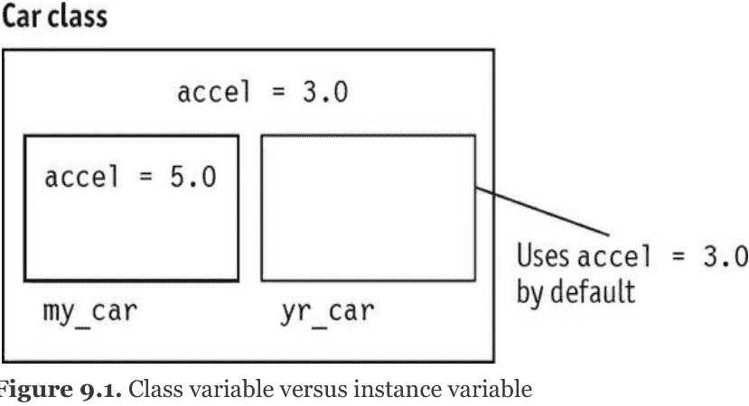
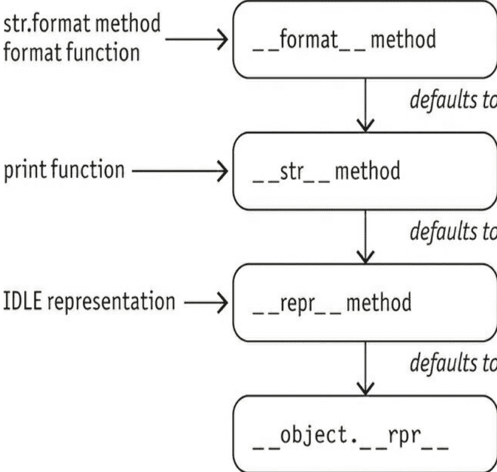

## 9. 类和魔术方法

Python 有类。在编程语言的世界里，这意味着能够编写用户定义的类型并赋予它们能力。一个类由它所做的事情定义，也由它包含的内容定义。大多数现代编程语言都有此功能。Python 增加了一种变体。它有一种称为 _魔术方法_ 的东西，它会在响应某些情况时自动调用。

在 Python 中编写类起初非常简单。但它很快就会变得有趣。

### 9.1 类和对象：基本语法

在 Python 中编写类的基本语法如下所示。


```
class class_name:
    statements
```

_statements_ 由一个或多个语句组成，并进行缩进。

你不能写零个语句，但可以使用 **pass** 关键字作为空操作；这在你想稍后定义类的功能时作为占位符很有用。

例如，我们可以这样定义 Car 类：

```
class Car:
    pass
```

我们也可以定义 Dog 和 Cat 类：

```
class Dog:
    pass

class Cat:
    pass
```

那么在 Python 中如何使用类？很简单。你可以创建该类的任意数量的实例，也称为 *实例*。以下语句创建了多个 Car 实例：

```
car1 = Car()
car2 = Car()
car3 = Car()
```

或者你可以创建 Dog 类的实例：

```
my_dog = Dog()
yr_dog = Dog()
```

到目前为止，这些实例都不执行任何操作。但这即将改变。我们可以用类做的第一件事是为整个类创建变量。这些变量称为 _类变量_，并由其所有实例共享。例如，假设 Car 是这样定义的：

```
class Car:
    accel = 3.0
    mpg = 25
```

现在，打印 Car 的任何实例都将产生这些值。

单击此处查看代码图像

```
print('car1.accel = ', car1.accel)
print('car2.accel = ', car2.accel)
print('car1.mpg   = ', car1.mpg)
print('car2.mpg   = ', car2.mpg)
```

# 这些语句打印

```
car1.accel = 3.0
car2.accel = 3.0
car1.mpg   = 25
car2.mpg   = 25
```

但这里有个变化：Car 的任何一个实例都可以为变量 accel 赋予自己的值。这样做会覆盖类变量的值，其值为 3.0。我们可以创建一个名为 my_car 的实例，并为 accel 赋值。

```
my_car = Car()
yr_car = Car()
my_car.accel = 5.0
```

图 9.1 说明了这种关系。在 my_car 对象中，accel 已成为实例变量；在 yr_car 中，



它仍然是类变量。

### 9.2 关于实例变量的更多信息

与其他语言不同，Python 有不在类中创建的实例变量——至少不是直接创建的。相反，实例变量是临时添加的，或者在 `__init__` 方法中添加。

一般规则是，你创建实例变量的方式与创建任何变量的方式相同——通过为其赋值。对于实例变量，你需要使用点（.）语法。


```
object.var_name = value
```

例如，我们可以创建一个名为 Dog 的类，创建一个实例，然后为该实例赋予多个属性——即实例变量。

单击此处查看代码图像

```
class Dog:
    pass

my_dog = Dog()  # Create instance of Dog.
my_dog.name = 'Champ the Wonder Dog'
my_dog.breed = 'Great Dane'
my_dog.age = 5
```

现在，三个数据变量附加到名为 my_dog 的对象上。它们是 name、breed 和 age，并且都可以这样访问。

单击此处查看代码图像

```
print('Breed and age are {} and {}.', my_dog.breed,
      my_dog.age)
```

此语句打印

```
Breed and age are Great Dane and 5.
```

此时，`name`、`breed` 和 `age` 都是 `my_dog` 对象特有的属性。如果你创建其他 Dog 对象，它们不一定具有这些相同的属性（即实例变量）。但是，我们可以选择在任何时候将这些相同的属性附加到另一个 Dog 对象上。

```
yr_dog = Dog()
top_dog = Dog()
hot_dog = Dog()
hot_dog.name = 'Hotty Totty'
hot_dog.breed = 'Dachshund'
```

如何确保同一个类的每个对象都具有这些属性（实例变量）？答案是这就是 `__init__` 方法的用途！

### 9.3 "`__INIT__`" 和 "`__NEW__`" 方法

对于每个类，如果定义了 `__init__` 方法，则在创建类的对象时会自动调用它。你可以使用此方法来确保类的每个实例都支持相同的公共变量集……但每个实例都有自己的值。


单击此处查看代码图像

```
class class_name:
    def __init__(self, args):
        statements
```

单词 **self** 不是关键字，而是第一个参数的名称，它是对单个对象的引用。这个参数可以是任何合法名称，但使用 `self` 是通用惯例。

`args` 是参数——如果有多个，则用逗号分隔——在首次创建对象时传递给对象。例如，我们可以修改 Dog 类定义以包含 `__init__` 方法。

单击此处查看代码图像

```
class Dog:
    def __init__(self, name, breed, age):
        self.name = name
        self.breed = breed
        self.age = age
```

现在，当创建 Dog 类的对象时，必须给出三个参数，然后将这些参数传递给 `__init__` 方法。下面是一个示例：

单击此处查看代码图像

```
top_dog = Dog('Handsome Dan', 'Bulldog', 10)
```

该语句创建一个名为 `top_dog` 的 Dog 对象，然后调用该类的 `__init__` 方法。在这种情况下，`__init__` 方法的效果是赋值实例变量，仿佛执行了以下语句：

```
top_dog.name = 'Handsome Dan'
top_dog.breed = 'Bulldog'
top_dog.age = 10
```

同样，你可以创建另一个名为 `good_dog` 的对象，它将不同的数据传递给超类函数。

单击此处查看代码图像

```
good_dog = Dog('WonderBoy', 'Collie', 11)
```

一般来说，`__init__` 方法倾向于具有如下所示的模式，尽管如果你愿意，它们也可以执行其他初始化工作。


单击此处查看代码图像

```
class class_name:
    def __init__(self, val1, val2, ...):
        self.instance_var1 = val1
        self.instant_var2 = val2
        ...
```

Python 实际上使用 `__new__` 方法来创建对象，但大多数时候，你会希望坚持编写和实现 `__init__` 方法来执行初始化。有两个主要例外。


## 9.4 类与前向引用问题

正如 Python 中的函数存在前向引用问题，Python 类也存在同样的问题。问题是，类必须在被实例化之前定义。_实例化_一个类意味着使用它来创建一个对象。

以下是一种在类前向引用中会出现问题的情况。

Click here to view code image

```
class Marriage:
    def __init__(self):
        self.wife = Person('f')
        self.husband = Person('m')
a_marriage = Marriage() # Instantiate the class.

class Person:
    def __init__(self, gender):
        self.gender = gender
```

这个愚蠢的程序会失败，但并非因为它愚蠢。你应该能看出问题所在：前几行代码被执行，导致类 Marriage 被定义，因此作为一个类存在；但第六行随后通过尝试创建一个名为 `a_marriage` 的实际对象来_实例化_该类。

这本身不应该是问题。但是，当对象被创建并调用其 `__init__` 方法时，该方法试图创建名为 `wife` 和 `husband` 的几个对象，即 Person 类的对象。问题就在这里。Person 类尚未定义，无法用于创建新对象。

解决方案很明显：只需将第六行移动到文件末尾。这样，两个类都在被实例化之前定义。

```
`a_marriage = Marriage()`
```

一般来说，如果遵循几条规则，对类的前向引用就不是问题。

- 确保所有类在被实例化之前都已定义。这是主要规则。
- 对于相互实例化的类，或者（天不容）一个类创建自身实例的类，要格外小心。虽然有一种技巧可以让你做到这一点，但这确实是你不应该涉足的领域。愚者总是敢于涉足智者所畏惧之地。
- 但是，包含其他类（单向）的类，或者包含对类实例引用的类，通常不是问题。不过要警惕相互依赖。

## 9.5 方法一般情况

_方法_与普通函数有几点不同。首先，方法是在类定义内定义的；这正是使它们成为方法的原因。

```
my_obj.a_method(12)
```

其次，每次通过实例调用方法时，都会传递一个隐藏参数：对调用它的对象的引用（_self_）。
这里显示的语法对比了方法定义（必须在类定义内发生）与对该同一方法的调用。


Click here to view code image

```
class class_name:
    def method_name(self, arg1, arg2, arg3...):
        statements

obj_name = class_name()
obj_name.method_name(arg1, arg2, arg3...)
```

请注意，方法的定义——但不是对该方法的_调用_——包含隐藏的第一个参数 _self_，因此定义的参数比函数调用多一个。例如，考虑以下类定义。

```
class Pretty:
    def __init__(self, prefix):
        self.prefix = prefix
    def print_me(self, a, b, c):
        print(self.prefix, a, sep='')
        print(self.prefix, b, sep='')
        print(self.prefix, c, sep='')
```

编写完这个类后，我们可以通过创建一个实例并使用它来测试它。请注意，对方法的调用始终比相应的定义少一个参数，因为定义显式包含 **self**，而对方法的调用则不包含。

```
printer = Pretty('-->')
printer.print_me(10, 20, 30)
```

这将打印

```
-->10
-->20
-->30
```

还要注意，在方法内部，实例本身始终标识为 **self**，实例变量标识为 **self.name**。

## 9.6 公共和私有变量与方法

面向对象编程的传统目标之一是 _封装_，它使类的内部内容对外部世界隐藏。

Python 的哲学与这一观点背道而驰。作为一种脚本语言，Python 倾向于暴露一切，让你尝试任何事情。与其他语言相比，安全性和类型检查较少。

但是，Python 有一个有用的约定。以下划线 (_) 开头的变量和方法名旨在为私有。此外，以双下划线 (__) 开头的名称通过一种称为 _名称改写_ 的过程变得不可访问，假设它们不是“魔术方法”，如本章后面所述。

一个简单的示例可以演示此工作原理。请注意，在以下类定义中，变量 x 和 y 无法从外部访问。但是，在类本身内部，所有三个变量（包括 __z）都是可访问的。

Click here to view code image

```
class Odd:
    def __init__(self):
        self.x = 10
        self.y = 20
        self.__z = 30

def pr(self):
    print('__z = ', self.__z)
```

给定这个类定义，以下语句完全有效，并且完全符合你的预期。

```
o = Odd()
o.x    # 10
o.y    # 20
```

但是，以下表达式会引发异常：

```
o.__z   # Error!
```

最后这个表达式引发错误，因为 Python 将 __z 替换为一个改写名称，该名称由类名和变量名的组合生成。

但是，__z 在同一类的方法定义内仍然可以访问，无需改写，这就是为什么 pr 方法仍然有效的原因。变量和方法名在同一类内始终可访问。但是请记住，在 Python 中，此类类内引用需要用 self 限定。

## 9.7 继承

Python 提供对继承的支持，也称为“子类化”。假设你有一个类 Mammal，它包含你在程序中需要使用的大多数方法。但是，你需要添加或更改其中的几个方法。例如，你可能希望创建一个 Dog 类，其实例可以做 Mammal 实例能做的任何事情，再加上更多事情。

首先显示带有一个基类的单继承语法。


> Click here to view code image

```
class class_name(base_class):
    statements
```

其效果是创建一个新类 class_name，它继承属于 base_class 的所有类变量和方法。语句可以添加新变量和方法定义，以及覆盖现有定义。

Python 中的每个变量和方法名都是多态的。名称直到运行时才被解析。因此，你可以调用任何对象的任何方法，并且它将被正确解析。

例如，以下类层次结构涉及一个基类 Mammal 和两个子类 Dog 和 Cat。子类从 Mammal 继承 __init__ 和 call_out 方法，但每个子类都实现了 speak 方法的自己的版本。

> Click here to view code image

```
class Mammal:
    def __init__(self, name, size):
        self.name = name
        self.size = size

def speak(self):
    print('My name is', name)

def call_out(self):
    self.speak()
    self.speak()
    self.speak()

class Dog(Mammal):
    def speak(self):
        print('ARF!!')

class Cat(Mammal):
    def speak(self):
        print('Purrrrrrr!!!!')
```

这些定义使以下语句成为可能：

> Click here to view code image

```
my_cat = Cat('Precious', 17.5)
my_cat.call_out()
```

最后一个语句打印

```
Purrrrrrr!!!!
Purrrrrrr!!!!
Purrrrrrr!!!!
```

Dog 和 Cat 类继承 __init__ 方法，与 C++ 语言中的构造函数不同。但这引发了一个问题：如果子类需要进行额外初始化，同时我们又希望尽可能利用基类的 __init__ 定义，该怎么办？解决方案是为子类编写一个新的 __init__ 方法定义，但调用基类的


version of `__init__` as follows. This results in calling all superclass initialization methods, even those inherited indirectly:

```
super().__init__
```

For example, the definition of `Dog.__init__` initializes the `breed` variable itself and calls `super().__init__` to do the rest of the initialization.

Click here to view code image

```
class Dog(Mammal):
    def speak(self):
        print('ARF!')
    def __init__(self, name, size, breed):
        super().__init__(name, size)
        self.breed = breed
```

## 9.8 多重继承

Python 的灵活语法支持多重继承。这允许你创建一个从两个或多个基类继承的类。


Click here to view code image

```
class class_name(base_class1, base_class2, ...):
```

例如，在以下类定义中，`Dog` 类不仅从 `Mammal` 类继承，还从另外两个类继承。

Click here to view code image

```
class Dog(Mammal, Pet, Carnivore):
    def speak(self):
        print('ARF!')
    def __init__(self, name, size, breed):
        Mammal.__init__(self, name, size)
        self.breed = breed
```

`Dog` 类现在不仅从 `Mammal` 类继承，还从 `Pet` 和 `Carnivore` 类继承。因此，`Dog` 的每个实例——即每个 `Dog` 对象——自动包含来自 `Pet` 和 `Carnivore` 类以及 `Mammal` 类的属性。

初始化期间只调用了 `Mammal.__init__` 方法；但是，其他基类也可能参与。例如，家庭昵称可以传入，然后在 `Pet.__init__` 中初始化：

Click here to view code image

```
def __init__(self, name, size, nickname,
               breed):
    Mammal.__init__(self, name, size)
    Pet.__init__(self, nickname)
    self.breed = breed
```

当你使用多重继承时，可能会出现冲突。例如，如果你编写一个从三个不同基类继承的类，只要基类不定义相同的方法或类变量，情况不太可能引起问题。如果它们与其他基类使用相同的方法或类变量名称，则可能会出现冲突。

## 9.9 魔术方法概述

在 Python 中，许多方法名称具有预定义的含义。所有这些名称都使用双下划线前缀和后缀（它们被称为 _dunder_ 方法）；因此，如果你在自己的方法名称中避免使用双下划线，就不必担心与这些名称冲突。

使用预定义名称的方法也称为 _魔术方法_。它们可以像任何其他方法一样被调用，但每个方法在特定条件下都会自动被调用。

例如，`__init__` 方法在创建类的实例时会自动被调用。通常的响应是将每个参数（当然 `self` 除外）分配给实例变量。

这些方法的一般类别包括以下内容。

+   * `__init__` 和 `__new__` 方法，它们会自动被调用以初始化和创建对象。这些在第 9.3 节中已介绍。

+   • 对象表示方法，包括 `__format__`、`__str__` 和 `__repr__`。这些在第 9.10.1 节和第 9.10.2 节中介绍。

+   • 比较方法，例如 `__eq__`（测试相等性）、`__gt__`（大于）、`__lt__`（小于）以及相关方法。这些在第 9.10.3 节中介绍。

+   • 二元运算符方法，包括 `__add__`、`__sub__`、`__mul__`、除法方法以及 `__pow__`。这些在第 9.10.4 节中介绍。

+   • 一元算术运算符方法，包括 `__pos__`、`__neg__`、`__abs__`、`__round__`、`__floor__`、`__ceil__` 和 `__trunc__`。这些在第 9.10.5 节中介绍。

+   • 位运算符方法 `__and__`、`__or__`、`__lshift__` 等等。大多数 Python 程序员几乎从不实现这些方法，因为它们只有在整数类型（`int`）上才有意义，而该类型已经支持它们。出于这个原因，本书不介绍这些方法。

+   • 反射方法，包括 `__radd__`、`__rsub__`、`__rmul__` 以及其他以 `r` 开头的名称。当你希望支持你的类与另一个不了解你的类之间的操作时，有必要实现这些方法。当你的对象是右侧操作数时，它们适用。这些在第 9.10.6 节中介绍。

+   • 原地赋值运算符方法，包括 `__iadd__`、`__isub__`、`__imul__` 以及其他以 `i` 开头的名称。这些方法支持赋值操作，例如 `+=`，利用其作为原地操作并使其真正原地。但是，如果你不编写这样的方法，你会“免费”获得 `+=` 作为重新赋值。在第 9.10.7 节中介绍。

+   • 转换方法：`__int__`、`__float__`、`__complex__`、`__hex__`、`__oct__`、`__index__` 和 `__bool__`。

这些在第 9.10.8 节中介绍。

+   • 容器类方法，使你能够创建自己的容器。这些方法包括 `__len__`、`__getitem__`、`__setitem__`、`__delitem__`、`__contains__`、`__iter__` 和 `__next__`。这些在第 9.10.9 节中介绍。

+   • 上下文和 pickling（序列化）方法，包括 `__getstate__` 和 `__setstate__`。通常，只要对象的所有组件都是可 pickling 的，该对象就是“可 pickling 的”。此类别中的方法处理特殊情况，超出了本书的范围。

+   • `__call__` 方法，可用于使类的实例直接作为函数调用。

## 9.10 魔术方法详解

以下小标题详细介绍了你作为中级到高级 Python 程序员可能会发现有用的主要魔术方法。如前所述，这里不介绍一些魔术方法，因为大多数 Python 程序员很少实现它们。请参阅 Python 的官方在线文档，以获取此类方法的完整列表和描述。

### 9.10.1 Python 类中的字符串表示

多种方法使类能够表示自身，包括 `__format__`、`__str__` 和 `__repr__`。

如第 5 章所述，`format` 函数将格式说明符传递给要打印的对象。正确的响应是基于该说明符返回字符串表示。例如，考虑以下函数调用：

```
format(6, 'b')
```

Python 通过调用整数类 `int` 的 `__format__` 方法来评估此函数调用，并传递说明符字符串 `'b'`。该方法通过返回包含整数 6 的二进制表示的字符串来响应。

```
'110'
```

以下是字符串表示中活动的一般流程摘要。

+   • `format` 函数尝试为对象调用 `__format__` 方法，并传递可选的格式说明符。实现此方法使类能够返回格式化的字符串表示。默认操作是调用 `__str__` 方法。

+   • `print` 函数调用对象的 `__str__` 方法来打印对象；也就是说，它调用该对象类的 `__str__` 方法。如果未定义 `__str__`，则默认情况下会调用类的 `__repr__` 方法。

+   • `__repr__` 方法返回包含对象在 Python 代码中表示的规范表达式的字符串。此方法通常与 `__str__` 做相同的事情，但并非总是如此。此方法由 IDLE 直接调用，或在使用 `r` 或 `!r` 时调用。

+   • 最后，`object` 类（即最终基类）的 `__repr__` 方法可能作为最终默认操作被调用。此方法打印关于对象类的简单语句。

图 9.2 直观地说明了此控制流。



**Figure 9.2.** 字符串表示中的控制流

### 9.10.2 对象表示方法

表 9.1 列出了字符串表示魔术方法，以及每个方法的描述。

| Table 9.1 | Magic Methods Supporting Object Representation |
|-----------|------------------------------------------------|
|           |                                                |


| 方法语法 | 描述 |
|---|---|
| `__format__(self, spec)` | 当对象直接传递给 `format` 函数时调用。<br>该方法的操作应返回格式化后的字符串。<br>很少有类直接实现此方法。 |
| `__str__(self)` | 该方法应返回一个呈现对象数据以供用户使用的字符串。例如，如果你创建了自己的 Fraction 类版本，你可能会将四分之三的值打印为 `3/4`。<br>如果未实现此方法，默认操作是调用类的 `__repr__` 方法。 |
| `__repr__(self)` | 此方法与 `__str__` 方法类似，但目的略有不同：它应返回包含对象规范表示的字符串，该表示将出现在 Python 代码中。如果你实现了此方法但未实现 `__str__`，则此方法决定两种情况下字符串的表示方式。 |

当对象作为参数传递给 `hash` 函数时调用；它生成哈希码，使该类型的对象能够作为数据字典中的键。此方法应返回一个整数。理想情况下，整数应尽可能随机选取，以便即使值相似的对象也能获得不接近的哈希码。但如果两个值相等，它们必须产生相同的哈希码。

布尔转换方法。在任何对 `bool` 函数的调用之后调用此方法；每当对象作为 `while` 或 `if` 等控制结构中的条件出现时，也会隐式调用此方法。正确的响应是返回 `True` 或 `False`；仅当对象为空、等于 `None` 或包含零值时，才应返回 `False`。

请记住，任何对象都可以在任何需要条件的上下文中指定。如果根本未实现 `__bool__` 方法，默认行为是返回 `True`。因此，如果你希望有时转换为 `False`，则需要实现此方法。

这是 Python 2.0 中支持的布尔转换。Python 3.0 要求改为实现 `__bool__`，如果你想支持布尔转换。

```python
_(
 se
 lf
)
```

以下示例展示了如何编写理论上的 Point 类，以同时支持 `__str__` 和 `__repr__` 方法，以及 `__init__`。为了说明，`__str__` 和 `__repr__` 方法返回略有不同格式的字符串。

单击此处查看代码图片

```python
class Point:
    big_prime_1 = 1200556037
    big_prime_2 = 2444555677
    def __init__(self, x = 0, y = 0):
        self.x = x
        self.y = y
    def __str__(self):
        s = str(self.x) + ', '
        s += str(self.y)
        return s
    def __repr__(self):
        s = 'Point(' + str(self.x) + ', '
        s += str(self.y) + ')'
        return s
    def __hash__(self):
        n = self.x * big_prime_1
        return (n + self.y) % big_prime_2
```

```python
def __bool__(self):
    return x and y
```

有了这个简单的类定义后，你可以按如下方式测试 `__str__` 和 `__repr__` 方法的操作。

```
>>> pt = Point(3, 4)
>>> pt
Point(3, 4)
>>> print(pt)
3, 4
```

在 IDLE 中直接输入 `pt` 会导致环境打印其规范表示，这会导致调用类的 `__repr__` 方法。但当 `pt` 作为参数传递给 `print` 函数时，该函数反过来调用 `__str__` 方法以获取对象的标准字符串表示。
为了说明，在这种情况下，`__repr__` 方法返回一个更长的显示字符串。

```
Point(3, 4)
```

## 9.10.3 比较方法

比较方法使你的类的对象能够用于比较，包括 `==` 和 `!=`（等于和不等于）以及不等式，包括 `>`、`<`、`>=` 和 `<=`。至少实现等于测试通常是个好主意，因为否则 `==` 的默认行为是应用 `is` 运算符。
比较运算符有一些我们在此处解释的特性，这些特性在书籍或互联网上很少有文档记录。官方规范包含了大部分这些信息，但并未阐明所有后果。
以下是 Python 中比较运算符的一些特殊功能。

- 要使你的类的对象相对于其他对象可排序，请定义小于（<）操作。例如，要将你的类的对象放入集合并对其进行排序，你可以实现与同类其他对象相关的 `__lt__`。这样做可以启用集合的 sort 方法以及 min 和 max。

- 但包含你的对象和其他类对象的集合呢？这是可行的。比较没有反射运算符——定义当你的对象在操作右侧时会发生什么——但它们具有同样好或更好的东西：对称性。

- 与反射运算符不同，Python 通过对称性规则执行反射。如果 A > B，Python 推断 B < A。因此，如果你为任何类组合实现 `__lt__` 和 `__gt__`，你实际上已经为两个方向定义了 `__lt__`。

- 这些规则还意味着，你通常可以“免费”获得操作，而无需实现所有操作。

在 Python 2.0 中，只需实现一个方法 `__cmp__` 即可支持所有比较运算符。Python 3.0 不支持此功能。
以下是一个简单的类，提供支持 Python 3.0 中所有比较运算符所需的最少代码，相对于同类成员。此类定义使你能够对集合进行排序，只要它们仅包含 Dog 对象。

单击此处查看代码图片

```python
class Dog:
    def __init__(self, n):
        self.n = n

    def __eq__(self, other):
        """Implementation of ==; provides != for
        free."""
        return self.n == other.n

    def __lt__(self, other):
        """Implementation of <; provides > for
        free."""
        return self.n < other.n

    def __le__(self, other):
        """ Implementation of <=; provides >= for
        free."""
        return self.n <= other.n
```

在描述每个比较运算符后，我们再次探讨对称性如何工作以及如何使对象相对于其他类可排序。表 9.2 描述了比较方法。

# 表 9.2. Python 比较魔术方法

| 语法 | 描述 |
|--------|-------------|
| `__cmp__` (self , other) | Python 3.0 或更高版本不使用。在 2.0 中，此方法可用于通过返回 -1（小于）、0（等于）或 1（大于）来实现所有比较。 |
| `__eq__` (self , other) | 测试等于。响应 == 运算符调用，该运算符测试内容是否相等。该方法应返回 True 或 False。如果未实现此方法，Python 将使用 is 运算符测试“等于”。 |
| `__ne__` (self , other) | 不等于。响应 != 运算符调用，该运算符测试内容是否不相等。与此处列出的所有其他方法一样，正确的响应是返回 True 或 False。如果未实现此方法，Python 将调用等于测试然后反转逻辑含义。因此，通常实现 `__eq__` 方法就足够了。 |
| `__gt__` (self , other) | 大于测试。此方法响应 > 运算符调用。通过对称性规则，如果你只需要与同类其他对象比较，则可以像稍后解释的那样免费获得大于操作。 |
| `__lt__` (self , other) | 小于测试。此方法响应 < 运算符调用。要启用包含你的类对象的集合中的排序，这是你需要实现的唯一比较运算符。要启用包含你的类对象和其他对象的集合中的排序，你可能还需要实现 `__gt__`。 |
| `__ge__` (self , other) | 大于或等于测试。此方法响应应用于类对象的 >= 运算符。当你实现 `__eq__` 和 `__gt__` 时，此运算符不会自动提供。相反，每个比较运算符都必须单独实现，但由于对称性规则，你可以通过实现 `__le__`（如果你只与同类对象比较）来免费获得 `__ge__`。 |
| `__le__` (self , other) | 小于或等于测试。此方法响应应用于类对象的 <= 运算符。当你实现 `__eq__` 和 `__lt__` 时，此运算符不会自动提供。相反，每个比较运算符都必须单独实现，但由于对称性规则，你可以通过实现 `__ge__`（如果你只与同类对象比较）来免费获得 `__le__`。 |

现在让我们看看 Python 中的对称性规则如何工作


comparisons and how this enables us to create classes for which `<` is defined in both directions, thereby making the objects mutually sortable with any kind of object.

Python assumes the following rules apply to comparisons:

If A > B, then B < A.

If A < B, then B > A.

If A >= B, then B <= A.

If A <= B, then B >= A.

If A == B, then B == A; furthermore, we can conclude that A != B is not true.

Let’s assume that you’re interested in supporting comparisons only between your objects and other objects of the same class. In that case, you can write less code, because you can get half your comparison operators for free.

Now let’s consider the more challenging issue: What if you want to make your objects mutually sortable with, say, numbers? The problem is that you have no access to source code for the `int`, `float`, `Decimal`, or `Fraction` class (among many other classes).

Assume your class is named Dog. For Dog objects to be mutually sortable with `int`, you need to support all of the following comparisons:

```
Dog < Dog
Dog < int
int < Dog
```

How do you implement this last comparison? Fortunately, there’s a work-around. Implement greater than (`__gt__`) and you’ll get `int < Dog` for free.

Here’s an example of a Dog class that’s mutually sortable with regard to numbers. Also, depending on how you initialize the instance variable, d, the Dog class also can be mutually sortable with regard to strings. By “mutually sortable,” we mean that you can place these objects in the same list as other kinds of objects, and the entire list can be sorted; this is true for our Dog class, even if the list contains both numbers and dogs, or it contains both strings and dogs. An example at the end of this section demonstrates an example featuring dogs and integers.

Dog implements four methods:

```python
class Dog:
    def __init__(self, d):
        self.d = d

    def __gt__(self, other):
        """ Greater than (>). This method provides a
        less-than comparison through Rules of
        Symmetry.
        if a > b, then b < a.
        """
        if type(other) == Dog:
            return self.d > other.d
        else:
            return self.d > other

    def __lt__(self, other):
        """ Less than (<). This method must support
comparisons to objects of the same class, as
well as to numbers.
'''
if type(other) == Dog:
    return self.d < other.d
else:
    return self.d < other

# Defining __repr__ also gets us __str__.
def __repr__(self):
    return "Dog(" + str(self.d) + ")"
```

Without the comments, this is a small class, although a good deal could be added to it, of course. This class definition enables code such as the following:

```python
d1, d5, d10 = Dog(1), Dog(5), Dog(10)
a_list = [50, d5, 100, d1, -20, d10, 3]
a_list.sort()
```

Printing `a_list` then produces:

```
[-20, Dog(1), 3, Dog(5), Dog(10), 50, 100]
```

## 9.10.4 Arithmetic Operator Methods

Table 9.3 provides a summary of the magic methods that support an arithmetic operator or arithmetic function. These methods will most often be of interest when the class represents some kind of mathematical object, such as a point or a matrix; however, the addition sign (+) is supported by the string class (`str`) and other classes (such as lists) as a concatenation operator.

| Method name | Description |
|---|---|
| `__add__(self, other)` | Addition. This method is invoked whenever an instance of the class is on the left side of an addition operation (+). The argument named `other` is a reference to the operand on the right. |
| `__sub__(self, other)` | Subtraction. This method is invoked whenever an instance of the class is on the left side of a subtraction operation (-). The argument named `other` is a reference to the operand on the right. |
| `__mul__(self, other)` | Multiplication. This method is invoked whenever an instance of the class is on the left side of a multiplication operation (*). The argument named `other` is a reference to the operand on the right. |
| `__floordiv__(self, other)` | Floor division. This method is invoked whenever an instance of the class is on the left side of a floor division operation (`//`), which should round the result downward. The argument named `other` is a reference to the operand on the right. For example, in Python 3.0, the expression `7 // 2` produces `3` as the result. |
| `__truediv__(self, other)` | Ordinary division. This method is invoked whenever an instance of the class is on the left side of a division operation (`/`). In Python 3.0, if the operands are integers or floating point, this operation should produce a floating-point result not rounded down. The argument named `other` is a reference to the operand on the right. For example, in Python 3.0, the expression `7 / 2` produces `3.5` as its result. |
| `__divmod__(self, other)` | Division performed by the `divmod` function, which returns a tuple with two values: a quotient—rounded to the nearest integer—and a remainder. The argument named `other` is a reference to the argument on the right (the divisor). For example, a call to `divmod(17, 2)` returns the tuple `(8, 1)`, because `8` is the ratio, rounded down, and `1` is the quotient. |
| `__pow__(self, other[, modulo])` | Power function. This method is automatically invoked when the exponentiation operator (`**`) is used to raise some object to a power. |
| `__lshift__(self, other)` | Left shift. This method is invoked whenever an instance of the class is on the left side of a left shift operation (`<<`). |

For example, `__add__` for a particular class is invoked when one of its objects is added to another object. This assumes, however, that the object is the left operand; if the object is the right operand, then its reflection method may be called—in this case, `__radd__`.

The following example utilizes the Fraction class from the fractions package. But if that package were not supported by Python, you could write such a class yourself.

```python
import fractions

f = fractions.Fraction(1, 2)
print(f + 1) # Calls Fraction.__add__
print(2 + f) # Calls Fraction.__radd__
```

As mentioned earlier, the `__add__` method could be supported by any class that recognizes the addition operator (+), even if it’s used for an operation such as string concatenation.

A hypothetical Point class can provide many good examples of how to implement these magic methods for arithmetic operators.

```python
class Point:
    def __init__(self, x, y):
        self.x = x
        self.y = y

    def __add__(self, other):
        """ Return a point containing self+other."""
        newx = self.x + other.x
        newy = self.y + other.y
        return Point(newx, newy)

    def __sub__(self, other):
        """ Return the distance between points."""
        dx = self.x - other.x
        dy = self.y - other.y
        return (dx * dx + dy * dy) ** 0.5

    def __mul__(self, n):
        """ Return point * a scalar number, n."""
        newx = self.x * n
        newy = self.y * n
        return Point(newx, newy)
```

This sample class, which supports four magic methods (`__init__`, `__add__`, `__sub__`, and `__mul__`), illustrates some important points. First, each of the arithmetic operator methods returns a value; that value, of course, can be assigned to a variable or used in any other kind of expression. Consider this example:

```python
pt1 = Point(10, 15)
pt2 = Point(0, 5)
x = pt1 + pt2
```

The expression `pt1 + pt2` results in the `__add__` method being called through the object `pt1`. In this method call, `self` is a reference to `pt1` itself, and `other` becomes a reference to the object `pt2`. The result of the call is a new Point value, which is then passed to the variable `x`.

In this case, adding two points causes the corresponding coordinates to be added together; the resulting data is then returned as a new Point object.

The subtraction sign (-) is interpreted as a distance operator in this case. The method calculates the distance between two points and then returns it as a single floating-point value.

Finally, the multiplication sign (*) assumes that the left operand (the operand referred to by `self`) is a Point object, and the right operand is a scalar value, such as 1, 5, or 10. The action of the method is to multiply each value in the Point operand by the same integer, `n`. The result is then returned as a new Point object.

The syntax shown here is a reminder of how to create a new object of a given class.


This syntax creates a new instance of `Class`, initializing it with the specified `args`, which in turn are passed to the class’s `__init__` method, if defined.


> 注意
> 如果类的某个实例可能与另一种类型进行操作组合，且该类型有支持交互的代码，那么二元操作方法在不支持这些类型时应返回 `NotImplemented`；这样，操作右侧的操作数就有机会实现该操作。有关更多信息，请参见第 9.10.6 节。

## 9.10.5 一元算术方法

此类别中的方法，与第 9.9 节列出的方法类似，通常由封装某种数字的类实现；不过，它们也可以指代其他数学对象，例如点或矩阵。

表 9.4 列出了一元算术方法。

### 表 9.4. 一元算术运算符的魔术方法

| 方法名 | 描述 |
|---|---|
| `__pos__(self)` | 一元正号。当将加号（+）应用于单个操作数时，会调用此方法。由于此运算符通常只是原样返回对象，因此很少有其他作用，它之所以被支持，是为了完整性。 |
| `__neg__(self)` | 一元负号。当将负号（-）应用于单个操作数时，会调用此方法。 |
| `__abs__(self)` | 绝对值。当将 abs 函数应用于类的对象时，会自动调用此方法。 |
| `__invert__(self)` | 按位取反，生成的结果中，操作数为 0 的每个位置都包含 1，反之亦然。这是响应 ~ 运算符而调用的。这也称为按位补码或一的补码。 |
| `__bool__(self)` | 将值转换为布尔值。此转换不仅由 bool() 调用，还由 not 等逻辑运算符以及响应条件的控制结构调用。如果未定义此方法，默认操作是返回 True。 |
| `__round__(self, n=None)` | 精度舍入函数。此方法由指定有限精度的格式化函数以及 round 函数调用。可选参数 n 指定要舍入到的有效数字位数。如果省略，函数应舍入到最接近的整数。 |
| `__floor__(self)` | 向下取整函数。其效果应是将值舍入到不高于对象值的最大整数。此方法由 math 包中的 math.floor 函数调用。 |
| `__ceil__(self)` | 向上取整函数。其效果应是将值舍入到不低于对象值的最小整数。此方法由 math 包中的 math.ceil 函数调用。 |
| `__trunc__(self)` | 向下截断方法。此方法与 `__floor__` 类似，但不是向上或向下舍入，而是仅截断浮点值的小数部分。例如，-3.5 被舍入为 -3.0，而 3.5 被舍入为 3.0。此方法由 math 包中的 math.trunc 函数调用。 |

与二元方法类似，这些一元方法期望一个创建新对象（即实例）并返回它的实现。此对象通常应与正在操作的对象属于同一类型。

前面介绍过的 Point 类是一个数学对象，可用于说明某些魔术方法的用法。为此，我们需要向现有的 Point 类定义添加以下方法定义：

单击此处查看代码图片

```python
def __neg__(self):
    newx = -self.x
    newy = -self.y
    return Point(newx, newy)
```

例如，以下表达式并非旨在更改 my_point 的内部值。相反，它旨在生成一个可以赋值或使用的新值。

```python
-my_point
```

有了此定义后，我们现在可以创建 Point 类实例（Point 对象）并应用算术取反。

单击此处查看代码图片

```python
pt1 = Point(3, 4)
pt2 = -pt1
print(pt2.x, ', ', pt2.y, sep='')
```

此示例输出

```
-3, -4
```

正如你所期望的，此结果是将 Point 实例设置为 3, 4 的算术取反。其取反是 Point 的一个新实例。然后将结果赋值给 `pt2`。

你可以通过直接调用魔术方法来测试它。例如，假设我们添加以下 `__trunc__` 方法的定义：

```python
def __trunc__(self):
    newx = self.x.__trunc__()
    newy = self.y.__trunc__()

    return Point(newx, newy)
```

有了此定义，我们可以直接测试 `__trunc__` 方法。

```python
import math

pt1 = Point(5.5, -6.6)
pt2 = math.trunc(pt1)
print(pt2.x, ', ', pt2.y, sep='')
```

此示例输出

```
5, -6
```

## 9.10.6 反射（逆序）方法

本节列出的魔术方法与前面介绍的二元运算符方法类似，但有一个关键区别：当讨论中的对象是表达式中的右侧（或第二个）操作数时，会调用这些方法。

> 注意
> 本讨论假设英语从左到右阅读单词的标准。Python 和其他计算机语言扫描语句的方式也是如此。

假设你有一个将两个对象相加的表达式，每个对象属于不同的类：

```python
fido = Dog()
precious = Cat()
print(fido + precious)
```

Python 计算表达式 `fido + precious` 时，首先检查 Dog 类是否实现了 `__add__` 方法。接下来会发生以下几种情况之一。

- 左操作数实现了 `__add__` 方法并返回了 `NotImplemented` 以外的值。那么不需要调用右操作数的任何方法。
- 左操作数（或其类）根本未实现 `__add__` 方法。在这种情况下，Python 检查右操作数是否实现了 `__radd__` 方法。
- 左操作数实现了 `__add__` 方法，但该方法决定不支持与右侧这样的对象进行交互。假设 `__add__` 方法已检查右操作数的类型，并决定：“我不支持与此类对象进行加法（+）运算。”在这种情况下，它应返回 `NotImplemented`。如果是，Python 检查右操作数是否实现了 `__radd__` 方法。

表 9.5 列出了反射二元运算符方法。

### 表 9.5. 反射操作的魔术方法

| 方法名 | 描述 |
|---|---|
| `__radd__(self, other)` | 右侧加法运算符（+）。如果右操作数定义了此方法，且左操作数未定义 `__add__` 或定义了但返回 NotImplemented，则在响应加法时调用此方法。 |
| `__rsub__(self, other)` | 右侧减法运算符（-）。如果右操作数定义了此方法，且左操作数未定义 `__sub__` 或返回 NotImplemented，则在响应减法时调用此方法。 |
| `__rmul__(self, other)` | 右侧乘法运算符（*）。如果右操作数定义了此方法，且左操作数未定义 `__mul__` 或返回 NotImplemented，则在响应乘法时调用此方法。 |
| `__rfloordiv__(self, other)` | 右侧向下取整除法（`//`）。如果右操作数定义了此方法，且左操作数未定义 `__floordiv__` 或返回 `NotImplemented`，则在响应向下取整除法时调用此方法。该方法应返回除法的结果，可能是一个新对象。 |
| `__rtruediv__(self, other)` | 右侧除法（`/`）。如果右操作数定义了此方法，但左操作数未定义 `__div__` 或返回 `NotImplemented`，则在响应标准除法（使用单个正斜杠）时调用此方法。该方法应返回除法的结果，可能是一个新对象。 |
| `__rmod__(self, other)` | 右侧取模除法运算符（%），也称为余数除法。如果右操作数定义了此方法，但左操作数未定义 `__mod__` 或返回 `NotImplemented`，则此方法实现取模除法。 |


| `__rdivmod__(self, other)` | `divmod` 的右侧。当调用 `divmod` 函数且第二个参数定义了此方法，而第一个参数未定义 `__divmod__` 或返回 `NotImplemented` 时，会调用此方法。该方法应返回一个元组，其中第一个元素是商，第二个元素是余数。 |
| --- | --- |
| `__rpow__(self, other)` | 右侧幂运算符（`**`）。当右操作数定义了此方法，且左操作数未定义 `__pow__` 或返回 `NotImplemented` 时，会响应幂运算调用此方法。该方法应返回幂运算的结果，结果可能是一个新对象。 |

在大多数情况下，反向顺序方法是其正向顺序（左操作数）版本的近似复制。例如，通过对其他魔术方法进行小幅修改，可以轻松编写反向顺序的 Point 类方法。

但是，对于这个类，没有必要编写其中大多数方法。例如，考虑以下代码：

```
pt1 = Point(1, 2)
pt2 = Point(5, 10)
```

```
pt3 = pt1 + pt2
```

假设以这种方式支持加法（+）—即将一个 Point 实例添加到另一个 Point 实例—那么在这种情况下，`__add__` 将通过左操作数（pt1）被调用；因此，`__radd__` 永远不会通过右操作数被调用。

对称操作（一个点加上一个点）永远不会调用任何右侧 r 魔术方法。

相反，r 方法在非对称情况下很有用 — 例如，当整数可能与 Point 对象相乘时。假设你想支持以下两种表达式：

```
pt3 = pt1 * 5
pt3 = 10 * pt1
```

这两个表达式中的第一个会导致调用 `__mul__` 方法，该方法会自动通过左操作数 pt1 被调用。

第二个语句更有问题，因为 10 是整数，而整数类（int）不支持与 Point 对象相乘。因此，该语句要求 Point 类实现 `__rmul__` 方法。

> 单击此处查看代码图像

```
def __rmul__(self, n):
    ''' Return point * a scalar number, n '''
    newx = self.x * n
```

```
newy = self.y * n
return Point(newx, newy)
```

此方法定义的主体与 `__mul__` 方法定义相同。尽管 Point 对象现在位于乘法表达式的右侧，但它仍然通过 self 参数被引用。

## 9.10.7 原地运算符方法

表 9.6 列出了为任何类提供组合赋值操作支持的魔术方法，包括 `+=`、`-=` 和 `*=`。

这些方法名称中的 i 代表“原地”。如果你实现了这些方法，可以使运算符对你的类的对象执行真正的原地操作，从而修改内存中的实际数据对象。

如果你支持所涉及的操作（例如用于实现加法的 `__add__`），但不支持相应的 i 方法，Python 仍然支持赋值操作；此行为是免费提供的。但此类操作不是原地操作：相反，它们会产生一个新对象，导致变量被重新分配给这个新对象。

例如，假设你有一个对象和对它的第二个引用。

单击此处查看代码图像

```
a = MyClass(10)
b = a
a += 1
```

```
print(a, b)  # Do a and b still have same value?
```

这里的问题是：如果操作 `a += 1` 是原地操作，那么 a 和 b 都继续引用相同的数据，该数据已被更改。但如果 `a += 1` 不是原地操作，则该操作必须将新数据分配给 a，这会打破 a 和 b 之间的关联。在这种情况下，操作后 a 和 b 引用不同的数据。

字符串类（`str`）是不可变的，不将 `+=` 实现为原地操作。相反，它将字符串变量重新分配给内存中的新对象。

# 表 9.6. 原地操作魔术方法

| 方法名称 | 描述 |
|---|---|
| `__iadd__(self, other)` | 组合加法赋值运算符方法。当 `+=` 运算符应用于类的对象时（该对象位于运算符左侧），会调用此方法。要成功实现原地操作，此方法应返回 `self`。 |
| `__isub__(self, other)` | 组合减法赋值运算符方法。当 `-=` 运算符应用于类的对象时（该对象位于运算符左侧），会调用此方法。要成功实现原地操作，此方法应返回 `self`。 |
| `__imul__(self, other)` | 组合乘法赋值运算符方法。当 `*=` 运算符应用于类的对象时（该对象位于运算符左侧），会调用此方法。要成功实现原地操作，此方法应返回 `self`。 |
| `__itruediv__(self, other)` | 组合除法赋值运算符方法。当 `/=` 运算符应用于类的对象时（该对象位于运算符左侧），会调用此方法。要成功实现原地操作，此方法应返回 `self`。 |
| `__ifloordiv__(self, other)` | 组合向下取整除法赋值运算符方法。当 `//=` 运算符应用于类的对象时（该对象位于运算符左侧），会调用此方法。要成功实现原地操作，此方法应返回 `self`。 |
| `__imod__(self, other)` | 组合取模赋值运算符方法。当 `%=` 运算符应用于类的对象时（该对象位于运算符左侧），会调用此方法。要成功实现原地操作，此方法应返回 `self`。 |
| `__ipow__(self, other)` | 组合幂赋值运算符方法。当 `**=` 运算符应用于类的对象时（该对象位于运算符左侧），会调用此方法。要成功实现原地操作，此方法应返回 `self`。 |
| `__ilshift__(self, other)` | 组合左移赋值运算符方法。当 `<<=` 运算符应用于类的对象时（该对象位于运算符左侧），会调用此方法。要成功实现原地操作，此方法应返回 `self`。 |
| `__irshift__(self, other)` | 组合右移赋值运算符方法。当 `>>=` 运算符应用于类的对象时（该对象位于运算符左侧），会调用此方法。要成功实现原地操作，此方法应返回 `self`。 |
| `__iand__(self, other)` | 组合按位与赋值运算符方法。当 `&=` 运算符应用于类的对象时（该对象位于运算符左侧），会调用此方法。要成功实现原地操作，此方法应返回 `self`。 |
| `__ixor__(self, other)` | 组合按位异或赋值运算符方法。当 `^=` 运算符应用于类的对象时（该对象位于运算符左侧），会调用此方法。要成功实现原地操作，此方法应返回 `self`。 |
| `__ior__(self, other)` | 组合按位或赋值运算符方法。当 `|=` 运算符应用于类的对象时（该对象位于运算符左侧），会调用此方法。要成功实现原地操作，此方法应返回 `self`。 |

| `__imul__(self, other)` | 当 `*=` 运算符应用于类的对象时（该对象位于运算符左侧），会调用此方法。要成功实现原地操作，此方法应返回 `self`。 |
| --- | --- |
| `__idiv__(self, other)` | 实现 `/=` 运算符。此方法和表中的其他方法遵循与上述相似的指导原则。 |
| `__igrounddiv__(self, other)` | 实现 `//=` 运算符，该运算符执行向下取整除法（向下舍入到最近的整数）。 |
| `__imod__(self, other)` | 实现 `%=`，该运算符执行模运算（余数）除法。 |
| `__ilshift__(self, other)` | 实现 `<<=` 运算符，该运算符执行按位左移。 |
| - | 实现 `>>=` 运算符，该运算符执行按位右 |


__irshift__(self, other)

__iand__(self, other)

__ior__(self, other)

__ixor__(self, other)

__ipow__(self, other[, modulo])

当将这些方法实现为真正的原地运算符（以便修改内存中的数据对象）时，应遵循以下步骤：首先，修改调用该方法的实例的内容——即通过 self 参数访问的变量。其次，使用

return self

返回对该对象的引用。

例如，Point 类可能会这样定义 __iadd__ 和 __imul__ 方法：

def __iadd__(self, other):
    self.x += other.x
    self.y += other.y
    return self

def __imul__(self, other):
    self.x *= other
    self.y *= other
    return self

# 9.10.8 转换方法

许多数据转换方法（参见表 9.7）对 Python 程序员非常有用。

例如，每当对象在需要条件的上下文中使用时（如 if 语句或 while 循环），Python 会隐式调用 bool 转换以获取 True 或 False 值。这个转换函数反过来会调用对象类的 __bool__ 方法。通过编写此类方法，你可以确定控制结构如何解释你的类的对象作为条件时的行为。

当然，__str__ 方法作为将任何内容显示为字符串的转换非常重要。但是，__str__ 已在前一节中介绍过。

# 表 9.7 转换方法

| 方法 | 描述 |
|---|---|
| __int__(self) | 响应 int 转换函数时调用。此方法应返回对象的整数等效值。 |
| __float__(self) | 响应 float 转换函数时调用。此方法应返回对象的浮点数等效值。 |
| __complex__(self) | 响应 complex 转换函数时调用。此方法应返回对象的复数等效值。例如，执行 complex(1) 时，返回的值为 (1+0j)。 |
| __hex__(self) | 响应 hex 转换函数以及格式化函数时调用。仅在 Python 2.0 中使用。 |
| __oct__(self) | 响应 oct 转换函数以及格式化函数时调用。仅在 Python 2.0 中使用。 |
| __index__(self) | 如果对象作为集合（如元组、字符串或列表）的索引，或切片操作中的限制，则调用此方法以返回实际索引号，该索引号必须是整数。 |
| __bool__(self) | 前面已在表 9.1 中描述。该方法应根据情况返回 True 或 False。大多数类的做法是返回 True，但在零值或空容器的情况下除外。 |

以下类定义说明了 Point 类与这些方法中几个简单定义的用法。

> 单击此处查看代码图像

class Point:
    def __init__(self, x = 0, y = 0):
        self.x = x
        self.y = y

    def __int__(self):
        return int(self.x) + int(self.y)

    def __float__(self):
        return float(self.x) + float(self.y)

以下 IDLE 会话说明了这些转换的用法。用户输入以粗体显示。

>>> p = Point(1, 2.5)
>>> int(p)
3
>>> float(p)
3.5

# 9.10.9 集合类方法

Python 允许你创建自己的容器类。大多数程序员，尤其是初级到中级程序员，很少发现有此必要。Python 的内置容器类（list、dict、set 等）功能多样、灵活且强大。

但是，如果你选择，可以使用任何想要的存储机制实现自己的容器。例如，你可以创建由底层二叉树而非哈希表实现的字典类。

你还可以创建基于某些现有 Python 容器类但添加额外功能的自定义容器类。你可以通过继承或包含来实现这一点，这两者将在第 10 章“Decimal、Money 和其他类”的实际示例中讨论。

表 9.8 列出了构建自己的集合类时应支持的魔术方法，具体取决于你希望这些集合有多有用和强大。

# 表 9.8 集合类魔术方法

| 语法 | 描述 |
|---|---|
| __len__(self) | 返回包含集合中元素数量的整数。 |
| __getitem__(self, key) | 给定用于选择元素的键，从集合中返回一个元素。此魔术方法响应索引表达式的使用，即 obj[key]。键可能是整数，在这种情况下，方法应执行索引操作。或者，键可能是非整数，例如数据字典的情况。无论哪种情况，适当的响应都是从集合中返回所选元素。 |
| __setitem__(self, key, value) | 此魔术方法的目的与 __getitem__ 方法类似，只是 __setitem__ 设置指定的值——同样根据键，如果键是整数，则键可能是索引号。由键选择的元素应被指定的值替换。 |

__delitem__(self, key) 此方法删除指定的项目，再次使用键值来选择该项目。

__iter__(self) 为集合对象返回一个迭代器；这样的迭代器是为集合实现 next 方法的对象。因此，实现 __iter__ 方法的最简单方式是返回 self，但要确保类直接实现 __next__ 方法。

__next__(self) 此方法可以由类本身或专为与主类协同工作而设计的辅助类实现。无论哪种情况，此方法都应返回迭代中的下一个元素，否则引发 StopIteration 异常。

__reversed__(self) 如果实现了此方法，则应返回值按逆序排列的集合迭代。

__contains__(self, item) 此方法应根据指定的项目是否可以在集合中找到而返回 True 或 False。

__missing__(self, key) 如果集合被要求访问不存在的元素，则调用此方法。该方法可以返回一个值，例如 None，或者根据情况引发异常。

以下代码提供了一个简单集合类的示例。这是一个专用的 Stack 类。它几乎不做什么，只是实现了 list 已经具备的一些功能；但 Stack 类还实现了 peek，它返回“顶部”（或最后一个）元素的值，而不会将其从堆栈中弹出。

class Stack:
    def __init__(self):
        self.mylist = []    # 此处使用了包含！

    def append(self, v):
        self.mylist.append(v)

    def push(self, v):
        self.mylist.append(v)

    def pop(self):
        return self.mylist.pop()

    def peek(self):
        return self.mylist[-1]

    def __len__(self):
        return len(self.mylist)

    def __contains__(self, v):
        return self.mylist.__contains__(v)

    def __getitem__(self, k):
        return self.mylist[k]

给定此类定义，我们可以创建一个 Stack 对象，然后将其作为集合进行操作。以下是一个示例：

st = Stack()
st.push(10)
st.push(20)
st.push(30)
st.push(40)
print('Size of stack is:', len(st))
print('First elem is:', st[0])
print('The top of the stack is:', st.peek())
print(st.pop())
print(st.pop())
print(st.pop())
print('Size of stack is:', len(st))

这些语句产生以下输出：

Size of stack is: 4
First elem is: 10
The top of the stack is: 40
40
30
20
Size of stack is: 1

如果你熟悉面向对象编程，可能会注意到，在这种情况下，同样的结果可以通过使用继承更轻松地实现。我们可以使用以下代码实现这个专用的 Stack 类：

class Stack(list):
    def push(self, v):
        self.append(v)

    def peek(self):
        return self[-1]

给定这几行代码，这个 Stack 类可以执行前面所示更复杂的类定义的所有操作。


earlier.
This solution—inheritance—works only when you choose to
build your collection class on top of an existing class, such as
`list` or `dict`.

# 9.10.10 实现“`__iter__`”和“`__next__`”

`__iter__` 和 `__next__` 方法，以及
`next` 函数，需要进一步阐述。这些方法使你的类的对象能够
产生一个 _生成器_（或 _迭代器_），进而使其可用于某些特殊上下文，例如 `for`
循环。让我们先从一些术语开始。

- 一个 _可迭代对象_ 是可以被迭代——或者更确切地说，逐个元素
遍历的对象。要成为可迭代对象，对象必须响应 `__iter__` 并返回一个对象。

- 一个 _迭代器_ 是对 `__iter__` 的调用必须返回的对象。迭代器
是一个可以用于遍历集合对象的对象。

- 这个迭代器可以是同一个类，也可以是专门为此目的编写的单独类，
它必须响应 `__next__` 方法——也就是说，它必须实现这个魔术方法，即使它
不做其他事情。

这些能力很重要，因为它们使类的实例能够与 Python `for` 关键字一起使用。例如，假设你有一个四维 Point 对象。如果
这样的对象的迭代器一次获取四个坐标中的一个，那么该类的用户可以使用如下代码：

```
my_point = Point()
for i in my_point:
    print(i)
```

这个示例将一次打印四个坐标中的每一个。

如前所述，集合可以是它自己的迭代器；要做到这一点，它
在响应 `__iter__` 方法时返回 `self`，并且它
自己实现 `__next__` 方法。

取决于你的容器的复杂性和你想要的灵活性程度，有几种方法可以
实现这些方法。

- 将对 `__iter__` 的调用传递给包含在目标中的集合对象。这是最简单的解决方案。这本质上是
让其他人来处理这项工作。

- 在集合类本身中实现 `__iter__` 和 `__next__`。在这种情况下，`__iter__` 方法返回 `self`，
并初始化迭代设置。但是，这样的解决方案使得无法同时支持多个循环。

- 响应 `__iter__` 方法，创建一个自定义迭代器对象，其唯一目的是支持
遍历集合类。这是最健壮的，也是推荐的方法。

下一个示例说明了第二种方法，因为在大多数情况下，它相对简单。要为之前介绍的 Stack 类使用这种方法，添加以下方法定义：

```
def __iter__(self):
    self.current = 0
    return self

def __next__(self):
    if self.current < len(self):
        self.current += 1
        return self.my_list[self.current - 1]
    else:
        raise StopIteration
```

这里一个重要的编码技巧是将变量 current 引用为 self.current。这会导致该变量成为实例变量，而不是类变量或全局变量。

当序列或迭代中的所有元素都通过反复递增 self.current 被遍历后，__next__ 方法会通过引发 StopIteration 异常来响应。这会导致 for 循环停止。

# ## 9.11 支持多种参数类型

如何编写接受多种参数类型的函数和方法？例如，假设你想以这样的方式编写一个 Point 类，使得 Point 对象既可以乘以标量数字，也可以乘以另一个 Point 对象。

Python 不支持重载，但你可以在运行时测试参数的类型，并根据该类型采取不同的操作。至少有两种方法可以测试对象的类型。一种技术是调用 **type** 函数。


```
type(object)
```

例如，你可以直接测试数据对象或变量，看它是否具有整数类型。

```
n = 5
if type(n) == int:
    print('n is integer.')
```

更可靠的方法是使用 **isinstance** 函数。你可以使用两种不同的版本。


点击此处查看代码图像

```
isinstance(object, class)
isinstance(object, tuple_of_classes)
```

第一个版本确定对象的类，然后如果对象的类与 *class* 参数相同或派生自该参数，则返回 **True**——也就是说，对象必须具有与第二个参数相同或派生自第二个参数的类。

这种语法的第二个版本相同，只是它允许你包含一个多个类的元组（即不可变列表）。

以下是第一种语法的示例：

点击此处查看代码图像

```
n = 5
if isinstance(n, int):
    print('n is an integer or derived from it.')
```

以下是第二种语法的示例。这种技术使你能够测试 n 是否包含任何整数或浮点数。

点击此处查看代码图像

```
if isinstance(n, (int, float)):
    print('n is numeric.')
```

请记住，因为使用了 isinstance 而不是 type，n 不需要具有 int 或 float 类型；派生自 int 或 float 的类型就足够了。这类类型不常见，但你可以通过子类化来创建一个。

因此，例如，假设你想要使 Point 对象支持乘以其他 Point 对象和数字。你可以通过定义 __mul__ 方法来做到这一点，如下所示：

点击此处查看代码图像

```
def __mul__(self, other):
    if type(other) == Point:
        newx = self.x * other.x
        newy = self.y * other.y
        return Point(newx, newy)
    elif type(other) == int or type(other) == float:
        newx = self.x * other
        newy = self.y * other
        return Point(newx, newy)
    else:
        return NotImplemented
```

如果这个类不知道如何处理涉及 _other_ 类的操作，则返回 **NotImplemented** 而不是引发异常很重要。通过返回 **NotImplemented**，你使 Python 能够询问右操作数其类是否支持 __rmul__ 方法来处理这种情况。
这个方法也可以使用 **isinstance** 函数来检查类型，而不是使用 **type** 函数来定义。

点击此处查看代码图像

```
def __mul__(self, other):
    if isinstance(other, Point):
        newx = self.x * other.x
        newy = self.y * other.y
        return Point(newx, newy)
    elif isinstance(other, (int, float)):
        newx = self.x * other
        newy = self.y * other
        return Point(newx, newy)
    else:
        return NotImplemented
```

无论哪种情况，对数字乘法的支持都是不对称的；这样的操作可能出现在如下表达式中：

```
pt2 = 5.5 * pt1
```

当然，问题是不能为整数或浮点数添加魔术方法，因为我们没有编写这些类。因此，应该为 Point 类编写 __rmul__ 方法。

点击此处查看代码图像

```
def __rmul__(self, other):
    if isinstance(other, (int, float)):
        newx = self.x * other
        newy = self.y * other
        return Point(newx, newy)
    else:
        return NotImplemented
```

# 9.12 动态设置和获取属性

Python 对象可以有许多属性；这些包括实例变量、方法和属性。所有这些属性的共同点是它们是硬编码的——也就是说，这些名称在编程代码中是固定的。

但有时动态设置属性很有用，即在运行时根据运行时条件设置属性名称。这允许用户建议属性名称，或者属性名称可以来自数据库或其他应用程序。第 15 章“从互联网获取财务数据”使用了这种技术。

**setattr** 函数的语法如下所示。


点击此处查看代码图像

```
setattr(object, name_str, value)
```

在这种语法中，_object_ 是对要修改的对象的引用，_name_str_ 是包含属性名称的字符串，_value_ 是包含值的数据对象或表达式。

**getattr** 函数具有互补的语法。


点击此处查看代码图像

```
getattr(object, name_str [, default_val])
```

以下是一个简单的示例，在 IDLE 环境中输入。属性 _breed_ 是动态添加的，并设置为 'Great


## 第 9 章 小结

Python 提供了一种灵活且强大的面向对象编程方式。基本概念——类——本质上是一种用户定义的类型。但是，与其他面向对象编程系统（OOPS!）一样，这种类型可以包含任意数量的方法定义。方法是在类中定义的函数，通常通过该类的实例来调用。

```python
my_dog = Dog('Bowser')
my_dog.speak()
```

Python 方法有一个必须的第一个参数，按照惯例称为 **self**。

**self** 参数在任何方法调用中都不会显式出现；但是，它必须始终出现在任何旨在通过单个实例调用的方法 _定义_ 中。名称 **self** 是对对象本身的引用。

Python 具有极强的多态性，原因是变量和函数名永远不会在运行时之前解析——也就是说，直到语句被执行。因此，任意数量的类可以定义同名的属性，但特定对象的正确代码始终会被正确访问。

Python 最独特的特征之一是，任何类都可以利用 _魔术方法_：对 Python 具有特殊含义并在特殊情况下自动调用的方法名称。例如，`__init__` 方法在类的实例被初始化时被调用。魔术方法名称的特征始终是同时具有前导和后置双下划线（`__`）。因此，如果你自己避免使用此类名称，就不会存在命名冲突的可能性。

本章介绍了 Python 支持的许多魔术方法，包括 `__init__` 以及支持算术和其他操作的方法。

## 第 9 章 复习问题

1. 你如何描述类与其实例之间的关系？例如，它是一对一还是一对多的关系？

2. 哪种信息仅保存在实例中？

3. 哪些信息保存在类中？

4. 方法究竟是什么，它与标准函数有何确切区别？

5. Python 是否支持继承，如果支持，语法是什么？

6. Python 在多大程度上支持封装（使实例或类变量私有）？

7. 类变量和实例变量之间究竟有什么区别？

8. 在类的方法定义中，self 何时需要使用，如果需要的话？

9. `__add__` 和 `__radd__` 方法之间有什么区别？

10. 什么时候真的需要反射方法？什么时候不需要，即使你支持该操作？

11. `__iadd__` 方法被称为什么？

12. `__init__` 方法是否被子类继承？如果你需要在子类中自定义其行为，该怎么办？

## 第 9 章 建议练习题

1. 编写并测试一个三维 Point 类，该类支持两个该类对象之间的加法和减法，以及与标量值（整数或浮点数）的乘法。除了 `__init__` 方法外，你还需要编写魔术方法，包括 `__str__`、`__repr__`、`__add__`、`__sub__`、`__mul__` 和 `__rmult__`。`__rmult__` 方法是支持 `n * point` 形式表达式所必需的，其中 `point` 是乘法符号右侧的 Point 对象。

2. 编写并测试一个 BankAcct 类，该类至少包含以下状态信息：姓名、账号、金额和利率。除了 `__init__` 方法外，该类应支持调整利率、提取和存款（可以合并在一个方法中）、更改利率以及标记时间流逝的方法——后者应自动计算指定天数的利息。
