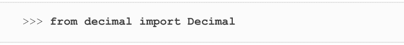
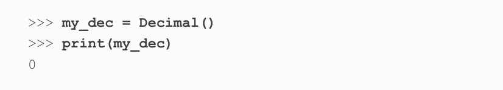
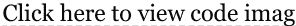
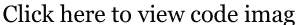
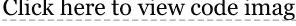
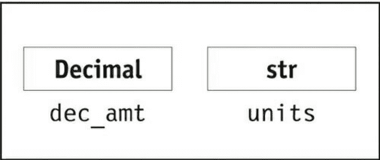
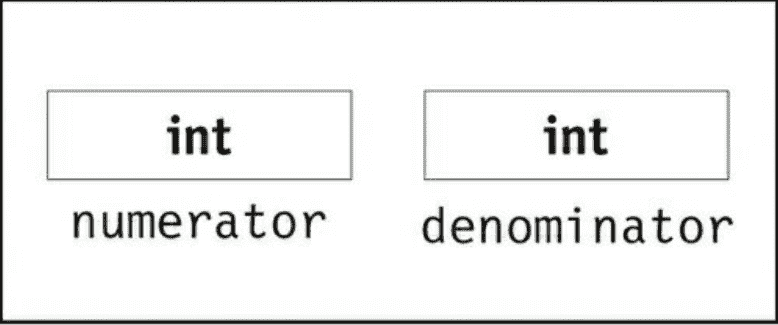

# 10. Decimal、货币和其他类

在电影《超人 III》中，一位计算机天才发现，如果他能在银行每笔交易中窃取一分钱的小数部分，并将该小数部分转移到自己的账户，他就能致富。这是因为一分钱的小数部分乘以每天数百万笔交易，就能积少成多。

这就是为什么银行家关心舍入误差。他们知道一分钱的小数部分可以积少成多。精确金额很重要。

早期，电子计算机被用于商业目的，因此精确记录美元和美分（或任何货币）而不出错非常重要。这就是本章的主旨：利用特别适合财务目的的数据跟踪方式。本章将介绍 `Decimal` 类和我们将逐步构建的 Money 类。

我们还将简要介绍 `Fraction` 和内置的 `complex` 类，尽管后者主要用于高级数学和科学应用。

## 10.1 数值类概览

本书大部分内容关注两种数值数据：整数和浮点数。这些数据类型对于许多应用程序来说已经足够。然而，正如你将看到的，它们并不完美。整数的明显缺点是不能保存小数，而浮点数据存在舍入误差，我们将在本章中展示这一点。

本章介绍了其他数据格式，包括一个我们将根据第 9 章“类和魔术方法”的原则自行开发的格式。

- `Decimal` 类，它是一种“定点”数据类型，可以精确且无误差地保存小数分数，例如 0.02。
- `Money` 类，你可以下载或自行开发。为了说明，本章采用后一种方法：我们自己开发这个类。
- `Fraction` 类，它可以精确且无任何舍入误差地保存分数，例如三分之一或七分之一，这是其他类无法做到的。
- `complex` 类，它代表高等数学中的复数。这类数字既有“实”部分，也有“虚”部分。

如果你不熟悉高等数学中复数的用法，不用担心。除非你从事需要使用复数的工作，否则可以安全地忽略这些数字。如果你是这类人，你自己已经知道了。

这些类都不需要你从互联网下载任何东西，而且 `complex` 类甚至不需要导入任何内容。它是一个内置类，就像 `int`、`float` 和 `str` 一样。

## 10.2 浮点格式的局限性

`float` 值的问题是，它们以十进制格式显示，但在内部以二进制存储。计算机可以精确存储 0.5 这样的数值，因为该值直接映射到二进制分数，但计算机在处理其他分数时会出现问题。

例如，如果你能以二进制基数显示浮点数，十进制数 2.5 将如下所示：

```
10.1
```

但是像 0.3 这样的十进制分数呢？问题是 0.3 必须存储为三十分之一，而十分之一无论精度有多少位都无法在二进制格式中精确存储。这是因为 1/10 不是 2 的幂，不像 1/2 或 1/4。因此，在这种情况下，数值必须被舍入，从而产生微小的不准确。

下面是 Python 中的一个示例，可以在 IDLE 中轻松演示：

```python
>>> 0.1 + 0.1 + 0.1
0.30000000000000004
```

这个结果在数学上是错误的，但它表明的不是处理器损坏，而是每当浮点运算处理十分之一之类的分数时，微小的舍入误差可能会出现。大多数程序只是忽略这些错误，因为打印和格式化函数通常在一定位数后进行舍入，从而隐藏了这些错误。

通常这没问题。编程的假设是，使用浮点数时必须接受微小误差；这只是你要付出的代价。在科学和实际应用中，通常根本不存在无限精度。例如，太阳距离地球并不是 _精确_ 9300 万英里，只是大约。

此外，你可以使用 **round** 函数消除这样的微小误差。

```python
>>> round(1.0 + 1.0 + 1.0, 2)
0.3
```

但是对于财务应用程序，我们希望做得更好，不依赖于不断使用 **round** 函数。小数很重要，即使是微小的误差也是不可接受的，因为它们可能会随时间累积。对于银行家来说，$1.99 必须精确等于 $1.99。

下面是一些更多演示舍入误差的示例。

```python
>>> 0.6 + 0.3 + 0.1 # Should produce 1.0
0.9999999999999999
>>> (0.6 + 0.3 + 0.1) / 2 # Should produce 0.5
0.49999999999999994
```


当你处理业务应用程序，尤其是银行业务领域时，能够精确地存储像 44.31 这样的数字，且没有任何误差，将非常有用。幸运的是，Python 提供了一个解决这个问题的类：`Decimal` 类。

## 10.3 介绍 Decimal 类

在 IDLE 中，执行以下 `import` 语句。



我们现在可以定义任意数量的 `Decimal` 类实例，它——就像浮点类 `float` 一样——可以存储小数部分。



如你所见，`Decimal` 实例的默认值是零 (0)。但你可以赋予任何喜欢的十进制值，并且它会被精确地存储。

```
>>> d = Decimal('0.1')
>>> print(d + d + d)
0.3
```

这个示例符合你的预期，但你应该已经注意到其中的一个转折。**Decimal** 变量 `d` 是用文本字符串初始化的。用浮点值来初始化似乎更自然。但看看如果你这样做会发生什么。

Click here to view code image

```
>>> d = Decimal(0.1)
>>> print(d)
0.10000000000000000555111512312578...
```

这个结果看起来一定很奇怪。但这背后有原因。当使用 `0.1` 进行初始化时，一个浮点值（类型 **float**）被转换为 **Decimal** 格式。如前所述，**Decimal** 可以以绝对精度存储 `0.1`。但在这种情况下，它首先必须从浮点数转换；而问题是，浮点值_本身已经包含了舍入误差_。这就像是吃了有毒之树的果实。

我们如何解决这个问题？从字符串初始化是最佳解决方案。使用 "`0.01`" 作为初始化器表示，“我希望得到这个字符串所代表的十进制实现”——也就是说，没有舍入误差的值。

让我们看看另一个示例。

Click here to view code image

```
>>> d = Decimal('0.1')
>>> print(d + d + d)
```

这给出了正确答案。将其与浮点版本进行对比。



```
>>> print(0.1 + 0.1 + 0.1)
0.30000000000000004
```

这里是另一个示例。以下使用浮点算术的情况显示了一个比使用 **Decimal** 解决的错误更明显的错误。



```
>>> print(0.1 + 0.1 + 0.1 - 0.3)
5.551115123125783e-17
>>> d1, d3 = Decimal('0.1'), Decimal('0.3')
>>> print(d1 + d1 + d1 - d3)
0.0
```

**Decimal** 类保持精度。例如，如果你对具有两位精度（包括尾随零）的 **Decimal** 实例进行算术运算，这两位精度会被保持，如你所见：



```
>>> d1, d3 = Decimal('0.10'), Decimal('0.30')
>>> d1 + d3
Decimal('0.40')
```

这种行为在使用 **Decimal** 对象表示美元和美分，并且希望保留小数点右侧两位精度的情况下很有用。你可以将一列这样的数字相加，只要它们都不超过两位精度，右侧的两位就会被保持。

这里是另一个示例：

Click here to view code image

```
>>> d1, d2 = Decimal('0.50'), Decimal('0.50')
>>> print(d1 + d2)
1.00
```

Note
如果你将一个对象传递给 print 函数，那么默认情况下，它会打印数字的标准字符串表示形式。对于 Decimal 对象，这种表示形式是一串简单的数字，并带有适当的小数点。

1.00

但是，如果你在 IDLE 环境中直接将 Decimal 对象作为输入，它会打印规范表示形式，其中包括类型名称和引号：

Decimal('1.00')

Decimal 类还有一些值得注意的其他行为特点。如果你将两个这样的对象相乘，精度不会被保持，反而会增加。下面是一个示例：

Click here to view code image

```
>>> d1, d3 = Decimal('0.020'), Decimal('0.030')
>>> print(d1 * d3)
0.000600
```

但是，你可以始终通过使用 **round** 函数来调整此类对象的精度，该函数重新调整小数点右侧的位数（去掉尾随零），并对数字进行向上或向下舍入。下面是一个示例：

```
>>> print(round(d1 * d3, 4))
0.0006
>>> print(round(d1 * d3, 3))
0.001
```

与整数和浮点值交互时适用几条规则。

- 你可以自由地将整数与 **Decimal** 对象相乘，也可以将它们相加。
- 你也可以直接且精确地从整数初始化：
  ```
  d = Decimal(5)
  ```
- 将 **Decimal** 对象与浮点值相加或相乘会导致错误。要执行此类操作，你需要将浮点数转换为 **Decimal** 对象——例如，先从浮点值转换，然后再进行舍入。否则，两种类型之间的算术运算会导致运行时错误。

因此，例如，你可以执行以下操作，与整数交互：

```
>>> d = Decimal(533)
>>> d += 2
>>> print(round(d, 2))
535.00
```

> ### Performance Tip
> 创建 `Decimal` 对象所需的时间大约是创建浮点对象的 30 倍，而浮点数上的算术运算速度比 `Decimal` 对象快 60 倍。教训是，在需要时使用 `Decimal` 对象，但在大多数应用程序中使用浮点值也有充分的理由。

## 10.4 Decimal 对象上的特殊操作

如果你创建一个 `Decimal` 对象并获取其帮助，文档将揭示大量操作和方法。

```
>>> help(Decimal)
```

其中大多数是魔术方法，它们存在是为了支持两个 `Decimal` 对象之间，或 `Decimal` 对象与整数之间的所有基本算术运算。其他操作，例如对数函数，也受到支持。

在其他方法中，大多数非常技术性或是空操作：它们实际上除了按当前状态返回对象之外什么也不做。但是，有些方法对 Python 程序员来说很有意思。其中之一是 **normalize** 方法。其作用是将对象的精度减少到所需的最小值，实际上去掉尾随零。

在以下示例中，**normalize** 将一个小数点后精度为三位的对象，转换为只有一位精度的对象。

```
>>> d = Decimal('15.700')
>>> print(d)
15.700
>>> d2 = d.normalize()
>>> print(d2)
15.7
```

**normalize** 方法甚至会在小数部分为零时彻底去掉小数点。

```
>>> d = Decimal('6.00')
>>> print(d)
6.00
>>> d2 = d.normalize()
>>> print(d2)
6
```

但是，当你更改 **Decimal** 值的精度时，你会得到一个具有不同内部状态的对象，即使在相等性测试（`==`）中这些值被认为是相等的。假设前面示例中 `d` 和 `d2` 的值：

```
>>> d == d2
True
```

Decimal 对象是不可变的，就像整数、浮点值和字符串一样。但是，以下代码是合法的，因为它并不真正更改现有的 Decimal 数据；它只是将 d 与一个新对象关联。（因此，`is` 运算符会显示这两个对象不相同。）但是请记住，原始对象在数值上被认为等于其归一化版本。

Click here to view code image

```
>>> d2 = d
# Save old version of d in d2.
>>> d = d.normalize() # Now d is normalized.
>>> d2 == d
True
>>> d2 is d
False
```

as_tuple 方法提供了关于此类对象内部结构的重要线索。

Click here to view code image

```
>>> d = Decimal('15.0')
>>> d.as_tuple()
DecimalTuple(sign=0, digits=(1, 5, 0), exponent=-1)
```

以下是这对该对象内部结构的暗示。


有一个符号位（1 表示负数；0 表示非负数）。
十进制数字（1、5、0）被单独存储。
精度被存储，在此情况下为负指数，显示需要将小数点向右移动多少位（如果为负数则向左移动）。

事实上，如果你选择，可以使用相同的信息直接构造一个 `Decimal` 对象。将元组放在括号内，然后使用该信息来初始化对象：

```
>>> d = Decimal((0, (3, 1, 4), -2))
>>> print(d)
3.14
```

此类元组（完全描述 Decimal 对象状态的元组）的一般结构如下所示。


```
(sign_bit, (digit1, digit2, digit3...), exponent)
```

另一种有时很有用的操作是 decimal 包中定义的 `getcontext` 函数。以下是使用示例。

```
>>> decimal.getcontext()
Context(prec=28, rounding=ROUND_HALF_EVEN,
Emin=-999999, Emax=999999, capitals=1, clamp=0,
flags=[DivisionByZero, Inexact, FloatOperation,
Rounded], traps=[InvalidOperation, DivisionByZero,
Overflow])
```

这里有大量信息需要梳理，但其中大部分很有用。首先，prec=28 表示最大精度为 28 位。其次，舍入技术 ROUND_HALF_EVEN 表示，如果需要，最终有效数字将通过检查其右侧的数字是否为 5 或更大来舍入，如果是，则进位。traps 指示哪些操作会引发异常。

## 10.5 十进制类应用

我们可以使用 `Decimal` 类来累加一列数字，其精度为小数点右侧两位。

这是累加美元和美分数字的适当方式，因此你可以期望所有金额都采用 1.00（一美元）、1.50、9.95 等形式。在这种情况下，如果出现分以下的零头，我们会将其四舍五入到最近的美分，而不是随意丢弃所有余数。

最后，该应用程序将以美元和美分格式显示结果——但不会打印货币符号。（这是我们将在下一节中添加的功能。）在查看编码技术时，请记住，**Decimal** 对象最自然且高效的创建方式是通过字符串初始化。

点击此处查看代码图像

```
money_amount = Decimal('1.99')
```

以下是完整的应用程序代码。操作是提示用户输入一个数字，如果用户没有输入空字符串，则将指定的数字字符串作为 **Decimal** 对象添加。如果用户按 Enter 键且未输入任何内容，程序将中断、停止并打印总计。

点击此处查看代码图像

```
from decimal import Decimal
total = Decimal('0.00')
while True:
    s = input('Enter amount in dollars and cents (##.##): ')
    if not s:
        break
    d = Decimal(s)
    d = round(d, 2)
total += d
print('The sum of all these amounts is:', total)
```

该程序在处理小于 0.01 的分数时，本可以采用两种不同的策略之一。你可以将所有较小的分数累加到运行总计中，并在最后进行舍入。但此处采用的方法是，在输入每个金额时即进行舍入。

以下是示例会话。

点击此处查看代码图像

```
Enter amount in dollars and cents (#.##): 1
Enter amount in dollars and cents (#.##): 3.00
Enter amount in dollars and cents (#.##): 4.50
Enter amount in dollars and cents (#.##): 33.003
Enter amount in dollars and cents (#.##): 12.404
Enter amount in dollars and cents (#.##):
The sum of all these amounts is: 53.90
```

由于此应用程序在每次输入后应用舍入，结果为 53.90。但我们也可以在最后一次性进行所有舍入，在这种情况下会产生略有不同的结果：53.91。

## 10.6 设计货币类

金钱说话。现在我们将创建一个 Money 类。你可以下载这样的类。但亲自创建这样的类很有教育意义。在此过程中，我们将在第 9 章中使用许多概念作为实际示例。

将十进制数字与一个 *units* 数字一起存储可能很有用，该数字代表货币类型。我们将使用三种类型，由存储在额外字符串字段中的值来指示。顺便说一句，表 10.1 中的缩写在国际上被公认为这些货币的标准名称。

# 表 10.1 三种货币的缩写

| Symbol (to store in units, a str instance variable) | Description |
|---|---|
| 'USD' | 美元 |
| 'EUR' | 欧元 |
| 'CAD' | 加元 |

现在需要做出决定：我们应该使用以下两种方法中的哪一种？

- 组合。这种方法将 Money 对象视为一个容器，包含一个 `Decimal` 对象和另一个对象（`units` 字段）。缺点是，对于你希望 Money 类支持的每个操作，都需要编写一个单独的魔术方法。
- 继承。这种方法将 Money 对象视为一种特殊的 `Decimal` 对象，其中 `units` 字段作为额外属性添加。

考虑到这一选择，继承可能是更好的方法；它也更符合面向对象的精神，即“A 是 B 的一种，只是更专业化”的关系实际上是继承关系。

另一方面，组合适用于“A 包含 B”的关系。在这种情况下，组合效果更好。

但是 Python 语言中有一个特性，使得在这种情况下继承难以使用。一般准则是，如果你希望保持简单，避免从不可变类或内置类继承。不幸的是，这包括从 `Decimal` 继承。

因此，在本章中，我们将使用对象组合来围绕 `Decimal` 类构建 Money 类。稍后，我们将在第 10.12 节“货币与继承”中展示如何使用继承来创建 Money 类。

图 10.1 显示了组合架构。每个 Money 对象包含两部分：一个 `Decimal` 对象 `dec_amt` 和一个名为 `units` 的字符串。



图 10.1 使用组合的 Money 类

## 10.7 编写基本 Money 类（组合）

围绕 `Decimal` 对象构建 Money 类在开始时很容易。以下是入门方法：

点击此处查看代码图像

```
from decimal import Decimal

class Money():
    def __init__(self, v = '0', units = 'USD'):
        self.dec_amt = Decimal(v)
        self.units = units
```

使用这个简单的类定义，你可以创建 Money 对象并显示其属性，尽管还需要添加其他操作和方法。以下示例利用了默认单位为美元的特性。

点击此处查看代码图像

```
>>> m1 = Money('0.10')
>>> print(m1.dec_amt, m1.units)
0.10 USD
```

但如果你只能做到这些，那就不够出色。接下来要添加的是以有意义且自动的方式打印 Money 对象的功能。目前，如果你打印 m1，它就不太有用。

点击此处查看代码图像

```
>>> print(m1)
<__main__.Money object at 0x103cc6f60>
```

## 10.8 显示 Money 对象（“__str__”、“__repr__”）

要确定 Money 对象的打印方式，请为类编写一个 `__str__` 方法。以下是要添加到类定义中的函数的工作版本。

点击此处查看代码图像

```
def __str__(self):
    s = str(self.dec_amt) + ' ' + self.units
    return s
```

以下是利用此方法的示例会话。

```
>>> m1 = Money('5.01', 'CAD')
>>> print(m1)
5.01 CAD
```

如你所见，现在可以轻松初始化和显示 Money 对象，默认单位类型为 USD，表示使用美元。

但我们还希望打印类的良好规范表示形式。除了 `__str__` 之外，还需要 `__repr__` 方法定义。

点击此处查看代码图像

```
def __repr__(self):
    s = ('Money(' + str(self.dec_amt) + ', ' +
         self.units + ')')
    return s
```

类的 `__repr__` 函数通常与 `__str__` 函数不同。


## 10.9 其他货币操作

到目前为止，我们使用 Money 类只能创建对象并打印它们。但要使该类有用，至少应支持 Money 对象之间的加法操作（+）。

如果暂时忽略单位的作用，`__add__` 函数很容易编写。这个版本假设你只想将 Money 对象添加到同一类的其他对象中。

Click here to view code image

```
def __add__(self, other):
    d = self.dec_amt + other.dec_amt
    return Money(str(d))
```

我们可以扩展这个函数定义，预设左操作数使用的单位应由结果使用。实现这种方法给我们提供了函数定义的第二个版本。在以下代码中，要添加的项目以粗体显示，仅为了说明。

```
def __add__(self, other):
    d = self.dec_amt + other.dec_amt
    return Money(str(d), self.units)
```

更有趣、更有用的是，在先乘以货币汇率后，将右侧使用的单位转换为与左侧匹配。虽然这些数字每天都在变化，但程序可以根据需要进行修改以适应这些变化。一种方法是从按需更新的文件中读取货币汇率。

为了暂时保持简单，我们将选取一些汇率（即撰写本文时的当前汇率），并假设程序可以根据需要进行修改。因为有六种可能的转换（来自我们支持的三种货币），最好的方法是使用字典。键值是连接两个货币符号的结果。值字段显示第二种货币必须乘以什么数字才能产生第一种货币。

```
exch_dict = {
    'USDCAD': Decimal('0.75'), 'USDEUR': Decimal('1.16'),
    'CADUSD': Decimal('1.33'), 'CADEUR': Decimal('1.54'),
    'EURUSD': Decimal('0.86'), 'EURCAD': Decimal('0.65')
}
```

例如，`USDCAD` 键的值为 0.75，这意味着加拿大元数字乘以 0.75 即可得到其等值的美元。现在，函数的最终版本可以在每当两种不同货币相加时应用货币汇率。

字典将汇率存储为 Decimal 对象，从而使后续算术运算更容易执行。

Click here to view code image

```
def __add__(self, other):
    ''''Money add function.
    Supports two Money objects added together;

    if
    the second has a different currency unit,
    then
    exchange rate must be applied before adding
    the
    two amounts together. Apply rounding of 2.
    '''
    if self.units != other.units:
        r = Money.exch_dict[self.units +
                            other.units]
        m1 = self.dec_amt
        m2 = other.dec_amt * r
        m = Money(m1 + m2, self.units)
    else:
        m = Money(self.dec_amt + other.dec_amt,
                  self.units)
    m.dec_amt = round(m.dec_amt, 2)
    return m
```

让我们逐步了解这个函数的工作原理。正如注释（或者更确切地说，文档字符串）所指出的，如果单位不同（例如美元与加拿大元），则在相加金额之前可能会应用汇率。虽然在大多数位置汇率表示为浮点数，但我们在这里将这些汇率存储为 **Decimal** 对象，以便需要进行的转换更少。

Click here to view code image

```
r = Money.exch_dict[self.units +
other.units]
m1 = self.dec_amt
m2 = other.dec_amt * r
m = Money(m1 + m2, self.units)
```

无论哪种情况——无论是应用了汇率还是没有应用——我们也希望应用 2 的舍入因子，以便货币始终以小数点后两位精度表示。

Click here to view code image

```
m.dec_amt = round(m.dec_amt, 2)
```

新的 Money 对象 m 最终由 `__add__` 函数返回。

有了这个函数定义，以及可以作为 Money 类变量的 `exch_dict`，我们现在可以将不同货币相加——只要它们是该程序识别的三种货币之一（尽管该列表可以根据需要扩展）。例如，我们可以将一美元与一加拿大元相加并得到有意义的结果。

Click here to view code image

```
>>> us_m = Money('1', 'USD')
>>> ca_m = Money('1', 'CAD')
>>> print(us_m + ca_m)
1.75 USD
```

> Note
> 当然，只要使用了三种支持的货币，这个函数定义就能正确工作。如果使用了 USD、CAD 或 EUR 以外的单位，每当混合货币相加时都会导致 **KeyError** 异常。

把所有内容放在一起，这里是完整的 Money 类。当然，它并不真正完整，因为我们还可以添加许多操作，例如减法和整数乘法。

Click here to view code image

```
from decimal import Decimal

class Money():
    ''''Money Class.
    Stores both a Decimal amount and currency units.
    When
    objects are added, exchange rate will be applied
    if
    the currency units differ.
    '''
    exch_dict = {
        'USDCAD': Decimal('0.75'), 'USDEUR':
        Decimal('1.16'),
        'CADUSD': Decimal('1.33'), 'CADEUR':
        Decimal('1.54'),
        'EURUSD': Decimal('0.86'), 'EURCAD':
        Decimal('0.65')
    }
    def __init__(self, v = '0', units = 'USD'):
        self.dec_amt = Decimal(v)
        self.units = units
    def __str__(self):
        s = str(self.dec_amt) + ' ' + self.units
        return s
    def __repr__(self):
        s = ('Money(' + str(self.dec_amt) + ' ' +
        str(self.units) + ')')
        return s
    def __add__(self, other):
        """Money add function.
        Supports two Money objects added together;
        if
        the second has a different currency unit,
        then
        exchange rate (r) is applied before adding
        the
        two amounts together. Apply rounding of 2.
        """
        if self.units != other.units:
            r = Money.exch_dict[self.units +
            other.units]
            ml = self.dec_amt
            m2 = other.dec_amt * r
            m = Money(ml + m2, self.units)
        else:
            m = Money(self.dec_amt + other.dec_amt,
            self.units)
        m.dec_amt = round(m.dec_amt, 2)
        return m
```

这就是（目前）完整的类定义——虽然，如前所述，你可能想添加许多操作。

## 10.10 演示：货币计算器

有了完整的 Money 类定义，现在可以编写一个计算器应用程序，它可以将我们目前支持的三种不同货币中的任意数量金额相加，并以共同面额给出答案。

大部分代码很容易编写，但用户输入必须分解为数值和单位部分，这在一定程度上使编码变得复杂。幸运的是，大部分工作由 **str** 类型的 **split** 方法完成。

Click here to view code image

```
from decimal import Decimal

# Place Money class definition here or import it.
def money_calc():
    ''''Money addition calculator.
    Prompt for a series of Money objects until empty
    string is entered; then print results of the
    running total.
    '''

    n = 0
    while True:
        s = input('Enter money value: ')
        s = s.strip()
        if not s:
            break
        a_list = s.split() # Split into amt, units.
        d = a_list[0]
        if len(a_list) > 1:
            m = Money(d, a_list[1])
        else:
            m = Money(d)
        if n == 0:
            amt = m
        else:
            amt += m
        n += 1
    print('Total is', amt)
money_calc()
```

这段代码的最后一行执行该函数，使其成为一个完整的程序。

这个函数有一个微妙之处。最好让第一种货币选择（第一行输入的单位）决定最终答案所使用的货币。这给用户对结果的控制权。例如，也许你希望结果以加拿大元或欧元表示；你只需确保第一个条目使用这些单位即可。

问题是，我们正在保持一个运行总数，而保持运行总数的常用方法是从初始零值开始。这里有一个示例：

```
amt = Money('0')
```

这里的问题是，目前 USD 是单位的默认值；因此，这个初始选择通过程序的逻辑，会预先确定该程序的每个结果都以美元表示。


## 10.11 设置默认货币

为了让我们的 Money 类对更广泛的用户群更加友好，我们应该允许类的用户设置除美元以外的默认单位。实现此功能的一个简单方法是将其与类变量绑定，然后让类的用户按需更改它。

要做到这一点，我们首先需要向 Money 类添加一个类变量，这是一个非常容易做的更改。

```python
class Money():
    default_curr = 'USD'
```

然后我们需要修改 `__init__` 函数。这比听起来要棘手，因为虽然你可以在方法定义中引用类变量，但不能在参数列表中使用这样的引用。因此，以下代码会导致错误：

```python
# This causes an ERROR!
def __init__(self, v='0',
             units=Money.default_curr):
```

令人沮丧的是，我们无法这样做。然而，`__init__` 函数的以下定义运行良好，它通过将默认值（空字符串）替换为存储在 `default_curr` 中的值来实现。

```python
def __init__(self, v='0', units=''):
    self.dec_amt = Decimal(v)
    if not units:
        self.units = Money.default_curr
    else:
        self.units = units
```

对 `__init__` 函数所做的更改（以粗体显示）后，类变量 `default_curr` 现在实际上成为 `units` 的默认值。

最后，`money_calc` 函数可以轻松修改，以便第一个项目输入的单位成为类的新默认设置。需要在循环大约四分之三处添加一行代码。

```python
if n == 0:    # If this is first entry...
    amt = m    # Create amt!
    Money.default_curr = m.units
```

有了这个更改，应用程序现在允许用户指定不同于美元的默认值。他们所要做的就是在输入的第一个货币对象中指定新的默认值。

例如，以下示例会话中的用户会导致加拿大元（CAD）成为默认值。

```
Enter money value: 1.0 CAD
Enter money value: 2.05
Enter money value: .95
Enter money value: 2
Enter money value:
Total is 6.00 CAD
```

在这种情况下，很容易看出，总计使用的单位和默认货币使用的单位都是加拿大元，而不是美元。

在下一个示例会话中，你可以看到，即使在系列中间输入了不同的货币，默认值仍然是加拿大元。

```
Enter money value: 2.0 CAD
Enter money value: -1
Enter money value: 10 USD
Enter money value: 5.01
Enter money value: -5.01
Enter money value:
Total is 14.30 CAD
```

你可以看到，所有加拿大金额都相互抵消，只剩下一加拿大元。还输入了 10 美元。但是最终结果以加拿大元打印——因为第一个数字是以 CAD 计价的。因此，虽然总和包含 10 美元，但它被转换为等值的加拿大元，加上未被抵消的一加拿大元，即 10 美元的加拿大元等价（13.30），加上一加拿大元（1.00），总计为 14.30。

你应该注意，更改类的默认单位有点棘手；只要程序正在运行，此类更改就会影响类的所有后续用途。（但是，它不影响程序的未来运行。）但如果你稍加注意，这不应该成为问题。

## 10.12 金钱与继承

获得金钱的最佳方式是什么？当然是继承。

正如我们在第 10.6 节“设计 Money 类”中提到的，基于现有对象类型 `Decimal` 创建 Money 类的更自然方式是使用继承——即子类化 `Decimal`。

问题是 `Decimal` 类型是不可变的。这带来了一个特殊的挑战；这个挑战可以通过几行代码来解决，但如何编写这段代码并不明显。不过，不用担心。本节将为你提供这种专业知识。

通常，继承很容易实现。假设 Money 子类化了另一个名为 Thingie 的类，该类不是不可变的。在这种情况下，你可以使用以下易于编写的代码：

```python
class Money(Thingie):
    def __init__(self, v, units='USD'):
        super().__init__(v)
        self.units = units
```

这种方法的意思是（请记住，这是你对大多数类使用的方法，但不适用于 `Decimal`）“调用超类函数来处理第一个参数的初始化，但直接初始化第二个参数 units。”请记住，units 是 Money 类添加到 Thingie 类的额外属性。

但是，这种方法对于像 Decimal 这样的不可变类会失败。相反，有必要为 Money 类编写一个 `__new__` 方法。Money 类中 Decimal 部分的分配由 `__new__` 处理。

```python
from decimal import Decimal

class Money(Decimal):
    def __new__(cls, v, units='USD'):
        return super(Money, cls).__new__(cls, v)

    def __init__(self, v, units='USD'):
        self.units = units

m = Money('0.11', 'USD')
print(m, m.units)
```

这个小程序打印以下内容：

```
0.11 USD
```

如果你想将这种编码技术应用于涉及不可变超类的其他情况，这里是你需要记住的：使用 `__new__` 函数调用超类版本的 `__new__`。参数应该是子类名称和 cls，即对类的引用。让此方法初始化源自超类的类部分（在此例中为 v）。确保传递超类版本的 `__new__` 返回的值。

```python
def __new__(cls, v, units='USD'):
    return super(Money, cls).__new__(cls, v)
```

对于其他情况，我们可以将此模式推广到任何给定的类和超类，分别命名为 MyClass 和 MySuperClass，以及超类数据 d：

```python
class MyClass(MySuperClass):
    def __new__(cls, d, other_data):
        return super(MyClass, cls).__new__(cls, d)
```

> **注意**
>
> 我们可以进一步将此代码概括如下，其中 `d` 是基类中的数据，`other_data` 是子类中的数据，应在 `__init__` 中初始化。
>
> ```python
> class MyClass(MySuperClass):
>     def __new__(cls, d, other_data):
>         return super(MyClass, cls).__new__(cls, d)
> ```

现在，让我们回到 Money 示例。如果子类添加了任何其他属性并需要初始化，仍然需要编写 `__init__` 方法。`__init__` 方法应当用于


initialize these other attributes.

Click here to view code image

```
def __init__(self, v, units='USD'):
    self.units = units
```

Even with these definitions in place, it’s still necessary to print both the object itself (which inherits directly from `Decimal`) and the `units`, which is the attribute added by Money.

```
print(m, m.units)
```

But we can improve this situation by overriding the `__str__` method, to print a Money object in a more natural and direct way. Notice that the superclass version of this method is called to do much of the work.

Click here to view code image

```
def __str__(self):
    return super().__str__() + ' ' + self.units
```

This is a typical example of how you’d override the `__str__` method, regardless of whether you’re subclassing an immutable class or a mutable class.

> **Note**
> It may seem unreasonable that Python doesn’t let you use the easy approach to subclassing another type, as shown earlier with the hypothetical superclass Thingie.

There are a number of reasons that's not feasible in Python. For one thing, if a superclass is immutable, that means its data can never be changed after it's created. Also, some built-in classes make use of the `__new__` function to initialize values, in addition to other actions, so that calling upon the superclass's `__init__` function is inadequate. The basic rule is this: If subclassing a built-in type the ordinary way doesn't work, you might need to subclass `__new__`.

## 10.13 分数类

Decimal 和 Money 类可以以绝对精度存储十进制数字，例如 0.53。但这些类也有其局限性。

如果你想存储 1/3 的值，该值无法在二进制基数下表示而不产生舍入误差。但在十进制基数下表示这个数量同样不可能！从数学上讲，你需要无限多的数字来在任一基数中存储 1/3（三分之一）。

0.33333333333333333333333333333333333333333...

幸运的是，整数来拯救了我们。整数以绝对精度存储数字，通过创建具有两部分的对象——分子（上半部分）和分母（下半部分）——我们可以表示任何可以表示为两个整数之比的数字（参见图 10.2）。



### 分数类

图 10.2. 分数类的结构

会出现一些问题，但这些问题都由该类平滑处理。例如，1/2、2/4 和 100/200 在数学上都是等价的。但得益于内部方法，这些都会自动减少到相同的内部表示。下面是一个示例。首先，我们需要导入该类。

Click here to view code image

```
from fractions import Fraction
```

请务必按所示输入此语句。单词 fractions 是小写复数；单词 Fraction 是大写单数！为什么不一致，我们不确定。无论如何，导入该类后，可以以一致且非常方便的方式处理 Fraction 对象。让我们再看看处理 1/2、2/4 和 100/200 的问题。

Click here to view code image

```
fr1 = Fraction(1, 2)
fr2 = Fraction(2, 4)
fr3 = Fraction(100/200)
print('The fractions are %s, %s, & %s.' % (fr1, fr2, fr3))
```

此示例打印

```
The fractions are 1/2, 1/2, & 1/2.
```

所有这些 **Fraction** 对象都显示为相同的数量，因为它们会自动减少到最简形式。

```
>>> if fr1 == fr2 and fr2 == fr3:
    print('They are all equal!')
They are all equal!
```

> Note
> 通过使用第 4 章中指出的快捷方式之一，你可以将此示例中的条件替换为链式比较，从而产生更短的版本。
> >>> if fr1 == fr2 == fr3:
>     print('They are all equal!')

分数可以以其他方式指定。例如，如果初始化时只给出一个整数，该类将其存储为该整数除以 1（当然，这是一个比率）。下面是一个示例：

```
>>> fr1 = Fraction(5)
>>> print(fr1)
5
```

分数也可以从 **Decimal** 对象和浮点值转换。有时这工作良好，如下所示。

```
>>> fr1 = Fraction(0.5)
>>> print(fr1)
1/2
```

但有时则不然。

```
>>> fr2 = Fraction(0.01)
>>> print(fr2)
5764607523034235/576460752303423488
```

哇，这里发生了什么？答案是，我们的老对头，浮点舍入误差，再次抬头了。**Fraction** 类尽力适应浮点值 0.01 中的那个微小舍入误差，因此得出了这个丑陋的比率。

有几种解决方案。一种是直接从字符串初始化，就像我们对 **Decimal** 对象所做的那样。

```
>>> fr2 = Fraction('0.01')
>>> print(fr2)
1/100
```

这就好多了！另一种选择是使用 `limit_denominator` 方法。该方法表示分母只能变得这么大。考虑到这一限制，`Fraction` 类会生成尽可能接近的近似值……而该近似值通常正好就是我们想要的数字。

```
>>> fr2 = Fraction(0.01).limit_denominator(1000)
>>> print(fr2)
1/100
```

成功！但该类的真正强大之处在于它支持所有 `Fraction` 类型对象的标准操作，并且结果保证绝对正确。下面是一个示例：

```
>>> fr1 = Fraction(1, 2)
>>> fr2 = Fraction(1, 3)
>>> fr3 = Fraction(5, 12)
>>> print(fr1 + fr2 + fr3)
5/4
```

因此，1/2、1/3 和 5/12 相加得到 5/4。你可以自己验证这个答案是否正确。其他算术运算，如乘法、除法、减法等，均受支持，并可以与整数平滑结合。

```
>>> fr1 = Fraction(1, 100)
>>> print(fr1, 'times 50 =', fr1 * 50)
1/100 times 50 = 1/2
```

考虑到你可以从指定浮点表达式的字符串（例如 `'0.1'`）初始化 **Fraction** 对象，那么你能否从字符串 `'1/7'` 初始化，这是我们真正想做的？

是的。这尤其方便，我们将在即将推出的应用程序中使用它。

```
>>> fr1 = Fraction('1/7')
>>> print(fr1)
1/7
>>> fr1 += Fraction('3/4')
>>> print(fr1)
25/28
```

这种转换只有在分子、正斜杠 (/) 和分母之间没有空格时才有效。很少有用户会愚蠢到加入额外空格。但如果你担心用户会这样做，你可以始终通过以下方式消除空格：

```
s = s.replace(' ', '')
```

最后，你始终可以访问 Fraction 对象的 **numerator** 和 denominator 成员。但请记住，这些对象在输入后会立即被简化。下面是一个示例：

```
>>> fr1 = Fraction('100/300')
>>> print('numerator is', fr1.numerator)
numerator is 1
>>> print('denominator is', fr1.denominator)
denominator is 3
```

现在，让我们创建另一个加法器应用程序——这次是针对分数的。分数可以以 'x/y' 形式的字符串输入，这使得这个应用程序易于编写。

```
from fractions import Fraction
total = Fraction('0')
while True:
    s = input('Enter fraction (press ENTER to quit): ')
    s = s.replace(',', '') # Elim. spaces, just in case.
    if not s:
        break
    total += Fraction(s)
print('The total is %s.' % total)
```

哇，这是一个短程序！之所以这么容易编写，是因为用户可以以他们通常使用的形式输入分数（例如 '1/3' 表示三分之一），而无需引入任何额外代码来词法分析此结果。是的，Fraction 类为你完成了所有工作！但是，用户不能以 '2 1/3' 的形式输入分数。那个特定的数量必须输入为 '7/3'。下面是一个示例会话。注意该应用程序如何平滑地处理负数和整数，例如 2。

```
Enter fraction (press ENTER to quit): 2
Enter fraction (press ENTER to quit): 1
Enter fraction (press ENTER to quit): 1/2
Enter fraction (press ENTER to quit): 1/3
Enter fraction (press ENTER to quit): -3
Enter fraction (press ENTER to quit):
The total is 5/6.
```

处理整数没有问题，因为像 2 这样的输入会被转换为分数 2/1。

## 10.14 复数类

在结束本章之前，我们将再看一个 Python 内置类型：复数类。像 int 和 float 一样，它是一个完全内置的不可变类；你甚至不需要导入任何东西。复数到底是什么？幸运的是，如果你不知道它是什么，你几乎肯定不是需要知道它的人。复数理论为


scientists and engineers working in advanced areas of math; other people might find the ideas interesting but almost never need to use them.

But, for what it’s worth, a complex number—and you’ll see this if you stick around—has two parts: a “real” part and an “imaginary” part. The imaginary part of a complex number is the answer to the age-old question, What is the square root of –1?

If you have some basic training in math, you may protest, “Negative numbers have no square roots! There is no number that, multiplied by itself, produces –1!” We empathize, but higher math presupposes such numbers.

If that’s a problem, the only thing to be said is “Turn back now, or else abandon hope, all ye who enter.” But professional mathematicians have worked out a series of techniques for dealing with such numbers.

Still with us? Okay. The first thing to be said about Python complex numbers is that you can write them as literal numbers. Here’s an example:

```python
z = 2.5 + 1.0j
```

At first glance, z looks like a real number that is the sum of 2.5 and 1.0 times a variable j. But it’s not. It’s a single object, in which the real portion is 2.5 and the imaginary portion is 1.0.

As with other classes we’ve looked at, the **complex** class produces objects that themselves are made up of smaller parts. Figure 10.3 displays the structure of a complex-number object.

# complex type

**Figure 10.3.** Structure of a Python complex number

Let's look at that assignment again.

```python
z = 2.5 + 1.0j
```

If you understand complex numbers, you may object that the letter `i` (not `j`) should be used to represent the imaginary portion of a number. But `j` is used because the letter `i` is used by some engineers to represent electric current; also, `i` is a formatting character.

After this assignment, `z` is an object that has real and imaginary portions that can be accessed as `real` and `imag`, respectively.

Click here to view code image

```python
print('Real part is %s and imaginary part is %s.'
      % (z.real, z.imag))
```

This prints

Click here to view code image

```
Real part is 2.5 and imaginary part is 1.0.
```

An alternative to writing a literal is to use an explicit **complex** conversion:

```python
z = complex(5.7, 10)
```

If we then print the real and imaginary portions of z explicitly, as in the previous example, z is now described this way:

Click here to view code image

```
Real part is 5.7 and imaginary part is 10.0.
```

The ability to write complex numbers directly is a convenience. You can even exclude the “real” part, and if you do, the number still has type **complex**. So you can do things like this:

```python
print(2j * 3j)
```

This statement produces the result of multiplying two complex numbers together (each of which has an imaginary portion in this case; the real portion exists but in each case is assumed to be 0). If you’re familiar with the basic math of complex numbers, the result should not surprise you.

```
(-6+0j)
```

By the way, if you store this result in z and then examine z.real and z.imag, you’ll find that each of these members is floating point, and not integer, despite the way the result is displayed in this case.

```python
>>> print(type(z.imag))
<class 'float'>
```

The use of literal complex numbers, such as -6+0j, although convenient, creates some situations in which you need to be careful. Parentheses are not required, but errors can crop up if you omit them. For example, how do you think Python evaluates the following?

```python
z = 0 + 2j * 0 + 3j
```

From the previous discussion, it might seem that Python would treat this statement as if written the following way:

```python
z = (0 + 2j) * (0 + 3j)
```

This in turn would produce the complex number (-6+0j). But Python does not interpret the statement that way. How can it know that o is not just o, a real number, instead of part of a complex number? Instead, the usual rules of precedence apply, and the statement is evaluated by performing multiplication first.

```python
z = 0 + (2j * 0) + 3j
```

So now, printing `z` produces

```
3j
```

> **Note**
> You might think that spacing changes things here, that entering `0 + 3j` with internal spaces omitted, resulting in `0+3j`, changes the interpretation of the expression. It does not.

Even the expression `3j` can be misleading if you’re not careful. Any such expression is actually part of a complex number.

```python
>>> z = 3j
>>> print(z.real)
0.0
```

You can, if you choose, have complex numbers with the imaginary portion currently set to zero. But the use of `j` ensures complex type.

```python
>>> z = 2 + 0j
>>> print(z)
(2+0j)
>>> print(z.real, z.imag)
2.0 0.0
```

And here’s another caveat: When you’re writing code that includes complex numbers, it’s a good idea to avoid making `j` a variable.

You can convert other numbers to **complex**, although the imaginary part will be assumed to be zero. But complex numbers cannot be converted to these other types (instead, you must assign from `.real` and `.imag` portions); they also cannot be compared to each other or to other numbers by using >, <, >=, or <=.

Click here to view code image

```python
z = complex(3.5)    # This is valid; z.imag will be 0.
x = float(z)        # Not supported!
x = z.real          # But this is valid.
```

This should give you a good grounding in complex numbers in Python, although most of the discussion has been about input and output formats, along with the interpretation of literals.

Mathematically, complex numbers are not difficult to handle, given that floating-point math is already well supported. Addition is obvious, and multiplication follows these rules:

- Multiply the four parts together, using distribution to get four results.
- There will be a real portion (real times real).
- There will be two portions with one factor of `j` each. Add these together to get the new imaginary portion.
- There will be a j-squared portion (imaginary times imaginary). Convert j-squared to -1, which means reversing the sign of the squared coefficient; then add that result back into the real portion.

That’s how it’s done! When you understand these simple rules, complex math is not such a mystery, after all.

# CHAPTER 10 SUMMARY

Most programming, or at least much of it, focuses on working with integers and floating-point numbers, but for certain areas of the data-processing industry, other data types may work better. Foremost among these is a Decimal, or fixed-point type, which can hold dollar-and-cents figures with more precision and accuracy than other data types can.

This chapter has shown that Python’s support for alternative data formats is very strong. You can easily utilize the Decimal, Fraction, and complex classes in your own programs, without having to download anything off the Internet; the complex type doesn’t even require importing.

You can also come up with your own classes, building on the existing ones. And, although you can download a Money class from the Internet, this chapter showed how to start creating your own Money class, using the techniques introduced in Chapter 9, “Classes and Magic Methods.”

But not everything is as easy as it looks. Inheriting from an immutable class such as Decimal requires a particular coding technique shown in this chapter.

# CHAPTER 10 REVIEW QUESTIONS

1. Compare and contrast the advantages and disadvantages of the `float` and `Decimal` classes.

2. Consider two objects: `Decimal('1.200')` and `Decimal('1.2')`. In what sense are these the same object? Are these just two ways of representing the exact same value, or do they correspond to different internal states?

3. What happens if `Decimal('1.200')` and `Decimal('1.2')` are tested for equality?

4. Why is it usually better to initialize a `Decimal` object from a string than from a floating-point value?

5. How easy is it to combine `Decimal` objects with integers in an arithmetic expression?

6. How easy is it to combine `Decimal` objects and floating-point values?

7. Give an example of a quantity that can be represented with absolute precision by using the `Fraction` class but not the `Decimal` class.

8. Give an example of a quantity that can be represented exactly by either the `Decimal` or `Fraction` class but not by a floating-point value.

9. Consider two `Fraction` objects: `Fraction(1, 2)` and `Fraction(5, 10)`. Do these two objects have the same internal state? Why or why not?

10. What is the relationship between the `Fraction` class and the integer type (`int`)? Containment or inheritance?


# 第 10 章 建议问题

1. 编写一个程序，提示用户输入所有所需信息，然后使用元组构造一个 `Decimal` 对象。例如，以下元组将对象初始化为值 `Decimal('12.10')`：`(0, (1, 2, 1, 0), -2)`

2. 使用第 10.12 节“金钱与继承”中开始的继承方法，完成 Money 类的定义，使加法、乘法和减法都受到支持。然后编写示例代码，确保所有这些操作都能正常工作。

3. 修订第 10.13 节中的 Fraction 类计算器，使其接受“N, D”形式的输入，同时也接受“N/D”形式——也就是说，程序应接受（并适当分析）诸如“1, 7”以及“1/7”的输入。
