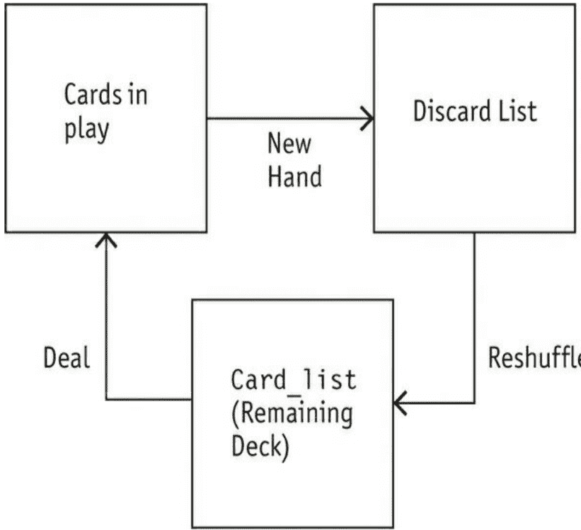
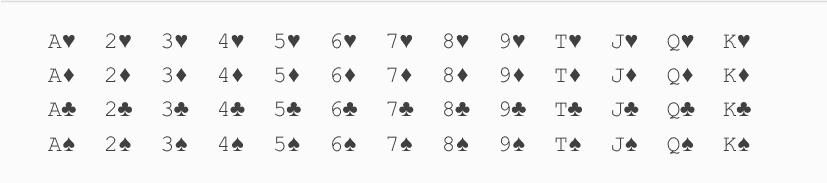
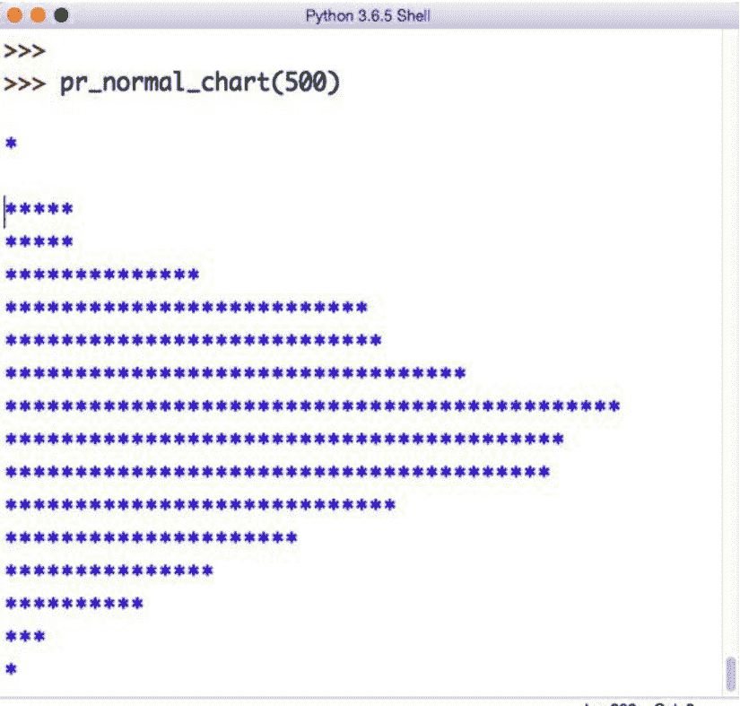
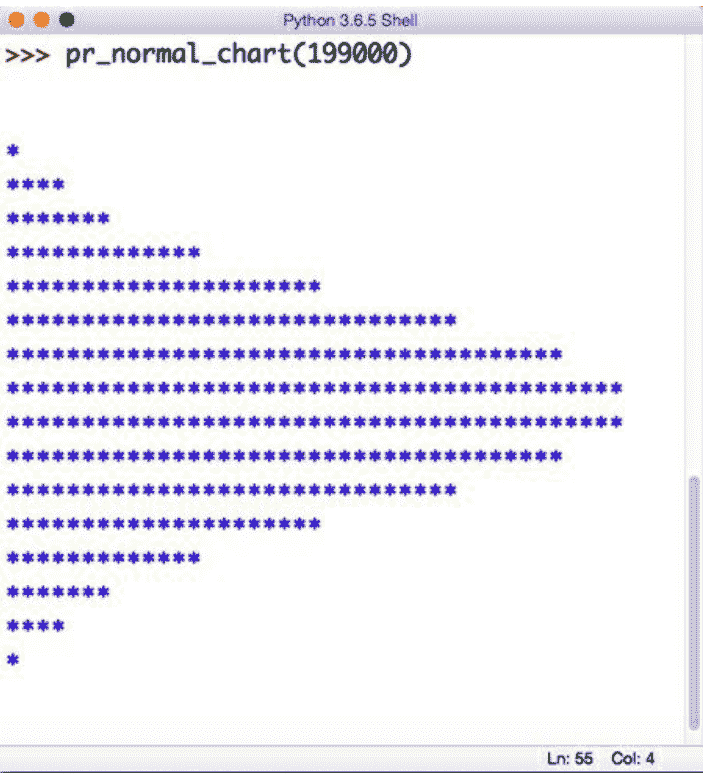
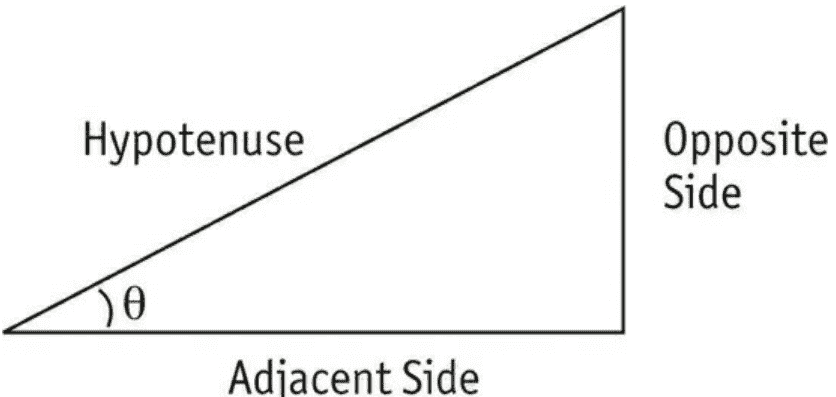
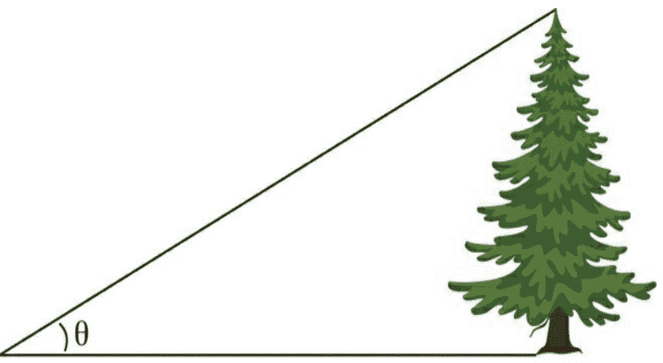

# 11. Random 和 Math 包

当其中一位作者还小的时候，他不喜欢花太多时间在算术上，因为他争辩说，总有一天每个人都会有电脑来完成世界上所有的算术。他部分是对的。算术仍然有用，但世界已经高度计算机化。条形码和收银机完成了你所需的一切，你随时可以拿出带有内置计算器功能的手机。

但数字运算仍然很重要。本章关注的不是平凡的算术，而是更高级的数学函数，以及 **random**，它在游戏程序和模拟中很有用。对于最复杂的 3D 游戏，你需要寻找更高级的包，但对于简单的游戏，**random** 和 **math** 就足够了。

**random** 和 **math** 包不需要下载。你所要做的就是使用简单的语法导入它们，然后就可以开始了。

## 11.1 Random 包概述

在许多游戏程序和模拟中，获取随机数，或者更确切地说，_伪随机数_的能力是必不可少的。

伪随机数取自一个表现得像随机选择的序列。本章使用一些常识性概念来测试这种行为。

随机数可以从几种 _分布_ 中选择。分布决定了随机数必须落入的范围，以及数字出现最频繁的位置。

例如，`random.randint` 函数从指定范围生成一个整数值，其中每个整数被选中的概率相等。例如，你可以让它模拟掷一个公平的六面骰子，并期望每个数字大约六分之一的时间出现一次。

要使用此包，请在源文件开头放置以下语句。

```python
import random
```

## 11.2 Random 函数概览

`random` 包由许多函数组成，每个函数支持不同的随机分布。表 11.1 总结了 `random` 包中更常用的函数。

### 表 11.1. 常用 Random 包函数

| 语法 | 描述 |
|---|---|
| `normalvariate(mean, dev)` | 生成经典的正态分布，即 _钟形曲线_。高度和宽度各异：它可能“更高”或“更平坦”。参数 _mean_ 是数值集中周围的值；参数 _dev_ 是标准差。大约三分之二的数值倾向于落在一个标准差以内。（因此，更大的标准差会创建更宽的钟形曲线。） |
| `randint(a, b)` | 在范围 _a_ 到 _b_（包含两端）内生成一个随机整数，其中每个整数被选中的概率相同；这是一种均匀分布。例如，`randint(1, 6)` 模拟一个完全公平的六面骰子的结果。 |
| `random()` | 生成范围 0 到 1（不包括高端点）之间的随机浮点数。范围是连续的，但分布是均匀的，因此如果将其分为 N 个子范围，数值应该以大约 1/N 的概率落入其中每个子范围。 |
| `sample(population, k)` | 从样本总体中随机生成 _k_ 个元素。总体是列表、元组、集合或兼容的集合类。要在字典上使用，你首先需要将其转换为列表。 |
| `shuffle(list)` | 随机打乱列表。这是包中最有用的函数之一。不返回值，但列表的内容被打乱，因此任何元素都可能最终出现在任何位置。例如，如果将 0 到 51 的数字分配给代表 52 张牌的牌组，shuffle(range(52)) 生成一个代表洗牌后牌组的列表。 |
| `uniform(a, b)` | 生成范围 a 到 b 之间的随机浮点数。分布是连续且均匀的。 |

## 11.3 测试随机行为

一系列随机数应表现出某些行为。

- 大致符合预期。如果你进行多次试验，其中 1 到 N 的值出现的概率相等，我们应期望每个值大约 1/N 的时间出现一次。
- 变化。然而，你应期望存在变化。如果你用 10 个均匀值运行 100 次试验，你不应期望每个值恰好出现 1/10 的时间。如果发生这种情况，模式过于规律且可疑地非随机。
- 随着 N 增大而减少的变化。然而，随着试验次数的增加，我们应期望预期命中数与实际命中数的比率越来越接近 1.0。这就是所谓的大数定律。

这些特性很容易测试。通过运行不同试验次数的测试，你应该能够看到预测命中数与实际命中数的比率越来越接近 1.0。以下是一个旨在测试这些特性的函数。

Click here to view code image

```python
import random
def do_trials(n):
    hits = [0] * 10
    for i in range(n):
        a = random.randint(0, 9)
        hits[a] += 1
    for i in range(10):
        fss = '{: {}t{{:.3}}'.format(i, hits[i],
        print(fss.format(i, hits[i],
        hits[i]/(n/10)))
```

此函数首先创建一个包含 10 个元素的列表。每个元素都存储命中次数：例如，hits[0] 将存储生成 0 的次数，hits[1] 将存储生成 1 的次数，hits[2] 将存储生成 2 的次数，以此类推。

第一个循环生成 n 个随机数，其中每个数都是 0 到 9 之间的整数。然后根据需要更新 hits 列表中的元素。

```python
for i in range(n):
    a = random.randint(0, 9)
    hits[a] += 1
```

当然，此循环中的关键语句是对 random.randint 的调用，（在此情况下）它生成 0 到 9 之间（包含两端）的整数，获得各种值的概率均匀。

第二个循环然后打印结果摘要，显示每个 0 到 9 的数字生成了多少次，以及该数字与预测命中数的匹配情况，在每种情况下预测命中数均为 n/10。

在以下会话中，该函数用于生成并记录 100 次试验的结果。

```python
>>> do_trials(100)
0: 7 0.7
1: 13 1.3
2: 10 1.0
3: 4 0.4
4: 11 1.1
5: 10 1.0
6: 7 0.7
7: 11 1.1
8: 12 1.2
9: 15 1.5
```

此次 100 次试验的运行表明，n 等于 100 远远不足以获得令人信服的均匀结果。实际命中数与预测命中数的比率从低 0.4 到高 1.5 不等。但运行 1000 次试验会产生更均匀的结果。

```python
>>> do_trials(1000)
0: 103 1.03
1: 91 0.91
2: 112 1.12
3: 102 1.02
4: 110 1.1
5: 101 1.01
6: 92 0.92
7: 96 0.96
8: 87 0.87
9: 106 1.06
```

在此处，实际命中数与预期命中数（n/10）的比率总体上更接近 1.0。如果将试验次数增加到 77,000，它们会更接近。

```python
>>> do_trials(77000)
0: 7812 1.01
1: 7700 1.0
2: 7686 0.998
3: 7840 1.02
4: 7762 1.01
5: 7693 0.999
6: 7470 0.97
7: 7685 0.998
8: 7616 0.989
9: 7736 1.0
```

请记住，预期命中数（所有试验的十分之一）与实际命中数（范围从 7470 到 7840）的比率构成第三列。

虽然这种方法并不完全科学，但它足够


## 11.4 一个随机整数游戏

用 Python 编写的最简单的游戏之一是猜数字游戏，用户反复猜测程序预先选定的一个秘密数字。在每一轮中，用户做出一个猜测，程序会通过说“成功”（用户获胜）、“太高”或“太低”来响应。这个游戏的一个简单版本在第 1 章中介绍过。

除非程序选择的秘密数字每次都不同，否则游戏就无趣；此外，这个数字应该尽可能不可预测，这就是随机数的全部意义所在。

下面是游戏简单版本的代码。这个版本首先从 1 到 50（包含 50）中选取一个随机数。

```python
import random
n = random.randint(1, 50)
while True:
    guess = int(input('Enter guess: '))
    if guess == n:
        print('Success! You win.')
        break
    elif guess < n:
        print('Too low.', end=' ')
    else:
        print('Too high.', end=' ')
```

下面是一个示例会话。假设函数调用 `random.randint(1, 50)` 返回值 31。用户直到游戏结束才知道这个值已被选中。

```
Enter guess: 25
Too low. Enter guess: 37
Too high. Enter guess: 30
Too low. Enter guess: 34
Too high. Enter guess: 32
Too high. Enter guess: 31
Success! You win.
```

这个游戏可以改进几个方面。首先，每局游戏结束后应该询问用户是否想再玩一次。其次，如果用户在某一轮游戏中感到无聊，应该能够提前退出。下面是改进后的版本。

```python
import random
def play_the_game():
    n = random.randint(1, 50)
    while True:
        guess = int(input('Enter guess (0 to exit): '))
        if guess == 0:
            print('Exiting game.')
            break
        elif guess == n:
            print('Success! You win.')
            break
        elif guess < n:
            print('Too low.', end=' ')
        else:
            print('Too high.', end=' ')

while True:
    play_the_game()
    ans = input('Want to play again? (Y or N): ')
    if not ans or ans[0] in 'Nn':
        break
```

## 11.5 创建 Deck 对象

**shuffle** 函数是 **random** 包中最有用的函数之一。正如你可能猜到的，这个函数特别适用于模拟一副扑克牌，你猜对了。但它也可以扩展到其他情况。

**shuffle** 的作用是重新排列列表的顺序，使任何元素都可以出现在任何位置。元素的数量不会改变，重复项的数量（如果有）也不会改变。因此，例如，假设你打乱下面的列表：

```python
kings_list = ['John', 'James', 'Henry', 'Henry',
              'George']
```

接下来，我们使用 `random.shuffle` 来随机化顺序。

```python
random.shuffle(kings_list)
```

如果你现在打印列表，你会发现无论打乱如何，仍然有两个 Henry，以及各一个 John、James 和 George。不过，顺序几乎肯定会改变。

打乱算法是一个相当通用的算法。

```
For I in range(0, N-2),
J = randint(I, N-1)
Swap list[I] with list[J]
```

`random.shuffle` 函数的作用是原地重新排列列表，替换所有旧值，但不会在内存中移动列表本身。

封装一副牌功能的最佳方法之一是创建一个 Deck 类，并用它来实例化 Deck 对象。它应该具有以下属性。

- 它将包含 0 到 N 的数字列表。对于一副 52 张的牌，这些数字中的每一个都可以映射到一张具有唯一等级和花色的牌。
- 初始化时，Deck 对象会自行打乱。
- 然后你可以要求 Deck 对象从“顶部”（列表的开头）一次发一张牌，将牌作为 0 到 51 之间的数字返回。
- 当所有牌都发完后，Deck 对象会自动重新打乱。

完成后，这将是面向对象编程的一个绝佳示例。Deck 对象的实例将维护其内部状态。以下实现使你能够创建任何大小的自动重新打乱的牌组。

```python
import random

class Deck():
    def __init__(self, size):
        self.card_list = [i for i in range(size)]
        random.shuffle(self.card_list)
        self.current_card = 0
        self.size = size

    def deal(self):
        if self.size - self.current_card < 1:
            random.shuffle(self.card_list)
            self.current_card = 0
            print('Reshuffling...!!!!')
        self.current_card += 1
        return self.card_list[self.current_card - 1]
```

顺便说一句，牌组“发出”的值可以转换为具有唯一等级和花色组合的扑克牌。

```python
ranks = ['2', '3', '4', '5', '6', '7', '8', '9',
         '10', 'J', 'Q', 'K', 'A']
suits = ['clubs', 'diamonds', 'hearts', 'spades']
my_deck = Deck(52)

# Deal twelve poker hands, so user can compare
# before and after shuffling.

for i in range(12):
    for i in range(5):
        d = my_deck.deal()
        r = d % 13
        s = d // 13
        print(ranks[r], 'of', suits[s])
    print()
```

正在进行的牌会留在桌面上，从发牌时开始。只有在发新手牌时，正在进行的牌才会加入弃牌堆。这在牌组、正在进行的牌和弃牌堆之间建立了一种关系，如图 11.1 所示。



曾经，二十一点（也称为黑杰克）在赌场中就是这样玩的。偶尔现在仍然是这样：一副标准牌组，一直发到最后一张牌，然后重新打乱。

我们可以重写 Deck 对象如下。

```python
import random

class Deck():
    def __init__(self, size):
        self.card_list = [i for i in range(size)]
        self.cards_in_play_list = []
        self.discards_list = []
        random.shuffle(self.card_list)

    def deal(self):
        if len(self.card_list) < 1:
            random.shuffle(self.discards_list)
            self.card_list = self.discards_list
            self.discards_list = []
            print('Reshuffling...!!!!')
        new_card = self.card_list.pop()
        self.cards_in_play_list.append(new_card)
        return new_card

    def new_hand(self):
        self.discards_list += self.cards_in_play_list
        self.cards_in_play_list.clear()
```

这个类定义有一个新方法 `new_hand`，每当一手牌结束并且当前正在进行的所有牌都放入弃牌堆时，都应该调用它。然后牌组应该将当前正在进行的牌添加到 `discard_list` 并清除 `cards_in_play_list`。

对 `deal` 方法的更改更为复杂。现在，与其只是打乱通常包含牌组中所有牌的 `card_list`，不如只打乱弃牌堆。然后将结果列表与 `card_list` 互换；这成为新的抽牌牌组。然后清空弃牌堆。

如果在桌上仍有牌时发生重新打乱，那些牌不会被重新打乱，因此生成的牌组大小可能不同。但是那些正在进行的牌如何才能重新进入牌组呢？很简单。它们将在当前手牌结束时加入弃牌堆，然后最终被重新打乱回牌组。

> **Note**  
> 你可能希望根据拉斯维加斯赌场二十一点规则的变化对这个类进行进一步修改。例如，你可能希望容纳大多数赌场使用的六副牌“鞋”。这实际上只是分配合适的牌组大小的问题；它不会改变此处显示的代码。你还可能希望修改一些方法，以便发牌员有方法提前重新打乱（例如，编写一个新方法来仅执行此操作）。

## 11.6 为牌组添加图形符号

如果你愿意，可以更改 Deck 类的初始化，使其存储标准扑克牌的小图片，而不仅仅是存储数字。如果你这样做，那么你就不需要一段单独的代码来将 0 到 51 的数字翻译成扑克牌的名称。相反，你可以直接打印牌符号，如下面的版本所示。

```python
def __init__(self, n_decks=1):
    self.card_list = [num + suit
                      for suit in '\u2665\u2666\u2663\u2660'
                      for num in 'A23456789TJQK'
                      for deck in range(n_decks)]
```


self.cards_in_play_list = []
self.discards_list = []
random.shuffle(self.card_list)

请注意，此版本的程序创建的牌组是标准 52 张牌组的倍数。创建包含多个牌组的“牌组”可能是模拟拉斯维加斯六副牌“鞋”的一种好方法。

鉴于此版本的 `__init__` 方法，Deck 对象现在包含的卡片表示形式如下，如果你打印它们的话。



下面是修订后的 Deck 类的完整版本，以及一个打印五张牌手牌（如扑克）的小程序。此版本假设使用六副牌鞋，但你可以轻松将其修改为仅使用一副牌。

# File deck_test.py
# ------------------------------------------------------------

import random

class Deck() :
    def __init__(self, n_decks=1):
        self.card_list = [num + suit
                          for suit in '\u2665\u2666\u2663\u2660'
                          for num in 'A23456789TJQK'
                          for deck in range(n_decks)]
        self.cards_in_play_list = []
        self.discards_list = []
        random.shuffle(self.card_list)

    def deal(self):
        if len(self.card_list) < 1:
            random.shuffle(self.discards_list)
            self.card_list = self.discards_list
            self.discards_list = []
            print('Reshuffling...!!!!')
        new_card = self.card_list.pop()
        self.cards_in_play_list.append(new_card)

        return new_card

    def new_hand(self):
        self.discards_list += self.cards_in_play_list
        self.cards_in_play_list.clear()

dk = Deck(6)     # Use six-deck shoe.
for i in range(5):
    print(dk.deal(), end=' ')

下面是一个示例会话。你拿到了两对。运气不错！

9♥ 9♥ T♠ 4♦ T♣

## 11.7 绘制正态分布

在数学和统计学中，正态分布是经典的钟形曲线。它在自然界中如此频繁地出现并非偶然。它是帕斯卡三角形在深入更深层次时趋同的形状。它是二项式定理在生成这些数字时预测的形状。

例如，平均美国男性的身高大约是五英尺十英寸。如果你对这个人群进行随机抽样，平均而言，你会发现绝大多数男性的身高都在这个身高几英寸以内。当然，会有一些特别矮或特别高的异常值。但是，随着你远离平均值，这些异常值会变得越来越少。

结果就是一条钟形曲线。大部分人口应该围绕平均值（或均值）分布，在该均值周围形成一个凸起。正态分布由两个主要因素控制：均值和标准差。

均值是平均值，即曲线的中间。标准差，也称为西格玛，决定曲线是窄还是宽。经过足够长的时间，数值的产生应符合表 11.2 中的规则。

### 表 11.2. 标准差的影响

| 标准差的数量 | 人口百分比（按预测） |
|---|---|
| 一 | 平均而言，约 68% 应落在均值的一个标准差以内。 |
| 二 | 平均而言，约 95% 应落在均值的两个标准差以内。 |
| 三 | 平均而言，约 99.7% 应落在均值的三个标准差以内。 |

以下是如何阅读表 11.2。例如，假设你有一个均值为 100、标准差为 20 的正态分布。从长远来看，你应该期望由 `normalvariate` 函数产生的约 68% 的数字落在 80 到 120 之间。你应该期望产生的 95% 的数字落在 40 到 160 之间。

然而，尽管 `random` 包中有所有概率分布，它们只是概率分布。尤其是在短期内，没有什么是确定的。对于给定的试验，在给出的条件下，数字落在 40 到 160 范围内的概率是 95%；有 5% 的概率落在范围之外。

但这并不意味着这种情况 _不可能发生_。概率仅为 5% 的事件确实会发生，而且经常发生。概率为百万分之一或更低的事件每天都会发生——每次有人中彩票时都会发生！

因此，如果你只取少量样本结果，可能看不到任何类似钟形曲线的东西。幸运的是，由于大数定律（在第 11.3 节“测试随机行为”中演示），如果你取许多样本值，你应该会看到相当可预测的行为。

以下程序旨在利用大数定律，允许任意数量的样本结果，缩小数字以便于绘图，然后打印结果图表。

```python
import random

def pr_normal_chart(n):
    hits = [0] * 20
    for i in range(n):
        x = random.normalvariate(100, 30)
        j = int(x/10)
        if 0 <= j < 20:
            hits[j] += 1
    for i in hits:
        print('*' * int(i * 320 / n))
```

此函数调用 **normalvariate** 函数任意次数；然后使用结果制作一个简单的基于字符的图表。关键行调用 **random.normalvariate**，均值为 100，标准差为 30：

```python
x = random.normalvariate(100, 30)
```

当然，标准差不必是 30。你可以通过修改这个数字进行实验。较小的偏差会产生更细、更明显的图表；较大的偏差会使曲线看起来更平坦。

代码然后通过除法和 int 转换将数字 x 转换为 0 到 20 之间的整数，将结果收集到二十个“桶”中。除非你增加标准差，否则随机数落在这个范围之外的情况很少见。

结果 x 被除，以便可以索引 hits 数组。在每个桶中，我们累积相应范围中的命中次数。

```python
j = int(x/10)
if 0 <= j < 20:
    hits[j] += 1
```

然后将每个命中次数乘以 320 并除以 n 进行缩小。这使得参数 n 可以设置为你选择的任意大值，而不会增加要打印的星号（*）的总数。如果不进行缩放，你就无法输入较大的 n 值，否则屏幕会被星号淹没。

```python
for i in hits:
    print('*' * int(i * 320 / n))
```

为什么使用这些特定的数字——100、30 和 320？

我们通过反复试验确定了这些数字，以达到美观的效果。你可以尝试使用不同的数字。

你可以输入相对较少的试验次数——比如 500 次。图 11.2 显示了典型结果。生成的图表显示的图形大致像钟形曲线，但明显有偏差；远不是大 n 时数学所预测的结果。



**图 11.2.** 500 次试验后的正态分布

但此图仅使用了 500 次试验，对于统计学来说，这并不是一个很大的样本；它应该揭示一般模式，但在某些地方会有显著偏差，确实如此。

在图 11.3 中，试验次数从 500 增加到 199,000 次。由于函数中编写的缩放，要打印的星号总数不会显著变化。但现在，形状与数学上完美的钟形曲线吻合得更加紧密。



**图 11.3.** 199,000 次试验后的正态分布

在样本大于 199,000（约 200,000）的情况下，你应该继续得到结果——在这个粗糙的粒度级别上——看起来像数学上完美的钟形曲线。


## 11.8 编写你自己的随机数生成器

本节介绍如何编写你自己的随机数生成器（如果你选择这样做）。其中包含一些最初在 _Python Without Fear_ 中讨论过的生成器相关内容。

大多数时候你不需要编写自己的随机数生成器，但在某些情况下它很有用。也许你正在为赌博设备编写代码，例如电子老虎机或在线扑克游戏。你的主要关注点之一是，不允许任何用户破解代码并预测接下来会发生什么。

`random` 包支持相当高质量的随机数分布。但是，如果没有外部随机化设备的访问权限——例如测量放射性衰变的设备——就必须使用伪随机数，这些数字虽然有用，但并非万无一失。理论上，任何序列都可以被破解。

编写你自己的伪随机生成器，使你能够生成一个尚未被任何人破解的序列。

### 11.8.1 生成随机数的原理

一般来说，伪随机序列可以通过做两件事来实现足够随机的行为：

- 选择一个 _种子_（起始值），人类难以或不可能猜测。系统时间对此目的来说是可以的。虽然时间不是随机的——它的值总是在增加——但它精确到微秒，且最低有效位对人类来说非常难以预测。
- 使用伪随机序列，它通过对前一个数应用数学运算来生成每个数字。这涉及复杂的变换。这些是混沌变换，因为初始值的微小差异会导致结果的巨大差异。

### 11.8.2 示例生成器

第 4 章介绍了在 Python 中编写生成器的原理。最重要的规则是，不使用 return 语句，而是使用 yield 语句。yield 在响应下一个函数调用（可能是直接调用，也可能是在 for 循环中调用）时给出一个值，并在再次调用之前保留内部状态。

这都是第 4.10 节“生成器”中描述的更大过程的一部分。虽然包含 yield 的函数似乎不返回对象，但实际上它返回了：它返回一个生成器对象，也称为迭代器。生成器对象才是在运行时实际产生值的东西。

所以——这是奇怪的部分——函数描述了生成器做什么，但生成器本身实际上是由函数返回的对象！诚然，这有点反直觉。

下面是一个简单的随机数生成器，它生成 0 到大约 42 亿（四字节整数的大小）范围内的浮点值。

Click here to view code image

```python
import time

def gen_rand():
    p1 = 1200556037
    p2 = 2444555677
    max_rand = 2 ** 32
    r = int(time.time() * 1000)
    while True:
        n = r
        n *= p2
        n %= p1
        n += r
        n *= p1
        n %= p2
        n %= max_rand
        r = n
        yield n
```

结果是一个随机数生成器（你可以自己验证），它似乎相当不错地满足了随机性的明显统计测试。然而，它仍然是一个相对简单的生成器，绝无意提供最佳性能。它确实遵循了一些随机性的基本原则。

定义此生成器函数后，你可以使用以下代码对其进行测试：

Click here to view code image

```python
>>> gen_obj = gen_rand()
>>> for i in range(10): print(next(gen_obj))
1351029180
```

## 11.9 math 包概述

`math` 包提供了一系列在许多科学和数学应用中有用的函数。

虽然 `math` 包的大部分服务以函数形式提供，但该包还包括两个有用的常量：`pi` 和 `e`。取决于你如何导入包，这些常量分别称为 `math.pi` 和 `math.e`。

`math` 包是任何标准 Python 下载中提供的另一个包。你永远不需要搜索它或下载它。导入它就足够了。

```python
import math
```

当然，你也可以选择性地导入符号。

## 11.10 math 包函数概览

`math` 包中最常用的函数分为表 11.3 总结的主要类别。

### 表 11.3. 按类别分类的常用 math 包函数

| 类别 | 描述 |
|---|---|
| 标准三角函数 | 包括 `sin`、`cos` 和 `tan`，分别是正弦、余弦和正切函数；每个函数都以角度作为输入，并生成直角三角形一条边与另一条边的比值。 |
| 反三角函数 | 这些函数与第一类密切相关，但它们不是以角度作为输入并返回直角三角形两边的比值，而是以比值作为输入并返回角度。此类别包括 `asin`、`acos` 和 `atan`。 |
| 角度和弧度 | 两个函数 `degrees` 和 `radians`，分别将弧度转换为角度（第一种情况），以及将角度转换为弧度（第二种情况）。这些在与三角函数一起使用时非常有用，三角函数使用弧度，尽管角度对大多数人来说更熟悉。 |
| 双曲函数 | 双曲函数类别包括三角函数和反三角函数的双曲版本。名称是通过在名称末尾添加“h”形成的，得到 sinh、cosh 和 tanh。 |
| 对数函数 | math 包提供了一组灵活的对数计算，包括支持多种底数。这些函数是指数运算的逆运算。它们包括 log2、log10 和 log，分别用于查找底数为 2、10 和 e 的对数。最后一个也可以与你指定的任何底数一起使用。 |
| 转换为整数 | 几个函数支持将浮点数转换为整数，包括 floor（始终向下取整）和 ceil（始终向上取整）。 |
| 杂项 | 包括 pow（幂，或指数运算）和平方根 sqrt。 |

## 11.11 使用特殊值（PI）

从 Python 包中命名常量（技术上是数据对象）的规则与函数相同。如果你使用 `import math`（推荐），则对包中对象的所有引用都必须限定。下面是一个示例：

Click here to view code image

```python
import math
print('The value of pi is:', math.pi)
```

但是，如果 `pi` 是直接导入的，则可以不加限定地引用它。

Click here to view code image

```python
from math import pi
print('The value of pi is:', pi)
```

表 11.4 列出了包中的对象；当然，这些是近似值。

### 表 11.4. math 包数据对象

| 数据对象 | 描述 |
|---|---|
| pi | 数学常数 pi，即完美圆周的周长与直径之比。等于 3.141592653589793。 |
| e | 数学常数 e。等于 2.718281828459045。 |
| tau | 仅限 Python 3.0。这是一个等于 2 乘以 pi 的数学值。等于 6.283185307179586。 |
| inf | 无穷大。仅用于 IEEE 数学。 |
| nan | 不是一个数字。仅用于 IEEE 数学。 |

表 11.4 中的最后两个数据对象是为了完全支持浮点协处理器的所有状态而提供的。然而，这些值在 Python 中很少使用，因为该语言不允许你通过除以零来获得无穷大；此类操作在 Python 中会引发异常。

然而，`math.pi` 的值在数学和科学应用中被广泛使用。下面是一个简单的示例：获取圆的直径并返回其周长。

Click here to view code image

```python
from math import pi

def get_circ(d):
    circ = d * pi
    print('The circumference is', circ)
    return circ
```

此常量列表中一个显著的遗漏是数学值 `phi`，也称为 _黄金比例_。但是，这个值相对容易自己生成：它是 1 加上 5 的平方根，然后将结果除以 2。


```python
import math
phi = (1 + math.sqrt(5)) / 2
```

或者，不使用 **math** 包，你也可以这样计算：

```python
phi = (1 + 5 ** 0.5) / 2
```

无论哪种情况，它在 Python 中最接近的近似值为 1.618033988749895。

## 11.12 三角函数：树的高度

三角函数有许多实际用途。在本节中，我们将演示一个简单的用途：计算树的高度。

考虑图 11.4 中所示的直角三角形。直角（90 度）是固定的，但其他两个角可以变化。我们选择离我们最近的角。根据这个角的度量，我们可以（通过三角函数）预测任意两边长度的比率。



图 11.4. 直角三角形

三个基本三角函数——正弦、余弦和正切——定义如下。在 Python 中，如同大多数其他编程语言和库一样，这三个函数分别实现为 sin、cos 和 tan 函数。

sine(θ) = 对边 <B> / 斜边 <C>
cosine(θ) = 邻边 <A> / 斜边 <C>
tangent(θ) = 对边 <B> / 邻边 <A>

例如，如果对边长度是邻边长度的一半，那么正切值就是 0.5。

这与树的高度有什么关系？关系很大。考虑以下场景：一名人类观察者驻守在距树底 1,000 英尺处。他不知道树的高度，但他确定到树底的距离，因为之前已经测量过。使用他可靠的六分仪，他测量了树顶相对于地平线的角度。这给了他一个角度，θ。

图 11.5 说明了这个场景。



图 11.5. 计算树的高度

现在只需一点代数知识就能得出正确的公式。记住正切函数的公式。

tangent(θ) = 对边 <B> / 邻边 <A>

两边同时乘以 A 并重新排列，我们得到以下计算规则。

对边 <B> = tangent(θ) * 邻边 <A>

因此，要得到树的高度，你需要求出仰角的正切值，然后乘以到树底的距离，在此例中为 1,000 英尺。现在编写一个计算树高的程序很容易。

单击此处查看代码图像

```python
from math import tan, radians
```

```python
def get_height(dist, angle):
    return tan(radians(angle)) * dist

def main():
    while True:
        d = float(input('Enter distance (0 to exit):'))
        if d == 0:
            print('Bye!')
            break
        a = float(input('Enter angle of elevation:'))
        print('Height of the tree is', get_height(d, a))

main()
```

程序的核心是执行计算的那一行：

单击此处查看代码图像

```python
return tan(radians(angle)) * dist
```

虽然这是一个简单的程序，但它确实有一个微妙之处，或者说是陷阱。所有 Python 三角函数都使用弧度。除非先将角度转换，否则它们不使用角度。一个完整圆定义为 360 度；它也定义为 2*pi 弧度。因此，如果用户要使用角度——这是大多数人在现实生活中使用的——你需要应用 math.radians 函数将角度转换为弧度（或者只需乘以 2*pi/360）。

以下是示例会话：

单击此处查看代码图像

```
Enter distance (0 to exit): 1000
Enter angle of elevation: 7.4
Height of the tree is 129.87732371691982
Enter distance (0 to exit): 800
Enter angle of elevation: 15
Height of the tree is 214.35935394489815
Enter distance (0 to exit): 0
Bye!
```

> 注意
> 在此示例中，我们使用了 `import` 语句语法的变体，该变体导入特定函数。如果你确定不会与导入的特定名称发生冲突，这通常是一种好的方法。
> 
> from math import tan, radians

## 11.13 对数：数字猜谜游戏重访

`math` 包中其他经常有用的函数是对数函数，如表 11.5 所示。

| 数据对象 | 描述 |
|---|---|
| `log10(` | 以 10 为底的对数。（10 需要被提升到多少次方才能产生 x？） |
| `log2 (x )` | 以 2 为底的对数。（2 需要被提升到多少次方才能产生 x？） |
| `log (x , base= e)` | 使用指定底数的对数。第二个参数是可选的；默认情况下，该函数使用底数 e 查找“自然对数”。 |

如果对数的概念对你已经很熟悉，请继续阅读第 11.13.2 节，了解对数在程序中的实际用途。你可以阅读第 11.13.1 节（下一节）来了解更多关于对数的信息。

### 11.13.1 对数的工作原理

对数是指数运算的逆运算。如果你记住这个定义，对数就不那么令人生畏了。例如，假设以下成立：

base ** exponent = amount

那么，以下等式也必须成立：

Logarithm-of-base (amount) = exponent

换句话说，对数计算的是达到某个数量所需的指数。通过一些示例更容易理解。首先，让我们假设底数为 10。注意表 11.6 中，随着指数的增加，数量增加得有多快。

| 10 提升到这个指数 | 产生这个结果 |
|----------------------------|----------------------|
| 1 | 10 |
| 2 | 100 |
| 3 | 1000 |
| 3.5 | 3162.277 |
| 4 | 10000 |
| 4.5 | 31622.777 |

现在，要理解以 10 为底的对数，我们只需要反转列（见表 11.7）。你应该从这些表中注意到，随着数量的增加，指数增加得有多慢。对数增长非常缓慢——并且总是会被简单的线性增长超越。

| 取 10 的对数 | 产生这个结果 |
|-----------------------|----------------------|
| 10 | 1 |
| 100 | 2 |
| 1000 | 3 |
| 3162.277 | 3.5（近似值） |
| 10000 | 4 |
| 31622.777 | 4.5（近似值） |

请记住，表 11.7 中的一些结果是近似值。例如，如果你取 31,622.777 的以 10 为底的对数，你会得到一个非常接近 4.5 的数字。

### 11.13.2 将对数应用于实际问题

现在让我们回到数字猜谜游戏。如果你玩几次游戏，你应该会看到有一个明显的策略，可以在少于 N 次猜测中得到答案，其中 N 是范围的大小。最糟糕的策略是从 1 开始，然后每次加 1，猜 2，依此类推，直到覆盖整个范围。

平均而言，该策略需要 N/2 次猜测才能成功：如果范围是 1 到 50，则需要 25 次猜测。但采用正确的策略，你应该能做得好得多，这引出了以下问题。

对于大小为 N 的范围，理想策略得到答案所需的最大步骤数是多少？

当 N = 3 时，最好的策略是什么？显然，你应该先猜中间的数字 2，然后下一次猜 1 或 3。这保证了你最多只需要猜两次，即使有三个值。当超过三个值时，我们可能需要再猜一次。但两次猜测对于 N = 3 就足够了。

下一个“上限”应该出现在 N = 7，你应该明白为什么。这是因为你可以猜中间的值 4，然后——如果这个猜测不成功——将自己限制在前三个数字（需要再猜两次）或后三个数字（也需要再猜两次）。因此，对于 N = 7，三次猜测就足够了。

如果你仔细想想，每上升一步，需要额外的猜测，可以通过在上一步将 N 加倍并加 1 来实现。例如，图 11.6 说明了当 N 从 1 增加到 3 再到 7 时，所需猜测次数如何从 1 增加到 2 再到 3。


Figure 11.6. How three guesses are needed at N = 7

We can now determine the maximum number of guesses required at certain numbers. When N falls between these numbers, we round upward to the next step—because to get the maximum number of guesses needed, we must assume a worst-case scenario. Table 11.8 shows the progression.

# Table 11.8. Maximum Number of Guesses Required by the Game

| Size = N | N + 1 | Number of guesses required = log2(N+1) |
|----------|-------|----------------------------------------|
| 1        | 2     | 1                                      |
| 3        | 4     | 2                                      |
| 7        | 8     | 3                                      |
| 15       | 16    | 4                                      |
| 31       | 32    | 5                                      |
| 63       | 64    | 6                                      |

The numbers in the leftmost column of Table 11.8 list ranges of numbers in the game; not all numbers are listed, but only those that “step up”—that is, require an additional guess. Each of these is an upper limit—so that for N = 15 or less, for example, up to four guesses are required. But for any range greater than 15, more guesses are required.

The numbers in the leftmost column are each 1 less than a power of 2. When added to 1, they correspond to a power of 2. Therefore, to get the numbers in the rightmost column—which contains the number of guesses needed—you must take logarithm base 2 of N+1.

The final step is to round upward to the nearest integer, because the number of steps taken must be an integer, and not floating point. The correct formula is

_Maximum guesses needed = ceiling(log-base-2(N + 1))_

Writing the program, with the aid of the **math** package, is now easy.

Click here to view code image

```
from math import log2, ceil

n = int(input('Enter size of range: '))
x = ceil(log2(n + 1))
print('Max. number of guesses needed is', x)
```

This program, in addition to using the `math.log2` function, also uses `math.ceil`, one of the miscellaneous functions. The `ceil` function takes any number and rounds it upward to the lowest integer greater than or equal to its input.

Now, if you run the program, you can answer the question we posed earlier. As usual, user input is shown in bold.

Click here to view code image

```
Enter size of range: 50
Max. number of guesses needed is 6.
```

So that’s the answer. If you follow the ideal strategy—which is to make a guess in the middle of the available range—you should never need more than six guesses.

As for the strategy, you pick a number as close as you can to the midpoint of the available range. This range should always be what’s left over after you use all the information you’ve gotten from previous guesses. For example, if you guess 25 and the computer says, “Too high,” you should adjust the range to 1 to 24 instead of 1 to 50.

This strategy reflects a binary-search pattern, which should, on average, reduce the number of available choices by roughly 50 percent each time, until the result is found.

# CHAPTER 11 SUMMARY

This chapter explored how two of the most commonly used packages—random and math—can be used in practical ways in your programs. Both of these packages come preinstalled with the Python download.

The random package provides a variety of distributions. The most commonly used ones were explored in this chapter: randint, returning a random integer with uniform distribution across a given range; shuffle, which rearranges the contents of a list as if it were a deck of cards; and normalvariate.

The classic normal probability distribution tends to generate values close to the specified mean. Outlier values are always possible, but the farther a value is from the mean, the less frequently it’s generated.

The chapter then showed how to use some of the most common functions from the math package, including tan, which calculates tangents, and the logarithmic functions. The Python implementation of logarithms includes log10, log2, and finally log, which calculates logarithms in any base.

# # CHAPTER 11 REVIEW QUESTIONS

+   1 What exactly is a probability distribution? How can you predict the values at all, if they are supposed to be random?

+   2 What is the difference, if any, between true random numbers and pseudo-random numbers? Why are the latter considered “good enough”?

+   3 What are the two major factors that govern how a “normal” probability distribution behaves?

+   4 Give an example of a normal distribution in real life.

+   5 How would you expect a probability distribution to behave in the short run? How would you expect it to change as the number of trials increases?

+   6 What kind of object can be shuffled by using `random.shuffle`?

+   7 Name several general categories of functions in the `math` package.

+   8 How is exponentiation related to logarithms?

+   9 What are the three logarithmic functions supported by Python?

# CHAPTER 11 SUGGESTED PROBLEMS

+   1 Revise the number guessing game in Section 11.4, “A Random Integer Game,” so that it lets the user specify a range of values at the beginning, rather than always using 1 to 50.

+   2 Write an application that determines the length of a hypotenuse of a right triangle, given two pieces of information: the nearest angle, measured in degrees, and the length of the adjacent side.

+   3 By taking advantage of the Deck object presented in Section 11.5, write a game program that deals a Poker hand of five cards. Then prompt the user to enter a series of numbers (for example: “1, 3, 5”) that selects cards to be replaced during a draw phase. Then print the result of drawing the new cards.
