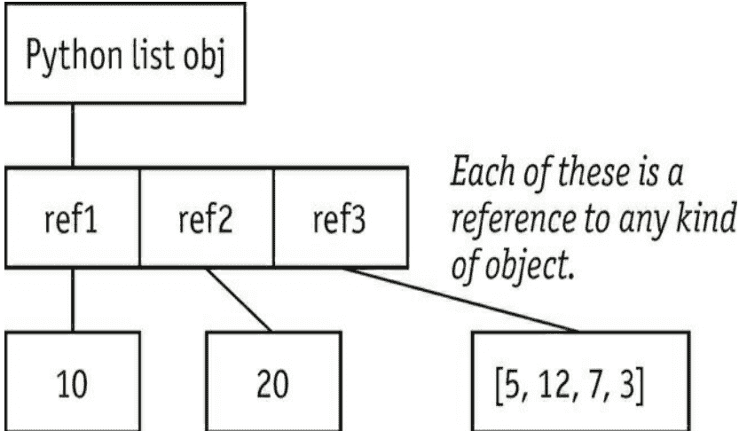
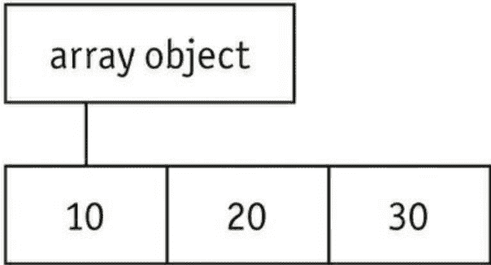
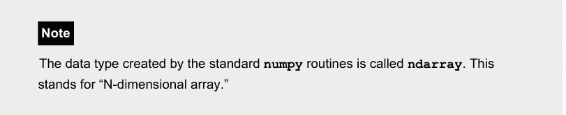
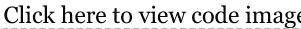
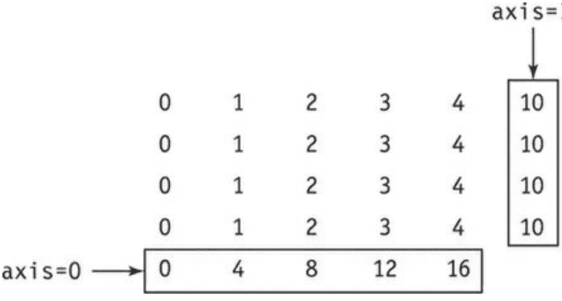

# # 12. The "numpy" (Numeric Python) Package

We now come to one of the best parts of Python: packages that perform sophisticated math operations on large amounts of data. The key package that enables many of these abilities is called **numpy**.

Some of these operations can be written with the core Python language, but many applications run much faster and compactly with help from the **numpy** package. Statistical analysis can be done with a simple, high-level commands in **numpy** rather than by writing complex functions, running as much as _a hundred times as fast_.

Whether you pronounce it “NUM-pee” or “num-PIE,” the **numpy** package may well become your favorite.

# ## 12.1 OVERVIEW OF THE “ARRAY,” “NUMPY,” AND “MATPLOTLIB” PACKAGES

The next two chapters cover the usage of several packages: **array**, **numpy**, **numpy.random**, and the **matplotlib** packages.

# ## 12.1.1 The “array” Package

You might not want to use this package much, but it has some of the basic features of the **numpy** package. The **array** package does, however, enable you to interface with contiguous blocks of data created by other programs.

# ## 12.1.2 The “numpy” Package

The **numpy** package is the core of the technology discussed in this chapter. It builds on the concept of contiguous memory— introduced by the **array** package—but it does much more. The **numpy** package provides efficient handling of one-dimensional arrays (which are something like lists), batch processing (in which you operate on an array or large portions of that array at the same time), and high-level support for creating and maintaining multidimensional arrays.

# ## 12.1.3 The “numpy.random” Package

The **numpy.random** package is automatically downloaded as part of the **numpy** package. It provides much of the same functionality described in Chapter 11 but is optimized for use with **numpy** arrays.

# ## 12.1.4 The “matplotlib” Package

This package is really more than one, but they are downloaded together: **matplotlib** and **matplotlib.pyplot**. With the help of these packages, you’ll be able to create a **numpy** array and then call on plot routines to beautifully plot the resulting graph for you.

Chapter 13, “Advanced Use of ‘numpy’,” covers the plotting library. This chapter deals with **numpy** basics.

# ## 12.2 USING THE “ARRAY” PACKAGE

The generic **array** package doesn’t do much, but it conceptually provides a foundation for how **numpy** works. This package supports one-dimensional arrays only. One advantage of this package is that it doesn’t need to be downloaded.

```
import array
```

This package, along with all the other packages introduced in this chapter, deals with arrays in the strict C and C++ sense, instead of lists.

So what are these things called “arrays”?

Like a list, an *array* is an ordered collection in memory in which elements can be referred to by index number. But unlike lists, arrays are assumed to contain fixed-length data. Data is contiguous, meaning that all elements are placed next to each other in memory.

Figure 12.1. helps illustrate the difference. In a Python list, a number of references are involved, although you don’t normally see these. (In C they would be pointers.)

A list object has a reference to the location of the actual list, which can be moved, but each object in this list is a reference to


实际数据。这正是 Python 能够在同一个列表中混合不同类型数据的原因。



**图 12.1.** Python 列表的存储

如图 12.2 所示，数组的设计更简单。数组对象本身只是指向内存中某个位置的引用。实际数据位于该位置。



所有这些项目在内存中相邻排列，并且大小相同。

**图 12.2.** 连续数组存储

由于数据以这种方式存储，元素必须具有固定长度。它们还需要具有相同的类型。你不能存储任意 Python 整数（理论上可能占用许多字节内存），但可以使用固定长度的整数。

数组存储数据比列表更紧凑。然而，索引数组的速度比索引 Python 列表稍慢，因为 Python 列表索引是经过大量优化的行为。

使用 `array` 包的一个优点是，如果你与其他进程或 C 语言库交互，它们可能要求你以连续内存块的形式传递数据，而本章中的数组正是以这种方式存储的。

要使用 `array` 包，请导入它，然后通过调用 `array.array` 来分配和初始化数组对象。例如，以下是获取数字 1、2、3 的简单数组的方法：

Click here to view code image

```
import array
a = array.array('h', [1, 2, 3])
```

请注意此处将 'h' 用作第一个参数。它接受一个单字符字符串，用于指定数据类型——在此例中为 16 位（2 字节）整数（将范围限制在正负 32K 以内）。我们可以使用 **range** 函数创建更大的数组。

Click here to view code image

```
import array
a = array.array('h', range(1000))
```

这可行，但请注意，除非将数据类型从短整数（'h'）增大为长整数（'l'），否则你无法以这种方式创建从 1 到 100 万（或 0 到 999,999）的数字数组，因为否则将超出 16 位整数数组可存储的范围。

Click here to view code image

```
import array
a = array.array('l', range(1_000_000))
```

警告：除非你准备好等上一整天，否则不要尝试打印这个数组！
此时，你可能会反驳说 Python 中的整数应该是“无限”的，或者更准确地说，整数的限制是天文数字般的。这是正确的，但当你处理固定长度结构时，你就放弃了这种灵活性。
**array** 包及其 **array** 类型的局限性之一是它仅支持一维数组。

## 12.3 下载和导入“NUMPY”

要尝试或使用本章其余部分中的任何代码，如果你尚未下载 **numpy**，则需要下载它。如果你在 IDLE 中工作或编写 Python 脚本，并且尝试导入 **numpy**，如果 **numpy** 包不存在，Python 将引发 **ModuleNotFoundError** 异常。
如果发生这种情况，你需要下载它。最简单的方法是使用 **pip** 实用程序，前提是它已存在。
**pip** 的一个好处是，它会访问互联网上发布包的标准存储位置，找到请求的软件并为你下载它。因此，假设你的系统上存在 **pip**，你只需启动 DOS 窗口或终端应用程序，然后键入以下内容：

```
pip download numpy
```

如果你使用的是 Macintosh 系统并安装了 Python 3，则可能需要改用命令 **pip3**。

```
pip3 download numpy
```

> Note
> 
> 在 Macintosh 系统上，有时可能会出现问题，因为可能预加载了 Python 2.0。你可能按照本节所述下载了 `numpy`，但发现它无法与 IDLE 一起使用，可能是因为版本号不同步。如果发生这种情况，请在终端中键入 `idle3` 来启动 IDLE。
> 
> ```
> idle3
> ```

## 12.4 “NUMPY”简介：求和 1 到 100 万

从现在起，我们将假设你已经成功下载了 **numpy**。如果没有，请尝试在互联网上搜索帮助。接下来的步骤当然是导入 **numpy**。

```
import numpy as np
```

假设没有错误，你可能会问，为什么要有 `as np` 子句？以这种方式导入 **numpy** 并非强制要求，而是一种建议。但是，对于这个包来说，**numpy** 这个名称可能会出现在一些很长的语句中，因此使用 `as np` 子句是个好主意。它使你能够通过更短的名称来引用该包。对于一些程序员来说，使用这个特定的短名称已成为一种惯例。



但是，为什么要使用 **numpy** 呢？要理解原因，请考虑加总一百万个数字的问题——具体来说，就是 1 到 1,000,000。

如果你擅长数学，可能知道有一个代数公式可以让你在脑海中完成此操作。但让我们假设你不知道这个公式。你可以同意，这项任务是衡量语言速度的良好基准。以下是使用核心 Python 语言最有效地对这些数字求和的方法：

Click here to view code image

```
a_list = list(range(1, 1_000_001))
print(sum(a_list))
```

按大多数语言的标准来看，这还不错。以下是使用 **numpy** 完成相同操作的代码。注意它看起来有多相似。

```
import numpy as np

a = np.arange(1, 1_000_001)
print(sum(a))
```

无论哪种情况，答案都应该是 500,000,500,000。为了衡量这两种方法之间的差异，我们需要使用性能基准。**time** 包对于获取计时信息非常有用。

Click here to view code image

```
import numpy as np
from time import time

def benchmarks(n):
    t1 = time()

    a_list = list(range(1, n + 1))  # Old style!
    tot = sum(a_list)

    t2 = time()
    print('Time taken by Python is', t2 - t1)
    t1 = time()

    a = np.arange(1, n + 1)  # Numpy!
    tot = np.sum(a)

    t2 = time()
    print('Time taken by numpy is ', t2 - t1)
```

如果使用此函数对前一千万个数字求和，以下是以秒为单位的测量结果：

Click here to view code image

```
>>> benchmarks(10_000_000)
Time taken by Python is 1.2035150527954102
Time taken by numpy is 0.05511116981506348
```

哇，差异几乎达到了 24 比 1。不错！

> Performance Tip
> 如果你只计算实际加法所花的时间（而不是创建初始数据集），差异会更大：快大约 60 倍。创建这些更准确的基准测试留作本章末尾的练习。

## 12.5 创建“NUMPY”数组

上一节展示了创建大型 **numpy** 数组的一种方法。

```
a = np.arange(1, n + 1)
```

此语句生成一个从 1 开始，到但不包括终点 n + 1 的范围；然后使用这些数据来初始化一个一维 **numpy** 数组。

创建和初始化 **numpy** 数组的方法有很多——事实上，多到本章无法逐一解释。但本节旨在介绍创建 **numpy** 数组的最常见方法，如表 12.1 所示。

### 表 12.1. “numpy” 中常见的数组创建函数

| NumPy 函数 | 生成 |
|---|---|
| arange | 由指定范围内的整数组成的数组，语法类似于 Python range 函数。 |
| linspace | 在指定范围内均匀间隔的值数组。此函数处理浮点值，因此如果需要，可以处理小的分数级数。（虽然从技术上讲它可以接受整数，但主要用于浮点数。） |
| empty | 未初始化的数组。值是“随机”的，但对于随机采样在统计上无效。 |
| eye | 对角线上为 1 的数组；其他单元格为 0。 |
| ones | 初始化为全 1 的数组（可以是整数、浮点数或布尔值 True）。 |
| zeros | 初始化为全 0 的数组（可以是整数、浮点数或布尔值 False）。 |
| full | 用指定值填充数组中每个位置的数组。 |


| co py | 从另一个 **numpy** 数组逐个成员复制得到的数组。 |
|---|---|
| fr om fu nc ti on | 通过对每个元素调用相同函数（以其索引或索引作为输入）来初始化的数组。 |

接下来的各节将提供详细信息。其中许多函数允许你指定 _dtype_ 参数，该参数决定 **numpy** 数组中每个元素的数据类型。此功能让你能够创建不同基本类型的数组。_dtype_ 说明符可以是（1）表 12.2 中显示的符号之一，或（2）包含名称的字符串。在前一种情况下，符号通常应加以限定：

```
import numpy as np
np.int8    # Used as a dtype
'int8'     # Also used as a dtype
```

# Table 12.2. “dtype” Values Used in “numpy”

| dt yp e va lue | Description |
|---|---|
| bool | 布尔值；每个元素为 True 或 False。 |
| int | 标准整数大小。通常与 int32 相同。 |
| int8 | 有符号 8 位整数。范围是 −128 到 127。 |
| uint8 | 无符号 8 位整数。 |
| int16 | 有符号 16 位整数。范围是正负 32K。 |
| uint16 | 无符号 16 位整数。 |
| int32 | 有符号 32 位整数。范围大约是正负 20 亿。 |
| uint32 | 无符号 32 位整数。 |
| int64 | 有符号 64 位整数。范围比 int32 指数级更高，但仍然是有限的。 |
| uint64 | 无符号 64 位整数。 |
| float | 标准浮点数大小。 |
| float32 | 32 位浮点数。 |
| float64 | 64 位浮点数。 |
| complex | 复数数据类型。输入 1.0 会被转换为 1.+0.j。 |
| 'i' | 标准大小整数。 |
| 'f' | 标准大小浮点数。 |
| 'U' | 无符号字符类型。如果 num 出现，你可以使用它来指定固定长度字符串类型。例如，<U8 表示存储长度最多为八个字符的字符串。 |

表 12.2 的最后一行创建了一个固定长度字符串类型。比此长度短的字符串可以赋值给此类型的元素。但较长的字符串会被截断。示例请参见第 12.5.8 节，“‘full’ 函数”。

# ## 12.5.1 The “array” Function (Conversion to an Array)

创建 **numpy** 数组最直接的方法是对 Python 数据源（如列表或元组）使用 **array** 转换。此语法还支持多个其他参数，包括 _subok_ 和 _ndmin_。有关更多信息，请参阅在线帮助。本节重点介绍更常用的参数。


Click here to view code image

```
array(data, dtype=None, order='K')
```

结果是指定类型的 **numpy** 数组；如果未指定 _dtype_ 或将其设置为 **None**，则函数会推断出足以存储每个元素的数据类型。（对于整数来说，这是一个非平凡的问题，因为 Python 整数没有固定长度。）

_order_ 决定高维数据的排列方式；默认值 **'K'** 表示保留源数据的存储方式，无论源数据是什么。**'C'** 表示使用行主序（即 C 语言所用的顺序），而 **'F'** 表示使用列主序（即 FORTRAN 所用的顺序）。

例如，你可以从 Python 列表初始化，创建一个一维整数数组。

```
import numpy as np
a = np.array([1, 2, 3])
```

同样，你可以使用多维 Python 列表（列表的列表）轻松创建二维数组或更高维数组：

- Click here to view code image

```
a = np.array([[1, 2, 3], [10, 20, 30], [0, 0, -1]])
print(a)
```

在 IDLE 中打印此数组会产生

```
array([[ 1,  2,  3],
       [10, 20, 30],
       [ 0,  0, -1]])
```

numpy 旨在处理形状平滑、矩形的数组。如果你使用的是“参差不齐”的高维输入，数组转换必须通过尽可能构建规则数组来补偿。因此，在 IDLE 中，你编写此代码：

- Click here to view code image

```
>>> import numpy as np
>>> a = np.array([[1, 2, 3], [10, 20, 300]])
>>> a
array([[  1,   2,   3],
       [ 10,  20, 300]])
```

但如果第二行比第一行更长，会发生以下情况：

```
>>> a = np.array([[1, 2, 3], [10, 20, 300, 4]])
>>> a
array([list([1, 2, 3]), list([10, 20, 300, 4])],
      dtype=object)
```

现在，数组被迫成为一维对象数组（每个对象都是一个列表），而不是真正的二维数组。

# 12.5.2 The “arange” Function

`arange` 函数创建从 1 到 N 的值数组，类似于 Python `range` 函数的工作方式。此函数仅限于生成一维数组。


```
arange([beg,] end [,step] [dtype=None])
```

`arange` 的参数几乎与 Python 内置 `range` 函数的参数相同。

此外，`dtype` 参数指定每个元素的类型。默认参数值为 `None`，这会导致函数推断数据类型。它使用足够大的整数来容纳范围中的所有值，例如 `'int32'`。

```
import numpy as np
a = np.arange(1, 1000001) # Create array a million long.
```

# 12.5.3 The “linspace” Function

`linspace` 函数类似于 `arange` 函数，但 `linspace` 既处理浮点数也处理整数值；值之间的步长可以是任意大小。

当你希望沿线提供一组均匀间隔的点或值时，此函数尤其有用。与 `arange` 函数一样，`linspace` 仅限于生成一维数组。

此处显示的语法概述了此函数的最重要参数。有关更完整的描述，请参阅 `numpy` 文档。


Click here to view code image

```
`linspace(beg, end, num=50, endpoint=True,
dtype=None)`
```

值 `beg` 和 `end` 不言自明，只是默认情况下 `end` 值包含在生成的值范围内（与 `arange` 不同）。如果包含 `endpoint` 参数并将其设置为 `False`，则不包含 `end` 值。

_num_ 参数指定要生成多少个值。它们将在范围内尽可能均匀间隔。如果未指定，_num_ 默认设置为 50。

_dtype_ 参数指定每个元素的数据类型。如果未指定或给定值为 **None**，则 **linspace** 函数从其余参数推断数据类型；这通常会导致使用 **float** 值。

假设你想创建一个 **numpy** 数组，其中包含每隔 0.25 个单位出现的值范围。以下语句生成这样的数组。

```
import numpy as np
a = np.linspace(0, 1.0, num=5)
```

在 IDLE 中显示此数组会产生

Click here to view code image

```
array([ 0. , 0.25, 0.5 , 0.75, 1. ])
```

要得到此结果，需要五个元素（而不是四个），因为默认情况下，**linspace** 函数将端点作为其中一个值。因此，_num_ 设置为 5。将其设置为 6 会得到以下结果：

Click here to view code image

```
>>> a = np.linspace(0, 1.0, num=6)
>>> a
array([ 0. , 0.2, 0.4, 0.6, 0.8, 1. ])
```

你可以指定任意数量的元素，只要该元素是正整数。你可以指定表 12.2 中列出的任何数据类型，尽管有些更难以容纳。（**bool** 类型会产生不理想的结果。）以下是一个示例：

Click here to view code image

```
>>> np.linspace(1, 5, num=5, dtype=np.int16)
array([1, 2, 3, 4, 5], dtype=int16)
```

在这种情况下，整数效果很好。但是，如果你指定一个通常需要浮点值的范围并使用整数类型，函数必须通过截断将许多或所有值转换为整数类型。

# ## 12.5.4 The “empty” Function

`empty` 函数生成一个未初始化的 `numpy` 数组。如果你想生成一个初始值未设置而是稍后再设置的数组，并且希望通过不进行两次初始化来节省时间，则可能需要使用 `empty` 函数。但是要小心，因为使用未初始化的值是一种危险的做法。当你试图使用每一个技巧来提高执行速度时——_并且_ 如果你确定元素在使用前会被赋予有意义的值，这是合理的。

不要假设，仅仅因为值未初始化，它们就是可用于模拟或游戏的有用随机数。这些数字具有统计异常


that make them poor data for random sampling.


```
`numpy.empty(shape, dtype='float', order='C')`
```

The _shape_ argument, the only required argument in this case, is either an integer or a tuple. In the former case, a one-dimensional array is created. A tuple specifies a higher-dimensional array. For example, (3, 3) specifies a two-dimensional, 3 × 3 array.

The _dtype_ argument determines the data type of each element. By default, it is set to '**float**'. (See Table 12.2 for a list of _dtype_ settings.)

The _order_ argument determines whether the array is stored in row-major or column-major order. It takes the value '**C**' (row-major order, as in C) or '**F**' (column-major order, as in FORTRAN). C is the default.

The following example creates a 2 × 2 array made up of 16-bit signed integers.



```
`import numpy as np
a = np.empty((2, 2), dtype='int16')`
```

Displaying this array in IDLE (and thereby getting its canonical representation) produces

```
array(([0, 0],
[0, -3]], dtype=int16)
```

Your results may vary, because the data in this case is uninitialized and therefore unpredictable. Here’s another example. Remember that although the numbers may look random, don’t rely on this “randomness.” It’s better to consider such uninitialized values to be “garbage.” This means don’t use them.

Click here to view code image

```
a = np.empty((3, 2), dtype='float32')
```

Displaying this array in IDLE produces

Click here to view code image

```
array(([1.4012985e-45, 2.3509887e-38],
[9.1835496e-41, 3.5873241e-43],
[1.4012985e-45, 2.3509887e-38]],
dtype=float32)
```

## 12.5.5 The “eye” Function

The **eye** function is similar to the **identity** function in **numpy**. Both create the same kind of array—specifically, an “identity” array, which places 1’s in the positions [0,0], [1,1], [2,2], [3,3] and so on, while placing 0’s everywhere else. This function produces a two-dimensional array only.


Click here to view code image

```
numpy.eye(N, M=None, [k,] dtype='float', order='C')
```

The _N_ and _M_ arguments, respectively, specify the number of rows and columns. If _M_ is not specified or is specified as **None**, then it’s automatically set to the value of _N_.

The _k_ argument, which is optional, can be used to move the diagonal. The default, 0, utilizes the main diagonal (see the upcoming example). Positive and negative integer values, respectively, move this diagonal up and down.

The _dtype_ argument determines the data type of each element. By default, it is set to **'float'**. See Table 12.2 for a list of settings.

The _order_ argument determines whether the array is stored in row-major or column-major order, and it takes the value **C** (row-major, as in the C language) or **F** (column-major, as in FORTRAN). C is the default.

Here’s an example:

```
a = np.eye(4, dtype='int')
```

Displaying this array in IDLE produces

```
array([[1, 0, 0, 0],
       [0, 1, 0, 0],
       [0, 0, 1, 0],
       [0, 0, 0, 1]])
```

Or we can create a floating-point version, using the _dtype_ default, `'float'`, and making it somewhat larger: 6 × 6 instead of 4 × 4.

```
a = np.eye(6)
```

The result looks like this when displayed in IDLE:

```
array([[1., 0., 0., 0., 0., 0.],
       [0., 1., 0., 0., 0., 0.],
       [0., 0., 1., 0., 0., 0.],
       [0., 0., 0., 1., 0., 0.],
       [0., 0., 0., 0., 1., 0.],
       [0., 0., 0., 0., 0., 1.]])
```

Arrays like this have a number of uses, but basically, they provide a way to do batch processing on large arrays when you want to do something special with coordinate pairs that match the identity relationship, R = C.

## 12.5.6 The “ones” Function

The ones function creates an array initialized to all 1 values. Depending on the data type of the array, each member will be initialized to either 1, an integer, 1.0, or the Boolean value **True**.


```
numpy.ones(shape, dtype='float', order='C')
```

These are the same arguments described for the **empty** function. Briefly, _shape_ is either an integer (giving the length of a one-dimensional array) or a tuple describing N dimensions. The _dtype_ is one of the values in Table 12.2. The _order_ is either 'C' (row-major order, as in the C language) or 'F' (column-major order, as in FORTRAN).

Here’s a simple example creating a \(3 \times 3\) two-dimensional array using the default **float** type.

```
>>> import numpy as np
>>> a = np.ones((3,3))
>>> a
array([[1., 1., 1.],
       [1., 1., 1.],
       [1., 1., 1.]])
```

Here is another example, this time creating a \(2 \times 2 \times 3\) array of integers.

```
>>> a = np.ones((2, 2, 3), dtype=np.int16)
>>> a
array([[[1, 1, 1],
        [1, 1, 1]],
       [[1, 1, 1],
        [1, 1, 1]]], dtype=int16)
```

Finally, here’s a one-dimensional array of Booleans. Notice that all the 1 values are realized as the Boolean value **True**.

Click here to view code image

```
>>> a = np.ones(6, dtype=np.bool)
>>> a
array([ True,  True,  True,  True,  True,  True])
```

This last kind of array—a Boolean array set to all-**True** values—will prove useful when running the Sieve of Eratosthenes benchmark to produce prime numbers.

## 12.5.7 The “zeros” Function

The **zeros** function creates an array initialized to all-0 values. Depending on the data type of the array, each member will be initialized to either 0, an integer, 0.0, or the Boolean value **False**.


Click here to view code image

```
zeros(shape, dtype='float', order='C')
```

These are the same common array-creation arguments described for the **empty** function. Briefly, _shape_ is either an integer (giving the length of a one-dimensional array) or a tuple, describing N dimensions. The _dtype_ is one of the values in Table 12.2. The _order_ is either 'C' (row-major order, as in the C language) or 'F' (column-major order, as in FORTRAN).

> Note
> 
> The name of this function is tricky, because the English word "zeros" can also be spelled "zeroes." Remember to use the shorter spelling, zeros, only. Ah, English spelling—never mastered even by native English speakers!

Here is a simple example creating a 3 × 3 two-dimensional array using the default float type.

```
>>> import numpy as np
>>> a = np.zeros((3,3))
>>> a
array([[0., 0., 0.],
       [0., 0., 0.],
       [0., 0., 0.]])
```

Here’s another example, this time creating a 2 × 2 × 3 array of integers.

Click here to view code image

```
>>> a = np.zeros((2, 2, 3), dtype=np.int16)
>>> a
array([[[0, 0, 0],
        [0, 0, 0]],
       [[0, 0, 0],
        [0, 0, 0]]], dtype=int16)
```

Finally, here’s a one-dimensional array of Booleans. Notice that all the zero values are realized as the Boolean value False.

Click here to view code image

```
>>> a = np.zeros(5, dtype=np.bool)
>>> a
array([False, False, False, False, False])
```

## 12.5.8 The “full” Function

The `full` function creates a `numpy` array using the same arguments shown earlier for `empty`, `ones`, and `zeros`; however, `full` has one additional argument: a value to assign to each and every element.


Click here to view code image

```
numpy.full(shape, fill_value, dtype=None, order='C')
```

Briefly, _shape_ is either an integer (giving the length of a one-dimensional array) or a tuple, describing N dimensions. The _dtype_ is one of the values in Table 12.2. The _order_ is either 'C' (row-major order, as in the C language) or 'F' (column-major order, as in FORTRAN).

If the _dtype_ argument is either omitted or set to `None`, the function uses the data type of the _fill_value_, which is required for this function.

Here’s a simple example creating a 2 × 2 array in which each element is set to 3.14.

```
>>> import numpy as np
```


>>> a = np.full((2, 2), 3.14)
>>> a
array([[3.14, 3.14],
       [3.14, 3.14]])

这里是另一个示例；这个示例创建一个包含八个整数的数组，每个都设置为 100。

+ Click here to view code image

>>> a = np.full(8, 100)
>>> a
array([100, 100, 100, 100, 100, 100, 100, 100])

这个最后的示例利用了这样一个事实：你可以创建一个 **numpy** 字符串数组——前提是所有这些字符串都遵守固定的最大大小。

+ Click here to view code image

>>> a = np.full(5, 'ken')
>>> a
array(['ken', 'ken', 'ken', 'ken', 'ken'],
      dtype='<U3')

以这种方式创建数组后，字符串大小为 3，每个字符串实际上都有一个最大大小。你可以将更长的字符串分配给这些数组元素中的任何一个，但它会被截断。

+ Click here to view code image

a[0] = 'tommy' # Legal, but only 'tom' is assigned.

## 12.5.9 “copy” 函数

**numpy copy** 函数复制现有数组的所有元素。因为数据是连续存储而不是通过引用，深拷贝与浅拷贝通常不是 **numpy** 数组的问题。

一个示例应该就足够了。假设你已经有一个数组，`a_arr`，并且你想要对它进行完整副本并将副本命名为 `b_arr`。

import numpy as np

b_arr = np.copy(a_arr)

## 12.5.10 “fromfunction” 函数

**numpy fromfunction** 函数（是的，这是个拗口的名字）是创建数组最强大的方式之一；我们将在下一节中使用它来创建乘法表。**fromfunction** 使你能够通过调用另一个函数来创建和初始化数组，该函数的工作方式 _就好像_ 它正在将索引转换为参数一样。


Click here to view code image

numpy.fromfunction(func, shape, dtype='float')

_shape_ 是一个整数或整数元组，就像其他一些函数一样。这个元组的长度决定了数组的秩（维度的数量）；它还决定了 _func_（一个可调用对象）必须接受多少个参数。

这里有一个转折：_shape_ 必须是元组而不是标量，因此你可能需要使用元组表达式（例如 (5,)）来创建一维数据集。

这里有一个简单示例：我们想要创建一个对应于前五个自然数的一维数组。你可以使用 **arange** 来做到这一点，但 **fromfunction** 提供了另一种方式。然而，它要求我们提供一个可调用对象。

Click here to view code image

import numpy as np

def simple(n):
    return n + 1

a = np.fromfunction(simple, (5,), dtype='int32')

生成的数组在 IDLE 中显示如下：

Click here to view code image

array([1, 2, 3, 4, 5], dtype=int32)

这可能更好地用 lambda 函数来表达。（有关 lambda 的更多信息，请参见第 3 章，“列表的高级功能”。）

Click here to view code image

a = np.fromfunction(lambda n:n+1, (5,),
        dtype='int32')

但是，高维数组很常见。这里有一个示例，它创建一个二维数组，其中每个元素等于其两个索引的总和。

Click here to view code image

def add_it(r, c):
    return r + c

a = np.fromfunction(add_it, (3, 3), dtype='int32')

这段代码也可以用 lambda 来编写。

Click here to view code image

a = np.fromfunction(lambda r,c:r+c, (3, 3),
        dtype='int')

无论哪种情况，如果生成的数组在 IDLE 中显示，它具有以下表示形式：

array([[0, 1, 2],
       [1, 2, 3],
       [2, 3, 4]])

在本节开头，我们指出 **fromfunction** 的工作方式 _就好像_ 该函数正在为每个元素调用，参数是该位置的索引或索引。

**fromfunction** 实际做的是创建一个数组或多个数组，其中一个维度（或 _axis_）被设置为一系列整数。对于大小为 6 的一维数组，这是 0 到 5 的数字。

[0 1 2 3 4 5]

这是一个 _identity_ 数组，因为每个元素等于其索引。

对于前一个示例中使用的二维 3 × 3 数组，**fromfunction** 创建两个数组：每个轴一个。

[[0 0 0],
 [1 1 1],
 [2 2 2]]

[[0 1 2],
 [0 1 2],
 [0 1 2]]

这些是特定轴上的 identity 数组。在第一个数组中，每个元素等于其行索引；在第二个数组中，每个元素等于其列索引。

**fromfunction** 的实现对数组进行操作。结果，_callable_ 参数（被调用的另一个函数）只执行一次！但是它是在一个或多个数组上执行的——每个维度一个——从而实现批量处理。

如果你按照 **fromfunction** 设计的方式使用它，这个底层实现是有效的。但是，如果你做一些不寻常的事情，就可能出现奇怪的结果。请考虑以下代码，它应该生成一个 3 × 3 数组。

```python
a = np.fromfunction(lambda r, c: 1, (3, 3),
                    dtype='int')
```

你可能期望结果是一个 3 × 3 数组，其中每个元素都设置为 1。然而，这个函数调用（你可以轻松尝试一下）返回 1 作为标量值！

## 12.6 示例：创建乘法表

假设你想要为 1 到 10 的数字创建经典的乘法表。使用 **numpy** 有不止一种方法。例如，你可以创建一个空数组，并向元素分配值。

使用 **numpy**，你也可以做类似的事情。例如，你可以创建一个初始化为全零值的数组，然后编写嵌套循环将 `R * C` 分配给每个元素——实际上，它是 `(R+1) * (C+1)`。

相比之下，最有效的方法是使用 **fromfunction** 创建一个调用函数来生成值的数组，而无需编写任何循环。这就是 **numpy** 的哲学：尽可能让包通过批量操作完成所有工作。你应该编写相对较少的循环。

这里是解决方案：

Click here to view code image

import numpy as np

def multy(r, c):
    return (r + 1) * (c + 1)

a = np.fromfunction(multy, (10, 10), dtype=np.int16)

你可以使用 lambda 函数将其写得更紧凑。（Lambda 在第 3 章“列表的高级功能”中有所解释。）

Click here to view code image

a = np.fromfunction(lambda r,c: (r+1) * (c+1),
(10, 10), dtype=np.int16)

打印结果 `a`，会生成一个看起来不错的乘法表。

Click here to view code image

>>> print(a)
[[ 1 2 3 4 5 6 7 8 9 10]
 [ 2 4 6 8 10 12 14 16 18 20]
 [ 3 6 9 12 15 18 21 24 27 30]
 [ 4 8 12 16 20 24 28 32 36 40]
 [ 5 10 15 20 25 30 35 40 45 50]
 [ 6 12 18 24 30 36 42 48 54 60]
 [ 7 14 21 28 35 42 49 56 63 70]
 [ 8 16 24 32 40 48 56 64 72 80]
 [ 9 18 27 36 45 54 63 72 81 90]
 [ 10 20 30 40 50 60 70 80 90 100]]

你可以通过去掉显示中的括号来改善外观。如果我们先转换为字符串，然后使用 str 类的 replace 方法，这相对容易做到。

s = str(a)
s = s.replace('[', '')
s = s.replace(']', '')
s = ' ' + s

如第 4 章中所述，用空字符串替换字符是清除字符所有实例的一种便捷方式。这个示例调用 replace 方法去掉两种括号。最后，在字符串前面插入一个空格，以弥补两个左括号的丢失。现在，打印这个字符串会产生令人愉悦的显示效果。

Click here to view code image

>>> print(s)
1 2 3 4 5 6 7 8 9 10
2 4 6 8 10 12 14 16 18 20
3 6 9 12 15 18 21 24 27 30
4 8 12 16 20 24 28 32 36 40
5 10 15 20 25 30 35 40 45 50
6 12 18 24 30 36 42 48 54 60
7 14 21 28 35 42 49 56 63 70
8 16 24 32 40 48 56 64 72 80
9 18 27 36 45 54 63 72 81 90
10 20 30 40 50 60 70 80 90 100


## 12.7 对 "NUMPY" 数组进行批量操作

当你开始对数组进行大规模或批量操作时，**numpy** 数组的真正威力和速度就显现出来了——无论是对整个数组，还是对通过切片创建的选定部分进行操作。这让你能够对选定的行和列，甚至交叉部分进行操作。

一旦你创建了一个 **numpy** 数组，你就可以将其与标量值结合，对其执行任意数量的算术运算。表 12.3 列出了你可以做的一些事情。这远非详尽无遗的列表。在这个表中，_A_ 是一个 **numpy** 数组，而 _n_ 是一个标量值，例如单个整数或浮点数。

### 表 12.3. “numpy” 数组的一些标量运算

| 运算 | 产生 |
|---|---|
| _A_ **+** _n_ | 将 _n_ 加到 A 的每个元素上的数组。 |
| _A_ **-** _n_ | 从 A 的每个元素中减去 _n_ 的数组。 |
| _A_ **\*** _n_ | 将 _n_ 与 A 的每个元素相乘的数组。 |
| _n_ **\*\*** _A_ | 将一个数提升到 A 每个元素的幂次，产生包含结果的另一个数组。 |
| _A_ **\*\*** _n_ | A 中的每个元素都提升到 n 次幂。 |
| _A_ / _n_ | 将 n 除以 A 中每个元素的数组。 |
| _A_ // _n_ | 将 n 除以 A 中每个元素的数组，但使用地板除法。 |

这些运算中的每一个都有一个与之关联的赋值运算符，就像普通的 Python 运算一样。例如，要将名为 `my_array` 的 **numpy** 数组中的每个成员加倍，请使用以下内容：

Click here to view code image

```
my_array *= 2  # Double each element of my_array
```

另一种简单且非常强大的 **numpy** 批量操作版本是对两个形状相同的 **numpy** 数组进行算术运算——这意味着维度数量匹配，以及每个维度的大小也匹配。表 12.4 显示了一些这些运算。

### 表 12.4. 一些数组到数组的运算

| 运算 | 产生 |
|---|---|
| A + B | 通过将 A 的每个元素加到 B 的相应元素上生成的数组。 |
| A - B | 通过从 A 的每个元素中减去 B 的相应元素生成的数组。 |
| A * B | 通过将 A 的每个元素与 B 的相应元素相乘生成的数组。 |
| A ** B | 通过将 A 中的每个元素提升到从 B 的相应元素中取出的指数生成的数组。 |
| A / B | 通过将 B 的每个元素除以 A 的相应元素生成的数组。 |
| A // B | 通过将 B 的每个元素除以 A 的相应元素生成的数组，但使用地板除法。 |

例如，让我们从一个简单的 4 × 4 数组开始。

Click here to view code image

```
import numpy as np
A = np.array([[0, 1, 2, 3], [4, 5, 6, 7],
             [8, 9, 10, 11], [12, 13, 14, 15]])
print(A)
```

打印 A 会给出一个漂亮的结果。

```
[[ 0 1 2 3]
 [ 4 5 6 7]
 [ 8  9 10 11]
 [12 13 14 15]]
```

这是一个熟悉的模式。有没有一种方法可以在不直接输入所有数据的情况下生成这样的数组？有，至少有两种！最简单的技术是生成 1 到 15 的数字来形成一个简单的数组，然后使用 **numpy reshape** 函数将其重新排列为一个具有相同元素的 4 × 4 数组。

Click here to view code image

```
A = np.arange(16).reshape((4, 4))
```

另一种方法（稍微冗长一些）是使用 **fromfunction** 来完成工作。无论哪种情况，你都可以将此模式应用到大得多的数组上，形状例如 200 × 100 甚至 1,000 × 3,000。

在创建 4 × 4 数组的情况下，函数调用将是

Click here to view code image

```
A = np.fromfunction(lambda r, c: r*4 + c, (4, 4))
```

假设，我们还有一个名为 B 的形状和大小匹配的数组。

```
B = np.eye(4, dtype='int16')
print(B)
```

这些语句打印出以下内容：

```
[[ 1  0  0  0]
 [ 0  1  0  0]
 [ 0  0  1  0]
 [ 0  0  0  1]]
```

现在有趣的事情开始了。我们可以生成一个新数组，例如，通过将 A 中的每个元素乘以 10。在 IDLE 中，结果如下：

```
>>> C = A * 10
>>> print(C)
[[  0.  10.  20.  30.]
 [ 40.  50.  60.  70.]
 [ 80.  90. 100. 110.]
 [120. 130. 140. 150.]]
```

要生成现在由变量 C 引用的数组，A 的每个元素都乘以了 10。我们也可以生成一个包含 A 中所有元素平方的数组。我们可以通过将 A 乘以它自己来做到这一点，这会对每个元素进行成员对成员的乘法。

```
>>> C = A * A
>>> print(C)
[[   0.    1.    4.    9.]
 [  16.   25.   36.   49.]
 [  64.   81.  100.  121.]
 [ 144.  169.  196.  225.]]
```

请记住，**numpy** 数组没有必须是完美的正方形或完美的立方体形状的要求——只需要是矩形即可。你随时可以重塑数组。例如，刚刚显示的 4 × 4 数组可以重塑为 2 × 8 数组。

Click here to view code image

```
>>> print(C.reshape((2,8)))
[[ 1. 4. 9. 16. 25. 36. 49. 64.]
 [ 81. 100. 121. 144. 169. 196. 225. 256.]]
```

如果我们想就地更改 A，这完全可以通过赋值运算符 *= 来实现。数组是可变的。

```
>>> A *= A
```

最后，让我们假设平方数通过刚刚显示的语句（A *= A）被赋值给 A 本身。下一个操作将 A 乘以 B。因为 B 是一个单位（或恒等）数组，你认为结果是什么？

```
>>> C = A * B
>>> print(C)
[[ 0. 0. 0. 0.]
 [ 0. 25. 0. 0.]
 [ 0. 0. 100. 0.]
 [ 0. 0. 0. 225.]]
```

同样，结果是成员对成员的乘法。

## 12.8 对 "NUMPY" 切片进行排序

你可以像对待 Python 列表一样对一维 **numpy** 数组进行切片；下一节将处理高维数组。

给定一个 **numpy** 数组，你可以打印它的一个切片，就像对待 Python 列表一样。这是一个例子：

```
>>> A = np.arange(1, 11)
>>> print(A)
[ 1  2  3  4  5  6  7  8  9 10]
>>> print(A[2:5])
[3 4 5]
```

你可以对 **numpy** 切片做的一件有趣的事情是，将一个标量值赋值给它。结果是将这个相同的值赋值给切片中的每个位置。

```
>>> A[2:5] = 0
>>> print(A)
[ 1  2  0  0  0  6  7  8  9 10]
```

你还可以做更多。你可以像对待完整数组一样对数组的切片进行操作。如果你使用赋值，这些操作会就地发生。例如，你可以给这三个元素中的每一个加上 100，而不是将它们设置为零。

```
>>> A[2:5] += 100
>>> print(A)
[   1    2  103  104  105    6    7    8    9   10]
```

请记住，当你通过标准运算将数组组合在一起时，两个数组的大小必须匹配。这也适用于切片。例如，以下是有效的，因为形状匹配。

```
A[2:5] *= [100, 200, 300]
```

其效果是将 A 的第三、第四和第五个元素分别乘以 100、200 和 300。该操作产生以下数组（假设我们将其应用于 A 的原始值）：

```
[ 1 2 300 800 1500 6 7 8 9 10]
```

现在，我们如何利用这些特性来解决实际问题？一个经典的基准测试是被称为埃拉托斯特尼筛法的算法，这是一种高效生成大量素数的方法。让我们从 0 到 50 之间的数字开始（包含 0 和 50）。该过程（我们稍后会将其概括）是消除所有非素数，然后打印剩下的数字。首先，这是我们开始使用的数组。

Click here to view code image

```
>>> A = np.arange(51)
>>> print(A)
[ 0 1 2 3 4 5 6 7 8 9 10 11 12 13 14 15 16
17 18 19 20 21 22 23 24 25 26 27 28 29 30 31 32 33
34 35 36 37 38 39 40 41 42 43 44 45 46 47 48 49 50]
```

我们想要将所有非素数清零。

- 将元素 A[1] 清零，因为 1 不是素数。
- 将 2 的所有倍数清零，从 2 的平方开始。
- 将 3 的所有倍数清零，从 3 的平方开始。
- 对 5 和 7 重复该过程。

以下代码执行前两个步骤。

Click here to view code image

```
>>> A[1] = 0
>>> A[2 * 2::2] = 0
>>> print(A)
[ 0 0 2 3 0 5 0 7 0 9 0 11 0 13 0 15 0
17 0 19 0 21 0 23 0 25 0 27 0 29 0 31 0 33
0 35 0 37 0 39 0 41 0 43 0 45 0 47 0 49 0]
```

`A[2 * 2::2]` 的含义是从索引号 2 的平方（即 4）开始取一个切片，然后到达数组末尾（因为中间参数为空），然后每次移动两个元素。切片中的所有内容都设置为 0。

请注意，在这个特定示例中，每个索引位置都对应 0 到 50 之间的一个数字的值。因此，例如，要将数字 8 清零，我们将 A[8] 设置为零。这使得编程简单。

结果显示，A[1] 已被清零，除了 2 本身之外的所有偶数也已被清零。我们可以对 3 的倍数做同样的事情。

Click here to view code image

```
>>> A[3 * 3::3] = 0
[ 0 0 2 3 0 5 0 7 0 0 0 11 0 13 0 0 0
```


对 5 和 7 的倍数重复该过程后，我们最终得到一个数组，其中所有值要么是 0，要么是质数。

```
[ 0 0 2 3 0 5 0 7 0 0 0 11 0 13 0 0 0
17 0 19 0 0 0 23 0 0 0 0 0 29 0 31 0 0
0 0 0 37 0 0 0 41 0 43 0 0 0 47 0 0 0]
```

那么，我们如何打印出所有非零值呢？当然，你可以写一个循环，遍历数组，如果值非零则打印它，或者将其添加到列表中。下面是一个示例：

```
my_prime_list = [i for i in A if i > 0]
```

这还不错，但 **numpy** 提供了一种更高效、更紧凑的方法！你可以通过指定条件来创建一个布尔数组。

```
A > 0
```

生成的布尔数组（我们将在第 12.10 节中更详细地探讨）可以作为一个 _掩码_ 应用于数组 A 本身——只需使用索引操作即可。在这种情况下，其效果是从 A 生成一个新数组，满足元素大于 0 的条件。

我们之前已将 A 中所有非质数置零；因此，通过提取 A 中剩余的非零值，我们得到的结果仅包含质数。

```
>>> P = A[A > 0]
>>> print(P)
[ 2 3 5 7 11 13 17 19 23 29 31 37 41 43 47]
```

就是这样：所有不大于 50 的质数。

# 12.9 多维切片

numpy 数组提供了更强大的切片功能：获取源数组支持的任意数量维度的切片。我们可以先看看对二维数组进行（表面上看）一维切片的效果。让我们从一个熟悉的 4 × 4 数组开始。

```
>>> A = np.arange(1,17).reshape((4,4))
>>> print(A)
[[ 1 2 3 4]
 [ 5 6 7 8]
 [ 9 10 11 12]
 [13 14 15 16]]
```

如果我们取中间两个元素——1 和 2——会发生什么？

```
>>> print(A[1:3])
[[ 5  6  7  8]
 [ 9 10 11 12]]
```

结果很明显，是生成中间两行。那么，如何获取中间两列呢？实际上，这几乎同样简单。

```
>>> A[:, 1:3]
array([[ 2,  3],
       [ 6,  7],
       [10, 11],
       [14, 15]])
```

再看一遍那个数组表达式。

```
A[:, 1:3]
```

逗号前面的冒号表示“选择此维度中的所有内容”——在这里，是行维度。表达式 1 : 3 选择从索引 1（第二列）开始，直到但不包括索引 3（第四列）的所有列。因此，该表达式的意思是“选择所有行，与列 1 到但不包括列 3 的交集——即第二列和第三列。”

对 N 维数组进行索引和切片的通用语法如下所示。

```
array_name[ i1, i2, i3,... iN ]
```

在此语法中，参数 _i_1 到 _iN_ 中的每一个都可以是标量值（必须是范围内的索引），也可以是切片。你最多可以使用 N 个这样的参数，其中 N 是数组的维度数（秩）。每使用一个标量，结果的维度就会减一。

因此，将二维数组切片为 `A[2, 1:4]` 会生成一个一维数组。将其切片为 `A[2:3, 1:4]` 会得到相同的元素，但结果是二维的，尽管它只有一行非空。（这一点很重要，因为大多数数组操作必须在大小和维度数上匹配。）

此语法中的任何 _i_ 值都可以省略；在这种情况下，其值被假设为冒号（`:`），表示“选择此维度中的所有元素”。如果参数少于 N 个，则前 M 个维度（M 为参数个数）会被赋予相应的值，而最后 N–M 个维度则默认使用冒号。

# Table 12.5. “numpy” 索引和切片示例

| 示例 | 描述 |
|---------|-------------|
| `A[3]` | 整个第四行，作为一维数组返回。 |
| `A[3, :]` | 同上。 |
| `A[3, ]` | 同上。 |
| `A[:, 2]` | 整个第三列，作为一维数组返回。 |
| `A[::2, 2]` | 从第三列中获取每隔一行的元素。 |
| `A[1:3, 1:3]` | 第二列和第三列与第二行和第三行的交集，作为二维数组返回。 |
| `A3D[2, 2]` | 第三个平面的第三行（平面是第三维的一个层级），作为一维数组返回。获取该行中的所有列。 |
| `A3D[2, 2, :]` | 同上。 |
| `A3D[:, 1:3, 2]` | 一个二维数组，包含第二行和第三行的第三列，与所有平面相交。 |
| `A3D[::2, 1:3, 2]` | 同上，但每隔一个平面（而不是每个平面）获取一次，从第一个开始。 |
| `A3D[0, 0, 1]` | 一个单个元素，取自第一个平面第一行的第二列。 |

让我们看一个更实际的例子。假设你正在编写一个名为“生命游戏”的计算机模拟，并且有以下网格，它被实现为一个我们称之为 G（代表“grid”）的 **numpy** 数组。1 为粗体以便清晰。

```
[[0 0 0 0 0 0]
 [0 0 1 0 0 0]
 [0 0 1 0 0 0]
 [0 0 1 0 0 0]
 [0 0 0 0 0 0]
 [0 0 0 0 0 0]]
```

1 代表活细胞；0 代表死细胞。你想统计特定单元格周围所有邻居的数量，比如 G[2, 2]。一种快速方法是获取一个二维切片，包括索引 2 之前、之后和包括 2 的列，与索引 2 之前、之后和包括 2 的行相交。

```
>>> print(G[1:4, 1:4])
[[0 1 0]
 [0 1 0]
 [0 1 0]]
```

请记住，使用的索引号是 1 和 4，而不是 1 和 3，因为切片表达式始终表示 _不包括终点_。

这给出了 G[2, 2] 周围所有邻居单元格的一个良好横截面，不包括单元格本身。因此，要获取邻居计数，只需对这个横截面求和，然后减去单元格本身的值即可。

```
neighbor_count = np.sum(G[1:4, 1:4]) - G[2, 2]
```

结果是 2。在生命游戏中，这将表明中间的单元格是“稳定”的：在下一代中，它既不会发生出生也不会发生死亡事件。

# 12.10 布尔数组：屏蔽掉那个“numpy”！

我们已经展示了将布尔数组用作掩码的用法。第 12.7 节“批量操作‘numpy’数组”中在结尾使用了以下表达式：

```
A > 0
```

假设 A 是一个 **numpy** 数组，这个表达式的意思是“对 A 中的每个元素，如果 A 中的元素大于 0，则生成 **True**，如果元素不大于 0，则生成 **False**。”生成的数组将与 A 具有相同的形状。

例如，从一个名为 B 的数组开始：

```
B = np.arange(1,10).reshape(3,3)
```

打印 B 时，它看起来像这样：

```
[[1 2 3]
 [4 5 6]
 [7 8 9]]
```

现在让我们应用条件 B > 4。

```
B1 = B > 4
```

结果是生成一个布尔数组 B1，其内容如下：

```
[[False False False]
 [False  True  True]
 [ True  True  True]]
```

B1 与 B 具有相同的形状，但每个元素要么是 **True**，要么是 **False**，而不是整数。通用规则如下。

> 每当将比较运算符（如 ==、< 或 >）应用于 numpy 数组时，结果都是一个具有相同形状的布尔数组。

使用此数组的一种方法是将所有不满足大于 4 条件的元素置零，通过将两个数组——B 和 (B>4)——相乘来实现。

```
>>> print(B * (B > 4))
[[0 0 0]
 [0 5 6]
 [7 8 9]]
```

使用布尔数组时，你应该注意，括号的使用通常非常关键，因为比较运算符的优先级较低。

但布尔数组更好的用法是将其用作掩码——在这种情况下，它选择掩码中对应 True 值的元素，并排除对应 False 值的元素。

将布尔数组用作掩码会生成一个一维数组，无论数组操作数的形状如何。


```
array_name[bool_array]  # 使用 bool_array 作为掩码。
```

例如，我们可以使用掩码来获取所有大于 7 的元素。结果是一个包含 8 和 9 的一维数组。

```
>>> print(B[B > 7])
[8 9]
```


Here’s a more sophisticated use: Get all elements whose remainder, when divided by 3, is 1. There are three elements of B that meet this condition: 1, 4, and 7.

```
>>> print(B[B % 3 == 1])
[1 4 7]
```

A difficulty arises when you try to introduce complex conditions involving **and** and **or** keywords, even though these operations should work with Booleans. A good solution is to apply the bitwise operators (`&`, `|`) to the Boolean masks. The `&` symbol performs bitwise AND, whereas the `|` symbol performs bitwise OR. You can also use multiplication (*) and addition (+) to get the same results.

For example, to create a Boolean array in which the test for each element of B is “greater than 2 and less than 7,” you could use the following:

```
B2 = (B > 2) & (B < 7)      # "AND" operation
```

Let’s break this down semantically.

- B is a two-dimensional array of integers.
- B > 2 is a Boolean array of the same shape as B.
- B < 7 is another Boolean array, again of the same shape as B.
- The expression `(B > 2) & (B < 7)` uses binary AND (`&`) to achieve an “and” effect between these two Boolean arrays.
- The resulting Boolean array is assigned to the variable `B2`. This array will contain True and False values, in effect produced by Boolean operations on the two arrays which serve as operands.

You can then apply the mask to B itself to get a one-dimensional array of results in which each element is greater than 2 _and_ less than 7.

```
>>> print(B[B2])
[3 4 5 6]
```

In this next example, bitwise OR is used to create a Boolean array from an “or” operation. That resulting Boolean array is then applied as a mask to B, and the final result selects all elements of B that are either equal to 1 or greater than 6.

```
>>> print(B[ (B == 1) | (B > 6)]) # "OR" operation
[1 7 8 9]
```

## 12.11 "NUMPY" AND THE SIEVE OF ERATOSTHENES

Let’s return to the Sieve of Eratosthenes example and benchmark how **numpy** does compared to a standard Python list solution.

The goal of the algorithm is to produce all the prime numbers up to N, where N is any number you choose in advance. Here’s the algorithm.


Create a one-dimensional Boolean array indexed from 0 to N.
Set all elements to True, except for the first two elements, which are set to False.
For I running from 2 to N:
If array[I] is True,
For J running from I*I to N, by steps of I:
Set array[J] to False

The result of these steps is a Boolean array. For each index number higher than 2, corresponding to a **True** element, add that index number to results.

Here is an obvious way to implement this algorithm as a Python function:

```
def sieve(n):
    b_list = [True] * (n + 1)
    for i in range(2, n+1):
        if b_list[i]:
            for j in range(i*i, n+1, i):
                b_list[j] = False
    primes = [i for i in range(2, n+1) if b_list[i]]
    return primes
```

Can we do better with **numpy**? Yes. We can improve performance by taking advantage of slicing and Boolean masking. In keeping with the general flavor of the algorithm, we use an array of Booleans, indexed from 2 to N–1.

```
import numpy as np

def np_sieve(n):
    # Create B, setting all elements to True.
    B = np.ones(n + 1, dtype=np.bool)
    B[0:2] = False
    for i in range(2, n + 1):
        if B[i]:
            B[i*i: n+1: i] = False
    return np.arange(n + 1)[B]
```

So where does this implementation of the algorithm manage to do better? The function still has to loop through the array, one member at a time, looking for each element with the value **True**. This indicates that the index number is prime, because its corresponding element in the Boolean array has not been eliminated yet.

But the inner loop is replaced by a slice operation that sets every element in the slice to **False**. Assuming there are many elements, we can perform all these operations more efficiently with a batch operation rather than a loop.

```
B[i*i: n+1: i] = False
```

The other advanced technology used here is a Boolean mask to produce the final results: a **numpy** array from 0 to n, inclusive, which after the masking operation will contain only the prime numbers in that range.

```
return np.arange(n + 1)[B]
```

Now, we’d like to know about the performance of this operation. By using the **time** package, you can perform benchmark tests designed to show which approach is faster. The following code adds lines that report the number of milliseconds taken. The added lines are in bold. The **return** statement is omitted, because you probably don’t need to print all the primes up to 1 million, for example, if you’re only interested in speed.

```
import numpy as np
import time

def np_sieve(n):
    t1 = time.time() * 1000
    B = np.ones(n + 1, dtype=np.bool)
    B[0:2] = False
    for i in range(2, n + 1):
        if B[i]:
            B[i*i: n+1: i] = False
    P = np.arange(n + 1)[B]
    t2 = time.time() * 1000
    print('np_sieve took', t2-t1, 'milliseconds.')
```

You can put in similar lines of timing code to benchmark the non-**numpy** version.

What the benchmarks show is that for relatively small numbers, the **numpy** version takes more time, and not less, than the other version. But for large N, especially greater than 1,000, `np_sieve` starts pulling ahead. Once N gets greater than 10,000 or so, the **numpy** version takes half the time the other version does. That may not be the spectacular results we were looking for, but it’s an increase in speed of 100 percent. Not bad.

Is this section playing fair? Yes. It’s admittedly possible to implement the non-**numpy** version, `sieve`, by using more lists and more list comprehension. However, we’ve found that such attempts at code enhancement actually make the function run more slowly. Therefore, for large N, the **numpy** version remains the high-speed champ.

## 12.12 GETTING “NUMPY” STATS (STANDARD DEVIATION)

One of the areas in which **numpy** excels is getting statistics on large data sets. Although you could get any of this information yourself by working with standard Python lists, this is where **numpy** arrays are many times faster.

Table 12.6 lists the statistical-analysis functions for **numpy** arrays. Each of these works by calling the corresponding method for the **ndarray** class; so you can use either the function or the method version.

These functions have a series of important arguments, which we’ll cover later.

# Table 12.6. Statistical Functions for “numpy” Arrays

| Function | Returns |
|---|---|
| min(A) | The lowest element in the data set. Will return the element lowest along each dimension if the `axis` argument is specified; the same applies to each function listed here. |
| max(A) | The highest element. |
| mean(A) | The arithmetic mean, which is the sum of the elements divided by the number of elements. When applied to an individual axis (as you’ll see in the next section), it will sum and divide along rows or columns as appropriate. |
| median(A) | The median element, which is the element in the group having an equal number of elements higher and lower. |
| n(A) | The number of elements. |
| std(A) | Standard deviation, a classic measure of variance. |
| sum(A) | The sum of all elements in the data set, or the sum of all elements in the specified subset. |

Let’s start by looking at how these functions apply to simple one-dimensional arrays. As the next section shows, you have more choices when applying them to higher-dimensional arrays.

The performance speeds of the statistical functions are impressive, as you’ll see. First, let’s generate an array to operate on. We can use a subpackage of **numpy** to generate random


numbers—specifically, the **numpy.random** function, **rand**,  
which takes an array shape as input and generates an array of  
that shape. Each element is a random floating-point number  
between 0.0 and 1.0.

```
import numpy as np  
import numpy.random as ran  
A = ran.rand(10)
```

Printing A produces an array full of random floating-point  
values.

> Click here to view code image

```
[0.49353738 0.88551261 0.69064065 0.93626092  
0.17818198 0.16637079 0.55144244 0.16262533  
0.36946706 0.61859074]
```

The **numpy** package can handle much bigger data sets and  
handle them efficiently, such as the following large array. But  
note: Don’t print this unless you want Python to be busy for a  
long, long time!

```
A = ran.rand(100000)
```

This statement creates an array of 100,000 elements, each of  
which is a random floating-point value, and it does it in a  
fraction of a second. Even more astonishing is the speed with  
which **numpy** statistical functions process this array. The  
following IDLE session demonstrates how quickly you can get  
stats on this large data set.

```
>>> import numpy as np
>>> import numpy.random as ran
>>> A = ran.random(100000)
>>> np.mean(A)
0.49940282901121
>>> np.sum(A)
49940.282901121005
>>> np.median(A)
0.5005147698475437
>>> np.std(A)
0.2889516828729947
```

If you try this session yourself, you should experience the response times as instantaneous, even the standard deviation.  
Most of these stats are straightforward in meaning. Because the probability distribution in this case is a uniform distribution from 0.0 to 1.0, you’d reasonably expect the mean to be close to 0.5, which it is: approximately 0.4994. The sum is exactly 100,000 times that, or about 49,940. The median is not the same as the mean, although you’d expect it to be close to the center of values, which it is: just over 0.50.

The standard deviation is what statisticians would predict for a uniform distribution like this: just under 0.29. So roughly 60 percent of the values fall within one standard deviation (plus or minus) of the mean.

Using **numpy** saves you from having to do this calculation yourself, but it’s useful to review how standard deviation is calculated and what it means. Assume A and A2 represent arrays, and `i` refers to elements:

A2 = (i − mean(A)) ^ 2, for all i in A.  
std(A) = sqrt(mean(A2))

In plainer language, these equations mean the following:

- Figure out the average of the elements in array A. This is also called the mean.
- Subtract the mean from each element in A to create a new array full of “deviations.”
- In this array of deviations, square each member, and call the resulting array A2.
- Find the average of all elements in A2, take the square root of the result, and voila! You have produced the standard deviation of the array you started with.

Although **numpy** provides the standard-deviation function for free, it’s useful to see what it would take to produce the result through the standard batch operations. First, getting A2 would be easy enough: Subtracting the mean of A (a scalar) from A itself gives us an array filled with deviations. All these are then squared.

A2 = (A - mean(A)) ** 2

Having obtained this new array, we need only get the square root of the mean of the deviations.

result = (mean(A2)) ** 0.5

Or, in terms of Python code, it requires the **np** qualifier to call the **mean** function:

```
>>> A2 = (A - np.mean(A)) ** 2
>>> result = (np.mean(A2)) ** 0.5
>>> result
0.2889516828729947
>>> np.std(A)
0.2889516828729947
```

The results, as you can see, are precisely the same in both cases—calculating standard deviation “the hard way” and getting it from `np.std`—which is good evidence that the **numpy** routines are following the same algorithm.

It’s instructive to run the standard deviation function on an even larger array—say, an array of 1 million random numbers—and the equivalent code in Python, using standard lists.

Now comes the interesting part: If you benchmark this technique with a list of 1 million elements in size, against a **numpy** version with an array containing the same data, the **numpy** version—getting the standard deviation directly—beats out the non-**numpy** version by a factor of more than 100 to 1!

Here’s the full benchmark code:

```
import numpy as np
import time
import numpy.random as ran

def get_std1(ls):
    t1 = time.time()
    m = sum(ls)/len(ls)
    ls2 = [(i - m) ** 2 for i in ls]
    sd = (sum(ls2)/len(ls2)) ** .5
    t2 = time.time()
    print('Python took', t2-t1)

def get_std2(A):
    t1 = time.time()
    A2 = (A - np.mean(A)) ** 2
    result = (np.mean(A2)) **.5
    t2 = time.time()
    print('Numpy took', t2-t1)

def get_std3(A):
    t1 = time.time()
    result = np.std(A)
    t2 = time.time()
    print('np.std took', t2-t1)

A = ran.rand(1000000)
get_std1(A)
get_std2(A)
get_std3(A)
```

Running all three gets the following results, expressed in parts of a second. Remember this is the time taken to get standard deviation _for 1 million elements_.

```
Python took 0.6885709762573242
Numpy took 0.0189220905303955
np.std took 0.0059509277343750
```

You can see how enormous the gains in performance are, as we go from Python lists, to **numpy** arrays, to finally using **numpy** to get standard deviation directly, with a single function call.

The increase in speed from not using **numpy** at all, compared to using `np.std` (the **numpy** standard deviation function) is well over 100 to 1. Now that's greased lightning!

# 12.13 获取数据

# “NUMPY” 行和列

第 12.12 节，“获取‘numpy’统计信息（标准差）”，假设的是最简单的情况：对一维浮点数组进行统计。但是，所有这些函数都接受其他参数。你可以在在线文档或 IDLE 中通过 help 命令查找这些参数。

除了数组本身之外，最重要的参数是 axis 参数，它用于更高维度——即大于一的维度。

让我们从另一个随机数数组开始——这次是整数。要生成这样的数组，可以使用 numpy.random 包的 randint 函数。下面是一个示例：

```
import numpy as np
import numpy.random as ran
A = ran.randint(1, 20, (3, 4))
print(A)
```

下面是一些示例输出。当然，你的结果会有所不同。

```
[[ 4 13 11  8]
 [ 7 14 16  1]
 [ 4  1  5  9]]
```

numpy.random 包有自己的 randint 函数，就像 random 包一样。这是使用命名空间限定符如此重要的另一个原因。在这种情况下，使用 numpy 随机包，该函数采用 begin 和 end 参数，正如你所期望的那样，但它还接受一个额外的参数：一个给出数组形状的元组。

还要注意的是，使用 `ran.randint` 时，_begin_ 和 _end_ 参数包括从 _begin_ 参数开始的数字，直到但不包括 _end_ 参数。因此，此示例生成的数字最高为 19。

最后，_shape_ 参数——位于 _begin_ 和 _end_ 参数之后——是 (3, 3)，这会将随机整数放置在整个 3 × 3 数组中。下面是再次显示。你的结果会有所不同。

```
[[ 4 13 11  8]
 [ 7 14 16  1]
 [ 4  1  5  9]]
```

正如你在上一节中所学，**numpy** 统计函数可以用来研究这个数组作为一个大的数据源。例如，如果 `np.mean` 直接应用于数组，它将获取所有 20 个元素的平均值。

```
>>> np.mean(A)
7.75
```

同样，我们可以对数据求和或获取标准差。

```
>>> np.sum(A)
93
>>> np.std(A) # standard deviation
4.780603169754489
```

有趣的部分来自沿轴收集统计信息：行或列维度。此类操作使我们能够将 **numpy** 数组视为电子表格，包含每行和每列的总计。但是，很容易混淆轴。表 12.7 应该有助于澄清。

| 设置 | 描述 |
|---|---|
| `axis = 0` | 为每个列创建一行来收集数据。生成的一维数组的大小是列数。 |
| `axis = 1` | 为每个行创建一列来收集数据。生成的一维数组的大小是行数。 |

对于更高维度的数组，轴设置可以更高。轴设置甚至可以是元组。虽然一开始可能会令人困惑，但处理“轇”这个词的方法是将其视为笛卡尔坐标系，正如名称所暗示的那样。再看一下 A。

```
[[ 4 13 11  8]
 [ 7 14 16  1]
 [ 4  1  5  9]]
```


参数设置 `axis=0` 指的是第一个轴，即行（因为假设采用行优先顺序）。因此，沿 `axis=0` 求和相当于沿传统的 X 轴求和。函数在求和过程中，会依次对每一列求和，从编号最小的列开始，向右移动。结果为

```
[15 28 32 18]
```

参数设置 `axis=1` 指的是第二个轴，即列。因此，沿 `axis=1` 求和相当于沿传统的 Y 轴求和。在这种情况下，求和从编号最小的行开始，向下移动。结果为

```
[36 38 19]
```

当沿 X 轴进行求和时，**numpy** 包会收集其他维度上的数据。因此，虽然 `axis=0` 指的是行，但实际求和的是列。图 12.3 说明了此过程的工作原理。



## 图 12.3. “axis=0” 和 “axis=1” 的工作原理

让我们再看一个例子；这个例子更容易看出其效果的工作原理。让我们从一个数组开始，其中每个元素都等于其列号。

单击此处查看代码图片

```
B = np.fromfunction(lambda r,c: c, (4, 5),
                    dtype=np.int32)
```

打印此数组会产生

```
[[0 1 2 3 4]
 [0 1 2 3 4]
 [0 1 2 3 4]
 [0 1 2 3 4]]
```

沿轴 0 求和（生成列总计）每次都应该得到 4 的倍数。沿轴 1 求和（生成行总计）每次都应该得到 10。事实上，结果确实如此。

单击此处查看代码图片

```
>>> np.sum(B, axis = 0)      # row, totaling cols.
array([ 0,  4,  8, 12, 16])
>>> np.sum(B, axis = 1)      # col, totaling rows.
array([10, 10, 10, 10])
```

这确实令人困惑，因为 axis=0 应该指的是行，但实际上它求和的是除行之外的所有维度（在此例中为列）。而 axis=1 实际上求和的是除列之外的所有维度（在此例中为行）。
我们能否利用这些数据生成类似电子表格的东西？我们想要做的是，例如，对所有行求和，然后将结果连接到数组上，将结果作为额外的列。
让我们再次从获取起始数组和按行求和的总计开始。

单击此处查看代码图片

```
B = np.fromfunction(lambda r,c:c, (4, 5),
dtype=np.int32)
B_rows = np.sum(B, axis = 1)
```

现在，我们能否将一维数组 B_rows“粘贴”到二维数组 B 上？
可以，解决方案是使用 c_ 运算符，如下所示：

```
B1 = np.c_[B, B_rows]
```

数组 B1 与我们最初的数组 B 类似，但 B1 有一个额外的列，该列由每一行的总计组成。打印时，它显示为

```
[[ 0 1 2 3 4 10]
 [ 0 1 2 3 4 10]
 [ 0 1 2 3 4 10]
 [ 0 1 2 3 4 10]]
```

这是“电子表格”显示的一部分，最后一列表示行的总和。再写几行代码，我们可以生成一个更完整的电子表格，其中底行包含列的总和。

为此，我们获取 B1 中所有列的总和。设置 `axis=0` 沿 X 方向移动，在移动过程中获取总计；因此，它创建一个包含列总计的行。

```
B_cols = np.sum(B1, axis = 0)
```

下面的语句将该行粘贴到 B1 的底部。

```
B2 = np.r_[B1, [B_cols]]
```

打印 B2 会输出以下结果：

```
[[ 0  1  2  3  4 10]
 [ 0  1  2  3  4 10]
 [ 0  1  2  3  4 10]
 [ 0  1  2  3  4 10]
 [ 0  4  8 12 16 40]]
```

就这样：我们将普通数组转换为电子表格显示，其中底部和右侧包含所有行和列的总和。

整个过程可以放入一个函数中，该函数可作用于任何二维数组。

```
def spreadsheet(A):
    AC = np.sum(A, axis = 1)
    A2 = np.c_[A, AC]
    AR = np.sum(A2, axis = 0)
    return np.r_[A2, [AR] ]
```

例如，假设你有以下数组：

单击此处查看代码图片

```
>>> arr = np.arange(15).reshape(3, 5)
>>> print(arr)
[[ 0 1 2 3 4]
 [ 5 6 7 8 9]
 [10 11 12 13 14]]
```

如果使用 `spreadsheet` 函数并打印结果，会发生以下情况：

```
>>> print(spreadsheet(arr))
[[ 0 1 2 3 4 10]
 [ 5 6 7 8 9 35]
 [10 11 12 13 14 60]
 [15 18 21 24 27 105]]
```

`spreadsheet` 函数可以修改为打印其他操作的汇总统计信息，例如均值、中位数、标准差（`std`）等等。

## 第 12 章 小结

`numpy` 包支持对大型数据集进行操作和统计分析，其能力远超标准 Python 数组。但是，尽管本章篇幅较长，也仅仅开始探索这些能力。

测试性能速度的一个简单方法是对一组大数字求和。在将 1 到 100 万的所有数字相加的测试中，**numpy** 版本的程序比普通版本快 10 倍。但是，当基准测试运行在数据操作而非数组创建上时，对比度会大得多。

**numpy** 包提供了多种方式来创建标准 **numpy** 数组，即 **ndarray**，或称“N 维数组”。该类型的特点在于，你可以轻松创建多于一个维度的数组。

这种 **numpy** 类型内置了对统计分析的支持，包括求和、均值、中位数和标准差。你可以对行、列和切片执行这些操作。

**numpy ndarray** 类型的大部分能力源于对这些数组进行切片（无论是一维还是高维）的能力，然后对其执行复杂的批量操作——即一次性进行许多计算。切片能力可以平滑地扩展到任意数量的维度。

这种 **numpy** 类型内置了对统计分析的支持，包括求和、均值、中位数和标准差。你可以对行、列和切片执行这些操作。

在下一章，第 13 章中，我们将探讨构建在 **numpy** 标准类型（**ndarray**）之上的更高级功能，特别是绘制数学方程的能力。

## 第 12 章复习

## 问题

- 1 内置数组包有什么优势（如果有）？
- 2 数组包有哪些局限性？
- 3 数组包与 numpy 之间有哪些主要区别？
- 4 描述 empty、ones 和 zeros 函数之间的区别。
- 5 在用于创建新数组的 fromfunction 函数中，可调用参数的作用是什么？
- 6 当 numpy 数组与单值操作数（标量，如 int 或浮点值）通过加法结合时，如表达式 A + n，会发生什么？
- 7 组合操作-赋值运算符（如 += 或 *=）能否用于数组到标量的操作？效果是什么？
- 8 固定长度字符串能否包含在 numpy 数组中？当将较长的字符串赋值给此类数组时会发生什么？
- 9 当两个 numpy 数组通过加法（+）或乘法（*）等操作结合时会发生什么？结合两个 numpy 数组必须满足哪些要求？
- 10 如何使用布尔数组作为另一个数组的掩码？

11 使用标准 Python 及其包，获取大量数据标准差的三种不同方法是什么？按执行速度对这三种方法进行排序。

12 由布尔掩码生成的数组的维度是多少？

## 第 12 章建议问题

1 修改第 12.4 节“numpy 简介：求和 1 到 100 万”中使用的基准测试，使其分别测量数据集的创建和求和——即，报告 Python 列表创建与 **numpy** 数组创建的相对速度，然后报告将数字相加的速度。

2 使用 `numpy.random` 包生成一个 1,000 × 1,000 随机浮点数数组。测量创建此数组的速度。测量此数组中数字的均值和标准差。

3 生成一个 0 到 99 之间（包含 0 和 99）的随机整数数组。然后，使用布尔数组，屏蔽掉所有整数，只保留满足以下三个条件之一的整数：N == 1，N 是 3 的倍数，或 N > 75。打印结果。

4 生成一个 10 × 10 的全 1 数组。然后将中间 8 × 8 部分置零，只保留数组的外部区域为 1。这将包括四个角和


edges. Print the results. (Hint: There is more than one way to do this, but slicing is particularly efficient.)

**5** Perform a similar operation for a \( 5 \times 5 \times 5 \) “cube,” leaving all visible portions set to 1, while the inner \( 3 \times 3 \times 3 \) cube is zeroed out. Then print the five horizontal planes constituting this cube.
