## 13. Advanced Uses of "numpy"

Your introduction to the world of **numpy** has just begun. One of the most interesting things you can do is plot charts, building on top of **numpy** data types and functions. You’ll need to download and import the **matplotlib** package as well as **numpy**.

There are many things you can set, such as color, range, extent, and other factors, but getting started is simple. After covering the plotting capabilities, this chapter examines other advanced uses of the **numpy** package:

- Financial applications
- Linear algebra: dot products and outer products
- Operations on fixed-length records of all kinds
- Reading and writing large amounts of data

### 13.1 ADVANCED MATH OPERATIONS WITH "NUMPY"

Before you start plotting curves, you’ll need to know about the mathematical functions operating on the standard **numpy** **ndarray** type.

Table 13.1 lists the most common of the functions. These are extremely useful in plotting graphs. Most of them take an array as argument and return an array of the same shape.

| Operation | Description |
|---|---|
| `numpy.cos(A)` | Return the cosine of each element in A, as explained in Chapter 11, “The Random and Math Packages.” The input to this function is assumed to be in radians and not degrees. That’s assumed for the other trig functions as well. |
| `numpy.sin(A)` | Return the sine of each element in A. As with `cos`, the results are returned in an array of matching shape. |
| `numpy.tan(A)` | Return the tangent of each element. |
| `numpy.exp(A)` | Return e raised to the power of each element in A. |
| `numpy.power(X, Y)` | Raise each element in X by its corresponding value in Y. These two arrays must have the same shape, or one or both must be scalar. |
| `numpy.deg2rad(A)` | Convert degrees to radians; the argument may be an array of the same shape or may be scalar. |
| `numpy.abs(A)` | Take the absolute value of each element in A. |
| `numpy.log(A)` | Take the natural logarithm of each element in A. |
| `numpy.log10(A)` | Take the logarithm base 10 of each element in A. |
| `numpy.log2(A)` | Take the logarithm base 2 of each element in A. |
| `numpy.sqrt(A)` | Take the square root of each element in A. |
| `numpy.arccos(A)` | Inverse cosine function. |
| `numpy.arcsin(A)` | Inverse sine function. |
| `numpy.arctan(A)` | Inverse tangent function. |
| `numpy.cosh(A)` | Hyperbolic cosine. |
| `numpy.sinh(A)` | Hyperbolic sine. |
| `numpy.tanh(A)` | Hyperbolic tangent. |
| `numpy.append(A, B)` | Create a new array by appending the contents of array B onto the end of array A. |
| `numpy.pi` | Get the value of pi. |
| `numpy.e` | Get the value of e. |

These functions have additional arguments. A common argument is the _out_ argument, which names an output array in which to place the results. Such an array must match the source array in size and shape. Here’s an example:

```python
import numpy as np
A = np.linspace(0, np.pi, 10)
B = np.empty(10)
np.sin(A, out=B)
```

This last line puts the results into B. The following statement would have the same effect, except that every time you call it, you allocate a new array. In some cases, it’s more efficient to use an existing array to store the results.

Click here to view code image

```python
import numpy as np
A = np.linspace(0, np.pi, 10)
B = np.sin(A)
```

To see all the arguments available to be called for each of these functions, use the `np.info` command.


Click here to view code image

```python
numpy.info(numpy.function_name)
```

For example, the following commands, given from within IDLE, provide manageable chunks of information on specific numpy functions:

```python
import numpy as np
np.info(np.sin)
np.info(np.cos)
np.info(np.power)
```

Most of the functions listed here are designed to operate on a single numpy array. A few functions have variations. The numpy power function takes at least two arguments: X and Y. Either or both can be an array; but if they are both arrays, they must have the same shape. The effect of the function is to raise each X value to a power specified by the corresponding element of Y.

For example, the following statements raise each of the elements in array A to the power of 2 (that is, to square each element).

```python
>>> import numpy as np
>>> A = np.arange(6)
>>> print(A)
[0 1 2 3 4 5]
>>> print(np.power(A, 2))
[ 0 1 4 9 16 25]
```

Other functions are often used in conjunction with the numpy linspace function, which in turn is heavily used in plotting equations, as you’ll see in Section 13.3, “Plotting Lines with 'numpy' and 'matplotlib.'”

For example, the following statements combine the **linspace** function with the **sin** function and the constant, **pi**, to get a series of 10 values that reflects the value of the sine function as its inputs increase from 0 to pi and then decrease back to 0.

Click here to view code image

```python
>>> A = np.linspace(0, np.pi, 10)
>>> B = np.sin(A, dtype='float16')
>>> print(B)
[0.000e+00 3.420e-01 6.431e-01 8.657e-01 9.849e-01
9.849e-01 8.662e-01 6.431e-01 3.416e-01 9.675e-04]
```

In this example, the data type **float16** was chosen so as to make the numbers easier to print. But a still better way to do that is to use some of the formatting techniques from Chapter 5. Now the results are easier to interpret.

Click here to view code image

```python
>>> B = np.sin(A)
>>> print(' '.join(format(x, '5.3f') for x in B))
0.000 0.342 0.643 0.866 0.985 0.985 0.866 0.643
0.342
0.000
```

This small data sample demonstrates the behavior of the sine function. The sine of 0 is 0, but as the inputs increase toward pi/2, the results approach 1.0; then they approach 0 again as the inputs increase toward pi.

## 13.2 DOWNLOADING "MATPLOTLIB"

We can use all this data to plot graphs in Python with the help of **numpy** and another package: **matplotlib**, which has to be downloaded and imported.

The first step in downloading a package is to bring up the DOS Box (Windows) or Terminal application (Macintosh).

As explained in Chapter 12, every Python download should come with the **pip** utility or with **pip3**. Use the **install** command of the **pip** utility. Assuming you’re connected to the Internet, the following command directs the utility to download the **matplotlib** software.

```
pip install matplotlib
```

If you use **pip** at the command line and it is not recognized, try using **pip3** (which is the name of the utility when Python 3 is installed on a Macintosh system).

```
pip3 install matplotlib
```

> **Note**
>
> If neither the **pip** nor **pip3** command worked, check how you spelled **matplotlib**. The spelling is tricky. To see the range of commands possible, type
> ```
> pip help
> ```

## 13.3 PLOTTING LINES WITH "NUMPY" AND "MATPLOTLIB"

Now you’re ready to have some fun. After **matplotlib** is downloaded, import it.

Click here to view code image

```python
import numpy as np
import matplotlib.pyplot as plt
```

You don’t have to give **matplotlib.pyplot** the short name **plt**, but **plt** is widely used and recognized. The full name, **matplotlib.pyplot**, is cumbersome, and most programmers use **plt** by convention.

Two of the major functions used for plotting include **plt.plot** and **plt.show**. The syntax shown here is a simplified view; we’ll show more of it later.


```python
plt.plot( [X,] Y [,format_str] )
plt.show()
```

In this syntax, square brackets are not intended literally but indicate optional items.

The simplest calls to **plot** usually involve two one-dimensional array arguments: X and Y. Where X is omitted, it’s assumed to be the array [0, 1, 2... N-1], where N is the length of


Y. 但大多数时候，你会希望同时包含 X 和 Y 参数。

该操作是从 X 和 Y 中取出点对，其中 X 和 Y 长度相同，并将它们绘制在图表上。X 中的每个值都与 Y 中对应的值匹配，以得到一个 (x, y) 点。然后绘制所有点并将其连接起来。

下面是一个简单的示例，使用 **np.linspace** 和 **np.sin** 函数。

Click here to view code image

```
import numpy as np
import matplotlib.pyplot as plt

A = np.linspace(0, 2 * np.pi)
plt.plot(A, np.sin(A))
plt.show()
```

如果你已下载 **numpy** 和 **matplotlib**，并且按所示输入此代码，你的计算机应显示图 13.1 中的窗口。窗口将保持可见，直到你关闭它。

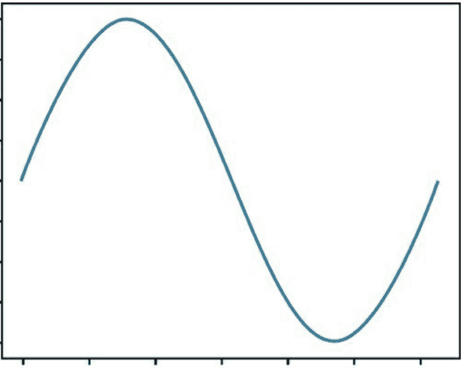

**Figure 13.1.** 正弦图

这是简单的代码，但让我们逐步了解每个部分。示例首先做的事情是导入所需的包。

Click here to view code image

```
import numpy as np
import matplotlib.pyplot as plt
```

接下来，示例调用 **numpy linspace** 函数。请记住，该函数生成一组值，包括两个指定的端点，以得到总共 N 个均匀间隔的值。默认情况下，N 为 50。

Click here to view code image

```
A = np.linspace(0, 2 * np.pi)
```

因此，数组 A 包含从 0 开始、以 2 * pi 结束，以及这两个值之间 48 个其他均匀间隔的浮点数。

对 **plot** 函数的调用指定了两个数组：A，它沿 X 轴包含 50 个值，以及第二个数组，它包含 A 中每个元素的正弦值。

```
plt.plot(A, np.sin(A))
```

该函数查看 A 中的每个元素，并将其与第二个数组中的对应值匹配，以得到 50 个 (x, y) 对。最后，**show** 函数告诉软件在屏幕上显示生成的图表。

当然，我们也可以同样轻松地绘制余弦函数，只需删除对 **np.sin** 的调用，并用 **np.cos** 替换它即可。

Click here to view code image

```
import numpy as np
import matplotlib.pyplot as plt

A = np.linspace(0, 2 * np.pi)
plt.plot(A, np.cos(A))
plt.show()
```

在这个版本中，A 中的每个值都与其余弦值匹配，以创建一个 (x, y) 对。图 13.2 显示了生成的图表。

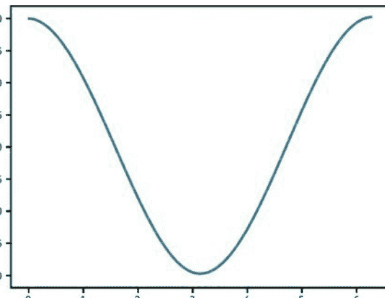

但你并不局限于三角函数。**numpy** 数组的灵活性——特别是它们可以作为一个整体进行操作——使 **matplotlib** 的绘图功能既简单又多功能。

例如，如果你想绘制 *倒数* 函数的图表——即 1/N？如果 N 是 5，其倒数是 1/5，反之亦然。

我们首先为 X 创建一系列值。这就是 **np.linspace** 函数如此有用的原因；它从所需的域中创建一组值（你想要多少都可以）。通常这些值沿 X 轴单调递增。

从值 0 开始会有问题，因为 1/N 会导致除以 0。相反，让我们从值 0.1 开始，运行到高达 10 的值。默认情况下，生成 50 个值。

```
A = np.linspace(0.1, 10)
```

现在，使用 A 和 1/A 为 (x, y) 对提供值，绘制和显示结果就很容易了。A 中的每个值都与其倒数匹配。

```
plt.plot(A, 1/A)
plt.show()
```

图 13.3 显示了结果。

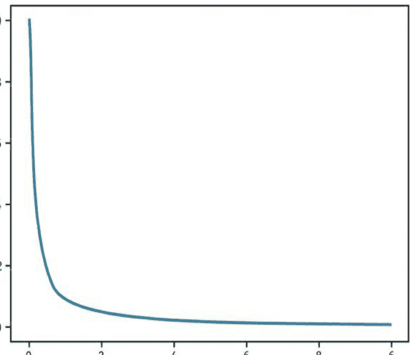

该函数通过组合 A 和 1/A 中的值来创建点。例如，第一个 (x, y) 对是

```
(0.1, 10.0)
```

第二个点以同样的方式形成，将 A 中的下一个值与第二组中的其倒数组合。以下是一些可以绘制的点。

> Click here to view code image

```
(0.1, 10.0), (0.2, 5.0), (0.3, 3.3) ...
```

一个不那么有趣但具有说明性的示例是绘制一小撮点并将它们连接起来。让我们指定五个这样的值：

```
(0, 1)
(1, 2)
(2, 4)
(3, 5)
(4, 3)
```

此图表的绘图将由以下语句创建：

> Click here to view code image

```
plt.plot([0, 1, 2, 3, 4], [1, 2, 4, 5, 3])
```

如果省略 X 参数，默认值为 [0, 1, 2, ... N–1]，其中 N 是 Y 数组的长度。因此，此示例可以写成

```
plt.plot([1, 2, 4, 5, 3])
```

无论哪种情况，调用 **show** 函数都会将图表显示在屏幕上，如图 13.4 所示。

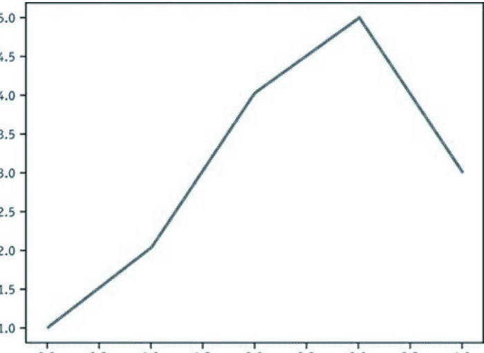

**Figure 13.4.** 五个点的原始图表

请注意，你不一定非要使用递增值。你可以使用任何点来创建任意线条。下面是一个示例：

Click here to view code image

```
plt.plot([3, 4, 1, 5, 2, 3], [4, 1, 3, 3, 1, 4])
```

要绘制的点将是

Click here to view code image

```
(3, 4), (4, 1), (1, 3), (5, 3), (2, 1), (3, 4)
```

这些点反过来形成一个五角星（或多或少），如图 13.5 所示。所有点都被绘制，然后在一个点和下一个点之间绘制线段。

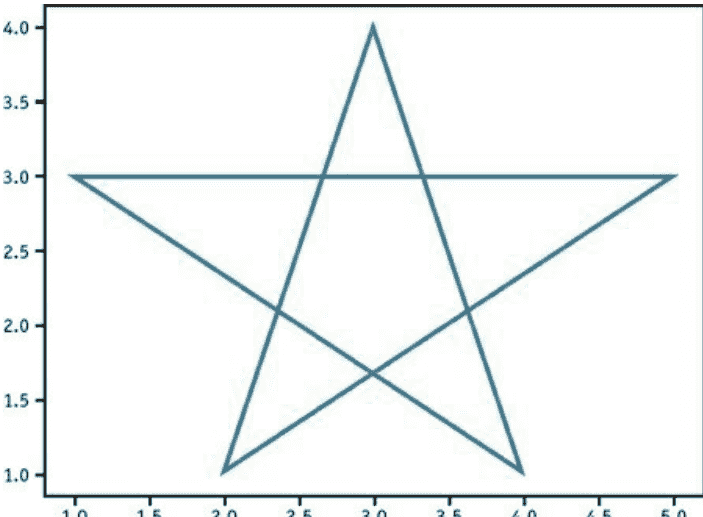

**Figure 13.5.** 五角星图

本节的最后一个示例表明，你可以绘制你喜欢的任何复杂公式。能够直接对 **numpy** 数组进行操作的美妙之处就在于此。绘制复杂多项式很容易。下面是一个示例：

Click here to view code image

```
import numpy as np
import matplotlib.pyplot as plt
A = np.linspace(-15, 20)
plt.plot(A, A ** 3 - (15 * A ** 2) + 25)
plt.show()
```

运行这些语句时，将绘制如图 13.6 所示的多项式。

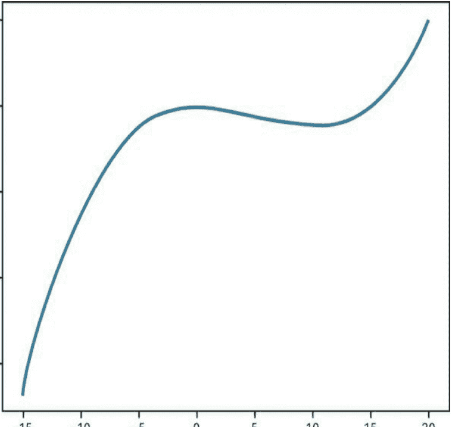

**Figure 13.6.** 绘制多项式

## 13.4 绘制多条线

如果你想显示更复杂的图表，例如同时包含正弦函数和余弦函数的图表以便比较，该怎么办？这很简单。例如，你可以在显示结果前对 `plot` 函数进行两次调用。

Click here to view code image

```
import numpy as np
import matplotlib.pyplot as plt

A = np.linspace(0, 2 * np.pi)
plt.plot(A, np.sin(A))
plt.plot(A, np.cos(A))
plt.show()
```

或者，两个 **plot** 语句可以通过在单个语句中放置四个参数来合并为一个。

Click here to view code image

```
plt.plot(A, np.sin(A), A, np.cos(A))
```

无论哪种情况，Python 都会通过显示图 13.7 中的图表来响应。

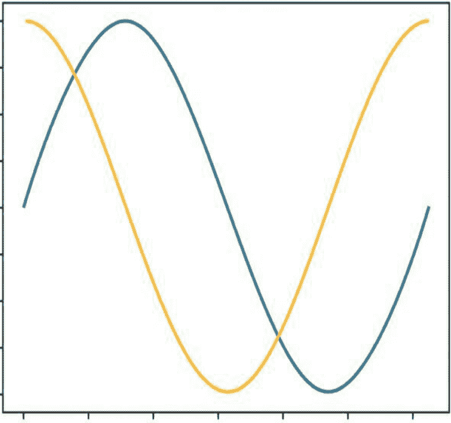

**Figure 13.7.** 正弦和余弦一起绘制

`matplotlib` 包会自动绘制两种不同颜色的曲线：橙色和蓝色。它们在计算机屏幕上显示效果很好，但在黑白打印输出中，你可能无法看到区别。

幸运的是，绘图软件提供了其他方式来通过格式化参数区分曲线，我们将在下一节中探讨。

`plot` 函数的更完整语法如下所示。


Click here to view code image

```
plt.plot( X1, Y1, [fmt1,] X2, Y2, [fmt2,] ... )
```

此语法表明，你可以包含任意数量的 X、Y 数组对。从每对中，通过组合对应元素来创建一组 (x, y) 点。然后可以添加可选的格式参数。

_fmt_ 参数对于通过赋予对比色和样式来区分线条很有用。例如，以下 **plot** 语句会使余弦函数的图表由小圆圈组成。

Click here to view code image

```
plt.plot(A, np.sin(A), A, np.cos(A), 'o')
plt.show()
```

正弦曲线没有格式说明符，因此采用默认外观。生成的图表很好地区分了两条曲线，如图 13.8 所示。默认情况下，为两条线分配不同的颜色。


## Figure 13.8. Sine and cosine differentiated

This formatting creates a dramatic contrast. But we can create even more of a contrast by specifying a style for the sine curve. The ^ format symbol specifies that the curve will be made up of tiny triangles.

While we’re at it, let’s bring in another plotting function, `title`. This simple function is used to specify a title for the graph before calling the `show` function. The `xlabel` and `ylabel` functions specify labels for the axes.

Click here to view code image

```python
plt.plot(A, np.sin(A), '^', A, np.cos(A), 'o')
plt.title('Sine and Cosine')
plt.xlabel('X Axis')
plt.ylabel('Y Axis')
plt.show()
```

Figure 13.9 shows the resulting graph, complete with title and axis labels.

## Figure 13.9. Sine and cosine with axis labels

If you get help on the `plt.plot` function, it provides you a reference to all the formatting characters. These characters can be combined in strings such as `'og'`, meaning “Use small green circles for this line.”

The characters used to specify colors are listed in Table 13.2.

# Table 13.2. Color Characters in Plot Format Strings

| Character | Color   |
|-----------|---------|
| b         | Blue    |
| g         | Green   |
| r         | Red     |
| c         | Cyan    |
| m         | Magenta |
| y         | Yellow  |
| k         | Black   |
| w         | White   |

The characters that specify shapes are shown in Table 13.3.

# Table 13.3. Shape Characters in Plotting Format Strings

| Character | Shape   |
|-----------|---------|
| .         | Points  |
| ,         | Pixels  |
| o         | Circles |
| v         | Down arrow |
| ^         | Up arrow |
| <         | Left-pointing arrow |
| >         | Right-pointing arrow |
| s         | Squares |
| p         | Pentagons |
| *         | Stars |
| h, H      | Hexagons (small and large, respectively) |
| +         | Plus signs |
| d, D      | Diamonds (light and heavy, respectively) |

Remember that you can specify any combination of color and shape. Here’s an example:

Click here to view code image

```python
'b^'    # Use blue triangles.
```

> **Note**
> Yet another technique for differentiating between lines is to use labels, along with a legend, to show how the information corresponds to lines of particular color and/or style. This technique is explained in Chapter 15, “Getting Financial Data off the Internet.”

## 13.5 PLOTTING COMPOUND INTEREST

Imagine the following scenario. You’re going to be given a trust fund in which you have your choice of plans. Plan A would add two dollars every year. But you can’t touch the money until you cash out. At that point, you get all the money, and the fund terminates. The two dollars is the only source of increase.

Alternatively, under plan B, the same conditions apply, except that instead of two dollars being added to the fund every year, plan B starts with one dollar and then it increases by 10 percent a year.

It would seem the choice is easy. One fund increases by two dollars a year, while the other increases—at least in the beginning—by only 10 cents. Obviously, plan A is better, isn’t it? It’s 20 times as good!

But plan A grows at a constant rate, while plan B compounds.

Every good mathematician, as well as accountant, should know the following.

> * Exponential growth (such as compound interest), however slow, must eventually overtake linear growth, however fast.

This is an amazing fact, especially when you consider that it implies that compound growth of .001% on a single dollar must eventually overtake a steady income of a million a year! This is quite true, by the way, but it would take lifetimes for the compounding fund to overtake the million-dollar fund.

This dynamic is easy to show with a graph. Start by creating a **numpy** array, A, representing values along an axis of time. Set it to measure the passing of 60 years.

Click here to view code image

```python
A = np.linspace(0, 60, 60)
```

Then we plot a linear-growth function of $2 a year versus a compound-growth function using 10 percent a year—which is mathematically equivalent of raising the number 1.1 to a power, N, where N is the number of years.

Click here to view code image

```python
2 * A # Formula for increase of $2 a year
1.1 ** A # Formula for growth of 10% a year
```

We’ll use a format string to specify that the first curve is made of little circles, for the sake of contrast (“o”).

Click here to view code image

```python
plt.plot(A, 2 * A, 'o', A, 1.1 ** A)
```

Alternatively, the two curves could be created by separate statements—with additional spaces inserted here for clarity’s sake.

Click here to view code image

```python
plt.plot(A, 2 * A, 'o') # +$2 a year (with circles)
plt.plot(A, 1.1 ** A) # Compound 10% a year
```

Next, let’s specify some useful labels and finally show the graph.

Click here to view code image

```python
plt.title('Compounded Interest v. Linear')
plt.xlabel('Years')
plt.ylabel('Value of Funds')
plt.show()
```

Figure 13.10 displays the results. For the first 30 years, the linear fund ($2 a year) outpaces the compound fund. However, between years 30 and 50, the accelerating growth of plan B becomes noticeable. Plan B finally equals and surpasses the linear fund shortly before year 50.

## Compounded Interest v. Linear

**Figure 13.10.** Compound growth plotted against linear

So if you have 50 years to wait, plan B is the better choice. Eventually, plan B greatly outperforms plan A if you can wait long enough. The compound growth will reach thousands, even millions, of dollars long before the other plan does.

> **Note**
> The labels along the X axis start in year 0 and run to year 60. Section 13.12, “Adjusting Axes with ‘xticks’ and ‘yticks,’” shows how these years could be relabeled—for example, by starting in the year 2020 and running to the year 2080—without changing any of the underlying data or calculations.

## 13.6 CREATING HISTOGRAMS WITH “MATPLOTLIB”

Histograms provide an alternative way of looking at data. Instead of presenting individual data points and connecting them, a _histogram_ shows how frequently the results fall into subranges.

The data is collected into buckets, or _bins_, each bin representing a range. We did that manually for some of the problems in Chapter 11, “The Random and Math Packages,” but the `numpy` and `matplotlib` packages do this work automatically.

Let’s start with a simple example. Suppose you have a list containing the IQ of each person on your software development team. You’d like to see which scores tend to be the most common.

Click here to view code image

```python
IQ_list = [91, 110, 105, 107, 135, 127, 92, 111,
    105,
    106, 130, 145, 145, 128, 109, 108, 98, 129,
    100,
    108, 114, 119, 99, 137, 142, 145, 112, 113]
```

It’s easy to convert this Python list into a `numpy` array. First, however, we’ll make sure we’ve imported the necessary packages.

Click here to view code image

```python
import numpy as np
import matplotlib.pyplot as plt

IQ_A = np.array(IQ_list)
```

Graphing this data as a histogram is the easiest step of all, because it requires only one argument. The **hist** function produces this chart. Then, as usual, the **show** function must be called to actually put the results onscreen.

```python
plt.hist(IQ_A)
plt.show()
```

Wow, that was easy! There are some additional arguments, but they’re optional.

One of the main reasons for providing the **show** function, by the way, is so that the graph can be tweaked in various ways before being displayed onscreen. The following example creates the histogram, gives it a title, and finally shows it.

Click here to view code image

```python
plt.hist(IQ_A)
plt.title('IQ Distribution of Development Team.')
plt.show()
```

Figure 13.11 displays the resulting graph.

**Figure 13.11.** IQ scores shown in a histogram

This graph reveals a good deal of information. It shows that the frequency of IQ scores increases until 110, at which point it drops off. There's a bulge again around 140.

A more complete syntax is shown here.

Click here to view code image

```python
plt.hist(A [, bins=10] [, keyword_args])
```


第一个参数，_A_，指的是一个 **numpy** 数组，也是唯一必需的参数。

_bins_ 参数决定子范围（或称为 bins）的数量。默认设置是 10，这意味着函数会计算最高值和最低值之间的差，然后除以 10 来得到每个子范围的大小。但你可以指定 10 以外的设置。

Click here to view code image

```
plt.hist(A, bins=50) # Place results into 50 bins.
```

此函数接受的其他关键字参数包括 **color**，它接受一个包含表 13.2 中所示字符之一的字符串；**align**，它接受 'left'、'right' 或 'mid' 之一的值；以及 **cumulative**，它是一个布尔值，指示是否绘制累积结果。有关更多信息，请使用 help。

```
>>> help(plt.hist)
```

直方图的另一个用途是绘制正态分布曲线。我们在第 11 章中展示了如何做到这一点，但这里的方法能产生更好的结果。

我们首先使用 **numpy** 随机化包生成 200,000 个正态分布的数据点。该分布的均值为 0.0，标准差为 1.0。但通过加法和乘法，我们可以将其转换为均值为 100、标准差为 10 的数组值。

Click here to view code image

```
A = np.random.standard_normal(200000)
A = A * 10 + 100
```

在绘制这些结果时，我们可以依赖 10 个 bins 的默认设置，但如果绘制成更小的子范围，结果会更令人满意。因此，我们指定 80 个 bins。同时，我们还将颜色设置为绿色。

Click here to view code image

```
plt.hist(A, bins=80, color='g')
plt.title('Normal Distribution in 80 Bins')
plt.show()
```

结果是一个看起来很吸引人的正态分布图，如图 13.12 所示。如果你能在屏幕上看到它是绿色的（如在计算机屏幕上显示的那样），那么它看起来有点像圣诞树。节日快乐！

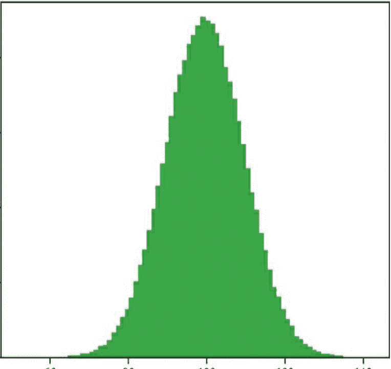

**Figure 13.12.** 正态分布的直方图

你可能会问：能否将这些数据呈现为一条完全平滑的线，而不是一系列柱状图？

可以。**numpy** 提供了一个 **histogram** 函数，可让你为一系列子范围（bins）生成频率数字。此处显示的通用语法展示了两个最重要的参数。


Click here to view code image

```
plt.histogram(A [, bins=10] [, keyword_args] )
```

该函数的作用是生成一个新数组；该数组包含直方图的结果。新数组中的每个元素都是一个频率数字，对应于其中一个 bin。默认情况下，bin 的数量为 10。因此，对于生成的数组：

- 第一个元素包含 A 中出现在第一个 bin（第一个子范围）中的值的数量。
- 第二个元素包含 A 中出现在第二个 bin（第二个子范围）中的值的数量。
- 以此类推。

返回的值实际上是一个元组。该元组的第一个元素包含我们想要绘制的频率数字。第二个元素包含 bin 的精确边缘。因此，要获取所需的数据，请使用以下语法：


```
plt.histogram(A, bins) [0]
```

我们现在可以生成一条平滑的正态分布曲线。生成一大组随机数，并将结果放入 50 个 bins 中。（你可以选择其他数量的 bins，但使用 50 到 100 之间的数量往往能产生良好的结果。）最后，绘制这些 bins 的频率数字。此示例使用了 200 万次试验，但几乎不应有明显延迟，这真是令人惊叹。

Click here to view code image

```
import numpy as np
import matplotlib.pyplot as plt

A = np.random.standard_normal(2000000)
A = A * 10 + 100
B = np.histogram(A, 50)[0]
plt.plot(B)
plt.show()
```

此代码未为“X 轴”数组指定参数；相反，它由默认值处理。绘图软件使用 0、1、2 ... N–1 作为 X 坐标，其中 N 是 B 数组的长度，该数组包含 `.histogram` 函数的结果。图 13.13 显示了此示例产生的结果。

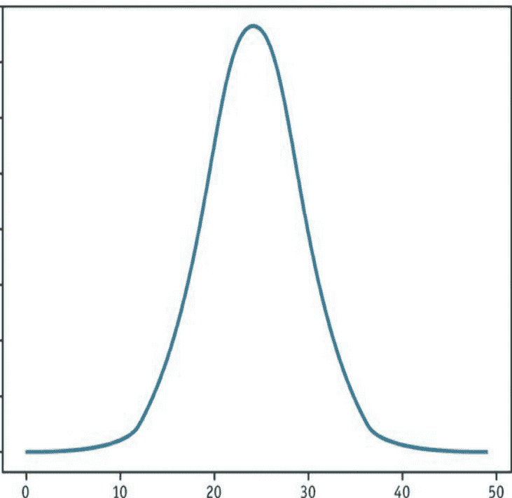

Figure 13.13. 正态分布曲线的平滑绘制

生成的图形是一条平滑、悦目的曲线。但是，X 轴可能不是你所期望的。X 轴上的数字显示的是 bin 编号。

范围是从生成的最低随机数到最高随机数；然后将此范围分为 50 份。Y 轴显示每个 bin 中命中的频率。

但是，与其在 X 轴上放置 bin 编号，不如显示分布本身的值更有用。做到这一点的最简单 *正确* 方法是使用代表每个 bin 中位点的“X 轴”值。下一个示例通过使用 `np.histogram` 返回的第二个数组来实现这一点。

该数组包含 bin 的边缘——即每个 bin 所代表的子范围的最低值。

这听起来可能很复杂，但只需添加几行代码即可。在此示例中，X 表示 bin 的边缘——然后 X 被修改为包含这些 bin 的中位点。这样，频率就会针对分布中的值（中心在 100 处）进行绘制，而不是针对 bin 编号。

Click here to view code image

```
import numpy as np
import matplotlib.pyplot as plt

A = np.random.standard_normal(2000000)
A = A * 10 + 100
B, X = np.histogram(A, 50)
X = (X[1:] + X[:-1]) / 2   # Use bin centers rather than
                          # edges.
plt.plot(X, B)             # Plot against values rather
                           # than
plt.show()                 #   bin numbers.
```

X 值是通过获取每个子范围的中位值来计算的——即取底部和顶部边缘（位置相差一个）并对它们求平均。表达式 X[1:] 会移动一个位置，因为它从第二个元素开始。表达式 X[:-1] 排除最后一个元素，以使长度相等。

Click here to view code image

```
X = (X[1:] + X[:-1]) / 2   # Use bin centers rather than
                          # edges
```

如果你查看修订后的直方图（图 13.14），你会看到它绘制的是中心在 100、标准差为 10 的值。标准差为 10 意味着曲线下大约 95% 的面积应落在两个标准差内（80 到 120），并且超过 99% 的面积应落在三个标准差内（70 到 130）。

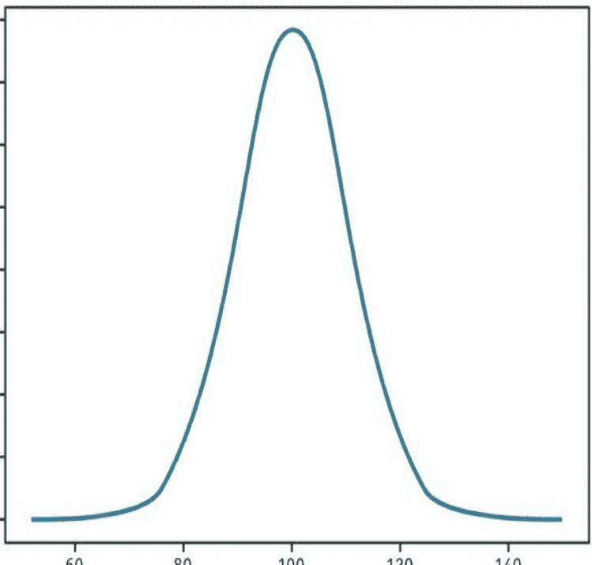

**Figure 13.14.** 中心在 100 的正态分布曲线

`histogram` 函数还有其他用途。例如，你可以用它来替换第 11 章中的一些代码，以演示大数定律。该章节中的示例在一系列 bins 中收集数据。`histogram` 函数与该章节中的代码做同样的事情，但速度快得多。

> Performance Tip
> 你应该通过本章和第 12 章观察到，许多 numpy 函数都呼应了可以在第 11 章“随机和数学包”中通过导入 random 和 math 来执行的操作。但是 numpy 版本，尤其是在处理大型数据集（例如为最近的示例生成的 2,000,000 个随机数）时，会快得多。因此，当你有选择时，请优先使用 numpy（包括其 random 子包）来进行大型数值操作。

其他一些参数偶尔也很有用。要了解所有参数，你可以在 IDLE 中获取帮助。

```
>>> np.info(np.histogram)
```

## 13.7 CIRCLES AND THE ASPECT RATIO

有时你会想要调整 X 轴和 Y 轴的相对大小；这在绘制几何图形时尤其如此。在本节中，我们将展示如何绘制一个圆。通常，你不希望它看起来像一个椭圆，因此我们将在显示图表之前调整 X 和 Y 之间的纵横比使其相等。

绘制圆有多种方法；另一种方法留作本章末尾的练习。在本节中，我们将使用利用三角函数的方法。想象一只小虫子沿着圆的外围移动，从 o 开始


degrees at the coordinate (1,0), as shown in Figure 13.15. The bug continues until it’s made a complete trip.

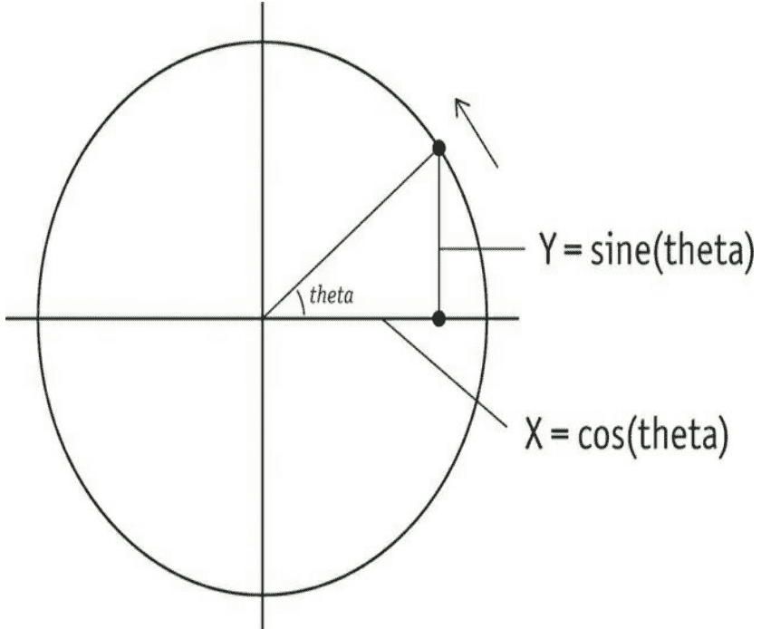

**Figure 13.15.** “Bug on a circle” about 42 degrees

Each point on the circle corresponds to an angle, which we call _theta_. For example, the point on the circle that is 90 degrees counterclockwise from the starting point has a value of 90 degrees—or rather, the equivalent in radians (pi / 2). Figure 13.15 shows the bug having traveled about 42 degrees (roughly equal to 0.733 radians).

At each point on the circle, the X coordinate of the bug’s position is given by

```
cosine(theta)
```

Likewise, the Y coordinate of the bug’s position is given by

```
sine(theta)
```

By tracking the bug’s journey, we get a set of points corresponding to a trip around the circle. Each point on this journey corresponds to the following (x, y) coordinates:

Click here to view code image

```
(cosine(theta), sine(theta))
```

Therefore, to graph a complete circle, we get a set of points corresponding to many angles on this imaginary trip, from 0 to 2 * pi (equal to 360 degrees). Then we graph the resulting (x, y) pairs. And we’ll get 1,000 data points to get a nice, smooth curve.

Click here to view code image

```
import numpy as np
import matplotlib.pyplot as plt
theta = np.linspace(0, 2 * np.pi, 1000)
plt.plot(np.cos(theta), np.sin(theta))
plt.show()
```

If you run these statements, they should draw a circle, but the result looks more like an ellipse. The solution is to specify a plt.axis setting that forces X and Y units to be equally spaced on the screen.

```
plt.axis('equal')
```

Now, let's plug this statement into the complete application, including the **import** statements.

Click here to view code image

```
import numpy as np
import matplotlib.pyplot as plt
theta = np.linspace(0, 2 * np.pi, 1000)
plt.plot(np.cos(theta), np.sin(theta))
plt.axis('equal')
plt.show()
```

Now the code produces the perfect circle onscreen, as shown in Figure 13.16.

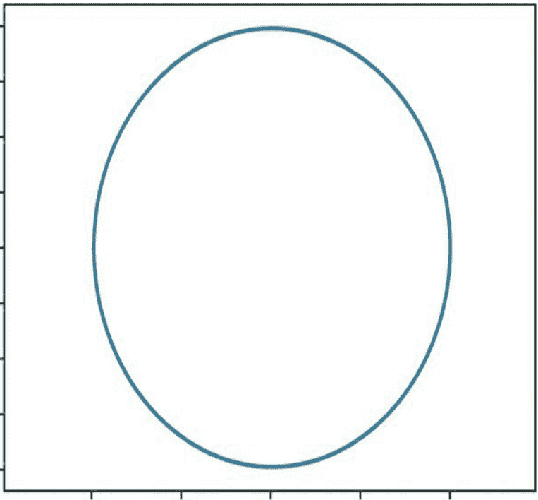

**Figure 13.16.** A perfect circle

## 13.8 CREATING PIE CHARTS

The versatility of the **numpy** and **matplotlib** packages extends even to pie charts. This is an effective way of illustrating the relative size of several pieces of data.

The syntax for the `plt.pie` function is shown here. As with other plotting functions, there are other arguments, but only the most important are shown here.


Click here to view code image

```
plt.pie(array_data, labels=None, colors=None)
```

The first argument, _array_data_, is a collection containing a relative size for each category. The _labels_ argument is a collection of strings that label the corresponding groups referred to in the first argument. The _colors_ argument is a collection of strings specifying color, using the values listed earlier in Table 13.2. And all the collections must have the same length.

This is a simple function to use once you see an example. Suppose you have data on the off-hours activities of your development team, and you want to see a chart. Table 13.4 summarizes the data to be charted in this example.

### Table 13.4. Weekly Activity of Development Team

| Activity | Hours per week (average) | Color |
|---|---|---|
| Poker | 3.7 | black ('k') |
| Chess | 2.5 | green ('g') |
| Comic books | 1.9 | red ('r') |
| Exercise | 0.5 | cyan ('c') |

It’s an easy matter to place each column of data into its own list. Each list has exactly four members in this case.

Click here to view code image

```
A_data  = [3.7, 2.5, 1.9, 0.5]
A_labels = ['Poker', 'Chess', 'Comic Books',
            'Exercise']
A_colors = ['k', 'g', 'r', 'c']
```

Now we plug these figures in to a pie-chart plot, add a title, and display. The aspect ratio of the pie chart can be fixed using a `plt.axis('equal')` statement, just as we did for the circle; otherwise, the pie will appear as an ellipse rather than a circle.

Click here to view code image

```
import numpy as np
import matplotlib.pyplot as plt
plt.pie(A_data, labels=A_labels, colors=A_colors)
plt.title('Relative Hobbies of Dev. Team')
plt.axis('equal')
plt.show()
```

Figure 13.17 shows the resulting pie chart.

# Relative Hobbies of Dev. Team


**Figure 13.17.** A pie chart

## 13.9 DOING LINEAR ALGEBRA WITH "NUMPY"

Before wrapping up these two chapters on the **numpy** package, we’ll take a look at one of the most useful areas, at least to a mathematician or engineer: linear algebra, which often involves vectors (arrays) and matrixes (multidimensional arrays).

It isn’t necessary to use separate “vector” or “matrix” collection types with **numpy**. You don’t even need to download or import new subpackages. You just apply the appropriate functions.

### 13.9.1 The Dot Product

As these last two chapters have shown, you can multiply arrays with scalars, and arrays with arrays. The requirement in the second case is that two arrays multiplied together must have the same shape. We can summarize this relationship as follows:

```
`(A, B) * (A, B) => (A, B)`
```

You can multiply an array of shape A, B to another array of shape A, B and get a third array of the same shape. But with **numpy**, you can also multiply arrays together by using the dot-product function, `dot`, but it has slightly more complex rules.


```
`numpy.dot(A, B, out=None)`
```

A and B are two arrays to be combined to form a dot product; the `out` argument, if specified, is an array of the correct shape in which to store the results. The “correct shape” depends on the size of A and B, as explained here.

The dot product of two one-dimensional arrays is simple. The two arrays must have the same length. The action is to multiply each element in A to its corresponding element in B, and then sum those products, producing a single scalar value.

Click here to view code image

```
D. P. = A[0]*B[0] + A[1]*B[1] + ... + A[N-1] * B[N-1]
```

Here’s an example:

Click here to view code image

```
>>> import numpy as np
>>> A = np.ones(5)
>>> B = np.arange(5)
>>> print(A, B)
[1. 1. 1. 1. 1.] [0 1 2 3 4]
>>> np.dot(A, A)
5.0
>>> np.dot(A, B)
10.0
>>> np.dot(B, B)
30
```

You should be able to see that the dot product of B with B is equal to 30, because that product is equal to the sum of the squares of its members:

Click here to view code image

```
D. P. = 0*0 + 1*1 + 2*2 + 3*3 + 4*4
= 0 + 1 + 4 + 9 + 16
= 30
```

We can generalize this:

```
D. P.(A, A) = sum(A * A)
```

The dot product between a couple of two-dimensional arrays is more complex. As with ordinary multiplication between arrays, the shapes must be compatible. However, they need only match in one of their dimensions. Here is the general pattern that describes how a dot product works with two-dimensional arrays:

```
(A, B) * (B, C) => (A, C)
```

Consider the following 2 × 3 array, combined with a 3 × 2 array, whose dot product is a 2 × 2 array.

Click here to view code image

```
A = np.arange(6).reshape(2, 3)
B = np.arange(6).reshape(3, 2)
C = np.dot(A, B)
print(A, B, sep='\n\n')
print('\nDot product:\n', C)

[[0 1 2]
 [3 4 5]]

[[0 1]
 [2 3]
 [4 5]]

Dot product:
[[10 13]
 [28 40]]
```

Here’s the procedure.

- Multiply each item in the first row of A by each corresponding item in the first column of B. Get the sum (10). This becomes C[0,0].
- Multiply each item in the first row of A by each corresponding item in the second column of B. Get the sum (13). This becomes C[0,1].
- Multiply each item in the second row of A by each corresponding item in the first column of B. Get the sum (28). This becomes C[1,0].
- Multiply each item in the second row of A by each corresponding item in the second column of B. Get the sum (40). This becomes C[1,1].

You can also take the dot product of a one-dimensional array combined with a two-dimensional array. The result is that the array shapes are evaluated as if they had the following shapes:

```
`(1, X) * (X, Y) => (1, Y)`
```

For example, you could take the dot product of [10, 15, 30] and the following array, which we’ll call B:

```
`[[0 1]
[2 3]
[4 5]]`
```

This next statement shows the dot product between a one-dimensional array and the two-dimensional array, B. The resulting dot product has a shape of (1, 2):

Click here to view code image


>>> print(np.dot([10, 15, 30], B))
[150, 205]

我们能否想出一些直观的、现实世界中的例子，来展示点积的用处？这类例子在某些数学和物理领域（例如三维几何）中比比皆是。但也有更简单的应用。假设你拥有一家宠物店，出售三种异国鸟类。表 13.5 列出了价格。

# 表 13.5. 宠物店鸟类价格

| Parrots | Macaws | Peacocks |
|---------|--------|----------|
| $10 | $15 | $30 |

再假设你记录了两个月的销售数据，如表 13.6 所示。

# 表 13.6. 鸟类月度销售数据

| Birds | October sales | November sales |
|-------|---------------|----------------|
| Parrots | 0 | 1 |
| Macaws | 2 | 3 |
| Peacocks | 4 | 5 |

你想做的是计算这两个月的鸟类总销售额。虽然挑选数据并不困难，但使用点积并让函数 `np.dot` 为你完成所有数学运算会更加容易。

图 13.18 展示了如何获得结果中的第一个元素：150。将每个销售数字乘以第一个月对应的销售数字。

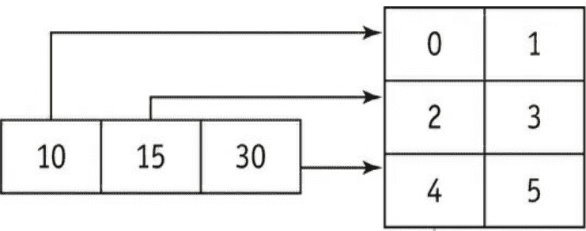

Dot Product for first elem. = (10*0) + (15*2) + (30*4)
= 0 + 30 + 120
= 150

**图 13.18.** 点积的计算方法，第一部分

按照此过程，你得到 0 + 30 + 120，总计 150。
你可以用同样的方法得到另一个数字 205（参见图 13.19）。将每个价格乘以第二个月对应的销售数字，然后求和。按照此过程，你得到 10 + 45 + 150，总计 205。

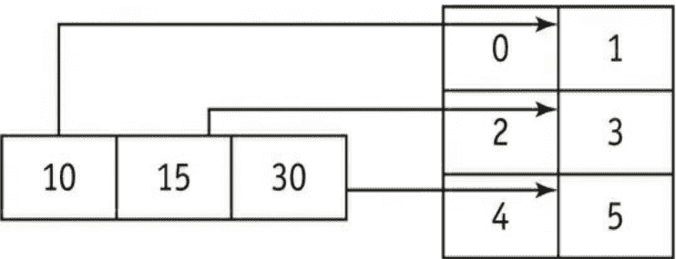

Dot Product for 2nd elem. = (10*1) + (15*3) + (30*5)
= 10 + 45 + 150
= 205

**图 13.19.** 点积的计算方法，第二部分

因此，完整的点积为

```
[150, 205]
```

在这种情况下，点积给出了所追踪的两个月（十月和十一月）内所有鸟类的总销售额。

## 13.9.2 外积函数

另一种乘数组的方法是使用 **outer** 函数计算 _外积_。这最常用于两个一维数组之间，以产生一个二维数组。如果此函数用于更高维度的数组，则这些数组中的每个输入都会被展平为一维。


Click here to view code image

```
numpy.outer(A, B, out=None)
```

该函数的作用是计算数组 A 和 B 的外积并返回它。`out` 参数（如果包含）指定一个目标数组，用于放置结果。它必须已经存在且大小合适。

要获得外积，请依次将 A 的每个元素乘以 B 的每个元素，以产生一个二维数组。就形状而言，我们可以这样表达这种关系：

```
(A) * (B) => (A, B)
```

简单来说，外积包含 A * B 的每种组合，因此如果 C 是结果，那么 C[x, y] 包含 A[x] 乘以 B[y]。

下面是一个相对简单的示例：

Click here to view code image

```
>>> import numpy as np
>>> A = np.array([0, 1, 2])
>>> B = np.array([100, 200, 300, 400])
>>> print(np.outer(A, B))
[[   0    0    0    0]
 [ 100  200  300  400]
 [ 200  400  600  800]]
```

在这个示例中，A 的第一个元素乘以 B 的每个元素，以产生结果的第一行；这就是为什么该行中的每个数字都是 0，因为 0 乘以任何值都是 0。A 的第二个元素（即 1）乘以 B 的每个元素，以产生第二行，以此类推，第三行也是如此。

外积的一个明显用途是我们在第 11 章“随机和数学包”中解决的一个问题：如何创建乘法表。**numpy** 包支持一个更简单的解决方案，而且无论如何都更快。

```
>>> A = np.arange(1,10)
>>> print(np.outer(A, A))
```

哇，这段代码相当简单！结果是

```
[[ 1 2 3 4 5 6 7 8 9]
 [ 2 4 6 8 10 12 14 16 18]
 [ 3 6 9 12 15 18 21 24 27]
 [ 4 8 12 16 20 24 28 32 36]
 [ 5 10 15 20 25 30 35 40 45]
 [ 6 12 18 24 30 36 42 48 54]
 [ 7 14 21 28 35 42 49 56 63]
 [ 8 16 24 32 40 48 56 64 72]
 [ 9 18 27 36 45 54 63 72 81]]
```

如同在第 11 章中一样，我们可以使用一些字符串操作来清理结果，消除方括号。

```
s = str(np.outer(A, A))
s = s.replace('[', '')
s = s.replace(']', '')
```

```
print(' ' + s)
```

如果我们愿意，可以将这四条语句合并为两条更紧凑的语句。

Click here to view code image

```
s = str(np.outer(A, A))
print(' ' + s.replace('[', '').replace(']', ''))
```

最后，这将产生

```
1 2 3 4 5 6 7 8 9
2 4 6 8 10 12 14 16 18
3 6 9 12 15 18 21 24 27
4 8 12 16 20 24 28 32 36
5 10 15 20 25 30 35 40 45
6 12 18 24 30 36 42 48 54
7 14 21 28 35 42 49 56 63
8 16 24 32 40 48 56 64 72
9 18 27 36 45 54 63 72 81
```

## 13.9.3 其他线性代数函数

除了点积和外积，**numpy** 还提供其他线性代数函数。请记住，它们不需要单独的“矩阵”类型。标准 **numpy** 数组类型 **ndarray** 可以与任何这些函数一起使用。

但是，与线性代数相关的函数列表很长，需要一整本书来介绍。有关更多说明，请参见官方在线文档 **https://docs.scipy.org/doc/numpy/reference/routines.linalg.html**

# 表 13.7. 常用线性代数函数

| Syntax | Description |
|---|---|
| `np.dot(A, B [,out])` | Compute the dot product between `A` and `B`. |
| `np.vdot(A, B)` | Compute the vector dot product. |
| `np.outer(A, B [,out])` | Compute the outer product formed by multiplying each element in `A` by each element in `B`. Flatten `A` and `B` into one-dimensional inputs as needed. |
| `np.inner(A, B [,out])` | Compute the inner product of `A` and `B`. |
| `np.tensordot(A, B [,out])` | Compute the tensor dot product of `a` and `B`. |
| `np.kron(A, B)` | Compute the Kronecker product of `a` and `B`. |
| `np.linalg.det(A)` | Compute the linear-algebra determinant of `A`. |

# 13.10 三维绘图

三维绘图的主题比较高级，要在此处完整介绍该主题本身就需要一整本书！然而，通过观察球体表面的绘图，你可以了解你已经见过的 **numpy** 函数如何帮助你创建三维表面。

以下示例需要导入你已经熟悉的包，但它还包括 **mpl_toolkits** 包。幸运的是，如果你已经下载了其他包，则此包已为你下载，你只需导入它即可。

Click here to view code image

```
from mpl_toolkits.mplot3d import Axes3D
import matplotlib.pyplot as plt
import numpy as np

fig = plt.figure()
ax = fig.add_subplot(111, projection='3d')

# Make data
uA = np.linspace(0, 2 * np.pi, 100)
vA = np.linspace(0, np.pi, 100)
X = 10 * np.outer(np.cos(uA), np.sin(vA))
Y = 10 * np.outer(np.sin(uA), np.sin(vA))
Z = 10 * np.outer(np.ones(np.size(uA)), np.cos(vA))
```

```
# Plot the surface
ax.plot_surface(X, Y, Z, color='w')
plt.show()
```

此处的大部分计算涉及获取角度从 0 到 2 * np.pi 的正弦和余弦值，然后通过外积将结果相乘。最后，由三个数组 X、Y 和 Z 描述一组三维点，软件根据此绘制球体表面。图 13.20 显示了生成的图表。

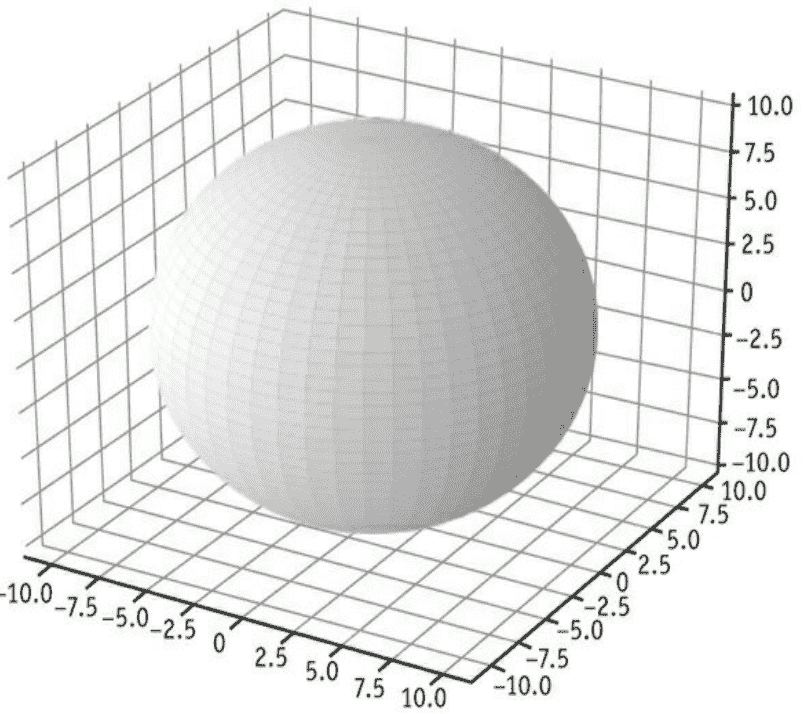

**图 13.20.** 球体的三维投影

# 13.11 “NUMPY” 金融应用

**numpy** 包强大的函数范围延伸到金融领域。例如，给定利率和付款计划的数据，你可以使用 **pmt** 函数来确定房屋或汽车的月供。


Click here to view code image

```
numpy.pmt(rate, nper, pv [, fv] [, when ])
```

_rate_ 是以浮点数表示的利率，而不是百分比。例如，0.065 的利率相当于 6.5% 的利率。由于这是每个付款周期的利率，你需要除以 12 才能从年利率得到月利率。

_nper_ 参数是付款周期的总数。如果付款是按月而不是按年进行，则需要将年数乘以 12。

_pv_ 参数是现值。这是借入的金额。

可选参数包括 _fv_，即预期的未来价值（假设这笔钱将在期末偿还）。另一个可选参数是 _when_，它可以可选地取


the value 1 or 0 to indicate whether a payment is due at the beginning or end of the payment period, respectively. Assume the following data:

- The interest rate is 6.5 percent. Divide by 12 to get monthly interest.
- The loan is for 20 years. Multiply by 12 to get the number of monthly payments.
- The amount borrowed is $250,000.

Given this data, we can easily use the **numpy pmt** function to determine the monthly payment that will be required.

Click here to view code image

```
>>> import numpy as np
>>> np.pmt(0.065 / 12, 20 * 12, 250000)
-1863.93283878775
```

Therefore, the monthly payment, rounded to the nearest cent, is $1,863.93. This amount is expressed as a negative number, because it represents the net cash flow.
We can write a function enabling the user to tweak the interest rate, years, and amount to determine the monthly payment, as follows.

Click here to view code image

```
import numpy as np
def monthly_payment():
    ''"Calculate monthly payment, after
    getting input data and calling np.pmt."""
```

```
# Calculate monthly rate.
s = 'Enter rate as a yearly percentage fig.: '
rate = (float(input(s)) / 100 / 12

# Calculate no. of periods
yyears = int(input('Enter number of years: '))
nper = nyears * 12

# Get loan amount.
pv = float(input('Enter amount of loan: '))

# Print results
payment= -1 * np.pmt(rate, nper, pv)
print('The monthly payment is: $%.2f' % payment)
```

Here’s a sample session:

Click here to view code image

```
>>> monthly\_payment()
Enter rate as a yearly percentage fig.: 5.0
Enter number of years: 30
Enter amount of loan: 155000
The monthly payment is: $832.07
```

Therefore, given an annual interest rate of 5 percent on a 30-
year loan of $155,000, the monthly payment is $832.07.

The **numpy** functions also calculate which portion of the
monthly payment goes to paying down the principal versus
paying the interest. Those two amounts, which together equal
the monthly payment, are determined by the functions shown
here.


Click here to view code image

```
numpy.ppmt(rate, per, nper, pv [, fv] [, when])
numpy.ipmt(rate, per, nper, pv [, fv] [, when])
```

The additional argument here is _per_, which specifies which payment period we’re currently in, in which the payment periods run from 0 to _nper_–1. The _nper_ argument still specifies the total number of these payment periods.

We can combine one of these functions, **ppmt**, with the calculation of the total payment, to plot a graph showing what percentage of the total monthly payment, over time, is applied to principal as opposed to interest.

Click here to view code image

```
import numpy as np
import matplotlib.pyplot as plt

# Set up basic parameters
rate = 0.05 / 12    # Assume 5% a year.
nper = 30 * 12      # Assume 30 years on loan.
pv = 155000         # $155,000 is amount of loan.

# Generate total payment
Total = -1 * np.pmt(rate, nper, pv)

# Plot each month's payment (A) as a ratio of Total
A = np.linspace(0, nper)
B = -1 * np.ppmt(rate, A, nper, pv) / Total
plt.plot(A, B)
```

```
# Set labels of axes, and display
plt.xlabel('Months')
plt.ylabel('Percentage Applied to Principal')
plt.show()
```

Figure 13.21 shows the results. In the beginning of the loan's lifetime, only a small portion is applied to the principal; the rest goes to interest. But as the loan matures, the percentage of the monthly payment applied to principal approaches 100 percent.

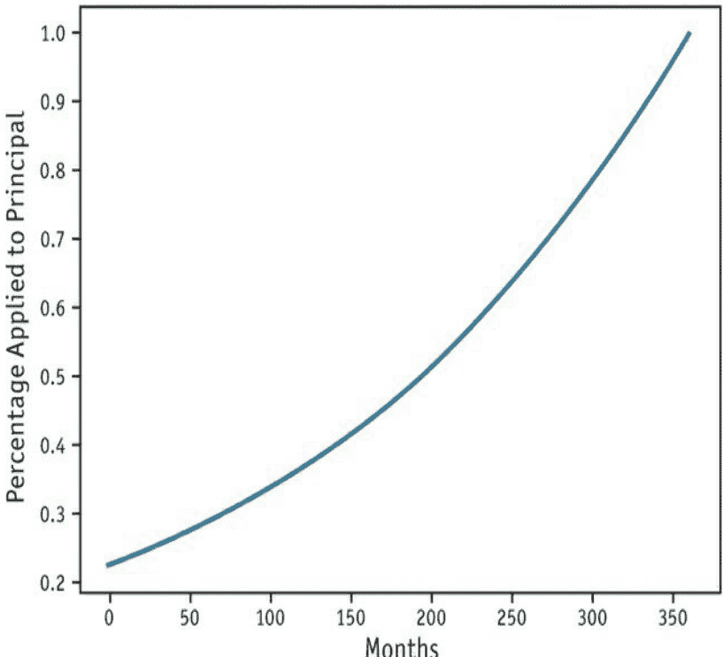

**Figure 13.21.** Plot of payments applied to principal

## 13.12 ADJUSTING AXES WITH “XTICKS” AND “YTICKS”

Figure 13.21 in the previous section was a good first attempt at a financial plot, but it lacks a couple of features.

First, the Y axis has ticks that run from 0.2 to 1.0. It would be more illustrative if the axis ran the full distance from 0 to 1. It would be more useful still to see the axis ticks labeled with percentages, as in “0%” to “100%”.

Second, the X axis has ticks corresponding to months but it would be more useful for them to mark off years. It might be even better to use labels for those years so that they start with year 2020 and go forward to 2050. We’re assuming the loan starts being serviced in the year 2020.

The `xticks` and `yticks` functions solve these problems. Both functions take two arguments. The first specifies a series of data points to be ticked off. The second argument specifies a series of labels to use at each point. (If there are more labels than ticks, the excess labels are ignored.)

For the Y axis, we want to specify ticks every 0.2 units but start at 0.0 rather than 0.2, and then label those units as percentage figures. Remember that the inputs of the `arange` function give beginning, ending, and step figures.

Click here to view code image

```
plt.yticks(np.arange(0.0, 1.1, 0.2),
           ('0%', '20%', '40%', '60%', '80%', '100%'))
```

For the X axis, we want to tick off every 60 months (five years) rather than the default, which is every 50 months. Here the inputs to **arange** are 0, 361, and 60 as beginning, ending, and step figures.

Click here to view code image

```
plt.xticks(np.arange(0, 361, 60),
 ('2020', '2025', '2030', '2035', '2040',
 '2045', '2050') )
```

**Note**

The `np.arange` function generates values _up to but not including_ the endpoint.
That's why these examples use the endpoints 1.1 and 361 instead of 1.0 and 360.

All that you need to do now is add these two statements
(`plt.yticks` and `plt.xticks`) to the program code in the
previous section. Let’s also change the X-axis label to “Years.”

```
plt.xlabel('Years')
```

Now Figure 13.22 produces a nice-looking result.

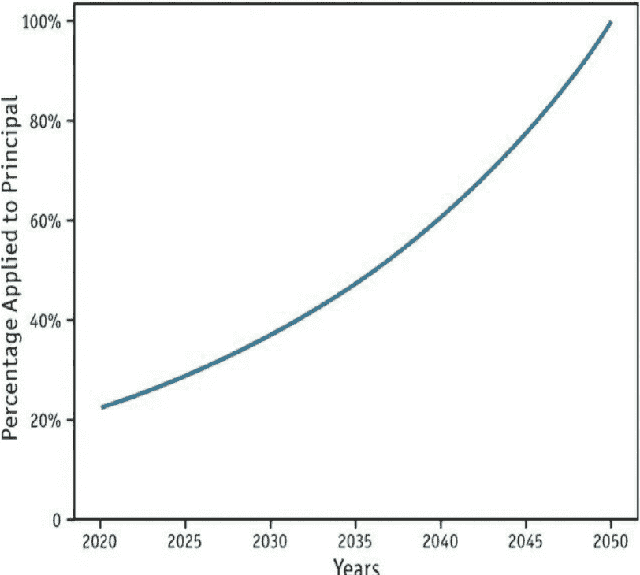

**Figure 13.22.** Plot of payments with “xticks” and “yticks” adjustments

This is an interesting function to graph, because it increases a little slowly at first but then accelerates later.

## 13.13 “NUMPY” MIXED-DATA RECORDS

You can store other data in a `numpy` array—even store text strings—just as you can in a Python list. There is a difference, however, in that `numpy` arrays can store strings only as a part of fixed-length structures.

When you work with arrays of strings, **numpy** imposes a fixed length if you don’t, based on the longest string. Here’s an example:

Click here to view code image

```
>>> Words = np.array(('To', 'be', 'orNotToBe'))
>>> Words
array(['To', 'be', 'orNotToBe'], dtype='<U9')
```

What this example tells us is that Words has been created as an array with three members, each a string in which the type is U9. Therefore, each element is exactly large enough to hold Python strings, each of which can hold at most nine characters.

You can always assign a string value that’s shorter than nine characters. But if you attempt to assign a longer string, it’s truncated to nine characters in this case.

Click here to view code image

```
>>> Words[0] = 'My uncle is Caesar.'
>>> Words[0]
'My uncle '
```

However, you can optionally specify a longer maximum length for strings, such as 20.

Click here to view code image

```
>>> Words = np.array(('To', 'be', 'orNotToBe'),
dtype = 'U20')
```

In this example, the length of ‘orNotToBe’ would determine the maximum string length by default, but instead the length was specifically determined by 'U20 '. Now you can assign a longer string to an element without its being truncated.

Click here to view code image

```
>>> Words[0] = 'My uncle is Caesar.'
>>> Words[0]
'My uncle is Caesar.'
```

Before we leave the topic of strings, note that **U**_n_ denotes a Unicode string, which accepts standard Python strings. **S**_n_ denotes **bytes** strings.

Very often, when handling large amounts of information, you’ll want to store records that combine numeric and string data. To do that with **numpy** arrays, you’ll need to create structured arrays, storing a combination of data types. The _dtype_ field enables you to create such structures by using a _name_ to identify each field.


Click here to view code image

```
dtype = [(name1, format1), (name2, format2) ...)]
```

Each of the name and format specifiers is a Python string, and each is useful, as you’ll see. Here’s an example:


>>> X = np.array([(12, 33, 'Red'),
           (0, 1, 'Blue'),
           (27, 103, 'Yellow'),
           (-1, -2, 'Blue') ],
           dtype = [('a', 'i4'), ('b', 'i4'), ('color', 'U10')])
>>> print(X)
[(12, 33, 'Red') (0, 1, 'Blue') (27, 103,
'Yellow')
(-1, -2, 'Blue')]

Notice how the _dtype_ argument is used to describe the fields:

Click here to view code image

```
dtype = [('a', 'i4'), ('b', 'i4'), ('color', 'U10')]
```

Now, how do you access and manipulate the information in this array? One way to get at parts of this data is to index it twice. For example, the following statement accesses the first field within the first element.

```
>>> X[0][0]
12
```

But it’s more useful to get all the numeric data associated with one of the named fields, which (remember) are named ‘a’, ‘b’, and ‘color’ in this case. Here’s how you’d get all the integers associated with the first field, ‘a’:

```
>>> print(X['a'])
[12 0 27 -1]
```

After the next series of statements, variable `A` refers to a **numpy** array containing all the integers collected from the field named `'a'`. After this data has been collected into a one-dimensional array, we can take the sum, mean, and standard deviation, among other things.

```
>>> A = X['a']
>>> np.sum(A)
38
>>> len(A)
4
>>> np.mean(A)
9.5
>>> np.std(A)
11.324751652906125
```

We can do the same things for B, the array formed by taking the second integer field from each element in X.

```
>>> B = X['b']
>>> print(B)
[ 33 1 103 -2]
```

Finally, we can collect all the values in the `'color'` field and get a list of strings:

Click here to view code image

```
>>> C = X['color']
>>> print(C)
['Red' 'Blue' 'Yellow' 'Blue']
```

Any of these columns, by the way, can be changed as a group.

For example, to zero out the entire 'b' column, use the following statement, which alters the contents of X.

```
>>> X['b'] = 0
```

## 13.14 READING AND WRITING "NUMPY" DATA FROM FILES

One of the main ways you get data is by reading it from a file, either binary or text. This section shows how to read a text file directly into a numpy array.

For simplicity's sake, let's assume that the data you want to read is stored in a series of records, one to a line, with fields separated by commas. This is a common way to store data. For this section, we'll look a file of 10 records, although you can, of course, have thousands or even millions of such records.

Let's suppose that the name of the file is `team_data.txt`, and it contains records on your development team:

+   - IQ, as an integer
+   - Height, as a floating-point number
+   - Age, an integer
+   - Last performance rating (from 0.0 to 4.0), as floating point
+   - College or university, a Unicode string

Here are the contents. Such a file is often called a comma-separated value (CSV) file.

| 101 | 70.5 | 21 | 2.3 | Harvard |
| 110 | 69.5 | 22 | 3.1 | MIT |
| 130 | 76.0 | 21 | 3.5 | Cal Tech |
| 120 | 72.5 | 29 | 3.7 | Yale |
| 120 | 73.2 | 33 | 2.9 | Harvard |
| 105 | 68.0 | 35 | 3.0 | U. of Wash. |
| 107 | 74.0 | 44 | 2.7 | Tacoma Comm. College |
| 140 | 67.0 | 30 | 3.1 | Oregon State |
| 100 | 72.5 | 31 | 2.0 | UCLA |

Remember, this data set could be thousands of records long, but we’re using 10 records for the sake of illustration. The first thing we need to do is create a list of tuples to represent the structure of each record. The name of each column is included, so that we can refer to it later.

```
dt=[('IQ', 'i2'), ('Height', 'f4'), ('Age', 'i2'),
('Rating', 'f4'), ('College', 'U30')]
```

Any of these fields can be a different size. For example, if you needed integers larger than 2 bytes in size, you could use 4-byte integers ( 'i4' ). And if you wanted to store more precise floating-point numbers, you could use 'f8' . But the cost of having such fields is to cause the array to have a bigger footprint in memory. Let’s stick with the settings we’ve used. The following syntax shows how to read a text file into a **numpy** array. There are other arguments, which you can look up online. Some of those enable you to skip specified rows or columns.


Click here to view code image

```
array = np.loadtxt(fname, dtype=<class 'float'>,
              delimiter)
```

This function is easy to use. It doesn’t require that you open the file ahead of time. Instead, it automatically opens the file for reading in text mode. If the file can’t be opened, an **IOError** exception is raised.

The _fname_ argument is a string containing the name of the file to open; it can be a complete path name. The _dtype_ argument is an array describing the data format, such as the dt list created earlier. The delimiter, in these examples, is a comma.

The following statement loads the text file shown at the beginning of this section.

Click here to view code image

```
team_a = np.loadtxt('team_data.txt', dt,
              delimiter=',')
```

After this statement is executed, the variable _team_a_ now contains the following, which you’ll see if you print it.

Click here to view code image

```
array([(101, 70.5, 21, 2.3, ' Harvard'),
       (110, 69.5, 22, 3.1, ' MIT'),
       (130, 76. , 21, 3.5, ' Cal Tech'),
       (120, 72.5, 29, 3.7, ' Yale'),
       (120, 73.2, 33, 2.9, ' Harvard'),
       (105, 68. , 35, 3. , ' U. of Wash.'),
       (107, 74. , 44, 2.7, ' Tacoma Comm.'),
       'College'),
       (140, 67. , 30, 3.1, ' Oregon State'),
       (100, 72.5, 31, 2. , ' UCLA')],
      dtype=[('IQ', 'i2'), ('Height', 'f4'),
             ('Age', 'i2'), ('Rating', 'f4'),
             ('College', 'U30')])
```

There’s at least one quirk in this example. The strings all have a leading space. That’s because the delimiter was only a comma. There are several ways to solve this problem. The simplest way is probably to make the delimiter into a combination comma and space (‘, ’).

```
team_a = np.loadtxt('team_data.txt', dt,
                   delimiter=', ')
```

You can now isolate columns as you choose and manipulate them or analyze the data, as we demonstrated in the previous section.

```
iq_a = team_a['IQ']
ht_a = team_a['Height']
age_a = team_a['Age']
rat_a = team_a['Rating']
```

Here’s a printout of the `iq_a` array, containing all the elements taken from the IQ field of each row:

```
[101 110 130 120 120 105 107 140 100]
```

You can analyze this data by using the **numpy** statistical functions.

```
print('Mean IQ of the dev. team is %.2f.' %
np.mean(iq_a))
print('Std. dev. of team\'s IQ is %.2f.' %
np.std(iq_a))
```

These statements, when executed, print the following:

```
Mean IQ of the dev. team is 114.78.
Std. dev. of team's IQ is 12.95.
```

One of the interesting things you can do with multiple columns is find the Pearson correlation coefficient. This measures the relationship of two arrays of equal length. A positive correlation means that the more you get of A, the more you get of B. A perfect correlation (1.0) would mean a perfect linear relationship, in which a 10 percent increase in one quantity is always accompanied by a 10 percent increase in the other.

Conversely, –1.0 is a perfect negative correlation: the more you have of one, the less you get of the other.

What is the correlation between height and IQ on the development team? You can determine that through the following calculation:

Click here to view code image

```
>>> np.corrcoef(iq_a, ht_a)[0, 1]
-0.023465749537744517
```

This result suggests there’s a negative correlation between IQ and height on this development team, but it’s a tiny one. If the most important thing is to have an IQ, the shorter guys have an advantage, but very slightly. The correlation is close to 0.0, showing that the two sets of data—IQ and height—are only mildly related. Note that the return value of the `np.corrcoef` function is actually a 2 × 2 array. To convert this to a single figure, use the index `[0, 1]` or `[1, 0]`.

You can optionally manipulate an array before writing it back out. For example, suppose you want to change the performance rating system so that instead of running from 0.0 to 5.0, it runs from 0.0 to 10.0. You can do that by multiplying the whole column by 2.

```
team_a['Rating'] *= 2
```

You can also append new rows of data at any time by using the `np.append` function. Here’s an example:

Click here to view code image


最后，你可以使用 `savetxt` 函数将数组写回文本文件，该函数有多个参数。


单击此处查看代码图片

```
np.savetxt( fname, array, fmt='%.18e', newline='\n',
header='', footer='')
```

文本文件会自动打开，前提是 _fname_ 是合法目标。格式字符串 _fmt_ 并不像前面所示的是 _dtype_ 数组。相反，它是一个使用百分号来指定字段的格式字符串，如第 5 章“精确格式化文本”中所示。下面是一个使用本节开发的数据数组 `team_a` 的示例。

单击此处查看代码图片

```
fmt_str = '%i, %.1f, %i, %.1f, %s'
np.savetxt('team_data.txt', team_a, fmt=fmt_str)
```

## 第 13 章总结

你可以使用 **numpy** 包完成的事情范围令人惊叹。过去两章都专门讨论了该主题，但我们还远未穷尽。

本章介绍了绘制二维图表的方法。基本思路是使用 **matplotlib** 包的 **plot** 函数，并传递两个长度相等的数值数组。绘图软件将第一个数组中的每个元素与第二个数组中对应的元素组合起来，从这些组合中得到一系列 (x, y) 对。这些对作为点进行绘制，**plot** 函数会尽可能平滑地绘制线条将它们连接起来。

但这只是开始。使用其他函数，你可以创建饼图、直方图和其他图形。虽然三维几何曲面的数学更加复杂，但绘图的基本原理同样适用于创建三维形状。

本章还展示了 **numpy** 包如何支持财务预测和线性代数运算，包括绘制函数的能力。最后，本章展示了如何在 **numpy** 数组中存储定长记录，以及如何将其读写到文本文件中。

第 15 章“从互联网获取财务数据”将展示如何从网络获取财务信息、下载并绘制图表。

## 第 13 章复习问题

- 1 如果有多个图形占据同一个图表，你有哪些选项可以增加它们之间的对比度？

- 2 阅读本章后，你能说明复利相比于不复利的更高利率有什么优势吗？

- 3 什么是直方图？请说出一种使用 **numpy** 生成此类图表的方法。

- 4 如有需要，如何调整 X 轴和 Y 轴之间的长宽比？

- 5 总结数组乘法在三种形式（点积、外积和两个 **numpy** 数组的标准乘法）中的差异。

- 6 在购买房屋之前，你可以使用哪个 **numpy** 函数来计算每月的房贷还款额？

- 7 **numpy** 数组可以存储字符串数据吗？如果可以，请说明这种数据至少有一个限制。

## 第 13 章建议练习题

- 1 为以下函数绘制函数曲线：

Y = X-squared

Y = X-cubed

Y = log-base-2(X)

- 2 绘制一个完美的圆，如第 13.7 节“圆与长宽比”中所示，但不要使用极坐标方法，而要使用更笛卡尔的方法，将 X 值直接映射到一个或两个 Y 值。具体来说，利用公式

X-squared + Y-squared = Radius-squared

因此，要绘制单位圆，请使用以下公式，求解 Y：

X-squared + Y squared = 1

但是，这种方法只能产生一个半圆。（为什么？）根据需要绘制两条曲线，以绘制一个完整的圆。

- 3 打印一个 10 年期房贷前 20 期的图表，显示利息支付中有多少用于本金、有多少用于利息。绘制两条线。
