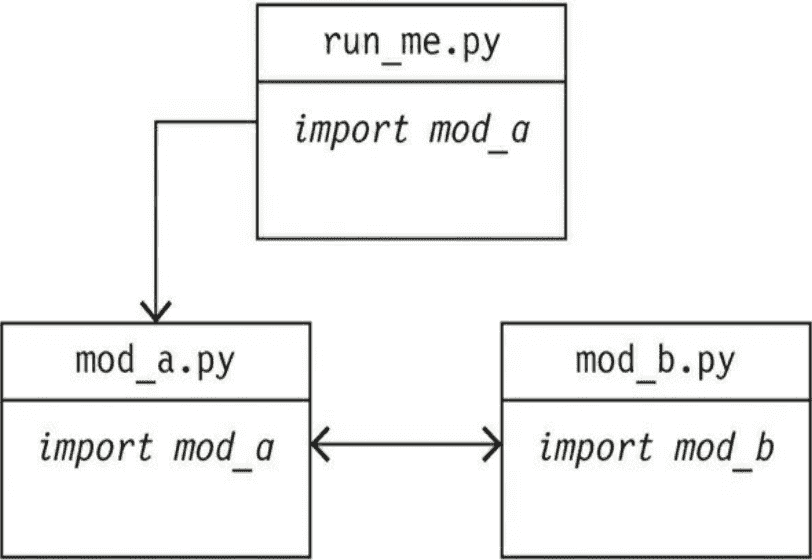
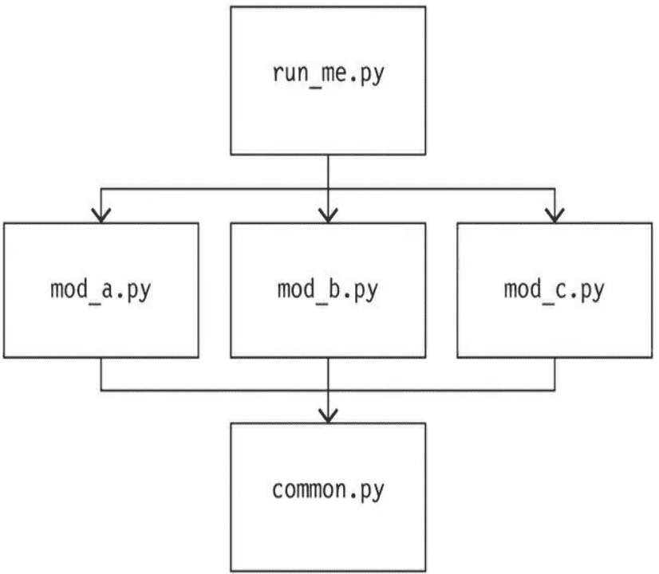
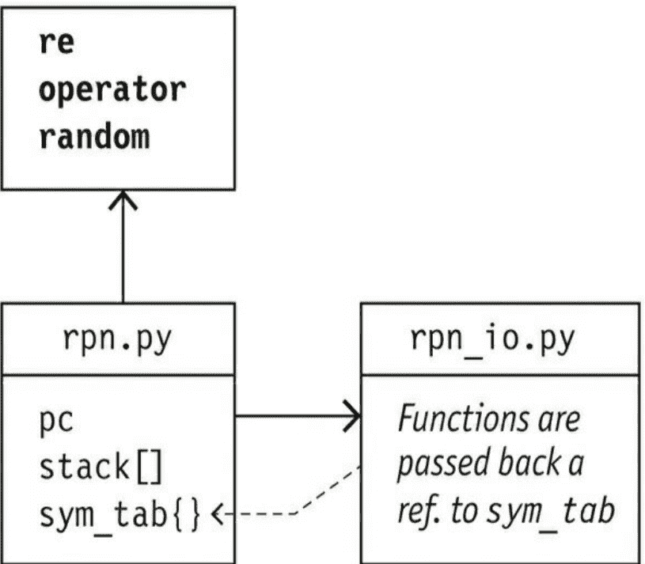

# 14. 多模块与 RPN 示例

如果你用 Python 编程一段时间，你会到达这样一个阶段：你想将代码放在多个源文件中，即一个 _module_。在单个项目中使用多个模块有许多优势。例如，多个开发人员可以同时处理不同的模块，尽管它们属于同一个项目。想想如果没有模块化开发，要创建像 Microsoft Windows 这样复杂的东西！

Python 模块大多易于使用，但有些陷阱可能会出现并咬你一口，就像蛇一样。但不用担心。我们会安全地引导你避开这些陷阱。

本章还完成了本书在第 3、6、7 和 8 章中一直在开发的逆波兰表示法示例。这个应用程序将解释一种足够强大的 RPN 语言，以支持循环和决策。

## 14.1 Python 中模块概述

在 Python 中，模块和其他事物一样是对象，每个模块都有自己的属性。这有重要的后果。

每个 Python 脚本至少有一个模块。即使在 IDLE 中工作时也是如此；在这种情况下，模块名为 `__main__`，你可以通过打印内置标识符 `__name__` 来验证这一点。

```
>>> print(__name__)
__main__
```

在本章中，我们假设你正在使用至少一个 Python 源文件，它将是主模块。运行此文件时，无论文件的实际名称如何，它都会被重命名为 `__main__`。

你可以使用 `import` 语句导入任意多个其他源文件，将它们带入项目，使用的语法与使用包时相同。程序始终通过运行主模块来启动。从 IDLE 打开主模块后，打开运行菜单并选择运行模块。

有一些导入的一般准则，如果遵循，应该可以最大限度地减少遇到麻烦的机会。

- 使用 `import` 语句导入另一个源文件，就像使用包一样，但不要使用 `.py` 扩展名。

- 你可以导入函数以及模块级变量（即非函数局部的变量）。你应该通过其限定名称引用导入的变量。例如，如果 `e` 在模块 `my_math.py` 中定义，那么从主模块中，应将其称为 `my_math.e`。

- 注意此例外：如果你绝对不会更改变量的值，那么直接引用它是安全的。例如，如果 `pi` 是一个常量，你可以在另一个模块中简单地将其称为 `pi`。

- 避免相互导入。如果 `mod_a.py` 导入 `mod_b.py`，那么 `mod_b.py` 不应该导入 `mod_a.py`。此外，应避免任何循环“环”导入。如果 A 导入 B，B 导入 C，那么 C 不应该导入 A。

规则 4 有例外。循环导入是可以工作的，正如你将看到的，但避免麻烦的最简单方法就是拒绝。

## 14.2 简单的双模块示例

让我们从一个你想拆分为两个模块的程序开始，主模块位于 `run_me.py` 中。

该文件可以作为 IDLE 脚本编写，然后保存。**import** 语句允许此模块调用另一个文件中定义的函数。

单击此处查看代码图片

```
# File run_me.py -----------------------------------------------
import printstuff             # Import
printstuff.py.
printstuff.print_this('thing') # Call imported func.
```

此程序导入文件 `printstuff.py`，但在代码中将模块称为 `printstuff`——没有 `.py` 扩展名。（抱歉如果我们重复了。）以下是 `printstuff.py` 的清单，它应与 `run_me.py` 一起放在工作目录中。

单击此处查看代码图片

```
# File printstuff.py --------------------

def print_this(str1):
    print('Print this %s.' % str1)
```

现在直接运行 `run_me.py` 文件。你不需要做其他事情来让另一个模块成为项目的一部分，假设它在同一目录中。

`import` 语句的作用是运行 `printstuff.py` 的内容，其中包含一个函数定义。`def` 语句的作用是创建一个可调用对象的函数。

> **Note**
>
> 请记住，在 `import` 语句中，`.py` 文件扩展名始终是隐含的，包括它是一个错误。名称的其余部分必须遵守形成文件名的标准规则。

由于函数 `print_this` 是从另一个模块中使用简单版本的 `import` 导入的，因此必须使用模块名称限定符 `printstuff` 来引用该函数。


## 在继续之前，让我们逐一回顾所有步骤。

- 从 IDLE 中，从 File 菜单中选择 New File 命令。IDLE 会提供一个纯文本、可编辑的窗口作为响应。输入以下内容。（注释不需要输入，但其余部分应完全按所示输入。）

```python
# File run_me.py ---------------------------------------
import printstuff #
Import printstuff.py
printstuff.print_this('thing') # Call
the func
```

- 将此文件另存为 run_me.py。

- 再次打开一个新文件。输入以下内容：

```python
# File printstuff.py -----------------------------------
def print_this(str1):
    print('Print this %s.' % str1)
```

- 将此文件另存为 printstuff.py。

- 打开 Windows 菜单，并选择 run_me.py。（这会将焦点切换回第一个文件，或者更确切地说，模块。）

- 通过从 Run 菜单中选择 Run Module 命令来运行此文件。

程序打印以下内容：

```
Print this thing.
```

导入的文件可能包含模块级代码——即不属于函数定义的代码。模块级代码会直接运行。因此，这个特定的程序可以这样编写：

```python
# File run_me.py ----------------------------------------
import printstuff   # Import printstuff.py file,
                    #   and run the code there.
#--------------------------------------------------------
# File printstuff.py
print('Print this thing.')
```

使用这个版本的程序，printstuff.py 包含模块级代码，这些代码会被直接执行。程序的结果是，再次打印以下内容：

```
Print this thing.
```

这种做法——从主模块以外的任何地方运行模块级代码——不是标准做法，但它是受支持的。不过，一般来说，应该避免这样做。

导入的模块还可以做的另一件事是提供模块级变量赋值，这会导致创建命名变量。

```python
# File run_me.py ------------------------------------
import printstuff # Import printstuff.py file.
# The next statement then uses imported variables.
print('%s and %s' % (printstuff.x, printstuff.y))
# File printstuff.py ------------------------------------
x, y = 100, 200
```

现在，运行文件 run_me.py 打印以下内容：

```
100 and 200
```

变量 x 和 y 是从名为 printstuff 的其他模块导入的，因此这些变量作为 printstuff.x 和 printstuff.y 可供主模块使用。

模块存在全局与局部访问的问题，就像函数一样。例如，假设你有以下代码：

```python
# File run_me.py ------------------------------------
from foo_vars import z, print_z_val
import foo_vars

z = 100
print_z_val()

# File foo_vars.py ------------------------------------
z = 0
def print_z_val():
    print('Value of z is', z)
```

如果你运行这个程序，它会说 z 的值仍然是 0，这看起来像是主模块（run_me.py）中对 z 的更改被忽略了。真正发生的情况是，语句 z = 100 创建了一个局部于主模块的 z 版本。问题在于，一旦将 run_me.py 中的 z = 100 改为

```python
foo_vars.z = 100
```

即可纠正。

此语句会导致 run_me.py 使用在 foo_vars.py 中定义的 z 版本，且仅在该处使用；因此，将 100 赋值给 z 现在会影响 foo_vars.z。

这里是另一个涉及恰好两个源文件的完整示例：一个主程序模块和另一个模块 poly.py。

```python
# File do_areas.py ----------------------------------------
import poly # Import the file poly.py
def main():
    r = float(input('Enter radius:'))
    print('Area of circle is',
    poly.get_circle_area(r))
    x = float(input('Enter side:'))
    print('Area of square is',
    poly.get_square_area(x))
main()
# File poly.py ------------------------------------
def get_circle_area(radius):
    pi = 3.141593
    return 3.141592 * radius * radius
def get_square_area(side):
    return side * side
def get_triangle_area(height, width):
    return height * width * 0.5
```

主模块是 do_areas.py。文件 poly.py 位于同一目录中。启动 do_areas.py 后，程序首先要做的是导入文件 poly.py：

```python
import poly # Import the file poly.py
```

当 Python 读取并执行此语句时，它会暂停主模块（do_areas.py）的执行并执行文件 poly.py。它会在自动为 poly 添加 .py 扩展名后找到该文件。

尝试导入带扩展名的文件名会导致错误，因为 Python 会尝试将 poly.py 解释为分层包名称。

执行 poly.py 中的代码的效果是，由于三个 **def** 语句，创建了三个可调用对象。**import** 语句还使三个函数名称对主模块可见——但仅当使用 poly 前缀（如下所示）时：

```python
poly.get_circle_area(radius)
poly.get_square_area(side)
poly.get_triangle_area(height, width)
```

## 14.3 "IMPORT" 语句的变体

当你导入自己的模块时，**import** 语句遵循本书前面所示的相同规则。最简单的用法使源文件能够访问其他模块中定义的模块级符号；但是，名称必须使用模块名进行限定。

```python
import module_name
```

因此，如果在命名模块中创建了一个函数，你可以调用该处定义的函数，但前提是使用正确的限定符：

```python
module_name.function_name(args)
```

这也适用于变量。

```python
module_name.var
```

但是，如果你使用 **from** 语法列出特定的符号名称，则这些符号可以直接使用。

```python
from module_name import sym1, sym2, sym3...
```

例如，在上一节末尾的示例中，函数名称 `get_circle_area` 和 `get_square_area` 可以通过使用 **from/import** 语法直接使用。结果如下。

```python
# File do_areas.py ------------------------------------------
from poly import get_circle_area, get_square_area
def main():
    r = float(input('Enter radius:'))
    print('Area of circle is', get_circle_area(r))
x = float(input('Enter side: '))
print('Area of square is', get_square_area(x))
main()
# File poly.py ----

def get_circle_area(radius):
    pi = 3.141593
    return 3.141592 * radius * radius

def get_square_area(side):
    return side * side

def get_triangle_area(height, width):
    return height * width * 0.5
```

鉴于两个函数的导入方式，可以不加限定地引用它们——即不使用点（.）语法。而且，如果这是唯一的 **import** 语句，则必须不加限定地引用它们。

```python
from poly import get_circle_area, get_square_area
```

此语句本身不提供对符号名称 `get_triangle_area` 的访问，因为在这种情况下未导入该函数名称。

你也可以选择导入模块中的所有符号，但需受下一节所述限制的约束。此语法使用星号（*）表示“从命名模块导入所有符号”。

```python
from poly import *
```

此语句的结果是，源文件 `poly.py` 被运行，其所有模块级符号对当前源文件可见且无需限定。（这假设源文件 `poly.py` 在当前目录中可用。）

> **注意**
> 在给定项目中首次导入源文件时，Python 会执行该文件中的代码。请记住，执行 `def` 语句会导致 Python 在运行时创建一个作为可调用对象的函数。与 C 或 C++ 不同，Python 不会在“编译”阶段创建函数。相反，函数的创建是动态的，可以在程序运行期间的任何时间发生。
> 这就是为什么 Python 必须运行命名模块中的代码；或者更确切地说，它会运行所有模块级代码，这些代码理想情况下应执行变量赋值或函数定义（或两者兼而有之）。以这种方式执行模块后，无论导入多少次，都不会再次执行。
> 当然，创建的函数可以被调用任意次数。但 `def` 语句的初始动作仅是创建作为可调用对象的函数，而尚未调用它。这一区别很重要。

## 14.4 使用 "`__ALL__`" 符号

上一节指出，你可以使用星号（*）将所需模块的所有模块级代码带入程序命名空间。例如，假设你有以下应用程序，它结合了主程序（`run_me.py`）和一个模块（`module2.py`）。


# File run_me.py ----
from module2 import *
pr_nice('x', x)
pr_nice('y', y)
# File module2.py ----
x = 1000
y = 500
z = 5
def pr_nice(s, n):
    print('The value of %s is %i.' % (s, n))
    print('And z is %i.' % z)

When run, the program `run_me.py` prints

```
The value of x is 1000.
And z is 5!
The value of y is 500.
And z is 5!
```

As this example demonstrates, the `import *` syntax causes all module-level symbols defined in `module2.py` to be accessible from this module.

But do all the symbols in `module2.py` really need to be visible in `run_me.py`? In this case, they don’t. The module-level variable `z` is used in the function definition for `pr_nice`, but it need not be visible to the main module.

When you use the version of `import` that uses the asterisk (*), Python allows you to control access through the use of the `__all__` symbol in the module itself. Here’s how it works.

- If the module does not assign a value to the special symbol `__all__`, then the importer of the module sees all the module-level (that is, global) symbols, exactly as you’d expect.
- If the module does assign a value to `__all__`, then only the listed symbols are visible to the importer of the module.

The syntax for `__all__` is shown here.


Click here to view code image

```
__all__ = [sym_str1, sym_str2, sym_str3...]
```

This syntax implies that all the symbolic names listed for this statement are placed in strings, and generally, this means names in quotation marks. (See the upcoming example.)

Consider the previous example. The names x, y, and z are all visible to the importing module, run_me.py, as is the function name, pr_nice. But z didn’t need to be visible as an import, because it’s visible internally within the module named module2. Therefore, the module could have been written this way:

Click here to view code image

```
# File module2.py ----
__all__ = ['x', 'y', 'pr_nice']
x = 1000
y = 500
z = 10
def pr_nice(s, n):
    print('The value of %s is %i.' % (s, n))
    print('And z is %i.' % z)
```

The new statement to be added is highlighted in bold. You’ll find that if you add this line and rerun `run_me.py`, the results are unchanged.

But if this new line of code doesn’t change the results, why use it? The answer is that it helps limit proliferation of symbols when you’re importing modules with the `*` syntax. Some large packages have thousands of module-level symbols. Using `__all__` controls the proliferation of symbolic names, which you don’t want to get out of hand. Otherwise, name conflicts can be a danger.

If the importer is not using the `import *` syntax to import symbols, the `__all__` assignment has no effect.

Look again at the case in which `z` is not included in the list:

```
__all__ = ['x', 'y', 'pr_nice']
```

Yet even in this case, the variable `z` can still be referred to by the main module, in other ways. Here’s an example:

Click here to view code image

```
# File listing for run_me.py ----
from module2 import *   # Import x, y, pr_nice
from module2 import z   # Import z
print('z is %i, for heaven's sake!' % z)
```

This version of the code prints the following:

```
z is 10, for heaven's sake!
```

This example works, because in this case, z is imported on its own, in a separate statement.

## 14.5 PUBLIC AND PRIVATE MODULE VARIABLES

The previous section raised an issue: Can you make a module-level symbol “private” to a module?

> The effect described in this section— of making names with a leading underscore (_) more difficult to import— is separate from the name mangling that takes place when you’re attempting to access a private attribute (signified by leading double underscores) from outside a class.
>
> See Section 9.6, “Public and Private Variables,” for more information on name mangling.

Other computer languages tend to have ways of privatizing a symbolic name. In Python, that feature is deemphasized, because the philosophy of Python is to make it easy to create something and just run it. However, names beginning with an underscore have special properties in Python.


```
`_name`
```

When a name beginning with an underscore is created in a Python module, it’s not accessible to another module that imports it using the `import *` syntax.

```
`from mod_a import *`
```

For example, the following program causes errors if `run_me.py` is run, because it assumes that `_a` and `__b` are accessible, but they’re not.

Click here to view code image

```
# File run_me.py ------------------------------------------------
from mod_a import *        # This will fail.

print(_a)
print(__b)

# File mod_a.py ------------------------------------------------
_a, __b = 10, 100
```

The references to both `_a` and `__b` fail. This single-underscore rule applies to double underscores, too, of course. Changing the way you import the symbols makes the program run successfully, as in the following example.

Click here to view code image

```
# File run_me.py ----------------------------------------
from mod_a import _a, __b  # This now works.

print(_a)
print(__b)

# File a_mod.py ----------------------------------------
_a, __b = 10, 100
```

The difference between the two examples is that the second one uses the **import** keyword to recognize `_a` and `__b` specifically, rather than relying on the asterisk (*) syntax.

## 14.6 THE MAIN MODULE AND “\_\_MAIN__”

Earlier, we claimed that modules are objects and that they have attributes just as other objects do. Here’s a simple program that creates some attributes and displays them. Note in particular what’s printed as the module name.

Click here to view code image

```
# File run_me.py ------------------------------------
import mod_a

x = 1
y = 2

print('My name is %s.\n' % __name__)

print(dir())
```

The output of the program is

```
My name is __main__.

['__annotations__', '__builtins__', '__doc__',
'__file__', '__loader__', '__name__', '__package__',
'__spec__', 'mod_a', 'x', 'y']
```

Why does the program say that its name is `__main__`?

The answer is that in any Python program— whether a single-module or a more complex one— the main module’s name is changed from its file name to the special name `__main__`.

This program imports a module named mod_a. Suppose mod_a has only one statement:

```
# File mod_a.py ------------------------------------

print('My name is %s.\n' % __name__)
```

When this module is imported and run, it prints the following:

```
My name is mod_a.
```

So this module’s name was not changed from `mod_a`, which is the name obtained by taking its file name without the `.py` extension. A module’s name is not changed unless it has become the main module— that is, the first module to be run.

There are some important consequences of these rules. First, when a module attempts to import the main module, it potentially creates two copies of every symbol in the main module, because now (in this example) there exists both `__main__` and `mod_a`.

The name `__main__` can be useful. Sometimes, you may want to test all the functions in a module, even though it’s not normally the main module. In that case, you might run it stand-alone, in which case it would become the main module.

For this reason, the following code is common in professional Python. It directs Python to run a module-level statement only if the file is actually serving as the main module.

Click here to view code image

```
# File start_me_up.py ----
def call_me_first():
    print('Hi, there, Python!')
if __name__=='__main__':
    call_me_first()
```

You can run a module as the main module, remember, by launching the Run Module command from the Run menu, while this file is being viewed in IDLE.

The point is this: If a module is going to be run stand-alone (usually as a test of whether that particular module’s functions work), it needs to have module-level code that will call the functions. That’s the point of testing `__name__` to see whether it is equal to `__main__`.

To put all this another way, this use of `__main__` is an extremely useful testing tool. It enables you to test differently modules individually. Then, when the overall program is run, modules will no longer be run independently but only as called by the main program, as usual.

## 14.7 GOTCHA! PROBLEMS WITH MUTUAL IMPORTING

Is it possible to have two modules that import each other, with each referring to symbols defined in the other module? You can do that, but when you do, problems can potentially arise, so be careful.

First, there are problems with importing the main module— the module that’s the starting point for running the program. As mentioned in the previous section, when a module becomes the main module, its name is changed to `__main__`; but if it’s imported by its file name, you create two copies of the module! Could you create two modules (mod_a and mod_b) that import each other? We might picture this as shown in Figure


## 14.1.



**Figure 14.1.** 潜在架构（不可靠）

这种方法看起来不错，有时也有效。但是，如果它在两个模块之间创建相互依赖，可能会失败。下面是一个这样的示例：

单击此处查看代码图像

```
# File run_me.py ------------------------------------------------
import mod_a
mod_a.funcA(5)
# File mod_a.py ------------------------------------------------
import mod_b
def funcA(n):
    if n > 0:
        mod_b.funcB(n - 1)
```

```
# File mod_b.py ----
import mod_a

def funcB(n):
    print(n)
    mod_a.funcA(n)
```

这个程序可以工作，或者至少在变得更复杂之前可以工作。主模块所做的只是导入两个模块（mod_a 和 mod_b），然后运行其中一个函数。虽然函数是相互依赖的——每个函数都调用另一个函数——但有一个合适的退出条件，因此程序运行良好，产生以下结果：

```
4
3
2
1
0
```

太好了！只是这段代码很容易出错。假设你在 mod_a.py 中添加一个看似无害的语句，产生以下结果（新语句以粗体显示）：

```
# File mod_a.py ----
import mod_b

**mod_b.funcB(3)**

def funcA(n):
    if n > 0:
        mod_b.funcB(n - 1)
```

如果你保存对 `mod_a.py` 的更改并从 `run_me.py` 重新运行程序，程序将失败。错误消息指出 `mod_a` “没有属性 funcA。”

发生了什么？当导入 `mod_a.py` 时，它首先要做的是导入 `mod_b`。这应该使调用 `mod_b` 中的函数（即 `funcB`）成为可能。但是，当调用 `funcB` 时，`mod_a` 尚未运行完毕；因此，`funcA` 尚未作为可调用对象创建。

因此，`funcB` 成功被调用，但它尝试在 `funcA` 存在之前调用它。这解释了奇怪的错误消息。

避免此类问题的一种方法是仔细避免在项目中的每个函数都定义之前调用 _任何_ 函数，我们在第 1 章“回顾基础知识”中建议这样做以解决前向引用问题。更安全的方法是仅使用单向导入。

那么，如何设计一个具有单向导入的项目，同时确保每个需要访问函数或变量的模块都能获得该访问权限呢？一个解决方案是将项目所需的所有公共对象放入尽可能靠近层次结构底部的模块中（参见 Figure 14.2）。这与许多 C 或 C++ 程序员设计项目的方式相悖，但这是“Python 的方式”。



# Figure 14.2. 模块导入的单向设计

另一个解决方案，我们将在下一节 14.8 中演示，是在函数调用过程中传递对象引用，而不是导入它们。

## 14.8 RPN 示例：拆分为两个模块

在本章剩余部分，我们将专注于第 8 章“文本和二进制文件”中所示的逆波兰表示法（RPN）语言解释器。该版本的程序能够读取和执行存储在文本文件中的 RPN 脚本。它支持赋值运算符（=），使用户能够创建变量。

下一步是将程序拆分为两个模块。最初，将文件处理函数移动到单独的模块是合理的。文件 I/O 函数 `open_rpn_file` 从用户处获取文件名，打开文件，将文件中的所有文本行读入字符串列表，并返回此列表。

在下一节中，我们将向该模块添加更多文件 I/O 语句。目前，让我们只用它来包含函数 `open_rpn_file`，我们将其放在名为 `rpn_io.py` 的 Python 源文件中。

下面是第 8 章中的程序，但现在重新组织为两个文件。

单击此处查看代码图像

```
#File rpn.py -------------------------------------------
import re
import operator
from rpn_io import *
# Provide a symbol table; values of variables will
be
#     stored here.
sym_tab = { }
stack = []        # Stack to hold the values.
# Scanner: Add items to recognize variable names,
which
#     are stored in the symbol table, and to perform
#     assignments, which enter values into the sym.

table.

scanner = re.Scanner([
    (r"[ \t\n]", lambda s, t: None),
    (r"-?(\d*)?\.\d+", lambda s, t:
        stack.append(float(t))),
    (r"-?\d+", lambda s, t: stack.append(int(t))),
    (r"[a-zA-Z_][a-zA-Z_0-9]*", lambda s, t:
        stack.append(t)),
    (r"[+]", lambda s, t: bin_op(operator.add)),
    (r"[-]", lambda s, t: bin_op(operator.sub)),
    (r"[*]", lambda s, t: bin_op(operator.mul)),
    (r"[/]", lambda s, t: bin_op(operator.truediv)),
    (r"[\^]", lambda s, t: bin_op(operator.pow)),
    (r"[=]", lambda s, t: assign_op()),
])

def assign_op():
    """Assignment Operator function: Pop off a name
    and a value, and make a symbol-table entry.
    """

    op2, op1 = stack.pop(), stack.pop()
    if type(op2) == str:   # Source may be another
    var!
        op2 = sym_tab[op2]
    sym_tab[op1] = op2

def bin_op(action):
    """Binary Operation evaluator: If an operand is
    a variable name, look it up in the symbol table
    and replace with the corresponding value, before
    being evaluated.
    """

    op2, op1 = stack.pop(), stack.pop()
    if type(op1) == str:
        op1 = sym_tab[op1]
    if type(op2) == str:
        op2 = sym_tab[op2]
    stack.append(action(op1, op2))

def main():
    a_list = open_rpn_file()
    if not a_list:
        print('Bye!')
        return

    for a_line in a_list:
        a_line = a_line.strip()
        if a_line:
            tokens, unknown = scanner.scan(a_line)
            if unknown:
                print('Unrecognized input:',
                      unknown)
            print(str(stack[-1]))

main()

#File rpn_io.py
#-------------------------------------------
def open_rpn_file():
    ''''Open-source-file function. Open a named
    file and read lines into a list, which is
    returned.
    '''

    while True:
        try:
            fname = input('Enter RPN source: ')
            if not fname:
                return None
            f = open(fname, 'r')
            break
        except:
            print('File not found. Re-enter.')
    a_list = f.readlines()
    return a_list
```

此版本的程序与第 8 章中的程序功能相同，该程序从文件读取 RPN 脚本，并使用符号表 sym_tab 存储因赋值（=）而创建的变量名。

例如，此程序应该能够读取一个文本文件，例如包含以下 RPN 脚本的文件，将其作为程序运行，并打印结果。

```
a_var 3 =
b_var 5 =
a_var b_var * 1 +
```

如果你尝试将其输入到文本文件中（我们将其称为 rpn_junk.txt），运行程序，并在提示时输入 rpn_junk.txt 作为文件名，你应该得到正确的结果，16。

> **Note**
> 如果你在 IDLE 中创建 RPN 源文件，不要惊讶于 IDLE 添加 .py 扩展名。

注意添加到主模块的导入语句：

```
from rpn_io import *
```

因为 `rpn_io` 模块只包含一个函数，所以名称冲突的可能性较低。但如果你选择，也可以更有选择性地导入。

单击此处查看代码图像

```
from rpn_io import open_rpn_file
```

## 14.9 RPN 示例：添加 I/O 指令

下一步是向 RPN 脚本语言添加高级输入和输出指令，以便用户可以为程序输入初始值以及打印结果。

让我们使用一种程序设计，添加四个指令，如表 14.1 所述。

# Table 14.1. RPN 语言的 I/O 指令

| 指令，带语法 | 描述 |
|---|---|
| `INPUT` _var_name_ | 从用户处获取一个值，将其转换为数值，并将其作为 _var_name_ 存储在符号表中。 |
| `PRINTS` _quoted_string_ | 打印指定的字符串。 |


| PRINTLN [quoted_str ing] | 打印指定的字符串（如果有），后跟一个换行符。 |
| PRINTVAR var_name | 在符号表中查找 var_name 的值，并将其打印。 |

为了说明问题，并且因为这样能形成更好的整体设计，我们将实现这四个指令的代码放在 `rpn_io` 文件中，而不是主模块。这引出了一个问题。其中两个指令（INPUT 和 PRINTVAR）需要访问在主模块中创建的符号表（`sym_tab`）。如何将此表共享给 `rpn_io` 模块？正如我们在第 14.6 节中所示，让两个模块相互导入是有风险的，因为这可能会导致程序失败的相互依赖关系。

最简单、最安全的解决方案是传递对 `sym_tab`（充当符号表的字典）的引用。

你可能会问，如何传递引用？Python 在传递参数时总是这样做。这是一个至关重要的性能特性。如果函数得到符号表的完整副本，这会减慢程序速度；此外，它还会剥夺被调用函数更改原始表中数据的能力。

在这种情况下，更改数据是可行的，因为我们利用了字典的可变性，因此可以在运行时更改。你可以让函数对字典 `sym_tab` 的部分进行更改，这些更改将生效。例如，下面的语句将变量及其值添加到表中，即使 `sym_tab` 是作为引用传递的。

```
sym_tab[var_name] = val
```

以下是文件 `rpn.py` 中 `main` 的新版本，要添加的行以粗体显示：

Click here to view code image

```
def main():
    a_list = open_rpn_file()
    if not a_list:
        print('Bye!')
        return

for a_line in a_list:
    a_line = a_line.strip()
    if a_line.startswith('PRINTS'):
        do_prints(a_line[7:])
    elif a_line.startswith('PRINTLN'):
        do_println(a_line[8:])
    elif a_line.startswith('PRINTVAR'):
        do_printvar(a_line[9:], sym_tab)
    elif a_line.startswith('INPUT'):
        do_input(a_line[6:], sym_tab)
    elif a_line:
        tokens, unknown = scanner.scan(a_line)
        if unknown:
            print('Unrecognized input:',
                  unknown)
```

这些新（或修改后）的代码行大多查找从目标 RPN 代码文件读取的行开头处是否存在某个指令名称——`PRINTS`、`PRINTLN`、`PRINTVAR` 或 `INPUT`。字符串类的 **startswith** 方法提供了一种高效的方式来检查这些指令。找到其中一个后，程序会调用相应的函数来处理它，并传递 RPN 代码行的其余部分。

其中两个函数（`PRINTVAR` 和 `INPUT`）还接受对符号表的引用。

以下是要添加到文件 `rpn_io.py` 的函数。这些函数执行主函数查找的四个指令。

Click here to view code image

```
def do_prints(s):
    """ Carry out PRINTS directive by printing a
    string.
    """

a_str = get_str(s)
print(a_str, end='')

def do_println(s):
    """ Carry out PRINTLN directive: print the
    optional string argument, if specified, and then
    print a newline, unconditionally.
    """
    if s:
        do_prints(s)
    print()

def get_str(s):
    """ Helper function for do_prints.
    """
    a = s.find(""")
    b = s.rfind("")
    if a == -1 or b == -1:
        return ''
    return s[a+1:b]

def do_printvar(s, sym_tab):
    ""' Carry out PRINTVAR directive; look up the
    variable name contained in the string s, and
    then look this name up in the symbol table.
    ""'
    wrd = s.split()[0]
    print(sym_tab[wrd], end=' ')

def do_input(s, sym_tab):
    ""' Carry out INPUT directive; get value input
    from the end user, then enter this value in the
    symbol table, for name contained in string s.
    ""'
    wrd = input()
    sym_tab[s] = float(wrd)
```

本程序中使用的函数很有启发性，因为它们使用了参数 `sym_tab`。最后两个函数（`do_printvar` 和 `do_input`）将对符号表的引用作为第二个参数。

引用 `sym_tab` 不是主模块中创建的符号表的副本，而是对原始表本身的直接引用。由于数据字典（例如符号表）是可变的，`do_input` 函数能够修改表本身，而不仅仅是副本。

有了对这四个指令的支持，RPN 解释器现在可以评估接近真实程序的脚本。例如，以下脚本提示输入直角三角形的两条直角边，计算斜边，并打印结果。

Click here to view code image

```
```
PRINTS 'Enter side 1: '
INPUT side1
PRINTS 'Enter side 2: '
INPUT side2
total side1 side1 * side2 side2 * + =
hyp total 0.5 ^ =
PRINTS 'Hypotenuse equals '
PRINTVAR hyp
```
```

假设你编写并保存此 RPN，将其放在名为 `rpn_hyp.txt` 的文件中。以下是运行主模块 `rpn.py` 时的示例会话：

Click here to view code image

```
```
Enter RPN source: rpn_hyp.txt
Enter side 1: 30
Enter side 2: 40
Hypotenuse equals 50.0
```
```

第一行显示的“Enter RPN source”是由 Python 程序本身打印的。第二、三、四行实际上是由 RPN 脚本打印的——或者更准确地说，是在评估该 RPN 脚本期间打印的。

## 14.10 对 RPN 示例的进一步更改

我们还可以做更多事情，使这个 RPN 解释器成为一个更好的程序。最大的问题之一是错误报告仍然很差。例如，假设 RPN 脚本编写者开始编写他的脚本，如下所示：

```
PRINTS 'Enter side 1: '
INPUT side 1
```

哎呀！在第二行中，他在尝试写 `side1` 时多输入了一个空格。鉴于程序 `rpn.txt` 当前的编写方式，符号名称 `side` 将被输入到符号表中，而 `1` 将被忽略，但后来，当脚本尝试在符号表中查找 `side1` 时，该符号将找不到。

通过更复杂的错误处理，解释器可能会指出问题出在第 2 行（或者，如果我们使用基于零的索引编号，则是第 1 行），并指出不能向 INPUT 指令提供两个参数。

但至少，我们的 Python 程序应该捕获出现的异常，然后打印一条礼貌的消息，以及指示发现错误位置的行号。为此，我们需要跟踪行号。

这个解决方案的优点在于，一旦添加了行号跟踪，就很容易添加一个控制结构“如果不为零则跳转”，如你将在第 14.10.2 节中看到。添加这一功能将大大扩展 RPN 脚本语言的功能。

### 14.10.1 添加行号检查

要向 RPN 解释器添加行号检查，我们需要声明一个新变量 `pc`，它需要在模块 `rpn.py` 中是模块级别的（不是局部的）。因为它是全局的，所以在任何使用它并为其赋予新值的函数中，都需要将其声明为 **global**。

> > 仔细观察此处代码中 **global** 语句的使用。在需要时未使用此关键字可能会导致一些棘手的错误。

我们需要做的第一件事是将程序计数器 `pc` 添加到主模块开头的全局变量列表中。在导入必要的包以及 `rpn_io.py` 之后，源代码以

Click here to view code image

```
```
sym_tab = { }    # Symbol table (for variables)
stack = []       # Stack to hold the values.
pc = -1          # Program Counter
```
```

第三行（此处以粗体显示）是需要添加的行。

此外，还需要向主函数添加几行。这些行在以下列表中以粗体显示。

Click here to view code image

```
```
def main():
    global pc
    a_list = open_rpn_file()
    if not a_list:
        print('Bye!')
        return
    pc = -1
    while True:
```
```


pc += 1
if pc >= len(a_list):
    break

a_line = a_list[pc]
try:
    a_line = a_line.strip()
    if a_line.startswith('PRINTS'):
        do_prints(a_line[7:])
    elif a_line.startswith('PRINTLN'):
        do_println(a_line[8:])
    elif a_line.startswith('PRINTVAR'):
        do_printvar(a_line[9:], sym_tab)
    elif a_line.startswith('INPUT'):
        do_input(a_line[6:], sym_tab)
    elif a_line:
        tokens, unknown = scanner.scan(a_line)
        if unknown:
            print('Unrecognized input:', unknown)
            break
except KeyError as e:
    print('Unrecognized symbol', e.args[0], 'found in line', pc)
    print(a_list[pc])
    break

让我们逐一了解这些添加内容的作用。首先，需要 `global` 语句。如果没有它，Python 会假设函数中使用的 `pc` 是对局部变量的引用。为什么？因为赋值会创建变量——请记住，Python 中没有变量声明！因此，Python 必须猜测正在创建哪种类型的变量，默认情况下，变量是局部的。`global` 语句告诉 Python 不要将 `pc` 解释为局部变量，即使它是赋值的目标。Python 会查找 `pc` 的全局（模块级）版本并找到它。

接下来，`pc` 被设置为 `-1`，以防需要将其设置为初始位置。程序的操作是在读取每一行时递增 `pc`，我们希望它在读取第一行后变为 `0`。

```python
pc = -1
```

接下来的几行按上述方式递增 `pc`。如果值过高，超出字符串列表的范围，程序将退出；这意味着我们完成了！

```python
while True:
    pc += 1
    if pc >= len(a_list):
        break
```

最后，在主函数的末尾添加了代码，用于捕获 **KeyError** 异常，并在引发该异常时报告有用的错误消息。然后程序终止。

```python
except KeyError as e:
    print('Unrecognized symbol', e.args[0], 'found in line', pc)
    print(a_list[pc])
    break
```

做出这些更改后，编写变量名时出现的错误会触发更智能的错误报告。例如，如果变量 `side1` 从未被正确创建（假设用户之前输入了 `side11` 或 `side 1`），解释器现在会打印一条有用的消息：

```
Unrecognized symbol sidel found in line 4
total side1 sidel * side2 side2 * + =
```

如果出现此消息，它应该告诉你 `side1` 或 `side2` 的创建存在问题。

## 14.10.2 添加非零跳转

既然 RPN 解释器有了工作的程序计数器（`pc`），向 RPN 语言添加一个控制结构就变得很容易了：_非零跳转_。添加这一条语句后，你可以让 RPN 程序具备循环和决策的能力，从而大大提高这种语言的可用性。

我们可以将非零跳转功能设计为指令，但更符合该语言精神的做法是将其作为 RPN 表达式。


```
conditional_expr line_num ?
```

如果 `conditional_expr` 是除零以外的任何值，程序计数器 `pc` 将被设置为 `line_num` 的值。否则，不执行任何操作。

会这么简单吗？是的，就是这样！唯一的复杂之处在于，我们需要允许 `conditional_expr` 是变量名，并且（尽管这种用法可能不常见）允许 `line_num` 也是变量。

到目前为止，还没有行标签，所以这不是一个完美的解决方案。（行标签的实现留作本章末尾的练习。）RPN 编写者将不得不计算行数，使用基于零的索引，以决定跳转到哪里。

下面是用户可以编写的示例。

```
`PRINTS 'Enter number of fibos to print: '
INPUT n
f1 0 =
f2 1 =
temp f2 =
f2 f1 f2 + =
f1 temp =
PRINTVAR f2
n n 1 - =
n 4 ?`
```

你看出这段代码的作用了吗？我们稍后会回到这个问题。

但是请看最后一行（`n 4 ?`）。要理解它的作用，请记住我们的程序计数器设计为基于零。它不必如此，但这样简化了一些编程工作。由于程序计数器是基于零的，最后一行——假设 `n` 不为零——会导致跳转回第五行（`temp f2 =`）。这形成一个循环，持续到 `n` 为零为止。

正如我们承诺的那样，非零跳转运算符 `?` 很容易实现。只需在 Scanner 代码中添加一行，并添加一个简短的函数。以下是修订后的 Scanner 代码，需要输入的新行已加粗。

```python
scanner = re.Scanner([
    (r"[ \t\n]", lambda s, t: None),
    (r"-?(\d*)?\.\d+", lambda s, t:
     stack.append(float(t))),
    (r"-?\d+", lambda s, t: stack.append(int(t))),
    (r"[a-zA-Z_][a-zA-Z_0-9]*", lambda s, t:
     stack.append(t)),
    (r"[+]", lambda s, t: bin_op(operator.add)),
    (r"[-]", lambda s, t: bin_op(operator.sub)),
    (r"[*]", lambda s, t: bin_op(operator.mul)),
    (r"[/]", lambda s, t: bin_op(operator.truediv)),
    (r"[\^]", lambda s, t: bin_op(operator.pow)),
    (r"[=]", lambda s, t: assign_op()),
    (r"[?]", lambda s, t: jnz_op())
])
```

新函数 `jnz_op` 会从堆栈中弹出两个项目，如果需要，在符号表中查找它们，然后执行操作本身，这很简单。

```python
def jnz_op():
    global pc
    op2, op1 = stack.pop(), stack.pop()
    if type(op1) == str:
        op1 = sym_tab[op1]
    if type(op2) == str:
        op2 = sym_tab[op2]
    if op1:
        pc = int(op2) - 1
```

请注意 **global** 语句的重要性。为了防止 `pc` 被解释为局部变量，**global** 语句是必需的。

```python
global pc
```

函数的核心是以下两行，如果 `op1` 非零（真），则更改程序计数器。

```python
if op1:
    pc = int(op2) - 1
```

让我们查看一个示例会话。假设本节开头显示的脚本（我们将其称为 `mystery.txt`）被提供给 RPN 解释器。

```
Enter RPN source: mystery.txt
Enter how many fibos to print: 10
1 2 3 5 8 13 21 34 55 89
```

这个程序明显打印出了前 10 个斐波那契数，除了第一个。我们已成功解释了一个 RPN 脚本，它能够根据用户输入执行不同次数的操作。

## 14.10.3 大于运算符 (>) 和获取随机数运算符 (!)

在完全离开 RPN 解释器话题之前，让我们添加两个更多功能，这将有助于创建游戏程序。通过添加大于运算符 (>) 和获取随机数运算符 (!)，我们将能够将猜数字游戏编写为 RPN 脚本。

大于运算符将与大多数 RPN 操作类似。它会从堆栈中弹出两个操作数，然后将结果压入堆栈顶部。


```
`op1 op2 >`
```

比较两个操作数。如果 `op1` 大于 `op2`，则将值 1 压入堆栈；否则，将值 0 压入堆栈。

事实证明，实现此功能所需的工作量仅需一行！我们不需要包含额外的函数来计算大于运算，因为它已由 `operator.gt` 处理，该函数从 `operator` 包导入。只需添加一行。

```python
scanner = re.Scanner([
    (r"[ \t\n]", lambda s, t: None),
    (r"-?(\d*)?\.\d+", lambda s, t:
     stack.append(float(t))),
    (r"-?\d+", lambda s, t: stack.append(int(t))),
    (r"[a-zA-Z_][a-zA-Z_0-9]*", lambda s, t:
     stack.append(t)),
    (r"[+]", lambda s, t: bin_op(operator.add)),
    (r"[-]", lambda s, t: bin_op(operator.sub)),
    (r"[*]", lambda s, t: bin_op(operator.mul)),
    (r"[/]", lambda s, t: bin_op(operator.truediv)),
    (r"[>]", lambda s, t: bin_op(operator.gt)),
    (r"[\^]", lambda s, t: bin_op(operator.pow)),
    (r"[=]", lambda s, t: assign_op()),
    (r"[?]", lambda s, t: jnz_op())
])
```

就是这样！你可能会发现，添加新运算符（只要它们是标准算术或比较运算符）如此简单，我们应该全部添加。

这没错，但如果你依赖单个标点符号来表示不同的操作，很快就会用完键盘上的符号。这个问题可能可以通过让“LE”代表“小于或等于”来解决，但如果你采用这种方法，就需要重新思考扫描器如何分析标记。

有了这个额外的运算符，现在可以使斐波那契脚本更可靠了。只需查看修订后的脚本。

```
PRINTS 'Enter number of fibos to print: '
INPUT n
f1 0 =
f2 1 =
temp f2 =
```


f2 f1 f2 + =
f1 temp =
PRINTVAR f2
n n 1 - =
n 0 > 4 ?

The last line now says the following: If `n` is greater than 0,
then jump to (zero-based) line 4. This improves the script,
because if the user enters a negative number, the RPN program
doesn’t go into an infinite loop.

Finally— although this is not necessary for most scripts— let’s
add an operation that gets a random integer in a specified
range.


```
op1 op2 !
```

The action of this RPN expression is to call
**`random.randint`**, passing `op1` and `op2` as the _begin_ and _end_
arguments, respectively. The random integer produced in this
range is then pushed on the stack.

Adding support for this expression is also easy. However, it
involves importing another package. The code will be easy to
write if we can refer to it directly. Therefore, let’s import it this
way:

```
from random import randint
```

Now we need only add a line to add support for
randomization. Again, here is the revised scanner, with the line
to be added in bold.

Click here to view code image

```
scanner = re.Scanner([
    (r"[ \t\n]", lambda s, t: None),
    (r"-?(\d*)?\.\d+", lambda s, t:
     stack.append(float(t))),
    (r"-?\d+", lambda s, t: stack.append(int(t))),
    (r"[a-zA-Z_][a-zA-Z_0-9]*", lambda s, t:
     stack.append(t)),
    (r"[+]", lambda s, t: bin_op(operator.add)),
    (r"[-]", lambda s, t: bin_op(operator.sub)),
    (r"[*]", lambda s, t: bin_op(operator.mul)),
    (r"[/]", lambda s, t: bin_op(operator.truediv)),
    (r"[>]", lambda s, t: bin_op(operator.gt)),
    (r"[!]", lambda s, t: bin_op(randint)),
    (r"[\^]", lambda s, t: bin_op(operator.pow)),
    (r"[=]", lambda s, t: assign_op()),
    (r"[?]", lambda s, t: jnz_op())
])

```

With all these additions to the RPN interpreter, it’s now
possible to write some interesting scripts. Here’s the RPN
version of the number guessing game.
Admittedly, it has a major limitation: no line labels! For
clarity, then, we show the script here with line numbers (the
targets of jumps) shown in bold— as well as with leading o’s,
which, though not required, are not invalid either:

Click here to view code image

```
n 1 50 ! =
```

```
PRINTS 'Enter your guess: '
INPUT ans
ans n > 07 ?
n ans > 09 ?
PRINTS 'Congrats! You got it! '
1 011 ?
PRINTS 'Too high! Try again. '
1 01 ?
PRINTS 'Too low! Try again. '
1 01 ?
PRINTS 'Play again? (1 = yes, 0 = no): '
INPUT ans
ans 00 ?
```

This script is probably still difficult to follow, so it might help
you to think of it with virtual line numbers placed in for the
sake of illustration. These line numbers are imaginary; you
can’t actually put them in the file at this point! However, you
might want to write them down on a piece of paper as you’re
programming.

Click here to view code image

```
00: n 1 50 ! =
01: PRINTS 'Enter your guess: '
02: INPUT ans
03: ans n > 07 ?
04: n ans > 09 ?
05: PRINTS 'Congrats! You got it! '
06: 1 011 ?
07: PRINTS 'Too high! Try again. '
08: 1 01 ?
09: PRINTS 'Too low! Try again. '
10: 1 01 ?
11: PRINTS 'Play again? (1 = yes, 0 = no): '
12: INPUT ans
13: ans 00 ?
```

This script takes advantage of a coding trick. If the jump-if- not-zero operation is given a constant, nonzero value, it amounts to an unconditional jump. Therefore, the following statement on lines o8 and 10 unconditionally jumps to the second line (numbered 01):

1 01 ?

Now you should be able to follow the flow of the script and see what it does. Here’s a sample session, assuming the script is stored in the file `rpn_game.txt`.

Click here to view code image

Enter RPN source: `rpn_game.txt`
Enter your guess: **25**
Too low! Try again. Enter your guess: **33**
Too low! Try again. Enter your guess: **42**
Too high! Try again. Enter your guess: **39**
Too low! Try again. Enter your guess: **41**
Congrats! You got it! Play again? (1 = yes, 0 = no): **0**

## 14.11 RPN: PUTTING IT ALL TOGETHER

There’s still more that can be done to improve the RPN application, but what we’ve developed in this chapter is a strong start. It has variables as well as control structures and even has
the ability to generate random numbers.

Before leaving the subject, let’s review the structure of the program. The main module, `rpn.py`, imports several packages and one module, `rpn_io.py`.

There’s a circular relationship here, in that the main module creates a symbol table that the other module needs access to. But this is easily facilitated by having some of the function calls pass `sym_tab`. The functions thereby get a reference to `sym_tab`, which they can then use to manipulate the table (see Figure 14.3).



**Figure 14.3.** Final structure of the PRN project

Here’s the final listing of the main module, `rpn.py`. Most of
the work of the module is done by the scanner object. The use of the Scanner class was explained in Chapter 7, “Regular Expressions, Part II.”

Click here to view code image

```
#File rpn.py --------------------------------------------
import re
import operator
from random import randint
from rpn_io import *
sym_tab = { } # Symbol table (for variables)
stack = [] # Stack to hold the values.
pc = -1 # Program Counter
# Scanner: Add items to recognize variable names,
which
# are stored in the symbol table, and to perform
# assignments, which enter values into the sym.
table.
scanner = re.Scanner([
(r"[ \t\n]", lambda s, t: None),
(r"-?(\d*)?\.\d+", lambda s, t:
stack.append(float(t))),
(r"-?\d+", lambda s, t: stack.append(int(t))),
(r"[a-zA-Z_][a-zA-Z_0-9]*", lambda s, t:
stack.append(t)),
(r"[+]", lambda s, t: bin_op(operator.add)),
(r"[-]", lambda s, t: bin_op(operator.sub)),
(r"[*]", lambda s, t: bin_op(operator.mul)),
(r"[/]", lambda s, t: bin_op(operator.truediv)),
(r"[>]", lambda s, t: bin_op(operator.gt)),
(r"[!]", lambda s, t: bin_op(randint)),
(r"[\^]", lambda s, t: bin_op(operator.pow)),
(r"[=]", lambda s, t: assign_op())),

```

```
(r"[?]", lambda s, t: jnz_op())
])

def jnz_op():
    '''Jump on Not Zero operation.
    After evaluating the operands, test the first
    op;
    if not zero, set Program Counter to op2 - 1.
    '''
    global pc
    op2, op1 = stack.pop(), stack.pop()
    if type(op1) == str:
        op1 = sym_tab[op1]
    if type(op2) == str:
        op2 = sym_tab[op2]
    if op1:
        pc = int(op2) - 1    # Convert op to int
        format.

def assign_op():
    '''Assignment Operator function.
    Pop off a name and a value, and make a symbol-
    table
    entry.
    '''
    op2, op1 = stack.pop(), stack.pop()
    if type(op2) == str:    # Source may be another
        var!
        op2 = sym_tab[op2]
    sym_tab[op1] = op2

def bin_op(action):
    '''Binary Operation function.
    If an operand is a variable name, look it up in
    the symbol table and replace with the
    corresponding
    value, before being evaluated.
    '''

```

```
op2, opl = stack.pop(), stack.pop()
if type(op1) == str:
    opl = sym_tab[opl]
if type(op2) == str:
    op2 = sym_tab[op2]
stack.append(action(opl, op2))
def main():
    """Main function.
    This is the function that drives the
    program. After opening the file and getting
    operations
    into a_list, process strings in a_list one at a
    time.
    """
    global pc
    dir('__main__')
    a_list = open_rpn_file()
    if not a_list:
        print('Bye!')
        return
    pc = -1
    while True:
        pc += 1
        if pc >= len(a_list):
            break
        a_line = a_list[pc]
        try:
            a_line = a_line.strip()
            if a_line.startswith('PRINTS'):
                do_prints(a_line[7:])
            elif a_line.startswith('PRINTLN'):
                do_println(a_line[8:])
            elif a_line.startswith('PRINTVAR'):
                do_printvar(a_line[9:], sym_tab)
            elif a_line.startswith('INPUT'):
                do_input(a_line[6:], sym_tab)
            elif a_line:
                tokens, unknown =
```


```python
scanner.scan(a_line)
    if unknown:
        print('Unrecognized input:',
              unknown)
        break
    except KeyError as e:
        print('Unrecognized symbol', e.args[0],
              'found in line', pc)
        print(a_list[pc])
        break

main()
```

当运行此源文件时，它会启动 main 函数，该函数控制程序的整体运行。首先，它会调用位于文件 rpn_io.py 中的 open_rpn_file 函数。

由于此文件不大且函数相对较少，这里使用了 import * 语法，以便使 rpn_io.py 中的所有符号名称直接可用。

单击此处查看代码图像

```python
#File rpn_io.py
---------------------------------------

def open_rpn_file():
    '''Open-source-file function.
    Open a named file and read lines into a list,
    which is then returned.
    '''
    while True:
        try:
            fname = input('Enter RPN source: ')
            if not fname:
                return None
            f = open(fname, 'r')
            break
        except:
            print('File not found. Re-enter.')
    a_list = f.readlines()
    return a_list

def do_prints(s):
    """Print string function.
    Print string argument s, without adding a
    newline.
    """
    a_str = get_str(s)
    print(a_str, end='')

def do_println(s=''):
    """Print Line function.
    Print an (optional) string and then add a
    newline.
    """
    if s:
        do_prints(s)
    print()

def get_str(s):
    """Get String helper function.
    Get the quoted portion of a string by getting
    text
    from the first quote mark to the last quote
    mark. If
    these aren't present, return an empty string.
    """
    a = s.find('"')
    b = s.rfind('"')
    if a == -1 or b == -1:
        return ''
    return s[a+1:b]

def do_printvar(s, sym_tab):
    """Print Variable function.
    Print named variable after looking it up in
    sym_tab, which was passed from main module.
    '''
    wrd = s.split()[0]
    print(sym_tab[wrd], end=' ')

def do_input(s, sym_tab):
    '''Get Input function.
    Get input from the end user and place it in
    the named variable, using a reference to the
    symbol table (sym_tab) passed in as a reference.
    '''
    wrd = input()
    if '.' in wrd:
        sym_tab[s] = float(wrd)
    else:
        sym_tab[s] = int(wrd)
```

## 第 14 章 总结

在本章中，我们探讨了在 Python 中使用 `import` 语句的各种方式，以创建可以包含任意数量源文件的多模块项目。

在 Python 中使用多个模块的方式与其他语言有所不同。特别是，在 Python 中，如果导入是 *单向* 的，则更安全，这意味着 `A.py` 可以导入 `B.py`，但如果是这样，`B` 不应该导入 `A`。你可以让 `A` 和 `B` 互相导入，但前提是你知道自己在做什么，并且小心不要创建相互依赖。

同样，你在从另一个模块导入模块级变量时也应当小心。最好使用其限定名称来引用这些变量，例如 `mod_a.x` 和 `mod_a.y`。否则，在创建该变量的模块之外对其进行任何赋值，都会导致创建一个“局部”于出现该变量的模块的新变量。

最后，本章完成了本书中一直在开发的 RPN 解释器应用程序的编程代码。本章添加了问号 (?) 作为非零跳转操作，比较符 (>) 以及感叹号 (!) 作为随机数生成器。添加这些操作极大地扩展了用 RPN 编写的脚本所能实现的功能。

但这些添加远非最终。还有许多其他重要功能你可能希望支持，例如行标签和更好的错误检查。这些留作本章末尾的练习。

## 第 14 章 复习问题

- 1 是否可以使用多个 `import` 语句多次导入同一个模块？这样做的目的是什么？你能想到什么场景会有用吗？

- 2 模块有哪些属性？（至少列举一个。）

- 3 使用循环导入——例如两个模块互相导入——可能会创建依赖关系和隐藏的错误。你如何设计程序以避免相互导入？

- 4 Python 中 `__all__` 的用途是什么？

- 5 在什么情况下引用 `__name__` 属性或字符串 `'__main__'` 是有用的？

- 6 在使用 RPN 解释器应用程序时——它逐行解释 RPN 脚本——添加程序计数器有哪些用途？

- 7 在设计一种简单的编程语言（如 RPN）时，你需要哪些最小的表达式或语句（或两者兼具）才能使该语言原始但完整——也就是说，理论上能够执行任何计算机任务？

## 第 14 章 建议问题

- 1 目前，两个模块 `rpn.py` 和 `rpn_io.py` 之间共享了一些数据。你能否修改应用程序，将共享数据放在第三个模块 `common.py` 中？

- 2 鉴于 RPN 解释器程序的编写方式，添加操作应该很容易，尤其是当它们对应于 operator 包中定义的操作之一时。作为一个小型项目，添加以下内容：小于测试和等于测试。你最大的挑战可能是找到足够的标点字符来表示所有不同的操作符。但是，如果你修改扫描中使用的正则表达式，你可以提出双字符操作符，例如 `==` 表示等于测试。

- 3 对于 RPN 脚本编写者来说，能够在脚本中添加注释将是很好的。你应该能够按照以下规则实现此功能：在 RPN 脚本的每一行中，忽略从井号 (#) 开始直到行尾的所有文本。

- 4 大于测试 (**>**) 是一个布尔运算符，产生 True 或 False（1 或 0）。RPN 脚本的编写者能否在没有实际提供小于 (**<**)、AND 或 OR 运算符的情况下，产生与其他逻辑运算符相同的效果？如果你仔细想想，乘法 (**\*** ) 完美地替代了 AND。加法 (**+**) 也能替代 OR 吗？大部分情况下可以；但是，结果有时是 **2** 而不是 **1** 或 **0**。那么，你能否创建一个逻辑 NOT 运算符，它接受输入 **0** 并产生 **1**，但接受任何正数并产生 **0**？我们真正想问的是，你能否想到几个算术运算，当组合在一起时，能做与逻辑 OR 相同的事情？

- 5 RPN 脚本语言中仍然缺少的最大部分是对行标签的支持。添加这些并不特别困难，但也并非微不足道。任何以 _label_: 开头的行都应被解释为标记一行代码。为了平滑地实现此功能，你应该进行几遍扫描。第一遍应该建立一个“代码表”，排除空行并编译第二个符号表，该表存储标签及其每个标签的值；该值应为代码表中的索引。例如，0 将表示第一行。

- 6 此应用程序中的错误检查可以进一步改进。例如，你能否添加错误检查，如果操作符过多则报告语法错误？（提示：在这种情况下，栈的状态会怎样？）
