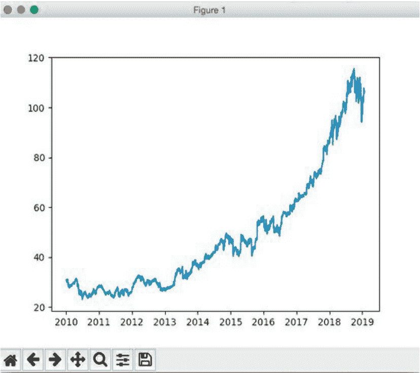
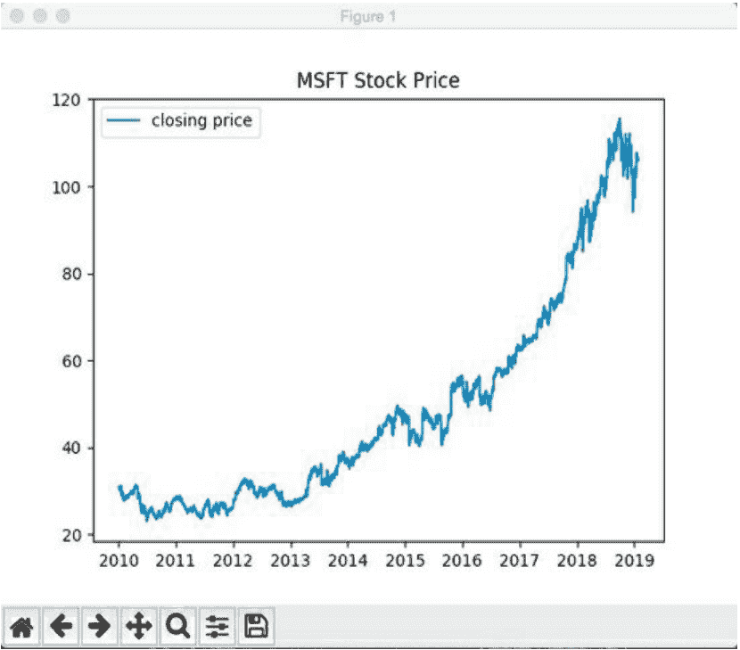
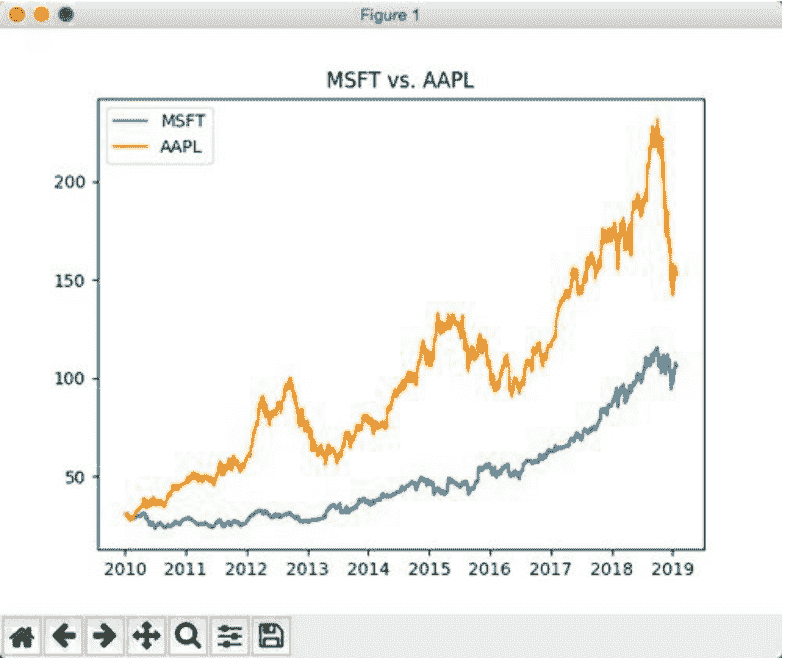
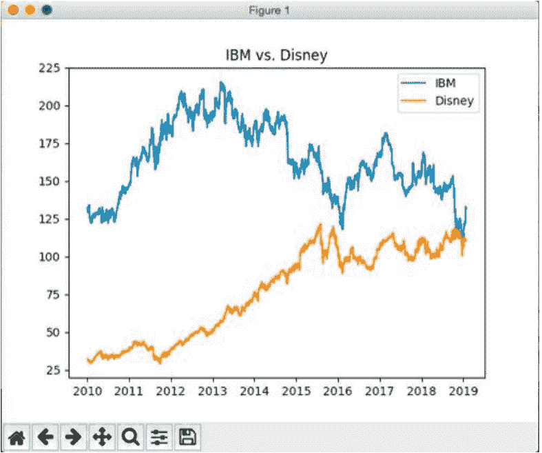
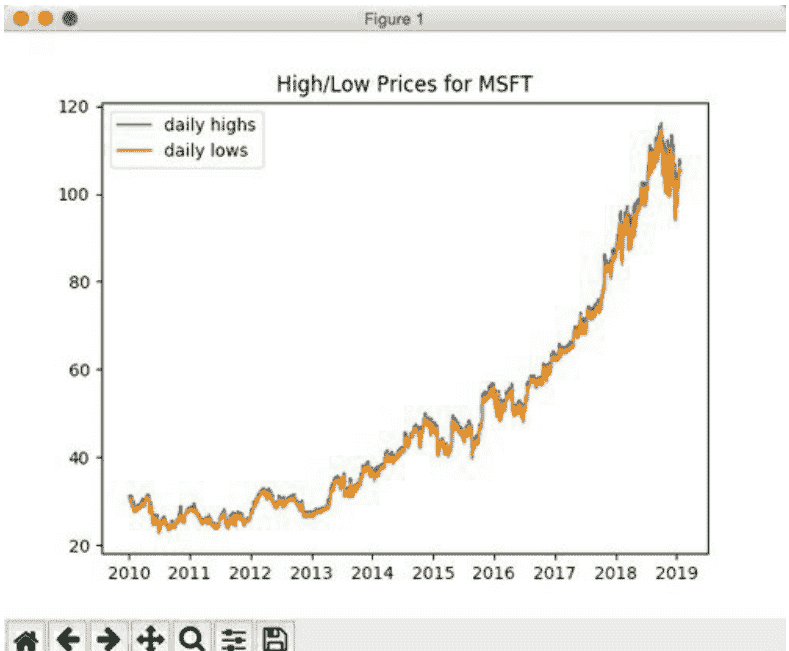
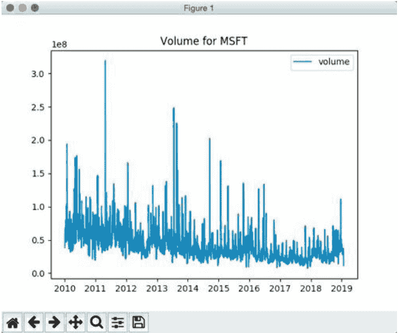
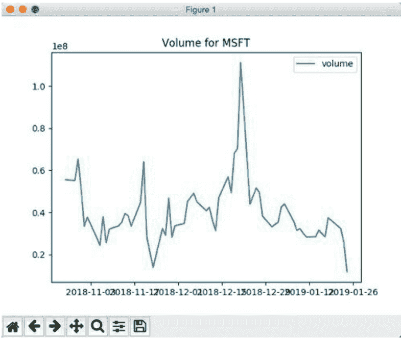
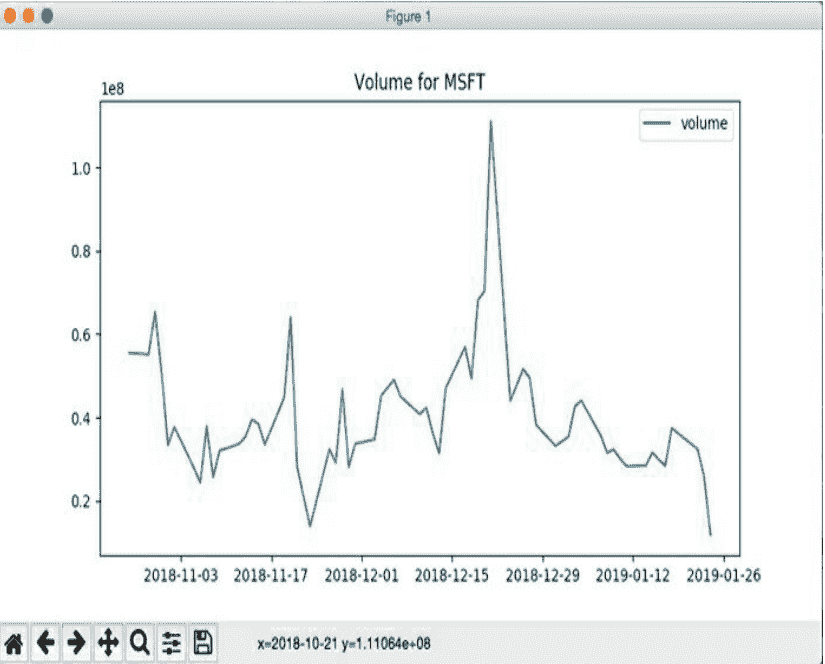
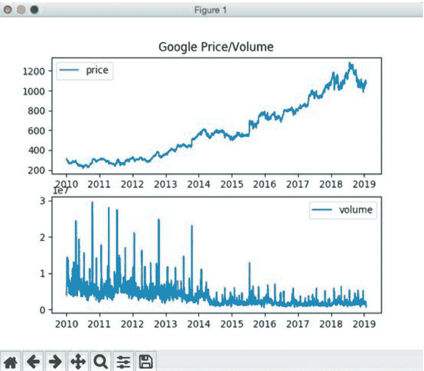

# 15. 从互联网获取财务数据

最后往往是最好的，我们把最好的留到了最后。用 Python 能做的最令人印象深刻的事情之一就是下载财务信息并以多种方式对其进行图表绘制。

本章将前面章节中使用的许多功能结合起来，展示它们的实际用途。你将看到如何去互联网上抓取信息，获取股票市场上的所需信息，并使用这些数据生成彩色图表，显示你喜爱的股票的表现。

这将是一次有趣的旅程。

## 15.1 本章计划

三个模块构成了本章的股票市场应用程序，如表 15.1 所示。这些文件可在 **brianoverland.com/books** 上以可下载形式获得，还有其他文件，包括 RPN 解释器应用程序。

**表 15.1.** 本章使用的模块

| 模块 | 描述 |
|---|---|


| 模块 | 描述 |
|------|------|
| `stock_demo` | 此模块打印菜单，提示用户选择命令并选择股票。 |
| `stock_load` | 从互联网下载数据框。 |
| `stock_plot` | 获取下载的信息并绘制图表。本章开发了该模块的四个版本，最终形成 `stock_plot_v4`。 |

## 15.2 介绍 PANDAS 包

向 **pandas** 包问好。与 **numpy** 类似，它提供了复杂的存储功能。但 **pandas** 还自带一个内置数据读取器，可从互联网获取信息。

在运行本章中的任何代码之前，您需要安装 **pandas** 和 **pandas_datareader**。从 DOS 窗口（Windows）或终端应用程序（Mac）中，逐个输入以下命令。每个命令需要几秒钟才能完成。

Click here to view code image

```
pip install pandas
pip install pandas_datareader
```

如果您在 Macintosh 上运行，请记住，如果 **pip** 不起作用，您可能需要使用 **pip3**：

Click here to view code image

```
pip3 install pandas
pip3 install pandas_datareader
```

我们还假设，由于这在本章中将变得重要，您已经安装了 **numpy** 和 **matplotlib** 包，如第 12 章和第 13 章中所述。但如果没有，您现在应该下载它们。

```
pip install numpy
pip install matplotlib
```

或者，在 Macintosh 环境中，使用以下命令：

```
pip3 install numpy
pip3 install matplotlib
```

请仔细注意 **matplotlib** 的准确拼写，它包含“mat”但不包含“math”。

**pandas** 包创建一个 _数据框_，它类似于用于存储大量信息的简单表格或数据库。数据框有自己的二进制格式。因此，在绘制图表之前，必须将其转换为 **numpy** 格式。以下是执行此操作的语句：

Click here to view code image

```
column = np.array(column, dtype='float')
```

# 15.3 “STOCK_LOAD”：一个简单的数据读取器

现在，让我们使用一个基于 **pandas** 的简单应用程序来读取有用信息。如果您愿意，可以将以下程序输入到文本编辑器中并将其保存为 `stock_load.py`。如果您只是想让它运行，则不需要输入注释（包括文档字符串），照常如此。

Click here to view code image

```
'''File stock_load.py ------------------------------------
Does the work of loading a stock, given its ticker symbol.
Depends on files: None
'''
# pip install pandas_datareader
import pandas_datareader.data as web
def load_stock(ticker_str):
    ''' Load stock function.
    Given a string, ticker_str, load information
    for the indicated stock, such as 'MSFT,' into a
    Pandas
    data frame (df) and return it.
    '''
    df = web.DataReader(ticker_str, 'yahoo')
    df = df.reset_index()
    return df
# Get a data frame (stock_df) and print it out.
if __name__ == '__main__':
    stock_df = load_stock('MSFT') # 'msft' also Ok.
    print(stock_df)
    print(stock_df.columns)
```

假设您可以输入此程序（或从 **brianoverland.com/books** 复制它）并运行它，恭喜您。您刚刚下载了过去 10 年微软股票（MSFT）的信息。

这在小空间内显示的信息太多了，因此 **pandas** 仅显示部分信息，并使用省略号 (...) 表明实际上有更多信息无法显示。以下是示例输出：

Click here to view code image

|    Date    |   High   | ... |   Volume   |   Adj   |
|------------|----------|-----|------------|---------|
| Close      |          |     |            |         |
| 0  2010-01-04 | 31.100000 | ... | 38409100.0 |         |
| 24.720928   |          |     |            |         |
| 1  2010-01-05 | 31.100000 | ... | 49749600.0 |         |
| 24.728914   |          |     |            |         |
| 2  2010-01-06 | 31.080000 | ... | 58182400.0 |         |
| 24.577150   |          |     |            |         |
| 3  2010-01-07 | 30.700001 | ... | 50559700.0 |         |
| 24.321552   |          |     |            |         |
| 4  2010-01-08 | 30.879999 | ... | 51197400.0 |         |
| 24.489288   |          |     |            |         |
| 5  2010-01-11 | 30.760000 | ... | 68754700.0 |         |
| 24.177786   |          |     |            |         |

该程序打印的信息比这里显示的更多；此处显示的输出仅给出了打印的前 10 行。

在打印了微软股票过去 10 年的所有数据后，该程序随后打印数据框本身的结构——具体来说，是一列列的列表。

Click here to view code image

```
Index(['Date', 'High', 'Low', 'Open', 'Close',
 'Volume',
 'Adj Close'], dtype='object')
```

让我们来看看这个应用程序的作用。它以一条导入 **pandas** 数据读取器包的语句开头，以便可以使用短名称 **web** 来引用它。

Click here to view code image

```
import pandas_datareader.data as web
```

该模块的大部分工作由一个函数 `load_stock` 完成，其定义如下：

Click here to view code image

```
def load_stock(ticker_str):
    ''' Load stock function.
    Given a short string, ticker_str, load
    information
    for the indicated stock, such as 'MSFT,' into a
    Pandas
    data frame (df) and return it.
    '''
    df = web.DataReader(ticker_str, 'yahoo')
    df = df.reset_index()
    return df
```

如果您读过第 14 章，可能会记得测试属性 `__name__` 具有特殊用途：它告诉应用程序，如果当前模块正在直接运行（从而使其成为主模块），则执行以下行。

Click here to view code image

```
# Get a data frame (stock_df) and print it out.
if __name__ == '__main__':
    stock_df = load_stock('MSFT') # 'msft' also Ok.
    print(stock_df)
    print(stock_df.columns)
```

调用 `load_stock` 函数，传递微软股票代码（MSFT）。该函数的大部分工作由第三行代码完成。

Click here to view code image

```
df = web.DataReader(ticker_str, 'yahoo')
```

这几乎太简单了。

对于服务器名称，程序使用 yahoo。我们相信该服务器在可预见的未来将继续可靠，但如果有必要，您可以在互联网上搜索另一个金融数据服务器。

下一步是调用 `reset_index` 方法。该方法更新列的索引信息。显然您需要使用这个，但事实证明它是必要的。没有它，本章中的代码都无法工作。

```
df = df.reset_index()
```

最后，数据框被返回到模块级代码。该代码既打印数据框本身，也打印数据框中列的摘要；我们稍后将回到该摘要。

# 15.4 生成简单股票图表

创建股票市场应用程序的下一步是绘制数据——尽管本节将以最小的方式进行，最初不会显示图例、标题或其他信息。

以下是第二个模块 `stock_plot` 版本 1 的内容。

Click here to view code image

```
"""File stock_plot_v1.py ------------------------------
Does the minimum to plot the closing price
of two fixed stocks. Depends on file stock_load.py
"""
import numpy as np
import matplotlib.pyplot as plt
from stock_load import load_stock
def do_plot(stock_df):
    """ Do Plot function.
    Use stock_df, a stock data frame read from the
    web.
    """
    column = stock_df.Close    # Extract
    price.
    column = np.array(column, dtype='float')
    plt.plot(stock_df.Date, column)    # Plot it.
    plt.show()
# Show the
plot.
# Run two test cases.
if __name__ == '__main__':
    stock_df = load_stock('MSFT')
    do_plot(stock_df)
    stock_df = load_stock('AAPL')
    do_plot(stock_df)
```

该模块在第一个模块 `stock_load.py` 的功能基础上构建，通过获取 `load_stock` 函数生成的数据；从数据框中获取所需数据；将其转换为 **numpy** 格式；并绘制图表。

在做任何其他事情之前，需要导入正确的包或模块（或两者）。**numpy** 和 **matplotlib** 包需要像在第 12 章和第 13 章中那样导入。但我们还需要从前一节开发的模块 `stock_load` 中导入 `load_stock`。

Click here to view code image

```
import numpy as np
import matplotlib.pyplot as plt
from stock_load import load_stock
```

从互联网读取数据框后，`do_plot` 函数完成大部分工作。该函数接收一个名为 `stock_df` 的 **pandas** 数据框。

Click here to view code image

```
def do_plot(stock_df):
    """ Do Plot function.
    Use stock_df, a stock data frame read from the
```


此函数用于提取股票价格，在此应用程序中，我们将其作为收盘价来访问——收盘价是数据帧中的一列。

Click here to view code image

```python
column = stock_df.Close    # Extract price.
```

然后，信息被转换为 **numpy** 数组。信息基本上是相同的，只是现在它采用了 **numpy** 格式。此转换是必要的，以确保 **matplotlib** 例程能够成功绘制图表。

Click here to view code image

```python
column = np.array(column, dtype='float')
```

最后，价格信息与 `Date` 列中的信息进行绘图。

Click here to view code image

```python
plt.plot(stock_df.Date, column)    # Plot it.
```

然后显示图表。此应用程序在一行中显示两个图表：一个是微软，另一个是苹果。图 15.1 显示了微软股票的图表。



**Figure 15.1.** 微软股票价格

## 15.5 添加标题和图例

为图表添加标题和图例并不困难。这项任务的一部分——为图表添加标题——之前在第 13 章中已经展示过。要为图表显示标题，只需在调用 `plt.show` 函数之前调用 **title** 函数即可。

### plt.title(title_str)

参数 `title_str` 包含在图表显示时放置在顶部的文本。显示图例是一个两步操作：

- 首先，当你调用 `plt.plot` 方法来绘制特定线条时，传递一个名为 `label` 的命名参数。在此参数中，传递要为相应线条打印的文本。
- 在调用 `plt.show` 函数之前，调用 `plt.legend`（无参数）。

我们通过对 `do_plot` 函数进行更改，然后显示结果来演示如何做到这一点。首先，这是 `do_plot` 的新版本，新行和更改的行以粗体显示。

Click here to view code image

```python
def do_plot(stock_df):
    ''' Do Plot function.
    Use stock_df, a stock data frame read from web.
    '''
    column = stock_df.Close    # Extract price.
    column = np.array(column, dtype='float')
    plt.plot(stock_df.Date, column, label='closing price')
    plt.legend()
    plt.title('MSFT Stock Price')
    plt.show()
```

由于此信息特定于微软，我们暂时不绘制苹果的价格信息。在第 15.8 节中，我们将展示如何将两个股票价格并排绘制。
如果你进行所示更改并重新运行应用程序，将打印出图形显示，如图 15.2 所示。



Figure 15.2. 带有标题和图例的微软股票

## 15.6 编写“MAKEPLOT”函数（重构）

在开发本章的应用程序代码时，我们发现某些语句一遍又一遍地重复。

要成为一名专业程序员——甚至是一名优秀的业余程序员——你应该寻找减少此类代码的方法：将程序中重复且枯燥的部分放入一个可以根据需要随时调用的公共函数中。借助本章中的绘图软件，大部分工作都可以放入一个名为 `makeplot` 的公共函数中，该函数足够灵活，可以以多种方式使用。

此过程称为对代码进行 _重构_。
在本节中，我们将提取一个名为 `makeplot` 的函数。
调用它的代码将不再执行大部分绘图工作，如你在本节后半部分将看到的那样。相反，代码将调用 `makeplot` 并传递以下参数：

- `stock_df`，由 `load_stock` 最初生成的数据帧，然后传递给特定的“绘图”函数
- `field`，你希望绘制的列（或 _属性_）的名称
- `my_str`，要放置在图例中的名称，用于描述图表中特定线条对应的内容，例如图 15.3 中的“MSFT”

本节及后续章节展示了 `do_plot` 函数如何调用 `makeplot` 并传递所需信息。
以下是 `makeplot` 本身的定义。它不做某些事情，例如调用 `plt.plot` 或设置标题，这是有充分理由的，如你将看到的那样。但它完成了其他所有工作。

Click here to view code image

```python
def makeplot(stock_df, field, my_str):
    column = getattr(stock_df, field)
    column = np.array(column, dtype='float')
    plt.plot(stock_df.Date, column, label=my_str)
    plt.legend()
```

让我们回顾一下这些语句。定义中的第一条语句会从数据帧中选择指定的列，使用由内置 `getattr` 函数访问的命名属性。调用者需要将属性（例如 `Close`）作为字符串传入。

定义中的第二条语句将存储在 **pandas** 数据帧中的信息转换为 **numpy** 格式。第三条语句执行实际绘图，使用 `my_str`，这是一个用于图例的字符串，并添加到图表中。

但是 `makeplot` 不会调用 `plt.show`，因为在将所有其他图表放入所需图表之前，不应调用该函数。

定义了 `makeplot` 后，其余代码变得更短。例如，有了 `makeplot`，上一节中的 `do_plot` 函数可以修改为

Click here to view code image

```python
def do_plot(stock_df, name_str):
    makeplot(stock_df, 'Close', 'closing price')
    plt.title(name_str + ' Stock Price')
    plt.show()
```

调用 `makeplot` 后，此函数只需设置标题——我们将其留作灵活操作——然后调用 `plt.show`。`makeplot` 的第二个参数选择要访问的列，第三个参数（`'closing price'`）是要放置在图例中的字符串。

## 15.7 同时绘制两个股票

当你看到图 15.2 时，你可能会说：“苹果电脑股票价格的图表怎么了？我想看看那个！”

我们可以把苹果放回去；事实上，我们可以做得更好。我们可以在同一个图表中显示两个股票价格，并使用图例来澄清哪条线指的是哪家公司。

然而，这需要对模块结构进行重大更改。我们需要修改不止一个函数，以便有一个函数调用来处理两个股票。让我们从模块级代码开始，现在它传递两个股票数据帧而不是一个。

Click here to view code image

```python
# Run test if this is main module.
if __name__ == '__main__':
    stock1_df = load_stock('MSFT')
    stock2_df = load_stock('AAPL')
    do_duo_plot(stock1_df, stock2_df)
```

对于每个股票，都会单独调用 `load_stock`，这样我们就不必修改第一个模块 `stock_load.py`。然后将两个数据帧交给 `do_duo_plot`，以便将两个股票一起绘制，并附带包含两个标签的图例。

Click here to view code image

```python
def do_duo_plot(stock1_df, stock2_df):
    """Revised Do Plot function.
    Take two stock data frames this time.
    Graph both.
    """
    makeplot(stock1_df, 'Close', 'MSFT')
    makeplot(stock2_df, 'Close', 'AAPL')
    plt.title('MSFT vs. AAPL')
    plt.show()
```

这个函数很短，因为它对 `makeplot` 函数（我们在上一节中编写的函数）进行了两次调用，以完成重复且枯燥的工作。为了回顾，这里是 `makeplot` 定义的再次展示：

Click here to view code image

```python
def makeplot(stock_df, field, my_str):
    column = getattr(stock_df, field)
    column = np.array(column, dtype='float')
    plt.plot(stock_df.Date, column, label=my_str)
    plt.legend()
```

请注意内置 `getattr` 函数如何用于获取字符串并访问要显示的列。此函数


在 9.12 节“动态设置和获取属性”中介绍过。在这里，这种技术是一种主要的编码便利。

图 15.3 显示了 `do_duo_plot` 函数的结果。



**图 15.3.** 绘制两只股票：MSFT 与 AAPL

如果你仔细查看代码，应该能发现一个缺陷。“MSFT”和“AAPL”是 _硬编码_ 的。当你想要跟踪的两只股票是微软和苹果时，这没问题。但如果你想查看其他股票——比如说，“IBM”和“DIS”（华特迪士尼公司）呢？

一个良好的设计目标是创建灵活的函数；你应该避免对它们进行硬编码，这样你就不需要大幅修改代码来适应新值。

因此，对于 stock_plot 模块的最新版本——我们将其称为版本 2——我们修改了代码，使 do_duo_plot 函数根据传递给它的股票打印相应的标签和标题。

单击此处查看代码图像

```python
'''File stock_plot_v2.py
------------------------------------

Plots a graph showing two different stocks.
Depends on stock_load.py
'''
import numpy as np
import matplotlib.pyplot as plt
from stock_load import load_stock
def do_duo_plot(stock1_df, stock2_df, name1, name2):
    ''' Do plot of two stocks.
    Arguments are data frames, which, in the symbol
    column,
    contain the ticker string.
    '''
    makeplot(stock1_df, 'Close', name1)
    makeplot(stock2_df, 'Close', name2)
    plt.title(name1 + ' vs. ' + name2)
    plt.show()
# Make a plot: do the boring, repetitive stuff.
def makeplot(stock_df, field, my_str):
    column = getattr(stock_df, field)
    column = np.array(column, dtype='float')
    plt.plot(stock_df.Date, column, label=my_str)
    plt.legend()
# Run test if this is main module.
if __name__ == '__main__':
    stock1_df = load_stock('MSFT')
    stock2_df = load_stock('AAPL')
    do_duo_plot(stock1_df, stock2_df, 'MSFT',
'AAPL')
```

现在，我们可以通过更改相对较少的代码来控制选择的两只股票。例如，以下是如何绘制 IBM 与迪士尼的对比图。

单击此处查看代码图像

```python
stock1_df = load_stock('IBM')
stock2_df = load_stock('DIS')
do_duo_plot(stock1_df, stock2_df, 'IBM',
'Disney')
```

图 15.4 显示了生成的图表，展示了 IBM 与“米老鼠之家”（迪士尼）的对比。



图 15.4. IBM 与迪士尼股票价格图表

以这种方式绘制股票图表有一个注意事项：如果没有彩色打印或彩色显示器的帮助，可能不容易区分各条线。希望，即使在这本书（印刷版）中，各条线之间的差异也能通过对比度不同的阴影显示出来。但如果这不令人满意，你可以尝试的一种方法是为两条线使用不同的样式，如第 13 章所述。

嗯……就像经纪人喜欢说的，过去的表现并不能保证未来的结果。但如果能保证，我们会把钱押在“米老鼠”身上。

## 15.8 变体：绘制其他数据

让我们回过头来，重新审视一下股票市场数据帧中可用的信息。第 15.3 节打印了这些帧的索引。

单击此处查看代码图像

```python
Index(['Date', 'High', 'Low', 'Open', 'Close',
       'Volume',
       'Adj Close'], dtype='object')
```

因此，数据帧提供了七列数据，如表 15.2 所示。

# 表 15.2. “pandas”股票数据帧中的列名

| 列 | 描述 |
|---|---|
| Date | 给定行对应的日期（该行包含一天股票报告的数据）。 |
| High | 当天记录的最高价格。 |
| Low | 当天记录的最低价格。 |
| Open | 该天股票的开盘价——即当天早上交易开始时的价格。 |
| Close | 当天的收盘价——即一天交易结束时的价格。 |
| Volume | 当天卖出的股票数量。对于微软等主要证券，这个数字可达数千万。 |
| Adj Close | 经调整的收盘价。 |

有了这些信息，你可以尝试将不同的列与 `Date` 列进行绘图，`Date` 列保存了每行对应的日期。例如，作为练习，我们可能想要绘制给定股票的每日最高价和最低价。

下面的代码清单——我们将其称为版本 3——为股票生成一个组合的高/低图表。和往常一样，新增和修改的行以粗体显示。

单击此处查看代码图像

```python
'''File stock_plot_v3.py -------------------------------------
---
Plots daily highs and lows for a stock.
Depends on stock_load.py
'''
import numpy as np
import matplotlib.pyplot as plt
from stock_load import load_stock
def do_highlow_plot(stock_df, name_str):
    ''' Do plot of daily highs and lows.
    Use high_price and low_price columns for one
    stock,
    which are passed through a stock data frame
    (stock_df).
    '''
    makeplot(stock_df, 'High', 'daily highs')
    makeplot(stock_df, 'Low', 'daily lows')
    plt.title('High/Low Prices for ' + name_str)
    plt.show()
# Make a plot: do the boring, repetitive stuff.
def makeplot(stock_df, field, my_str):
    column = getattr(stock_df, field)
    column = np.array(column, dtype='float')
    plt.plot(stock_df.Date, column, label=my_str)
    plt.legend()
# Run test if this is main module.
if __name__ == '__main__':
    stock_df = load_stock('MSFT')
    do_highlow_plot(stock_df, 'MSFT')
```

图 15.5 显示了生成的图表，绘制了微软股票的每日最高价和最低价。



# 图 15.5. 绘制微软股票的高低价

我们还能用这些数据做什么？另一个有用的信息是成交量：任何一天卖出的股票数量。这里是另一个绘图函数，新增的行以粗体显示。

单击此处查看代码图像

```python
def do_volume_plot(stock_df, name_str):
    """ Plot the daily volume of a stock passed in
    as a
    data frame (stock_df).
    """
    makeplot(stock_df, 'Volume', 'volume')
    plt.title('Volume for ' + name_str)
    plt.show()
```

当此函数运行并传入 MSFT 的数据帧时，它会生成图 15.6 所示的图表。



**图 15.6.** 股票每日成交量图表

左侧的数字代表的不是百万股，而是数千万股。由于这些数字太大，如果不占用大量屏幕空间就无法打印，因此图表顶部会打印数字 1e8。因此，左侧的数字应解释为 1000 万的倍数，即等于 1e8（10 的 8 次方）。

## 15.9 限制时间段

到目前为止，我们尚未控制图表所覆盖的时间段。如果你想查看股票过去三个月的数据，而不是 10 年的数据，该怎么办？

每一天都标记一个活跃交易日：这包括周一至周五，但不包括节假日。这就是为什么一年大约有 240 个“交易日”，而不是 365 天。按照同样的逻辑，一个月大约是 20 天，三个月大约是 60 天。

需要注意的是，限制数据帧持续时间的技术是使用我们的老朋友——切片。如你在第 3 章中可能记得的，获取字符串、列表或数组最后 N 个元素的表达式是

```
[-N:]
```

我们可以将此操作应用于 pandas 数据帧。其效果是获取最新的 N 行数据，忽略其他所有内容。因此，要将数据帧限制为过去三个月（60 天），你可以使用以下语句：

单击此处查看代码图像

```python
stock_df = stock_df[-60:].reset_index()
```

还会调用 reset_index 方法，因为在这种情况下，保持数据准确是必要的。

当将此语句插入到之前的示例中时，我们将获得给定股票过去三个日历月（60 天）的成交量数据，而不是整年的数据。

单击此处查看代码图像

```python
def do_volume_plot(stock_df, name_str):
    """ Plot the daily volume of a stock passed in
```


作为
数据框(stock_df)。仅绘制最近 60 天的数据。
'''
stock_df = stock_df[-60:].reset_index()
makeplot(stock_df, 'Volume', 'volume')
plt.title('Volume for ' + name_str)
plt.show()

现在，当应用程序运行时，你将只能看到三个月的数据（图 15.7）。



**图 15.7.** 绘制三个月的成交量数据

如你所见，这个图表的问题是，它在 X 轴上给出的是月/年/日期标签，而不是仅月/年，导致日期和时间信息拥挤在一起。

但有一个简单的解决方案。使用鼠标抓取图表框架的侧边，然后将其拉宽。这样做时，X 轴上会腾出空间，使你能够清晰地看到日期和时间数字，如图 15.8 所示。



# 图 15.8. 拉宽图表

使用这个图表，你还可以做更多事情。在这个时间段内，微软股票曾出现过成交量最高的一天。将鼠标指针移动到折线的顶点，你可以看到，这种高成交量发生在 12 月底，当天交易的股票数量超过 110,000,000 股，即一亿一千万股，价值超过 110 亿美元。正如比尔所说，这足以买很多奶酪汉堡。

## 15.10 分割图表：子图绘制成交量

当你能将股票成交量与价格结合起来查看时，成交量会更有趣。如果价格大幅上涨或下跌伴随着小成交量，那么价格变化很可能只是偶然：可能只是当天参与交易的交易者太少。

但价格大幅变化伴随着高成交量则更具实质意义。这意味着价格变化是由许多卖家或买家的行为引起的，他们决心追逐该股票。

因此，我们真正想看到的是一个*分割图表*，一个让我们并排查看价格和成交量的图表。事实证明，绘图包提供了一种简单的方法来实现这一点。你主要需要学习一个新的方法调用。


单击此处查看代码图像

```
plt.subplot(nrows, ncols, cur_row)
```

这个方法调用表示，绘图命令，直到下一次调用`plt.subplot`，仅适用于指定的子图。`nrows`和`ncols`参数指定单独图表的虚拟“行”和“列”的数量；`cur_row`参数指定要处理的网格中的哪一“行”。在这种情况下，我们只有两个网格成员和只有一个虚拟

列。
以下是用于此双图的 Python 代码的一般计划：

单击此处查看代码图像

```
plt.subplot(2, 1, 1) # Do first "row."

# Plot the top half of the graph here.

plt.subplot(2, 1, 2) # Do second "row."

# Plot the bottom half of the graph here.

plt.show()
```

所以子图绘制并不难。我们只需将已知内容插入这个通用方案即可。以下是实现此功能的代码。

单击此处查看代码图像

```
def do_split_plot(stock_df, name_str):
    """ Do Plot function, with subplotting.
    Use stock_df, a stock data frame read from web.
    """

    plt.subplot(2, 1, 1) # Plot top half.
    makeplot(stock_df, 'Close', 'price')
    plt.title(name_str + ' Price/Volume')

    plt.subplot(2, 1, 2) # Plot bottom
    half.
    makeplot(stock_df, 'Volume', 'volume')
    plt.show()
```

这段代码有一个变通之处。只有上半部分应该有标题；下半部分的标题会与上半部分的 X 轴挤在一起。因此，只显示一个标题。
但除此之外，这个示例使用的是看起来熟悉的代码。
图 15.9 使用 GOOGL (Google) 作为选定的股票。



**图 15.9.** GOOGL (Google) 的子图，带有成交量

## 15.11 添加移动平均线

你可以为股票市场报告添加的最有用的内容之一是移动平均线。以下是 180 天（六个月）移动平均线的工作原理。

+   • 从至少有 180 个前置数据点的日期开始。如果你想更早开始，可以使用尽可能多的可用前置日期。
+   • 对此日期之前的所有 180 个日期的收盘价求平均值。这成为移动平均线的第一个点。
+   • 对下一天重复步骤 1 和 2：你现在得到的价格是第二个日期之前的 180 个价格的平均值。
+   • 继续重复这些步骤，以生成一条绘制平均价格的折线图，该线中的每个数据点都对前 180 天的价格求平均。

结果是，如果你忠实地遵循这些步骤，你将得到一条似乎跟随实际价格但（大部分）不精确匹配它的线。相反，它总是滞后于后面，仿佛被过去的遗产所拖累。但这两条线之间的关系很有趣。
一方面，当当前价格突破其移动平均线时，似乎即将出现强劲上涨；反之，当当前价格跌破移动平均线时，这往往是大跌的开始。

> > **注意**
> >
> > 警告：我们不赞同任何特定的投资策略。然而，许多股票分析师和经济学家确实关注移动平均线。

计算移动平均线似乎是计算机的理想工作。事实上，对于 Python 来说，使用我们导入的包，这很容易。**pandas rolling** 函数使你能够为任何给定行获取一组 `n` 个前置行，其中行按时间顺序排列。
然后只需求平均值即可得到我们想要的移动平均线。

要获取此移动平均线，请使用此处所示的函数调用。


单击此处查看代码图像

```
data_set = selected_column.rolling(n,
min_periods=m).mean()
```

selected_column 是 Open、Close 或我们正在使用的任何列。值 n 告诉在平均值中使用多少个过去的天数。min_period（如果你愿意可以省略）说明对于任何给定日期，需要有多少个前置数据点可用，才能成为移动平均线的一部分。

此语句之所以有效，是因为对于每一天，rolling 函数访问 n 个前置行。对这些数据求平均值即可得到我们要找的移动平均值。本质上，rolling 访问 180 行数据以生成一个二维矩阵；然后 mean 方法将这些行合并为一个单一列，该列包含平均值。

例如，以下是针对每一天平均前 180 天的调用：

单击此处查看代码图像

```
moving_avg = column.rolling(180,
min_periods=1).mean()
```

为了使其余代码更容易编写，让我们先修改`makeplot`函数，使其能够容纳一个可选参数来创建移动平均线。对**rolling**的调用必须在`column`仍然是**pandas**列而不是**numpy**列时进行。

单击此处查看代码图像

```
# Make a plot: do the boring, repetitive stuff.
def makeplot(stock_df, field, my_str, avg=0):
    column = getattr(stock_df, field)
    if avg:         # Only work if avg is not 0!
        column = column.rolling(avg,
min_periods=1).mean()
    column = np.array(column, dtype='float')
    plt.plot(stock_df.Date, column, label=my_str)
    plt.legend()
```

请注意，这为`makeplot`提供了一个额外参数`avg`，但该参数实际上是可选的；它有一个默认值 0。

现在让我们绘制一只股票及其 180 天移动平均线，大约对应六个月。像往常一样，新的和修改的行以粗体显示。

单击此处查看代码图像

```
def do_movingavg_plot(stock_df, name_str):
    ''' Do Moving-Average Plot function.
    Plot price along with 180-day moving average
```


Wow, it works!

And it’s clear how to tweak this example. The following statement replaces 180 with 360, thereby doubling the period of averaging so that for any given day, the previous 360 days’ prices are averaged in to produce the moving-average line rather than 180.

Click here to view code image

```
makepot(stock_df,'Close','360 day average',
360)
```

## 15.12 向用户提供选择

要构建可用的应用程序，你需要向用户提供选择，并让他们决定绘制哪些数据。在任何给定的一天，可能会显示成千上万种图表。

最重要的选择是显示信息的股票。这很简单，只需提示用户输入股票代码，例如 IBM、DIS、MSFT 或 GOOGL。

然后，应用程序可以打印过去十年收盘价的简单图表，也可以从菜单中选择打印几种类型的图表之一。你还可以添加一个“退出”命令。

一个合理的起始应用程序设计可能是提供以下菜单：

Click here to view code image

+   0. Quit
+   1. Print simple closing-price graph.
+   2. Print highs and lows.
+   3. Print price/volume subplots.
+   4. Print price with 180-day moving average.

为了支持这些操作，`stock_plot` 模块需要包含几个函数，每个函数执行不同的操作。这只是从之前的部分复制和粘贴代码的问题。
下面的清单显示了 `stock_plot` 模块的最终版本。

> Click here to view code image

```
# file stock_plot_v4.py ----
---
import numpy as np
import matplotlib.pyplot as plt
from stock_load import load_stock
def do_simple_plot(stock_df, name_str):
 """ Do Plot function.
 Plot a simple graph of closing price.
 """
 makeplot(stock_df,'Close', 'closing price')
 plt.title(name_str + ' Stock Price')
 plt.show()
def do_highlow_plot(stock_df, name_str):
 """ Do High/Low Plot function.
 Plot both highs and lows for stock, then show.
 """
 makeplot(stock_df, 'High', 'daily highs')
makeplot(stock_df, 'Low', 'daily lows')
plt.title('High/Low Graph for ' + name_str)
plt.show()

def do_volume_subplot(stock_df, name_str):
    """ Do Volume Subplot function.
    Plot closing price and volume subplots.
    """
    plt.subplot(2, 1, 1)      # Plot top half.
    makeplot(stock_df, 'Close', 'price')
    plt.title(name_str + ' Price/Volume')
    plt.subplot(2, 1, 2)      # Plot bottom
    half.
    makeplot(stock_df, 'Volume', 'volume')
    plt.show()

def do_movingavg_plot(stock_df, name_str):
    """ Do Moving-Average Plot function.
    Plot price along with 180-day moving average
    line.
    """
    makeplot(stock_df,'Close', 'closing price')
    makeplot(stock_df,'Close', '180 day average',
    180)
    plt.title(name_str + ' Stock Price')
    plt.show()

# Do the boring, repetitive stuff.
def makeplot(stock_df, field, my_str, avg=0):
    column = getattr(stock_df, field)
    if avg:      # Only plot avg if not 0!
        column = column.rolling(avg,
    min_periods=1).mean()
    column = np.array(column, dtype='float')
    plt.plot(stock_df.Date, column, label=my_str)
    plt.legend()

if __name__ == '__main__':
    name_str = 'GOOGL'
stock_df = load_stock(name_str)
do_movingavg_plot(stock_df, name_str)
do_simple_plot(stock_df, name_str)
do_volume_subplot(stock_df, name_str)
do_highlow_plot(stock_df, name_str)
```

现在还需要编写一个模块，提示用户选择，然后调用相应的函数。该模块将提示输入股票代码，然后——如果找到了相关股票——要求进行菜单选择。

我们本可以从一个不尝试捕获异常（运行时错误）的版本开始，但考虑到可能出错的所有情况（连接不佳、输入无效的股票代码），添加错误检查（即异常处理代码）后，这个应用程序会更加有用。错误检查对于许多类型的应用程序都是一件好事，但在这种情况下，它是必不可少的。

以下应用程序通过重新提示用户，直到成功或直到用户输入空字符串来处理错误，在这种情况下，应用程序会优雅地终止。如第 8 章所示，根据需要进行重新提示，因为异常处理和 while 循环的结合。循环永远不会退出，直到函数返回；异常处理的一个副作用是跳转到 except 语句，然后（作为结果）再次从循环顶部开始。

Click here to view code image

```
# file stock_demo.py ------------------------------------
from stock_plot_v4 import *
menu_str = ('Menu choices:\n' +
'0. Exit\n' +
'1. Simple Plot of Prices\n' +
'2. Plot of Daily High/Low Prices\n' +
'3. Plot of Price with Volume Subplot\n' +
'4. Price plus Moving Average\n')
prompt_msg = 'Enter stock symbol (ENTER to exit): '
def main():
    while True:
        # Prompt and re-prompt user until a valid
        stock
        # symbol is entered OR user exits.
        try:
            s = input(prompt_msg)
            s = s.strip()
            if not s:        # On empty string,
                exit.
                return
            stock_df = load_stock(s)
            n = int(input(menu_str + 'Input choice:
'))
            if n < 0 or n > 4:
                n = 0
            if n == 0:
                return
            fn = [do_simple_plot, do_highlow_plot,
                  do_volume_subplot, do_movingavg_plot]
            [n-1]
            fn(stock_df, s)
        except:
            print('Couldn\'t find stock. Re-try.')
main()
```

这里采用的技术之一是使用开放括号来启用行延续，帮助创建多行字符串，`menu_str`。

另一种技术是索引函数名称列表（可调用对象）并调用相应的命令。还有其他方法可以达到同样的效果——最明显的方法是使用一系列 `if/elif` 语句——但这里使用的技术紧凑且高效。

这个模块的一个有趣之处在于，它调用了 `load_stock` 函数，尽管该函数既未定义在本模块中，也未定义在它直接导入的模块 `stock_plot_v4.py` 中。但该模块导入了 `stock_load.py`。因此，`stock_demo` 间接导入了 `stock_load`。

还有许多可能的改进，但这些留给了章末的建议问题。

# 第 15 章总结

在这本书中，我们已经走得很远了。在第 1 章中，我们的 Python 程序展示了几个打印一些值的语句。然后，仍在第 1 章中，我们使用 Python 打印了诸如斐波那契数之类的复杂序列。但是，在本章及之前的章节中，我们添加了列表、矩阵和复杂数据框等 Python 对象。

能够从互联网上获取信息，将其加载到数据框和数组中，最后将其绘制出来，这真是太棒了。图形编程是你可以掌握的最具挑战性的任务之一，但得益于其包，Python 将问题减少到仅几行代码。甚至在第 13 章中也涉及了三维图形。

所以，如果我们问“Python 有什么用？”答案是“任何事情，只要有人为它编写了包！”

还有其他一些关于这门语言的事情可以说。在大多数程序中你最常想做的事情——获取用户输入，然后将输入分解为单词、短语和数字——在 Python 中得到了极好的支持。而正则表达式包将这些能力提升到了更高的水平。

Python 在列表、字符串、字典和集合方面的内置能力非常强大，以至于最大的挑战之一就是了解你拥有的所有选项。你可以很长一段时间都没有意识到集合是自排序的，或者你可以在不编写循环的情况下获取列表的总和。学习每个 Python 快捷方式可能需要一段时间。我们写这本书，部分目的就是为了缩短你掌握这种丰富语言所需的时间。

Python 也存在偶尔的危险，你在沿着 Python 河流顺流而下时可能会遇到的危险弯道。我们也在本书中尝试解决了大部分这些问题，所以当你最终与 Python 面对面时，你会发现它不是草丛中的蛇，而是一个新朋友和伙伴。

# 第 15 章复习


## QUESTIONS

- 1 Is there any difference between a **numpy** array and a **pandas** data frame? If there is, how do you convert between the two?

- 2 What things can go wrong when a user enters a stock-ticker symbol, and how should you respond?

- 3 Name some of the plotting methods used to create a stock-market chart.

- 4 In a stock-market chart, why is it important to print a legend? (Note: We’re not talking about Hercules, King Arthur, or Batman.)

- 5 How do you restrict the duration of a **pandas** data frame so that it covers less than a year’s time?

- 6 What is a 180-day moving average?

- 7 Did the final example in this chapter use “indirect” importing? If so, how, exactly?

## CHAPTER 15 SUGGESTED PROBLEMS

1 A desirable feature of our stock demo program would be to enable the user to specify the period of the moving-average line. That period has been set to 180 working days (equivalent to six months), but the program should provide adjustment of this time period as one option. You can, if you want, start out with a default of 180 days. But the user should be able to adjust this.

2 It would also be desirable to retain the stock-market selection until it is changed. If the user enters a blank string at the beginning, that should indicate a desire to exit the program. But subsequently, entering a blank line in response to the stock-market ticker prompt should cause the program to continue using the stock already selected.

3 Yet another desirable feature would be to enable the user to enter any number of stock-market ticker symbols (assuming they are all valid) and then graph all the stocks referred to. (Hint: To implement this feature, you might create a list of such symbols and pass it to one or more `for` loops that would get a data frame for each stock and then pass all that data to a function that plotted each and every stock, before showing the entire graph.)

## A. Python Operator Precedence Table

Operators in Python expression are evaluated in the order shown in Table A.1 for Python 3.0.

### Table A.1. Python Operators by Precedence

| Operator | Description |
|---|---|
| _func_(_args_) | Function call |
| _collection_[_begin : end : step_] | Slicing |
| _collection_[_index_] | Indexing |
| _object_.attribute | Property or member access |
| _num_ ** _num_ | Exponentiation |
| ~_int_ | Bitwise NOT |
| +num, -num | Plus/minus sign |
| *, /, %, // | Multiplication, division, remainder division, integer division (when operation is between two numbers); also multiplication of lists and strings: list * n |
| +, - | Addition and subtraction (when operation is between two numbers); also str + str produces string (or list) concatenation |
| int << n, int >> n | Left and right bit shifts |
| int & int | Bitwise AND |
| int ^ int | Bitwise XOR |
| int \| int | Bitwise OR |
| in, not in, is, is not, <, <=, >, >=, !=, == | Comparisons; each produces Boolean value (true/false) |
| not vala | Boolean NOT |
| val and vala | Boolean AND |
| val or vala | Boolean OR |

a. The _val_ may be almost any kind of value; Python will apply the operation `bool()` to convert before applying to conditionals— within, say, `if` or `while`. See notes that follow.

**Other notes:**

1. Where operators are at the same level of precedence, they are evaluated left to right.

2. Parentheses override precedence rules.

3. The special symbol = (not to be confused with ==, which is test for equality) is part of assignment-statement syntax and is not an operator.

4. With combined assignment-operator symbols (+=, *=, /=, etc.), the entire expression on the right is evaluated and then the assignment is carried out, regardless of precedence. For example, if x starts out as 12, then the statement x /= 3 + 9 sets x to 1, but the statement x = x / 3 + 9 sets x to 13.

5. Assignment-operator symbols include +=, -=, *=, /=, //=, **=, <<=, >>=, &=, ^=, |=. In each case, x op= y is equivalent to x = x op y; but note 4 applies.

6. As mentioned in Chapter 4, the Boolean operators apply short-circuit logic. If the first operand is true, the operator `and` returns the second operand. If the first operand is false, the operator `or` returns the second operand. Otherwise, the first operand is returned without evaluating the second operand.

7. To determine whether a value behaves as true or false, Python applies a Boolean conversion, **bool()**. For numeric values, zero is “false.” For collections, an empty string or collection is “false.” For most types, **None** is “false.” In all other cases, the value behaves as if “true.” (Comparisons, such as n > 1, always return **True** or **False**, which are fixed values.)

By combining the last two rules, you should be able to see why Python responds as follows:

```
>>>print(None and 100)
None
>>>print(None or 100)
100
>>>print(not(''))
True
```

8. &, -, ^, and | have specialized uses with set objects, as intersection, difference, symmetric difference, and union, respectively.

## B. Built-In Python Functions

In this appendix, square brackets in the syntax displays are not intended literally but indicate optional items.

The argument type *iterable* appears many times in this appendix. An *iterable* may be a collection, such as a string, list, or tuple, or any object whose class implements an `__iter__` method. Generators and ranges are also iterables.

Some of the functions (such as `min` and `max`) require a sequence or group of arguments to be *sortable*. To be sortable, a less-than operator (`<`) must be successfully applied to every combination of objects in the sequence.

### Table B.1. Most Commonly Used Built-In Functions

| To do the following task: | Call these function(s): |
|---|---|
| Convert between ASCII and character format | `ch`, `ord` |
| Convert to `binary`, `oct`, `hex` string display | Call function of the same name. |
| Convert to `bool`, `bytes`, `complex`, `float`, `int`, `str`, `set`, or `list` data-object type. | Call function of the same name. |

| Description | Function |
|---|---|
| Divide, with modular division | `divmod` |
| Format an object to be printed | `format` |
| Generate a sequence of integers | `range` |
| Get absolute value | `abs` |
| Get input string from end user | `input` |
| Get length of a collection | `len` |
| Get type of object | `type`, `isinstance` |
| Get maximum from two or more values | `max` |
| Get minimum from two or more values | `min` |
| Merge two or more sequences | `map`, `zip` |
| Open a disk file for reading or writing | `open` |
| Print or display a series of values | `print` |
| Produce a sorted or reversed version of a collection | `sorted`, `reversed` |
| Round a fractional amount | **round** |
| Sum the elements of a collection | **sum** |

## ABS(X)

Returns the absolute value of the numeric argument x. The result is nonnegative; so negative arguments are multiplied by −1. In the case of a **complex** argument, the function returns the length of the real or imaginary vector as a non-negative, real-number result. The function uses the Pythagorean Theorem to find this value. For example:

```
>>> c = 3+4j
>>> abs(c)
5.0
```

In fact, this combination of features—using `abs` on a **complex** number—is a convenient shortcut for invoking the Pythagorean Theorem!

## ALL(ITERABLE)

Returns **True** if all the elements generated by _iterable_ are “true”—that is, they produce **True** after a **bool** conversion is applied. In general, non-zero values and non-empty collections evaluate as true. For example:

```
>>> all([1, 2, 4])
True
>>> all([1, 2, 0])
False
```

## ANY(ITERABLE)

Returns **True** if at least one of the elements in _iterable_ is “true,” after a **bool** conversion is applied to each item. Remember that non-zero values and non-empty collections evaluate as “true.” For example:

```
>>> any([0, 2, 0])
True
>>> any([0, 0, 0])
False
```

## ASCII(OBJ)

Produces an ASCII-only representation of the object, _obj_, returning it as a string. If non-ASCII characters are found in the output string, they are translated into escape sequences.

## BIN(N)

Binary-radix conversion. Returns a string containing a binary-radix representation of integer _n_, including the `0b` prefix. Inputs other than integer will cause Python to raise a **TypeError** exception.

For example:


## BOOL(OBJ)

布尔转换。这是一个重要的转换，因为它会被 `if` 和 `while` 语句以及 `filter` 函数根据需要隐式调用。

该函数根据 _obj_ 的值返回 `True` 或 `False`。每个类都可以通过实现 `__bool__` 方法来决定如何评估此函数；但否则，默认行为是返回 `True`。Python 类倾向于遵循以下一般准则。如果对象包含以下任何内容，则通常转换为 `True`：

- 非零数值。（对于复数，这是 `0+0j` 以外的任何值。）
- 非空集合，包括非空列表和字符串。

通常转换为 `False` 的对象包括：

- 任何等于零的数值
- 零长度的集合或序列，或零长度字符串
- 特殊值 `None`

例如：

```
>>> class Blah() :
 pass
```

```
>>> b = Blah()
>>> b.egg = 0
>>> bool(b)
True
>>> bool(b.egg)
False
```

在这种情况下，对象 `b` 自动转换为 **True**，因为类未定义 `__bool__` 方法，但 `b.egg` 等于 0，因此为 **False**。

## BYTES(SOURCE, ENCODING)

字节字符串转换函数。将源（通常是字符串）转换为 `bytes` 字符串，其中每个元素的字节值在 0 到 255 之间（包含 0 和 255），并存储在单个字节中。在 Python 3.0 中，Python 字符串通常使用 Unicode 或 UTF-8 表示，因此普通字符串每个字符可能占用多个字节。因此，如果需要每个字符占用一个字节，则需要将普通字符串转换为 `bytes` 字符串。

例如：

```
>>> bs = bytes('Hi there!', encoding='utf-8')
>>> bs
b'Hi there!'
```

## CALLABLE(OBJ)

如果对象 _obj_ 可以作为函数调用，则返回 **True**。真值表示以下一项或多项：_obj_ 是函数名、由函数定义创建，或是实现 `__call__` 的类的实例。

## CHR(N)

返回一个字符的字符串，该字符的 Unicode 值为 _n_。此范围的下半部分包括 ASCII 字符。这是 **ord** 函数的逆函数。此函数的定义域为 0x10FFFF。超出该范围的 _n_ 值会引发 **ValueError**。

例如：

```
>>> chr(97)
'a'
```

## COMPILE(CMD_STR, FILENAME, MODE_STR, FLAGS=0, DONT_INHERIT=FALSE, OPTIMIZE=-1)

**compile** 函数接受一个包含表达式、语句或代码块（取决于 _mode_）的字符串，并返回一个代码对象，然后可以通过调用 **eval** 或 **exec** 函数来执行。_mode_str 字符串包含 'exec'、'single' 或 'eval'，分别用于编译模块、单个语句或表达式。

因为它允许执行任意 Python 代码字符串，通过 **exec** 给外部人员访问会造成重大安全漏洞。一般来说，除非有非常充分的理由使用它，否则应避免使用。但下面是一个简单的演示：

```
>>> command_str = '''
pi = 3.141592
print('pi/2 = ', pi/2)
'''
>>> cmd = compile(command_str, 'my_mod', 'exec')
>>> exec(cmd)
pi/2 = 1.570796
```

有关更多信息，请搜索在线帮助。请记住，很少有人应该使用此函数。如果执行任意用户输入的字符串，您将交出程序和系统中一切的控制权。

## COMPLEX(REAL=0, IMAG=0)

复数转换。_real_ 和 _imag_ 参数均为可选，且每个参数的默认值均为 0。给定数值输入（与字符串输入相反，字符串输入将在下一条目中解释），函数将执行以下操作：

- 将 _imag_ 参数乘以 1j——即乘以虚数 _i_。
- 将其加到 _real_ 参数上。
- 如果需要，通过添加或减去 `0j` 来确保结果是复数。（这通常由前两条规则得出。）

这些简单的规则涵盖了转换的所有内容。例如，默认情况下返回零值复数：

```
>>> complex()
0j
```

您也可以仅为实部提供参数，创建一个包含 `0j` 的值，以指示其作为复数而非实数的状态。

```
>>> complex(5.5)
(5.5+0j)
```

使用此转换的最常见方法是为每个参数使用实数或整数。

```
>>> complex(3, -2.1)
(3-2.1j)
```

您也可以仅为第一个参数指定复数参数，转换将原样返回该数字。

```
>>> complex(10-3.5j)
(10-3.5j)
```

此函数的一个特点是，您可以为两个参数都指定复数！前面概述的规则仍然适用。在以下示例中，_imag_ 参数为 5j。像往常一样，它乘以 1j，结果为 5j * 1j = -5。然后将该值加到 _real_ 参数 1 上，以产生 -4。

```
>>> complex(1, 5j)
(-4+0j)
```

## COMPLEX(COMPLEX_STR)

复数转换接受一个形如 ' a+bj ' 的单个字符串参数——但它不能有内部空格，且不允许第二个参数。可选的括号可以围绕 a+bj。例如：

```
>>> complex('10.2+5j')
(10.2+5j)
>>> complex(' (10.2+5j) ')
(10.2+5j)
```

此函数接受有效复数的字符串，即使该数字只有实部或只有虚部。即使没有非零虚部，结果中也始终会存在 0j。例如：

```
>>> complex('2')
(2+0j)
>>> complex('3j')
3j
```

此函数的另一个特点是，_complex_str 是唯一可以使用 `j` 代替 `1j` 的上下文；通常，数字必须与 `j` 结合，以将其与名为 `j` 的任何变量区分开。

```
>>> complex('1+j')
(1+1j)
```

> 注意
> 有可能生成使用 `-0j` 而不是通常的 `+0j` 的值。例如，`complex(1, -1j)` 生成 `(2-0j)`，尽管 `complex(2, 0)` 生成 `(2+0j)`。两个结果可以用 `==` 成功比较，但不能用 `is` 比较。这种现象源于浮点表示包括符号位；`0.0` 和 `-0.0` 是不同的对象，即使数值相等。

另请参见前一条目中的 `complex`。

## DELATTR(OBJ, NAME_STR)

删除属性函数。从对象 `obj` 中删除一个属性，其中 _name_str 是包含属性名称的字符串。例如：

```
my_dog.breed = 'St Bernard'
...
a_str = 'breed'
delattr(my_dog, a_str)
```

执行此语句后，对象 `my_dog` 不再具有 'breed' 属性。

如果 `obj` 在删除前不具有指定的属性，则会引发 `AttributeError` 异常。另请参见 `hasattr` 和 `setattr` 函数。

## DIR([OBJ])

目录函数。返回可选参数 _obj_ 的属性列表。如果此对象是类，则显示类的所有属性。如果对象不是类，则获取对象的类并显示该类的所有属性。

如果省略此参数，`dir` 返回当前上下文（当前函数或模块）的属性列表。例如：

```
dir()   # 获取模块的属性
```

或者，在函数定义内部：

```
def demo():
    i = 1
    j = 2
    print(dir())
```

调用 `demo` 将打印以下内容：

```
['i', 'j']
```

看似无害的 `print(dir(i))` 将打印一个相当长的列表，因为 `i` 是整数，而整数类（`int`）有相当长的属性列表。此类调用的输出与以下内容相同：

```
print(dir(int))
```

## DIVMOD(A, B)

将 _a_ 除以 _b_，然后返回一个元组，包含 a/b（向下舍入到最接近的整数）以及结果 a % b（余数）。此函数通常与整数一起使用。例如：

```
quot, rem = divmod(203, 10) # 结果是 20，
余数 3
```

参数 _a_ 和 _b_ 中的一个或两个可以是 **float** 值；但在这种情况下，两个返回值都将是浮点格式。商将没有小数部分，但余数可能有。例如：

```
>>> divmod(10.6, 0.5)
(21.0, 0.09999999999999964)
```

在这种情况下，结果元组应为 `(21.0, 0.1)`，但存在一个小的舍入误差，这在浮点值中可能发生。您可以使用 **round** 函数来帮助纠正它。

## ENUMERATE(ITERABLE, START=0)

枚举。接受一个 _iterable_ 作为输入并返回一个


sequence of tuples, each having the form

```
`number, item`
```

Here, _number_ is an integer in a sequence beginning with _start_ (0 by default) and increasing by 1 in each position; and _item_ is an item produced by the _iterable_.

For example, if you want to take a list of strings and print each along with a sequential number, you could use the following loop:

Click here to view code image

```
beat_list = ['John', 'Paul', 'George', 'Ringo']
for n, item in enumerate(beat_list, 1):
    print('%s. %s' % (n, item))
```

This prints

```
1. John
2. Paul
3. George
4. Ringo
```

The value produced by the **enumerate** function, by the way, is an “enumerate” object, which can be used in a **for** statement, and can also, like other iterables, be turned into a list or tuple if desired. In this example, which starts with 1, the enumeration object produces tuples in this sequence:

Click here to view code image

```
`(1, item0), (2, item1), (3, item2)...`
```

If you want to print this iterable, you need to convert it to a list, or else use a `for` loop to step through it, as was done here.

## EVAL(EXPR_STR [, GLOBALS [, LOCALS]])

Evaluates the Python expression contained in `expr_str`. Although this can be a way to write more compact code, it’s potentially dangerous if you evaluate arbitrary input strings input by the user, unless the app is for your own use only.

The following example evaluates a Python expression and returns the result.

```
>>> a = 100
>>> eval('3 * a + 55')
355
```

The string must contain an expression and not a statement. Therefore, assignment statements cannot be used. However, expressions can contain function calls, and function calls, in turn, can execute statements.

One way to reduce the dangers of `eval` is to prevent access to symbols. The `globals` argument, by default, gives the setting for local symbols as well. Setting this argument to an empty dictionary prevents access to symbols. (But note that built-in functions are always accessible.)

[Click here to view code image]

```
>>> eval('3 * 100 + 55', {}) # This is fine.
355
>>> eval('3 * a + 55', {}) # ERROR; 'a' not
defined
```

One way to bulletproof your code is to create a dictionary
containing the symbols you want to be accessible; then give that
dictionary as the `globals` argument:

> Click here to view code image

```
>>> from math import *
>>> a = 25
>>> dict_1 = {'tan': tan, 'radians': radians, 'a': a
}
>>> eval('1000 * tan(radians(a))', dict_1)
176.326980708465
```

The effect is to create a dictionary that restricts the `eval` statement to recognize only two functions (**tan** and **radians**) and one variable (`a`).

The _locals_ argument isn’t used much, but you can use it to restrict access to local symbols only. In that case, it won’t usually permit access to functions.

> Click here to view code image

```
eval('a * a + 100', {}, locals())
```

> Note
> Although you can use the arguments to try to make `eval` safer, you can never fully bulletproof this usage if your application should happen to take an arbitrary string

from the user and evaluate it. There are ways hackers can take advantage of such
code to bring down a system. So again, take care.

## EXEC(OBJECT [, GLOBAL [, LOCALS]]))

See the **compile** and **eval** functions. The **compile** and **exec**
functions are used by only the most advanced programmers.
You should usually avoid this function because of the large
security risks it can create.

Except for the few people who need it, this function is a
classic case of overkill. Proceed at your own risk.

## FILTER(FUNCTION, ITERABLE)

Generates a filtered sequence of values. Each item in the
*iterable* is passed to *function* in turn. This, argument,
*function*, should take one argument and return **True** or
**False**.

If **True** is returned for a given element, the element gets
included in the sequence generated by **filter**. Otherwise, the
item is omitted.

In this next example, only negative numbers get included in
the results. Other values get filtered out.

Click here to view code image

```
def is_neg(x):
    return x < 0
```

```
my_list = [10, -1, 20, -3, -2.5, 30]
print(list(filter(is_neg, my_list)))
```

The result produced by **filter** is a kind of iterable. You can convert it to a list if desired and print it; so the last of the lines just shown prints the following:

```
[-1, -3, -2.5]
```

The _function_ argument may optionally be **None**. In that case, the items included in the result are those that evaluate to **True** when the **bool** conversion is applied. (Generally, any non-zero value or non-empty collection evaluates as true.)

## FLOAT([X])

Floating-point conversion. If the optional argument _x_ is specified, the result of converting the value to floating point is returned. Types that may be successfully converted to floating point include numeric types (such as integers) and strings containing a valid representation of a floating-point number.

Strings can include numeric representations such as `'4.105'`, `'-23E01'`, and `'10.5e-5'`. Positive and negative infinity can also be represented as `'Infinity'`, `'-Infinity'`, `'inf'`, and `'-inf'`.

> Click here to view code image

```
n = 1
yyy = float(n)    # Assign 1.0 to yyy.
amt = float('-23E01')  # Assign -23E01 to amt.
```

If no argument is specified, the value 0.0 is returned. Note that the square brackets, in this case, indicate that the argument, x, is optional.

Click here to view code image

```
amt = float()   # Assign 0.0 to amt.
```

## FORMAT(OBJ, [FORMAT_SPEC])

Format-string function, using the extended syntax for formatting described in Chapter 5, “Formatting Text Precisely.” If the optional _format_spec_ argument is specified, that argument is interpreted as a _spec_ formatting code, as described in Chapter 5. Otherwise, the object is translated into its standard __str__ representation. In either case, a string is returned.

For example:

```
>>> format(1000000, ',')
'1,000,000'
```

The _format_ method of the string class (_str_) calls this function once for each embedded print field. The result is to call the object’s __format__ method if it’s defined, or (by default) its __str__ method.

## FROZENSET([ITERABLE])

Returns a _frozenset_ object, which is an immutable version of the _set_ type. Note the use of parentheses in the following

example, indicating that the argument is a tuple.

Click here to view code image

```
>>> frozenset((1, 2, 2, 3, 3, 4, 1))
frozenset({1, 2, 3, 4})
```

If the _iterable_ argument is omitted, this function returns
an empty **frozenset**.

## GETATTR(OBJ, NAME_STR [,DEFAULT])

Get-attribute function. Returns the value of the named attribute
for the object, _obj_; this value may have any type. The
_name_str argument is a string containing the attribute. If the
attribute does not exist, the default value is returned; but if the
named attribute does not exist and there’s no default value, an
**AttributeError** exception is raised.

The following example assumes that a Dog class exists.

```
>>> d = Dog()
>>> d.breed = 'Bulldog'
>>> attr_name = 'breed'
>>> getattr(d, attr_name)
'Bulldog'
```

_See also_ **delattr**, **hasattr**, and **setattr**.

## GLOBALS()

Returns a data dictionary, giving the names and values of global

variables for the module that's currently executing.

## HASATTR(OBJ, NAME_STR)

Returns **True** if the object, _obj_, has the attribute specified in _name_str. The following example assumes that _my_dog is an instance of a class, such as Dog:

```
>>> my_dog.breed = 'Husky'
>>> nm = 'breed'
>>> hasattr(my_dog, nm)
True
```

## HASH(OBJ)

Returns a hash value for the specified object, _obj_. This hash value is used by data dictionaries; as long as such a value is provided, the object, _obj_, can be used as a key. Classes whose objects do not support this function are not “hashable” and therefore cannot be used as dictionary keys.

This function is implemented by calling the __hash__ method of the object’s class. See Chapter 9 for more information.

Very rarely is there any reason to call hash or __hash__ directly, except for testing purposes. The most important thing to remember is that if you write a class and want it to serve as a type that can be used as a key, then be sure to implement the __hash__ magic method.

## HELP([OBJ])


## HEX(N)

十六进制转换。返回包含整数 _n_ 的十六进制（基数 16）表示的字符串，包括前缀 `0x`。非整数输入会导致 Python 引发 `TypeError` 异常。

例如：

```
>>> hex(23)
'0x17'
```

## ID(OBJ)

返回对象 `obj` 的唯一标识符。如果两个变量（`obj1` 和 `obj2`）具有相同的标识符，则表达式 `obj1 is obj2` 返回 `True`——这意味着它们引用内存中的同一个对象。（注意：不要将其与相等性测试 `==` 混淆，后者是一种限制较少的条件。）

## INPUT([PROMPT_STR])

输入函数。在等待用户输入零个或多个字符并按下回车键后，返回用户输入的字符串。如果指定了 _prompt_str_，则打印一个用于提示用户的字符串，例如“Enter name here: ”。此提示字符串后不会自动打印额外的空格，因此你可能需要自行提供。例如：

Click here to view code image

```
my_name = input('Enter your name, please: ')
my_age = int(input('Enter your age, please: '))
```

## INT(X, BASE=10)

整数转换函数。该函数接受一个数值或包含有效整数表示的字符串，然后返回实际的整数值。如果包含 *base* 参数，则决定如何解释作为参数给出的数字字符串；默认情况下假设十进制基数（基数 10），但也可以使用其他基数，例如 2（二进制）、8（八进制）或 16（十六进制）。例如：

```
>>> int('1000', 16)
4096
```

对于第一个参数，你可以指定另一种数值类型的对象，例如 *float*。*int* 转换会截断小数部分。例如：

```
>>> int(3.99), int(-3.99)
(3, -3)
```

要使用不同的舍入方案四舍五入到最接近的整数（或任何有效位数），请参见 **round** 函数。

## INT()

用于空参数列表的 `int` 转换函数。此版本的 `int`，在未指定任何参数的情况下，返回整数值 0。

_另请参见_ 先前的 `int` 条目。

## ISINSTANCE(OBJ, CLASS)

如果对象 _obj_ 是指定的 _class_ 或从该类派生的任何类型的实例，则返回 **True**。通常建议使用此函数而不是 **type** 函数。（第二个参数也可以是类型元组。在这种情况下，如果对象是任何指定类的实例，则此函数返回 **True**。）

## ISSUBCLASS(CLASS1, CLASS2)

如果 _class1_ 是 _class2_ 的子类或两个参数是同一个类，则返回 **True**。如果 _class1_ 不是类，则引发 **TypeError** 异常。与 `isinstance` 类似，第二个参数也可以是类型元组。

例如：

Click here to view code image

```
>>> class Floopy(int):
 pass

>>> f = Floopy()
>>> issubclass(Floopy, int)
True
>>> issubclass(int, Floopy)
False
>>> issubclass(int, int)
True
>>> issubclass(f, int) # TypeError: f is not a class
```

## ITER(OBJ)

迭代函数。此函数调用假设 _obj_ 是可迭代对象——即返回迭代器的对象。这包括标准集合和序列，以及生成器。

如果参数不是可迭代对象，则调用 `iter(obj)` 会导致引发 **TypeError** 异常。如果 _obj_ 是可迭代对象，则对 `iter` 的调用应返回一个迭代器对象。此类对象通过响应 `next` 来执行对一系列值的实际遍历。

几个示例应该能澄清这一点。首先，如果对象不是可迭代对象，则不能合法地调用 `iter(obj)`。例如：

Click here to view code image

```
>>> gen = iter(5) # This raises a TypeError
```

但是，如果目标对象是列表，则调用是有效的，即使（如本例所示）它是仅包含单个成员的短列表。

```
>>> gen = iter([5])
```

当然，更常见的是在包含至少两个成员的较长列表上使用 `iter`。返回的对象（称为迭代器或生成器对象）随后可以与 `next` 一起用于一次访问一个值的流。例如：

Click here to view code image

```
>>> gen = iter([1, 2, 3])
>>> next(gen)
1
>>> next(gen)
2
>>> next(gen)
3
>>> next(gen)    # StopIteration exception raised.
```

`iter` 函数的效果是调用可迭代对象类（如集合或生成器）中的 `__iter__` 魔术方法，而 `next` 函数的效果是调用迭代器对象类的 `__next__` 方法。请记住这是一个两步过程。

- 对可迭代对象（如集合、序列或范围）调用 `iter` 返回一个迭代器对象（如前示例中的 `gen`）。有时这会隐式发生；`for` 循环会自动为你执行此操作。

- 对迭代器对象调用 `next` 可获取迭代产生的下一个值。`for` 循环也会自动执行此操作。

## LEN(SEQUENCE)

返回当前存储在 `sequence` 中的元素数量，该序列通常是集合，但也可能是由 `range` 函数生成的序列。对于字符串，这给出字符串中的字符数。

```
>>> len('Hello')
5
```

此函数通常通过调用对象类的 `__len__` 方法来实现。

请注意，尽管由 **range** 函数生成的序列支持此函数，但不能保证其他生成器也支持。

## LIST([ITERABLE])

列表转换函数。接受一个参数，该参数必须是某种可迭代对象，并返回一个列表。如果涉及生成器对象，则值的来源必须是有限数量的。

如果 *iterable* 是字符串，则该函数返回一个列表，其中每个元素都是一个单字符字符串。

```
>>> print(list('cat'))
['c', 'a', 't']
```

语法中的方括号表示 *iterable* 是可选的。如果未指定 *iterable*，则此函数返回一个空列表，[]。

Click here to view code image

```
>>> new_list = list() # Init new_list to empty list.
>>> new_list
[]
```

## LOCALS()

返回包含本地符号表中值信息的字典。不应直接修改此字典。例如：

```
>>> def foobar() :
    a = 2
    b = 3
    c = 1
    print(locals())
>>> foobar()
{'a':2, 'b':3, 'c':1}
```

## MAP(FUNCTION, ITERABLE1 [, ITERABLE2...])

接受一系列 _iterables_ 并返回另一个可迭代对象，该对象可用于 `for` 语句，例如，或通过调用 `list` 转换转换为列表。

_function_ 参数是一个可调用对象，必须接受与提供给此函数的其他参数中的 _iterables_ 数量相等的参数数目。

对于 _iterables_ 中的每个参数位置，都会调用该函数并从每个参数中获取一个元素；然后将结果放置由 `map` 函数生成的结果序列中。结果可迭代对象会在任何参数耗尽时停止。

例如：

Click here to view code image

```
>>> def multy(a, b, c):
    return a * b * c
>>> m = map(multy, [1, 20], [1, 20], [1, 50])
>>> print(list(m))
[1, 20000]
```

在这种情况下，结果为 [1, 20000]，因为 1 * 1 * 1 产生 1，而 20 * 20 * 50 产生 20000。

map 函数可以只使用一个可迭代参数；但是，在这种情况下，列表推导式通常提供更好的解决方案。

## MAX(ARG1 [, ARG2]...)

返回一系列一个或多个参数中的最大值（此处的括号并非字面意思）。有关此函数工作原理的更多信息，请参见 max 的其他条目。

```
>>> max(1, 3.0, -100, 5.25)
5.25
```

## MAX(ITERABLE)

从有限可迭代对象（可能是集合、序列或生成器对象）中返回最大元素。在 Python 3.0 中，所有元素都必须相对于所有


other elements, or else this function raises a **TypeError** exception.

Sorting is enabled by support for the less-than operator (<) for the objects involved; this means that the appropriate `__lt__` magic method must be defined for every combination of element.

But note that all built-in numeric types, except for **complex**, are sortable with regard to each other.

For example:

Click here to view code image

```
>>> from fractions import Fraction
>>> a_list = [1, Fraction('5/2'), 2.1]
>>> max(a_list)
Fraction(5, 2)
```

_See also_ the previous listing for **max**.

## MIN(ARG1 [, ARG2]...)

Returns the minimum value from a series of one or more arguments (brackets here are not intended literally). See the other entry for **min** for more information on how this function works.

```
>>> min(1, 3.0, -100, 5.25)
-100
```

## MIN(ITERABLE)

Returns the minimum element from a finite _iterable_ (which may be a collection, sequence, or generator object). In Python 3.0, all the elements must be sortable with regard to all the other elements, or else this function raises a **TypeError** exception.

Sorting is enabled by support for the less-than operator (<) for the objects involved; this means that the appropriate `__lt__` magic method must be defined for every combination of element.

But note that all built-in numeric types, except for **complex**, are sortable with regard to each other.

For example:

Click here to view code image

```
>>> from fractions import Fraction
>>> a_list = [1, Fraction('5/2'), 2.1]
>>> min(a_list)
1
```

See also the previous listing for **min**.

## OCT(N)

Returns a string containing the integer _n_ in octal representation, including the octal prefix (0o). Inputs other than integer cause Python to raise a **TypeError** exception.

For example:

```
>>> oct(9)
'0o11'
```

## OPEN(FILE_NAME_STR,
MODE='RT')

Attempts to open the file named by the first argument, which
may include a complete path name or a name local to the
current directory. If the file open is successful, a file object is
returned. If not, an exception is raised, such as
**FileNotFoundError**.

The _mode_ is a string that should not contain more than two or
three characters. Up to one character may be 't' or 'b',
indicating whether the file is accessed as text or binary. The
default is text ('t').

The other character or characters determine whether the file-
access mode is read, write, or read/write. The default is read
mode ('r'). Table B.2 shows the read/write modes that may be
combined with 't' (the default) or 'b', representing text and
binary mode, respectively.

## Table B.2. File Read/Write Modes

| Read/Write file modes | Description |
|---|---|
| r | Read mode. The file must already exist. |
| w | Write mode. The file will be replaced in its entirety. |
| a | Append mode. File pointer is set to end of file, but |
| w+ | Read/write mode. Truncates the file to zero bytes upon opening. |
| r+ | Read/write mode. Performs no truncation upon opening. |
| x | Open for exclusive creation (write mode). Exception is raised if the file already exists. |

Here’s a simple example, opening a file in binary write mode ('wb'):

```
f = open('mydata.dat', 'wb')
```

This function has a number of other optional arguments that are occasionally used in specialized situations, not covered in this appendix. These other arguments include _buffering_, which by default is set to -1; and _encoding_, _errors_, and _newline_, each of which is set to **None** by default.

> **Note**
> >
> > A file, once open, can be closed by calling the `close` method of the `file` class, which includes many other I/O methods. A file may also be closed automatically by using the `with` keyword, as explained in Appendix E.

## ORD(CHAR_STR)

Ordinal value function. Returns the number that is the ASCII or Unicode character code for the character contained in _char_str_. This argument is assumed to be a string containing exactly one character. If it is not a string or if it contains more than one character, a **TypeError** exception is raised.

The **ord** function is the inverse of the **chr** function.

```
>>> chr(ord('a'))
'a'
```

## POW(X, Y [, Z])

Power function. Returns the same value that `x ** y` does—that is, it raises the numeric value _x_ to the power of _y_. If _z_ is specified, the function returns `x ** y % z` (divide the result by _z_ and then return the remainder). For example:

```
>>> pow(2, 4)
16
>>> pow(2, 4, 10)
6
>>> pow(1.1, 100)
13780.61233982238
```

This last figure represents one dollar compounded at 10 percent annually for 100 years. The result is more than $13,000. (All good things come to those who wait!)

## PRINT(OBJECTS, SEP='', END='\n', FILE=SYS.STDOUT)

General-purpose `print` function. Default action is to get the string representation (`str`) of each of the objects and print them. By default, the `print` function prints an empty space between each of the objects’ arguments; however, the `sep` argument may be used to specify another separator, including (if desired) an empty string, which would result in no separator at all.

Another named argument is `end`, which by default is a newline character; this determines what character, if any, is automatically printed at the end of all the output produced by this call to the `print` function. This is another argument that’s often set to an empty string, giving the function caller more control over how often the output advances to the next line.

Finally, the default destination for the output is standard output (`sys.stdout`).

Here’s an example using a customized separator: a semicolon followed by a space.

```
s1 = 'eenie'
s2 = 'meenie'
s3 = 'Moe'
print(s1, s2, s3, sep='; ')
```

This prints

```
eenie; meenie; Moe
```

This function is implemented by calling the `__str__` function for each of the objects to be printed.

## RANGE(N)

Returns a sequence of integers, starting with 0 up to but not including n. Therefore, range(n) produces 0, 1, 2, ... n-1.
You can use this sequence directly in a for statement; but if you want the sequence to have the full status of a list (so that you can print or index it), you need to apply a list conversion.

```
>>> list(range(5))
[0, 1, 2, 3, 4]
```

The expression range(len(collection)) returns a sequence of integers corresponding to all the valid, non-negative indexes for the collection.
Remember that the value n is itself not included in the sequence. Instead, range generates integers from 0 up to but not including n.

## RANGE(START, STOP [, STEP])

Returns a sequence of integers, just as in the other version of range. However, the start argument specifies an integer to begin the sequence on; stop is the number to end on; and the range extends up to, but not including, the stop argument. The step argument, if included, determines how much to increment each time.
If the step value is negative, the range goes in the reverse direction. It begins with the start value and then goes down to, but not including, the stop value. For example:

```
>>> list(range(1, 7, 2))
[1, 3, 5]
>>> list(range(5, 1, -1))
[5, 4, 3, 2]
```

See also the previous entry for **range**, which shows you can
have as few as one argument.

## REPR(OBJ)

Produces a string representation of _obj_, similar to the action of
the **str** conversion function; however, whereas **str** gives a
standard string representation, **repr** gives the canonical
representation of the object as it appears in code. Therefore,
whereas `str(a_string)` prints a string as it is, without any
surrounding quotation marks, `repr(a_string)` prints it with
the quotes, because that’s how it would appear in Python code.

For example:

> Click here to view code image

```
>>> my_str = 'Hi, I'm Brian!'
>>> print(repr(my_str))
'Hi, I'm Brian!'
```

The last two lines are equivalent to the following, because
IDLE uses **repr** to display the value of an object rather than
passing the object to **print**.

```
>>> my_str
'Hi, I'm Brian!'
```


此函数通过调用对象类的 `__repr__` 函数来实现。

## REVERSED(ITERABLE)

生成一个反向生成器，用于遍历源中的元素——也就是说，它按照与元素在 _iterable_ 中的顺序相反的顺序迭代项目。你可以在 `for` 循环中使用此生成器，这是最典型的用法。你还可以使用 **list** 转换函数将其转换为列表。例如：

```
>>> print(list(reversed([1, 2, 3])))
[3, 2, 1]
```

从技术上讲，你可以获取字符串的反向生成器并尝试显示有意义的结果。然而，这很难实现，并且需要使用列表和 `join` 函数。否则，请看会发生什么：

```
>>> str(reversed('Wow, Bob, wow!'))
'<reversed object at 0x11124bc88>'
```

问题是，**reversed** 函数对字符串操作时，生成的是一个生成器对象而不是字符串。但有替代方案。最简单的解决方案是直接在字符串上使用切片。例如：

```
>>> 'Wow, Bob, wow!'[::-1]
'!wow ,boB ,woW'
```

## ROUND(X [,NDIGITS])

对数值 x 进行四舍五入，使用 ndigits 指示在哪个位置进行四舍五入：具体来说，ndigits 是一个整数，指示小数点右侧多少位进行四舍五入。负数表示小数点左侧的位置。

ndigits 值为 0 会导致四舍五入到最接近的单位（即最接近的整数）。ndigits 值为 1 会四舍五入到最接近的十分位，而值为 -1 会四舍五入到最接近的 10 的倍数。

如果未指定 ndigits，则函数四舍五入到最接近的单位，并将结果作为整数而不是浮点数返回。（语法中的方括号表示该参数是可选的。）

例如：

```
>>> round(12.555, 1)
12.6
>>> round(12.555, 2)
12.56
>>> round(12.555, 0)
13.0
>>> round(12.555)
13
>>> round(12.555, -1)
10.0
```

默认情况下，四舍五入机制根据结果中最低有效位右侧数字的值向上或向下舍入。如果该数字为 5 或更高，则向上舍入；如果为 4 或更低，则向下舍入。此行为对正数和负数都适用，因此“向上舍入”会产生远离 0 的值。例如：

```
>>> round(-55.55)
-56
```

## SET([ITERABLE])

Python 集合的转换函数。如果省略 *iterable* 参数，则结果为空。这是在 Python 中表示空集合的标准方法，因为 { } 表示空字典而不是空集合。

```
empty_set = set()
```

如果 *iterable* 不为空，则生成的集合包含参数中的所有元素，但重复项会被删除，顺序无关紧要。例如：

```
>>> my_list = [11, 11, 3, 5, 3, 3, 3]
>>> my_set = set(my_list)
>>> my_set
{3, 11, 5}
```

## SETATTR(OBJ, NAME_STR, VALUE)

属性设置函数。虽然大多数属性设置是直接完成的，但此函数允许你在运行时（而非硬编码）稍后确定属性。这样，属性名称可以在运行时确定。该属性可能由用户提供，也可能由程序交互的数据库中的某个属性确定。

例如，Dog 对象的品种可以这样设置：

```
d = Dog()
d.breed = 'Dane'
```

但如果属性事先未知，则以下语句完成相同的操作，在这种情况下将 `breed` 属性设置为 'Dane'。

```
attr_str = 'breed'
...
setattr(d, attr_str, 'Dane')  # set d.breed = 'Dane'
```

## SORTED(ITERABLE [, KEY] [, REVERSE])

生成一个包含 _iterable_ 中所有元素但按排序顺序排列的列表。参数中的所有元素必须是相同的数据类型，或兼容的数据类型，其顺序可以通过对任意两个元素应用小于（<）运算符来确定。如果不支持此类比较，则会引发 **TypeError** 异常。

以下是一个简单的示例：

```
>>> sorted([5, 0, 10, 7])
[0, 5, 7, 10]
```

此函数始终生成一个列表，而 **reversed** 函数生成一个可迭代对象。key 参数是一个返回用于排序的 _key_ 的函数，而 _reverse_ 如果为 **True** 则表示从高到低的顺序。如果使用，每个参数都必须是关键字参数。

## STR(OBJ="")

返回对象 _obj_ 的字符串表示形式。如果未指定 _obj_，则此函数返回空字符串。

此转换通过调用对象类的 `__str__` 方法来实现。如果类未定义 `__str__` 方法，则默认调用其 `__repr__` 方法。在许多情况下，两种方法显示的结果相同；然而，区别在于 `__repr__` 方法包含对象在代码中出现的表示形式——例如，字符串对象会带有引号返回。

除了打印中的作用外，此字符串转换还有其他用途。例如，如果你想计算数字中 o 的数量，可以使用此转换。

```
>>> n = 10100140
>>> s = str(n)
>>> s.count('0')
4
```

## STR(OBJ=B" [, ENCODING='UTF-8'])

此版本的 `str` 将 `bytes` 字符串（保证由单个字节组成）转换为标准 Python 字符串，后者可能使用两个或多个字节来存储一个字符。例如：

```
bs = b'Hello!' # Guaranteed to hold exactly six bytes
s = str(bs, encoding='utf-8')
print(s) # Print a normal string, ? bytes per char.
```

_另请参见_ 上一条关于 `str` 的条目。

## SUM(ITERABLE [, START])

生成 _iterable_ 中元素的总和。所有元素必须是数值；或者它们至少必须支持该类型对象之间以及与整数的 __add__ 方法。它不会连接字符串。

这是一个非常方便的函数，用于数值列表、元组和集合。例如，这是一个获取数值集合平均值的简单函数：

```
def get_avg(a_list):
    return sum(a_list)/len(a_list)
```

以下是执行此函数的示例：

```
>>> get_avg([1, 2, 3, 4, 10])
4.0
```

**sum** 函数可以用于其他类型的可迭代对象，例如生成器，只要它们产生有限序列。例如：

```
>>> def gen_count(n):
    i = 1
    while i <= n:
        yield i
        i += 1
>>> sum(gen_count(100))
5050
```

在这种情况下，`sum(gen_count(n))` 的效果是将 1 到 n 的所有数字相加。

## SUPER(TYPE)

返回指定类型的超类。当你从类继承并希望调用特定方法（例如 `__init__`）的超类版本时，这很有用。

## TUPLE([ITERABLE])

元组转换：通过从 _iterable_ 获取值来返回不可变序列，该序列的大小必须是有限的。方括号表示 _iterable_ 是可选参数；如果省略，则返回的元组为空。

## TYPE(OBJ)

返回 _obj_ 的类型，可以在运行时与其他类型进行比较，使用等式测试（==）或 **is**。例如：

```
>>> i = 5
>>> type(i) is int
True
>>> type(i) == int
True
```

**type** 函数在 Python 中通常很有用，用于确定参数的类型；它使你能够针对不同类型的参数做出不同响应。但是，通常建议使用 **isinstance** 而不是 **type**，因为 **isinstance** 会考虑子类。

## ZIP(*ITERABLES)

从一系列参数返回元组序列。对于每个位置，结果中的元组是 (i1, i2, i3... iN)，其中 N 是此函数的参数数量，_i_ 是由相应的 _iterable_ 参数生成的值。当这些参数中最短的一个耗尽时，函数停止生成元组。


That’s a mouthful, but an example should help clarify. The following example demonstrates how **zip** can be used to create one list from the sum of two other lists: each element in _a_ is added to the corresponding element in _b_.

Click here to view code image

```
a = [1, 2, 3]
b = [10, 20, 30]
c = [i[0] + i[1] for i in zip(a, b)]
```

Printing the results gives us

```
[11, 22, 33]
```

The expression `zip(a, b)`, were you to convert it to a list and print it, produces a list of tuples, as shown:

```
>>> a_list = list(zip(a, b))
>>> a_list
[(1, 10), (2, 20), (3, 30)]
```

Compare the first three lines of the previous example with the following lines, which are more complicated and harder to maintain. This is a longer way of producing the same result.

Click here to view code image

```
a = [1, 2, 3]
b = [10, 20, 30]
c = []
for i in range(min(len(a), len(b)) ):
    c.append(a[i] + b[i])
```
