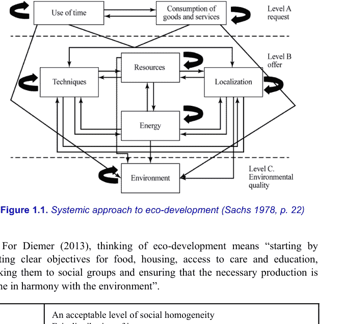
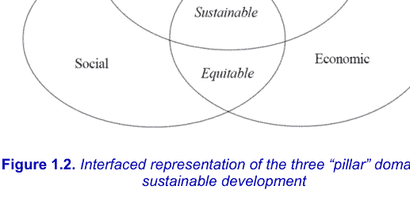
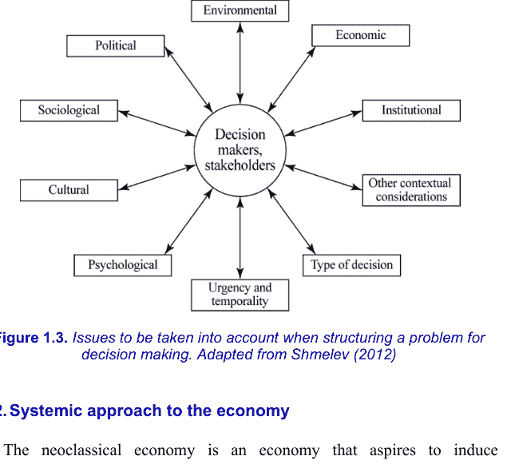
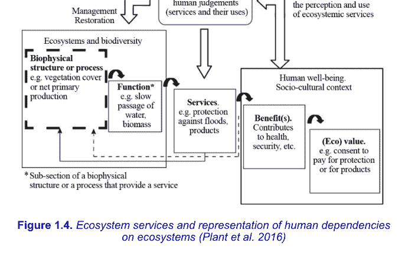
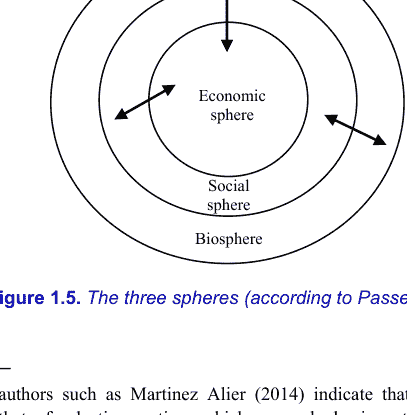
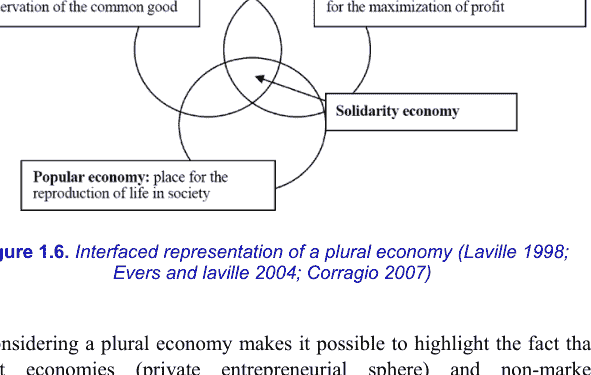
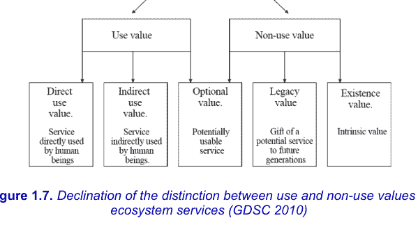
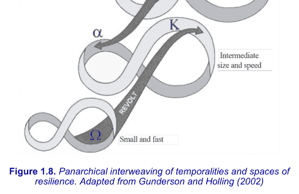

## 1. 经济与失衡

### 1.1. 权力攫取

布伦特兰等人（1987）提出的奠基性定义——“满足当代人需求而不损害后代人满足其自身需求的能力的发展”——强调了一种能力概念，这种能力是随着时间推移而嵌入并得以更新的。可持续发展概念提出的一个基本问题是，经济在随时间更新这一能力中的地位。

在其网站上，法国国家统计局 INSEE 提供了另一个可持续发展的定义，该定义源于 1992 年里约地球峰会：“经济高效、社会公平和生态可持续的发展。” 对这一定义应赋予何种含义？可持续发展是对经济发展的边际适应吗？是将其视为在思想史上用来限定经济发展的标准清单中，加入社会公平和生态可持续性¹？还是说要重新思考发展本身？

动物物种会发展；我们对植物说植被发育；城市也可以被认为处于发展中，或——在比喻意义上——一种社会组织，如教派。但当发展一词不带限定词使用时，它最常指经济的发展。

关于可持续发展经济的认识论需要澄清。一个可能的起点是审视这一经济方法的起源。可持续发展概念所表征的若干要素早已存在于另一个概念——*生态发展*——的核心。一些人仍认为后者是分析社会、生态和经济方面关系可持续性的最合适的参照。

1 Flipo（2015）区分了与活动专业化（List 1841）、交换形式（Hildebrand 1848）、生产（所有权）关系（Marx 1876）、生产者与消费者之间的路径长度（Schmoller 1884）、人均消费量（Rostow 1957）、国民生产总值增长（Solow 1972）或私人利率与社会利率的平价（North 1976）相关的标准。

#### 1.1.1. 从生态发展到可持续发展

##### 1.1.1.1. 参照框架的转变

*生态发展*的设想由 Maurice Strong 在 1972 年斯德哥尔摩会议²上提出。对于后来使这一概念普及的 Ignacy Sachs 来说，这种生态发展“意味着目标的层级：首先是社会问题，其次是环境，最后才是经济可行性的追求，而没有经济可行性，一切都不可能。增长不应成为首要目标，而应始终作为服务于当代人与后代团结的工具”（Sachs 2002，第 7 页）。生态完整性因此被视为实现社会福祉目标的必要条件。而经济可行性——发展的必要条件——仍然是手段，必须在生物圈的物理极限之内。

发展在世界物理极限内的这种锚定意味着时间上的锚定。生态系统——其生存能力和更新时间——将成为规划者的范式。人类活动将适应，“时间视野将以数十年甚至数百年计算”（Sachs 1988，第 40 页）。

这种适应不会以牺牲人口为代价。生态发展涉及一定程度的经济、环境和社会政策规划，以确保人类处于中心地位。

2 1972 年 6 月 5 日至 16 日举行的联合国关于发展与环境的会议，比布伦特兰报告和可持续发展概念的首次表述早 15 年。

图 1.1. 生态发展的系统性方法（Sachs 1978，第 22 页）

对于 Diemer（2013）而言，思考生态发展意味着“首先为粮食、住房、医疗和教育获取设定明确目标，将其与社会群体联系起来，并确保必要的生产在与环境和谐的状态下进行”。

| 类别 | 标准 |
|---|---|
| 社会 | 可接受的社会同质性水平 收入公平分配 充分就业或提供可接受生活水平的就业保障 公平获取自然资源 |
| 经济 | 经济各部门的均衡发展 粮食安全 不断现代化生产设备的能力 在科学和技术研究方面具有足够的自主程度 在尊重国家主权的同时融入国家市场 |
| 生态 | 保护自然资产的更新能力 控制不可再生资源使用的限制 |
| 文化 | 连续性中的变革（尊重传统与创新的平衡） 独立设计国家方案的可能性：个人自主性、内生性（而非盲目信任外国模式）、自信心与对世界的开放相结合 |
| 区域 | 平衡农村和城市发展（扭转有利于向城市地区分配公共资金的趋势） 改善城市景观 反对区域差异 为环境敏感地区实施环境友好的发展战略 |

表 1.1. 生态发展的五项标准（Sachs 1997，第 84–85 页；Berr 2013）

让我们回到可持续发展的概念。 其最广为人知的表述，即 1992 年在里约提出的三个“领域”——或“支柱”——的界面，以非常具体的方式——几乎与生态发展建议的正交——展示了经济、生态和社会领域之间的关系。虽然这两种方法都可以被描述为系统性的，但里约提出的界面将三个领域置于同一挑战和手段水平，而生态发展则将它们划分为相互关联、相互嵌套的层级，区分需求（社会）、供给（经济）和环境质量。

图 1.2. 可持续发展三个“支柱”领域的界面表述

生态发展的标准和目标也让人联想到十七项全球 *可持续发展目标*（SDG），它们取代了联合国开发计划署于 2000 年³通过的八项 *千年发展目标*（MDG）。

|   |   |
|---|---|
| 1 | 无贫穷 |
| 2 | 零饥饿 |
| 3 | 良好健康与福祉 |
| 4 | 优质教育 |
| 5 | 性别平等 |
| 6 | 清洁饮水和卫生设施 |
| 7 | 可负担的清洁能源 |
| 8 | 体面工作和经济增长 |
| 9 | 工业、创新和基础设施 |
| 10 | 减少不平等 |
| 11 | 可持续城市和社区 |
| 12 | 负责任的消费和生产 |
| 13 | 气候行动 |
| 14 | 水下生命 |
| 15 | 陆地生命 |
| 16 | 和平、正义和强大机构 |
| 17 | 伙伴关系以实现目标 |

表 1.2. 十七项可持续发展目标（UN 2015）

这两个标准集相隔 20 年，其接近性令人惊讶。一些生态发展标准在应实施的手段方面更具断言性（创新与传统的平衡、独立设计国家方案的可能性等）。然而，如果我们仅静态地审视这两个标准集，要确定它们与可持续发展目标的根本区别并不容易。与之相关的两种概念传播的历史，有助于理解导致其中一种取代另一种的现象。

3 这一取代发生在 2015 年 9 月 25 日，在纽约联合国总部举行的联合国峰会上，从 9 月 25 日至 27 日以大会高级别全体会议的形式举行，以通过 2015 年后发展议程。

##### 1.1.1.2. 概念传播的空间

1974年10月，来自联合国环境规划署⁴和联合国贸易和发展会议⁵的专家在墨西哥科科约克举行研讨会，延续了两年前在斯德哥尔摩启动的工作。它涉及资源利用、环境与发展的组织安排，采用的方法深受生态发展逻辑的影响。

科科约克最终宣言呼吁通过制止富国的过度发展来对抗欠发展，鼓励发展中国家发挥自身优势以增强自信心并学会不再依赖富国。作为回应，美国国务卿亨利·基辛格敦促⁶联合国环境规划署继续关注清理问题（Sachs 2007，第264页）。随后，生态发展项目将在世界政治舞台的前沿逐渐被可持续发展的概念所取代。

对于斯滕格斯（1989，第21–22页）来说，“概念的传播或试图传播并非发生在冷漠、均质的空间中，而是在这些操作行为者所熟知的议题所构建的景观中进行（……）。激活传播操作的某些议题是偶然性的，例如与技术、工业或社会问题相关。另一些则更紧密地与科学方法本身所附带的声望和权威利益相关。在后者中，我们可以识别出两种（……），我们将称之为‘强化’和‘捕获’。”

生态发展概念的政治性排斥——即其传播的中断——并非发生在冷漠影响和表征的“空间”中。起主要作用的并非偶然性问题——生态发展与可持续发展的标准和目标的接近性证明了这一点。如果两者出现时的情况截然不同，又如何会用如此相似的环境、经济和社会标准来描述这两个概念呢？

强化和捕获问题，正如斯滕格斯（1989）所定义的那样，具有决定性。根据贝尔（2013）的说法，正是基辛格的干预加上新自由主义的兴起导致了生态发展项目的边缘化。对于迪梅尔（2013）而言，“生态发展在社会包容且尊重环境方面，很难与1990年代的经济环境相兼容，后者以自由主义论点的回归为标志，而华盛顿共识正是其体现”。

生态发展的概念对上述基本问题提供了精确的方法论回答——可持续发展是经济发展的更新，还是让位于新经济的发展？其被全球经济治理所捕获，限制了其“继任者”传播的可能性空间：新自由主义影响在很大程度上促成了生态发展的边缘化，它又怎能与可持续发展的传播无关呢？

正是对这一问题的探索构成本书的主题。经济表征对其他层面现实的表征以及为使这些现实更具可持续性而可以采取的行动的影响是决定性的。

那么让我们关注新自由主义论点及其所传达的经济表征。这些论点的应用得到了新古典经济学的数学形式主义的支持（Denison 1967），其基石之一是全球要素生产率的逻辑（Stiglitz 1974；Dasgupta and Heal 1979）。

这种“全球生产率”的核心思想是，经济生产的价值可以描述为资本（金融和制造）、人力劳动和原材料共同动员的结果。这种“全球生产率”尤其体现在斯蒂格利茨的模型（1974）中，该模型通过柯布-道格拉斯方程——Q = L^α K^β E^γ——描述了生产（Q）、劳动“要素”（L）、资本“要素”（K）和环境“要素”（E）之间的关系。生产相对于这三个要素的“偏弹性”α、β、γ表明了每个要素在产品中所占的各自份额。

这种方法导致了生产要素至少部分可替代的可能性。按照这一推理得出的结论是，由于生产内部存在弹性⁷，一个要素的供应减少在一定程度上可以通过另一个要素的更大幅度动员得到补偿。

从新自由主义经济中工业生产的观点来看，金钱确实可以购买机器，以及付费劳动时间和来自环境的原材料。但这种可替代性的逻辑能否扩展到严格的工业生产企业观点之外？

可持续发展的界面化表征并不排除使用生产要素的全球生产率模型。一方面，生态与经济共同实现可持续性；另一方面，环境与资本共同实现经济生产。表征空间的混淆可能迅速发生！然而恰恰在新自由主义经济中工业生产价值的表征空间里，社会系统仅以其提供的劳动而言存在，而生态系统则被同化为仅是原材料储备的环境。

无论如何，新古典经济学家都肯定地回答——替代是可能的——他们尤其传播*补偿*和*外部性的内部化*的理论。

*补偿*理论（Hartwick 1977）假定，通过保持经济储蓄高于“自然资本”的折旧，并将储蓄再投资于该资本的再形成（以便“修复”经济活动的环境影响），可以确保发展的生态可持续性。

*外部性的内部化*理论提出，危害和污染——经济的负外部效应，或“负外部性”——应与一个价格相关联，使其能够被考虑并因此得到控制。这可以通过国家干预来实现，通过税收（许可费），以弥合社会成本（污染和危害对社会的成本）与私人成本（企业转向污染较少生产方式的成本（Pigou 1920））之间的差距；或者，在没有直接国家干预的情况下，通过谈判以实现污染排放者与受害者之间的市场补偿（Coase 1960）。

在1992年的里约宣言期间，正是在该宣言中出现了与可持续发展概念相关的三个“支柱”及其界面化表征，提出了27项原则以阐明这一概念并付诸行动。

其中，整合原则⁸强调环境保护必须是发展过程不可分割的一部分。另一项原则，即第13项原则，通过提供有关污染责任立法以及对此类污染的本地和国际受害者的补偿方法的细节，规定了这种整合的一种方式。它为污染者付费原则⁹的运作化铺平了道路，该原则已于1970年代初被经合组织采纳，其直接起源于外部性内部化的新古典理论。

该宣言的第11项原则认为，地方立法措施的有效性必须允许标准适应可能因国家而异的生产环境。这无疑是与生产社会和环境成本相关的公平措施。但这也是一个问题，正如以下原则¹⁰所解释的那样，即在可能产生经济增长同时对抗环境退化的体系中维持自由贸易。

8 PRINCIPLE 4: “为了实现可持续发展，环境保护必须构成发展过程不可分割的一部分，不能孤立地考虑。” PLANET EARTH SUMMIT. United Nations Conference on Environment and Development. Rio de Janeiro, Brazil. June 3–14, 1992.

9 PRINCIPLE 16: “各国当局应努力促进环境成本的内部化以及经济工具的使用，同时考虑到污染者原则上应承担污染成本的方法，在充分考虑公共利益且不扭曲国际贸易和投资的前提下。” PLANET EARTH SUMMIT. United Nations Conference on Environment and Development. Rio de Janeiro, Brazil. June 3–14, 1992.

10 PRINCIPLE 12: “各国应合作促进一个具有支持性和开放性的国际经济体系，以促进所有国家的经济增长和可持续发展，更好地应对环境退化问题。环境目的的贸易政策措施不应构成任意或无法辩解的歧视手段，或对国际贸易的变相限制。单方面行动以应对环境挑战之外

根据 Damian 和 Graz (2001) 的说法，“里约会议与‘华盛顿共识’一致。(...) 外向型发展的原则随后被扩展到通过国际贸易和贸易自由化保护环境和促进可持续发展。”

“应避免进口国的管辖权。针对跨境或全球环境问题的环境措施，应尽可能基于国际共识。” 行星地球峰会。联合国环境与发展会议。巴西里约热内卢。1992年6月3日至14日。

构成该宣言的全部27项原则可以导向更细致的解读。第10项原则——被称为 *participation*¹¹——例如指出，“处理环境问题的最佳方式是确保所有相关公民在适当层级参与 (...)”，通过促进他们获取信息和决策过程的渠道。

然而，不可否认的是，正如我们刚才所做的那样，将其中一些原则拉近，会揭示出矛盾的指令。我们如何在内在化外部性并限制自由贸易的监管壁垒的同时，将公民置于决策的核心，整合经济与环境保护呢？

这种对可持续发展概念的结构化导致了许多操作性偏差，尤其是在适用第15项原则——所谓的 *precautionary principle*¹²——时。如果科学不确定性不应导致停滞，而应导致实施适当措施以防止对环境的潜在损害——正如该原则所指出的那样——那么与阻止生态发展蔓延相似的经济和政治俘获就不应对这些措施比例性的确定产生任何影响，理由何在？

11 它在里约之前就出现在《世界人权宣言》中。

12 其起源归因于 Jonas (1979)。

#### 1.1.2. 解耦概念的利益与局限

##### 1.1.2.1. 绝对必要性与主体间性

*decoupling* 概念常被提出作为可持续发展分析的参考点。“解耦指标有助于决策者更好地理解两个不同领域趋势的交集”（Stevens 2006）。最常见的是，这些指标描述了经济与环境之间的关系。“它们基于经济学的弹性概念，并表达了两个增长率之间的关系，例如家庭废弃物与家庭消费的增长率”（Boulanger 2004）。

这种解耦方法在局限于新古典经济学实践时是有用的，但在更广泛地解决人类活动在人类世时代得以维持的条件时存在重大局限。

在工业和新自由主义的表征中，对解耦的追求是新古典逻辑的一部分，该逻辑认为技术投资、环境绩效与盈利能力之间存在线性关系。有些人将这一逻辑扩展到公共经济，并认为，例如，有必要在 CO₂ 的市场价格¹³ 与社会成本之间实现“最优”，同时为更清洁的技术研发提供补贴（Nordhaus et al. 1973; Nordhaus 2011）。

这里描述的是为特定工业生产模式的出现提供公共支持的尝试，该模式处于有利于这种生产模式的市场管制尝试的部门。这种方法有用吗？当然有用。其推广到所有污染活动是否足以帮助将经济锚定在财富生产与全球生态系统生存能力之间的“绝对解耦”中？

换一种说法：明天的技术会更少污染吗，市场会鼓励今天减少 CO₂ 排放吗？它会减少这些排放并让我们摆脱其物理后果的现实，特别是气候变化吗？对一些经济学家来说，没有什么更不确定的！Pottier (2016) 例如表明，Nordhaus 的方法不可避免地导致考虑 2100 年经济上“最优”的全球变暖 3.5°，这与 IPCC 研究人员的建议完全不相容。

13 新古典经济学家认为 CO₂ 市场是内在化 CO₂ 排放外部效应的工具。

更一般地，在人类世的背景下，解耦不仅仅是绝对的必要。它必须是内在的绝对。人类活动对自然系统产生的压力不应以相对于经济增长的方式减少。它们必须以绝对值减少，足以确保全球生态系统的生存能力。

规避这一约束，无论是通过直接的政治选择还是通过为政治选择合法化的经济工具，都意味着允许经济单位的数量和/或产量以比每个单位产生的环境影响减少更快的速度增长。这将产生 *ecological intensity of the economy*——由于经济活动对自然系统的压力——按生产增加值单位计算在下降，但绝对值在增加¹⁴。

Sachs (1976) 认为“社会总能找到对经济、社会或能源问题的技术回应”这种无限的技术乐观主义没有正当理由。Costanza 等人（1991，第7页）认为，对技术进步轨迹、资源可用性和生态系统可持续性动态各自演变的高不确定性，使得这种乐观主义相当不理性¹⁵。

对于 Bourg 和 Cohn-Bendit (2013) 来说，基于技术进步与市场经济结合的解耦策略构成了“最重要的问题”。据他们说，这种关联“在现实中不可避免地导致这种增加[物质流动]。只有将这种进步与消费框架相结合才能导致相反的结果”。他们因此引入了一个在分析解耦时必须考虑的社会和政治维度。

这里的问题不是争论消费框架，也不是生产管制——我们稍后会谈到——而是明确分析解耦的方法。需要澄清三点。首先，有必要界定拟议解耦的目的：*what is being described?* 然后，为了验证该对象的相关性，重要的是回到分析的目的：该方法对 *what and to whom is the approach useful?* 有用？只有在那之后，才能确定该方法的运作方式：*what are the methods and tools used?*

提出研究解耦时必须描述什么的问题乍一看似乎是多余的。我们可以草率地回答，这是界定经济对环境影响的问题。但通过这样做，通过界定这种影响，我们 *really* 做了什么，如果不是比较经济现象的社会表征和生态现象的社会表征呢？

对于 Nicolescu (2011) 来说，“现实不仅仅是社会建构，是一个社区的共识、主体间协议。它还具有超主体维度，因为一个简单的实验事实可以摧毁最美丽的科学理论。所谓现实的层级，我们指的是在若干一般规律作用下不变的一组系统：例如，受量子规律支配的量子实体，其与宏观物理世界规律存在根本断裂。”

如此表述，被描述对象的提问就不那么明显了。当两个增长率的比较构成解耦分析的基础时，该操作的范围——说明现实的两个表征层级中发生的现象各自演变之间的两个数字之比——是有限的。

一个比率将属于特定现实并发生在不同时间的现象的瞬时数学转录简化为单一的分析维度。此外，这些现象的界定、对它们固有品质、特定于其宇宙的评估，是由具有不同主体性的行为者进行的。最后，比较这些评估的数学转录预设了一个比较范围，尽管不同的评估行为并未涉及所涉现象之间的相互作用。

Diemer (2014) 在这方面指出，在解耦分析中，“The economist will propose a method to take into account the effects of economic activity on the environment and thus delimit the field of

14 这里说明了 Jevons (1865) 的悖论。该悖论指出，随着技术改进提高资源使用效率，该资源的总体消费可能会增加而不是减少。

15 Costanza 等人（1991，第7页）认为“依赖技术能力来抵消资源约束是不理性的。如果我们错了，那么结果将是我们资源基础和我们文明本身的灾难性和不可逆转的破坏。我们必须假设，至少在目前，技术将无法抵消资源约束。如果可以，我们会愉快地感到惊讶。如果不可以，至少我们已经实现了一个可持续的系统”。

环境经济学。(...) 同时，生物学家将能够从生物多样性的角度评估这种影响，例如。这将产生一系列并列的数据，但这些数据不会被置于张力之下，仍将保持为“信息”。

有关不同现实层面的信息的比较本质上是一种处理不确定性的方法。它意味着学科之间进行沟通，其代表意识到他们调动的不是同一对象，并且他们关心构建新的、跨学科的对象，这些对象由近似值构成，其使用仅限于特定方法。这种方法要求关注跨学科对象的生产条件。它基于对解释行为的集体承认，以及在任何数学表征之前对该解释的情境化。

另一方面，当一个学科凭空塑造一个跨学科对象，赋予其永久的科学使命，并通过该对象强加一种使其他现实相关学科沉默的表征层级时，就出现了现实的扭曲。

对于 Nicolescu（2011）而言，“两个现实层级是不同的，如果从一个到另一个的过渡存在法则的断裂和基本概念的断裂（如例如因果关系）。没有人成功找到一种数学形式主义，能够实现从一个世界到另一个世界的严格过渡”。

新古典主义评估所依据的现实表征的简化本身并不是问题。问题开始于简化为可操作性让位于还原论之处，在评估上的后果标志着可接受性阈值，该阈值将所选近似值与所受扭曲分隔开来。

因此，在希望将来自多个现实层面的描述性信息置于张力之下时，显然不应禁止在经济学中使用数学形式主义。然而，绝对至关重要的是要确保这种计算固有的近似不会对政治行为者强加现实表征的扭曲。例如，“污染者付费”原则只有在生产者责任和公众意识方面才有用，如果污染者支付应付金额不会
导致对环境损害有效补偿的幻觉¹⁶，或忽视此类损害造成的社会影响。

##### 1.1.2.2. 被忽视的社会经济方向

无处不在的不确定性和必要的近似不应导致放弃绝对脱钩的雄心，而只满足于寻求仅与人类活动生产相关的经济价值的脱钩。这将是颠覆。脱钩战略的成功不在于不确定性来源的数量和近似模式，而在于近似和不确定性组合的效果。因此，一方面要知道不确定性在哪里，另一方面要确定近似如何影响表征能力和行动前景。

新古典主义提出将储蓄再投资于自然资本的“修复”——假设这种修复是可能的，我们将回到这一点——将意味着对生态和经济现实的超主观知识，但也意味着对影响生态和经济现实表征的社会现实的认识。

这种知识对人类心智，即使是集体而言也是不可及的。另一方面，对驱动生态、经济和社会领域动态的存在进行交互主观承认是可能的，而这正是构建脱钩战略必须遵循的路径。

脱钩作为集体行动以及为此行动必要的评估，是通过多个现实进行的承认之路的一部分。这段旅程始于对社会现实的承认，通过这些现实来承认经济和生态现实。它继续以经济和生态现实之间相互关系的表征为内容，然后回到社会层面——既作为与经济和生态现实相互关联的社会整体，也作为解释和决策的场所。

16 继 Erika 沉没后发生的石油泄漏之后，清理海滩、收集被油污染的鸟类、拯救部分并重新引入其他鸟类，并没有例如修复海洋生态系统的化学污染。此外，很难确定对石油集团处以的罚款对其实践环境责任可能变化的影响。

即使新古典主义分析家在通过其模型的方程式阅读现实时也遵循一条——有限的——知识之路。市场抵消战略的推动来自社会主体——例如以制度化 CO₂ 市场的社会行动为案例——而对该战略效果的承认也作为一种承认行为，在社会现实中实现。

新古典主义分析家所进行的承认的社会行动的特殊性基于两点。首先，基于该行动动员数学方程式来进行承认，这并不使其成为其他于承认的社会行动。这一核心观点将在本书中贯穿始终。它引出了计算和对“重要之物”的描述在分析中各自所占位置的问题，然后这就成为答案的一部分；这种特殊性在于，该行动只承认方程式允许我们从现实中接近的内容。这种情况导致对“分析路径”的强烈依赖，即从同一阅读框架出发——将同一方程式从一种情境转置到另一种情境，可能根据承认的情况调整需要考虑的变量。

然而，不应对新古典主义经济学家进行毫无根据的指责。由分析惯例驱动的偏见也可能在社会经济方法中显现——即基于社会表征的方法，并且可能在之后、仅在之后才使用计算工具。然而，社会经济学家所动员的实践文化使这些偏见成为例外和错误，而新古典主义经济学家引入的偏见则直接源于他们所认为的原则和法则的运作——数学——展开。

如果经济学是一门科学，它首先是通过行动的承认的科学，然后才是为行动而知的科学。新古典主义经济学的迷失源于知识与承认之间的体裁混淆，因此也源于现实与模型之间的混淆。承认新古典主义经济学无法通过行动思考这种无能，将引入需要承认的不仅是无处不在的不确定性，而且是不可还原的相对性。这种相对性对新古典主义经济学家是不可接受的。它与“硬科学”的理念不相容，因为它导致打破“其他条件不变”所强加的规范性，并始终将与“外部世界”的关系视为评估的一部分。

换句话说，形式化一个假设的行动，如模型的生产，是对共享表征的工作的结果，即被行为者认为彼此兼容并且与给定现实兼容。建模因此既意味着承认多个现实，也意味着承认自己是跨学科概念、方法和工具的生产者，这些概念、方法和工具旨在主观地描述这些现实之间的关系。

在没有对这些现实的了解的情况下，将存在于经济现实之一中的表征（如市场）作为在其他现实层级行动的主要支撑（如经济对环境影响的内部化），因此是不严谨的。此外，超越科学严谨性，还有经济表征所赋予的意义的问题，特别是其对政治行动的影响，即经济实践的意识形态影响问题。这些塑造了社会表征。

最有可能的是，这一维度最切断了新古典主义经济学对可持续发展模式兴起的贡献。发展可以同样被理解为集体后工业革命进步，也可以被理解为所产生的物质和社会进步的希望，以及资本主义社会的全球扩张（Comeliau 1999；Gendron and Reveret 2000）。

如果可持续发展的政治对象被新古典主义实践所捕获，它就可以指代经济表征对生态和社会现实的使用的延续——可持续维持——的理念。

结果是，可持续发展的概念仍然受到强烈批评。Diemer（2013）报告了非常强烈的立场，特别是来自 Latouche 的，他援引“借口概念”、“铺就善意地狱”（1994，第 80 页），或“矛盾修辞”（2003）；Georgescu-Roegen（1995）援引“甜美摇篮曲”；Godard（2005）将可持续发展与“海市蜃楼或歪曲”联系起来；以及 Boisvert 等人（2009）援引全球化的“化身”。

然而，这一可持续发展概念已根深蒂固。问题不在于将其遗忘，而在于澄清和完善它，为此理解它为何仍受若干悖论阻碍，以便对其传播施加影响。换句话说，问题在于进行分析方法以认识其局限性

可持续发展概念，这可以带来对其所源自的概念，即生态发展的更深入理解。

对于萨克斯（1981，第139页），“发展是一个整体。文化、社会、经济、制度、政治和生态维度必须通过综合政策在相互关系中得到处理”。据他说，这是一个思考“规范性标准和问题而非僵化模式”的问题（Sachs 1990，第3页），以及涉及“同时尊重社会、文化、生态、环境、领土、经济、政治和国际指标”的解决方案（Sachs 1997，第84-85页）。

这一多指标分析视角的要求，是萨克斯对发展表征构想的核心，是对可持续发展新自由主义捕获的防御。

这种捕获会导致市场整合占主导地位，通过要素化来解决问题，从而导致指标所描述的现实的融合，并导致与全球生产率逻辑相兼容的等式。

另一方面，同时满足若干指标所描述的要求意味着远不止拥有适用于某一现实层面的专业知识。这需要适应同时动员若干方法与工具的知识，这些方法与工具致力于识别在不同现实中登记的现象的特殊性，以及由此产生的识别信息如何被置于张力之下。

因此，这种努力并不意味着拒绝任何新古典主义实践。它在于将任何新古典主义实践，例如脱钩分析，锚定在一个更广泛的社会经济方法中，该方法处理同一主题，但允许在稳健的整体框架内处理它。换句话说，这是一条旨在将新古典主义近似——例如由比较增长率的使用引起——置于结构化不确定性状态的认知路径。

在经济评估实践中，这种方法通常与多准则决策支持方法相关联（Roy 1985；Roy 1991；Roy and Vincke 1981）。

这些方法提出的认知路径由一条非线性和递归的路径组成，包含四个步骤：（i）通过将决策标准与问题关联来构建决策问题；（ii）阐述和建模偏好；（iii）聚合备选方案的评估（偏好）；以及（iv）提出建议（Guitouni and Martel 1998）。

多准则分析可用于支持与生态系统服务对经济的估值相关的数学计算，或确定旨在例如对污染活动引入税收的政治价格。但更根本的是，它旨在提供表征以指导决策。当货币表征介入时，它因此被视为决策应用的工具——而决策本身仍是社会表征的结果。

图1.3. 构建决策问题时需要考虑的问题。改编自Shmelev（2012）

### 1.2. 经济的系统性方法

新古典经济是一种力求诱导出可理解现实的经济。已成为范式的全球要素生产率学说，导致遵循它的分析者仅将可以用数学方程描述的现象——如今由数值算法实现——视为具有生产性的。

任何与工业价值链及其所嵌入的市场没有直接关系的东西都被排除在外，被视为外部性、外部效应。*external*效应的这一术语证实了二元对立：一方面是市场联系的工业实体，另一方面是它们所运作的——物理和社会的——领土。

从新自由主义经济中工业实体的角度来看，领土并不是“世界其他地区”——这一表述专门用于限定其他经济活动部门。从工业和新自由主义经济的角度来看，领土是经济的“彼岸”——或更确切地说是不被思考之处；而必须将经济活动对在此彼岸发生的某些现象的附带效应的数学图像带回经济中，这些现象在经济的观察方式中并未被内在地考虑。

换句话说，在新古典方法中，市场影响社会和生态系统，这些影响可以被计算，甚至可能被调整——这赋予市场经济一定的可接受性。但认为社会和生态系统是市场的根基，或更进一步，市场无非是经济和社会现象的涌现，则不被考虑。悖论在于，这些现象构成了市场存在的根基——即形成市场*price*的计算发生之处——可以在其表现上被限定，但在其本质上无法被计算。

*ecological economics*（Georgescu-Roegen 1971；Daly 1977；Passet 1979）的分析者以及*social economy*（Godin 1871；Laville 1997；Draperi 2005）逆转了新古典视角。他们通过两个截然不同的领域，但通过相似的智力过程证明，内在化既不能保证生态系统的保存，也不能保证社会群体的保存。

将它们联系起来同时与新古典主义区分开来的方法是简单的：问题不在于在现实的静态和原子化视野中试图纠正影响，而是在动态和系统性的视野中有效地保存产生它们的涌现现象所带来的能力。因此，有必要更新对构成由两种资本隐喻所描述的能力的要素、关系和功能的生存条件和保护方式的理解：*natural capital*（Schumacher 1973）和*social capital*（Bourdieu 1980）。

#### 1.2.1. 生产性资本的性质与结构

##### 1.2.1.1. 生态经济学与涌现

可以考虑两种对*natural capital*的方法。它们关注与能否用经济资本替代这一自然资本相关的问题。这种新古典主义思想，尤其由Hartwick（1977）在上述补偿原则中捍卫，催生了*environmental economics*（Stiglitz 1974；Dasgupta and Heal 1979）这一流派。它被*ecological economics*运动的支持者坚决拒绝，他们因此与新古典主义思维区分开来，而环境经济是其一种变体。

这两个为同一分析对象——自然资本——竞争的流派之间的区别，或更确切地说分裂，通常以*low*和*high sustainability*来表述。审视*ecosystem services*的概念（Costanza et al. 1997；Daily 1997）可以更好地理解它们之间的分歧。

联合国*Millennium Ecosystem Assessment*（2005）将生态系统服务区分为若干类别：文化服务¹⁷、供给服务¹⁸、调节服务¹⁹和支持服务²⁰。

新古典*environmental economy*通过针对每个类别的特定方法将这些不同服务整合到市场经济中，例如为获取文化服务而支付意愿，或为供给服务而支付原材料成本。调节服务和支持服务在新自由主义工业经济的直接效用范围之外，仅通过可能的内在化和补偿机制以相关且部分的方式被考虑。

总体而言，这些生态系统服务对新古典主义者构成“*environmental factor*”——正是全球要素生产率逻辑使其可替代，即可与劳动要素和经济资本互换。新古典主义者因此比较成本（补偿

和内化）以及利益（生态系统服务的商品化）并解决他们所称的自然资本在成本-效益分析中的估值。

*生态经济学*对自然资本是什么、由何组成以及因此如何对其进行估值提供了非常不同的理解。对生态经济学家而言，自然资本并不具有新古典主义赋予经济资本和劳动资本的同等标准的可替代性属性（Faucheux and Noël 1995）。在他们看来，持相反观点将是否定决定自然要素之间相互关系以及其纳入社会获得服务的生化循环的物理特征的独特性（*同上*）。

必须强调的是自然资本组成部分的互补性（Pearce and Warford 1993）。用技术完全替代其中一个要素只能导致生态系统出现整体扰动，并由此波及经济（Costanza and Daly 1992; Barbier and Markandya 1990）。

因此，生态经济学家的思路引导我们认为自然资本在结构上比经济资本更为根本。它具有不可替代的禀赋特征，因为它并非由人类社会生产（O’Connor 1993）。它是一个整体，以非线性方式响应生态系统功能的破坏，包括其自净和再生功能。在某些阈值之上，称为*饱和阈值*——或*临界阈值*——其中一些功能，即确保自然平衡的功能，会遭到破坏。自然资本的一部分随后被称为*关键自然资本*（Ciriacy-Wantrup 1952; Bishop 1978）。

对生态系统服务的经济估值只有在不掩盖维持生态系统功能的方法时才有意义，即生化要素和循环的动态品质和相互作用。对生态经济学家而言，目标是确保对自然资本的预防性管理，即致力于生态系统的*事前*维护，而非仅仅同意对人类活动的*事后*影响进行补偿。

图 1.4. 生态系统服务及人类对生态系统的依赖性表征（Plant et al. 2016）

对 Hueting 等（1992）和 Richard（2012）而言，*自然资本*的估值主要不是与生态系统服务的*效用*问题相关，而是与生态系统的*功能性*相关。

*功能性*一词是一个“保障”。它迫使我们不要将服务的效用分析与使其存在的功能分析分开，即将生态系统的经济分析建立在要素与驱动它们的生化循环之间的功能联系之上。考虑这一分析的唯一严谨方式是认为，如果生态系统显然没有*价格*，就市场经济的意义而言，其维护，即致力于其保护或更新的行动，会为愿意投身其中的行动者产生*成本*。

必须核算这一维护成本，以便诱导使用影响生态系统的经济资产的*折旧*（Godard 2010, p. 60; Richard 2012）。换句话说，如果与生态系统不同，生态系统服务可以有价格，那么该服务的价格只有在包含为系统性维护支撑该服务存在的生态系统功能所必需的资金时，才能反映依赖它的活动的可持续锚定（Hueting 1980; Ekins 2000; Ekins and Simon 2000; Godard 2010）。

简而言之，生态经济学家拒绝将环境置于新古典经济标准和推理之下。相反，他们提出将经济整合到生物圈中，尊重其循环，因而尊重后者的时间性（Georgescu-Roegen 1971, 1979, 1995; Passet 1979, 1985）。在这一点上，生态经济与生态发展趋同。然而，它在目的上有所不同——经济领域与其与生态领域的关系，而非“发展”——并且它并不总是明确提及社会目的 21。

实践生态经济并不意味着排除社会领域：生态系统服务和自然资本的概念是社会表征，而事前生态系统管理系统的制度化是一种社会行动。相反，生态经济意味着使社会现实成为涌现现象得以被认可的场所，其[content]
和内化）以及利益（生态系统服务的商品化）并解决他们所称的自然资本在成本-效益分析中的估值。

*生态经济学*对自然资本是什么、由何组成以及因此如何对其进行估值提供了非常不同的理解。对生态经济学家而言，自然资本并不具有新古典主义赋予经济资本和劳动资本的同等标准的可替代性属性（Faucheux and Noël 1995）。在他们看来，持相反观点将是否定决定自然要素之间相互关系以及其纳入社会获得服务的生化循环的物理特征的独特性（*同上*）。

必须强调的是自然资本组成部分的互补性（Pearce and Warford 1993）。用技术完全替代其中一个要素只能导致生态系统出现整体扰动，并由此波及经济（Costanza and Daly 1992; Barbier and Markandya 1990）。

因此，生态经济学家的思路引导我们认为自然资本在结构上比经济资本更为根本。它具有不可替代的禀赋特征，因为它并非由人类社会生产（O’Connor 1993）。它是一个整体，以非线性方式响应生态系统功能的破坏，包括其自净和再生功能。在某些阈值之上，称为*饱和阈值*——或*临界阈值*——其中一些功能，即确保自然平衡的功能，会遭到破坏。自然资本的一部分随后被称为*关键自然资本*（Ciriacy-Wantrup 1952; Bishop 1978）。

对生态系统服务的经济估值只有在不掩盖维持生态系统功能的方法时才有意义，即生化要素和循环的动态品质和相互作用。对生态经济学家而言，目标是确保对自然资本的预防性管理，即致力于生态系统的*事前*维护，而非仅仅同意对人类活动的*事后*影响进行补偿。

图 1.4. 生态系统服务及人类对生态系统的依赖性表征（Plant et al. 2016）

对 Hueting 等（1992）和 Richard（2012）而言，*自然资本*的估值主要不是与生态系统服务的*效用*问题相关，而是与生态系统的*功能性*相关。

*功能性*一词是一个“保障”。它迫使我们不要将服务的效用分析与使其存在的功能分析分开，即将生态系统的经济分析建立在要素与驱动它们的生化循环之间的功能联系之上。考虑这一分析的唯一严谨方式是认为，如果生态系统显然没有*价格*，就市场经济的意义而言，其维护，即致力于其保护或更新的行动，会为愿意投身其中的行动者产生*成本*。

必须核算这一维护成本，以便诱导使用影响生态系统的经济资产的*折旧*（Godard 2010, p. 60; Richard 2012）。换句话说，如果与生态系统不同，生态系统服务可以有价格，那么该服务的价格只有在包含为系统性维护支撑该服务存在的生态系统功能所必需的资金时，才能反映依赖它的活动的可持续锚定（Hueting 1980; Ekins 2000; Ekins and Simon 2000; Godard 2010）。

简而言之，生态经济学家拒绝将环境置于新古典经济标准和推理之下。相反，他们提出将经济整合到生物圈中，尊重其循环，因而尊重后者的时间性（Georgescu-Roegen 1971, 1979, 1995; Passet 1979, 1985）。在这一点上，生态经济与生态发展趋同。然而，它在目的上有所不同——经济领域与其与生态领域的关系，而非“发展”——并且它并不总是明确提及社会目的 21。

实践生态经济并不意味着排除社会领域：生态系统服务和自然资本的概念是社会表征，而事前生态系统管理系统的制度化是一种社会行动。相反，生态经济意味着使社会现实成为涌现现象得以被认可的场所，其[content]
和内化）以及利益（生态系统服务的商品化）并解决他们所称的自然资本在成本-效益分析中的估值。

*生态经济学*对自然资本是什么、由何组成以及因此如何对其进行估值提供了非常不同的理解。对生态经济学家而言，自然资本并不具有新古典主义赋予经济资本和劳动资本的同等标准的可替代性属性（Faucheux and Noël 1995）。在他们看来，持相反观点将是否定决定自然要素之间相互关系以及其纳入社会获得服务的生化循环的物理特征的独特性（*同上*）。

必须强调的是自然资本组成部分的互补性（Pearce and Warford 1993）。用技术完全替代其中一个要素只能导致生态系统出现整体扰动，并由此波及经济（Costanza and Daly 1992; Barbier and Markandya 1990）。

因此，生态经济学家的思路引导我们认为自然资本在结构上比经济资本更为根本。它具有不可替代的禀赋特征，因为它并非由人类社会生产（O’Connor 1993）。它是一个整体，以非线性方式响应生态系统功能的破坏，包括其自净和再生功能。在某些阈值之上，称为*饱和阈值*——或*临界阈值*——其中一些功能，即确保自然平衡的功能，会遭到破坏。自然资本的一部分随后被称为*关键自然资本*（Ciriacy-Wantrup 1952; Bishop 1978）。

对生态系统服务的经济估值只有在不掩盖维持生态系统功能的方法时才有意义，即生化要素和循环的动态品质和相互作用。对生态经济学家而言，目标是确保对自然资本的预防性管理，即致力于生态系统的*事前*维护，而非仅仅同意对人类活动的*事后*影响进行补偿。

图 1.4. 生态系统服务及人类对生态系统的依赖性表征（Plant et al. 2016）

对 Hueting 等（1992）和 Richard（2012）而言，*自然资本*的估值主要不是与生态系统服务的*效用*问题相关，而是与生态系统的*功能性*相关。

*功能性*一词是一个“保障”。它迫使我们不要将服务的效用分析与使其存在的功能分析分开，即将生态系统的经济分析建立在要素与驱动它们的生化循环之间的功能联系之上。考虑这一分析的唯一严谨方式是认为，如果生态系统显然没有*价格*，就市场经济的意义而言，其维护，即致力于其保护或更新的行动，会为愿意投身其中的行动者产生*成本*。

必须核算这一维护成本，以便诱导使用影响生态系统的经济资产的*折旧*（Godard 2010, p. 60; Richard 2012）。换句话说，如果与生态系统不同，生态系统服务可以有价格，那么该服务的价格只有在包含为系统性维护支撑该服务存在的生态系统功能所必需的资金时，才能反映依赖它的活动的可持续锚定（Hueting 1980; Ekins 2000; Ekins and Simon 2000; Godard 2010）。

简而言之，生态经济学家拒绝将环境置于新古典经济标准和推理之下。相反，他们提出将经济整合到生物圈中，尊重其循环，因而尊重后者的时间性（Georgescu-Roegen 1971, 1979, 1995; Passet 1979, 1985）。在这一点上，生态经济与生态发展趋同。然而，它在目的上有所不同——经济领域与其与生态领域的关系，而非“发展”——并且它并不总是明确提及社会目的 21。

实践生态经济并不意味着排除社会领域：生态系统服务和自然资本的概念是社会表征，而事前生态系统管理系统的制度化是一种社会行动。相反，生态经济意味着使社会现实成为涌现现象得以被认可的场所，其界定构成了活世界中经济学的领域。

图 1.5. 三个领域（根据 Passet 1979）

21 即使像 Martinez Alier（2014）这样的作者指出，丰裕的生态主义（即选择性分类，只能在垃圾桶溢出时才被发明）与全球保护生存所必需的环境的需要相补充，因此是穷人的生态主义。另一方面，一些生态系统服务具有直接的社会影响，而不经过“经济”环节，例如生态系统提供的精神和休闲机会。

*涌现*现象是生物系统的特征之一，按 Bertalanffy 的*一般系统论*（1968）所指：在一个集合的整体层面上，无法从其基本属性推导出的属性会出现，这些属性可以用阈值效应来解释。

经济行动者所认为的生态系统服务因此不过是生态系统的涌现属性。而该属性无法从生态系统在生化要素中的组成推导出来。其存在由这些要素在循环和功能中的关系所解释，而这些循环和功能的生存能力只有在破坏水平低于某些水平时才可能。上述提到的临界阈值，即超过后整个生态系统不再可行的阈值，是其顶点。

生态系统服务，即从生态系统功能中剥离的经济效用，正如我们所见，对应于对生态系统涌现的功利主义解读。然而，由于它是生态系统现实的解释，该服务也源于另一个系统的涌现属性：社会系统，通过该系统认识到生态系统循环的功能特征，从中涌现出所考虑的效用。

该属性无法从社会系统的基本组成推导出来。它需要人们在构成社会生活循环的认知共同体中得到锚定。

更一般地说，这促使我们将经济构想为对社会决定且生态锚定的现实的功利主义解读。

##### 1.2.1.2. 社会经济与外化

*社会系统*可以由许多学科来理解。其中两个学科特别有用，可以在社会领域提出与导致生态系统功能所有权的涌现现象相类似的类比。

*社区心理学*（Bronfenbrenner 1979; Saïas 2011）使得能够从涉及人们互动从而允许主体间性和形成认识某一现实层面的必要知识的角度来接近社会系统。

*社会经济*促进对主体间性和知识形成的[content]
和内化）以及利益（生态系统服务的商品化）并解决他们所称的自然资本在成本-效益分析中的估值。

*生态经济学*对自然资本是什么、由何组成以及因此如何对其进行估值提供了非常不同的理解。对生态经济学家而言，自然资本并不具有新古典主义赋予经济资本和劳动资本的同等标准的可替代性属性（Faucheux and Noël 1995）。在他们看来，持相反观点将是否定决定自然要素之间相互关系以及其纳入社会获得服务的生化循环的物理特征的独特性（*同上*）。

必须强调的是自然资本组成部分的互补性（Pearce and Warford 1993）。用技术完全替代其中一个要素只能导致生态系统出现整体扰动，并由此波及经济（Costanza and Daly 1992; Barbier and Markandya 1990）。

因此，生态经济学家的思路引导我们认为自然资本在结构上比经济资本更为根本。它具有不可替代的禀赋特征，因为它并非由人类社会生产（O’Connor 1993）。它是一个整体，以非线性方式响应生态系统功能的破坏，包括其自净和再生功能。在某些阈值之上，称为*饱和阈值*——或*临界阈值*——其中一些功能，即确保自然平衡的功能，会遭到破坏。自然资本的一部分随后被称为*关键自然资本*（Ciriacy-Wantrup 1952; Bishop 1978）。

对生态系统服务的经济估值只有在不掩盖维持生态系统功能的方法时才有意义，即生化要素和循环的动态品质和相互作用。对生态经济学家而言，目标是确保对自然资本的预防性管理，即致力于生态系统的*事前*维护，而非仅仅同意对人类活动的*事后*影响进行补偿。

图 1.4. 生态系统服务及人类对生态系统的依赖性表征（Plant et al. 2016）

对 Hueting 等（1992）和 Richard（2012）而言，*自然资本*的估值主要不是与生态系统服务的*效用*问题相关，而是与生态系统的*功能性*相关。

*功能性*一词是一个“保障”。它迫使我们不要将服务的效用分析与使其存在的功能分析分开，即将生态系统的经济分析建立在要素与驱动它们的生化循环之间的功能联系之上。考虑这一分析的唯一严谨方式是认为，如果生态系统显然没有*价格*，就市场经济的意义而言，其维护，即致力于其保护或更新的行动，会为愿意投身其中的行动者产生*成本*。

必须核算这一维护成本，以便诱导使用影响生态系统的经济资产的*折旧*（Godard 2010, p. 60; Richard 2012）。换句话说，如果与生态系统不同，生态系统服务可以有价格，那么该服务的价格只有在包含为系统性维护支撑该服务存在的生态系统功能所必需的资金时，才能反映依赖它的活动的可持续锚定（Hueting 1980; Ekins 2000; Ekins and Simon 2000; Godard 2010）。

简而言之，生态经济学家拒绝将环境置于新古典经济标准和推理之下。相反，他们提出将经济整合到生物圈中，尊重其循环，因而尊重后者的时间性（Georgescu-Roegen 1971, 1979, 1995; Passet 1979, 1985）。在这一点上，生态经济与生态发展趋同。然而，它在目的上有所不同——经济领域与其与生态领域的关系，而非“发展”——并且它并不总是明确提及社会目的 21。

实践生态经济并不意味着排除社会领域：生态系统服务和自然资本的概念是社会表征，而事前生态系统管理系统的制度化是一种社会行动。相反，生态经济意味着使社会现实成为涌现现象得以被认可的场所，其界定构成了活世界中经济学的领域。

图 1.5. 三个领域（根据 Passet 1979）

21 即使像 Martinez Alier（2014）这样的作者指出，丰裕的生态主义（即选择性分类，只能在垃圾桶溢出时才被发明）与全球保护生存所必需的环境的需要相补充，因此是穷人的生态主义。另一方面，一些生态系统服务具有直接的社会影响，而不经过“经济”环节，例如生态系统提供的精神和休闲机会。

*涌现*现象是生物系统的特征之一，按 Bertalanffy 的*一般系统论*（1968）所指：在一个集合的整体层面上，无法从其基本属性推导出的属性会出现，这些属性可以用阈值效应来解释。

经济行动者所认为的生态系统服务因此不过是生态系统的涌现属性。而该属性无法从生态系统在生化要素中的组成推导出来。其存在由这些要素在循环和功能中的关系所解释，而这些循环和功能的生存能力只有在破坏水平低于某些水平时才可能。上述提到的临界阈值，即超过后整个生态系统不再可行的阈值，是其顶点。

生态系统服务，即从生态系统功能中剥离的经济效用，正如我们所见，对应于对生态系统涌现的功利主义解读。然而，由于它是生态系统现实的解释，该服务也源于另一个系统的涌现属性：社会系统，通过该系统认识到生态系统循环的功能特征，从中涌现出所考虑的效用。

该属性无法从社会系统的基本组成推导出来。它需要人们在构成社会生活循环的认知共同体中得到锚定。

更一般地说，这促使我们将经济构想为对社会决定且生态锚定的现实的功利主义解读。

##### 1.2.1.2. 社会经济与外化

*社会系统*可以由许多学科来理解。其中两个学科特别有用，可以在社会领域提出与导致生态系统功能所有权的涌现现象相类似的类比。

*社区心理学*（Bronfenbrenner 1979; Saïas 2011）使得能够从涉及人们互动从而允许主体间性和形成认识某一现实层面的必要知识的角度来接近社会系统。

*社会经济*促进对主体间性和知识形成的[content]
和内化）以及利益（生态系统服务的商品化）并解决他们所称的自然资本在成本-效益分析中的估值。

*生态经济学*对自然资本是什么、由何组成以及因此如何对其进行估值提供了非常不同的理解。对生态经济学家而言，自然资本并不具有新古典主义赋予经济资本和劳动资本的同等标准的可替代性属性（Faucheux and Noël 1995）。在他们看来，持相反观点将是否定决定自然要素之间相互关系以及其纳入社会获得服务的生化循环的物理特征的独特性（*同上*）。

必须强调的是自然资本组成部分的互补性（Pearce and Warford 1993）。用技术完全替代其中一个要素只能导致生态系统出现整体扰动，并由此波及经济（Costanza and Daly 1992; Barbier and Markandya 1990）。

因此，生态经济学家的思路引导我们认为自然资本在结构上比经济资本更为根本。它具有不可替代的禀赋特征，因为它并非由人类社会生产（O’Connor 1993）。它是一个整体，以非线性方式响应生态系统功能的破坏，包括其自净和再生功能。在某些阈值之上，称为*饱和阈值*——或*临界阈值*——其中一些功能，即确保自然平衡的功能，会遭到破坏。自然资本的一部分随后被称为*关键自然资本*（Ciriacy-Wantrup 1952; Bishop 1978）。

对生态系统服务的经济估值只有在不掩盖维持生态系统功能的方法时才有意义，即生化要素和循环的动态品质和相互作用。对生态经济学家而言，目标是确保对自然资本的预防性管理，即致力于生态系统的*事前*维护，而非仅仅同意对人类活动的*事后*影响进行补偿。

图 1.4. 生态系统服务及人类对生态系统的依赖性表征（Plant et al. 2016）

对 Hueting 等（1992）和 Richard（2012）而言，*自然资本*的估值主要不是与生态系统服务的*效用*问题相关，而是与生态系统的*功能性*相关。

*功能性*一词是一个“保障”。它迫使我们不要将服务的效用分析与使其存在的功能分析分开，即将生态系统的经济分析建立在要素与驱动它们的生化循环之间的功能联系之上。考虑这一分析的唯一严谨方式是认为，如果生态系统显然没有*价格*，就市场经济的意义而言，其维护，即致力于其保护或更新的行动，会为愿意投身其中的行动者产生*成本*。

必须核算这一维护成本，以便诱导使用影响生态系统的经济资产的*折旧*（Godard 2010, p. 60; Richard 2012）。换句话说，如果与生态系统不同，生态系统服务可以有价格，那么该服务的价格只有在包含为系统性维护支撑该服务存在的生态系统功能所必需的资金时，才能反映依赖它的活动的可持续锚定（Hueting 1980; Ekins 2000; Ekins and Simon 2000; Godard 2010）。

简而言之，生态经济学家拒绝将环境置于新古典经济标准和推理之下。相反，他们提出将经济整合到生物圈中，尊重其循环，因而尊重后者的时间性（Georgescu-Roegen 1971, 1979, 1995; Passet 1979, 1985）。在这一点上，生态经济与生态发展趋同。然而，它在目的上有所不同——经济领域与其与生态领域的关系，而非“发展”——并且它并不总是明确提及社会目的 21。

实践生态经济并不意味着排除社会领域：生态系统服务和自然资本的概念是社会表征，而事前生态系统管理系统的制度化是一种社会行动。相反，生态经济意味着使社会现实成为涌现现象得以被认可的场所，其界定构成了活世界中经济学的领域。

图 1.5. 三个领域（根据 Passet 1979）

21 即使像 Martinez Alier（2014）这样的作者指出，丰裕的生态主义（即选择性分类，只能在垃圾桶溢出时才被发明）与全球保护生存所必需的环境的需要相补充，因此是穷人的生态主义。另一方面，一些生态系统服务具有直接的社会影响，而不经过“经济”环节，例如生态系统提供的精神和休闲机会。

*涌现*现象是生物系统的特征之一，按 Bertalanffy 的*一般系统论*（1968）所指：在一个集合的整体层面上，无法从其基本属性推导出的属性会出现，这些属性可以用阈值效应来解释。

经济行动者所认为的生态系统服务因此不过是生态系统的涌现属性。而该属性无法从生态系统在生化要素中的组成推导出来。其存在由这些要素在循环和功能中的关系所解释，而这些循环和功能的生存能力只有在破坏水平低于某些水平时才可能。上述提到的临界阈值，即超过后整个生态系统不再可行的阈值，是其顶点。

生态系统服务，即从生态系统功能中剥离的经济效用，正如我们所见，对应于对生态系统涌现的功利主义解读。然而，由于它是生态系统现实的解释，该服务也源于另一个系统的涌现属性：社会系统，通过该系统认识到生态系统循环的功能特征，从中涌现出所考虑的效用。

该属性无法从社会系统的基本组成推导出来。它需要人们在构成社会生活循环的认知共同体中得到锚定。

更一般地说，这促使我们将经济构想为对社会决定且生态锚定的现实的功利主义解读。

##### 1.2.1.2. 社会经济与外化

*社会系统*可以由许多学科来理解。其中两个学科特别有用，可以在社会领域提出与导致生态系统功能所有权的涌现现象相类似的类比。

*社区心理学*（Bronfenbrenner 1979; Saïas 2011）使得能够从涉及人们互动从而允许主体间性和形成认识某一现实层面的必要知识的角度来接近社会系统。

*社会经济*促进对主体间性和知识形成的[content]
和内化）以及利益（生态系统服务的商品化）并解决他们所称的自然资本在成本-效益分析中的估值。

*生态经济学*对自然资本是什么、由何组成以及因此如何对其进行估值提供了非常不同的理解。对生态经济学家而言，自然资本并不具有新古典主义赋予经济资本和劳动资本的同等标准的可替代性属性（Faucheux and Noël 1995）。在他们看来，持相反观点将是否定决定自然要素之间相互关系以及其纳入社会获得服务的生化循环的物理特征的独特性（*同上*）。

必须强调的是自然资本组成部分的互补性（Pearce and Warford 1993）。用技术完全替代其中一个要素只能导致生态系统出现整体扰动，并由此波及经济（Costanza and Daly 1992; Barbier and Markandya 1990）。

因此，生态经济学家的思路引导我们认为自然资本在结构上比经济资本更为根本。它具有不可替代的禀赋特征，因为它并非由人类社会生产（O’Connor 1993）。它是一个整体，以非线性方式响应生态系统功能的破坏，包括其自净和再生功能。在某些阈值之上，称为*饱和阈值*——或*临界阈值*——其中一些功能，即确保自然平衡的功能，会遭到破坏。自然资本的一部分随后被称为*关键自然资本*（Ciriacy-Wantrup 1952; Bishop 1978）。

对生态系统服务的经济估值只有在不掩盖维持生态系统功能的方法时才有意义，即生化要素和循环的动态品质和相互作用。对生态经济学家而言，目标是确保对自然资本的预防性管理，即致力于生态系统的*事前*维护，而非仅仅同意对人类活动的*事后*影响进行补偿。

图 1.4. 生态系统服务及人类对生态系统的依赖性表征（Plant et al. 2016）

对 Hueting 等（1992）和 Richard（2012）而言，*自然资本*的估值主要不是与生态系统服务的*效用*问题相关，而是与生态系统的*功能性*相关。

*功能性*一词是一个“保障”。它迫使我们不要将服务的效用分析与使其存在的功能分析分开，即将生态系统的经济分析建立在要素与驱动它们的生化循环之间的功能联系之上。考虑这一分析的唯一严谨方式是认为，如果生态系统显然没有*价格*，就市场经济的意义而言，其维护，即致力于其保护或更新的行动，会为愿意投身其中的行动者产生*成本*。

必须核算这一维护成本，以便诱导使用影响生态系统的经济资产的*折旧*（Godard 2010, p. 60; Richard 2012）。换句话说，如果与生态系统不同，生态系统服务可以有价格，那么该服务的价格只有在包含为系统性维护支撑该服务存在的生态系统功能所必需的资金时，才能反映依赖它的活动的可持续锚定（Hueting 1980; Ekins 2000; Ekins and Simon 2000; Godard 2010）。

简而言之，生态经济学家拒绝将环境置于新古典经济标准和推理之下。相反，他们提出将经济整合到生物圈中，尊重其循环，因而尊重后者的时间性（Georgescu-Roegen 1971, 1979, 1995; Passet 1979, 1985）。在这一点上，生态经济与生态发展趋同。然而，它在目的上有所不同——经济领域与其与生态领域的关系，而非“发展”——并且它并不总是明确提及社会目的 21。

实践生态经济并不意味着排除社会领域：生态系统服务和自然资本的概念是社会表征，而事前生态系统管理系统的制度化是一种社会行动。相反，生态经济意味着使社会现实成为涌现现象得以被认可的场所，其界定构成了活世界中经济学的领域。

图 1.5. 三个领域（根据 Passet 1979）

21 即使像 Martinez Alier（2014）这样的作者指出，丰裕的生态主义（即选择性分类，只能在垃圾桶溢出时才被发明）与全球保护生存所必需的环境的需要相补充，因此是穷人的生态主义。另一方面，一些生态系统服务具有直接的社会影响，而不经过“经济”环节，例如生态系统提供的精神和休闲机会。

*涌现*现象是生物系统的特征之一，按 Bertalanffy 的*一般系统论*（1968）所指：在一个集合的整体层面上，无法从其基本属性推导出的属性会出现，这些属性可以用阈值效应来解释。

经济行动者所认为的生态系统服务因此不过是生态系统的涌现属性。而该属性无法从生态系统在生化要素中的组成推导出来。其存在由这些要素在循环和功能中的关系所解释，而这些循环和功能的生存能力只有在破坏水平低于某些水平时才可能。上述提到的临界阈值，即超过后整个生态系统不再可行的阈值，是其顶点。

生态系统服务，即从生态系统功能中剥离的经济效用，正如我们所见，对应于对生态系统涌现的功利主义解读。然而，由于它是生态系统现实的解释，该服务也源于另一个系统的涌现属性：社会系统，通过该系统认识到生态系统循环的功能特征，从中涌现出所考虑的效用。

该属性无法从社会系统的基本组成推导出来。它需要人们在构成社会生活循环的认知共同体中得到锚定。

更一般地说，这促使我们将经济构想为对社会决定且生态锚定的现实的功利主义解读。

##### 1.2.1.2. 社会经济与外化

*社会系统*可以由许多学科来理解。其中两个学科特别有用，可以在社会领域提出与导致生态系统功能所有权的涌现现象相类似的类比。

*社区心理学*（Bronfenbrenner 1979; Saïas 2011）使得能够从涉及人们互动从而允许主体间性和形成认识某一现实层面的必要知识的角度来接近社会系统。

*社会经济*促进对主体间性和知识形成的功能性本质的认可，以在其他现实中客观化其他功能——尤其是基于生态系统的功能——也在工作的社会现实中。

在社区心理学中，“社会”一词指的是“物质空间（领土、制度安排、场所）和象征空间（关系场、社会文化语境构成群体和个体的心理空间、治疗空间），在这些空间中可以识别出社会维度”（Saïas 2011）。而“社区”概念是理论建构的一部分，其中“社会身份得以锻造，并与本群体成员以及其他群体成员发展出归属感和积极或冲突性的互动”（Jodelet 2009）。

Jovchelovitch（2007）提供了一个客观化社会关系的框架，该框架将*记忆负荷*与象征性和物质空间结合起来。这种记忆负荷在个体之间产生社会关系，也在群体内部和群体之间产生。它决定了“科学共同体”（Latour 1987）的涌现，即行动者网络，可以被形式化为实体的直接利益相关者，以及不太正式的“知识共同体”（Dupouet et al. 2006）的涌现，它们创造知识并通过有组织的或虚拟的网络传播知识，*最终*产生一个共同身份，该身份通过共享社会规范的生产得以巩固（Saïas 2011）。

社区心理学也受 Lewin（1951）工作的[content]
和内化）以及利益（生态系统服务的商品化）并解决他们所称的自然资本在成本-效益分析中的估值。

*生态经济学*对自然资本是什么、由何组成以及因此如何对其进行估值提供了非常不同的理解。对生态经济学家而言，自然资本并不具有新古典主义赋予经济资本和劳动资本的同等标准的可替代性属性（Faucheux and Noël 1995）。在他们看来，持相反观点将是否定决定自然要素之间相互关系以及其纳入社会获得服务的生化循环的物理特征的独特性（*同上*）。

必须强调的是自然资本组成部分的互补性（Pearce and Warford 1993）。用技术完全替代其中一个要素只能导致生态系统出现整体扰动，并由此波及经济（Costanza and Daly 1992; Barbier and Markandya 1990）。

因此，生态经济学家的思路引导我们认为自然资本在结构上比经济资本更为根本。它具有不可替代的禀赋特征，因为它并非由人类社会生产（O’Connor 1993）。它是一个整体，以非线性方式响应生态系统功能的破坏，包括其自净和再生功能。在某些阈值之上，称为*饱和阈值*——或*临界阈值*——其中一些功能，即确保自然平衡的功能，会遭到破坏。自然资本的一部分随后被称为*关键自然资本*（Ciriacy-Wantrup 1952; Bishop 1978）。

对生态系统服务的经济估值只有在不掩盖维持生态系统功能的方法时才有意义，即生化要素和循环的动态品质和相互作用。对生态经济学家而言，目标是确保对自然资本的预防性管理，即致力于生态系统的*事前*维护，而非仅仅同意对人类活动的*事后*影响进行补偿。

图 1.4. 生态系统服务及人类对生态系统的依赖性表征（Plant et al. 2016）

对 Hueting 等（1992）和 Richard（2012）而言，*自然资本*的估值主要不是与生态系统服务的*效用*问题相关，而是与生态系统的*功能性*相关。

*功能性*一词是一个“保障”。它迫使我们不要将服务的效用分析与使其存在的功能分析分开，即将生态系统的经济分析建立在要素与驱动它们的生化循环之间的功能联系之上。考虑这一分析的唯一严谨方式是认为，如果生态系统显然没有*价格*，就市场经济的意义而言，其维护，即致力于其保护或更新的行动，会为愿意投身其中的行动者产生*成本*。

必须核算这一维护成本，以便诱导使用影响生态系统的经济资产的*折旧*（Godard 2010, p. 60; Richard 2012）。换句话说，如果与生态系统不同，生态系统服务可以有价格，那么该服务的价格只有在包含为系统性维护支撑该服务存在的生态系统功能所必需的资金时，才能反映依赖它的活动的可持续锚定（Hueting 1980; Ekins 2000; Ekins and Simon 2000; Godard 2010）。

简而言之，生态经济学家拒绝将环境置于新古典经济标准和推理之下。相反，他们提出将经济整合到生物圈中，尊重其循环，因而尊重后者的时间性（Georgescu-Roegen 1971, 1979, 1995; Passet 1979, 1985）。在这一点上，生态经济与生态发展趋同。然而，它在目的上有所不同——经济领域与其与生态领域的关系，而非“发展”——并且它并不总是明确提及社会目的 21。

实践生态经济并不意味着排除社会领域：生态系统服务和自然资本的概念是社会表征，而事前生态系统管理系统的制度化是一种社会行动。相反，生态经济意味着使社会现实成为涌现现象得以被认可的场所，其界定构成了活世界中经济学的领域。

图 1.5. 三个领域（根据 Passet 1979）

21 即使像 Martinez Alier（2014）这样的作者指出，丰裕的生态主义（即选择性分类，只能在垃圾桶溢出时才被发明）与全球保护生存所必需的环境的需要相补充，因此是穷人的生态主义。另一方面，一些生态系统服务具有直接的社会影响，而不经过“经济”环节，例如生态系统提供的精神和休闲机会。

*涌现*现象是生物系统的特征之一，按 Bertalanffy 的*一般系统论*（1968）所指：在一个集合的整体层面上，无法从其基本属性推导出的属性会出现，这些属性可以用阈值效应来解释。

经济行动者所认为的生态系统服务因此不过是生态系统的涌现属性。而该属性无法从生态系统在生化要素中的组成推导出来。其存在由这些要素在循环和功能中的关系所解释，而这些循环和功能的生存能力只有在破坏水平低于某些水平时才可能。上述提到的临界阈值，即超过后整个生态系统不再可行的阈值，是其顶点。

生态系统服务，即从生态系统功能中剥离的经济效用，正如我们所见，对应于对生态系统涌现的功利主义解读。然而，由于它是生态系统现实的解释，该服务也源于另一个系统的涌现属性：社会系统，通过该系统认识到生态系统循环的功能特征，从中涌现出所考虑的效用。

该属性无法从社会系统的基本组成推导出来。它需要人们在构成社会生活循环的认知共同体中得到锚定。

更一般地说，这促使我们将经济构想为对社会决定且生态锚定的现实的功利主义解读。

##### 1.2.1.2. 社会经济与外化

*社会系统*可以由许多学科来理解。其中两个学科特别有用，可以在社会领域提出与导致生态系统功能所有权的涌现现象相类似的类比。

*社区心理学*（Bronfenbrenner 1979; Saïas 2011）使得能够从涉及人们互动从而允许主体间性和形成认识某一现实层面的必要知识的角度来接近社会系统。

*社会经济*促进对主体间性和知识形成的功能性本质的认可，以在其他现实中客观化其他功能——尤其是基于生态系统的功能——也在工作的社会现实中。

在社区心理学中，“社会”一词指的是“物质空间（领土、制度安排、场所）和象征空间（关系场、社会文化语境构成群体和个体的心理空间、治疗空间），在这些空间中可以识别出社会维度”（Saïas 2011）。而“社区”概念是理论建构的一部分，其中“社会身份得以锻造，并与本群体成员以及其他群体成员发展出归属感和积极或冲突性的互动”（Jodelet 2009）。

Jovchelovitch（2007）提供了一个客观化社会关系的框架，该框架将*记忆负荷*与象征性和物质空间结合起来。这种记忆负荷在个体之间产生社会关系，也在群体内部和群体之间产生。它决定了“科学共同体”（Latour 1987）的涌现，即行动者网络，可以被形式化为实体的直接利益相关者，以及不太正式的“知识共同体”（Dupouet et al. 2006）的涌现，它们创造知识并通过有组织的或虚拟的网络传播知识，*最终*产生一个共同身份，该身份通过共享社会规范的生产得以巩固（Saïas 2011）。

社区心理学也受 Lewin（1951）工作的[content]
和内化）以及利益（生态系统服务的商品化）并解决他们所称的自然资本在成本-效益分析中的估值。

*生态经济学*对自然资本是什么、由何组成以及因此如何对其进行估值提供了非常不同的理解。对生态经济学家而言，自然资本并不具有新古典主义赋予经济资本和劳动资本的同等标准的可替代性属性（Faucheux and Noël 1995）。在他们看来，持相反观点将是否定决定自然要素之间相互关系以及其纳入社会获得服务的生化循环的物理特征的独特性（*同上*）。

必须强调的是自然资本组成部分的互补性（Pearce and Warford 1993）。用技术完全替代其中一个要素只能导致生态系统出现整体扰动，并由此波及经济（Costanza and Daly 1992; Barbier and Markandya 1990）。

因此，生态经济学家的思路引导我们认为自然资本在结构上比经济资本更为根本。它具有不可替代的禀赋特征，因为它并非由人类社会生产（O’Connor 1993）。它是一个整体，以非线性方式响应生态系统功能的破坏，包括其自净和再生功能。在某些阈值之上，称为*饱和阈值*——或*临界阈值*——其中一些功能，即确保自然平衡的功能，会遭到破坏。自然资本的一部分随后被称为*关键自然资本*（Ciriacy-Wantrup 1952; Bishop 1978）。

对生态系统服务的经济估值只有在不掩盖维持生态系统功能的方法时才有意义，即生化要素和循环的动态品质和相互作用。对生态经济学家而言，目标是确保对自然资本的预防性管理，即致力于生态系统的*事前*维护，而非仅仅同意对人类活动的*事后*影响进行补偿。

图 1.4. 生态系统服务及人类对生态系统的依赖性表征（Plant et al. 2016）

对 Hueting 等（1992）和 Richard（2012）而言，*自然资本*的估值主要不是与生态系统服务的*效用*问题相关，而是与生态系统的*功能性*相关。

*功能性*一词是一个“保障”。它迫使我们不要将服务的效用分析与使其存在的功能分析分开，即将生态系统的经济分析建立在要素与驱动它们的生化循环之间的功能联系之上。考虑这一分析的唯一严谨方式是认为，如果生态系统显然没有*价格*，就市场经济的意义而言，其维护，即致力于其保护或更新的行动，会为愿意投身其中的行动者产生*成本*。

必须核算这一维护成本，以便诱导使用影响生态系统的经济资产的*折旧*（Godard 2010, p. 60; Richard 2012）。换句话说，如果与生态系统不同，生态系统服务可以有价格，那么该服务的价格只有在包含为系统性维护支撑该服务存在的生态系统功能所必需的资金时，才能反映依赖它的活动的可持续锚定（Hueting 1980; Ekins 2000; Ekins and Simon 2000; Godard 2010）。

简而言之，生态经济学家拒绝将环境置于新古典经济标准和推理之下。相反，他们提出将经济整合到生物圈中，尊重其循环，因而尊重后者的时间性（Georgescu-Roegen 1971, 1979, 1995; Passet 1979, 1985）。在这一点上，生态经济与生态发展趋同。然而，它在目的上有所不同——经济领域与其与生态领域的关系，而非“发展”——并且它并不总是明确提及社会目的 21。

实践生态经济并不意味着排除社会领域：生态系统服务和自然资本的概念是社会表征，而事前生态系统管理系统的制度化是一种社会行动。相反，生态经济意味着使社会现实成为涌现现象得以被认可的场所，其界定构成了活世界中经济学的领域。

图 1.5. 三个领域（根据 Passet 1979）

21 即使像 Martinez Alier（2014）这样的作者指出，丰裕的生态主义（即选择性分类，只能在垃圾桶溢出时才被发明）与全球保护生存所必需的环境的需要相补充，因此是穷人的生态主义。另一方面，一些生态系统服务具有直接的社会影响，而不经过“经济”环节，例如生态系统提供的精神和休闲机会。

*涌现*现象是生物系统的特征之一，按 Bertalanffy 的*一般系统论*（1968）所指：在一个集合的整体层面上，无法从其基本属性推导出的属性会出现，这些属性可以用阈值效应来解释。

经济行动者所认为的生态系统服务因此不过是生态系统的涌现属性。而该属性无法从生态系统在生化要素中的组成推导出来。其存在由这些要素在循环和功能中的关系所解释，而这些循环和功能的生存能力只有在破坏水平低于某些水平时才可能。上述提到的临界阈值，即超过后整个生态系统不再可行的阈值，是其顶点。

生态系统服务，即从生态系统功能中剥离的经济效用，正如我们所见，对应于对生态系统涌现的功利主义解读。然而，由于它是生态系统现实的解释，该服务也源于另一个系统的涌现属性：社会系统，通过该系统认识到生态系统循环的功能特征，从中涌现出所考虑的效用。

该属性无法从社会系统的基本组成推导出来。它需要人们在构成社会生活循环的认知共同体中得到锚定。

更一般地说，这促使我们将经济构想为对社会决定且生态锚定的现实的功利主义解读。

##### 1.2.1.2. 社会经济与外化

*社会系统*可以由许多学科来理解。其中两个学科特别有用，可以在社会领域提出与导致生态系统功能所有权的涌现现象相类似的类比。

*社区心理学*（Bronfenbrenner 1979; Saïas 2011）使得能够从涉及人们互动从而允许主体间性和形成认识某一现实层面的必要知识的角度来接近社会系统。

*社会经济*促进对主体间性和知识形成的功能性本质的认可，以在其他现实中客观化其他功能——尤其是基于生态系统的功能——也在工作的社会现实中。

在社区心理学中，“社会”一词指的是“物质空间（领土、制度安排、场所）和象征空间（关系场、社会文化语境构成群体和个体的心理空间、治疗空间），在这些空间中可以识别出社会维度”（Saïas 2011）。而“社区”概念是理论建构的一部分，其中“社会身份得以锻造，并与本群体成员以及其他群体成员发展出归属感和积极或冲突性的互动”（Jodelet 2009）。

Jovchelovitch（2007）提供了一个客观化社会关系的框架，该框架将*记忆负荷*与象征性和物质空间结合起来。这种记忆负荷在个体之间产生社会关系，也在群体内部和群体之间产生。它决定了“科学共同体”（Latour 1987）的涌现，即行动者网络，可以被形式化为实体的直接利益相关者，以及不太正式的“知识共同体”（Dupouet et al. 2006）的涌现，它们创造知识并通过有组织的或虚拟的网络传播知识，*最终*产生一个共同身份，该身份通过共享社会规范的生产得以巩固（Saïas 2011）。

社区心理学也受 Lewin（1951）工作的标记，该工作将*行为*描述为个人与其环境互动的函数，并受 Bronfenbrenner（1979, 2001）的工作影响，其所谓的*生态*方法促使我们考虑个体在其多种环境中的情况。

Bronfenbrenner 构想了理解个人与其社会环境互动的不同层级：从*本体系统*（个体及其自身特征）；通过*微系统*（最接近个体的社区实体，即家庭和密友）；*中系统*（不同微系统之间的互动）；以及*宏观系统*，它涵盖其他系统并构成一组价值观、传统和信仰，形成主体的文化。

为了继续将这种方法应用于社会互动的系统化，并回到经济学，可以提到由 Laville（1998）、Evers 和 Laville（2004）以及 Coraggio（2007）发展的 *多元经济* 范式。他们的研究方法形式化并连接了 *社会经济* 所考虑的经济功能的理解的不同“场所”。

**图 1.6.** *多元经济的界面化表征* (Laville 1998; Evers and Laville 2004; Coraggio 2007)

考虑多元经济使得能够突出这样一个事实：市场经济（私人企业领域）和非市场经济（尤其是公共经济领域）都依赖于人与人之间的关系（尤其是大众经济领域）。换句话说，它们只存在于社会领域中。Passet（1979）在生态经济学领域中关于三个领域的[content]
为了继续将这种方法应用于社会互动的系统化，并回到经济学，可以提到由 Laville（1998）、Evers 和 Laville（2004）以及 Coraggio（2007）发展的 *多元经济* 范式。他们的研究方法形式化并连接了 *社会经济* 所考虑的经济功能的理解的不同“场所”。

**图 1.6.** *多元经济的界面化表征* (Laville 1998; Evers and Laville 2004; Coraggio 2007)

考虑多元经济使得能够突出这样一个事实：市场经济（私人企业领域）和非市场经济（尤其是公共经济领域）都依赖于人与人之间的关系（尤其是大众经济领域）。换句话说，它们只存在于社会领域中。Passet（1979）在生态经济学领域中关于三个领域的[content]
为了继续将这种方法应用于社会互动的系统化，并回到经济学，可以提到由 Laville（1998）、Evers 和 Laville（2004）以及 Coraggio（2007）发展的 *多元经济* 范式。他们的研究方法形式化并连接了 *社会经济* 所考虑的经济功能的理解的不同“场所”。

**图 1.6.** *多元经济的界面化表征* (Laville 1998; Evers and Laville 2004; Coraggio 2007)

考虑多元经济使得能够突出这样一个事实：市场经济（私人企业领域）和非市场经济（尤其是公共经济领域）都依赖于人与人之间的关系（尤其是大众经济领域）。换句话说，它们只存在于社会领域中。Passet（1979）在生态经济学领域中关于三个领域的[content]
为了继续将这种方法应用于社会互动的系统化，并回到经济学，可以提到由 Laville（1998）、Evers 和 Laville（2004）以及 Coraggio（2007）发展的 *多元经济* 范式。他们的研究方法形式化并连接了 *社会经济* 所考虑的经济功能的理解的不同“场所”。

**图 1.6.** *多元经济的界面化表征* (Laville 1998; Evers and Laville 2004; Coraggio 2007)

考虑多元经济使得能够突出这样一个事实：市场经济（私人企业领域）和非市场经济（尤其是公共经济领域）都依赖于人与人之间的关系（尤其是大众经济领域）。换句话说，它们只存在于社会领域中。Passet（1979）在生态经济学领域中关于三个领域的[content]
为了继续将这种方法应用于社会互动的系统化，并回到经济学，可以提到由 Laville（1998）、Evers 和 Laville（2004）以及 Coraggio（2007）发展的 *多元经济* 范式。他们的研究方法形式化并连接了 *社会经济* 所考虑的经济功能的理解的不同“场所”。

**图 1.6.** *多元经济的界面化表征* (Laville 1998; Evers and Laville 2004; Coraggio 2007)

考虑多元经济使得能够突出这样一个事实：市场经济（私人企业领域）和非市场经济（尤其是公共经济领域）都依赖于人与人之间的关系（尤其是大众经济领域）。换句话说，它们只存在于社会领域中。Passet（1979）在生态经济学领域中关于三个领域的[content]
为了继续将这种方法应用于社会互动的系统化，并回到经济学，可以提到由 Laville（1998）、Evers 和 Laville（2004）以及 Coraggio（2007）发展的 *多元经济* 范式。他们的研究方法形式化并连接了 *社会经济* 所考虑的经济功能的理解的不同“场所”。

**图 1.6.** *多元经济的界面化表征* (Laville 1998; Evers and Laville 2004; Coraggio 2007)

考虑多元经济使得能够突出这样一个事实：市场经济（私人企业领域）和非市场经济（尤其是公共经济领域）都依赖于人与人之间的关系（尤其是大众经济领域）。换句话说，它们只存在于社会领域中。Passet（1979）在生态经济学领域中关于三个领域的[content]
为了继续将这种方法应用于社会互动的系统化，并回到经济学，可以提到由 Laville（1998）、Evers 和 Laville（2004）以及 Coraggio（2007）发展的 *多元经济* 范式。他们的研究方法形式化并连接了 *社会经济* 所考虑的经济功能的理解的不同“场所”。

**图 1.6.** *多元经济的界面化表征* (Laville 1998; Evers and Laville 2004; Coraggio 2007)

考虑多元经济使得能够突出这样一个事实：市场经济（私人企业领域）和非市场经济（尤其是公共经济领域）都依赖于人与人之间的关系（尤其是大众经济领域）。换句话说，它们只存在于社会领域中。Passet（1979）在生态经济学领域中关于三个领域的[content]
为了继续将这种方法应用于社会互动的系统化，并回到经济学，可以提到由 Laville（1998）、Evers 和 Laville（2004）以及 Coraggio（2007）发展的 *多元经济* 范式。他们的研究方法形式化并连接了 *社会经济* 所考虑的经济功能的理解的不同“场所”。

**图 1.6.** *多元经济的界面化表征* (Laville 1998; Evers and Laville 2004; Coraggio 2007)

考虑多元经济使得能够突出这样一个事实：市场经济（私人企业领域）和非市场经济（尤其是公共经济领域）都依赖于人与人之间的关系（尤其是大众经济领域）。换句话说，它们只存在于社会领域中。Passet（1979）在生态经济学领域中关于三个领域的[content]
为了继续将这种方法应用于社会互动的系统化，并回到经济学，可以提到由 Laville（1998）、Evers 和 Laville（2004）以及 Coraggio（2007）发展的 *多元经济* 范式。他们的研究方法形式化并连接了 *社会经济* 所考虑的经济功能的理解的不同“场所”。

**图 1.6.** *多元经济的界面化表征* (Laville 1998; Evers and Laville 2004; Coraggio 2007)

考虑多元经济使得能够突出这样一个事实：市场经济（私人企业领域）和非市场经济（尤其是公共经济领域）都依赖于人与人之间的关系（尤其是大众经济领域）。换句话说，它们只存在于社会领域中。Passet（1979）在生态经济学领域中关于三个领域的[content]
为了继续将这种方法应用于社会互动的系统化，并回到经济学，可以提到由 Laville（1998）、Evers 和 Laville（2004）以及 Coraggio（2007）发展的 *多元经济* 范式。他们的研究方法形式化并连接了 *社会经济* 所考虑的经济功能的理解的不同“场所”。  **图 1.6.** *多元经济的界面化表征* (Laville 1998; Evers and Laville 2004; Coraggio 2007) 考虑多元经济使得能够突出这样一个事实：市场经济（私人企业领域）和非市场经济（尤其是公共经济领域）都依赖于人与人之间的关系（尤其是大众经济领域）。换句话说，它们只存在于社会领域中。Passet（1979）在生态经济学领域中关于三个领域的[content]
为了继续将这种方法应用于社会互动的系统化，并回到经济学，可以提到由 Laville（1998）、Evers 和 Laville（2004）以及 Coraggio（2007）发展的 *多元经济* 范式。他们的研究方法形式化并连接了 *社会经济* 所考虑的经济功能的理解的不同“场所”。

**图 1.6.** *多元经济的界面化表征* (Laville 1998; Evers and Laville 2004; Coraggio 2007)

考虑多元经济使得能够突出这样一个事实：市场经济（私人企业领域）和非市场经济（尤其是公共经济领域）都依赖于人与人之间的关系（尤其是大众经济领域）。换句话说，它们只存在于社会领域中。Passet（1979）在生态经济学领域中通过其关于三个领域的[content]
为了继续将这种方法应用于社会互动的系统化，并回到经济学，可以提到由 Laville（1998）、Evers 和 Laville（2004）以及 Coraggio（2007）发展的 *多元经济* 范式。他们的研究方法形式化并连接了 *社会经济* 所考虑的经济功能的理解的不同“场所”。

**图 1.6.** *多元经济的界面化表征* (Laville 1998; Evers and Laville 2004; Coraggio 2007)

考虑多元经济使得能够突出这样一个事实：市场经济（私人企业领域）和非市场经济（尤其是公共经济领域）都依赖于人与人之间的关系（尤其是大众经济领域）。换句话说，它们只存在于社会领域中。Passet（1979）在生态经济学领域中关于三个领域的[content]
为了继续将这种方法应用于社会互动的系统化，并回到经济学，可以提到由 Laville(1998)、Evers 和 Laville(2004)以及 Coraggio(2007)发展的 *多元经济* 范式。他们的研究方法形式化并连接了 *社会经济* 所考虑的经济功能的理解的不同“场所”。

**图 1.6.** *多元经济的界面化表征* (Laville 1998; Evers and Laville 2004; Coraggio 2007)

考虑多元经济使得能够突出这样一个事实：市场经济（私人企业领域）和非市场经济（尤其是公共经济领域）都依赖于人与人之间的关系（尤其是大众经济领域）。换句话说，它们只存在于社会领域中。Passet(1979)在生态经济学领域中关于三个领域的[content]
为了继续将这种方法应用于社会互动的系统化，并回到经济学，可以提到由 Laville(1998)、Evers 和 Laville(2004)以及 Coraggio(2007)发展的 *多元经济* 范式。他们的研究方法形式化并连接了 *社会经济* 所考虑的经济功能的理解的不同“场所”。

**图 1.6.** *多元经济的界面化表征* (Laville 1998; Evers and Laville 2004; Coraggio 2007)

考虑多元经济使得能够突出这样一个事实：市场经济（私人企业领域）和非市场经济（尤其是公共经济领域）都依赖于人与人之间的关系（尤其是大众经济领域）。换句话说，它们只存在于社会领域中。Passet(1979)通过其在生态经济学领域对三个领域的[content]
为了继续将这种方法应用于社会互动的系统化并回到经济学，可提及 Laville(1998)、Evers 和 Laville(2004)及 Coraggio(2007)发展的 *多元经济* 范式。其方法形式化并连接了 *社会经济* 所考虑的经济功能理解的不同“场所”。

**图 1.6.** *多元经济的界面化表征* (Laville 1998; Evers and Laville 2004; Coraggio 2007)

考虑多元经济可凸显市场经济（私人企业领域）和非市场经济（尤其是公共经济领域）都依赖人与人关系（尤其是大众经济领域），换言之它们只存在于社会领域。Passet(1979)在生态经济学中以三领域方法也强调此点，图1.5。社会关系先在家庭后在社会中发生，无之货币经济主体即不存在。Laville(1998)认为“联系先于商品”。

意识到类比局限，社区心理学与社会经济可进一步呼应生态经济学家观点。

如前所述，社区心理学要求计入记忆负荷。这与维持自身所需的临界阈值共鸣，以允许出现并维持社会系统基本构成无法推导的属性：社区在不同关系空间中的展开。

社会经济指功能互相关系要素间可行性条件维持不应被这些互相关系所产生服务效用评估所掩盖，即联系不应被商品掩盖。

由此可对新古典经济学与社会系统的关系进行批判，与其与生态系统的关系批判相似。多元经济框架尤其适合此批判。企业领域产生的货币财富再分配逻辑是否接近 Hartwick 1977 补偿提案的逻辑？且同样脆弱？

有效再分配当然可影响个体层面的社会目标实现，涉及 *初级社会商品* (Rawls 1971) 和 *社会能力* (Sen 1992)。但流动性供给并不能保证大众经济领域社会凝聚质量。据 Giraud 和 Renouard(2010)，大量资金流入社会结构反而可能制造不平等并对社会结构指标造成隐性损害。

Servet(2007)认为 *互惠* 允许社会联结。互惠与市场互补，其作用在市场主导时会受损。互惠亦可描述为功能性社会互动，是社区涌现的结果，其延续需参照 *临界阈值*。若视经济为现实认知模式仅存在于社会领域，再分配也可描述为社会领域内的功能性社会互动，即经济互动。

Georgescu-Roegen(1971)继 Alfred Lotka 发展、Stiegler(2016)现动员的 *外化* 理论邀请我们如此做。对这些作者而言，技术属于 *外器官学* 现实，即机器是 *外器官* ——外部器官，其在生化生命体内的生产主要源于社会生命体中的人类决策。

按此逻辑，整个经济——即使工业经济——仅是生态与社会现实的结合。经济本身仅因维持生态与社会关系之需而存在。此解释接近生态发展概念。

若继续外化理论所允许的推理，不是自然资本和“人力”资本基于经济资本的隐喻，而是经济资本代表人类演化过程中生态与社会系统相互渗透的结果。

此处回到 *劳动要素* 概念，新古典将其纳入全球生产率方程，指其视为同质可替代的整体能力的激活。该能力由基于对社会系统部分品质的表征的计算得出数字表示。此方法满足新自由主义工业经济分析师需求，却否定了个体能力在技能与健康等方面的动态、详细和地方性。

若人力资本概念与同质、非特异性、非个体化理解关联且仅指向新古典所考虑的劳动要素可得性，则似乎无效。我们认为动员 *社会资本* 概念更可取。该概念更强调的不是新古典所理解的工作可激活能力的可用性，而是人们凭借其独特性发展功能性联系的能力。

此选择不必然意味着完全放弃新古典以人力资本概念描述的分析对象，但允许该对象纳入社会互相关系空间内的评价。它使经济实践中纳入对社会系统 *事前* 维持的定性目标权衡成为可能，并确保该权衡不被定量再分配目标权衡所掩盖。

#### 1.2.2. 生产现象的空间与时间性

##### 1.2.2.1. 财富、价值、市场与应用伦理

可持续发展经济必须是 Polanyi(1944)意义上的 *政治经济*，即经济在社会与民主关系中的再嵌入经济。此再嵌入决定社会与生态系统可持续性目标及其共同涌现——经济——的韧性，与增值即价值承认目标的比较。

Crozet(2004)认为经济计算应“不是单一不可动摇的参照，而是政治过程不同阶段的支撑”。Bourg(2009)认为需在市场基础的新古典估值之外增加以可持续发展相关基本价值考量为框架的过程。

若以其所[content]
为继续社会互动系统化并回归经济学，可提及 Laville1998、Evers和Laville2004及Coraggio2007发展的 *多元经济* 范式。其形式化并连接 *社会经济* 所考虑经济功能理解的不同“场所”。

**图 1.6.** *多元经济的界面化表征* (Laville 1998; Evers and Laville 2004; Coraggio 2007)

考虑多元经济可凸显市场经济（私人企业领域）和非市场经济（尤其是公共经济领域）依赖人与人关系（尤其是大众经济领域），换言之仅存在于社会领域。Passet1979在生态经济学中以三领域方法亦强调此点，图1.5。社会关系先在家庭后在社会，无之货币经济主体不存在。Laville1998认为“联系先于商品”。

意识类比局限，社区心理学与社会经济可进一步呼应生态经济学家。

如前所述，社区心理学要求计入记忆负荷。这与维持自身所需临界阈值共鸣，以允许出现并维持社会系统基本构成无法推导的属性：社区在不同关系空间的展开。

社会经济指功能互相关系要素间可行性条件维持不应被这些互相关系产生服务效用评估掩盖，即联系不应被商品掩盖。

由此可对新古典经济学与社会系统的关系进行批判，与其与生态系统关系批判相似。多元经济框架尤其适合此批判。企业领域产生的货币财富再分配逻辑是否接近Hartwick1977补偿提案？且同样脆弱？

有效再分配当然可影响个体层面社会目标实现，涉及 *初级社会商品* (Rawls 1971) 和 *社会能力* (Sen 1992)。但流动性供给不能保证大众经济领域社会凝聚质量。据Giraud和Renouard2010，大量资金流入社会结构反而可能制造不平等并对社会结构指标造成隐性损害。

Servet2007认为 *互惠* 允许社会联结。互惠与市场互补，其作用在市场主导时会受损。互惠亦可描述为功能性社会互动，是社区涌现结果，其延续需参照 *临界阈值*。若视经济为现实认知模式仅存在于社会领域，再分配也可描述为社会领域内功能性社会互动，即经济互动。

Georgescu-Roegen1971继Alfred Lotka发展、Stiegler2016现动员的 *外化* 理论邀请我们如此做。对这些作者而言，技术属于 *外器官学* 现实，即机器是 *外器官* ——外部器官，其在生化生命体内的生产主要源于社会生命体中的人类决策。

按此逻辑，整个经济——即使工业经济——仅是生态与社会现实的结合。经济本身仅因维持生态与社会关系之需而存在。此解释接近生态发展概念。

若继续外化理论所允许推理，不是自然资本和“人力”资本基于经济资本隐喻，而是经济资本代表人类演化过程中生态与社会系统相互渗透结果。

此处回到 *劳动要素* 概念，新古典将其纳入全球生产率方程，指其视为同质可替代整体能力的激活。该能力由基于对社会系统部分品质表征的计算得出数字表示。此方法满足新自由主义工业经济分析师需求，却否定了个体能力在技能与健康等方面的动态、详细和地方性。

若人力资本概念与同质、非特异性、非个体化理解关联且仅指向新古典所考虑劳动要素可得性，则似乎无效。我们认为动员 *社会资本* 概念更可取。该概念更强调的不是新古典所理解工作可激活能力可用性，而是人们凭借独特性发展功能性联系的能力。

此选择不必然意味着完全放弃新古典以人力资本概念描述的分析对象，但允许该对象纳入社会互相关系空间内评价。它使经济实践中纳入对社会系统 *事前* 维持的定性目标权衡成为可能，并确保该权衡不被定量再分配目标权衡掩盖。

#### 1.2.2. 生产现象的空间与时间性

##### 1.2.2.1. 财富、价值、市场与应用伦理

可持续发展经济必须是Polanyi1944意义上的 *政治经济*，即经济在社会与民主关系中的再嵌入经济。此再嵌入决定社会与生态系统可持续性目标及其共同涌现——经济——的韧性，与增值即价值承认目标的比较。

Crozet2004认为经济计算应“不是单一不可动摇参照，而是政治过程不同阶段支撑”。Bourg2009认为需在市场基础新古典估值之外增加以可持续发展相关基本价值考量为框架的过程。

可持续发展政治经济，若以其所对立面概括，可由两种“价值承认”方法关系描述：应用伦理与市场。

应用伦理是面向情境反思的学科，其实践导致优先个体所承载价值体系，并允许在具体情境化情境中评估拟议行动，Létourneau和Moreault2006。它是适应方法，提供辨识与现实感知不同尺度及决策不同尺度相关议题特异性的能力。伦理涉及三层面：普遍、特殊（涉及数人）和单一（仅涉及一人）。它由此整体[content]
为继续社会互动系统化并回归经济学，可提及Laville1998、Evers和Laville2004及Coraggio2007发展的 *多元经济* 范式。其形式化并连接 *社会经济* 所考虑经济功能理解的不同“场所”。  **图 1.6.** *多元经济的界面化表征* (Laville 1998; Evers and Laville 2004; Coraggio 2007) 考虑多元经济可凸显市场经济（私人企业领域）和非市场经济（尤其是公共经济领域）依赖人与人关系（尤其是大众经济领域），换言之仅存在于社会领域。Passet1979在生态经济学中以三领域方法亦强调此点，图1.5。社会关系先在家庭后在社会，无之货币经济主体不存在。Laville1998认为“联系先于商品”。 意识类比局限，社区心理学与社会经济可进一步呼应生态经济学家。 如前所述，社区心理学要求计入记忆负荷。这与维持自身所需临界阈值共鸣，以允许出现并维持社会系统基本构成无法推导的属性：社区在不同关系空间的展开。 社会经济指功能互相关系要素间可行性条件维持不应被这些互相关系产生服务效用评估掩盖，即联系不应被商品掩盖。 由此可对新古典经济学与社会系统的关系进行批判，与其与生态系统关系批判相似。多元经济框架尤其适合此批判。企业领域产生的货币财富再分配逻辑是否接近Hartwick1977补偿提案？且同样脆弱？ 有效再分配当然可影响个体层面社会目标实现，涉及 *初级社会商品* (Rawls 1971) 和 *社会能力* (Sen 1992)。但流动性供给不能保证大众经济领域社会凝聚质量。据Giraud和Renouard2010，大量资金流入社会结构反而可能制造不平等并对社会结构指标造成隐性损害。 Servet2007认为 *互惠* 允许社会联结。互惠与市场互补，其作用在市场主导时会受损。互惠亦可描述为功能性社会互动，是社区涌现结果，其延续需参照 *临界阈值*。若视经济为现实认知模式仅存在于社会领域，再分配也可描述为社会领域内功能性社会互动，即经济互动。 Georgescu-Roegen1971继Alfred Lotka发展、Stiegler2016现动员的 *外化* 理论邀请我们如此做。对这些作者而言，技术属于 *外器官学* 现实，即机器是 *外器官* ——外部器官，其在生化生命体内的生产主要源于社会生命体中的人类决策。 按此逻辑，整个经济——即使工业经济——仅是生态与社会现实的结合。经济本身仅因维持生态与社会关系之需而存在。此解释接近生态发展概念。 若继续外化理论所允许推理，不是自然资本和“人力”资本基于经济资本隐喻，而是经济资本代表人类演化过程中生态与社会系统相互渗透结果。 此处回到 *劳动要素* 概念，新古典将其纳入全球生产率方程，指其视为同质可替代整体能力的激活。该能力由基于对社会系统部分品质表征的计算得出数字表示。此方法满足新自由主义工业经济分析师需求，却否定了个体能力在技能与健康等方面的动态、详细和地方性。 若人力资本概念与同质、非特异性、非个体化理解关联且仅指向新古典所考虑劳动要素可得性，则似乎无效。我们认为动员 *社会资本* 概念更可取。该概念更强调的不是新古典所理解工作可激活能力可用性，而是人们凭借独特性发展功能性联系的能力。 此选择不必然意味着完全放弃新古典以人力资本概念描述的分析对象，但允许该对象纳入社会互相关系空间内评价。它使经济实践中纳入对社会系统 *事前* 维持的定性目标权衡成为可能，并确保该权衡不被定量再分配目标权衡掩盖。 ## 1.2.2. 生产现象的空间与时间性 ### 1.2.2.1. 财富、价值、市场与应用伦理 可持续发展经济必须是Polanyi1944意义上的 *政治经济*，即经济在社会与民主关系中的再嵌入经济。此再嵌入决定社会与生态系统可持续性目标及其共同涌现——经济——的韧性，与增值即价值承认目标的比较。 Crozet2004认为经济计算应“不是单一不可动摇参照，而是政治过程不同阶段支撑”。Bourg2009认为需在市场基础新古典估值之外增加以可持续发展相关基本价值考量为框架的过程。 可持续发展政治经济，若以其所对立面概括，可由两种“价值承认”方法关系描述：应用伦理与市场。 应用伦理是面向情境反思的学科，其实践导致优先个体所承载价值体系，并允许在具体情境化情境中评估拟议行动，Létourneau和Moreault2006。它是适应方法，提供辨识与现实感知不同尺度及决策不同尺度相关议题特异性的能力。伦理涉及三层面：普遍、特殊（涉及数人）和单一（仅涉及一人）。它由此整体把握政治决策涌现现象，通过强化机构事务及数据收集与管理能力，ibid。 我们认为市场一词描述社会系统的涌现属性，围绕一套方法与实践的制度化构成，产生由该空间行动者共享的同质表征空间。且使用这些方法使构成市场共同体的个体能够随时以递归方式生产普遍且确定的价格，即社会表征。 本章开头所例示的生态发展概念的经济捕获使我们在此假设存在临界阈值，超过后政治经济功能失效：一旦达到这些阈值，政治经济将

被剥夺其增殖能力的份额，而这将完全转移到市场经济²²。

继续比较应用伦理学与市场，以便分析这两种方法所处理的现实之间的接口，使得能够识别出导致政治经济体系内超出临界阈值的危险做法。而界定此类阈值意味着要处理政治经济学试图通过将经济重新纳入民主体系来调和的子系统之间的制约关系。

对于 de Courcelles（2009）而言，伦理学的困难在于调和 singular、particular 和 universal 的层面——及其可能的矛盾——以定义一个既可读又尊重身份和责任的评价基础。

可持续发展，在以强可持续性在普遍层面把握的意义上，然后是我们在个体层面通过不同的归属共同体所应努力追求的[content]
被剥夺其增殖能力的份额，而这将完全转移到市场经济²²。

继续比较应用伦理学与市场，以便分析这两种方法所处理的现实之间的接口，使得能够识别出导致政治经济体系内超出临界阈值的危险做法。而界定此类阈值意味着要处理政治经济学试图通过将经济重新纳入民主体系来调和的子系统之间的制约关系。

对于 de Courcelles（2009）而言，伦理学的困难在于调和 singular、particular 和 universal 的层面——及其可能的矛盾——以定义一个既可读又尊重身份和责任的评价基础。

可持续发展，在以强可持续性在普遍层面把握的意义上，然后是我们在个体层面通过不同的归属共同体所应努力追求的远景——这些共同体具有对比鲜明的规范、习俗和信仰——个体在其自身的主体性和 singular 利益下于其中互动。

De Courcelles 补充说，区分伦理学与道德很重要。伦理学是对行动的质疑并为行动服务，它动员一个不断演进的“价值”体系，因为它取决于参与决策的行动者集合。另一方面，道德指的是一个已经由规范所调节的行动，这些规范源于一个固定且不加具体化的价值体系。

此外，伦理学的“黄金法则”——“不要做你不希望别人对你做的事”——并不意味着仅出于利他主义或公共利益而行动，而且也对应于行为的正确性和正义性；因此，可持续发展并不意味着要放弃财富的概念，而可能是重新定义这一概念（同上）。

22 例如，没有反映如此极端的情况，上面提到的里约峰会的原则，在表面上平衡地动员企业界、公共经济和民间经济的情况下，促进了发展权力向企业界的广泛转移。

同样需要被视为风险的是，对财富概念地位的重新界定。生产出分析框架以便通过比较伦理实践和市场实践来接近政治经济学，需要厘清“财富”、经济“价值”和社会“价值观”之间的关系。

*Wealth* 可以被视为一个整体，对应于给定社会群体在 *universal level* 的 good。 在发展的可持续政治经济学中，我们认为财富的概念必须对应于生态和社会系统之间可持续共演化的一种状况——后者以广义的意义被考虑，即包括经济共同体。 而对这种财富的集体表述则诱导出一个跨主体的框架，用以表征什么重要、什么至关重要，即一种能力，其改进可以与 *progress* 联系在一起。 这里所说的后者一词理解为一种向可持续的自由的进展，这种自由摆脱了与生态和社会经济系统相关的一组临界阈值所带来的制约。

*Value* 是一种社会表征，一种复合的人工制品，是为行动提供决策支持的结构化于 *level of the particular*，即社会群体在普遍系统层面所表征财富的一个子集。价值是关于一项活动或现象如何促进获取财富、即有助于共同消除生态和社会经济系统相关临界阈值的（价值）判断所产生的跨主体共识。

因此，价值是非汇总且协商地整合不同组成部分（使用、非使用和交换）的结果，这种整合发生在某种现象被集体视为具有生产性时被界定，因为它允许通向财富的路径。 因此，生产性现象本身并不生产价值，它之所以具有价值，是因为在一个群体内部被认为具有生产性，这导致承认并主张经济价值的社会、空间和时间相对性的特征。

根植于人们认知中的 *Plural social value* 系统，即社会群体在 *level of the individual* 所表征财富的层面，在对生产性现象价值进行谈判期间所发挥作用的判断制定中被动员。 这些系统可以通过这些谈判而重新组织，其过程和条款影响——并受影响于——普遍层面上对财富的集体表征。

例如，上面提到的对生态系统服务经济价值的谈判，就涉及使用价值和非使用价值的一组组成部分。

图 1.7. 生态系统服务使用价值与非使用价值区别的展开（GDSC 2010）

这种“总”价值的构成与被允许对这些服务做出价值判断的群体的构成不可分割，即源于一种非常精确的评估情境，锚定于情境化的社会生态地方性。 因此这种价值是完全相对的。

##### 1.2.2.2. 政治经济学与多元劳动

其达成会导致丧失政治经济学所享有的价值承认权力的临界阈值，从根本上与削弱允许社区表征空间之间互动的社会功能相关。

de Courcelles（2009）提到的调和 singular、particular 和 universal 的困难，与此问题毫不无辜。

在普遍层面上对财富的表征直接受到来自 singular 层面的影响，这种影响由多元社会价值系统在政治过程的发展和更新期间的动员所产生。 在个体层面，政治过程所产生的互动与这些社会系统的动态产生共鸣，导致个体性和共享知识的创造性分化现象，这影响了在普遍层面上的财富重新定义。

Stiegler（2006）将 *individuation* 描述为对应于“尚未完成的个体之心理和社会生物学形成”的现象²³。 Stiegler 呼吁建立一种基于 psychic 和集体个体化与一种技术——*technique* 在此指一种将“我”与“我们”联系起来的具体而有效的环境——之间重新调和的政策。 在 Stiegler 的研究中，*transindividual* 是产生社会的产物，也是通过它， “我”的历时性共个体化产生“我们”的共时性超个体化³。

个体之间的互动产生独特性，每个人的特定节奏，但也产生一个群体，在其中他们通过一个可以从内在接近并根据特定时间性进行的过程共同构成并滋养其个体性。 作为社会制度，以及作为在该制度内生产其环境的技术的经济——政治、工业和市场经济——因此是共时性超个体化与历时性共个体化的结合。

一个社会群体纳入到该群体普遍层面上对财富关系的共时性中，是与不同子群体围绕价值进行的历时性谈判不可分割的，这些子群体在不同时间和地域尺度上考虑各种生产性现象。

正如在民主过程中所讨论的那样，对财富关系的共时性直接受到围绕生产性现象价值的谈判的历时性影响所影响。 在民主过程中，人们在集体中自我认同并共同演化多元社会价值系统，这些系统将在围绕生产性现象价值的谈判中被动员，而这些谈判反过来又影响政治过程。

政治经济学是经济重新嵌入社会和民主关系——即与现实制约的关系——的经济——它必须考虑到多个层面（singular、particular 和 universal）以及财富和价值的不同时间表征。 当所涉及的现实被承认为系统性现象、功能和涌现的结果时，这一点尤为必要且微妙，这些现象、功能和涌现必须既独立地又在其相互作用中被处理。

Theories of *共演化* (Norgaard 1984, 1988, 1992; Hodgson 2010) address the comparative dynamics of the relationships between the economy, society and the environment. More generally, a set of systems is in co-evolution when a change in part of one of the systems causes multiple changes in the feedback between these systems (Faucheux and Noël 1995).

Linked to these theories, the concept of *韧性* (Holling 1973) is useful in identifying critical thresholds and functions within ecological and socioeconomic systems. This concept can be considered as “the ability of a system to absorb shocks, sources of dysfunction, and to reorganize itself while changing so as to maintain essentially the same function, structure, identity and feedback” (Walker et al. 2004).

It is often associated with the *适应性循环* model (Holling 1995), as well as with the *泛拱* model (Holling et al. 2002), which proposes a spatial and temporal interweaving of descriptive adaptive cycles of socioecological systems. In a panarchical representation, it is the interaction between phenomena occurring at different scales that should be the focus of attention (Levin 1992).

图 1.8. *韧性时间性与空间的泛拱式交织。改编自 Gunderson and Holling (2002)*

This model makes it possible to partially illustrate the relationships between the levels of the universal, the particular and the singular. It could also contribute to addressing the phenomena of synchronizing transindividuation and diachronizing co-individuation considered by Stiegler (2006), and thus to addressing the relationships between wealth and values.

Negotiations around the value of productive phenomena are carried out at an intermediate level between that of the individual who makes judgments about the composition of this value in the short term and that of the society that transforms the representation of wealth in the long term.

In a market economy in the neoclassical sense24, i.e. one that removes all rationality other than that attached to the quest for financial profit per market transaction – as is the case, for example, in the GAFAM economy25 – wealth and exchange value merge. This economy thus institutes at the universal level the value of exchange as the only standard of wealth, i.e. of the good.

If nothing else imposes itself on it, the pre-eminence of this representation of wealth captures transindividuation. As a result, negotiations at the individual level, aimed at qualifying the value of productive phenomena, may tend to be conducted only to structure the exchange value that can be associated with the useful emergence of ecological and socioeconomic functions.

People’s social value systems are only mobilized to induce them to express their consent to give or receive an exchange value during transactions that may concern any phenomenon of reality.

A market economy in the strictly neoclassical sense would therefore not only make the dimensions of representation of reality (particularly social, ecological and economic) fungible. It would erase the differences between collective spaces of perception of the qualities socially attributed to this reality (levels of the universal, the particular and the singular), which would lead to homogenizing any social group of actors into a set of agents of the market economy.

24 The market economy has existed for a very long time, long before pre-capitalism, marked in particular by double-entry accounting. We distinguish here a market economy in the strict sense of the term, and the current instantiation of the market economy, under the rule of neoclassicism.
25 Acronym for Google, Apple, Facebook, Amazon, Microsoft.

In a neoliberal industrial economy, the situation is different. This economy also has as its horizon the universality of the market and the exchange value as a standard of wealth, but there remains at the level of the individual an autonomous space of representation, that of production, where the use value intervenes.

Value judgments then put local tension on exchange and use in a social group that is no longer necessarily limited to market agents, but includes actors in the industrial economy who extend the scope of objectification of utility to the act of physical production. Individuals bring together at the level of the singular and the particular *知识* whose usefulness for development implies reconsidering the foundations of the “labor factor”.

An interface between two economic worlds then remains materialized by the relationship to the physical dimension of the productive apparatus. The particularities of this apparatus impose a distance from exchange by mixing in negotiations around the value concerns related to socioecological and economic non-market costs specific to the mode of production.

This interface structures spaces of representation that allow the existence of diversified socioeconomic communities, thus likely to open the field of a political economy, by crossing the views on the value of productive phenomena.

Let us then assume here that the diversity of communities led to consider the value of productions results in a diversity of views on the phenomenon of work, and that it is not homogeneous but composite – it is a *多元工作*, of which we distinguish five components here:
- bio-physical-chemical phenomena related to the production and reproduction functions of living organisms are the result of *基于生态系统的劳动*;
- community and political phenomena related to the production and reproduction functions of life in society are the result of *社会劳动*;
- psychosociological phenomena linked to the production and reproduction functions of the capacities for the recognition of socioecological phenomena are the result of *经济劳动*;
- physical and numerical phenomena related to the transformation functions of energy and matter are the result of *工业劳动*;
- capitalization phenomena linked to the functions of market transactions and monetarization are the result of *金融劳动*.

The representation of value therefore derives from a negotiated interpretation of the ways in which these different productive phenomena contribute to wealth – understood in the sense of a sustainable co-evolution between ecological and social systems.

### 1.3. 结论

In a sustainable development political economy, ecosystem work is to be considered as necessary for *初级生产*. It makes possible the existence of the social system as an area of intersubjective representation, in which work is to be considered in what is necessary for a *二级生产* that is the production of the social system as a trans-subjective reality: groups able to communicate and in particular to formulate needs.

The economic system, as a reality within the social sphere, would then correspond to the more or less rapid production and spread of new ways of valuing the responses to these needs. And the associated field of representation approaches economic work, in its essence, as a work of recognition of social and ecological productions, within the social sphere and in a perspective of responding to social need.

This economic recognition work is necessary for *三级生产*: that of the modalities of responding to social need and their qualification in terms of use value. It leads to a new field of representation of work: that of industry – physical and digital – the place of a *四级生产* that is a response to social need by combining ecosystemic and economic work.

The field of physical and digital industry leads to the field of finance in which the work to be considered is that necessary for a *五级生产*: that of representing the exchange value of the combined products of the five components of work.

Each of these domains exists through the other domains. They must be considered from an ontological perspective. It must not only be said that the

人类提供给企业的劳动工作能力，其来源在于生物、社会和经济领域。必须指出，生物、社会和经济劳动是存在的，而企业则是这种多元劳动分解性表征的场所。

从这一视角来看，工业劳动——物理的和数字的——具有特别重要的意义。它为金融劳动提供了与 *初级生产*（资源的货币化、影响的货币成本）、与 *二级生产*（劳动力的货币化、货币再分配）以及与 *三次生产*（表征的货币化、知识生产成本）和 *四次生产*（商品和服务的货币化、能量和物质流动成本）的接口。

换句话说，金融劳动重新组合了在企业层面被分解的劳动表征，并将这种重新组合的价值表现在单一维度上：货币。

金融交易职能，从广义上理解为 *五次生产* 的支撑，目前与所有其他形式生产的表征无关。它基于资本化现象、会计或股票市场，这些现象将货币信息与非货币信息分离，而非货币信息则代表了在企业的时间和空间中被分解的多元劳动。

换句话说，企业是一个具有劳动多准则价值的场所，而金融交易则去语境化了生产的货币表征（“单准则”）。

因此，金融劳动的表征在结构上与劳动其他组成部分的表征脱节。它是在目前仅由金融市场的 *特设* 信息和监管系统以约束性方式联系起来的无形实体之间进行的。因此，导言中提到的措施 26 如果不从根本上寻求将金融劳动重新整合到与 *企业*——公有或私有——的社会和民主关系中，使这种关系与生态限制和约束的现实相兼容，则似乎是不够的。
