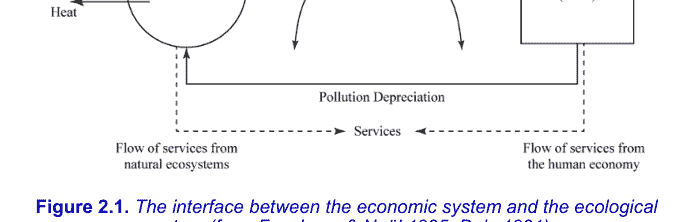
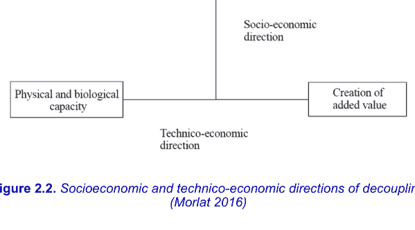
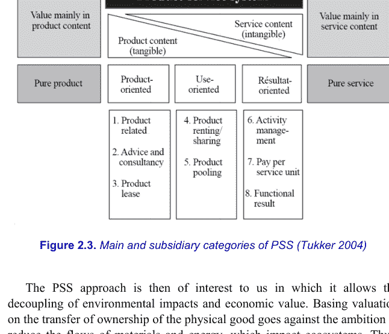
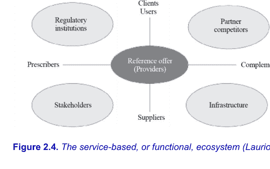
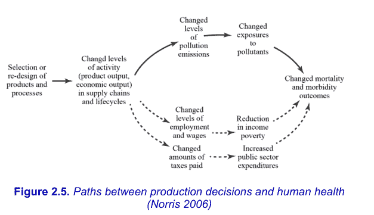
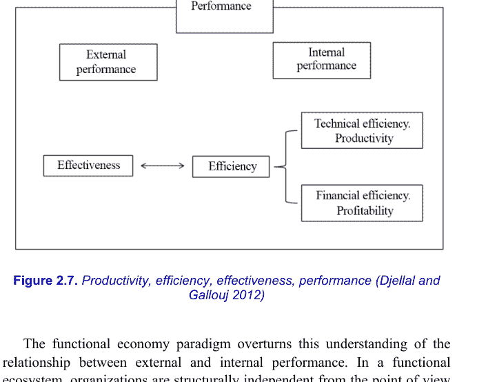
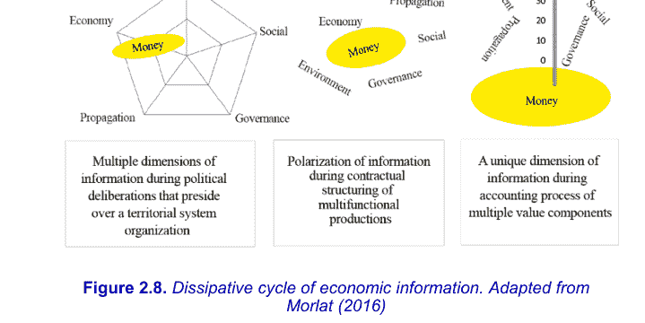
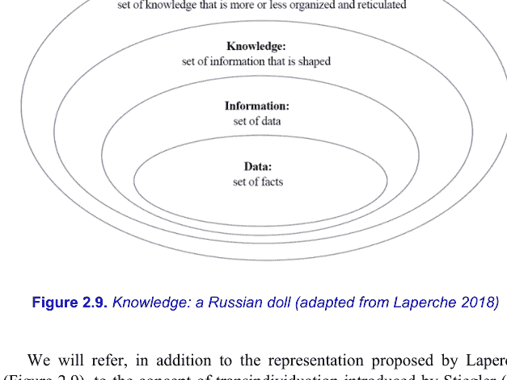

## 2. 信息结构生产

### 2.1. 价值链：一种过时的表征

在可持续发展的社会和生态经济中，联系——无论是个体与社区之间，还是物理要素与生态系统功能之间——先于经济物品。这些联系必然在地域的尺度上被客观化，这与将增值归因于单一制度实体的活动并不十分兼容。事实上，除了生产现象的价值，该价值只能在实体层面有限地理解之外，还必须考虑到该实体所在地域内与其功能上相联系的其他实体活动对该实体施加的影响。

因此，对生产现象的估值就意味着在理论和实践上为新古典主义和社会经济估值方法之间的共存开辟一条道路。

一种方法就是回到我们刚刚描述的劳动本体论，并从这一视角出发，认为某些金融劳动产品并非金融产品。金融劳动作为多元劳动的一部分，影响着选择可以关联交换价值的生产的经济劳动。通过这种选择，它排斥或支持物理和数字生产，而这些生产因根植于生态、社会和经济生产的地域而影响着在那里发生的多元劳动，并使这些生产成为可能。

这种选择性相遇的危险在于其具有破坏性。劳动的金融组成部分属于一种虚幻的、全球化的环境，其直接和间接的与其他劳动组成部分的互动打破了它们的地域锚定，这种锚定不仅以表征的场所和时间性为特征，而且以信息的形式和过程为特征。我们特别指的是价值的多准则分析，这是一种根植于社会群体的实践，其表征——概念——可以被捕捉。

然而，一些资本化和交易方法能够利用物理和数字工业的接口来改善生态、社会和经济信息质量，并将金融劳动重新整合到围绕价值的地域谈判中。

#### 2.1.1. 向功能型经济迈进

##### 2.1.1.1. 稳态经济与解耦

达利（Daly，1974）——一位生态经济学家——提出的稳态经济模型基于“吞吐量”概念（Boulding 1966；Daly 1968；Georgescu-Roegen 1971）。这一流量描述了从生物圈中提取能量和原材料，这些能量和原材料经人类经济转化后以热能和废物的形式返回。

图 2.1. 经济系统与生态系统之间的界面（引自 Faucheux & Noël 1995；Daly 1991）

稳态经济随后关注的是在物质商品存量和人类人口保持在期望且充足的恒定水平下，经济提供的服务效率条件（Daly 1974）：

终极效率 ≡ 服务/流量 ≡ 服务/存量 × 存量/流量

这一关系有助于将经济价值的分析锚定在实现绝对解耦（见第 1.1.2.1 节）所必需的严格性和强可持续性条件中，但它仅限于经济-环境互动。因此，它无法解释地域的社会经济，即同一物理商品的生产可以与具有公认效用的多种功能的生产相关联（功能性）。

深入研究该等式中（存量/流量）这一组成部分，可以设想工业生产物理商品单位之间的贸易在地域上的重新组织对能量-物质流量会产生何种影响。

存量/流量 ≡ 实物商品 / 交换组织 × 交换组织 / 吞吐量 (1)

而详细说明（服务/存量）这一组成部分则可以引入对从物理商品生产中期望的功能的识别与对这些功能使用的估值之间的联系。

服务/存量 ≡ 使用价值 / 已识别功能 × 已识别功能 / 实物商品 (2)

这些关系纯属教学性。然而，它们有助于更深入地理解解耦战略可能是什么。这包括识别导言中提到的技术经济和社会经济方法之间的局限性和互补性。

通过技术手段提高物质生产节俭性是解耦的一个方向。这种改进还必须而且主要是基于社会和政治过程，这也是解耦的另一个方向，可能使必要的物质商品消费框架合法化，以减少能量和物质流量（见第 1.1.1.2 节）。此类框架的社会可接受性以及经济论证——包括“收入损失”的可能性——当然也需要考虑。

为此，让我们回到关系式（1），该式比较了工业生产的重新组织与在能量-物质流量恒定的情况下实物商品存量增加的可能性。这一关系说明了循环经济和工业生态的目的：利用生产的一定 *产出*，这些产出在传统的线性工业经济方案中被视为废物，而在地域内将被其他活动用作资源。

*生态工业战略*（Erkman 1997）涉及封存和关闭能量和物质流动，使产品和服务去物质化；它们需要在流程之间进行输入和输出的汇集，以及资源、活动和产品的替代¹。这些战略为某些行为者降低成本提供了机会，因此需要高度的地域合作。虽然它们本质上反映了生态经济学逻辑向工业组织传播，但其实施的驱动力是社会经济行动。

关系式（2）也强调，控制能量流量和降低物质商品工业生产的成本并不是一个地域活动获得经济收益的唯一机会。解耦战略的成功很大程度上取决于识别并尽可能多地向尽可能多的行为者推广由同一工业生产产生的尽可能多的功能获取的能力。

因此，解耦政策的经济可接受性既是生态工业方法的问题，也是 *利益相关者* 方法（Freeman 1984）²的问题，后者涉及使用与贸易之间的关系。

1 生态工业战略（Erkman 1997）主要基于生态经济学逻辑在生产模式物理锚定的地域设计中的传播。其思想是将生产系统的物理维度组织视为一个工业生态系统（Boons et al. 2000），并研究该生态系统的代谢，以便更好地理解其与自然环境的界面。这种工业代谢是指“*流经工业系统的全部物质和能量流动。它通过一种本质上分析和描述性的方法（基本上是物料平衡原理的应用）来研究，旨在理解与人类活动相关的物质和能量流动的循环，从其最初的提取到其不可避免地、迟早重新整合到生物地球化学循环中*”（Erkman 1997）。

2 利益相关者方法基于五项原则：利益相关者合作原则；利益相关者责任原则；复杂性原则；

从 *使用价值*（对效用的识别）转向 *交换价值*（基于这些效用的商品和服务获取权的提供货币化）涉及重新组合它们之间的关系（1）和（2）。

交换价值 / 流量 ≡ 交换组织 / 已识别的功能 × 已识别的功能 / 吞吐量 (3)

关系（3）说明了区域识别有价值功能的能力如何可能通过重组交换并在相同水平的物质能量流下促进交换价值水平的提升。它引入了脱相关——脱钩——的可能性，即吞吐量的生态系统影响、物质商品的工业生产、效用的可用性以及由此可得的交换价值之间出现脱钩。

这是一种在三个脱钩层面上发挥作用的区域“杠杆”，可通过认识区域功能的临界性并识别有用的功能而集体激活。该关系有助于弥合可用效用（使用价值）的识别、将该效用的来源现象视为实际提供的服务的依据的倾向，以及在维持该现象上进行投资（交换价值）的倾向之间的差距。

这些反思支持第一章的发展：脱钩战略不应将界定生产方式和经济价值认可的社会行动与政治组织排除在分析范围之外。因此必须制定新的脱钩指标，例如考虑到发展政治组织与生态系统质量维持之间的联系，而不仅仅总是关注污染技术的效应。

描绘一条与可持续发展相兼容的经济轨迹需要方法和工具，使我们能够在各自的特殊性和相互作用中处理脱钩的两个方向——技术经济和社会经济。

图 2.2. 社会经济与技术经济脱钩方向 (Morlat 2016)

功能经济的范式（Stahel 1986）使我们能够将思考集中在这两个方向的交汇点上。它表明，分岔很可能至少部分地将基于对有形商品生产资料所有权的经济转变为基于无形服务社会建构的经济。

##### 2.1.1.2. 产品-服务系统与合作

> 对于 Stahel (1986) 来说：“功能经济 (...) 是优化商品和服务的利用（或功能）从而管理现有财富（商品、知识和自然）的经济。功能经济的经济目标是在尽可能长时间内创造尽可能高的使用价值，同时尽可能少地消耗物质资源和能源。因此，这种功能经济比当前以生产及其相关的物质流作为创造财富的主要手段的经济要可持续得多，或去物质化得多。”

许多公式可被视为界定这一经济。以下三种引起我们的兴趣：

- *生态高效服务* (Bartolomeo et al. 2003) 强调物理产品的产权问题，其布局允许提供服务（基于该布局诱导的功能）；这些产品完全或部分仍掌握在生产者手中，后者仅将其使用权转移给客户。
- *功能销售* (Östlin et al. 2006) 包括优化产品 *生命周期* 的要求，从而鼓励将广泛的社会和环境影响整合到服务的估值中。
- *产品-服务系统* (PSSs; Goedkoop et al. 1999) 构成“一个不断努力保持竞争力、满足客户需求并比传统商业模式具有更低环境影响的产品、服务、‘参与者’网络和支持性基础设施的系统”。

后一种方法在多方面很有趣。首先，考虑 PSS 使我们能够处理 *生态高效服务* 核心的所有权关系。

Hockerts 和 Weaver (2002)、Tukker (2004) 以及 Laperche 和 Picard (2013) 区分了三种 PSS 战略：

- *以结果为导向的 PSS*：将其视为最具创新性的战略，对应于提供专门产生且成本由用户直接承担的功能现象。在此，物理财产的所有权不予转移。该商品仅是动员以产生功能并使其可供用户使用的支持。交易的目的是这些特征的效用。
- *以使用为导向的 PSS*：该战略对应于在不转移所有权的情况下提供一组物质商品的使用，用户通过其组合产生功能现象。物质商品占据更核心的位置：它们在功能需求表达之前就已存在。然而，交易的客体始终是这些商品的功能性安排，而非其营销。
- *以产品为导向的 PSS*：这是最不具创新性和最不雄心勃勃的战略。它对应于一种旨在在用户购得产品后提高产品功能性或使用寿命的服务。因此，后一种选择更像是传统售后服务的“可持续版本”，而非功能经济方法，正是因为物理商品所有权的转移（Laperche and Picard 2013）。

图 2.3. PSS 的主要和次要类别 (Tukker 2004)

PSS 方法随后引起我们的兴趣，因为它允许环境影响与经济价值脱钩。以物理商品所有权转移为基础的估值违背了减少影响生态系统的物质和能量流的雄心。因此，在避免所有权转移方面更具雄心的 PSS 战略（以产品为导向和以结果为导向的战略），脱钩程度就越强。

最后，结果是，PSS 方法使得能够处理这种脱钩的社会经济方向。随着 PSS 创新的雄心增强，社会经济创新优先于技术经济创新。的确，这一点至关重要，区域社会提升同一组物理产品功能的能力越强，使用其他工业生产的必要性就越小，从而可以限制吞吐量。

对于 Morelli (2006) 而言，PSS 首先是一种社会建构。它是在行为者网络内部锻造的联系，预示着生产解决方案的能源和物质节制、所产生的多重功能、收益的契约化以及 PSS 的经济平衡之间的关系。

这种联系可以在区域的一个实体层面进行评估，考虑其对该区域其他实体的影响。Baines *et al.* (2007) 认为 *设计师-制造商* 的知识是 *综合性供给* 的基础，后者提高 PSS 的产出价值，同时降低其投入端的材料和其他流的成本。

这种联系也可以共同地从区域层面加以客观化。对于 Isckia (2011) 而言，营销 PSS 的公司不应被视为自主生产者，而应被视为领导者（或枢纽），负责协调其他公司的贡献。后者在一个 *商业生态系统* 中演进（Moore 1993, 1996）。它们既是领导者的客户，也是彼此之间以及与领导者之间合作与竞争关系的一部分（Isckia 2011）。

在[content]
从 *使用价值*（对效用的识别）转向 *交换价值*（基于这些效用的商品和服务获取权的提供货币化）涉及重新组合它们之间的关系（1）和（2）。

交换价值 / 流量 ≡ 交换组织 / 已识别的功能 × 已识别的功能 / 吞吐量 (3)

关系（3）说明了区域识别有价值功能的能力如何可能通过重组交换并在相同水平的物质能量流下促进交换价值水平的提升。它引入了脱相关——脱钩——的可能性，即吞吐量的生态系统影响、物质商品的工业生产、效用的可用性以及由此可得的交换价值之间出现脱钩。

这是一种在三个脱钩层面上发挥作用的区域“杠杆”，可通过认识区域功能的临界性并识别有用的功能而集体激活。该关系有助于弥合可用效用（使用价值）的识别、将该效用的来源现象视为实际提供的服务的依据的倾向，以及在维持该现象上进行投资（交换价值）的倾向之间的差距。

这些反思支持第一章的发展：脱钩战略不应将界定生产方式和经济价值认可的社会行动与政治组织排除在分析范围之外。因此必须制定新的脱钩指标，例如考虑到发展政治组织与生态系统质量维持之间的联系，而不仅仅总是关注污染技术的效应。

描绘一条与可持续发展相兼容的经济轨迹需要方法和工具，使我们能够在各自的特殊性和相互作用中处理脱钩的两个方向——技术经济和社会经济。

图 2.2. 社会经济与技术经济脱钩方向 (Morlat 2016)

功能经济的范式（Stahel 1986）使我们能够将思考集中在这两个方向的交汇点上。它表明，分岔很可能至少部分地将基于对有形商品生产资料所有权的经济转变为基于无形服务社会建构的经济。

## 2.1.1.2. 产品-服务系统与合作

> 对于 Stahel (1986) 来说：“功能经济 (...) 是优化商品和服务的利用（或功能）从而管理现有财富（商品、知识和自然）的经济。功能经济的经济目标是在尽可能长时间内创造尽可能高的使用价值，同时尽可能少地消耗物质资源和能源。因此，这种功能经济比当前以生产及其相关的物质流作为创造财富的主要手段的经济要可持续得多，或去物质化得多。”

许多公式可被视为界定这一经济。以下三种引起我们的兴趣：

- *生态高效服务* (Bartolomeo et al. 2003) 强调物理产品的产权问题，其布局允许提供服务（基于该布局诱导的功能）；这些产品完全或部分仍掌握在生产者手中，后者仅将其使用权转移给客户。
- *功能销售* (Östlin et al. 2006) 包括优化产品 *生命周期* 的要求，从而鼓励将广泛的社会和环境影响整合到服务的估值中。
- *产品-服务系统* (PSSs; Goedkoop et al. 1999) 构成“一个不断努力保持竞争力、满足客户需求并比传统商业模式具有更低环境影响的产品、服务、‘参与者’网络和支持性基础设施的系统”。

后一种方法在多方面很有趣。首先，考虑 PSS 使我们能够处理 *生态高效服务* 核心的所有权关系。

Hockerts 和 Weaver (2002)、Tukker (2004) 以及 Laperche 和 Picard (2013) 区分了三种 PSS 战略：

- *以结果为导向的 PSS*：将其视为最具创新性的战略，对应于提供专门产生且成本由用户直接承担的功能现象。在此，物理财产的所有权不予转移。该商品仅是动员以产生功能并使其可供用户使用的支持。交易的目的是这些特征的效用。
- *以使用为导向的 PSS*：该战略对应于在不转移所有权的情况下提供一组物质商品的使用，用户通过其组合产生功能现象。物质商品占据更核心的位置：它们在功能需求表达之前就已存在。然而，交易的客体始终是这些商品的功能性安排，而非其营销。
- *以产品为导向的 PSS*：这是最不具创新性和最不雄心勃勃的战略。它对应于一种旨在在用户购得产品后提高产品功能性或使用寿命的服务。因此，后一种选择更像是传统售后服务的“可持续版本”，而非功能经济方法，正是因为物理商品所有权的转移（Laperche and Picard 2013）。

图 2.3. PSS 的主要和次要类别 (Tukker 2004)

PSS 方法随后引起我们的兴趣，因为它允许环境影响与经济价值脱钩。以物理商品所有权转移为基础的估值违背了减少影响生态系统的物质和能量流的雄心。因此，在避免所有权转移方面更具雄心的 PSS 战略（以产品为导向和以结果为导向的战略），脱钩程度就越强。

最后，结果是，PSS 方法使得能够处理这种脱钩的社会经济方向。随着 PSS 创新的雄心增强，社会经济创新优先于技术经济创新。的确，这一点至关重要，区域社会提升同一组物理产品功能的能力越强，使用其他工业生产的必要性就越小，从而可以限制吞吐量。

对于 Morelli (2006) 而言，PSS 首先是一种社会建构。它是在行为者网络内部锻造的联系，预示着生产解决方案的能源和物质节制、所产生的多重功能、收益的契约化以及 PSS 的经济平衡之间的关系。

这种联系可以在区域的一个实体层面进行评估，考虑其对该区域其他实体的影响。Baines *et al.* (2007) 认为 *设计师-制造商* 的知识是 *综合性供给* 的基础，后者提高 PSS 的产出价值，同时降低其投入端的材料和其他流的成本。

这种联系也可以共同地从区域层面加以客观化。对于 Isckia (2011) 而言，营销 PSS 的公司不应被视为自主生产者，而应被视为领导者（或枢纽），负责协调其他公司的贡献。后者在一个 *商业生态系统* 中演进（Moore 1993, 1996）。它们既是领导者的客户，也是彼此之间以及与领导者之间合作与竞争关系的一部分（Isckia 2011）。

在[content]
从 *使用价值*（对效用的识别）转向 *交换价值*（基于这些效用的商品和服务获取权的提供货币化）涉及重新组合它们之间的关系（1）和（2）。

交换价值 / 流量 ≡ 交换组织 / 已识别的功能 × 已识别的功能 / 吞吐量 (3)

关系（3）说明了区域识别有价值功能的能力如何可能通过重组交换并在相同水平的物质能量流下促进交换价值水平的提升。它引入了脱相关——脱钩——的可能性，即吞吐量的生态系统影响、物质商品的工业生产、效用的可用性以及由此可得的交换价值之间出现脱钩。

这是一种在三个脱钩层面上发挥作用的区域“杠杆”，可通过认识区域功能的临界性并识别有用的功能而集体激活。该关系有助于弥合可用效用（使用价值）的识别、将该效用的来源现象视为实际提供的服务的依据的倾向，以及在维持该现象上进行投资（交换价值）的倾向之间的差距。

这些反思支持第一章的发展：脱钩战略不应将界定生产方式和经济价值认可的社会行动与政治组织排除在分析范围之外。因此必须制定新的脱钩指标，例如考虑到发展政治组织与生态系统质量维持之间的联系，而不仅仅总是关注污染技术的效应。

描绘一条与可持续发展相兼容的经济轨迹需要方法和工具，使我们能够在各自的特殊性和相互作用中处理脱钩的两个方向——技术经济和社会经济。

图 2.2. 社会经济与技术经济脱钩方向 (Morlat 2016)

功能经济的范式（Stahel 1986）使我们能够将思考集中在这两个方向的交汇点上。它表明，分岔很可能至少部分地将基于对有形商品生产资料所有权的经济转变为基于无形服务社会建构的经济。

## 2.1.1.2. 产品-服务系统与合作

> 对于 Stahel (1986) 来说：“功能经济 (...) 是优化商品和服务的利用（或功能）从而管理现有财富（商品、知识和自然）的经济。功能经济的经济目标是在尽可能长时间内创造尽可能高的使用价值，同时尽可能少地消耗物质资源和能源。因此，这种功能经济比当前以生产及其相关的物质流作为创造财富的主要手段的经济要可持续得多，或去物质化得多。”

许多公式可被视为界定这一经济。以下三种引起我们的兴趣：

- *生态高效服务* (Bartolomeo et al. 2003) 强调物理产品的产权问题，其布局允许提供服务（基于该布局诱导的功能）；这些产品完全或部分仍掌握在生产者手中，后者仅将其使用权转移给客户。
- *功能销售* (Östlin et al. 2006) 包括优化产品 *生命周期* 的要求，从而鼓励将广泛的社会和环境影响整合到服务的估值中。
- *产品-服务系统* (PSSs; Goedkoop et al. 1999) 构成“一个不断努力保持竞争力、满足客户需求并比传统商业模式具有更低环境影响的产品、服务、‘参与者’网络和支持性基础设施的系统”。

后一种方法在多方面很有趣。首先，考虑 PSS 使我们能够处理 *生态高效服务* 核心的所有权关系。

Hockerts 和 Weaver (2002)、Tukker (2004) 以及 Laperche 和 Picard (2013) 区分了三种 PSS 战略：

- *以结果为导向的 PSS*：将其视为最具创新性的战略，对应于提供专门产生且成本由用户直接承担的功能现象。在此，物理财产的所有权不予转移。该商品仅是动员以产生功能并使其可供用户使用的支持。交易的目的是这些特征的效用。
- *以使用为导向的 PSS*：该战略对应于在不转移所有权的情况下提供一组物质商品的使用，用户通过其组合产生功能现象。物质商品占据更核心的位置：它们在功能需求表达之前就已存在。然而，交易的客体始终是这些商品的功能性安排，而非其营销。
- *以产品为导向的 PSS*：这是最不具创新性和最不雄心勃勃的战略。它对应于一种旨在在用户购得产品后提高产品功能性或使用寿命的服务。因此，后一种选择更像是传统售后服务的“可持续版本”，而非功能经济方法，正是因为物理商品所有权的转移（Laperche and Picard 2013）。

图 2.3. PSS 的主要和次要类别 (Tukker 2004)

PSS 方法随后引起我们的兴趣，因为它允许环境影响与经济价值脱钩。以物理商品所有权转移为基础的估值违背了减少影响生态系统的物质和能量流的雄心。因此，在避免所有权转移方面更具雄心的 PSS 战略（以产品为导向和以结果为导向的战略），脱钩程度就越强。

最后，结果是，PSS 方法使得能够处理这种脱钩的社会经济方向。随着 PSS 创新的雄心增强，社会经济创新优先于技术经济创新。的确，这一点至关重要，区域社会提升同一组物理产品功能的能力越强，使用其他工业生产的必要性就越小，从而可以限制吞吐量。

对于 Morelli (2006) 而言，PSS 首先是一种社会建构。它是在行为者网络内部锻造的联系，预示着生产解决方案的能源和物质节制、所产生的多重功能、收益的契约化以及 PSS 的经济平衡之间的关系。

这种联系可以在区域的一个实体层面进行评估，考虑其对该区域其他实体的影响。Baines *et al.* (2007) 认为 *设计师-制造商* 的知识是 *综合性供给* 的基础，后者提高 PSS 的产出价值，同时降低其投入端的材料和其他流的成本。

这种联系也可以共同地从区域层面加以客观化。对于 Isckia (2011) 而言，营销 PSS 的公司不应被视为自主生产者，而应被视为领导者（或枢纽），负责协调其他公司的贡献。后者在一个 *商业生态系统* 中演进（Moore 1993, 1996）。它们既是领导者的客户，也是彼此之间以及与领导者之间合作与竞争关系的一部分（Isckia 2011）。

在[content]
从 *使用价值*（对效用的识别）转向 *交换价值*（基于这些效用的商品和服务获取权的提供货币化）涉及重新组合它们之间的关系（1）和（2）。

交换价值 / 流量 ≡ 交换组织 / 已识别的功能 × 已识别的功能 / 吞吐量 (3)

关系（3）说明了区域识别有价值功能的能力如何可能通过重组交换并在相同水平的物质能量流下促进交换价值水平的提升。它引入了脱相关——脱钩——的可能性，即吞吐量的生态系统影响、物质商品的工业生产、效用的可用性以及由此可得的交换价值之间出现脱钩。

这是一种在三个脱钩层面上发挥作用的区域“杠杆”，可通过认识区域功能的临界性并识别有用的功能而集体激活。该关系有助于弥合可用效用（使用价值）的识别、将该效用的来源现象视为实际提供的服务的依据的倾向，以及在维持该现象上进行投资（交换价值）的倾向之间的差距。

这些反思支持第一章的发展：脱钩战略不应将界定生产方式和经济价值认可的社会行动与政治组织排除在分析范围之外。因此必须制定新的脱钩指标，例如考虑到发展政治组织与生态系统质量维持之间的联系，而不仅仅总是关注污染技术的效应。

描绘一条与可持续发展相兼容的经济轨迹需要方法和工具，使我们能够在各自的特殊性和相互作用中处理脱钩的两个方向——技术经济和社会经济。

图 2.2. 社会经济与技术经济脱钩方向 (Morlat 2016)

功能经济的范式（Stahel 1986）使我们能够将思考集中在这两个方向的交汇点上。它表明，分岔很可能至少部分地将基于对有形商品生产资料所有权的经济转变为基于无形服务社会建构的经济。

## 2.1.1.2. 产品-服务系统与合作

> 对于 Stahel (1986) 来说：“功能经济 (...) 是优化商品和服务的利用（或功能）从而管理现有财富（商品、知识和自然）的经济。功能经济的经济目标是在尽可能长时间内创造尽可能高的使用价值，同时尽可能少地消耗物质资源和能源。因此，这种功能经济比当前以生产及其相关的物质流作为创造财富的主要手段的经济要可持续得多，或去物质化得多。”

许多公式可被视为界定这一经济。以下三种引起我们的兴趣：

- *生态高效服务* (Bartolomeo et al. 2003) 强调物理产品的产权问题，其布局允许提供服务（基于该布局诱导的功能）；这些产品完全或部分仍掌握在生产者手中，后者仅将其使用权转移给客户。
- *功能销售* (Östlin et al. 2006) 包括优化产品 *生命周期* 的要求，从而鼓励将广泛的社会和环境影响整合到服务的估值中。
- *产品-服务系统* (PSSs; Goedkoop et al. 1999) 构成“一个不断努力保持竞争力、满足客户需求并比传统商业模式具有更低环境影响的产品、服务、‘参与者’网络和支持性基础设施的系统”。

后一种方法在多方面很有趣。首先，考虑 PSS 使我们能够处理 *生态高效服务* 核心的所有权关系。

Hockerts 和 Weaver (2002)、Tukker (2004) 以及 Laperche 和 Picard (2013) 区分了三种 PSS 战略：

- *以结果为导向的 PSS*：将其视为最具创新性的战略，对应于提供专门产生且成本由用户直接承担的功能现象。在此，物理财产的所有权不予转移。该商品仅是动员以产生功能并使其可供用户使用的支持。交易的目的是这些特征的效用。
- *以使用为导向的 PSS*：该战略对应于在不转移所有权的情况下提供一组物质商品的使用，用户通过其组合产生功能现象。物质商品占据更核心的位置：它们在功能需求表达之前就已存在。然而，交易的客体始终是这些商品的功能性安排，而非其营销。
- *以产品为导向的 PSS*：这是最不具创新性和最不雄心勃勃的战略。它对应于一种旨在在用户购得产品后提高产品功能性或使用寿命的服务。因此，后一种选择更像是传统售后服务的“可持续版本”，而非功能经济方法，正是因为物理商品所有权的转移（Laperche and Picard 2013）。

图 2.3. PSS 的主要和次要类别 (Tukker 2004)

PSS 方法随后引起我们的兴趣，因为它允许环境影响与经济价值脱钩。以物理商品所有权转移为基础的估值违背了减少影响生态系统的物质和能量流的雄心。因此，在避免所有权转移方面更具雄心的 PSS 战略（以产品为导向和以结果为导向的战略），脱钩程度就越强。

最后，结果是，PSS 方法使得能够处理这种脱钩的社会经济方向。随着 PSS 创新的雄心增强，社会经济创新优先于技术经济创新。的确，这一点至关重要，区域社会提升同一组物理产品功能的能力越强，使用其他工业生产的必要性就越小，从而可以限制吞吐量。

对于 Morelli (2006) 而言，PSS 首先是一种社会建构。它是在行为者网络内部锻造的联系，预示着生产解决方案的能源和物质节制、所产生的多重功能、收益的契约化以及 PSS 的经济平衡之间的关系。

这种联系可以在区域的一个实体层面进行评估，考虑其对该区域其他实体的影响。Baines *et al.* (2007) 认为 *设计师-制造商* 的知识是 *综合性供给* 的基础，后者提高 PSS 的产出价值，同时降低其投入端的材料和其他流的成本。

这种联系也可以共同地从区域层面加以客观化。对于 Isckia (2011) 而言，营销 PSS 的公司不应被视为自主生产者，而应被视为领导者（或枢纽），负责协调其他公司的贡献。后者在一个 *商业生态系统* 中演进（Moore 1993, 1996）。它们既是领导者的客户，也是彼此之间以及与领导者之间合作与竞争关系的一部分（Isckia 2011）。

在[content]
从 *使用价值*（对效用的识别）转向 *交换价值*（基于这些效用的商品和服务获取权的提供货币化）涉及重新组合它们之间的关系（1）和（2）。

交换价值 / 流量 ≡ 交换组织 / 已识别的功能 × 已识别的功能 / 吞吐量 (3)

关系（3）说明了区域识别有价值功能的能力如何可能通过重组交换并在相同水平的物质能量流下促进交换价值水平的提升。它引入了脱相关——脱钩——的可能性，即吞吐量的生态系统影响、物质商品的工业生产、效用的可用性以及由此可得的交换价值之间出现脱钩。

这是一种在三个脱钩层面上发挥作用的区域“杠杆”，可通过认识区域功能的临界性并识别有用的功能而集体激活。该关系有助于弥合可用效用（使用价值）的识别、将该效用的来源现象视为实际提供的服务的依据的倾向，以及在维持该现象上进行投资（交换价值）的倾向之间的差距。

这些反思支持第一章的发展：脱钩战略不应将界定生产方式和经济价值认可的社会行动与政治组织排除在分析范围之外。因此必须制定新的脱钩指标，例如考虑到发展政治组织与生态系统质量维持之间的联系，而不仅仅总是关注污染技术的效应。

描绘一条与可持续发展相兼容的经济轨迹需要方法和工具，使我们能够在各自的特殊性和相互作用中处理脱钩的两个方向——技术经济和社会经济。

图 2.2. 社会经济与技术经济脱钩方向 (Morlat 2016)

功能经济的范式（Stahel 1986）使我们能够将思考集中在这两个方向的交汇点上。它表明，分岔很可能至少部分地将基于对有形商品生产资料所有权的经济转变为基于无形服务社会建构的经济。

## 2.1.1.2. 产品-服务系统与合作

> 对于 Stahel (1986) 来说：“功能经济 (...) 是优化商品和服务的利用（或功能）从而管理现有财富（商品、知识和自然）的经济。功能经济的经济目标是在尽可能长时间内创造尽可能高的使用价值，同时尽可能少地消耗物质资源和能源。因此，这种功能经济比当前以生产及其相关的物质流作为创造财富的主要手段的经济要可持续得多，或去物质化得多。”

许多公式可被视为界定这一经济。以下三种引起我们的兴趣：

- *生态高效服务* (Bartolomeo et al. 2003) 强调物理产品的产权问题，其布局允许提供服务（基于该布局诱导的功能）；这些产品完全或部分仍掌握在生产者手中，后者仅将其使用权转移给客户。
- *功能销售* (Östlin et al. 2006) 包括优化产品 *生命周期* 的要求，从而鼓励将广泛的社会和环境影响整合到服务的估值中。
- *产品-服务系统* (PSSs; Goedkoop et al. 1999) 构成“一个不断努力保持竞争力、满足客户需求并比传统商业模式具有更低环境影响的产品、服务、‘参与者’网络和支持性基础设施的系统”。

后一种方法在多方面很有趣。首先，考虑 PSS 使我们能够处理 *生态高效服务* 核心的所有权关系。

Hockerts 和 Weaver (2002)、Tukker (2004) 以及 Laperche 和 Picard (2013) 区分了三种 PSS 战略：

- *以结果为导向的 PSS*：将其视为最具创新性的战略，对应于提供专门产生且成本由用户直接承担的功能现象。在此，物理财产的所有权不予转移。该商品仅是动员以产生功能并使其可供用户使用的支持。交易的目的是这些特征的效用。
- *以使用为导向的 PSS*：该战略对应于在不转移所有权的情况下提供一组物质商品的使用，用户通过其组合产生功能现象。物质商品占据更核心的位置：它们在功能需求表达之前就已存在。然而，交易的客体始终是这些商品的功能性安排，而非其营销。
- *以产品为导向的 PSS*：这是最不具创新性和最不雄心勃勃的战略。它对应于一种旨在在用户购得产品后提高产品功能性或使用寿命的服务。因此，后一种选择更像是传统售后服务的“可持续版本”，而非功能经济方法，正是因为物理商品所有权的转移（Laperche and Picard 2013）。

图 2.3. PSS 的主要和次要类别 (Tukker 2004)

PSS 方法随后引起我们的兴趣，因为它允许环境影响与经济价值脱钩。以物理商品所有权转移为基础的估值违背了减少影响生态系统的物质和能量流的雄心。因此，在避免所有权转移方面更具雄心的 PSS 战略（以产品为导向和以结果为导向的战略），脱钩程度就越强。

最后，结果是，PSS 方法使得能够处理这种脱钩的社会经济方向。随着 PSS 创新的雄心增强，社会经济创新优先于技术经济创新。的确，这一点至关重要，区域社会提升同一组物理产品功能的能力越强，使用其他工业生产的必要性就越小，从而可以限制吞吐量。

对于 Morelli (2006) 而言，PSS 首先是一种社会建构。它是在行为者网络内部锻造的联系，预示着生产解决方案的能源和物质节制、所产生的多重功能、收益的契约化以及 PSS 的经济平衡之间的关系。

这种联系可以在区域的一个实体层面进行评估，考虑其对该区域其他实体的影响。Baines *et al.* (2007) 认为 *设计师-制造商* 的知识是 *综合性供给* 的基础，后者提高 PSS 的产出价值，同时降低其投入端的材料和其他流的成本。

这种联系也可以共同地从区域层面加以客观化。对于 Isckia (2011) 而言，营销 PSS 的公司不应被视为自主生产者，而应被视为领导者（或枢纽），负责协调其他公司的贡献。后者在一个 *商业生态系统* 中演进（Moore 1993, 1996）。它们既是领导者的客户，也是彼此之间以及与领导者之间合作与竞争关系的一部分（Isckia 2011）。

在[content]
从 *使用价值*（对效用的识别）转向 *交换价值*（基于这些效用的商品和服务获取权的提供货币化）涉及重新组合它们之间的关系（1）和（2）。

交换价值 / 流量 ≡ 交换组织 / 已识别的功能 × 已识别的功能 / 吞吐量 (3)

关系（3）说明了区域识别有价值功能的能力如何可能通过重组交换并在相同水平的物质能量流下促进交换价值水平的提升。它引入了脱相关——脱钩——的可能性，即吞吐量的生态系统影响、物质商品的工业生产、效用的可用性以及由此可得的交换价值之间出现脱钩。

这是一种在三个脱钩层面上发挥作用的区域“杠杆”，可通过认识区域功能的临界性并识别有用的功能而集体激活。该关系有助于弥合可用效用（使用价值）的识别、将该效用的来源现象视为实际提供的服务的依据的倾向，以及在维持该现象上进行投资（交换价值）的倾向之间的差距。

这些反思支持第一章的发展：脱钩战略不应将界定生产方式和经济价值认可的社会行动与政治组织排除在分析范围之外。因此必须制定新的脱钩指标，例如考虑到发展政治组织与生态系统质量维持之间的联系，而不仅仅总是关注污染技术的效应。

描绘一条与可持续发展相兼容的经济轨迹需要方法和工具，使我们能够在各自的特殊性和相互作用中处理脱钩的两个方向——技术经济和社会经济。

图 2.2. 社会经济与技术经济脱钩方向 (Morlat 2016)

功能经济的范式（Stahel 1986）使我们能够将思考集中在这两个方向的交汇点上。它表明，分岔很可能至少部分地将基于对有形商品生产资料所有权的经济转变为基于无形服务社会建构的经济。

## 2.1.1.2. 产品-服务系统与合作

> 对于 Stahel (1986) 来说：“功能经济 (...) 是优化商品和服务的利用（或功能）从而管理现有财富（商品、知识和自然）的经济。功能经济的经济目标是在尽可能长时间内创造尽可能高的使用价值，同时尽可能少地消耗物质资源和能源。因此，这种功能经济比当前以生产及其相关的物质流作为创造财富的主要手段的经济要可持续得多，或去物质化得多。”

许多公式可被视为界定这一经济。以下三种引起我们的兴趣：

- *生态高效服务* (Bartolomeo et al. 2003) 强调物理产品的产权问题，其布局允许提供服务（基于该布局诱导的功能）；这些产品完全或部分仍掌握在生产者手中，后者仅将其使用权转移给客户。
- *功能销售* (Östlin et al. 2006) 包括优化产品 *生命周期* 的要求，从而鼓励将广泛的社会和环境影响整合到服务的估值中。
- *产品-服务系统* (PSSs; Goedkoop et al. 1999) 构成“一个不断努力保持竞争力、满足客户需求并比传统商业模式具有更低环境影响的产品、服务、‘参与者’网络和支持性基础设施的系统”。

后一种方法在多方面很有趣。首先，考虑 PSS 使我们能够处理 *生态高效服务* 核心的所有权关系。

Hockerts 和 Weaver (2002)、Tukker (2004) 以及 Laperche 和 Picard (2013) 区分了三种 PSS 战略：

- *以结果为导向的 PSS*：将其视为最具创新性的战略，对应于提供专门产生且成本由用户直接承担的功能现象。在此，物理财产的所有权不予转移。该商品仅是动员以产生功能并使其可供用户使用的支持。交易的目的是这些特征的效用。
- *以使用为导向的 PSS*：该战略对应于在不转移所有权的情况下提供一组物质商品的使用，用户通过其组合产生功能现象。物质商品占据更核心的位置：它们在功能需求表达之前就已存在。然而，交易的客体始终是这些商品的功能性安排，而非其营销。
- *以产品为导向的 PSS*：这是最不具创新性和最不雄心勃勃的战略。它对应于一种旨在在用户购得产品后提高产品功能性或使用寿命的服务。因此，后一种选择更像是传统售后服务的“可持续版本”，而非功能经济方法，正是因为物理商品所有权的转移（Laperche and Picard 2013）。

图 2.3. PSS 的主要和次要类别 (Tukker 2004)

PSS 方法随后引起我们的兴趣，因为它允许环境影响与经济价值脱钩。以物理商品所有权转移为基础的估值违背了减少影响生态系统的物质和能量流的雄心。因此，在避免所有权转移方面更具雄心的 PSS 战略（以产品为导向和以结果为导向的战略），脱钩程度就越强。

最后，结果是，PSS 方法使得能够处理这种脱钩的社会经济方向。随着 PSS 创新的雄心增强，社会经济创新优先于技术经济创新。的确，这一点至关重要，区域社会提升同一组物理产品功能的能力越强，使用其他工业生产的必要性就越小，从而可以限制吞吐量。

对于 Morelli (2006) 而言，PSS 首先是一种社会建构。它是在行为者网络内部锻造的联系，预示着生产解决方案的能源和物质节制、所产生的多重功能、收益的契约化以及 PSS 的经济平衡之间的关系。

这种联系可以在区域的一个实体层面进行评估，考虑其对该区域其他实体的影响。Baines *et al.* (2007) 认为 *设计师-制造商* 的知识是 *综合性供给* 的基础，后者提高 PSS 的产出价值，同时降低其投入端的材料和其他流的成本。

这种联系也可以共同地从区域层面加以客观化。对于 Isckia (2011) 而言，营销 PSS 的公司不应被视为自主生产者，而应被视为领导者（或枢纽），负责协调其他公司的贡献。后者在一个 *商业生态系统* 中演进（Moore 1993, 1996）。它们既是领导者的客户，也是彼此之间以及与领导者之间合作与竞争关系的一部分（Isckia 2011）。

在[content]
从 *使用价值*（对效用的识别）转向 *交换价值*（基于这些效用的商品和服务获取权的提供货币化）涉及重新组合它们之间的关系（1）和（2）。

交换价值 / 流量 ≡ 交换组织 / 已识别的功能 × 已识别的功能 / 吞吐量 (3)

关系（3）说明了区域识别有价值功能的能力如何可能通过重组交换并在相同水平的物质能量流下促进交换价值水平的提升。它引入了脱相关——脱钩——的可能性，即吞吐量的生态系统影响、物质商品的工业生产、效用的可用性以及由此可得的交换价值之间出现脱钩。

这是一种在三个脱钩层面上发挥作用的区域“杠杆”，可通过认识区域功能的临界性并识别有用的功能而集体激活。该关系有助于弥合可用效用（使用价值）的识别、将该效用的来源现象视为实际提供的服务的依据的倾向，以及在维持该现象上进行投资（交换价值）的倾向之间的差距。

这些反思支持第一章的发展：脱钩战略不应将界定生产方式和经济价值认可的社会行动与政治组织排除在分析范围之外。因此必须制定新的脱钩指标，例如考虑到发展政治组织与生态系统质量维持之间的联系，而不仅仅总是关注污染技术的效应。

描绘一条与可持续发展相兼容的经济轨迹需要方法和工具，使我们能够在各自的特殊性和相互作用中处理脱钩的两个方向——技术经济和社会经济。

图 2.2. 社会经济与技术经济脱钩方向 (Morlat 2016)

功能经济的范式（Stahel 1986）使我们能够将思考集中在这两个方向的交汇点上。它表明，分岔很可能至少部分地将基于对有形商品生产资料所有权的经济转变为基于无形服务社会建构的经济。

## 2.1.1.2. 产品-服务系统与合作

> 对于 Stahel (1986) 来说：“功能经济 (...) 是优化商品和服务的利用（或功能）从而管理现有财富（商品、知识和自然）的经济。功能经济的经济目标是在尽可能长时间内创造尽可能高的使用价值，同时尽可能少地消耗物质资源和能源。因此，这种功能经济比当前以生产及其相关的物质流作为创造财富的主要手段的经济要可持续得多，或去物质化得多。”

许多公式可被视为界定这一经济。以下三种引起我们的兴趣：

- *生态高效服务* (Bartolomeo et al. 2003) 强调物理产品的产权问题，其布局允许提供服务（基于该布局诱导的功能）；这些产品完全或部分仍掌握在生产者手中，后者仅将其使用权转移给客户。
- *功能销售* (Östlin et al. 2006) 包括优化产品 *生命周期* 的要求，从而鼓励将广泛的社会和环境影响整合到服务的估值中。
- *产品-服务系统* (PSSs; Goedkoop et al. 1999) 构成“一个不断努力保持竞争力、满足客户需求并比传统商业模式具有更低环境影响的产品、服务、‘参与者’网络和支持性基础设施的系统”。

后一种方法在多方面很有趣。首先，考虑 PSS 使我们能够处理 *生态高效服务* 核心的所有权关系。

Hockerts 和 Weaver (2002)、Tukker (2004) 以及 Laperche 和 Picard (2013) 区分了三种 PSS 战略：

- *以结果为导向的 PSS*：将其视为最具创新性的战略，对应于提供专门产生且成本由用户直接承担的功能现象。在此，物理财产的所有权不予转移。该商品仅是动员以产生功能并使其可供用户使用的支持。交易的目的是这些特征的效用。
- *以使用为导向的 PSS*：该战略对应于在不转移所有权的情况下提供一组物质商品的使用，用户通过其组合产生功能现象。物质商品占据更核心的位置：它们在功能需求表达之前就已存在。然而，交易的客体始终是这些商品的功能性安排，而非其营销。
- *以产品为导向的 PSS*：这是最不具创新性和最不雄心勃勃的战略。它对应于一种旨在在用户购得产品后提高产品功能性或使用寿命的服务。因此，后一种选择更像是传统售后服务的“可持续版本”，而非功能经济方法，正是因为物理商品所有权的转移（Laperche and Picard 2013）。

图 2.3. PSS 的主要和次要类别 (Tukker 2004)

PSS 方法随后引起我们的兴趣，因为它允许环境影响与经济价值脱钩。以物理商品所有权转移为基础的估值违背了减少影响生态系统的物质和能量流的雄心。因此，在避免所有权转移方面更具雄心的 PSS 战略（以产品为导向和以结果为导向的战略），脱钩程度就越强。

最后，结果是，PSS 方法使得能够处理这种脱钩的社会经济方向。随着 PSS 创新的雄心增强，社会经济创新优先于技术经济创新。的确，这一点至关重要，区域社会提升同一组物理产品功能的能力越强，使用其他工业生产的必要性就越小，从而可以限制吞吐量。

对于 Morelli (2006) 而言，PSS 首先是一种社会建构。它是在行为者网络内部锻造的联系，预示着生产解决方案的能源和物质节制、所产生的多重功能、收益的契约化以及 PSS 的经济平衡之间的关系。

这种联系可以在区域的一个实体层面进行评估，考虑其对该区域其他实体的影响。Baines *et al.* (2007) 认为 *设计师-制造商* 的知识是 *综合性供给* 的基础，后者提高 PSS 的产出价值，同时降低其投入端的材料和其他流的成本。

这种联系也可以共同地从区域层面加以客观化。对于 Isckia (2011) 而言，营销 PSS 的公司不应被视为自主生产者，而应被视为领导者（或枢纽），负责协调其他公司的贡献。后者在一个 *商业生态系统* 中演进（Moore 1993, 1996）。它们既是领导者的客户，也是彼此之间以及与领导者之间合作与竞争关系的一部分（Isckia 2011）。

在[content]
从 *使用价值*（对效用的识别）转向 *交换价值*（基于这些效用的商品和服务获取权的提供货币化）涉及重新组合它们之间的关系（1）和（2）。

交换价值 / 流量 ≡ 交换组织 / 已识别的功能 × 已识别的功能 / 吞吐量 (3)

关系（3）说明了区域识别有价值功能的能力如何可能通过重组交换并在相同水平的物质能量流下促进交换价值水平的提升。它引入了脱相关——脱钩——的可能性，即吞吐量的生态系统影响、物质商品的工业生产、效用的可用性以及由此可得的交换价值之间出现脱钩。

这是一种在三个脱钩层面上发挥作用的区域“杠杆”，可通过认识区域功能的临界性并识别有用的功能而集体激活。该关系有助于弥合可用效用（使用价值）的识别、将该效用的来源现象视为实际提供的服务的依据的倾向，以及在维持该现象上进行投资（交换价值）的倾向之间的差距。

这些反思支持第一章的发展：脱钩战略不应将界定生产方式和经济价值认可的社会行动与政治组织排除在分析范围之外。因此必须制定新的脱钩指标，例如考虑到发展政治组织与生态系统质量维持之间的联系，而不仅仅总是关注污染技术的效应。

描绘一条与可持续发展相兼容的经济轨迹需要方法和工具，使我们能够在各自的特殊性和相互作用中处理脱钩的两个方向——技术经济和社会经济。

图 2.2. 社会经济与技术经济脱钩方向 (Morlat 2016)

功能经济的范式（Stahel 1986）使我们能够将思考集中在这两个方向的交汇点上。它表明，分岔很可能至少部分地将基于对有形商品生产资料所有权的经济转变为基于无形服务社会建构的经济。

## 2.1.1.2. 产品-服务系统与合作

> 对于 Stahel (1986) 来说：“功能经济 (...) 是优化商品和服务的利用（或功能）从而管理现有财富（商品、知识和自然）的经济。功能经济的经济目标是在尽可能长时间内创造尽可能高的使用价值，同时尽可能少地消耗物质资源和能源。因此，这种功能经济比当前以生产及其相关的物质流作为创造财富的主要手段的经济要可持续得多，或去物质化得多。”

许多公式可被视为界定这一经济。以下三种引起我们的兴趣：

- *生态高效服务* (Bartolomeo et al. 2003) 强调物理产品的产权问题，其布局允许提供服务（基于该布局诱导的功能）；这些产品完全或部分仍掌握在生产者手中，后者仅将其使用权转移给客户。
- *功能销售* (Östlin et al. 2006) 包括优化产品 *生命周期* 的要求，从而鼓励将广泛的社会和环境影响整合到服务的估值中。
- *产品-服务系统* (PSSs; Goedkoop et al. 1999) 构成“一个不断努力保持竞争力、满足客户需求并比传统商业模式具有更低环境影响的产品、服务、‘参与者’网络和支持性基础设施的系统”。

后一种方法在多方面很有趣。首先，考虑 PSS 使我们能够处理 *生态高效服务* 核心的所有权关系。

Hockerts 和 Weaver (2002)、Tukker (2004) 以及 Laperche 和 Picard (2013) 区分了三种 PSS 战略：

- *以结果为导向的 PSS*：将其视为最具创新性的战略，对应于提供专门产生且成本由用户直接承担的功能现象。在此，物理财产的所有权不予转移。该商品仅是动员以产生功能并使其可供用户使用的支持。交易的目的是这些特征的效用。
- *以使用为导向的 PSS*：该战略对应于在不转移所有权的情况下提供一组物质商品的使用，用户通过其组合产生功能现象。物质商品占据更核心的位置：它们在功能需求表达之前就已存在。然而，交易的客体始终是这些商品的功能性安排，而非其营销。
- *以产品为导向的 PSS*：这是最不具创新性和最不雄心勃勃的战略。它对应于一种旨在在用户购得产品后提高产品功能性或使用寿命的服务。因此，后一种选择更像是传统售后服务的“可持续版本”，而非功能经济方法，正是因为物理商品所有权的转移（Laperche and Picard 2013）。

图 2.3. PSS 的主要和次要类别 (Tukker 2004)

PSS 方法随后引起我们的兴趣，因为它允许环境影响与经济价值脱钩。以物理商品所有权转移为基础的估值违背了减少影响生态系统的物质和能量流的雄心。因此，在避免所有权转移方面更具雄心的 PSS 战略（以产品为导向和以结果为导向的战略），脱钩程度就越强。

最后，结果是，PSS 方法使得能够处理这种脱钩的社会经济方向。随着 PSS 创新的雄心增强，社会经济创新优先于技术经济创新。的确，这一点至关重要，区域社会提升同一组物理产品功能的能力越强，使用其他工业生产的必要性就越小，从而可以限制吞吐量。

对于 Morelli (2006) 而言，PSS 首先是一种社会建构。它是在行为者网络内部锻造的联系，预示着生产解决方案的能源和物质节制、所产生的多重功能、收益的契约化以及 PSS 的经济平衡之间的关系。

这种联系可以在区域的一个实体层面进行评估，考虑其对该区域其他实体的影响。Baines *et al.* (2007) 认为 *设计师-制造商* 的知识是 *综合性供给* 的基础，后者提高 PSS 的产出价值，同时降低其投入端的材料和其他流的成本。

这种联系也可以共同地从区域层面加以客观化。对于 Isckia (2011) 而言，营销 PSS 的公司不应被视为自主生产者，而应被视为领导者（或枢纽），负责协调其他公司的贡献。后者在一个 *商业生态系统* 中演进（Moore 1993, 1996）。它们既是领导者的客户，也是彼此之间以及与领导者之间合作与竞争关系的一部分（Isckia 2011）。

在[content]
从 *使用价值*（效用识别）转向 *交换价值*（基于这些效用的商品和服务获取权的货币化）涉及重新组合关系（1）和（2）。

交换价值 / 流量 ≡ 交换组织 / 已识别的功能 × 已识别的功能 / 吞吐量 (3)

关系（3）说明区域识别有价值功能的能力如何可通过重组交换并在相同物质能量流水平下提升交换价值。它引入了脱相关——脱钩——的可能性，即吞吐量的生态系统影响、物质商品工业生产、效用可用性与由此可得的交换价值之间脱钩。

这是一种在三个脱钩层面的区域“杠杆”，可通过认识区域功能临界性并识别有用功能而集体激活。该关系有助于弥合可用效用（使用价值）的识别、将效用来源现象视为实际提供服务基础的倾向，以及在维持该现象上投资（交换价值）的倾向之间的差距。

这些反思支持第一章发展：脱钩战略不应将界定生产方式和经济价值认可的社会行动与政治组织排除在分析之外。因此必须制定新脱钩指标，例如考虑发展政治组织与生态系统质量维持的联系，而非总聚焦污染技术效应。

描绘与可持续发展相容的经济轨迹需要方法与工具，使我们能在各自特殊性与相互作用中处理脱钩的两个方向——技术经济和社会经济。

图 2.2. 社会经济与技术经济脱钩方向 (Morlat 2016)

功能经济范式（Stahel 1986）使我们能将思考集中在这两个方向的交汇点。它表明分岔很可能至少部分地将基于有形商品生产资料所有权的经济转变为基于无形服务社会建构的经济。

## 2.1.1.2. 产品-服务系统与合作

> 对于 Stahel (1986) 来说：“功能经济 (...) 是优化商品和服务利用（或功能）从而管理现有财富（商品、知识和自然）的经济。功能经济的经济目标是在尽可能长时间内创造尽可能高的使用价值，同时尽可能少消耗物质资源和能源。因此，这种功能经济比当前以生产及其相关物质流作为创造财富主要手段的经济更可持续，或更去物质化。”

许多公式可被视为界定该经济。以下三种引起我们兴趣：

- *生态高效服务* (Bartolomeo et al. 2003) 强调物理产品产权问题，其布局允许提供服务（基于该布局诱导的功能）；这些产品完全或部分仍在生产者手中，后者仅转移使用权给客户。
- *功能销售* (Östlin et al. 2006) 包括优化产品 *生命周期* 的要求，从而鼓励将广泛的社会和环境影响整合到服务估值中。
- *产品-服务系统* (PSSs; Goedkoop et al. 1999) 构成“一个不断努力保持竞争力、满足客户需求并比传统商业模式具有更低环境影响的产品、服务、‘参与者’网络和支持性基础设施的系统”。

后一种方法多方面有趣。首先，考虑 PSS 使我们能处理 *生态高效服务* 核心的所有权关系。

Hockerts 和 Weaver (2002)、Tukker (2004) 以及 Laperche 和 Picard (2013) 区分了三种 PSS 战略：

- *以结果为导向的 PSS*：视为最具创新性的战略，对应提供专门产生且成本由用户直接承担的功能现象。此处物理财产所有权不转移。该商品仅是动员以产生功能并使其可供用户使用的支持。交易的目的是这些特征的效用。
- *以使用为导向的 PSS*：对应在不转移所有权的情况下提供一组物质商品的使用，用户通过其组合产生功能现象。物质商品占据更核心位置：它们在功能需求表达前已存在。然而交易的客体始终是这些商品的功能性安排，而非其营销。
- *以产品为导向的 PSS*：最不具创新性和最不雄心勃勃的战略。对应一种旨在用户购得产品后提高产品功能性或使用寿命的服务。因此后一种选择更像是传统售后服务的“可持续版本”，而非功能经济方法，正因物理商品所有权的转移（Laperche and Picard 2013）。

图 2.3. PSS 的主要和次要类别 (Tukker 2004)

PSS 方法随后引起我们兴趣，因其允许环境影响与经济价值脱钩。以物理商品所有权转移为基础的估值违背减少影响生态系统的物质和能量流的雄心。因此，在避免所有权转移方面更具雄心的 PSS 战略，脱钩程度越强。

最后，PSS 方法使我们能处理这种脱钩的社会经济方向。随着 PSS 创新雄心增强，社会经济创新优先于技术经济创新。的确，区域社会提升同一组物理产品功能的能力越强，使用其他工业生产的必要性越小，从而可限制吞吐量。

对于 Morelli (2006) 而言，PSS 首先是社会建构。它是在行为者网络内部锻造的联系，预示生产解决方案的能源和物质节制、所产生多重功能、收益契约化以及 PSS 经济平衡之间的关系。

该联系可在区域一个实体层面评估，考虑其对该区域其他实体的影响。Baines *et al.* (2007) 认为 *设计师-制造商* 的知识是 *综合性供给* 的基础，后者提高 PSS 产出价值，同时降低其投入端材料和其他流成本。

该联系也可共同地从区域层面客观化。对于 Isckia (2011) 而言，营销 PSS 的公司不应视为自主生产者，而应视为领导者（或枢纽），负责协调其他公司贡献。后者在一个 *商业生态系统* 中演进（Moore 1993, 1996）。它们既是领导者客户，也是彼此之间以及与领导者之间合作与竞争关系的一部分（Isckia 2011）。

在功能经济特征的创新过程中，行为者间的相互依赖从而产生其 *协同演化*。*协同专业化*（*协同设计*、*协同生产*和*协同评估*）使他们进入旨在增加有价值功能数量同时确保其互补性的 *集体编程* 逻辑（Vaileanu-Paun 2009）。

对于 Vaileanu-Paun (2009)，*协同专业化* 逻辑更根本地指向功能供给出现条件，而非在各自商业模式边缘的衔接与适应。为实现如此程度的供给特异性和整合而所需重构，随后产生比 Moore *商业生态系统* 所特征化者更高水平的邻近性和网络。

因此使用 *功能生态系统* 概念（Lauriol 2007）是合适的，该概念涵盖并超越了商业生态系统概念所提供的表征可能性。功能生态系统概念使我们能通过将公司、机构、基础设施和利益相关者纳入单一分析单元来处理更高层级的组织。

Figure 2.4. 服务型或功能型生态系统 (Lauriol 2007)

功能生态系统的概念有助于解读功能经济的机制。它使得 PSS 的设计能够扩展到所有对生产相关的功能感兴趣的利益相关者。

因此我们将使用“生产现象”一词，而非“生产”一词，后者的通常含义聚焦于工业实体。在此我们既理解物质商品的工业生产，其对物理和社会领土的影响，以及这些影响的表征过程，这些过程可能导致对生产方式进行集体选择的方法。

由此可得出，在一个领土内多个行为者对单一工业生产赋予各种性质的优势的可能性，从而共同对同一生产现象所附着的若干功能进行估值。

#### 2.1.2. 估值多功能生产

### 2.1.2.1. 社会与环境生命周期分析

工业活动所赋予的功能性利益的受益者可能参与到对这些利益进行识别、资格认定、认可和估值的集体过程之中。

让我们引入一个住房热能改造的雄心勃勃的计划的例子。这是一种工业生产，其主要产品——经过改造的住房——可以在生产场所的规模上，也可以在其他领土规模上，与大量未来效应相关联。

在建筑层面，改造计划将创造经济活动，从而有助于减少参与改造工程工人的货币贫困³。它还将导致住房的能源消耗降低，从而限制燃料贫困，即改善居民的取暖能力。建筑的改造也常常是改善室内卫生条件的机会，这归因于所用材料的质量、更好的湿度管理等。因此，改造计划可以与影响部分住房居住者的疾病数量和严重程度的减少相关联——特别是呼吸系统疾病。

在更广的范围内，公共当局可能会寻求识别某些社会服务需求的下降趋势，这是住房健康状况改善的结果。观察到的成本降低可能使得维持和加强可在必要时在其他地方动员的投资能力成为可能。业主们可能会对当地房地产市场将改造涉及的建筑物的市场或租金价值归为高于同类型但未改造的其他建筑物这一事实敏感。能源供应商也可能认为开展热能改造项目是有用的，这些项目通过减少能源消耗，降低了未付款的风险。虽然改造的选择取代了拆除和重建的策略，但住房的改造也具有避免新建筑材料供应流和废物流的效果，以及这些物质流所必需的能源消耗，以及与该消耗相关的 CO₂ 排放。

更一般地说，当归属于一个机构实体的生产产生被其他实体认可为有用的效应时，那么从后者的角度来看，该生产具有一个*function*。它对它们自身的活动是有用的。当在一个领土内，生产被认可为对可能追求非常不同目的的多个实体的活动有用时，这些实体很可能将该生产与

3 “货币”一词的用意是为了明确存在其他形式的贫困，特别是由于远离公共服务而产生的行政贫困，这可能导致不稳定状况。

若干功能相关。Barthelemy *et al.* (2003) 因此认为一种生产会产生*multifunctional*对象，这些对象共同提供可在市场上估值的产品和其他不可估值的产品。

为了说明这一*multifunctional production*的概念，在前面的例子中，前缀“multi”描述了可以分析地与建筑改造相关联的众多社会、经济和/或环境效应。“functional”一词意味着这种改造不应作为孤立的生产现象来估值。它是各种行为者组成的系统的一部分，每个行为者都可能认可一种社会、环境和/或经济功能。

*multifunctionality*的概念随后导致需要在微观和中观之间、或更准确地说在两个层面上同时处理估值，并将“value chain”方法置于一个跨部门互动的空间中，在该空间中公共经济和私人经济紧密交织。

一种*social and environmental lifecycle analysis*可以伴随对属于多功能生产系统的意识。认识到一种生产方式对个人或集体问题的回应所产生的效应，随后既更新了行为者与这种生产方式的关系，也更新了他们看待其领土内问题的[content]

Figure 2.4. 服务型或功能型生态系统 (Lauriol 2007)

功能生态系统的概念有助于解读功能经济的机制。它使得 PSS 的设计能够扩展到所有对生产相关的功能感兴趣的利益相关者。

因此我们将使用“生产现象”一词，而非“生产”一词，后者的通常含义聚焦于工业实体。在此我们既理解物质商品的工业生产，其对物理和社会领土的影响，以及这些影响的表征过程，这些过程可能导致对生产方式进行集体选择的方法。

由此可得出，在一个领土内多个行为者对单一工业生产赋予各种性质的优势的可能性，从而共同对同一生产现象所附着的若干功能进行估值。

## 2.1.2. 估值多功能生产

### 2.1.2.1. 社会与环境生命周期分析

工业活动所赋予的功能性利益的受益者可能参与到对这些利益进行识别、资格认定、认可和估值的集体过程之中。

让我们引入一个住房热能改造的雄心勃勃的计划的例子。这是一种工业生产，其主要产品——经过改造的住房——可以在生产场所的规模上，也可以在其他领土规模上，与大量未来效应相关联。

在建筑层面，改造计划将创造经济活动，从而有助于减少参与改造工程工人的货币贫困³。它还将导致住房的能源消耗降低，从而限制燃料贫困，即改善居民的取暖能力。建筑的改造也常常是改善室内卫生条件的机会，这归因于所用材料的质量、更好的湿度管理等。因此，改造计划可以与影响部分住房居住者的疾病数量和严重程度的减少相关联——特别是呼吸系统疾病。

在更广的范围内，公共当局可能会寻求识别某些社会服务需求的下降趋势，这是住房健康状况改善的结果。观察到的成本降低可能使得维持和加强可在必要时在其他地方动员的投资能力成为可能。业主们可能会对当地房地产市场将改造涉及的建筑物的市场或租金价值归为高于同类型但未改造的其他建筑物这一事实敏感。能源供应商也可能认为开展热能改造项目是有用的，这些项目通过减少能源消耗，降低了未付款的风险。虽然改造的选择取代了拆除和重建的策略，但住房的改造也具有避免新建筑材料供应流和废物流的效果，以及这些物质流所必需的能源消耗，以及与该消耗相关的 CO₂ 排放。

更一般地说，当归属于一个机构实体的生产产生被其他实体认可为有用的效应时，那么从后者的角度来看，该生产具有一个*功能*。它对它们自身的活动是有用的。当在一个领土内，生产被认可为对可能追求非常不同目的的多个实体的活动有用时，这些实体很可能将该生产与

3 “货币”一词的用意是为了明确存在其他形式的贫困，特别是由于远离公共服务而产生的行政贫困，这可能导致不稳定状况。

若干功能相关。Barthelemy *et al.* (2003) 因此认为一种生产会产生*多功能*对象，这些对象共同提供可在市场上估值的产品和其他不可估值的产品。

为了说明这一*多功能生产*的概念，在前面的例子中，前缀“multi”描述了可以分析地与建筑改造相关联的众多社会、经济和/或环境效应。“functional”一词意味着这种改造不应作为孤立的生产现象来估值。它是各种行为者组成的系统的一部分，每个行为者都可能认可一种社会、环境和/或经济功能。

*多功能性*的概念随后导致需要在微观和中观之间、或更准确地说在两个层面上同时处理估值，并将“价值链”方法置于一个跨部门互动的空间中，在该空间中公共经济和私人经济紧密交织。

一种*社会与环境生命周期分析*可以伴随对属于多功能生产系统的意识。认识到一种生产方式对个人或集体问题的回应所产生的效应，随后既更新了行为者与这种生产方式的关系，也更新了他们看待其领土内问题的视角。

Figure 2.5 强调了这样一个事实：从事健康问题的专业人员可以扩展分析范围，以确定构成其目标答案的内容，并有助于鼓励有利于实现这些目标的领土生产。

**Figure 2.5.** *生产决策与人类健康之间的路径* (Norris 2006)

Norris (2006) 在此描述了生产方式的变化如何导致与该生产相关的实体活动水平在当地发生变化，以及这种变化因此如何影响这些实体的产品生命周期。Figure 2.5 表明，领土系统内的此类功能性互动可能对诸如污染物排放、就业状况和活动税等各种关注领域产生效应，因而产生影响。

将这些效应孤立地处理要么导致忽视它们，要么将它们的影响视为与导致它们的职能互动脱离的外部性。相反，从它们通过互动构成一个或多个领土功能的角度来处理它们，意味着承认它们整体的影响并构建这种影响的表征以确定其社会意义。例如，如果再次参考 Figure 2.5，一组效应可能被赋予在应对公共卫生问题中的功能性角色。

第一章中讨论的新古典和社会经济方法因此可以再次得到说明。它们诱导出特定的表征。一方面，是要内化到经济效用计算的数学方程中的外部性，另一方面，是在对其经济效用进行重新关注后需要得到支持的多功能生产。

新古典概念的*积极外部性*指的是生产活动产生的积极外部效应。内化积极外部性旨在加强其效应被认可为对领土内其他活动具有有益影响的活动的经济平衡。这是一种动员货币表征——货币化——来纠正市场的方法，当市场不允许考虑这些效应时。

积极外部性的内化可以动员与前一章所述的负外部性——如环境损害——相同的类型工具（市场价格，或政治价格，即税）。并且与负外部性一样，这种内化通常是在基于监护价值的基础上进行的，该价值归属于一种通用效应，即以“地上”方式进行，即不考虑评估的领土背景的特殊性。

例如，ADEME⁴ 提出的投资援助即属此类，其资格是在事先确定的，依据是在受助实体层面进行的盈利性分析，而非在其影响领土层面⁵。

2019基金会提出的循环增值税（Hua et al. 2014）的设想将对应于一种更为具体的外部性内部化方法。基于对某类产品在其整个生命周期内的效应分析，该方法设想通过对相关产品适用增值税的激励性调节，间接实现这些效应的货币化。

这两种做法的局限之一在于，在受助实体层面或被征税的交易层面，不可能评估估值的目的是一项积极的外部性还是一项负面外部性的减少。这再次提出了脱钩的绝对性或相对性的问题。管理这种脱钩需要一种整合能力，这种能力可以导致区分什么是足够积极的效果，什么是积极但不足的效果，从而形成基于领土战略的整体观点。

另一个局限是，当前货币化外部性的做法不涉及行为主体。发生在某一领土内的活动的效应并非由经济行为主体估值，也不是更广泛地由该领土的行为主体估值，而是由在另一层级的代表和决策中设定的价格的规范性推导来估值。

挑战因此在于调和一个整体概览与对地方特殊性的理解，而对这些特殊性的考虑丰富了对领土内活动之间功能关系的解读。对外部性的估值工作，如果是数学系统化的结果——无论这种系统化应用于宏观、中观或微观层面——都不整合对这些特殊性的解读。

另一种做法，即对实体的无形资本进行估值——因此是一种会计方法——使得以不同的方式实现对在其活动领土内产生积极影响的实体的商业模式的强化成为可能。

## 2.1.2.2. 无形资本概念的利益与局限

*immaterial capital* 的概念（Eddington 1990；Bounfour 1998；Fustec and Marois 2006）使我们能够进一步理解领土特殊性对生产的影响。可以描述该资本的多个组成部分，例如 *partners*、*knowledge assets*、*information system* 和 *social assets*。它们代表了若干能力，其提升使实体能够在其分析性账目中记录其领土锚定所带来的优势，特别是其他实体对其施加的积极效应所带来的优势。

投资者和分析师在选择信息以代表实体的财务状况时，显然有兴趣考虑领土内其他实体施加的效应。让产生有益效应的实体与受益于这些效应的实体之间进行讨论是有用的。同样，将这些利益纳入实体的总账资产负债表也是合理一致的。然而，这种领土对齐更为复杂：此类利益的价值只能记录在成本会计中；不能记录在总账中。

管理人员和会计师对 *materiality* 的概念理解不同。两种观点之间的区别基于 *asset* 概念的定义。这指的是实体可以有把握地预期获得未来经济利益的项目。

从会计师的角度来看，可以从自己合法拥有的东西预期未来利润。当一项资产被视为 *immaterial*，即从会计师的角度看不具有“materiality”时，是因为公司并不拥有它⁶。

6 资产负债表资产方所指的“有形”部分“由固定资产（无形、tangible 和金融资产）和流动资产（存货、应收款项、金融投资和现金）组成” 来源 Vernimmen.net。最后访问于 01/17/2016，网址：http://www.vernimmen.net/Vernimmen/Resumes_of_chapters/Part_1_The_financial_diagnosis/Chapter_4_L_economic_asset_and_financial_resources.html。

资产的有形或无形性质不应与是否具有物理实质混为一谈（Fustec *et al.* 2011, p. 38）。物理上“无形”的资产，如专利和商标，可以在资产负债表中得到确认，因为它们在会计准则意义上是“有形”的，而会计准则正是因为其所有权所建立的控制权而承认它们所带来的利益。

从管理者的角度来看，然而，可以从自己不拥有的要素预期未来经济利益。条件是必须对其拥有控制权。公司控制一项无形资产“要么是因为它拥有它并可以对其采取行动，要么是因为它支配它并可以对其采取行动以获得未来利润”（Fustec et al. 2011, p. 38）。正是这种对未来利润的预期使金融分析师的工作合法化，即将无形资本结构化为不同类别的无形资产，尽管这些资产不能纳入会计资产负债表。

因此，无形资产反映了公司的“不可见价值”，市场专家可能在未来合并、收购或各种获取金融资本的途径中，能够将其认可到商誉的水平。

| 资产 | 负债 | 备注 |
|---|---|---|
| 固定资产 | 权益 | 资产负债表 = “可见”价值 |
| 流动资产 | 债务 | |
| 1. 客户资本 | | |
| 2. 人力资本 | | |
| 3. 合作伙伴资本 | | |
| 4. 知识资本 | | |
| 5. 品牌价值 | | |
| 6. 组织资本 | | |
| 7. 信息系统 | | |
| 8. 股东 | | |
| 9. 自然资本 | | |
| 10. 社会资本 | 商誉 | 无形资本 ≡ “不可见”价值 |

图 2.6. 无形资本与会计资产负债表。改编自（Fustec et al. 2011, p. 38）

对无形资本的考虑，推动分析师代表实体间互动，因此与外部性的内部化相比是向前迈出的一大步，但仍受限。

会计师与实体管理者之间关于什么值得、什么重要的问题的表征冲突，在该实体所属的领土层面同样成问题。随后交叉而不相遇的表征就是国家会计师与政治家的表征。

*social economy* 的案例具有症候性。一旦试图将生产现象的理解扩展到实体的资本及其对有偿就业的使用之外，会计就不允许进行财富的衡量（按第一章的定义）。

在法国，自 2005 年以来 INSEE 公布的数据显示，社会经济中的就业率与与此就业相关的 GDP 份额之间存在差距⁷。

7 2010 年，社会经济约占法国创造的毛 VA 的 6%（Roucher 2013），而同年，其有薪劳动力在整个经济中的比重为 10.3%。

根据 Kaminski（2009）的说法，GDP 的计算方式——基于工资总额而非就业结构——以及社会经济与资本概念之间的关系，共同导致了这一差距。

关于就业结构，Bisault（2011）指出数据处理基础设施与增加值（VA）记录流程的特殊性之间的差距。CLAP（Connaissance locale de l’appareil productif – Local Knowledge of the Productive System）⁸ 系统未考虑兼职就业，这增加了社会经济就业与 GDP 计算中相关 VA 权重之间的差距。

8 可在以下网址获取：https://www.insee.fr/fr/information/2044773，访问于 07/29/2018。

关于与资本的关系，Kaminski（2009）指出一些降低社会经济对 GDP 贡献的因素。特别是，它指出就业与固定资产需求之间相关性低，无需为股东提供盈余，以及社会经济的市场活动率低（低于 20%），因此产生的增值税也低。

*Ecological economics* 也面临就业结构和与资本关系的问题。如第一章所述，生态系统

功能提供生物物理工作，为经济和社会提供服务。

鉴于这一类比的局限性，可以认为人类经济“雇佣”了生态系统，其涌现特性被视为服务。当前经济并未考虑提供有价值的生态系统服务所必需的生物物理工作的一部分。我们面临的是生态系统实体和功能的“就业结构”问题。

9 欧盟统计局提出的生产边界概念不言自明：“Production is an activity carried out under the control, responsibility and management of an institutional unit that uses inputs of labor, capital and goods and services to produce outputs of goods and services. Production does not cover natural processes which have no human involvement or direction, such as the unmanaged growth of fish stocks in international waters, but production does include fish farming” (Eurostat 2013, point 3.07)。

通过排除生态系统被使用（“雇佣”）的方式来限制对生产性工作的考虑，而只考虑其提供的服务，破坏了工业实体对有形资产的估值与对自然资本的估值之间的关系。因此，一方面，由于这种表征缺失所导致的自然资本概念，环境对GDP的贡献被大幅削减；另一方面，更为严重的是，对生产系统生态系统维度的这种深刻无知妨碍了对其维护和保护的认真考虑。

### 2.2. 重塑绩效

生态经济学和社会经济学的共同点在于，它们优先关注财富生产过程的系统性方面。它们通过承认工作的生态系统和社会——社区——组成部分来提高对生产现象的理解。经济学家和管理者随后将不得不转变他们对工业组织地域锚定的表征，以提升这些新的工作形式。

在可持续发展的社会和生态经济中，无论是个人与社区之间，还是物理要素与生态系统功能之间的联系，都先于经济物品。这些联系必然以地域的尺度来理解，这与将增加值（VA）归属于单一机构实体的活动并不十分兼容。当前的经济和会计实践——外部性的内部化以及无形资本的估值——是对这种不足的回应过于不完善。因此，可持续发展的经济不能仅限于对其的重新表述。

区分-结合原则（Morin 1990）使得可以解释对以下问题的联合但有区别的方法的兴趣：地域层面上实体之间互动价值的集体表征，以及实体层面的会计估值。它有助于动员PSS和功能生态系统的概念。

对支持多功能生产的利益的共同表征，以及拥有生产手段的组织对其的会计表征，是基于不同的逻辑（区分）。然而，这些逻辑之间的互补性、竞争性甚至对立性必须在同一个分析单元中得到处理，而不会因该单元而抹去其差异（结合）。

对组织绩效的评估，为了理解决定该组织演变的因素，必须适应这一原则。

### 2.2.1. 信息社会经济

#### 2.2.1.1. 功能性与生产率

对于 Djellal 和 Gallouj（2012, p. 24），绩效的概念指的是“the ability of an organization (or any other analytical entity) to achieve a number of general objectives, set a priori, concerning various aspects of its development. It covers (or can cover) multiple objectives, not only economic, but also social, ethical, ecological, etc.”

Djellal 和 Gallouj 区分了有效性与效率。有效性（外部绩效）反映了目标实现的程度，无论这些目标是什么，都不考虑所产生的成本或创造的产量。效率（内部绩效）则反映了这些目标在节约资源方面的实现程度。他们从两个互补的角度来考虑这种效率：财务和技术。

图2.7. 生产率、效率、有效性、绩效（Djellal and Gallouj 2012）

功能经济范式颠覆了这种对外在绩效与内在绩效之间关系的理解。在功能生态系统中，从财务会计的角度来看，组织在结构上是独立的，但从PSS的管理和估值过程的角度来看，它们在功能上是相互联系的（参见第2.1.1.2节）。这涉及重新定义盈利能力与生产率之间关系的分析范围，即效率的分析范围。

在功能经济中，效率分析必然超越组织的边界。效率是组织能够将自身集体表征为其认可为积极、具体且有意义的功能现象的能力。这也是由于这种认可导致对促进该现象存在的活动的支持。这种支持可能包括PSS合同，以认可相关功能利益，并签订服务合同以获取这些利益。

将效率与内部绩效联系起来已不再完全一致。并且将组织的效能，即其目标的实现，定性为外部绩效也失去了意义。在功能经济中，组织的效能与其效率的决定因素不可分割。如果组织的效率目标得以实现，并且其他行为者将其与强化对他们有用的功能存在条件的措施相结合，组织就可以受益于这些行为者的合同支持。

此外，当我们谈论效率的技术组成部分——也称为生产率——时，技术一词太常被严格地与生产装置的物理维度联系在一起。然而，对功能现象“物质性”进行集体但有差别的表征能力的激活，这引发了服务合同的可能性，仍然意味着一种社会经济技术。

那么，为什么不考虑一种以技术为基础的服务效率——或服务型生产率——特别地附属于PSS供给生产技术的集体动员呢？

我们将把这种服务型技术——纯粹专注于对所生产效用的认可以及对其可用性条件的谈判，因此专注于契约化行为——与另一种技术区分开来：贡献型技术。

在过去的创新过程中，功能生态系统的行为者共同动员并产生信息和知识，使他们能够认识到每个人参与PSS的利益。如果服务型技术允许在合同签订时对一项活动的用途进行双边或多边认可，那么贡献型技术则允许在该活动地域嵌入的时间内对其功能进行集体认可。

因此，我们也将考虑一种功能技术效率——或功能生产率——附属于生产和动员构建功能生态系统所需的信息和知识。

组织的生产率概念随后既指服务的技术效率，技术功能效率和

通过使用物理技术对象来利用自然资源的技术的效率。简而言之，以工业经济的意义理解的技术效率分析，仅作为由地域经济信息所考虑的技术效率分析的一个组成部分而存在。而正是这一组由技术效率——或生产率——这一概念汇集起来的分析要素，才需要与财务效率进行比较。

将生产率视为实现目标时节约资源的能力（Djellal and Gallouj 2012）因此意味着要明确哪些类型的资源应可供功能经济使用。这也意味着要澄清人们通常对“节约”资源的理解，这些资源是就无法比较的数量而言的，其特定演变的动态是通过不可通约单位的测量方法来把握的。

## 2.2.1.2. 什么是节约

一些资源在财富生产过程中被消耗和降级。能源和物质资源即属此类。在这种情况下，“节约”意味着要么降低活动强度，要么提高物理生产率水平，要么两者结合。其他资源则不会被消耗和降级，而是被动员和强化。信息、知识以及源自过去以服务和功能为导向的技术动员过程中积累的共享知识遗产尤其如此。

从这个意义上说，我们提出了功能遗产的概念（Morlat 2016）。如果通过网络中信息结构化来保存知识和共享知识遗产的条件得到满足，这一遗产可以在被保存（节约）的同时被动员。但它也可能因其动员而耗散。当效率分析仅整合物理技术效率与财务效率之间的关系，而忽略功能性和服务导向技术的重要性时即会出现这种情况。

让我们以一个地域行为者设计的基建项目为例。成本和收益的货币表征只是经济反思的一部分，而经济反思本身也只是评估项目地域嵌入所削弱或增强的功能以及由此带来的效用变化的一个维度。这种评估涉及信息和知识，利益相关者据此表达对项目的兴趣，通过构建其生态、社会和经济意义，即构建项目可能具有的意义。不是绝对意义上的，而是从功能生态系统的视角出发。

当该基础设施项目被外包时，货币与非货币信息之间的极化被逆转。可能的社会和生态标准与项目实施的描述性非货币经济标准相关联，所有这些标准都被纳入合同条款中，而合同整体则与货币价格相关联。

然后，在会计估值时——可被视为地域经济信息循环的第三个“时刻”——一部分非货币信息被纳入实体账目的附注中，一部分被纳入非财务报告中，另一部分被纳入公共统计中。代表非货币信息的媒介因此与代表货币信息的媒介分离。

货币/非货币极性的逆转，随后是这两种表征之间的分离，导致经济信息耗散。它阻止分析者将与项目的不同效用相关联的每个行为者的货币交换价值，与因该项目地域锚定而质量被规范化或降级的功能的使用价值和非使用价值进行比较。

这种极性逆转的持续，以及货币与非货币信息之间的分离，导致了*地域经济信息的耗散循环*以及解释功能与效用之间关系的能力，即表征功能性。

然而，正是，可持续发展经济的挑战，如我们在第一章中所提到的，是限制关于社会、生态和经济系统共演化的信息耗散。这是一个问题，即用适应其保存的地域过程来对抗这种信息耗散。

政治审议期间主导地域系统组织的政治审议期间的信息的多重维度

多功能生产合同结构化过程中的信息极化

多价值组成部分会计处理过程中的信息单一维度

### Figure 2.8. Dissipative cycle of economic information. Adapted from Morlat (2016)

在实体层面估值一项服务，与在地域层面集体构建生产现象的功能意义的社会建构行动不可分割，因此与在地域层面的估值行动不可分割。因此，估值是一个必须在微观和中观层面分别和联合考虑的过程，在此过程中，货币和非货币信息表征的结构不断演变。

将*绝对解耦*作为估值标准的要求意味着，经济信息货币和非货币表征结构化的这一演变是以生物物理的、非货币信息为基础的。

功能经济使得建立适当的估值体系成为可能。在这种经济中，物理商品被视为资产而非消耗品（Lauriol 2008）。生产装置的物理维度，即工业经济，成为财富创造的支持功能——按我们在第一章中定义的财富意义。它是一种范式转变：大部分生产率取决于功能现象潜力的可用性，当行为者认识到其有用性时，这些现象被限定为*功能性*。而大部分盈利能力则取决于在服务合同框架内为这些效用赋予价格的能力。

这种用于估值的、循环的——货币和非货币的——跨尺度的——即超越分析尺度的——并以绝对生物物理极限为界的信息处理，不能与信息生产过程的理解相分离。

*Information*可以被视为对一组*data*，如社会、生态和经济事实，赋予的情境化意义。在这方面，我们区分了分析尺度和分析层面：尺度指的是事实，层面指的是对客观化这些事实的行为者所考虑的问题。

根据 Laperche（2018），*knowledge*，由进行*acknowledging*事实行动的行为者构建或动员，并与其关于若干问题的影响相关，可以被视为一组*set of information put into form*的知识。知识就是行为者用来解释事实以生产数据，并用来选择这些数据以构成有意义的集合，即信息的东西。

Pesqueux（2018）提出了数据、信息和知识之间相当相似的层级划分；他在后两者之间插入了*skills*¹⁰的概念，即能力。

经济学中的核心问题——当处理发展可持续性时，其关键性更为突出——是为特定价值认可过程所动员的知识的适当性问题。例如，我们对新古典主义实践的批评更多地基于知识的相关性，该知识往往以相同的方式被动员用于非常不同的评估情境，而非该知识的内在质量。这种做法导致只考虑部分经济事实值得认可：新古典主义者生产的数据旨在被整理成信息，而这些信息只会在以服务导向生产率为逻辑的框架下才有意义。

10 "如果‘数据’和‘信息’ clearly 属于信息系统主题，‘技能’则增加了人力资源维度，而‘战略’和‘知识’则增加了‘战略’维度。因此，数据的概念指的是工程师的形象，信息的概念指的是记者的形象，能力的概念指的是管理者的形象，而知识的概念指的是科学家"（Pesqueux 2018）。

因此有必要直接干预知识生产过程的基础，即 *共享知识遗产* 的基础。

图 2.9. 知识：俄罗斯套娃（改编自 Laperche 2018）

我们将参考，除拉佩尔什提出的表征（图 2.9）之外，还将参考斯蒂格勒引入的转个体化概念（参见第 1.2.2.2 节），该概念基于动态方法，因此适用于信息创造过程与估值过程的联合解读。

支持共享知识遗产的创造可以使具有不同理性、并且在不同时间对所处理问题持有不同看法的主体，产生共同的参照系统，从而对事实的影响，即生产性现象的价值，达成详细的共识。

若无共享知识遗产的获取，因而也无动员适当知识的能力，支撑生产性现象价值认可的谈判只能导致信息的捕获，从而无法对事实进行个体和集体的双重审视。

#### 2.2.2. 保护功能性遗产

### 2.2.2.1. 三个解耦层级

将有形商品视为 *资产* 重新界定了值得关注和重要的领域。通过这一资本资产原则，功能经济构建了一个新的会计表征空间。

对 *实物资产* 的估值，作为拥有工业生产单位的实体的资产，是根据这些实体能够处置和使用它的必要条件进行的。然后主要应将自然资本记为各自的负债。因此我们建议在该解耦的技术经济方向上，在区域内实体的账目中纳入 *第一层解耦*。

*功能性*，即对有形商品功能性安排所认可的效用，应由另一条资产线来转录，这些资产不应仅以自然资本为衡量标准。确实，在此关键的是地域社会技术组织的品质，因为它为工业生产单位与感知这些生产影响的地域行为者之间进行沟通的能力提供了基础，而这些行为者因此可能认可并界定其多重功能。因此 *第二层解耦* 将反映在实体的账目中，对应于解耦的技术经济路径与社会经济路径的交汇点。

针对这一第二层解耦的资产估值不再仅涉及工业生产单位的所有者。任何因多功能生产优势而受益的实体的活动，都可以合法地在其资产——物质或非物质——中纳入反映这一优势的功能性。然而，严谨的条件是，其随后需在负债方共同估值支撑该多功能生产存在与认可的社会技术关系资本。

换句话说，区域内某些实体对有形资产的登记可以与另一些实体对无形资产（物质或非物质）的登记相协调。所有这些实体共同承担自然资本和社会技术资本的责任，其集体随后差异化的估值意味着共同制定的规则，并特别关注解耦分析的层级与尺度之间的区别。这种方法将通过会计启动对地域功能生态系统的制度性认可。

在第三层估值中，在有形商品和功能性之后， comes 对基于这些功能性的服务合同的估值。这些合同导致一组实体形成财务和非财务资产，该组实体并不完全重叠于受益于多功能生产的实体，且超出其范围。参与基于功能性的服务的契约化确实可以为金融部门行为者带来特定优势。对于这些行为者而言，正是契约化构成了与使用价值相关联的功能，因为它可能构成金融服务的基础。

正是在这一第三层解耦与前两层之间的交界面上，必须解决重新思考金融工作的需求。

第三层解耦
服务交换的价值认可
其生产建立在促进获取功能性的工作之上

| 资产（可用资源） | 负债（需维持的资本） |
|---|---|
| 契约化服务 | 维护社会经济过程 |

第二层解耦
功能性使用的价值认可
其生产建立在准备有形商品功能性布局的工作之上

| 资产（可用资源） | 负债（需维持的资本） |
|---|---|
| 选择的功能性 | 维护社会技术过程 |

第一层解耦
有形商品存在的价值认可
其生产建立在物质-能量流转化的工作之上

| 资产（可用资源） | 负债（需维持的资本） |
|---|---|
| 可用的有形商品 | 维护生态系统过程 |

图 2.10. 应在构成地域功能生态系统的实体账目中体现的三个解耦层级

### 2.2.2.2. 一种无形且不可分割的共享物品

为了更进一步控制资产在生产资料所有权范围之内和之外（即确保负债）的可持续可用性，区域内的组织必须相互协调。

只有在就对多功能生产的贡献进行谈判之后，负债才能得到恰当的估值，资本才能在长期内得到维护和更新。必须建立一个框架，使每个人能够清晰且共同地认可这些生产的效用的价值，并管理对其可持续性贡献管理的集体过程。

对于 Barthélemy et al.（2003），对多功能生产的分析导致“讨论资本和外部性概念的使用和扩展，然后研究一种可能的替代方案，该方案要求将遗产视为一种范畴，而非资本的等价物或支撑，该范畴由一种异于市场逻辑的逻辑承载。遗产的基础在于对被认为对群体生活至关重要且对其延续必不可少的要素的持久或再生产的需求”11。

在前一点通过提出三个解耦层级及其系统实施所建议的对资本关系的扩展之后，让我们现在澄清我们对外部性概念使用的关系。

根据 Zacklad（2007），“对积极外部性的考虑，在我们看来必须是功能经济的决定性特征，意味着将其构成一种不可分割的共享物品，该物品往往侵占社会学、法律或地域共同体的共同物品”12。Zacklad 将这一不可分割的共享物品概念与 du Tertre（2006）提出的“非物质集体遗产”概念相联系。

功能经济的特定特征在于通过地域社会经济

11 Barthélemy et al.（2003）因此在“里尔斯集团”内部奠定了遗产经济流派的基础，由此派生出我们为引入功能经济而动员的多功能对象概念。

12 Zacklad（2007）所指的共同物品“最常关联生态（空气、水、土壤等）、人类（健康、文化、语言、安全、福祉等）或狭义上的生产性维度（交通基础设施、能源生产资源、自由软件、文献遗产等）”。

创新涉及在价值创造过程的内部和跨实体分析中采取既有区别又有联合的方法。这是 Zacklad（2007）在讨论将外部性 *构成* 为不可分割的共享物品的必要性时所采取的谨慎做法。

然而，这种措辞会导致文类混淆。在我们看来，“积极外部性”并不是可以“构成共享物品”的对象。它们是源于对功能现象分析得出的信息，而该现象的存在仅由新古典知识所涉及，而这种知识不足以引领对共享物品本质的理解。

这并不是社会经济与新古典方法之间又一次“徒劳的斗争”。新古典知识动员方法所带来的后果是非常实际的。

在服务合同的背景下，将功能效益价值的信息内化于市场价格中，未能捕捉到支撑创新过程的知识和行为者之间联系的价值。

的确，即使在分配产权和“完美”信息的理想理论情境下——从而容忍了两种还原主义的维度——对一项活动的外部效应的估值仅反映了实体能够识别的效用。在这种外部性估值中，任何地方都没有考虑使这种识别成为可能的职能生态系统的存在价值，因此共享物品的价值也无处体现。

这种遗产和内在的地域价值是实体能够构成自身为功能生态系统、识别某些功能现象的有价值用途并共同生产其存在或持续条件的能力的基础。将这些有价值的效用称为 *外部性* 因此是完全的误读。这些效用是集体意图的产物，因而与生产现象并无“外部”之处：它们既是预期结果，也是源泉！

这可能仍只是一个细节问题、修辞问题，除传播与所倡导范式相悖的表征所可能引发的后果外，并无太多影响。我们对“将积极外部性构成不可分割的共享物品”这一提议的本质分歧在于，不可分割的共享物品这一概念随后被接管并转变为贫乏且封闭的容器。

将积极外部性构成不可分割的共享物品确实可能导致遗忘 *不可分割的共享物品*，或 du Tertre 所提及的 *集体非物质遗产*，或我们所称的 *功能遗产*，并非仅由效用构成。事实并非如此。功能生态系统内部共享遗产的现实由一切通过社会联系使利益的认知和表达得以集体行动的东西构成。这种遗产是一切使效用得以出现的要素，而这一整体——这一总和——无法简化为这些效用的总和。它是一种共享的知识遗产。

无形资本的关系也提出了同样的问题。贡献实体的非物质资本估值之和是否等于功能生态系统的非物质资本价值？不。

行为者共同推进对何为物质、何为非物质的理解还需要其他东西。管理者必须进入共同生产功能现象的方法，而会计师必须能够识别和衡量有价值的效用。

这些用于协调动员特定知识所必需的技能可以通过共同知识的生产而出现。这就是 Stiegler（2006）所描述的跨个体化现象（参见第 1.2.2.2 节）。而将价值分析作为对该现象分析的一部分意味着考虑一个时间标准，即共享知识遗产生产的时间。

我们所指的功能共享遗产反映了 *地域遗产* 的概念，如 Colletis 和 Pecqueur（2004）所理解的那样，并且必须在联系之外整合时间维度，即历史性。

对他们而言，“‘遗产’——如果我们想用这个术语来帮助界定一种不会 *无中生有* 的地域建构——是由先前成功协调情境的记忆、由此产生的行为者之间的信任，以及特定的、近乎互补的认知资源（可能被组合以解决未来的生产问题）所构成的”（Colletis and Pecqueur 2004）。

## 2.3. Conclusion

使 PSS 与服务市场区别开来的首先是其目的。当它们各自独立考虑时，某一地域的市场实体追求的是个体利润目标。它们受一种规制的管辖——在同一部门内——对所有实体一视同仁。然而，每个实体都必须应对对其特有的、并具体影响其绩效的局部特殊性。

将工业部门的逻辑从属于功能生态系统的逻辑，有助于催生地域化的合作策略，这些策略也包括非市场参与者。市场实体随后拥有非货币的战略信息，由此在本地构建并为决策过程提供支持——从而平衡规制与市场的指令。因此，它们可以以更高的雄心开展行动——既在盈利能力方面，也在地域可持续性方面。

功能的、地域的、非物质的、基于知识的、共享的遗产——或对一个群体在网络中构建信息然后动员以集体生产财富的能力所赋予的任何限定词——构成了个体绩效的基础。它是我们在其中所描述的 *功能技术效率*，或 *功能生产率* 这一生产率组成部分的起源，我们认为它必须与服务生产率同等考虑，或许更甚。

这些技术效率的无形组成部分——功能性和服务性——即分别不归因于工业技术效率的生产率份额，描述了某项活动如何认识到其所受益的功能的存在，以及如何以服务形式对其进行估值。这两种效率的结合使得能够评估中长期投资。

对多功能生产的承认开辟了一条道路，可能导致新古典与社会经济方法在理论和实践上的共存，正如本章开头所述。

这种共存的一个条件是效率的两个组成部分以“平衡”的方式被“对待”。为此，实体层面对外部性的内化实践和对非物质资本的估值不得削弱集体代表地域功能及其效用的能力。另一个条件是实体能够单独且可靠地评估和估值由集体支持的多功能生产的收益。

将财务估值锚定于这种复杂的地域性之中——在此，某项活动必须既被构想为实体所开展的过程，又被视为地域组织的一部分——意味着经济信息系统的更新。我们在这里谈的不仅仅是会计实践。更广泛地说，挑战在于使实体能够寻求并生产信息，帮助其识别并公开其所依据的、用于服务合同会计估值的生产现象，或其所依赖的生产现象。

换句话说，这关乎通过部署地域信息系统来实现功能生态系统的制度化体现。

