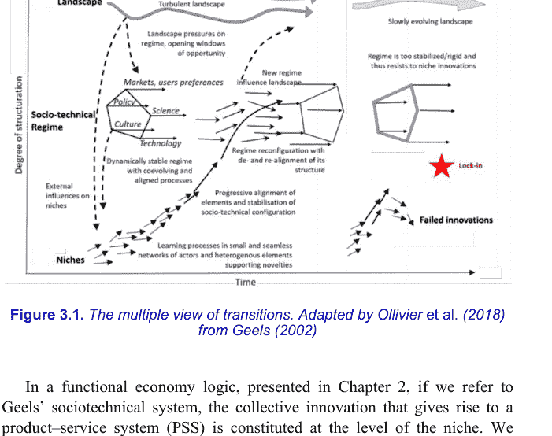
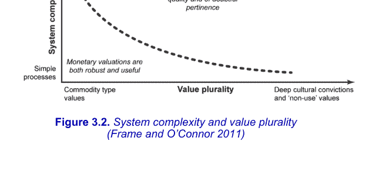
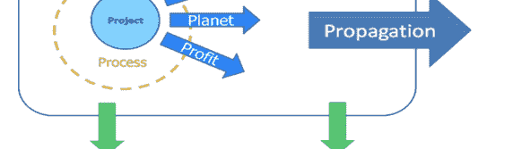
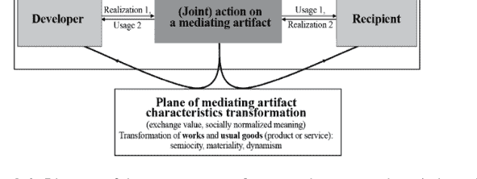
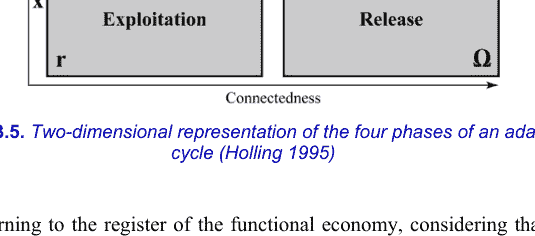
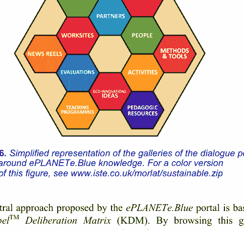
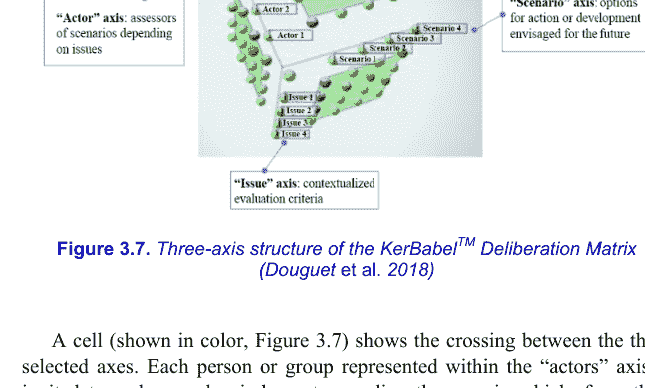
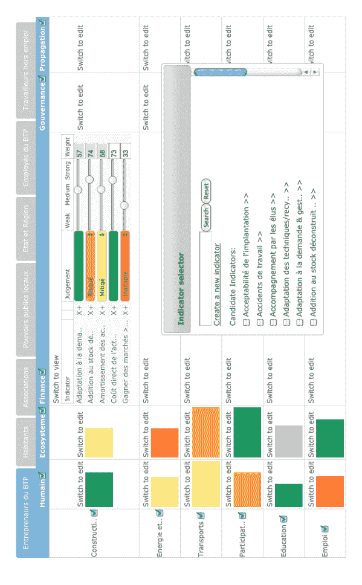
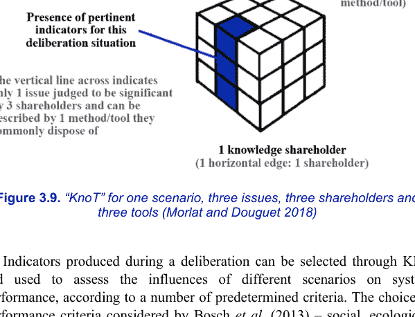
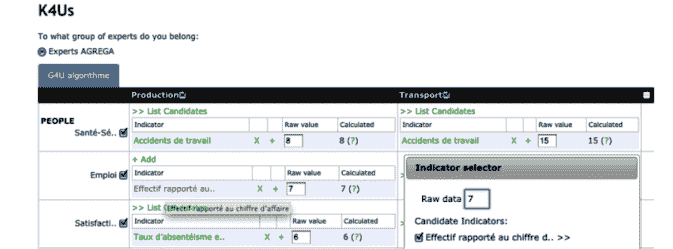

## 3. 沟通重塑理性

### 3.1. 从主体到行动者

我们认为，对功能经济中服务合同的基础性物理商品和功能性进行协调增值，意味着必须按照我们已提及的三个相互关联的解耦层级来进行领土价值分析。这些三个解耦层级，每一层都指向比前一层所描述的更为无形——但同样“物质性”的——资产，应与第一章末尾引入的五种工作形式相联系来看。

第一层解耦所考虑的生产是指社会工作诱发一种新的经济工作形式（对社会和生态现象的认知），从而导致一种对生态系统工作限制较小的工业工作形式。

第二层所考虑的生产是通过社会工作再次将生产的领土视野开放给面向多功能性的有形商品的安排，从而诱发致力于最大化其使用价值的行动者生态系统的构成。

第三层解耦所描述的生产意味着社会工作始终通过对所生产多功能性使用的增值，使对交换价值问题的看法得以更新（无形服务实体之间的增值），从而通过金融工作导致工业工作方法的新的选择。

这些工作要素与解耦层级之间的关系构成了一个有用的框架，用于构建实体之间的技术和社会经济关系，从而用于领土信息系统，进而用于功能生态系统的制度化。

在它们对于承认共同或相互利益是必要的范围内，这些关系对领土内的实体——无论单独还是共同考虑——都具有资本价值。综合来看，这些关系具有领土遗产价值。

### 3.1.1. 解构经济空间的区隔

### 3.1.1.1. 社会技术系统与货币表征

For Gaudin (2001), “可以注意到，行动者范畴的相对近期动员已涉及三个重大的科学议题。第一个聚焦于所观察对象的客观化。[...] 第二个是个人行动与集体行动之间的关系。[...] 最后，第三个是方法论路径的选择，这一议题难以与前者分离。[...] 这里同样，行动者概念的使用与否，以及在所观察现象的表征中给予它的位置，似乎具有严重后果。”

构建领土信息系统的挑战恰恰在于使人们成为社会、经济、工业和金融工作的行动者，而不仅仅是被强加于他们并塑造其表征和行动的情境所预先决定的主体。

产品-服务供给的共生产所发生的更广泛的功能生态系统，是社会技术系统的一部分，Geels (2002) 将其分解为三个相互关联的层级：“景观”、“体制”和“利基”。

利基使颠覆性创新得以出现并在其中逐渐成熟，免受其所属体制施加的选择压力。社会技术体制以规范、信念、认知惯例和法规为特征，这些因素或多或少稳定，引导实践的轨迹。景观描述了体制外部的环境，由宏观经济、文化表征模式和宏观政治发展构成（Bernard de Raymond and Goulet 2014）。

如果这三个层级之间的关联被打破，则社会技术系统就会“锁定”。当利基创新无法影响其所属的——并且可能传播它的——文化、政治、经济、科学和技术体制时，就会发生这种情况，或者当表征社会技术景观的多样性和动态性不足以伴随利基和体制的演变时，也会发生这种情况。

Figure 3.1. 转变的多重视角。由 Ollivier et al. (2018) 改编自 Geels (2002)

在第二章中提出的职能经济逻辑下，如果参照 Geels 的社会技术系统，催生产品-服务系统（PSS）的集体创新是在利基层级构成的。我们已描述了功能生态系统对 PSS 创新的传播影响，既通过利益相关者之间的协调专业化，也通过对所生产功能性及其价值的共同表征。该生态系统是在利基层级与 Geels 体制之间的一种中间层级构建起来的。

简而言之，一个由多功能利基生产支撑的服务供给，只有当其基于一种绩效评估能力时才会被认可为有价值，而这种能力之所以高度情境化是因为它受体制影响。因此，对服务供给进行价值评估的做法与其实体集体构建的社会技术环境不可分割。换句话说，这种构建本身的行动产生了绩效的表征，而这些表征只在功能生态系统内部的局部发生。

服务的财务价值因此不仅与有用功能性的可用性相关，正如我们在第二章讨论的解耦层级中的第三层所指出的资产与负债比较所暗示的那样。它还取决于基于对这些功能性获取服务的市场解决方案需求的波动，因而取决于对第二解耦层级所考虑的效用需求的非市场响应能力的波动。因此，这种波动不仅源于需求的波动，也源于识别和认可这些功能性、其价值以及使其使用得以提供的获取方式的能力的可变性。

基于多功能生产对服务进行货币化的困难在于，功能生态系统是一个开放系统。它属于一个体制，并受多个利基以及社会经济景观主要趋势的影响。这些影响的多样性和交叉授粉诱发了不同层级的需求，这些需求由行动者提出，他们对功能性价值的表征不同，或对使用其的获取能力——商业或非商业——不同。

换句话说，多功能生产的效用价值与获取其提供的功能性的服务的市场价值相关，只能归因于市场结构高度发达的特殊情况，该情况为可为此生产所认可的所有效用提供了机会。这降低了构成功能生态系统的实体的偿付能力潜力，而这些实体的生态可持续性选择和社会需求的功能性回应并未与可货币化的服务相关联。

此外，功能性及其价值的表征的不同领域与其可用性方式之间的脱节，加剧了这一障碍，使得社会和生态可持续的多功能生产难以出现，而这些生产并非可货币化的。

对于 Frame and O’Connor (2011) 而言，任何货币表征方法在价值客观化过程涉及基于具有多元文化和理性的行动者主观性的复杂系统分析时，且在大型领土和组织尺度上，其质量和相关性就会丧失。

Figure 3.2. 系统复杂性与价值多元性
(Frame and O'Connor 2011)

换句话说，货币表征只有在服务被外包时，或在谈判其基础功能性生产条件时才相关。它在表达这些功能性的非市场使用价值以及其非使用价值时并不相关。

此外，PSS 与一个更为复杂的系统不可分割：其发展的功能生态系统。PSS 供给只能在不断更新的谈判结束时“稳固地”和“恰当地”与单一的货币表征相关联，该谈判旨在界定并提升其与功能生态系统的互动。而这些谈判只能由功能生态系统中的行动者进行。因此，与供给的货币表征唯一性相关的严谨性条件是双重的：它源于这种表征的永恒更新及其社会性详细程度。

更一般地说，当无法严格地为在那里生产的功能性关联单一的普遍政治或市场价格——即适用于整个社会技术系统的价格——时，如何加强为 PSS 做出贡献的实体的偿付能力，即在利基层级？这不再仅仅是标准化商品和服务——因此可以在其生产的地方性之外识别——的交换价值之间的关系，以及多元价值之间的关系

必须解决特定于该地方的使用与非使用问题。必须考虑将功能性生产利基、再分配以及公共投资制度和景观嵌入地方功能生态系统的问题。

功能经济由审议过程驱动，无论是正式的还是非正式的，从方案的共同设计到共同生产解决方案的评估，以及对其效用的非市场化和商业化增值。

正是通过这种审议方法，我们将在社会技术系统的开放而动态的框架内解决货币化问题。我们建议的方法相当简单：由于生产价值的货币与非货币表征之间的区分仅在功能生态系统内部才是一致的，因此必须将其扩展到其他行动者。

这种雄心不仅仅意味着生产促进对本地生产功能的使用价值和非使用价值的认可的信息。其他生产领域的人们能够自我认同的能力至关重要。

如果这些其他地方的决策者确实是新古典经济学所考虑的行动者（由其社会技术利基特有的理性决定），那么他们识别“外生”功能的能力就是有限的。

如果另一方面，这些人不仅受决定，还受制于寻求信息的过程，该过程超越了僵化渠道的系统性贡献，尤其是由会计法规形式化，或基于或多或少同质行为假设构建的算法，那么他们认识到自己对多功能共同生产做出贡献的兴趣的倾向是真实的。

Gaudin（2001）中关于行动者范畴动员的三个问题——所观察对象的客观化、个体与集体行动之间的关联，以及方法论路径的选择——因此与实体的偿付能力问题不可分割。

## 3.1.1.2. 超越微观-宏观抽象：领土

领土的概念提供了侧向一步的可能性。它使得能够回到行动者的形象以及其纳入社会技术空间的维度，在该空间中进行集体生产、评估和增值过程的分析。

根据 Colletis 等人（2005 年）的说法，“要存在一个领土，必须结合三种邻近性：空间的、组织的和制度的”。我们认为，这些邻近性构成了一个潜在的领土，必须通过一种协调情境来揭示，该情境从位于时空中的行动者所遇到的问题的解决，到使锚定于这种三重邻近性的行动者的时间视野趋同的领土发展项目。

生产是一种协调情境，尤其当我们按我们所理解的方式考虑功能经济中的这种生产时。它由功能生态系统中一个自我构成的行动者群体所面临的政治、经济和社会问题的集体解决工作所滋养。

这些行动者在社会技术空间中的集体处境影响了他们执行这项工作的能力：领土邻近性决定了克服那些阻止利基功能创新在制度层面得到认可并在其他利基中得到估值的障碍。

这些行动者也在时间上共同定位。我们将证明，正是通过审议而实现的时间视野趋同的动态决定了生产、契约化和增值的集体能力。

领土并不永久存在。领土潜力的实现方式——Colletis 等人（2005 年）提出的邻近性——与一种增值模式而非另一种模式出现的可能性密切相关。

Landel 和 Senil（2009）强调了构建领土和将其视为资源所必需的三个操作：

-   *分离*使得能够为领土赋予特定的品质；
-   *投射*使得能够将这些特定品质用作行动者对领土未来所作表征的标记，并将这些行动者置于共同视野之中；
-   *关联*使得能够在由多源行动者合作产生的合同内，将不同对象与这些特定品质联系起来，并使这些行动者铭刻于共享的时间性中。

因此，“领土项目将成为管理悖论的空间，可以无限地适用于地方特殊性。它将成为涉及利益相关者在新的制度游戏中进行新形式公共辩论的机会。国家、地方当局、企业、协会、服务表达基于不同对象的矛盾逻辑”（Landel 和 Senil 2009）。

我们认为，正是通过这三种类型的操作，才实现了 Colletis 等人（2005 年）所提出的、为“揭示”领土潜力所必需的空间、组织和制度邻近性的结合。

-   *分离*使得能够将与领土相关的问题按迄今为止的表征方式进行表征，并*质疑既定空间、组织和制度邻近性的相关性*。
-   *投射*使得能够确定与新领土特定品质相关的判断标准，并构建一个将行动者置于共享的表征和行动视野中的情景，从而*更新制度和组织邻近性*。
-   *关联*使得能够根据这些标准在目标上进行权衡，在将情景置于共享时间性框架内的合同中，这导致了*组织邻近性的更新及其在空间邻近性中锚定的重新配置*。

功能生态系统必须被视为*功能经济的领土*。而 PSS 型方案的构建推动了这种功能领土的构建，而后者反过来又使该方案的奠基性创新（即利基创新）锚定于社会技术制度。

功能生态系统品质的*分离*既是生产活动绩效组成部分的分离，也是与其相关价值的使用、非使用和交换组成部分的分离。

*投射*是功能方案的集体设计，它既是绩效情景，也是价值认可情景。

*关联*将功能生态系统体现为一种解决方案，该解决方案不仅由产品和服务构成，还由投射所产生的共同制度视野的物化构成。

换句话说，在功能经济模式中，制度解决方案伴随着组织创新，并使得能够将创新利基与使其有利于该创新扩散的制度联系起来。

> 在这方面，Eurbanlab 方法（Bosch 等人 2013）很有意义。它动员了一种用于基准测试城市创新的工具，其绩效根据可持续性标准进行考虑，这些标准在环境、经济和社会三元组之外增加了创新的*过程*和*传播*。
> 
> *过程*绩效特别指领导力的品质、创新在其出现背景下的适当性、行动者共享文化的水平以及他们在创新的不同阶段的参与程度。
> 
> *传播*绩效反映了创新的扩散潜力，这种潜力与可能改变其所产生的领土系统的该创新的特征相关。
> 
> 我们认为，这种方法使得能够在 PSS 方案的评估中纳入其被其他经济地方认可的条件，即扩大功能生态系统的条件。

## 框 3.1. Eurbanlab 方法

图 3.3. Eurbanlab 方法（Bosch 等人 2013）所考虑的城市创新绩效评估维度

## 3.1.2. 迈向合作交易社会

### 3.1.2.1. 双重偶然性与增值

Niklas Luhmann（1982, 1988, 1986, 1986, 1991, 1995）其*社会系统理论*部分受 Talcott Parsons 教义¹（1951, 1968）启发，该教义认为社会沟通使得解决*双重偶然性*情境成为可能。该情境可描述为一种不确定性和犹豫不决的状态，源于两位行动者之间的互动，其各自的想法彼此无法得知，使得任一方的行为都取决于另一方的行为。

对 Luhmann 而言，*沟通*是一个非常特殊的过程。在他看来，需要注意不要认为“传递的信息对发送者和接收者来说是相同的”，信息的同一性被认为“与发送者和接收者对其意义可能非常不同这一事实相兼容”（Luhmann 1991, p. 135）。

功能经济由一种*沟通*过程驱动，旨在通过认识可由集体设计、生产和提升的 PSS 方案的生态、社会和经济效用，使行动者相互靠近。

一方面，“功能编码”由与生产的职能品质及可持续延续所需条件相关的信息的发送者执行。另一方面，“基于服务的编码”由与该生产的使用以及其回收的社会政治和市场条件相关的信息的发送者执行。

这种*沟通*通过将行动者纳入更新的功能生态系统，减少了多重偶然性的情境。

根据 Parsons（1951, 1968），双重偶然性状态的解决方案源于行动者之间通过文化继承价值体系之间的互动而获得的共识。这种文化遗产可以从时间、信息、*沟通*与组织之间的关系来理解。

我们上面论证过，增值既产生制度，制度也反过来产生增值。这就是我们现在要说明的。增值操作由于基于信息并产生其他信息，不能与*沟通*操作分离，这尤其意味着要从 Parsons 提到的文化遗产的角度来考虑交易行为。

借用 Dewey 和 Bentley（1949）的交易概念，Zacklad（2006）确定了四个步骤：“Virtualization（潜在接收者表达开发者认同或反之的项目愿景）、技能获取（开发者或共同开发者获得执行项目所需的技能）、绩效（中介物与执行项目内容的人们或多或少同时发生的转变）、认可（接收者对导演的象征性或有形奖励）。”²

Zacklad（2007）随后发展了*合作交易*的概念，描述了与会议相关的生产性互动，这些互动允许*中介物*（人工制品或媒介）与利益相关者共同转变。

图 3.4. *合作交易组成部分图*（改编自 Zacklad 2007）

2 Zacklad 基于符号学（Greimas 1966），该符号学由 Cooren（1999）在组织沟通领域使用。

这些合作交易产生新的经验内容，以转变的形式描述：“身体的——主要是身体效应（主要是感官体验）；表达性的——主要是心理效应（主要是表征体验）；能动性的——主要是社会关系效应（主要是关系体验）”（Zacklad 2008）。

合作交易的概念可以与 Luhmann 意义上的*沟通*相比较。*沟通*确实必须被视为“具有三个位置的单位”，即“三个要素——信息、沟通和成功预期——的综合……”（Luhmann 1991, p. 136）。然而，共同参与合作交易的两个人各自都在等待成功——当对中介物上的共同行动的满意程度进行综合评估时，成功就实现了。

对 Luhmann 而言，“信息、沟通（Mitteilung）和成功预期这三个要素在同一注意行为中的综合预设了‘编码’”（Luhmann 1991, p. 137）。从合作交易的观点来看，这种编码是在交易前存在的人们的经验内容中进行的，并允许同时识别中介物——例如 PSS 方案——及其相关价值。

*沟通*——在其最广义上（“*沟通*”）——应被视为一种“选择过程”，其中“在沟通中更新的选择构成了其自身视域。它已经构成了其作为选择所选择的内容，即作为信息”（Luhmann 1991, p. 135）。为了继续这种接近，每个人在动员来限定中介物的经验内容中所做的选择，已经是交易的视域。

换句话说，功能的生产者和受益者各自从自己的表征系统——在其经验内容中——选择描述该功能提供的条件及其服务的信息的选择是交易的视域：两位参与者所选信息组合无法描述他们对生产方式和服务优势的感知之外的任何内容。

因此，经验内容越丰富，生产中被认可的功能范围就越广，与这些功能相关的非使用、使用和交换价值就越能更好地整合到交易中。

### 3.1.2.2. 审慎以建立协议

合作交易改变了行动者动员的多元价值体系，以及他们共同考虑的对象的个体表征。换句话说，人们的经验内容和中介物在交易过程中共同演化。

上述描述的合作交易的四个阶段——虚拟化、技能获取、绩效、制裁——可以与第一章中提到的 Holling 自适应循环（见第 1.2.2.2 节）进行比较。

图 3.5. 自适应循环四个阶段的二维表示（Holling 1995）

回到功能经济的语境，考虑到 PSS 的共同实施是行动者之间协调专业化的结果，而这种专业化源于合作交易，这种接近可以如下说明：

- Virtualization, during a cooperative transaction within a functional ecosystem, corresponds to the meeting of the expression of utility needs and production capacities. In our opinion, this step results in an Ω phase called the “release” of resources (here informational).
- 虚拟化，在功能生态系统内的合作交易中，对应于效用需求表达与生产能力相遇。我们认为，这一阶段导致一个被称为资源“释放”的 Ω 阶段（此处为信息）。
- The acquisition of skills, during a cooperative transaction within a functional ecosystem, corresponds to the operationalization of concerted specialization. In our opinion, this stage involves an α phase of “reorganization-renewal” of functional production capacities.
- 技能获取，在功能生态系统内的合作交易中，对应于协调专业化的操作化。我们认为，这一阶段涉及功能生产能力“重组-更新”的 α 阶段。
- Performance, in a cooperative transaction within a functional ecosystem, corresponds to the co-production of functionalities. In our opinion, this stage involves an r phase (known as the “growth/exploitation” phase) of the utilities available and valued socially or in the context of market services.
- 绩效，在功能生态系统内的合作交易中，对应于功能的共同生产。我们认为，这一阶段涉及社会上或市场服务背景下被认可和重视的效用的 r 阶段（即“增长/开发”阶段）。
- The approval of the cooperative transaction corresponds to the material or symbolic reward for performance, i.e. a collective and differentiated response to the expectations relating to multifunctional production. This step results in a K phase, the “conservation” of experiential content and mediating artifacts, during which the message of performance is decoded, before being interpreted in the Ω phase of the next cycle.
- 合作交易的认可对应于对绩效的物质或象征性奖励，即对多功能生产相关期望的集体和差异化回应。此步骤导致 K 阶段，即经验内容和中介物的“保存”，在此期间绩效信息被解码，然后在下一个循环的 Ω 阶段被解释。

一旦奖励支付完毕，它就释放了信息资源。它为动员绩效经验教训和对先前合同安排的建设性批评打开了大门，从而通过其品质的更新表达，为未来的投射和衔接，实现功能生态系统这一经济领土的另一次分离。

因此回到 Landel 和 Senil（2005）提出的领土建构操作，Ω 阶段或虚拟化阶段指的是 Landel 和 Senil（2005）提出的分离操作；α 阶段或技能获取阶段指的是投射操作；r 阶段或绩效阶段指的是衔接操作，而 K 阶段或认可阶段描述了衔接与新分离之间的循环。

换句话说，行动者需要动员领土更新的品质，以便通过个体化和差异化的技能获取，不仅产生集体表征，也产生集体能力。然后，将这些技能的实施结合在共同视域内，使得能够以更新且共享的生产领土表征来设想这一视域。物质或象征性的实际奖励随后暂时构建了领土，使其成为在评估和增值期间以合同形式定义的多种绩效的领土。

通过这些操作，合作交易源于多重偶然性情境的减少并伴随

由 Colletis 等人（2005）提出的空间、制度和组织邻近性所包含的领土潜力的物化。

简而言之，合作交易既生产功能经济的领土——即功能生态系统，也以其为养分。

如果该交易能在行为者在共同生产 PSS 供给期间的 *Communication* 过程中降低偶然性水平，它就会在功能生态系统内发挥组织闭合的作用。

挑战在于在同一个交易行为中涵盖卢曼式 *Communication* 的三个位置：*information*（功能及其生产可持续性条件的资格认定）、*communication*（社会和/或商业契约化的行为）以及就非使用、使用和交换价值而言的 *expectation of success*（通过价值化机构）。

我们在此找到了我们在第 2 章中描述为领土经济信息耗散循环的三种情况（见第 2.2.1.2 节）。有关一项活动的经济成分仅部分货币化的信息，不得因契约行为和会计价值化而耗散。

应用于功能经济的合作交易逻辑导致将价值化呈现为制度的手段，而非仅在已确立的框架内发生时才使价值化合法化。两种逻辑并存。虽然需要有财富表征网格来进行估值，但该网格的构建是过去价值化过程的结果，这些过程创造了新网格的需求和合法性。框架始终处于运动之中。

### 3.2. 讨论即生产

Friedberg（1993，第 13 页）认为组织——或更确切地说 *phenomenon of organization* ——是“地方秩序构建的偶然且始终暂时的结果，其相对自主的特征构成了相关人员的集体行动能力。它同时是容器和内容、结构和过程，是人类行动的约束也是其结果。它赋予集体企业以持续性和厚度。其存在对反思和行动都有深远影响”。

这种呈现组织现象的方式可能对应于我们所说的“领土信息系统”：一种现象、容器和内容、结构和过程、人类行动的约束及其结果。

我们特别考虑的一种人类行动是推动功能经济中产品-服务供给共同构建的行动：该行动属于合作交易的一部分，通过合作交易，生产和价值化的地方性和临时性秩序得以构成：功能生态系统。

回到第 1 章末尾提出的劳动构成要素的区分，如果合作交易是经济劳动的结果，那么它只是由社会劳动产生的更根本现象的出现：卢曼意义上的 Communication。并且为了将多元劳动的社会和经济构成要素的表征领域结合起来，我们将此合作交易等同于 Communication，并从中区分出三个位置：information、contractualization 和 valorization。

描述这三个位置的术语应以特定意义来理解。

我们认为，information 指的是对效用需求以及使这些效用可用的功能生产能力的表达。它不仅仅是通信所传递的数据集合——“Mitteilung”，它是卢曼 “Kommunikation” 的位置之一，我们更常称之为“content”。这种信息本质上也是一个信息过程。它持续产生评价标准，生产方法和与生产相关的价值的表征将据此组织起来。

Contractualization 指的是合作交易中严格的经济部分。它是在需求的社会表达之后、通过通用绩效标准和具体指标对其内容进行表述的过程，但它紧接在工业劳动将被运用的物理和数字响应方式的结构化之前。

*Valorization* 不仅指就非使用、使用和交换价值对绩效的解释。我们认为，它描述的是人们经验内容与他们整合并制度化的表征和信息系统的共同转变。

我们确实认为价值化产生制度化，反之亦然。而这一点尤为重要，如果我们回到本章开头提及的问题，可以重新表述如下：如何提升本地生产的功能性对那些没有参照以使其能够识别这些功能性所赋予的效用库的行为者的价值？

我们随后讨论了功能生态系统的扩展。更准确地说，它是通过领土信息系统对多个功能生态系统进行网络化，每个生态系统都由具有特定 *Communication* 过程的合作交易驱动，这些过程特定于其生产性地方。

通过领土信息系统对功能生态系统进行网络化在去耦雄心要求集体构建共同视野并因此需要协调空间、组织和制度邻近性时具有特别重要意义。目标是连接不共享交易经验的行为者，并将他们整合到协调一致的专业化中，不再仅限于功能生态系统内部，也包括生态系统之间。目标是确保他们在共享的领土中对其活动的登记实现联合但有差异的——并且是 *absolute* ——改善。

最核心的经济问题之一是，在工业劳动的数字维度（由经济劳动构建）趋向于优先于社会劳动的信息维度（为经济劳动构建）之时。换句话说，在北美平台所进行的破坏性冲击——有时甚至被描述为掠夺性——之时，信息、知识和共享知识遗产在人类与信息网络关系中的相对位置问题。

### 3.2.1. 走向诠释性和贡献性的网络

#### 3.2.1.1. 关于功能性的对话

*Islets of rationality*，由 Fourez（1994，第 57 页）比喻性地描述为“在无知海洋中涌现的知识”，可以在表征的领土空间中识别出来。这些小岛的存在促进了行为者之间的地方理解，从而促进他们的合作，进而促进不同经济规模之间创新的共同演化。它们的出现涉及围绕项目对不同观点进行调和和仲裁（Fourez 1997，第 131 页）。

在本案中——功能生态系统的网络化——问题不在于考虑知识在无知海洋中的涌现，而在于把握在建设中的领土中各种理性共存的情况。

为了对该领土有更清晰的视野，可以绘制争议地图（Latour 2001）。其目标是澄清某些被认为 *socially lively*（Alpe 1999）的 *issues* 的轮廓——既在社会中，也在参考知识以及学校（甚至大学）知识中（Legardez and Simoneaux 2011）。

对于 Latour（2001）而言，争议必须导致“对那些成为深入专业知识对象的主题进行制图，同时这些主题也已成为案例，往往混淆不清，混合了法律、道德、经济和社会问题，以至于‘这些公共事物’变得越来越成为政治生活的核心。”

那些在不同学科专家、专业专家和地方参与者之间引发辩论的争议，是经济创新过程的一部分。争议的状态尤其决定了不同行为者在社会主要趋势、创新的涌现及其 appropriation 的汇合处相遇的条件。

Venturi（2008）指出，“争议制图的目的是通过数字技术的创造性使用来促进这些机制[表征、谈判和协商]的发展。”

几个功能生态系统——即几个经济领土——的联结，承认共同视野，可以基于 *model of dialogue based on knowledge*。这种模型属于通过相互交流理解复杂性并发展人们学习能力的前景的一部分（O’Connor 1999）。

更具体地说，我们将关注一个诠释性的基于网络的平台，*ePLANETe.Blue* 网络门户，它是一个参与性和贡献性的

致力于集体选择的模型。该门户提供了一种启发式导航，通过主题门、空间、画廊和对象档案的组织以及交叉链接来实现，使我们能够让主角参与到社会、经济和生态改善的过程中。

图 3.6. ePLANETe.Blue 知识对话门户画廊的简化表示。如需查看此图的彩色版本，请访问 www.iste.co.uk/morlat/sustainable.zip

ePLANETe.Blue 门户提出的核心方法基于 KerBabel™ 审议矩阵（KDM）。通过浏览此画廊，贡献者可以改变系统的表示（例如 PSS）并支持其社会意义的构建（例如在功能生态系统中价值判断的表达）。

在进行深入研究（访谈、文献综述等）后分析现场并制定目标后，贡献者受邀识别该系统特有的“社会选择”复杂问题。例如，该问题可能是为了共同构建其融资而对他们与 PSS 关联的价值的不同组成部分进行结构化，同时考虑到公共、市场和大众经济的逻辑——而不将其对立起来。

KDM 基于魔方™ 的理念，将这一社会选择问题以利益相关者、议题类别和行动情景为框架进行结构化。例如，图 3.7 中的表示可以被调整用于利益相关者之间的审议，以比较不同的 PSS 情景如何根据其对不同地域议题的回应进行比较。

图 3.7. KerBabel™ 审议矩阵的三轴结构
(Douguet et al. 2018)

一个单元格（图 3.7 中以颜色显示）显示所选三个轴之间的交叉。 “行为者”轴中代表的每个个人或群体都被邀请就从其角度来看，每个情景如何回应每个议题做出价值判断。判断通过与“元类别”相关联的颜色可视化：例如，绿色表示“适应”；红色表示“不适应”；橙色表示“风险”；黄色表示“缓解”；灰色表示“不相关”³。

颜色（图 3.7）要么对应于对每个单元格的直接判断，要么对应于针对每个单元格构成的若干“篮子”的综合，每个单元格包含一至五个用于审议辅助的指标，旨在明确所表达的判断。

表示（图 3.8）表明，一组建筑承包商使用了指标来澄清他们对建筑用途更新的地域性财政支持情景的适宜性判断。

3 判断的描述性文本（有利、不利等）及其相关颜色可在矩阵构建过程中由用户自由修改。

图 3.8. KerBabel™ 审议矩阵的使用示例（屏幕截图）。
如需查看此图的彩色版本，请访问 www.iste.co.uk/morlat/sustainable.zip

贡献者还可以在其动用的每个指标上关联一个讨论论坛。例如，这用于证明颜色选择的合理性，或讨论分配给该指标的主观权重，以便在有关所涉议题-情景交叉的总体判断中衡量该指标所提出的论证的重要性。

## 3.2.1.2. 从信息到等待成功

审议支持指标可以保存在一个补充画廊中，即 KerBabel™ 指标亭（KIK），它是由每个用户社区使用的指标目录。指标由元信息描述：名称、缩写、简短描述、科学概况、解释方法、生产来源（包括动员的知识）、状态、稳健性等。

指标不仅仅是决策辅助，或价值判断即时表达的论据。对于 O’Connor（2004）而言，指标的使用建立了一种对话，通过这种对话，知识生产者和使用者共同评估在复杂问题治理情境中知识动员的相关性。

然而，对话就像任何沟通一样意味着编码。让我们设想两个行为者会面讨论情景的效用和可接受性条件。他们各自使用的指标将非常不同。让我们再次以前一点的例子为例。受邀对地域性财政支持情景对其与建筑议题关系的影响发表意见的居民，并不总是使用与建筑承包商相同的指标。而且在这种情况下，例如考虑到 kWh/m² 指标，建筑承包商和居民对其的解释不会相同。

这不是观点分歧的问题，而是观点围绕同一分析参考点——指标——相交，却不将其与同一对象关联，甚至不追求相同的分析方法。例如，建筑承包商会从应遵守的建设标准角度思考 kWh/m²，而居民则以能源支出方式观察该指标。

建筑承包商和居民都可以声称对所考虑的情景有利或不利，并通过 kWh/m² 指标具体说明其判断；他们谈论的不是同一件事，因此无法沟通。审议随后反映了帕森斯意义上的双重偶然性情境（参见第 3.1.2.1 节）。

这就是为什么在清单中保留与指标相关联的元信息至关重要。除了记录指标外，还需要识别与其使用相关的元数据，即与这些指标相关的任何形式的知识，以便确保对该知识的可接受的可见度和透明度。

KIK 画廊履行此功能。它允许我们使用主题过滤器在指标之间导航，建议在这些指标与动员它们的方法和工具、领域或方法之间建立联系，并提供访问相关信息（文件和网站）。

为了减少审议情境所特有的偶然性情境，选择能够“与”尽可能多的贡献者“对话”的指标可能是有用的。在审议过程中，某些贡献者的观点表达会因某些指标的过度代表而得到青睐，这些指标系统性地与相同的分析方法相关联，则审议会产生偏见。

列出指标很重要，但同样重要的是允许贡献者选择指标以确保观点的代表性。

KerBabel™ 表示架（KRR）是 KDM 和 KIK 的补充画廊，提出了一个用于此目的的识别和收集指标的过程。

每个审议情境都是特定的、独特的，因为所涉及的问题、每位行为者用来描述情景对其活动影响的方法和工具的特殊性，以及对共同挑战的回应。

KRR 使能够将审议产生的指标与可用的知识形式相对应。

按四个轴设计，它允许根据以下内容重新定位每个指标：

- 1) 可能动员它的行为者类别（科学家、专家、企业、居民、公共当局等）——在此称为“知识载体”；
- 2) 这些行为者可能动员它的理论、概念方法（科学、通俗或其他）、方法和工具（用于分析、建模等）以及各种实践；
- 3) 可用于比较的情景或对象；
- 4) 其所涉及的议题。

对于 Douguet 等人（2018），提供对指标来源理解的第一个两个轴提供了知识供给的概览。其他两个轴构建了对知识情境化的需求，从而描述了一种知识需求（同上）。

通过重新定位所动员的指标，KRR 使能够根据四个选定轴评估可用知识的相关性（van der Sluijs et al. 2008; Douguet et al. 2009; Funtowicz and Ravetz 1994）。

知识载体——即正在审议的行为者，但也包括任何其他感兴趣的行为者——评估在四个轴（行为者、情景、议题、工具）之间的每个“交叉”中，每个在审议中产生的指标的适用性。每个贡献者必须在“0”（表示“不相关”）、“1”——“低相关性”；“4”——“高相关性”（默认值）之间进行选择。

该图示（图 3.9）描述了 Douguet 等人（2015）所称的“KnoT”或“知识超立方体”原理，以说明指标的相关性如何在 KRR 动员的四个轴的交点处描述。其二维表示意味着冻结四个轴中的一个或另一个。

KRR 不仅致力于审议指标的生产和选择。它还可用于选择规范性评估的指标。ePLANETe.Blue 门户的另一画廊，KerBabel™ for You（K4U），提供了一种共同生产算法的方法，以根据多个标准评估系统的性能，每个标准都将由次要目标具体说明。

图 3.9. 一个情景、三个议题、三个利益相关者和三个工具的“KnoT”（Morlat and Douguet 2018）

在审议过程中产生的指标可以通过 KRR 进行选择，并用于根据若干预先确定的标准评估不同情景对系统绩效的影响。例如，Bosch 等人（2013）所考虑的绩效标准选择——社会、生态、经济、治理以及解决方案的传播——可用于评估系统的 *可持续性绩效*（参见第 3.1.1.1 节）。

这些指标不再是审议性指标，而是绩效指标，贡献者将其与每个绩效标准相关的次级目标相关联。该集合输入一个简单的算法公式，使得能够比较情景对根据各标准所考虑的绩效实现的影响。

K4U 的运行意味着用户此次以评估者的角色，按照之前共同制定的解释和标准化规则⁴为每个指标分配 0–10 的分数。

4 这些规则是记录在 KIK 中的元信息的一部分。特别是，它们使得能够使与不同评估相关的指标的评估具有可比性，无论是定量还是定性，通过使用在 *ePLANETe.Blue* 上编制的李克特表将其简化为 0 到 10 的量表上的评估。

在为每个指标分配分数后，K4U 算法为每个绩效轴关联一个分数，以便生成具有 n 个绩效维度的[content]

图 3.9. 一个情景、三个议题、三个利益相关者和三个工具的“KnoT”（Morlat and Douguet 2018）

在审议过程中产生的指标可以通过 KRR 进行选择，并用于根据若干预先确定的标准评估不同情景对系统绩效的影响。例如，Bosch 等人（2013）所考虑的绩效标准选择——社会、生态、经济、治理以及解决方案的传播——可用于评估系统的 *可持续性绩效*（参见第 3.1.1.1 节）。

这些指标不再是审议性指标，而是绩效指标，贡献者将其与每个绩效标准相关的次级目标相关联。该集合输入一个简单的算法公式，使得能够比较情景对根据各标准所考虑的绩效实现的影响。

K4U 的运行意味着用户此次以评估者的角色，按照之前共同制定的解释和标准化规则⁴为每个指标分配 0–10 的分数。

4 这些规则是记录在 KIK 中的元信息的一部分。特别是，它们使得能够使与不同评估相关的指标的评估具有可比性，无论是定量还是定性，通过使用在 *ePLANETe.Blue* 上编制的李克特表将其简化为 0 到 10 的量表上的评估。

在为每个指标分配分数后，K4U 算法为每个绩效轴关联一个分数，以便生成具有 n 个绩效维度的配置文件——维度数量与标准相同（如果我们考虑社会、生态、经济、过程和传播标准，则为五个）。默认情况下，算法对与所讨论标准相关联的指标分配的分数进行加权平均。

上面介绍的每个画廊都可以以特定且独立的方式使用。然而，正是通过从一个画廊导航到另一个画廊的论述性使用，才加强了知识情境并促进了多利益相关方对话。为此，我们可以将 ePLANETE.Blue 门户的某些画廊与 Luhmann 描述的沟通的三个位置相关联。审议矩阵可被视为集体构成复杂信息的地方（基于每个贡献者为所有其他人提出的指标），表示架以及沟通构建方式的选择，而在制定多标准评估算法时对目标、指标和权重 的选择则可能由对共同成功的期望所驱动。

图 3.10. ePLANETE.Blue 门户上“K4U”类型的多标准评估算法的构建

## 3.2.2. 政治经济的贡献平台

### 3.2.2.1. 通过沟通实现再生产

通过 ePLANETE.Blue 门户画廊的集体旅程催化了知识的中介，并预示着新的策略和决策方法可能出现，与领土创新相兼容。

在此过程中，利益相关者之间的对话导致所动员指标（因此是知识）的选择发生变化。通过 K4U 算法根据不同绩效标准比较多个情景，可能导致用于支持价值判断的指标选择发生变化（通过审议矩阵）。改变他们提供关于所描述系统所赋予价值的信息的方式，将导致行为者重新考虑指标与评估方法之间的联系（通过表示架）以及指标的解释规则（通过 KIK）。

生产者和使用者之间的这种对话——指标的——他们可能是同一个人，但承担不同的角色（利益相关者、知识承载者、绩效目标或评估标准的生产者）——产生了 Colletis 和 Pecqueur（2004）所定义的 *领土遗产*。通过使用 *ePLANETe.Blue* 形成的这种遗产可以通过一个 *适应性循环* 来说明，该循环详细说明了 *合作交易* 的阶段，遵循上述提出的方法，并将其与 Landel 和 Senil（2005）描述 *领土建构* 的操作进行比较（参见第 3.1.2.2 节）。

KDM 是 *虚拟化* 的特权场所（合作交易方法），我们将其与一个称为信息资源“释放”的 Ω *阶段*（适应性循环方法）以及 Landel 和 Senil（2005）的 *分离* 操作进行了比较。事实上，审议的本质就是重新审视他们所称的领土的特定 *品质*，通过表达基于指标本身的论据的价值判断。

KRR 是 *技能获得* 的场所（合作交易方法），这种集体获取导致对可用于审议或评估的知识的共享表征。它对应于一个称为“重组-更新”阶段的 α *阶段*（适应性循环方法），即在重新定位可用知识的过程中，[content]

图 3.9. 一个情景、三个议题、三个利益相关者和三个工具的“KnoT”（Morlat and Douguet 2018）

在审议过程中产生的指标可以通过 KRR 进行选择，并用于根据若干预先确定的标准评估不同情景对系统绩效的影响。例如，Bosch 等人（2013）所考虑的绩效标准选择——社会、生态、经济、治理以及解决方案的传播——可用于评估系统的 *可持续性绩效*（参见第 3.1.1.1 节）。

这些指标不再是审议性指标，而是绩效指标，贡献者将其与每个绩效标准相关的次级目标相关联。该集合输入一个简单的算法公式，使得能够比较情景对根据各标准所考虑的绩效实现的影响。

K4U 的运行意味着用户此次以评估者的角色，按照之前共同制定的解释和标准化规则⁴为每个指标分配 0–10 的分数。

4 这些规则是记录在 KIK 中的元信息的一部分。特别是，它们使得能够使与不同评估相关的指标的评估具有可比性，无论是定量还是定性，通过使用在 *ePLANETe.Blue* 上编制的李克特表将其简化为 0 到 10 的量表上的评估。

在为每个指标分配分数后，K4U 算法为每个绩效轴关联一个分数，以便生成具有 n 个绩效维度的配置文件——维度数量与标准相同（如果我们考虑社会、生态、经济、过程和传播标准，则为五个）。默认情况下，算法对与所讨论标准相关联的指标分配的分数进行加权平均。

上面介绍的每个画廊都可以以特定且独立的方式使用。然而，正是通过从一个画廊导航到另一个画廊的论述性使用，才加强了知识情境并促进了多利益相关方对话。为此，我们可以将 ePLANETE.Blue 门户的某些画廊与 Luhmann 描述的沟通的三个位置相关联。审议矩阵可被视为集体构成复杂信息的地方（基于每个贡献者为所有其他人提出的指标），表示架以及沟通构建方式的选择，而在制定多标准评估算法时对目标、指标和权重 的选择则可能由对共同成功的期望所驱动。

图 3.10. ePLANETE.Blue 门户上“K4U”类型的多标准评估算法的构建

## 3.2.2. 政治经济的贡献平台

### 3.2.2.1. 通过沟通实现再生产

通过 ePLANETE.Blue 门户画廊的集体旅程催化了知识的中介，并预示着新的策略和决策方法可能出现，与领土创新相兼容。

在此过程中，利益相关者之间的对话导致所动员指标（因此是知识）的选择发生变化。通过 K4U 算法根据不同绩效标准比较多个情景，可能导致用于支持价值判断的指标选择发生变化（通过审议矩阵）。改变他们提供关于所描述系统所赋予价值的信息的方式，将导致行为者重新考虑指标与评估方法之间的联系（通过表示架）以及指标的解释规则（通过 KIK）。

生产者和使用者之间的这种对话——指标的——他们可能是同一个人，但承担不同的角色（利益相关者、知识承载者、绩效目标或评估标准的生产者）——产生了 Colletis 和 Pecqueur（2004）所定义的 *领土遗产*。通过使用 *ePLANETe.Blue* 形成的这种遗产可以通过一个 *适应性循环* 来说明，该循环详细说明了 *合作交易* 的阶段，遵循上述提出的方法，并将其与 Landel 和 Senil（2005）描述 *领土建构* 的操作进行比较（参见第 3.1.2.2 节）。

KDM 是 *虚拟化* 的特权场所（合作交易方法），我们将其与一个称为信息资源“释放”的 Ω *阶段*（适应性循环方法）以及 Landel 和 Senil（2005）的 *分离* 操作进行了比较。事实上，审议的本质就是重新审视他们所称的领土的特定 *品质*，通过表达基于指标本身的论据的价值判断。

KRR 是 *技能获得* 的场所（合作交易方法），这种集体获取导致对可用于审议或评估的知识的共享表征。它对应于一个称为“重组-更新”阶段的 α *阶段*（适应性循环方法），即在重新定位可用知识的过程中，[content]

图 3.9. 一个情景、三个议题、三个利益相关者和三个工具的“KnoT”（Morlat and Douguet 2018）

在审议过程中产生的指标可以通过 KRR 进行选择，并用于根据若干预先确定的标准评估不同情景对系统绩效的影响。例如，Bosch 等人（2013）所考虑的绩效标准选择——社会、生态、经济、治理以及解决方案的传播——可用于评估系统的 *可持续性绩效*（参见第 3.1.1.1 节）。

这些指标不再是审议性指标，而是绩效指标，贡献者将其与每个绩效标准相关的次级目标相关联。该集合输入一个简单的算法公式，使得能够比较情景对根据各标准所考虑的绩效实现的影响。

K4U 的运行意味着用户此次以评估者的角色，按照之前共同制定的解释和标准化规则⁴为每个指标分配 0–10 的分数。

4 这些规则是记录在 KIK 中的元信息的一部分。特别是，它们使得能够使与不同评估相关的指标的评估具有可比性，无论是定量还是定性，通过使用在 *ePLANETe.Blue* 上编制的李克特表将其简化为 0 到 10 的量表上的评估。

在为每个指标分配分数后，K4U 算法为每个绩效轴关联一个分数，以便生成具有 n 个绩效维度的配置文件——维度数量与标准相同（如果我们考虑社会、生态、经济、过程和传播标准，则为五个）。默认情况下，算法对与所讨论标准相关联的指标分配的分数进行加权平均。

上面介绍的每个画廊都可以以特定且独立的方式使用。然而，正是通过从一个画廊导航到另一个画廊的论述性使用，才加强了知识情境并促进了多利益相关方对话。为此，我们可以将 ePLANETE.Blue 门户的某些画廊与 Luhmann 描述的沟通的三个位置相关联。审议矩阵可被视为集体构成复杂信息的地方（基于每个贡献者为所有其他人提出的指标），表示架以及沟通构建方式的选择，而在制定多标准评估算法时对目标、指标和权重 的选择则可能由对共同成功的期望所驱动。

图 3.10. ePLANETE.Blue 门户上“K4U”类型的多标准评估算法的构建

## 3.2.2. 政治经济的贡献平台

### 3.2.2.1. 通过沟通实现再生产

通过 ePLANETE.Blue 门户画廊的集体旅程催化了知识的中介，并预示着新的策略和决策方法可能出现，与领土创新相兼容。

在此过程中，利益相关者之间的对话导致所动员指标（因此是知识）的选择发生变化。通过 K4U 算法根据不同绩效标准比较多个情景，可能导致用于支持价值判断的指标选择发生变化（通过审议矩阵）。改变他们提供关于所描述系统所赋予价值的信息的方式，将导致行为者重新考虑指标与评估方法之间的联系（通过表示架）以及指标的解释规则（通过 KIK）。

生产者和使用者之间的这种对话——指标的——他们可能是同一个人，但承担不同的角色（利益相关者、知识承载者、绩效目标或评估标准的生产者）——产生了 Colletis 和 Pecqueur（2004）所定义的 *领土遗产*。通过使用 *ePLANETe.Blue* 形成的这种遗产可以通过一个 *适应性循环* 来说明，该循环详细说明了 *合作交易* 的阶段，遵循上述提出的方法，并将其与 Landel 和 Senil（2005）描述 *领土建构* 的操作进行比较（参见第 3.1.2.2 节）。

KDM 是 *虚拟化* 的特权场所（合作交易方法），我们将其与一个称为信息资源“释放”的 Ω *阶段*（适应性循环方法）以及 Landel 和 Senil（2005）的 *分离* 操作进行了比较。事实上，审议的本质就是重新审视他们所称的领土的特定 *品质*，通过表达基于指标本身的论据的价值判断。

KRR 是 *技能获得* 的场所（合作交易方法），这种集体获取导致对可用于审议或评估的知识的共享表征。它对应于一个称为“重组-更新”阶段的 α *阶段*（适应性循环方法），即在重新定位可用知识的过程中，[content]

图 3.9. 一个情景、三个议题、三个利益相关者和三个工具的“KnoT”（Morlat and Douguet 2018）

在审议过程中产生的指标可以通过 KRR 进行选择，并用于根据若干预先确定的标准评估不同情景对系统绩效的影响。例如，Bosch 等人（2013）所考虑的绩效标准选择——社会、生态、经济、治理以及解决方案的传播——可用于评估系统的 *可持续性绩效*（参见第 3.1.1.1 节）。

这些指标不再是审议性指标，而是绩效指标，贡献者将其与每个绩效标准相关的次级目标相关联。该集合输入一个简单的算法公式，使得能够比较情景对根据各标准所考虑的绩效实现的影响。

K4U 的运行意味着用户此次以评估者的角色，按照之前共同制定的解释和标准化规则⁴为每个指标分配 0–10 的分数。

4 这些规则是记录在 KIK 中的元信息的一部分。特别是，它们使得能够使与不同评估相关的指标的评估具有可比性，无论是定量还是定性，通过使用在 *ePLANETe.Blue* 上编制的李克特表将其简化为 0 到 10 的量表上的评估。

在为每个指标分配分数后，K4U 算法为每个绩效轴关联一个分数，以便生成具有 n 个绩效维度的配置文件——维度数量与标准相同（如果我们考虑社会、生态、经济、过程和传播标准，则为五个）。默认情况下，算法对与所讨论标准相关联的指标分配的分数进行加权平均。

上面介绍的每个画廊都可以以特定且独立的方式使用。然而，正是通过从一个画廊导航到另一个画廊的论述性使用，才加强了知识情境并促进了多利益相关方对话。为此，我们可以将 ePLANETE.Blue 门户的某些画廊与 Luhmann 描述的沟通的三个位置相关联。审议矩阵可被视为集体构成复杂信息的地方（基于每个贡献者为所有其他人提出的指标），表示架以及沟通构建方式的选择，而在制定多标准评估算法时对目标、指标和权重 的选择则可能由对共同成功的期望所驱动。

图 3.10. ePLANETE.Blue 门户上“K4U”类型的多标准评估算法的构建

## 3.2.2. 政治经济的贡献平台

### 3.2.2.1. 通过沟通实现再生产

通过 ePLANETE.Blue 门户画廊的集体旅程催化了知识的中介，并预示着新的策略和决策方法可能出现，与领土创新相兼容。

在此过程中，利益相关者之间的对话导致所动员指标（因此是知识）的选择发生变化。通过 K4U 算法根据不同绩效标准比较多个情景，可能导致用于支持价值判断的指标选择发生变化（通过审议矩阵）。改变他们提供关于所描述系统所赋予价值的信息的方式，将导致行为者重新考虑指标与评估方法之间的联系（通过表示架）以及指标的解释规则（通过 KIK）。

生产者和使用者之间的这种对话——指标的——他们可能是同一个人，但承担不同的角色（利益相关者、知识承载者、绩效目标或评估标准的生产者）——产生了 Colletis 和 Pecqueur（2004）所定义的 *领土遗产*。通过使用 *ePLANETe.Blue* 形成的这种遗产可以通过一个 *适应性循环* 来说明，该循环详细说明了 *合作交易* 的阶段，遵循上述提出的方法，并将其与 Landel 和 Senil（2005）描述 *领土建构* 的操作进行比较（参见第 3.1.2.2 节）。

KDM 是 *虚拟化* 的特权场所（合作交易方法），我们将其与一个称为信息资源“释放”的 Ω *阶段*（适应性循环方法）以及 Landel 和 Senil（2005）的 *分离* 操作进行了比较。事实上，审议的本质就是重新审视他们所称的领土的特定 *品质*，通过表达基于指标本身的论据的价值判断。

KRR 是 *技能获得* 的场所（合作交易方法），这种集体获取导致对可用于审议或评估的知识的共享表征。它对应于一个称为“重组-更新”阶段的 α *阶段*（适应性循环方法），即在重新定位可用知识的过程中，[content]

图 3.9. 一个情景、三个议题、三个利益相关者和三个工具的“KnoT”（Morlat and Douguet 2018）

在审议过程中产生的指标可以通过 KRR 进行选择，并用于根据若干预先确定的标准评估不同情景对系统绩效的影响。例如，Bosch 等人（2013）所考虑的绩效标准选择——社会、生态、经济、治理以及解决方案的传播——可用于评估系统的 *可持续性绩效*（参见第 3.1.1.1 节）。

这些指标不再是审议性指标，而是绩效指标，贡献者将其与每个绩效标准相关的次级目标相关联。该集合输入一个简单的算法公式，使得能够比较情景对根据各标准所考虑的绩效实现的影响。

K4U 的运行意味着用户此次以评估者的角色，按照之前共同制定的解释和标准化规则⁴为每个指标分配 0–10 的分数。

4 这些规则是记录在 KIK 中的元信息的一部分。特别是，它们使得能够使与不同评估相关的指标的评估具有可比性，无论是定量还是定性，通过使用在 *ePLANETe.Blue* 上编制的李克特表将其简化为 0 到 10 的量表上的评估。

在为每个指标分配分数后，K4U 算法为每个绩效轴关联一个分数，以便生成具有 n 个绩效维度的配置文件——维度数量与标准相同（如果我们考虑社会、生态、经济、过程和传播标准，则为五个）。默认情况下，算法对与所讨论标准相关联的指标分配的分数进行加权平均。

上面介绍的每个画廊都可以以特定且独立的方式使用。然而，正是通过从一个画廊导航到另一个画廊的论述性使用，才加强了知识情境并促进了多利益相关方对话。为此，我们可以将 ePLANETE.Blue 门户的某些画廊与 Luhmann 描述的沟通的三个位置相关联。审议矩阵可被视为集体构成复杂信息的地方（基于每个贡献者为所有其他人提出的指标），表示架以及沟通构建方式的选择，而在制定多标准评估算法时对目标、指标和权重 的选择则可能由对共同成功的期望所驱动。

图 3.10. ePLANETE.Blue 门户上“K4U”类型的多标准评估算法的构建

## 3.2.2. 政治经济的贡献平台

### 3.2.2.1. 通过沟通实现再生产

通过 ePLANETE.Blue 门户画廊的集体旅程催化了知识的中介，并预示着新的策略和决策方法可能出现，与领土创新相兼容。

在此过程中，利益相关者之间的对话导致所动员指标（因此是知识）的选择发生变化。通过 K4U 算法根据不同绩效标准比较多个情景，可能导致用于支持价值判断的指标选择发生变化（通过审议矩阵）。改变他们提供关于所描述系统所赋予价值的信息的方式，将导致行为者重新考虑指标与评估方法之间的联系（通过表示架）以及指标的解释规则（通过 KIK）。

生产者和使用者之间的这种对话——指标的——他们可能是同一个人，但承担不同的角色（利益相关者、知识承载者、绩效目标或评估标准的生产者）——产生了 Colletis 和 Pecqueur（2004）所定义的 *领土遗产*。通过使用 *ePLANETe.Blue* 形成的这种遗产可以通过一个 *适应性循环* 来说明，该循环详细说明了 *合作交易* 的阶段，遵循上述提出的方法，并将其与 Landel 和 Senil（2005）描述 *领土建构* 的操作进行比较（参见第 3.1.2.2 节）。

KDM 是 *虚拟化* 的特权场所（合作交易方法），我们将其与一个称为信息资源“释放”的 Ω *阶段*（适应性循环方法）以及 Landel 和 Senil（2005）的 *分离* 操作进行了比较。事实上，审议的本质就是重新审视他们所称的领土的特定 *品质*，通过表达基于指标本身的论据的价值判断。

KRR 是 *技能获得* 的场所（合作交易方法），这种集体获取导致对可用于审议或评估的知识的共享表征。它对应于一个称为“重组-更新”阶段的 α *阶段*（适应性循环方法），即在重新定位可用知识的过程中，受此审议和/或评估影响的领土品质的 α 阶段。确定该知识对所考虑系统相关性的过程因此属于 Landel 和 Senil（2005）的 *投射* 练习。这里的目标是通过将指标置于情境中然后选择它们来重构知识体系，从而动员通过审议更新的领土的 *品质*，以产生基于该知识体系进行审议和评估的集体能力。

多标准评估算法 K4U 指的是集体 *绩效*（合作交易方法），贡献者通过该方法构成构成算法的目标并将指标与这些目标相关联。此步骤对应于一个被称为“增长/开发”阶段的 *r 阶段*（适应性循环方法），即在共享惯例中将个体绩效表征锚定在共享惯例中的能力。我们将其与 Landel 和 Senil（2005）描述的 *articulation* 相联系。事实上，这是在共同时间范围内实施所获得技能的结合，即对所研究系统的绩效评估。

KIK 是我们认为 *批准被强加* 的场所（合作交易方法）。正是通过它，更确切地说是通过重新设计它所容纳的指标的评估、解释规则和其他元信息，绩效的物质或象征性奖励才得以实现。这一阶段反映在被称为“保护”的 *K 阶段*（适应性循环方法）中，在此阶段与指标相关的元信息冻结，在——或更确切地说是——补偿的时间内，然后它们再次被其他审议、表征和评估所动员。这确实是 Landel 和 Senil 描述的 *articulation* 与 *projection* 操作之间的循环，在一次对话情境与另一次对话情境之间。

这种 *closure* 的概念，作为对认知主义方法的回应，受⁵ *Santiago 理论*（Maturana and Varela 1994）的启发并扩展到社会领域，可能邀请我们将领土视为个体表征生产与共享

5 在该理论中，生物学家 Maturana 和 Varela（1994）认为“认知行为不仅仅是外部客观现实的镜像，而是一种根植于我们生物结构的主动过程，通过它我们真正创造了我们的体验世界。”他们还建议“当一个生命系统与其环境相互作用时，不是环境干扰决定了生命体中发生的事情，就像外部力量作用于它一样（线性因果），而是系统内部将自身结构转化为对破坏性因素的反应（适应）。”

表征，即地域遗产。圣地亚哥理论的奠基概念之一是 *自创生*，即一个系统在受到外部干扰时不断生成并规定自身组织的现象⁶。可以认为，参与审议会从内部更新行动者的表征系统，即更新其心理系统。

然而，将 *自创生* 概念扩展到社会领域的尝试一直是争论的焦点（Fleischaker 1992；Mingers 1995，第119页 *et seq.*）。尤其是该概念的创始人马图拉纳和瓦雷拉，并不严格意义上设想社会自创生。对马图拉纳（1988）而言，语言使社会系统中的个体能够进行其生物学上的自创生，而系统本身并非自创生的。而对瓦雷拉（1981）来说，如果社会系统可以被一个接近自创生的组织封闭过程所表征，那么表征该概念的生产网络概念必须限定于物理领域。

另一方面，接受社会自创生思想的作者中包括尼克拉斯·卢曼。他的 *社会系统理论* ——本章第一部分广泛讨论的内容——甚至以这一概念为基础，并严格限定其在社会领域的适用范围。

卢曼所考虑的系统是心理（个体）和社会（群体）系统。这些系统不仅在对话，而且处于 *相互渗透*，即一种普遍关系中，“每个系统都把自身的复杂性置于另一个系统的服务之下”（Martuccelli 1999，第154页）。对卢曼而言，这种关系反映了“一个自创生系统预设了另一个系统的自创生成果，因而可以将其视为自身系统的一部分的方式”（同上）。

简而言之，卢曼（1990）认为“社会系统以沟通作为其自创生再生产的特定方式。其要素是沟通，即（……）由网络产生并再生产，且只能存在于此类网络之内的沟通。

基于这一思想，回到功能经济——更一般地说是政治经济——我们认为经济信息只能存在于能够沟通的行动者网络之中。

正是通过一种沟通情境，行动者才生产使用价值的指标，预见交换价值的水平，同时表达构成可持续性标准基础的非使用价值判断。这种情境意味着领土内的每个行动者都将其他行动者视为其自身活动系统的一部分，并且所有这些行动者共同能够定位为确定和解释这些不同指标、水平和标准而动员的知识。

## 3.2.2.2. 贡献型制度主义

以可持续发展为目标的经济评估面临与 Hill（1997）在观察传统公共政策制定和实施模式时所考虑的同类限制。大多数公共行政机构致力于特定职能（如交通、住房和健康），而非对问题的回应（如能源贫困）。这种组织体系减少了行动者之间的沟通，从而削弱了集体能力，无论是在问题形式化、选择应采取的行动、投资和评估方面。

在市场部门，经济估值面临另一项限制，即——尽管存在数字生态系统——主要基于工业时代价值链的部门化方法。市场行动者对部门生产效用所持的独立观点的并置，将评估空间缩小为交换关系的框架，其时间性也缩小为与获取金融资本的关系的时间性。

无论是公共还是私营领域，评估方法都是由行动者之间当前关系的构成所决定、所强加的，以及这种构成对生产和增值空间与时间表征的影响所决定的。相反，它可以在 *领土* 的尺度上被视为内在的，采用针对所涉问题的集体投射方法。

评估系统的锚定简而言之应是对经济 *制度主义构想* 的扩展（Commons 1934；Polanyi 1957）。

对 Vivien（2009）而言，在这种方法中，利益相关者概况和领土关系的多种多样意味着价值形成标准上的评估和审议过程的多样化。但这种相对的复杂性使得能够得出一种具体的、基于能够涵盖所有领土空间和时间性的工具的方法论回应。

这正是 *ePLANETe.Blue* 门户所允许的。依附于不同机构且不使用相同评估工具的支持行动者，在构建各种领土功能交织的集体表征以及评估社会选择问题的共享方法方面发挥作用。

围绕知识如 *ePLANETe.Blue* 的对话门户上的贡献工作更广泛地是在 Stiegler（2006）意义上的心理与集体 *个体化* 之间的重新 articulation，同时也是一个技术——这里的 *技术* 指的是评估，因为它构成了一个具体而有效的环境，将行动者以其个体性与领土联系起来，即 Stiegler 所认为的产生社会事务的 *超个体*（参见第1.2.2.2节）。

经济是一种社会制度。而作为在该制度内部产生其环境的技艺，评估——凭借其政治、社会、工业和市场维度——是超个体的表达，我们认为它需要不断更新。除了在特定交易背景下评估的执行目的之外，确实需要考虑的是人们 *经验内容* 的更新——用 Zacklad 的表述（参见第3.1.2.1节）——以及将群体纳入与财富关系的同步性。

领土评估过程如可在中观经济层面并在相当长的时间段内——即制度和政策的时间段——所设想的那样，因此不可分割于驱动不同群体在不同时间与领土尺度上就各种生产现象价值进行的历时性谈判的评估。

这种谈判无法在无法付诸实践双方动员的知识的领土中进行。将工业经济的部门表征以及被称为 *知识* 经济或 *认知资本主义* 的极端自由经济的数字平台所带来的破坏，留给其固定与财富关系的同步性，就会产生这种效果。尤其是被称为 *协作* 平台的 GAFAM 平台，往往具有标准化经济表征和行为的关联效应。在这方面，它们并不 *贡献*，即不参与不仅知识，而且领土锚定和共享的知识遗产的生产。

更一般而言，去地域化和过度标准化经济表征的格式和内容，剥夺了行动者在围绕生产现象价值进行地方谈判的实践中的主权，这倾向于削弱民主进程中的参与。

然而，如果 *地域遗产* ——在 Colletis 和 Pecqueur（2004）的意义上，即指源于过去成功合作经验的行动者之间的信任——在此背景下构成集体行动能力潜能的关键要素；必须假定它可能被驱散。

而如果这种遗产可以被消散，必须假定合作的潜能可能倾向于消失，转而有利于一种权力的行使：即一种表征、一种方法，以牺牲不仅其他表征和方法，而且承载它们的行动者的动态为代价。这将导致领土遗产的贫化，合作潜能以及与可持续发展相容的社会经济创新的减少。

因此，在贡献门户上进行的团体工作，以及更广泛地，领土内行动者之间的任何审议过程，都具有内在的经济价值。

6 自创生系统是“组织为一组生产过程的网络，这些过程的组成部分（a）通过其转化和相互作用不断再生产生它们的网络，（b）将系统构成其存在空间中的具体单元，规定其作为网络实现的拓扑域。由此，一个自创生机器不断生成并规定自身组织。它进行这种不断替换其组成部分的过程，因为它持续受到外部干扰，并不断被迫补偿这些干扰。因此，自创生机器是一个稳定关系的系统，其基本不变量是其自身组织（定义它的关系网络）”（Varela 1989）。

### 3.3. 结论

前三章使得提出一个经济问题成为可能。*Solvency*，即实体履行其财务承诺的能力，通常通过我们对工作的广义概念中经济与工业组成部分——物理和数字——之间的关系来考虑。我们在本章中刚刚说明的是，从可持续发展的角度来看，财务工作必须被领土的历史所捕获，并在行为者对其抱有的期望方面重新定义，即在生态、社会和经济系统的未来的一种限定性视野中。

作为对其各种形式资本形成和交换的一种新的关系，财务工作可以导致支持这些系统的可持续性，从而随着时间的推移推迟其临界阈值的实现。因此，财富的视野现在包括创造代表生态、社会和经济债务的社区，但也包括工业债务——物理和数字——以便不将技术进步排除在可持续创新的前景之外。

这种全球债务必须通过地方化、情境化和协商的重新估值来平衡，而工业和数字生产为这种方法提供了一个有趣的接口，在其中它影响可持续性的“tripod”，同时滋养财务利润。

接下来的三章提出了某些原则和工具，所有这些共同构成了一种方法，其最初的步骤是我们博士论文的主题，题为 *Dynamic Modeling of Cost Systems for a Sustainable Management of Territories*（2016）。这是一种经济评估方法，基于将评估视为生产性工作的认识，因此是一种自指的方法，可以作为一种编码来处理，因此，本质上，作为 Luhmann 的 *Communication*。

技术经济和社会经济关系的领土遗产，功能生态系统概念使得对其进行具体化——而非限定——以代表一个分析单元，这既是对支撑效用再现的质量的维护的保证，也是对这些效用的生态、社会、经济、工业和财务增值的一种工具。

它构成了共享资源、领土公共产品，实体从中获得具有资本价值的关系能力，正如它使这些相同的实体能够在这些关系中认识到具有资产价值的能力一样。

正是从这个意义上，我们引入第一个原则，该原则指出，分配给当地生产过程——特别是工业——的整体运营成本份额，不应基于直接促成该过程的活动的成本来确定。生产过程的运营成本必须由每个在其中工作的实体或系统如何直接或间接地促成构成该过程目的的一组目标来决定——一个社会、政治决定的财富视野。

只有在构建这一视野以及对每个实体对通向该视野的进展的贡献的协商表征结束时，才能对构建社会项目的成本进行分配。而只有在了解这种分配的情况下，才能确定相关生产过程的成本。

这，不多也不少，是一种管理控制，在领土层面以参与和协商的方式进行，旨在揭示在当前领土信息系统框架内仍然不可见的功能性生产。
