## 4. 会计：对话中的数字

### 4.1. 绩效系统

为了说明《绿色增长能源转型法》（*projet de loi relatif à la transition énergétique* 于 2014 年 7 月 30 日由法国国民议会通过）的目的，能源被描述为“这种经济上至关重要的力量，这种行动中的力量以与血液在组织中循环并为细胞供应的方式灌溉我们所有的活动，同时我们的物质和非物质通信系统以与神经系统相同的方式管理其生产和交付、其循环、其转换点和其分配”。

这种生物学寓言将能源转型定位于现实的两个层面。“行动中的力量”在热力学上影响生产系统，而构成社会的个人和社会群体则“像神经系统一样”对能源系统产生反作用。

如果我们仅参考为法国社会提供服务的能源部门，能源的热力学概念占主导地位。为了继续这个寓言，在这种情况下，能源转型的规划可以集中在摄入、消化、血管化和营养物质向细胞的传递上。

另一方面，如果我们将法国社会与能源转型问题联系起来，我们就把人文科学放在了中心位置。然后有必要思考内部新陈代谢，根据整个有机体所要进行的运动。“能源现实”随后被视为社会项目的术语来考虑，反思不再仅仅是部门性的，而是领土性的，因此是定性和务实的。

《绿色增长能源转型法》最终文本第 183 条¹，于 2015 年 8 月颁布，提及能源研究和创新政策需要“动员所有科学学科并促进围绕关键主题的多学科和跨学科科学社区的发展”。

从这个角度来看，我们必须考虑这些社区将如何代表能源系统，以便集体思考其转型。因此，一方面，重要的是选择适合这种转型、更一般地适合可持续发展的经济表征、方法和实践。也有必要确定这些选择的模式，这些选择可以是民主过程的结果，也可以是主导行为者对集体理性的捕获和同质化。

将自己局限于对一个物体或物理现象的观点并列——在多学科的排他性中——会妨碍人们辨别对经济理解有用的知识领域之间的接口。另一方面，鼓励对该物体或现象的表征进行跨学科组合，会产生新的、中介的知识，有助于纳入一个更少部门化、有时更合适的分析领域。

能源社会学（Zelem and Beslay 2015）的正式出现，例如提供了把握能源物体和现象的技术和社会维度而不失真的可能性。如果经济学要对生态转型做出有用的贡献，可持续发展经济的认识论必须得到澄清。第一章正是以这些术语引入的，这导致了前三章的发展。

我们现在为自己设定的一个目标，通过提出用于领土可持续管理的成本系统动态建模（DMCS）方法的原则，是将对生产现象进行跨学科方法所必需的中介知识，与领土行为者对这些现象所关联的价值的跨部门核算相结合。

说明这一目标有效性的切入点是一个研究项目，在此期间，贡献式网络门户 ePLANETe.Blue 使行为者能够在工业部门经济循环化战略与其领土可持续性之间的相互作用的集体表征方面得到支持。

### 4.1.1. 功能生态系统之间的耦合

#### 4.1.1.1. 领土循环经济的示例

循环经济模式，已在第 2 章（第 2.1.1.1 节）中提到，旨在通过限制资源消耗（原材料、水、能源）和废物生产以可持续的方式生产商品和服务。这是要摆脱线性经济模式（提取、制造、消费、丢弃），转向更“循环”的物质流动模式，由“4R”规则（Reduce, Reutilize, Reuse, Recycle）描述。

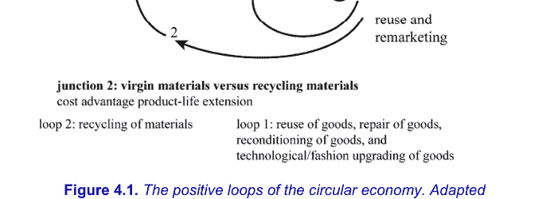

图 4.1. 循环经济的正向循环。改编并翻译自 Stahel and Reday-Mulvey (1981)

作为由 Agence Nationale Recherche（法国国家研究署）领导的“迈向循环经济——方法及相关服务”项目的一部分，AGREGA 项目——“Anticipation et Gestion régionales des Ressources En GranulAts（颗粒资源区域预期与管理）”

“管理骨料资源）” – 重点关注向法兰西岛大区供应建筑骨料，以及在大巴黎地区管理建筑废弃物。该项目于2018年初完成。

试点应用区域：法兰西岛，由于与骨料消费²增长趋势相关的当地问题的特殊复杂性，比其他地方更强，尤其由于大巴黎的实施。

问题：骨料资源紧张的风险已被证实（DRIEE IDF 2012）。塞纳河和马恩河冲积谷的砂砾开采将不足以满足需求。虽然区域间团结是应对这一风险³的一部分，但在区域层面也应考虑更好的管理。骨料长距离运输受限，尤其在盈利能力⁴和环境可接受性方面。此外，出口地区在中期将显示出产能下降。

## 框 4.1. AGREGA 项目的背景（Douguet 等，2018）

与其它行业相比，骨料生产商目前没有需求杠杆，他们只能做出回应，而无法影响市场发展。这种情况使得预测未来需求变得困难——而这些需求高度依赖于法兰西岛大区的发展速度（Chamaret 2015）。

已确定两种应对需求增长的情景（DRIEE 2012）。第一种涉及总消费量为每年 37.9 Mt，区域依赖比率维持在 45%。第二种考虑相同的消费量，但仅考虑来自外部地区的额外贡献，这导致依赖比率⁵上升。

2 1970年至2009年间年均增长0.7%，从280增至376 MT（UNPG 2011）。
3 对进口骨料的依赖率约为45%（DRIEE IDF 2012）。
4 骨料的最终价格每运输50公里翻一番（Chamaret 2015）。
5 这两种情景考虑了来自外部地区贡献的相似分布（按比例）。然而，有必要考虑地理分布（1）未来需求的增长，主要预计在内郊和外郊西部地区（DRIEE IDF 2012）；（2）需动员的资源类型（冲积资源、块状岩石、海岸骨料，

应对法兰西岛对骨料的需求既涉及在产量方面的生产努力增加，骨料质量的提高（用于建筑的商品混凝土），以及维持当前对外部地区依赖水平的努力。这种矛盾的指令对终端用户（法兰西岛大区的开发管理者）和行业利益相关者而言是技术和组织复杂性的重要来源。

在循环经济方法中，改善法兰西岛建筑骨料行业的过程涉及拓宽其分析范围，以便从减少物质流动的角度评价该行业的绩效。然而，扩大所考虑的绩效范围也可能导致研究骨料经济如何融入生物圈的主要循环（碳、水等）。

随后反思聚焦于第2章末尾所述的三种解耦水平中的第一种。

可以进一步扩展绩效分析；此次聚焦于该行业在不同地域尺度上产生的社会和经济效应。这涉及在超越其在物质流动和生态可持续性方面的事实性描述的基础上，共同构建该工业部门在社会和经济可持续性方面的*意义*。

随后反思聚焦于第二种解耦水平：它反映了社会技术系统内部产生的多功能性与能源-物质流动的影响之间的关系，因而也影响生态系统。

贡献式网络门户 *ePLANETe.Blue*（见第3.2节）在 AGREGA 项目期间被动员起来以代表工业部门，然后共同构建对其循环化影响可以赋予的意义。用于描述系统并生成审议矩阵的议题由一项社会经济研究（Chamaret 等，2015）确定，该研究旨在启动 AGREGA 项目。该研究确定了法兰西岛骨料供应链的11个可持续性议题。其理解随后在项目期间得到进一步发展（Douguet 等，2018）。

### 限制对气候变化的贡献
- 骨料资源开采、转化尤其是运输的能源消耗和温室气体排放（影响因材料和运输方式而异）。
- 获取资源困难导致与生产地点的距离逐步拉大，因而需覆盖的距离增加。

### 保护水资源
- 骨料的使用（尤其是最受欢迎的冲积沉积物）可能产生影响：水消耗（清洗和加工）、靠近取水区的风险等。

### 满足骨料需求
- 法兰西岛每年消耗约30 Mt骨料，主要用于住房和未来交通基础设施的混凝土。
- 需求在地理上不均，未来需求缺乏可见性（有人指出骨料资源紧张的风险）：信息缺乏阻碍了集体规划。

### 确保长期经济盈利性
- 需要了解建筑业拆除材料本地回收水平的可见性：为考虑如何满足区域需求，采石公司需进行的大量土地投资，⁶等。

### 保护资源
- 法国总体上骨料储量仍然很高，但属于可耗竭资源。
- 观察到冲积沉积物稀缺，这种高质量材料现已保留用于建筑等高尚用途（此前用于道路）。
- 需要对所谓的“天然”或“原生”资源——即直接来源于开采的资源——的替代品（回收可以为其做出贡献）。

6 后者的经济模式以惯性为特征，阻止其迅速改变战略（采石场开设申请可能需要超过10年）。

### 维持就业
- 采石场提供就业岗位，其中大部分为低技能且不可转移⁷。
- 需求的增加、储量的耗尽以及进口的高度使用正在削弱巴黎地区采石场的就业。
- 回收将减缓这一增长，并有助于创造不可外包的就业。

### 确保结构的安全性和质量
- 建筑质量/安全与骨料资源保护之间的竞争。
- 即使不符合技术、规范或法规要求，对原生（“天然”）骨料的偏好仍根深蒂固。
- 各行各业的研发（建筑商、混凝土和水泥制造商、采石场）：确保在更少原生材料的情况下保持相同的工作质量，并支持与回收相关的新技术的发展。

### 将资源送达所需地点
- 骨料是一种沉重但价格低廉的资源，因此运输在最终价格中所占份额显著：该价格每50公里翻一番。大规模运输将提高盈利能力。
- 需要考虑法兰西岛大区的配置和运输问题（道路交通、经塞纳河穿越首都的困难）——供应必须来自各方⁸。

7 法兰西岛大区的1,550家公司雇佣14,660人。间接就业估计为50,000人（Union nationale des producteurs de granulats 2011）。
8 此外，大部分消费发生在密集地区，运输已饱和。消费地与生产地之间也存在差异：小环城路集中了大部分消费，但没有生产基地（回收除外）。

## 限制对当地居民的滋扰
- 骨料对居民几乎没有益处，或仅有轻微益处，而居民仍不得不承受滋扰：噪音、粉尘、交通、景观变化等。 NIMBY 综合征表现强烈，尤其是在面对露天采石场时。
- 选民官员对材料问题了解甚少，往往顺应同胞的意见反对项目（特别是通过城市规划法规）。

## 维持伊勒-德-法兰西大区的自给率
- 伊勒-德-法兰西每年开采约 1000 万吨骨料，需加上混凝土、沥青混合料以及生活垃圾焚烧底渣回收产生的替代材料产量（500 万吨）。
- 年消费量为 3000 万吨：该地区平均缺口为 45%，必须从邻近地区（或不太邻近的地区，尤其是比利时）进口材料。
- 出口地区感到过度开采，尤其是在该活动目前并未创造就业的情况下，因为材料在伊勒-德-法兰西进行转化。对伊勒-德-法兰西地区的出口决策是政治决策。

## 保护自然环境
- 采石场活动通过关闭后再开发努力是否对自然环境有益，这一问题引发了不同的观点。
- 自然环境受到该活动的冲击。
- 社会对环境保护日益增长的兴趣，越来越导致资源获取困难：禁区数量不断增加。

## Box 4.2. 伊勒-德-法兰西骨料供应链可持续性的挑战（Chamaret 等 2015；Douguet 等 2018）

这些骨料行业可持续性的挑战使得能够在三个解耦层面之间建立联系。

能源-材料流动和生态影响的减少（第一层面）意味着行业社会技术构型的变化（第二层面），这可能导致使用方式的变化，从而有可能影响构成该行业的工业活动的盈利能力（第三层面）。

在概述适当的估值体系之前，有必要明确待估值对象。我们建议在此考虑 AGREGA 项目，该项目属于行业参与者主导的集体战略范畴，涉及 *product-service systems*（PSS）。

PSS 模型特别适合在三个解耦层面进行价值分析。比较第 2 章（第 2.1.1.2 节）中提到的三种 PSS 战略，可以解决伊勒-德-法兰西骨料供应链分析所用到的各种问题、尺度、层面和观点多样性。

- 行业网络的规模和对材料流动的关注。骨料行业构成的工业活动体系内回收/再利用骨料的销售，伴随着两种可被视为服务的功能的提供：延长动员骨料的使用寿命（行业层面的产品寿命）和降低原生资源消耗（行业层面的效益）。

因此，与工业部门相关联的系统可以表示为 *product-oriented PSS*。

- 区域尺度和对骨料行业地域扎根可持续性的关注。11 项可持续性问题的介绍（见框 4.2）表明，在行业内部增加回收将成为伊勒-德-法兰西地区有用功能的来源。换句话说，在面向地方参与者的社会技术体系内销售再生骨料，伴随着不同于构成行业内制造商之间所有权转移基础的服务。

因此，与骨料行业地域扎根相关联的系统可以表示为 *use-oriented PSS*。

- 对工业部门与领土之间互动的看法。AGREGA 项目（Douguet *et al.* 2018）的经验教训突出了上述两个 PSS 之间的功能性互动。这些互动可以如下举例说明，尽管并非穷举：
  - 伊勒-德-法兰西建筑规模上回收量的增加（材料循环性能）将有助于固定本地就业，同时限制区域采石场的枯竭，这将特别使得能够减少进口量和距离，从而降低货币成本和相关的 CO₂ 排放（行业的可持续性绩效）。
  - 区域行业通过其构型限制供应区域扩张的能力（行业的可持续性绩效）将使得能够避免开辟新的供应渠道，这些渠道可能向本地市场倾销过剩资源，其存在将破坏再生骨料目前享有的轻微竞争优势（材料循环性能）。

更一般地，再生骨料价格问题属于多标准评估体系的一部分，要求扩大绩效和经济平衡的表征尺度。

如果领土的参与者以及工业部门的参与者共同构建旨在增加回收利用的情景，以产生他们期望的功能性效益，他们共同促成了一个结果导向型 PSS。

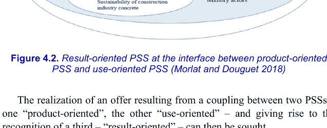

Figure 4.2. 产品导向型 PSS 与使用导向型 PSS 之间的界面上的结果导向型 PSS（Morlat and Douguet 2018）

然后可以寻求一种由两种 PSS 之间的耦合产生的供给的实现——一种“product-oriented”，另一种“use-oriented”——并导致对第三种——“result-oriented”——的认可。

## 4.1.1.2. 建筑改造示例

在以功能互动、服务和可持续性绩效描述的中观经济系统方法之后，考虑可以对其施加的微观经济影响是有趣的。

此处的方法将与前一点提出的方法相当相似，但例证的切入点是不同的研究项目。通过该项目，我们将突出社会经济实践，使其能够达到联合的可持续性和偿付水平，而仅靠技术经济实践是不可能设想的。

CIRePaT 项目 – Comment Impulser la Rénovation du Parc Tertiaire ?（如何推动第三产业园区改造？）– 由 FONDATERRA 基金会⁹ 支持，已证实地方当局可以促进私人商业建筑的热改造使用。这涉及通过适当的社会经济措施（教育、城市规划、激励、服务）影响房地产行业的组织以及运营的盈利能力。

*Pilot application area:* 伊勒-德-法兰西，对圣康坦-伊夫林城市共同体 SQY 生态城和瓦勒-德-法兰西城市共同体“拉缪特”区域进行的调查研究。

*Problematic:* 在研究时，建筑行业是法国耗能最多的行业，排放了近 24% 的全国 CO₂ 排放量（ADEME 2011）。第三产业房地产存量包括约 850 百万 m² 建筑，其中 480 百万 m² 为私营部门（Fondaterra 2012）。该园区不断增长并侵占农业和自然区域，而现有建筑的空置率很高。该房地产组合很大程度上源于第一部热工法规之前或同时期的建设（Girault 2001），其特点是老化程度高、热工性能差。园区的老化，甚至某些建筑的过时，对环境（能源、温室气体、城市蔓延等）、生活环境和健康状况（对建筑使用者和当地人口而言）以及地区经济（活力、吸引力等）产生影响。

## Box 4.3. CIRePaT 项目背景（Fondaterra 2012）

在这种情况下，可以考虑热能改造和翻新策略，但其财务成本往往高于拆除/重建策略相关的成本。然而，后者的生态影响远大于翻新策略（Fondaterra 2012）。因此，鼓励翻新对于确保可持续城市发展的连贯性是必要的。

在两个地区开展的研究显示，私营三级房地产资产的管理者往往出于经济原因被迫选择新的拆除/重建策略，但有可能转向新的决策方法。

初步调查更好地了解了园区技术特征以及利益相关者对项目目的的认知。本阶段一方面区分了房地产行业的参与者，另一方面区分了地方当局的参与者。

下一阶段催化了房地产行业不同参与者之间的交流：租户公司、房东和住户、投资者、营销人员、开发商、管理人员等。其目标随后是确定一套行动杠杆，使地方当局能够影响诊断期间确定的问题；目的是鼓励私营三级园区业主投资其遗产的翻新。

第一阶段结果：刺激翻新的主要障碍识别。

- 房地产行业参与者指出的议题：财务问题（盈利能力、投资能力、费用增加、租金维持、市场承压、翻新估值偏低等）；组织问题（场地占用、时间不足、与租户互动、缺乏地域活力等）；以及信息问题（难以评估与翻新相关的“可持续”形象、缺乏对能源老化问题及改造资产的了解等）。
- 地方当局指出的议题：财务问题（缺乏财政资源、亏损运营、经济环境等）；城市规划（公共交通服务以及提供的服务——商店等——不允许翻新工作使房地产达到足够的整体吸引力水平）；以及集体智慧（动员企业协会将有助于可持续发展政策）。
- 两类参与者共同指出的议题：投资盈利问题、集体动态（治理问题和复杂参与者的动员）；工作福祉（员工舒适度、就业创造、本地招聘和地域团结等）；能源效率（翻新和改善建筑整体性能、控制能源消耗）；环境保护；以及从法律角度实施操作工具，以促进在翻新项目期间获得创新法律和经济安排的便利。

第二阶段结果：识别可用于组成连贯行动方案的杠杆，以适应每个社区的具体情况。

- 教育杠杆：与住户需求相关（由地方当局发起的调查，其结果可传播给房东）；可达性、健康与安全；与《环境格勒内尔》相关的措施（绿色租赁、关于三级部门的法令）；生态行动（良好实践和现有工具的认知）；未来能源成本；绿色价值；现有补贴和计划（直接补贴、节能证书（ESCs）、能源绩效合同（EPC）等）。
- 城市规划杠杆：与建筑翻新可能的容积率奖励相关（与绩效或标签挂钩）；与翻新情况下建筑用途变更的授权相关；与流动性相关（改善区域流动性和优化员工流动性）；与城市规划工具和气候计划上的行动相关。
- 激励杠杆：与第三方融资计划的推广和支持相关（提升和整合 ESCs、促进和担保共享 EPC 等）；支持设立单一融资窗口以及 SEM（société d’économie mixte – 混合经济公司）；银行与项目业主之间伙伴关系的创建或加强；公共投资政策、补贴、奖金的实施；“游说”行动的实施（与大区、欧洲等）。
- 服务杠杆：与开发支持项目业主的地域方法相关（市镇间层面的共享能源顾问和/或地域附近存在专门从事能源效率的地方能源机构）；支持集体智慧的出现（动员企业协会、在地域内界定技能矩阵、识别并创造可能的协同效应等）；提出调解人角色（鼓励在其地域内建立新的中小企业）；加强地域内的服务。

CIRePaT 项目期间进行的诊断和讨论还显示，能源性能并不是业主的优先事项：当考虑翻新时，仅追求其本身并不是触发因素（Fondaterra 2012）。

## Box 4.4. 私营三级园区能源再生的相关议题（Fondaterra 2012；Louradour 等 2013）

社会和环境生命周期分析，如第 2 章中讨论的（见第 2.1.2.1 节），可以揭示从新的拆除/重建策略转向再造策略的有益影响。

直接影响将体现在建筑材料、能源、水的消耗以及拆除废弃物的管理方面。这些影响将能够为不同时间尺度和地域尺度的各种活动提供或多或少具体且分散的，但仍然非常真实的经济效益（服务）¹⁰。

换句话说，可以扩展与建筑再造作业相关的功能生态系统。然后有几种策略可供选择。

该作业可被视为“以产品为导向”的 PSS。它有助于改善建筑的内在功能性，最小化构成该建筑的产品所消耗的资源，以及该产品的耐久性（与拆除/重建策略不同）。

10 除第 2 章中介绍的社会和环境 LCA 外，还可以考虑多种功能。它们的识别和界定尤其可以基于与健康益处相关的现象；居民满意度（舒适度、社区改善、地域锚定等）；宏观环境（对消除能源生产高峰的贡献、低碳能源的发展、温室气体排放的减少等）；地方环境（通过新建避免浪费和材料与水的使用、自然区域和农业用地保护等）；地域经济（贸易平衡、租金、资产估值、就业、个体生产、租户偿付能力等）；房东的经济平衡（紧急和维护呼叫、火灾风险、保险成本的减少等）。（Institut de la Monétarisation 2013）。

它还可以形成更雄心勃勃的“以使用为导向”和“以结果为导向”的 PSS 策略的基础（见第 2.1.1.2 节和第 4.1.1.1 节）。

从拆除/重建策略向翻新策略的转变为社区提供的服务远比与建筑直接相关的效益更为显著。

从中观经济角度来看，一个社区例如可能对私营三级再造对骨料部门的影响感兴趣。再生选项的推广将大大减少对建筑材料的需求，并有助于减轻对骨料市场的压力，而这削弱了区域部门的可持续性。

换句话说，在微观经济层面组织地方当局利益与私营三级房地产参与者利益的交汇，将为骨料部门和地域带来中观经济功能优势。

通过区域、社会和环境生命周期分析来处理这些策略的构成，将阐明这些效益的一些组成部分及其受益者。然而，这些分析仅提供 *数据*，必须以集体解读的方式，使 *信息* 得以构建并且功能优势得到相互 *认知* ——或认可。

## 4.1.2. 多尺度与跨部门情景

### 4.1.2.1. 表示功能耦合

术语 *功能耦合* 在此指的是两种功能生态系统之间的分析关系，其相互作用在社会上得到认可，也可被经济所认可。

例如，翻新数量的增加在功能上影响区域工业骨料供应链演变的事实很容易说明；我们在前一点中刚刚做到了这一点。在行动中认可经济利益并设计整合在这些不同层面进行的思考的经济策略，则不那么明显。

评价一项活动对另一项活动影响所带来的利益是一回事，将这些利益与受益活动的绩效共同变化相结合是另一回事。有必要区分这些绩效是如何实现的、谁能够观察到它们、对它们进行定性并确定将它们的影响纳入考虑的后果，以价值实现为衡量标准。

这种在两个功能生态系统之间的分析耦合方法还意味着克服某些障碍，这些障碍与当前的地域邻近性（空间、组织、制度）相关。产生并受益于功能优势的活动不属于同一部门这一事实，可能导致在绩效的认可、支持和提升方面出现社会学、技术或监管方面的限制。

进而有必要解锁用于表征生产性现象的时间性和空间的框架：建筑回收或再利用的盈利性在微观层面有时并不立即显现，而这些活动的绩效对于部门层面的盈利性却是必要的。

一种微观（回收、翻新）和中观（骨料部门）生态系统的 *functional coupling* 从而将证明，不仅是对它们孵化的 PSS 之间相互作用的认可，而且是对各自治理过程的演变，进而——通过其存在逻辑的重构——导致对其业务模式的 *structural coupling*。

结构耦合的概念借鉴自 Maturana 和 Varela（1994），其目的在此是提出与 *autopoiesis* 概念的有限类比。它描述了一个认知系统如何——从其自身组织出发——转变以补偿外部事件造成的干扰（参见第 3.2.2.1 节）。该系统在持续适应这些干扰的同时保持其身份，这一事实被称为结构耦合。

在此，意识到类比的局限性，工业骨料部门的中观结构受到由私人第三产业不动化工业部门微观结构演变所引发的“干扰”的影响。

将这些“干扰”的定性改变为称之为“利益”，是一个社会认可的过程，其在于改变表征的层级，以便在新的功能生态系统的尺度上应对经济和政治理性。这是前一点所提出的方法：将两个 PSS，“产品导向”和“使用导向”纳入第三个“结果导向”PSS。

在 ANR“AGREGA”项目期间，贡献式网络门户 *ePLANETe.Blue*，在第 3 章中介绍，使其能够支持伊勒-德-法国大区骨料供应链的参与者对循环经济战略与地域可持续性挑战之间的相互作用进行集体表征。

使用 KerBabel™ *Deliberation Matrix*（KDM）使得能够支持对骨料部门地域嵌入的五个情景的评估会议¹¹。这些审议突出了该部门的功能性：一个整合系统，而不仅仅是锚定于商业关系的工业活动的[content]
评价一项活动对另一项活动影响所带来的利益是一回事，将这些利益与受益活动的绩效共同变化相结合是另一回事。有必要区分这些绩效是如何实现的、谁能够观察到它们、对它们进行定性并确定将它们的影响纳入考虑的后果，以价值实现为衡量标准。

这种在两个功能生态系统之间的分析耦合方法还意味着克服某些障碍，这些障碍与当前的地域邻近性（空间、组织、制度）相关。产生并受益于功能优势的活动不属于同一部门这一事实，可能导致在绩效的认可、支持和提升方面出现社会学、技术或监管方面的限制。

进而有必要解锁用于表征生产性现象的时间性和空间的框架：建筑回收或再利用的盈利性在微观层面有时并不立即显现，而这些活动的绩效对于部门层面的盈利性却是必要的。

一种微观（回收、翻新）和中观（骨料部门）生态系统的 *功能耦合* 从而将证明，不仅是对它们孵化的 PSS 之间相互作用的认可，而且是对各自治理过程的演变，进而——通过其存在逻辑的重构——导致对其业务模式的 *结构耦合*。

结构耦合的概念借鉴自 Maturana 和 Varela（1994），其目的在此是提出与 *自创生* 概念的有限类比。它描述了一个认知系统如何——从其自身组织出发——转变以补偿外部事件造成的干扰（参见第 3.2.2.1 节）。该系统在持续适应这些干扰的同时保持其身份，这一事实被称为结构耦合。

在此，意识到类比的局限性，工业骨料部门的中观结构受到由私人第三产业不动化工业部门微观结构演变所引发的“干扰”的影响。

将这些“干扰”的定性改变为称之为“利益”，是一个社会认可的过程，其在于改变表征的层级，以便在新的功能生态系统的尺度上应对经济和政治理性。这是前一点所提出的方法：将两个 PSS，“产品导向”和“使用导向”纳入第三个“结果导向”PSS。

在 ANR“AGREGA”项目期间，贡献式网络门户 *ePLANETe.Blue*，在第 3 章中介绍，使其能够支持伊勒-德-法国大区骨料供应链的参与者对循环经济战略与地域可持续性挑战之间的相互作用进行集体表征。

使用 KerBabel™ *审议矩阵*（KDM）使得能够支持对骨料部门地域嵌入的五个情景的评估会议¹¹。这些审议突出了该部门的功能性：一个整合系统，而不仅仅是锚定于商业关系的工业活动的[content]
评价一项活动对另一项活动影响所带来的利益是一回事，将这些利益与受益活动的绩效共同变化相结合是另一回事。有必要区分这些绩效是如何实现的、谁能够观察到它们、对它们进行定性并确定将它们的影响纳入考虑的后果，以价值实现为衡量标准。

这种在两个功能生态系统之间的分析耦合方法还意味着克服某些障碍，这些障碍与当前的地域邻近性（空间、组织、制度）相关。产生并受益于功能优势的活动不属于同一部门这一事实，可能导致在绩效的认可、支持和提升方面出现社会学、技术或监管方面的限制。

进而有必要解锁用于表征生产性现象的时间性和空间的框架：建筑回收或再利用的盈利性在微观层面有时并不立即显现，而这些活动的绩效对于部门层面的盈利性却是必要的。

一种微观（回收、翻新）和中观（骨料部门）生态系统的 *功能耦合* 从而将证明，不仅是对它们孵化的 PSS 之间相互作用的认可，而且是对各自治理过程的演变，进而——通过其存在逻辑的重构——导致对其业务模式的 *结构耦合*。

结构耦合的概念借鉴自 Maturana 和 Varela（1994），其目的在此是提出与 *自创生* 概念的有限类比。它描述了一个认知系统如何——从其自身组织出发——转变以补偿外部事件造成的干扰（参见第 3.2.2.1 节）。该系统在持续适应这些干扰的同时保持其身份，这一事实被称为结构耦合。

在此，意识到类比的局限性，工业骨料部门的中观结构受到由私人第三产业不动化工业部门微观结构演变所引发的“干扰”的影响。

将这些“干扰”的定性改变为称之为“利益”，是一个社会认可的过程，其在于改变表征的层级，以便在新的功能生态系统的尺度上应对经济和政治理性。这是前一点所提出的方法：将两个 PSS，“产品导向”和“使用导向”纳入第三个“结果导向”PSS。

在 ANR“AGREGA”项目期间，贡献式网络门户 *ePLANETe.Blue*，在第 3 章中介绍，使其能够支持伊勒-德-法国大区骨料供应链的参与者对循环经济战略与地域可持续性挑战之间的相互作用进行集体表征。

使用 KerBabel™ *审议矩阵*（KDM）使得能够支持对骨料部门地域嵌入的五个情景的评估会议¹¹。这些审议突出了该部门的功能性：一个整合系统，而不仅仅是锚定于商业关系的工业活动的[content]
评价一项活动对另一项活动影响所带来的利益是一回事，将这些利益与受益活动的绩效共同变化相结合是另一回事。有必要区分这些绩效是如何实现的、谁能够观察到它们、对它们进行定性并确定将它们的影响纳入考虑的后果，以价值实现为衡量标准。

这种在两个功能生态系统之间的分析耦合方法还意味着克服某些障碍，这些障碍与当前的地域邻近性（空间、组织、制度）相关。产生并受益于功能优势的活动不属于同一部门这一事实，可能导致在绩效的认可、支持和提升方面出现社会学、技术或监管方面的限制。

进而有必要解锁用于表征生产性现象的时间性和空间的框架：建筑回收或再利用的盈利性在微观层面有时并不立即显现，而这些活动的绩效对于部门层面的盈利性却是必要的。

一种微观（回收、翻新）和中观（骨料部门）生态系统的 *功能耦合* 从而将证明，不仅是对它们孵化的 PSS 之间相互作用的认可，而且是对各自治理过程的演变，进而——通过其存在逻辑的重构——导致对其业务模式的 *结构耦合*。

结构耦合的概念借鉴自 Maturana 和 Varela（1994），其目的在此是提出与 *自创生* 概念的有限类比。它描述了一个认知系统如何——从其自身组织出发——转变以补偿外部事件造成的干扰（参见第 3.2.2.1 节）。该系统在持续适应这些干扰的同时保持其身份，这一事实被称为结构耦合。

在此，意识到类比的局限性，工业骨料部门的中观结构受到由私人第三产业不动化工业部门微观结构演变所引发的“干扰”的影响。

将这些“干扰”的定性改变为称之为“利益”，是一个社会认可的过程，其在于改变表征的层级，以便在新的功能生态系统的尺度上应对经济和政治理性。这是前一点所提出的方法：将两个 PSS，“产品导向”和“使用导向”纳入第三个“结果导向”PSS。

在 ANR“AGREGA”项目期间，贡献式网络门户 *ePLANETe.Blue*，在第 3 章中介绍，使其能够支持伊勒-德-法国大区骨料供应链的参与者对循环经济战略与地域可持续性挑战之间的相互作用进行集体表征。

使用 KerBabel™ *审议矩阵*（KDM）使得能够支持对骨料部门地域嵌入的五个情景的评估会议¹¹。这些审议突出了该部门的功能性：一个整合系统，而不仅仅是锚定于商业关系的工业活动的[content]
评价一项活动对另一项活动影响所带来的利益是一回事，将这些利益与受益活动的绩效共同变化相结合是另一回事。有必要区分这些绩效是如何实现的、谁能够观察到它们、对它们进行定性并确定将它们的影响纳入考虑的后果，以价值实现为衡量标准。

这种在两个功能生态系统之间的分析耦合方法还意味着克服某些障碍，这些障碍与当前的地域邻近性（空间、组织、制度）相关。产生并受益于功能优势的活动不属于同一部门这一事实，可能导致在绩效的认可、支持和提升方面出现社会学、技术或监管方面的限制。

进而有必要解锁用于表征生产性现象的时间性和空间的框架：建筑回收或再利用的盈利性在微观层面有时并不立即显现，而这些活动的绩效对于部门层面的盈利性却是必要的。

一种微观（回收、翻新）和中观（骨料部门）生态系统的 *功能耦合* 从而将证明，不仅是对它们孵化的 PSS 之间相互作用的认可，而且是对各自治理过程的演变，进而——通过其存在逻辑的重构——导致对其业务模式的 *结构耦合*。

结构耦合的概念借鉴自 Maturana 和 Varela（1994），其目的在此是提出与 *自创生* 概念的有限类比。它描述了一个认知系统如何——从其自身组织出发——转变以补偿外部事件造成的干扰（参见第 3.2.2.1 节）。该系统在持续适应这些干扰的同时保持其身份，这一事实被称为结构耦合。

在此，意识到类比的局限性，工业骨料部门的中观结构受到由私人第三产业不动化工业部门微观结构演变所引发的“干扰”的影响。

将这些“干扰”的定性改变为称之为“利益”，是一个社会认可的过程，其在于改变表征的层级，以便在新的功能生态系统的尺度上应对经济和政治理性。这是前一点所提出的方法：将两个 PSS，“产品导向”和“使用导向”纳入第三个“结果导向”PSS。

在 ANR“AGREGA”项目期间，贡献式网络门户 *ePLANETe.Blue*，在第 3 章中介绍，使其能够支持伊勒-德-法国大区骨料供应链的参与者对循环经济战略与地域可持续性挑战之间的相互作用进行集体表征。

使用 KerBabel™ *审议矩阵*（KDM）使得能够支持对骨料部门地域嵌入的五个情景的评估会议¹¹。这些审议突出了该部门的功能性：一个整合系统，而不仅仅是锚定于商业关系的工业活动的[content]
评价一项活动对另一项活动影响所带来的利益是一回事，将这些利益与受益活动的绩效共同变化相结合是另一回事。有必要区分这些绩效是如何实现的、谁能够观察到它们、对它们进行定性并确定将它们的影响纳入考虑的后果，以价值实现为衡量标准。

这种在两个功能生态系统之间的分析耦合方法还意味着克服某些障碍，这些障碍与当前的地域邻近性（空间、组织、制度）相关。产生并受益于功能优势的活动不属于同一部门这一事实，可能导致在绩效的认可、支持和提升方面出现社会学、技术或监管方面的限制。

进而有必要解锁用于表征生产性现象的时间性和空间的框架：建筑回收或再利用的盈利性在微观层面有时并不立即显现，而这些活动的绩效对于部门层面的盈利性却是必要的。

一种微观（回收、翻新）和中观（骨料部门）生态系统的 *功能耦合* 从而将证明，不仅是对它们孵化的 PSS 之间相互作用的认可，而且是对各自治理过程的演变，进而——通过其存在逻辑的重构——导致对其业务模式的 *结构耦合*。

结构耦合的概念借鉴自 Maturana 和 Varela（1994），其目的在此是提出与 *自创生* 概念的有限类比。它描述了一个认知系统如何——从其自身组织出发——转变以补偿外部事件造成的干扰（参见第 3.2.2.1 节）。该系统在持续适应这些干扰的同时保持其身份，这一事实被称为结构耦合。

在此，意识到类比的局限性，工业骨料部门的中观结构受到由私人第三产业不动化工业部门微观结构演变所引发的“干扰”的影响。

将这些“干扰”的定性改变为称之为“利益”，是一个社会认可的过程，其在于改变表征的层级，以便在新的功能生态系统的尺度上应对经济和政治理性。这是前一点所提出的方法：将两个 PSS，“产品导向”和“使用导向”纳入第三个“结果导向”PSS。

在 ANR“AGREGA”项目期间，贡献式网络门户 *ePLANETe.Blue*，在第 3 章中介绍，使其能够支持伊勒-德-法国大区骨料供应链的参与者对循环经济战略与地域可持续性挑战之间的相互作用进行集体表征。

使用 KerBabel™ *审议矩阵*（KDM）使得能够支持对骨料部门地域嵌入的五个情景的评估会议¹¹。这些审议突出了该部门的功能性：一个整合系统，而不仅仅是锚定于商业关系的工业活动的[content]
评价一项活动对另一项活动影响所带来的利益是一回事，将这些利益与受益活动的绩效共同变化相结合是另一回事。有必要区分这些绩效是如何实现的、谁能够观察到它们、对它们进行定性并确定将它们的影响纳入考虑的后果，以价值实现为衡量标准。

这种在两个功能生态系统之间的分析耦合方法还意味着克服某些障碍，这些障碍与当前的地域邻近性（空间、组织、制度）相关。产生并受益于功能优势的活动不属于同一部门这一事实，可能导致在绩效的认可、支持和提升方面出现社会学、技术或监管方面的限制。

进而有必要解锁用于表征生产性现象的时间性和空间的框架：建筑回收或再利用的盈利性在微观层面有时并不立即显现，而这些活动的绩效对于部门层面的盈利性却是必要的。

一种微观（回收、翻新）和中观（骨料部门）生态系统的 *功能耦合* 从而将证明，不仅是对它们孵化的 PSS 之间相互作用的认可，而且是对各自治理过程的演变，进而——通过其存在逻辑的重构——导致对其业务模式的 *结构耦合*。

结构耦合的概念借鉴自 Maturana 和 Varela（1994），其目的在此是提出与 *自创生* 概念的有限类比。它描述了一个认知系统如何——从其自身组织出发——转变以补偿外部事件造成的干扰（参见第 3.2.2.1 节）。该系统在持续适应这些干扰的同时保持其身份，这一事实被称为结构耦合。

在此，意识到类比的局限性，工业骨料部门的中观结构受到由私人第三产业不动化工业部门微观结构演变所引发的“干扰”的影响。

将这些“干扰”的定性改变为称之为“利益”，是一个社会认可的过程，其在于改变表征的层级，以便在新的功能生态系统的尺度上应对经济和政治理性。这是前一点所提出的方法：将两个 PSS，“产品导向”和“使用导向”纳入第三个“结果导向”PSS。

在 ANR“AGREGA”项目期间，贡献式网络门户 *ePLANETe.Blue*，在第 3 章中介绍，使其能够支持伊勒-德-法国大区骨料供应链的参与者对循环经济战略与地域可持续性挑战之间的相互作用进行集体表征。

使用 KerBabel™ *审议矩阵*（KDM）使得能够支持对骨料部门地域嵌入的五个情景的评估会议¹¹。这些审议突出了该部门的功能性：一个整合系统，而不仅仅是锚定于商业关系的工业活动的[content]
评价一项活动对另一项活动影响所带来的利益是一回事，将这些利益与受益活动的绩效共同变化相结合是另一回事。有必要区分这些绩效是如何实现的、谁能够观察到它们、对它们进行定性并确定将它们的影响纳入考虑的后果，以价值实现为衡量标准。

这种在两个功能生态系统之间的分析耦合方法还意味着克服某些障碍，这些障碍与当前的地域邻近性（空间、组织、制度）相关。产生并受益于功能优势的活动不属于同一部门这一事实，可能导致在绩效的认可、支持和提升方面出现社会学、技术或监管方面的限制。

进而有必要解锁用于表征生产性现象的时间性和空间的框架：建筑回收或再利用的盈利性在微观层面有时并不立即显现，而这些活动的绩效对于部门层面的盈利性却是必要的。

一种微观（回收、翻新）和中观（骨料部门）生态系统的 *功能耦合* 从而将证明，不仅是对它们孵化的 PSS 之间相互作用的认可，而且是对各自治理过程的演变，进而——通过其存在逻辑的重构——导致对其业务模式的 *结构耦合*。

结构耦合的概念借鉴自 Maturana 和 Varela（1994），其目的在此是提出与 *自创生* 概念的有限类比。它描述了一个认知系统如何——从其自身组织出发——转变以补偿外部事件造成的干扰（参见第 3.2.2.1 节）。该系统在持续适应这些干扰的同时保持其身份，这一事实被称为结构耦合。

在此，意识到类比的局限性，工业骨料部门的中观结构受到由私人第三产业不动化工业部门微观结构演变所引发的“干扰”的影响。

将这些“干扰”的定性改变为称之为“利益”，是一个社会认可的过程，其在于改变表征的层级，以便在新的功能生态系统的尺度上应对经济和政治理性。这是前一点所提出的方法：将两个 PSS，“产品导向”和“使用导向”纳入第三个“结果导向”PSS。

在 ANR“AGREGA”项目期间，贡献式网络门户 *ePLANETe.Blue*，在第 3 章中介绍，使其能够支持伊勒-德-法国大区骨料供应链的参与者对循环经济战略与地域可持续性挑战之间的相互作用进行集体表征。

使用 KerBabel™ *审议矩阵*（KDM）使得能够支持对骨料部门地域嵌入的五个情景的评估会议¹¹。这些审议突出了该部门的功能性：一个整合系统，而不仅仅是锚定于商业关系的工业活动的[content]
在审议期间，每位参与者都能够组成指标集¹²，以便对情景如何应对骨料部门的可持续性问题表达价值判断（参见第 4.1.1.1 节图 4.2）。这些指标已在 KerBabel™ *指标亭*（KIK）中得到记录，其元信息也得到丰富。

至于 KerBabel™ *表征网格*（KRG），它既用作 *事前* 也用作 *事后*：通过将指标置于参与者所动员的知识的背景下，识别其相关性的工作，导致持续提出并更新一份适用于情景评估的指标清单。

*ePLANETe.Blue* 门户能够使伊勒-德-法国大区的参与者更进一步，特别是通过共同生产一种 *特设* 评估方法，该方法旨在促进对迄今被独立考虑的生产之间功能耦合的共同表征。

11 “围绕大巴黎快线的城市规划”；“大巴黎，一个可持续的大都市区”；“开通塞纳-北欧运河”；“多式联运平台的发展”；“大巴黎建设”；以及“零废弃”。

12 在 AGREGA 项目期间，会议是基于纸质矩阵进行的；在第二步中，指标和相关的价值判断被输入到门户中。

这种方法由 O’Connor 等人（2015）在实验室13 中启动，作为 AGREGA 项目官方发展的补充。

首先，我们区分了“骨料生命周期”的四个阶段（生产、运输、使用、回收）。

这种不同阶段的分离有利于对微观和中观绩效的共同实现进行战略投射，以及与该绩效相关的 PSS 商业模式的结构耦合——因此是[content]
对一项活动对另一项活动影响所带来的利益进行定性是一回事，将这些利益与受益活动绩效的共同变化结合起来是另一回事。有必要区分这些绩效的实现方式、谁能够观察到它们、对它们进行定性并确定将它们的影响纳入考虑的后果，以价值化为衡量标准。

这种在两个功能生态系统之间的分析耦合方法还意味着克服与当前地域邻近性（空间、组织、制度）相关的某些障碍。产生并受益于功能优势的活动不属于同一部门这一事实，可能导致在绩效的认可、支持和提升方面出现社会学、技术或监管方面的限制。

进而有必要解锁用于表征生产性现象的时间性和空间的框架：建筑回收或再利用的盈利性在微观层面有时并不立即显现，而这些活动的绩效对于部门层面的盈利性却是必要的。

微观（回收、翻新）和中观（骨料部门）生态系统的 *功能耦合* 从而将证明，不仅是对它们孵化的 PSS 之间相互作用的认可，而且是对各自治理过程的演变，进而——通过其存在逻辑的重构——导致对其业务模式的 *结构耦合*。

结构耦合的概念借鉴自 Maturana 和 Varela（1994），其目的在此是提出与 *自创生* 概念的有限类比。它描述了一个认知系统如何——从其自身组织出发——转变以补偿外部事件造成的干扰（参见第 3.2.2.1 节）。该系统在持续适应这些干扰的同时保持其身份，这一事实被称为结构耦合。

在此，意识到类比的局限性，工业骨料部门的中观结构受到由私人第三产业不动化工业部门微观结构演变所引发的“干扰”的影响。

将这些“干扰”的定性改变为称之为“利益”，是一个社会认可的过程，其在于改变表征的层级，以便在新的功能生态系统的尺度上应对经济和政治理性。这是前一点所提出的方法：将两个 PSS，“产品导向”和“使用导向”纳入第三个“结果导向”PSS。

在 ANR“AGREGA”项目期间，贡献式网络门户 *ePLANETe.Blue*，在第 3 章中介绍，使其能够支持伊勒-德-法国大区骨料供应链的参与者对循环经济战略与地域可持续性挑战之间的相互作用进行集体表征。

使用 KerBabel™ *审议矩阵*（KDM）使得能够支持对骨料部门地域嵌入的五个情景的评估会议¹¹。这些审议突出了该部门的功能性：一个整合系统，而不仅仅是锚定于商业关系的工业活动的[content]
评价一项活动对另一项活动影响所带来的利益是一回事，将这些利益与受益活动绩效的共同变化相结合是另一回事。有必要区分这些绩效是如何实现的、谁能够观察到它们、对它们进行定性并确定将它们的影响纳入考虑的后果，以价值实现为衡量标准。

这种在两个功能生态系统之间的分析耦合方法还意味着克服某些障碍，这些障碍与当前的地域邻近性（空间、组织、制度）相关。产生并受益于功能优势的活动不属于同一部门这一事实，可能导致在绩效的认可、支持和提升方面出现社会学、技术或监管方面的限制。

进而有必要解锁用于表征生产性现象的时间性和空间的框架：建筑回收或再利用的盈利性在微观层面有时并不立即显现，而这些活动的绩效对于部门层面的盈利性却是必要的。

一种微观（回收、翻新）和中观（骨料部门）生态系统的 *功能耦合* 从而将证明，不仅是对它们孵化的 PSS 之间相互作用的认可，而且是对各自治理过程的演变，进而——通过其存在逻辑的重构——导致对其业务模式的 *结构耦合*。

结构耦合的概念借鉴自 Maturana 和 Varela（1994），其目的在此是提出与 *自创生* 概念的有限类比。它描述了一个认知系统如何——从其自身组织出发——转变以补偿外部事件造成的干扰（参见第 3.2.2.1 节）。该系统在持续适应这些干扰的同时保持其身份，这一事实被称为结构耦合。

在此，意识到类比的局限性，工业骨料部门的中观结构受到由私人第三产业不动化工业部门微观结构演变所引发的“干扰”的影响。

将这些“干扰”的定性改变为称之为“利益”，是一个社会认可的过程，其在于改变表征的层级，以便在新的功能生态系统的尺度上应对经济和政治理性。这是前一点所提出的方法：将两个 PSS，“产品导向”和“使用导向”纳入第三个“结果导向”PSS。

在 ANR“AGREGA”项目期间，贡献式网络门户 *ePLANETe.Blue*，在第 3 章中介绍，使其能够支持伊勒-德-法国大区骨料供应链的参与者对循环经济战略与地域可持续性挑战之间的相互作用进行集体表征。

使用 KerBabel™ *审议矩阵*（KDM）使得能够支持对骨料部门地域嵌入的五个情景的评估会议¹¹。这些审议突出了该部门的功能性：一个整合系统，而不仅仅是锚定于商业关系的工业活动组合。

在审议期间，每位参与者都能够组成指标集¹²，以便对情景如何应对骨料部门的可持续性问题表达价值判断（参见第 4.1.1.1 节图 4.2）。这些指标已在 KerBabel™ *指标亭*（KIK）中得到记录，其元信息也得到丰富。

至于 KerBabel™ *表征网格*（KRG），它既用作 *事前* 也用作 *事后*：通过将指标置于参与者所动员的知识的背景下，识别其相关性的工作，导致持续提出并更新一份适用于情景评估的指标清单。

*ePLANETe.Blue* 门户能够使伊勒-德-法国大区的参与者更进一步，特别是通过共同生产一种 *特设* 评估方法，该方法旨在促进对迄今被独立考虑的生产之间功能耦合的共同表征。

11 “围绕大巴黎快线的城市规划”；“大巴黎，一个可持续的大都市区”；“开通塞纳-北欧运河”；“多式联运平台的发展”；“大巴黎建设”；以及“零废弃”。

12 在 AGREGA 项目期间，会议是基于纸质矩阵进行的；在第二步中，指标和相关的价值判断被输入到门户中。

这种方法由 O’Connor 等人（2015）在实验室13 中启动，作为 AGREGA 项目官方发展的补充。

首先，我们区分了“骨料生命周期”的四个阶段（生产、运输、使用、回收）。

这种不同阶段的分离有利于对微观和中观绩效的共同实现进行战略投射，以及与该绩效相关的 PSS 商业模式的结构耦合——因此是[content]
因此是 PSS 商业模式的衔接。

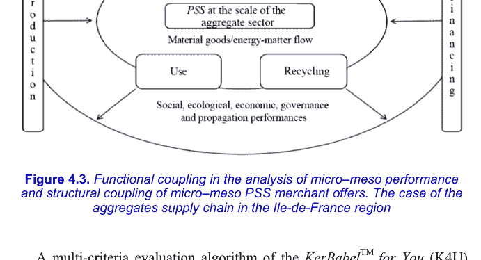

图 4.3. 微观-中观绩效分析中的功能耦合以及微观-中观 PSS 商业产品供给的结构耦合。伊勒-德-法国大区骨料供应链的案例

随后开发了一种 KerBabel™ for You（K4U）类型的多准则评估算法14（“Granulates for You”[G4U]）。其构建基于上述骨料生命周期的四个阶段与五个绩效领域——社会、环境、经济、流程和传播绩效（参见第 3.1.1.2 节）——的交叉，受 Bosch 等人（2013）的启发。

13 在 REEDS 实验室（Recherche en Economie écologique, Eco-innovation et ingénierie du Développement Soutenable – Research in Ecological Economics, Eco-innovation and Sustainable Development Engineering）中，隶属于凡尔赛-圣康坦-伊夫林大学。

14 ePLANETe.Blue 门户允许集体——贡献式——生产 K4U 算法，“G4U”算法虽在实验室设计，但由 O’Connor 等人（2015）以“专家”方式开发。

每个轴都分配了六个子绩效目标，其实现程度由主题指标——定量或定性——描述。

我们使用这些指标来反映每个骨料生命周期阶段的演进情景（表 4.1 的列）对区域骨料供应链子绩效目标实现（表 4.1 的行）的影响。

因此，这里与 AGREGA 官方发展的主题相反，并没有讨论情景如何可能应对该部门特有的可持续性问题。G4U 工具提供了一种既规范又更通用的多准则评估算法。其目的既是为与其他部门和地区进行比较提供要素，也——由于分阶段方法——反映影响骨料生命周期不同阶段的利益相关者的不同观点。

对于与绩效轴（“5Ps”）相关的某些子目标，单一指标即可覆盖生命周期的四个阶段，且解释和标准化规则对每个阶段都相同。对于其他目标，同一指标覆盖四个阶段，但由于不同阶段活动特点的不同，提出了不同的标准化规则。对于其他目标，虽然与所有阶段相关的目标定义指标的逻辑相同，但指标及其相关元信息会根据阶段而变化。

K4U 工具通过将六个子目标与每个绩效轴关联，以及为每个目标制定特定的指标类型，构成了一个可管理且综合的系统。

| 轴 | 绩效标准 | 次要目标 | 指标 |
|---|---|---|---|
| 社会 | 健康与安全 | 工伤事故 |  |
| 社会 | 就业 |  |  |
| 社会 | 工作满意度 |  |  |
| 社会 | 艰苦工作条件 |  |  |
| 社会 | 就业能力 | 能力 |  |
| 社会 | 噪音污染 | 允许水平 |  |
| 环境 | 材料 | 库存补充 | 库存管理 |
| 环境 | 水 | 蓝水足迹 |  |
| 环境 | 能源 | 能源强度 |  |
| 环境 | 气候 | 温室气体排放 |  |
| 环境 | 空气质量 | PM10排放 |  |
| 环境 | 环境承诺 | 环境承诺水平 |  |
|  | 绩效标准 | 次要目标 | 生命周期阶段 |
|  |  |  | 生产 | 运输 | 使用 | 再利用 |
|  |  |  | 定量 | 定性 |
|  | 指标 |  |  |  |  |  |

表 4.1. “G4” 算法动员的指标体系 (O'Connor et al. 2015).

如需此图的彩色版本，请参阅 www.iste.co.uk/mortar/sustainable.zip

| 类别 | 维度 | 指标 |
|---|---|---|
| 经济 | 物理一致性 | 盈利能力；生产成本；投资；韧性；地方价值 |
| 经济 | 合理使用 | EBE 的解释；运营费用；资产折旧；对需求和流程管理的适应；地方价值创造 |
| 经济 | 预测可用性 |  |
| 经济 | 负荷连续性 |  |
| 经济 | 资源质量 |  |
| 流程 | 参与 | 理解；经验；代表性；社会对话；推动 |
| 流程 | 利益相关者参与 | 共享文化；解决方案经验；影响多样性；内部反思；领导力 |
| 传播 | 技术系统 | 经济前景；兼容性；可接受性；监管；商业模式 |
| 传播 | 技术与前瞻性战略 | 比较可用性；比较成本；与供应链的兼容性；社会可接受性；监管发展；法律和经济安排 |
| 传播 | 比较成本 | 比较成本 |

“G4U” 算法的运行随后基于一个虚构案例进行了测试。所获得结果的介绍将在第 6 章中描述（见第 6.1.2.2.2 节）。

## 4.1.2.2. 设计集体绩效的新领域

设计 G4U 算法——用于评估骨料行业地域锚定的绩效——需要建立构成该行业活动的制度框架。

为此，我们使用了法国活动分类 Nomenclature d’Activités Française NAF Rév.2.1 (INSEE 2015a) 提出的分类。对于骨料生命周期的每个阶段，已从该分类中选择了不同的类别，以代表被认为相关的活动的整体概览（见表 4.2）。

| 代码 | 描述 |
|---|---|
|  | **开采** |
| 代码：08.11Z | 装饰石和建筑石、工业石灰石、石膏、白垩和板岩的开采 |
| 代码：08.12Z | 砾石和沙坑开采，粘土和高岭土开采 |
|  | **运输** |
| 代码：49.20 | 铁路货运 |
| 代码：49.41 | 道路公路货运 |
| 代码：50.40 | 内河货运 |
| 代码：52.10 | 仓储和存储 |
| 代码：52.21 | 陆路运输辅助服务 |
| 代码：52.22 | 水路运输辅助服务 |
|  | **使用** |
| 代码：46.13 | 木材和建筑材料贸易中间商 |
| 代码：46.73 | 木材、建筑材料和卫生设备的批发 |
| 代码：23.61 | 建筑用混凝土构件制造 |
| 代码：23.63 | 预拌混凝土制造 |
| 代码：23.64 | 灌浆料和干混混凝土制造 |
| 代码：41.20 | 住宅和非住宅建筑施工 |
| 代码：42.11 | 道路和高速公路建设 |
| 代码：42.12 | 地面和地下铁路建设 |
| 代码：42.13 | 桥梁和隧道建设 |
| 代码：43.11 | 拆除工程 |
|  | **回收** |
| 代码：38.11 | 无害废物收集 |
| 代码：38.21 | 无害废物处理和处置 |
| 代码：38.32 | 分拣废物回收 |
| 代码：46.77 | 废料和废金属批发 |

表 4.2. 基于法国 NAF Rev.2.1 (2015) 分类法的“骨料生命周期”相关活动指示性分类

对于等级为“XX.XX.”的每个 NAF 代码，其子类别的细节（未出现在表 4.2 中）已被详细说明，以提供所涉活动的精确规范。骨料生命周期制度性表征的这一首个框架旨在超越直接参与工业部门的参与者而得到丰富。

这种活动“范围”的定义必然是主观选择，但它绝不能是任意且固定的。

例如，对于代码 50.40“内河货运”，我们考虑了在河流、运河、湖泊和其他内陆水道上的货运，包括港口和码头。我们还选择考虑为内河水路货运租赁有船员的船舶，因为从功能角度来看这是合理的。然而，我们没有考虑河流的推挽服务，这是一个值得怀疑的选择。

我们还针对代码 52.22，“水路运输辅助服务”，考虑了运营港口和码头等终端设施、运营船闸、航行、引航和锚泊活动以及救援和驳运活动。

这些在实验室中做出的“专家”选择旨在强调这些活动的支持功能。然而，在地域方法的框架内，只有参与者之间的磋商——导致了针对这一支持功能的社会理解及其价值的特定指标的出现——才可能使其合法化。

我们在这里想要说明的是，工业经济通过参考同质生产单位（HPU）而动员的分析框架，并不直接允许多功能生产的提升。

只有当地方活动类型单位（KAU）“仅生产一种产品且不开展任何次要活动”时（Eurostat 2013，第 1.60 点），这样的生产单位才可观察到。然而，这些 HPU 是法国 NAF rev. 2 分类法中同质活动分支的构成单位，即活动和产品 – CPF rev. 2.1 (INSEE 2015)。

作为领土内活动之间互动的客观化第一层级，HPU 因此也是还原主义的第一层级！经济必须将这一分析对象 – HPU – 整合到代表生产过程的另一结构中。

循环经济和工业生态战略（见第 2.1.1.1.1 节）的目的在于重新配置物理生产单位之间联系的功能组织和合同结构。为了强化这一动态，必须建立一个新的共享表征框架，以便描述构成这一结构的 HPU 之外的参与者的影响。

简而言之，这不仅是解决工业结构重新配置的功能后果的问题，也是反映对该结构的不同功能影响 – 特别是制度性影响 – 的问题。

例如，对 HPU“道路货运”（NAF 类别 49.41）征收的碳税将导致考虑该税对 HPU“住宅和非住宅建筑施工”（NAF 类别 41.20）与 HPU“分拣废物回收”（NAF 类别 38.32）之间关系的影响。

继续这种方法意味着将制度性参与者，即该碳税实施的来源，视为一系列现象的生产者，这些现象可以被识别为对工业部门其他活动有用，甚至对社会有用的现象。而且，一旦这些效用被识别，就有必要考虑它们的资格，特别是通过基于社会和商业合同的绩效评估标准的制定。

在此再次以向法兰西岛大区供应骨料为例，并将征收碳税的假设限制在“运输”阶段的活动上，然后可以区分由领土向该行业提供的两类服务：

- 与运输活动与其他工业活动之间的互动直接相关的服务，涉及运输被征税的材料财产的交易。
- 例如，对碳排放征税会增加每吨公里的成本，从而导致对本地的潜在偏好，并鼓励回收活动，这些活动对运输活动产生反馈（方式转变和长途交通减少），从而提高税收的效率。
- 与工业部门之间间接互动相关的服务，其运输活动被征税，而这些活动不受税收或涉及运输的物质商品交易直接影响。

例如，在城市和城郊地区提高对拆解建筑材料分拣和处理场地的可接受性，促进了回收利用，这有助于减轻对当地“天然”骨料储量的压力，从而控制供应来源之间的距离，进而对运输活动产生反馈，由此提高税收的效率。

两种类型的服务均可通过绩效承诺来表征，这些承诺可通过指标加以限定，而这些指标可转化为非货币数据与货币数据之间的比率。这些指标和比率可以纳入行业参与者与区域参与者之间的合同。换句话说，它们有助于在工业部门的参与者与区域的参与者之间建立沟通，涉及生态税收在区域经济的共同表征中的纳入。

## 4.2. Cost systems

本章第一部分提出了一个相对明确的问题：*我们如何在绩效表征被实物商品贸易结构所捕获的情况下，构建一个功能性价值化体系？*

实际上，在区域表征的空间中对功能性影响进行估值是困难的。交易仍然主要局限于“价值链”和“同质活动分支”。在既定的组织和制度接近性之外，参与者不一定能认识到彼此的共同利益，而且最常情况下，没有事先的沟通经验。

我们在此引用 Zacklad（2006）的观点：“接受方可能在第一眼看不到功能性供给的好处，而供给方必须证明其有用性和一致性，就像任何创新一样。正是在这个意义上，我们所主张的功能性经济可以被称为建构主义¹⁵。功能性并非永恒存在；它是供应商与接受方之间合作建构的结果，对应于此前相互独立的一系列交易的转化性视野”。

15 “F. Hubault 因此认为功能性经济是‘反功能主义’的！”（Zacklad 2006）。

DMCS 方法的目标正是使目前看似独立的交易的依赖性变得可见。

其目的是通过识别*functional couplings*，发展对某一区域经济的集体表征，并促进彼此商业模式的一致性，即支持*structural couplings*。挑战不仅在于更新一个部门活动的互动，还在于让第三方能够通过比基于 HPU 的行政命名法更合适的解读框架来分析这些互动。

从功能耦合的表征转向结构耦合的表征，意味着通过新的地方管理实践鼓励政治谈判的具身化——可能为公共行为者提供反馈——尽可能从根本上强化其可持续性雄心，同时在经济上使这些条件合法化。

由私营第三产业园区改造活动引发的微观经济市场交易，可能对区域层面的交易产生影响。我们已说明了地方当局通过投资合作性、非市场交易而采取行动的潜力，以便设立各种杠杆来刺激这些改造。

政治与经济之间沟通所缺乏的是，在价值分析中对这些尺度变化进行核算的能力，而不将货币信息与非货币信息分开，也不因对前者的关注而降低后者的可读性。

### 4.2.1. Internalization and territorialization

#### 4.2.1.1. Internalized “green” value

*green value* 的概念——由英国的 *Royal Institution of Chartered Surveyors (RICS)* 提出——自 2005 年以来，已凸显了加拿大和美国之间建筑环境质量与其市场价值之间的联系。该概念在涉及私营第三产业房地产的交易背景下可能具有动员的意义。

不同于新古典逻辑的方法被用来接近这一 *green value*：

- “*valorization by comparison*” 比较两处房产的价格：一处经过改造，另一处具有相似特征但未改造¹⁶。
- “*hedonistic*” 方法（Ridker and Henning 1967；Rosen 1974）使得价值化得以细化。它分离出对改造房产某些组成部分的隐含供给和需求。随后统计计算评估这些供给和需求对该房产买卖或租赁价格的可能影响¹⁷。
- “*total cost*” 方法评估建筑在其整个生命周期内的成本分布，从设计到拆除（MIQCP 2006；MEEM/CGDD/SEEI 2009）。它区分被视为 *elementary costs* 的技术和财务成本、房地产资产经济绩效的 *intangible* 决定因素，以及 *externalities*。
- “*capitalization*” 方法考虑房产环境绩效对其市场价值的影响。该绩效结合风险和/或成本的降低，对净收入与资本化率的比率产生积极影响。

其他方法也可以使用，然而我们不会关注它们：这里重要的是将绿色价值呈现为对房地产参与者生态系统内非正式服务的价值化的新古典转录。换句话说，绿色价值是功能关系被认可的新古典表达。从这个角度来看，以上所述的方法足以用于我们的论证。

Lorentz（2010）提出了一种绿色价值形成过程决定因素的表征，基于 *hedonistic* 和 *capitalization valuation* 方法。

16 这些方法使得能够根据特征的宽泛集合的区分来比较不同房产的财务绩效（例如，使用的主要技术工艺类型、是否有标签等）。

17 描述每平方米价格的典型享乐模型：P/m² = α + β₁C₁ + β₂C₂ + ... + βₙCₙ + ε 其中：α = 截距，βi = 特征 i 的单位价格，C₁ = 特征 i，ε = 残差项（误差项）。

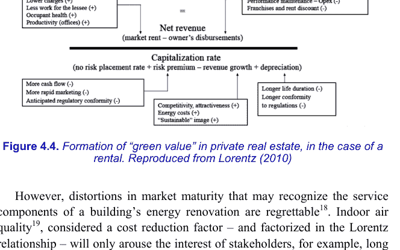

图 4.4. 私人房地产中“绿色价值”的形成，以租赁为例。转引自 Lorentz（2010）

然而，市场成熟度可能承认建筑节能改造的服务组成部分的扭曲是令人遗憾的¹⁸。室内空气质量¹⁹，被视为成本降低因素——并在 Lorentz 关系中被因子化——只会在例如很久之后才引起利益相关者的兴趣，另一个因素是使用舒适性（Bouteloup et al. 2010）。

这些扭曲限制了全生命周期成本方法的适用，该方法邀请在建筑整个生命周期内考虑成本和收益。

更根本地说，让我们在此回顾，新古典主义者所称的因素在功能性经济中对应于由要素和功能组成的系统的涌现属性；并且在不考虑其涌现条件的情况下对该属性进行因子化，会削弱评估。

18 优化营销延迟，作为显著降低风险溢价的因素，将在短期内产生强烈效果；与可持续发展、健康、直接租金重估、非过时性和监管合规性相关的问题，避免免赔额和租金折扣，以及整体现金流对风险溢价的影响将在短期内产生显著效果，然后在中期产生非常显著的效果；由于费用减少而导致租金上涨，与减少业主支出的维护进展相关的竞争力、形象、与能源成本相关的吸引力将在中期产生强烈效果；而租金因租户需承担的工作平均成本下降而合法化上涨，以及大修和维修对业主支出的影响将在长期产生显著效果（Bouteloup et al. 2010）。

19 能源改造通常是利用对居住者健康安全的材料对建筑进行再生的机会。

空气质量和使用舒适度，例如，与另一种现象——缺勤——的出现密不可分，而缺勤因其明显的经营管理实质性，对投资选择具有强烈影响。仅从这三种现象中提取用于定义市场价格的因子信息，将使对其出现的理解变得不可能。

洛伦茨的方法，本质上不过是对外部性的内部化，必须基于价值的系统性分析，并且这种系统性方法绝不能被放弃。

工作生产率以及缺勤率的降低，其中部分原因在于舒适度提高以及知道健康质量得到考虑的满意感，应与已翻新的办公楼的占用总成本进行比较。

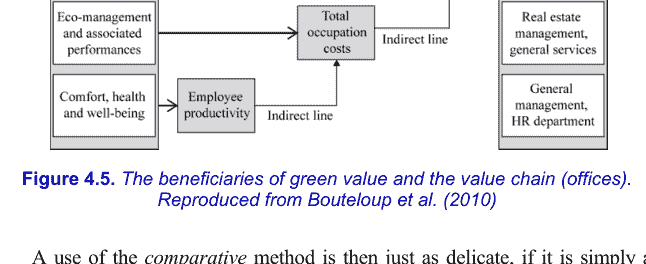

Figure 4.5. 绿色价值的受益者及价值链（办公楼）。转引自 Bouteloup et al. (2010)

使用 *比较* 方法同样微妙，如果它仅仅是关注价格，因而关注有形和房地产资产的 *交换价值*，而非其所基于的使用价值。

将此 *比较* 方法锚定在更广泛的分析中，将使我们能够处理翻新房地产资产的绿色价值，以及其他无形资产的价值，即与拥有该建筑的实体 *非物质资本* 的估值一起处理（参见第 2.1.2.2 节）。

这将涉及将拥有翻新有形财产的实体的 *商誉* 与拥有除翻新外具有相似特征的资产的实体进行比较。然后将涉及对这两个实体的无形资本进行结构化，以便突出上述其他三种方法所考虑的特征。

这种方法并非难以实现。自 2002 年以来，IAS²⁰-IFRS²¹ 标准要求对有形固定资产进行“逐组件”核算。然后就可以将房地产资产细分为多个要素，例如通过区分外壳、能源系统、屋顶、设备等。于是，通过分离不同的主体组件，可以更精确地处理设备/使用关系。

换句话说，对有形固定资产进行分解将使实体能够形式化无形资产，这些无形资产专门用于描述与内部社会组织安排的接口，即表征影响建筑性能的使用方式。

对于 Biojo et al. (2012) 而言，按组件资本化使得能够区分未来经济利益将归属于该实体资产的项目，以及那些很可能归属于投资者以及其他合作伙伴行为者的项目。

这完全符合节约功能性的逻辑。在我们所介绍的研究案例中，对建筑外壳的修复是对资产组件的投资，而这项投资延长了建筑的使用寿命，同时也推迟了拆除/重建的期限，这对骨料行业具有功能性影响（市场紧张程度的降低）。

在这一阶段，仍有必要更精确地考虑，这种有益的功能性影响——即这种功能性——如何在地域层面得到形式化。然后将有必要提出一种综合分析逻辑，用于关联微型投资的价值以及该投资所产生的中观经济功能性。

## 4.2.1.2. Territorialized “green” value

如果正如我们刚才所说明的那样，翻新建筑的“绿色价值”不仅取决于技术特征，并且其认可受到管理物业资产的实体内部现象的影响（设计、占用情景、技术/能力适配、信息流失、设施管理、使用方式、占用者行为等），它还取决于外部现象，这些现象由行为者之间关系的本地组织决定。

Chazel (2009) 从一种仍保持微观经济的视角来审视绿色价值生产过程，但与前一点讨论的方法不同，它将其置于组织间视角中。

对他而言，构成运营（P）的法律、经济和技术可靠性的证据使能源改造项目的业主和项目业主（总承包商）能够保证（1）预期效益的实现。向银行和投资者传达（2）这些证据会改变他们对所涉风险的认知，从而改善与该项目相关的借款利率（r）²²。

22 更现实的看法是，这些可行性证明使融资成为可能，而没有它们这种融资将不会提供。

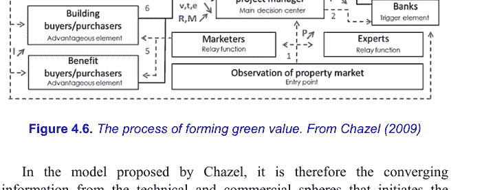

Figure 4.6. 绿色价值的形成过程。转引自 Chazel (2009)

在 Chazel 提出的模型中，因此是技术和商业领域汇聚的信息启动了这一过程。总承包商，由于借款利率的降低，可能在财务上能够开展环境质量良好的雄心勃勃的运营（Q）。这种雄心对于组织能够受益于为这些雄心勃勃的运营融资的杠杆效应（3）是必要的：运营成本（c）的降低，由于节能以及所有相关的额外能源效应对市场价值产生影响。

Chazel 然后描述了这一过程的放大（4）。认证机构可能会共同认可经济结构的持续性（融资系统的认证）和运营的技术质量（认证²³）。同时也有必要考虑到营销人员的工作，他们有助于行为者的文化适应，从而促进本地市场的发展（5）。环境质量良好的物业随后受益于更好的形象（I）。如果这种形象传达给客户和融资方（6），它会提高租金（R）和市场（M）价值，并有助于减少建筑空置率（v）、营销时间（t）以及与这些估值和营销相关的费用（e）。项目的盈利能力（7）随之得到改善。

Chazel (2009) 提出的方法可分为三个涉及多个利益相关者系统的信息生产阶段：

- *社会技术* 信息，用于验证社会技术系统内“利基”状态，以提供技术和商业可靠性的证明；
- *技术和经济* 信息，证明允许实现节能技术选择的财务杠杆的有效性；
- *社会经济* 信息，证明项目的绩效，将其转化为可用的功能性，并促进功能需求表达与这些可用性状态的适配。

首先应指出，从一个阶段向另一个阶段的过渡对应于 Luhmann 意义上的沟通（参见第 3.1.2.1 节）。例如，技术信息向社会经济信息的过渡，是认证者与客户之间沟通的结果，结合了 *信息* 的位置（通过确认技术绩效）、*沟通*（标签的生产）和 *成功预期*（对建筑环境质量形象的感知）。然而，对于这些位置中的每一个，[指标 – 元信息] 组合的构建方式并不相同24。

让我们再指出，我们所采取的方法——在功能生态系统中以合作交易逻辑考虑绿色价值——至少促使将这种沟通扩展到价值对话的另外两个层面：

- 围绕翻新建筑管理组织内部现象的实现和认可所涉及的行为者之间的对话；
- 围绕可能影响和/或受房地产行业组织间现象影响的领土利益相关者之间的对话。

应回顾的是，在我们的方法背景下，价值分析的地域化目标，一方面是为了辨别地方当局的不同行动杠杆（Box 4.4，第 4.1.1.2 节）如何被用来刺激翻新，另一方面是为了识别领土经济分析如何以及在多大程度上能够形式化政治选择以促进行动杠杆与行使该杠杆对领土工业部门构型的影响之间的联系。

让我们现在回到前一点引入的建议，该建议考虑了按组件记录会计资产的可能性——

24 关于信息位置，标签是一个由与建筑技术特征相关的绩效目标组成的参考框架，因此与元信息相关的指标。然而，曾为可持续建筑联盟进行的一项比较研究（Larsson 2009）对不同国际标签的架构进行了研究，以突出主要认证系统的特殊性。这些系统与 CEN/TC 350 欧洲部门标准之间的趋同和差距已导致一个涵盖各不同标签相关性的普遍参考框架。关于等待成功的立场，多项研究（Miller et al. 2008；Eichholtz et al. 2010）已指出，建筑认证（标准和标签）使得能够考虑到行为者主观性对物业资产价格的影响。他们使用标签来配备比较方法，并比较在各方面具有相同特征、除认证外完全相同的园区。然后假设经验上获得的价值差异是与对认证的心理感知相关的“绿色价值”（Chazel 2009）。

组件，以便围绕一对[设备 – 使用]来构建实体的非物质资本。

我们在此想要介绍的最基本观点是，能够将对应于一对[设备 – 使用]的无形资产形式化为分析逻辑，在房地产实体内部，可以被移植到中观经济层面。

在功能型经济中，我们认为领土的“设备”由自然资本、制造资本组成，以及当然而且最重要的是，人力资本和社会资本、行动者博弈的组织——即治理——以及社会技术系统的构型，其对创新和可持续解决方案的推广的适应性。简而言之，这种“设备”对应于功能生态系统演进的社会技术系统与滋养该生态系统出现并推动社会技术系统永久性再配置的领土遗产的结合。

我们认为，在功能型经济中，领土的“使用”对应于由 Colletis 等人（2005）意义上的领土邻近性所构成的领土潜力的揭示，即一种协调情况，从集体解决一个问题，到一个领土项目，因此到纳入——特别是合同性的——一个共同视野，其中一个组成部分可以是估值。

我们现在以及本书其余部分的讨论将转向会计和政治、微观和宏观经济信息系统在报告工业经济设备的使用与领土经济的“设备”的“使用”——或更确切地说，自然和社会遗产的动员——之间的共演化方面的适当性。

## 4.2.2. 构建微观-宏观会计空间

### 4.2.2.1. 微观经济会计与领土

根据法国通用会计制度（PCG）第120-1条给出的定义，“会计是组织财务信息以捕捉、分类、记录基本数据并编制报表以反映实体资产、财务状况和在资产负债表日结果的真实公允的系统”。

尽管在国际上使用，尤其是在1978年7月25日的理事会指令78/660/EEC²⁵以来在欧洲使用，但该概念并未由法国通用会计制度（PCG）定义（Revault 2009）。这一概念极具争议性²⁶（Honoré 1994；Haverals 2006）。它只能根据现行的会计原则和规则来理解。“换句话说，‘忠实性’不能相对于本身不存在的现实来评估：真实公允的观点源于会计规则善意的应用”（CNCC 1989，第128页）。

然而，尽管法国商法典第10条第一段规定，“资产负债表、损益表和附注必须包括必要的项目和明细，以给出公司的资产、财务状况和收入的真实公允的观点”，同一法典第L. 123-14条规定，“当会计要求的适用不足以给出本条所述的真实公允观点时，必须在附注中提供补充信息”，并且，“如果在特殊情况下，会计要求的适用不适合给出资产、财务状况或结果的真实公允观点，则必须放弃。该豁免在财务报表附注中提及并得到充分证明，并说明其对公司的资产、财务状况和结果的影响”。

简而言之，实体资产（其所有财产）、财务状况（其资产负债表）和结果（在损益表中编制）的真实公允观点基于会计实践制度化的当前状态。而这些实践在需要提供额外信息或偏离某些会计规范时可能会受到质疑，然后在财务报表附注中记录这些信息、这些偏离及其原因。

然而，准确地说，面向领土发展强可持续性的功能型经济中的会计意味着对会计实践的质疑。然而，这一挑战不能通过在会计附录中记录的例外豁免来满足。

对于 Rambaud 和 Richard（2015）而言，过时的正是通常的复式记账系统本身。他们并不将这种过时归因于该系统的技术特征，而是归因于其目标：仅维持财务资本27。因此，他们的方法在于保留它，但将其与其他目标和实践结合起来，提供一种我们因其对多功能生产分析的高度适用性而推广的方法：CARE®系统（生态尊重的综合会计）。该系统由 Richard（2012）设计，也被称为CARE/TDL28，这是 Rambaud 和 Richard 在继续对其进行理论化和发展时现在赋予它的名称。

为了将复式记账适应可持续发展目标，CARE®源于“将非常传统的会计原则应用于人力资本和自然资本的‘扩展’”（Richard 2012，第147页）。

在详细介绍这种方法之前，应指出 CARE®是一个“内部-外部”会计系统，考虑到实体活动对领土的影响，而不仅仅是反向——正如当前会计系统所做的那样29。因此，人力资本和自然资本应作为负债记录，作为需要保留的资本，而不是将其视为“仅作为资产方使用的资源和/或其利润的费用”（同上）。

CARE®指的是对资本的开放性方法：“资本是被承认为需要在资产负债表负债方在一定预定时间内维持的能力（或一组能力）。资源由可在资产负债表资产方直接用于使用的能力（或一组能力）组成”（Rambaud and Richard 2015）。

这种开放性和内部-外部视角对我们而言是有意义的，因为它们通过复式记账系统，即该实体的资产负债表，来形式化实体与其功能生态系统之间的关系。

实体可以将由领土内各种活动构成的功能生产装置视为需要维持的能力，而所赋予的功能优势——功能性——则视为可供使用的能力。为此，它将在负债方记入为维持和/或更新其所依赖的功能领土生产所必需的成本，并在资产方记入其所认可的功能优势的使用价值。

为维持和/或替代实体的领土资本的成本做出贡献的逻辑源于CARE®系统的指导原则，该原则指出“资本的价值等于其维持的成本，根据其本体论规范，并在其预定的重新评估期间，如果所有相应的资源都被消耗”（Rambaud and Richard 2015）。

因此，CARE®是历史成本会计——公司过程的一种特定表征，与供给和处置市场无关（Richard 1976）。而全面说明公司过程的特殊性意味着折旧的特定使用，这将一方面减少相关资产（其“成本价值”损失一部分），另一方面减少财政年度的结果，即作为费用或负债的减少（Rambaud and Richard 2015）。

这种折旧共同但差异化地适用于人力、自然和财务资本。这就是三重折旧线的出现，其重要性在CARE/TDL缩写中得到强调。

通过在对使用自然和人力资本产生的资产进行折旧后减少财政年度的结果，可以释放出为维持/更新这些资产而需要的资金，即为预防性投资。结果在这里因此是一个盈余，超出各种类型贡献的维持/更新——包括财务资本和领土赋予的能力。这种特征使CARE®成为一种方法，其制度化将允许具有强可持续性目标的会计。

该方法的应用涉及通过使用社会群体和生态系统的“发言人”来监控和管理人力和自然资本。这些“代表”（科学家、非政府组织、工会、职业医生、地方社区、公共机构等）必须代表人力和自然资本与实体对话，以便促进实体与领土之间联系的描述和分析。

27 Richard（2012）指出，复式记账系统的当前使用“旨在仅维持财务资本……公司在其账目中从未将人力和自然资本作为需要在资产负债表负债方保留的资本列入。他们仅将其视为资产方使用的资源和/或其利润的费用。在这个不幸至今仍然存在的系统中，这三种资本之间因此存在处理上的二分法。只有财务资本享有系统性保护的特权”。 28 TDL：三重折旧线。 29 当前会计被理解为考虑到环境对公司的影响的积极方面（机会来源）和消极方面（监管约束/商业风险）。

根据 Rambaud 和 Richard（2015 年）的说法，这一发言人（聚焦于资本）的概念取代了利益相关者的概念，后者仅被视为向实体带来利益和/或风险的行动者。这些发言人的角色还将是传递与该资本相关的争议、其被代表和管理的[content]
根据 Rambaud 和 Richard（2015 年）的说法，这一发言人（聚焦于资本）的概念取代了利益相关者的概念，后者仅被视为向实体带来利益和/或风险的行动者。这些发言人的角色还将是传递与该资本相关的争议、其被代表和管理的[content]
根据 Rambaud 和 Richard（2015 年）的说法，这一发言人（聚焦于资本）的概念取代了利益相关者的概念，后者仅被视为向实体带来利益和/或风险的行动者。这些发言人的角色还将是传递与该资本相关的争议、其被代表和管理的[content]
根据 Rambaud 和 Richard（2015 年）的说法，这一发言人（聚焦于资本）的概念取代了利益相关者的概念，后者仅被视为向实体带来利益和/或风险的行动者。这些发言人的角色还将是传递与该资本相关的争议、其被代表和管理的[content]
根据 Rambaud 和 Richard（2015 年）的说法，这一发言人（聚焦于资本）的概念取代了利益相关者的概念，后者仅被视为向实体带来利益和/或风险的行动者。这些发言人的角色还将是传递与该资本相关的争议、其被代表和管理的[content]
根据 Rambaud 和 Richard（2015 年）的说法，这一发言人（聚焦于资本）的概念取代了利益相关者的概念，后者仅被视为向实体带来利益和/或风险的行动者。这些发言人的角色还将是传递与该资本相关的争议、其被代表和管理的[content]
根据 Rambaud 和 Richard（2015 年）的说法，这一发言人（聚焦于资本）的概念取代了利益相关者的概念，后者仅被视为向实体带来利益和/或风险的行动者。这些发言人的角色还将是传递与该资本相关的争议、其被代表和管理的[content]
根据 Rambaud 和 Richard（2015 年）的说法，这一发言人（聚焦于资本）的概念取代了利益相关者的概念，后者仅被视为向实体带来利益和/或风险的行动者。这些发言人的角色还将是传递与该资本相关的争议、其被代表和管理的[content]
根据 Rambaud 和 Richard（2015 年）的说法，这一发言人（聚焦于资本）的概念取代了利益相关者的概念，后者仅被视为向实体带来利益和/或风险的行动者。这些发言人的角色还将是传递与该资本相关的争议、其被代表和管理的[content]
根据 Rambaud 和 Richard（2015 年）的说法，这一发言人（聚焦于资本）的概念取代了利益相关者的概念，后者仅被视为向实体带来利益和/或风险的行动者。这些发言人的角色还将是传递与该资本相关的争议、其被代表和管理的[content]
根据 Rambaud 和 Richard（2015 年）的说法，这一发言人（聚焦于资本）的概念取代了利益相关者的概念，后者仅被视为向实体带来利益和/或风险的行动者。这些发言人的角色还将是传递与该资本相关的争议、其被代表和管理的[content]
根据 Rambaud 和 Richard（2015 年），发言人（聚焦资本）的概念取代了利益相关者概念，后者仅被视为向实体带来利益和/或风险的行动者。这些发言人还需传递与该资本相关的争议、其表征与管理方式。发言人负责将这些争议提升至实体层面，同时也提升至业务分支和功能生态系统层面。这种方法“将会计的重新定义与治理的重新定义相联系，从共同决策的视角出发”（同上）。

现在让我们转向另一种微观经济会计创新，它也可能有助于促进对 PSS 做出贡献的实体之间的沟通。

*Comptabilité Universelle®（通用会计）*（Schoun 等 2012）是一种国有成本会计制度，其目的是评估实体外部效应对其总账的影响。它涉及实体中观经济和环境效应的影响：其对地方治理的影响及其社会锚定效应——后者领域可被分离以区分社会与社会性（Schoun 等 2012，第 48 页）。这些领域均通过传统会计形式主义来考虑（复式记账、损益表、附注等）。

| 社会 |  | 环境 |  | 经济 |  | 治理 |  | 社会性 |  |
|---|---|---|---|---|---|---|---|---|---|
| 资产负债表（€） | 损益表（€） | 资产负债表（€） | 损益表（€） | 资产负债表（€） | 损益表（€） | 资产负债表（€） | 损益表（€） | 资产负债表（€） | 损益表（€） |

## 表 4.3. *Comptabilité Universelle®（通用会计）* 的会计领域

*Comptabilité Universelle®（通用会计）* 因此是一种专门用于正外部性货币化的会计制度。归因于实体的所述外部效应与各受影响领域的损益表中的会计费用和收入相关联。根据这些效应的影响被认为对实体业务是积极还是消极，这些费用和收入在该领域的资产负债表上记为资产或负债的减少/增加（Schoun 等 2012，第 101 页）。

这一方面对应于可持续性的弱方法。然而，它部分被其他特征所抵消，这些特征使得由新古典逻辑的展开所造成的的信息损失得以限制。

首先，该方法禁止在不同领域的资产负债表之间合并货币化价值，认为“受穷尽性原则支配的经济资产负债表不能与按领域（环境、社会、社会性、治理）划分的资产负债表合并，后者本质上不可能穷尽”，并且“经济资产负债表不能与指标范围不具同质性的其他领域资产负债表合并”（Schoun 等 2012，第 48 页）。这种定位避免了由整体要素生产率概念所导致的补偿原则陷阱（见第 1.1.2.2 节）。

然后，它根据这些领域所描述的现象的时间性来调整分析期，使得分析时间不再被困于实体账目的年度性。生态系统的更新时间、行动者网络重组的時間，或政治进程的时间都可以按其本来的面目来把握，而非永久地与金融资本的时间相紧张。

| 原则 | 传统会计 | *Comptabilité Universelle®（通用会计）* | 观察 |
|---|---|---|---|
| 完整性 | 是 | 否 | 重点在于行动 |
| 历史成本计价 | 是（除 IFRS：公允价值原则） | 否 | 与利益相关者按现行成本计价 |
| 可比性 | 所有公司之间 | 按专业分支 | 按专业部门的最佳实践 |
| 年度性 | 是 | 否，不一定 | 1 至 20 年或更长时间 |
| 范围 | 固定范围 | 可变合并范围 | 根据指标 |
| 预测资产负债表 | 非强制 | 是 | 未来行动的量化预测 |
| 合并 | 是 | 否 | 环境、社会、社会性和治理报告不能与经济报告合并。 |

## 表 4.4. 传统会计与 *Comptabilité Universelle®（通用会计）* 支配原则的主要差异汇总（Schoun 等 2012，第 60 页）

最后，*Comptabilité Universelle®（通用会计）* 所设想的货币化是与利益相关者协商的结果，以为产生的外部性建立地方会计估值政策。

因此，货币表征植根于社会表征体系；它并非这些外部性的任意且去地域化的市场货币化。

这些特征使 *Comptabilité Universelle®（通用会计）* 成为一种旨在实现“半强”可持续性的会计制度。

让我们回到我们感兴趣的案例研究。为了在法国协调不同分析层面的若干对[设备 – 使用]的利益相关者之间的沟通而构建无形资本，意味着要考虑受 PCG 和 IAS-IFRS 约束的实体之间的义务差异。

关于建筑行业的有形固定资产，Biojo 等（2012）指出存在相当结构性的差异（见表 4.5）。

|  | 法国 PCG 体系 | 国际 IAS-IFRS 体系 |
|---|---|---|
| 有形固定资产的估值 | 按历史成本³⁰计价，但现在可按公允价值³¹计量 | 按其公允价值³²计价 |
| 重大维护和修复（MMR）支出的记录 | 记为费用和准备，或记为资产 | 强制资本化，可计提准备，但不能进行相关税收抵扣 |
| 折旧记录 | 整体固定资产 | 按“组件”方法 |
| 随时间计提折旧 | 根据所考虑资产类型制定标准 | 基于组件的实际预期使用寿命——期限由实体自行定义 |

## 表 4.5. PCG 义务与 IAS-IFRS 关于不动产、厂房和设备会计处理的差异。（来源：Biojo 等 2012）

30 在资产负债表中保持不动产的取得或建造价值减去在损益表中确认的折旧。

31 在与 IAS-IFRS 国际会计制度规定的条件相当的条件下（Jaudet 等 2011）。

32 “在知情、自愿的当事方之间进行公平交易的资产可交换金额，或负债可清偿金额”（IAS 16，第 6 段）。该公允价值使账面价值与市场价值得以调和，从而可在资产负债表中减少潜在损失（在记录有形固定资产与市场估值商誉之间不匹配的情况下），并改善风险感知。然而，公允价值“是一种财务价值，不考虑公司的经济数据和长期投资战略”（Cappelletti 和 Khouatra 2002）。

CARE® 允许将折旧制度直接整合到 PCG 财务会计中，从而使维持扩展资本（人力和自然，不仅是财务）的成本得以作为负债报告。通过区分三条折旧线，CARE® 开辟了按组件记录折旧的可能性。

作为负债记录的翻新建筑所需成本，导致了自然、人力和经济资产的会计形式化（例如温室气体排放的减少、室内空气质量和能源成本的降低）。

此外，方法基于“内部-外部”视角，使得这些成本可被设计为实体不拥有的多功能生产手段可持续性的投资。这种方法的效果是加强实体对其资产的控制。CARE® 通过鼓励管理者和会计师观点之间的调和，以及实体利益与领土内利益相关者利益的比较，来在有形和无形资产之间移动界限。

至于 *Comptabilité Universelle®（通用会计）*，受 IFRS 约束或希望适用 IFRS 的实体使用该方法将使其更好地理解“公允价值”概念。与利益相关者一起考虑一种旨在按其活动领土绩效问题领域对外部性——积极和消极——进行分类的方法，然后对这些外部性进行货币化，将导致实体直接在其总账中列入未签约服务的货币化价值。

因此，在建筑翻新案例中，避免的温室气体排放的货币化将同时为环境经营账户提供产品价值和资产价值。如果为建筑物使用者提供培训得到资助，则在社会领域经营账户中作为费用报告的该培训成本也为同一领域资产负债表中的无形资产提供了直接价值。

在第 6 章，我们将提出 CARE® 的一种衔接，它在各方面都符合我们关于增值可持续领土锚定的方法，并对 *Comptabilité Universelle®* 的非货币化资产负债表进行调整。组装的会计模块将因此使得能够考虑受 IFRS 约束的实体与领土功能生态系统的其他实体之间的沟通。

这个领土功能生态系统当然包括围绕[设备 – 使用]这一对构建的 PSS 所涉及的实体，我们希望将功能经济锚定在会计中。它还包括公共行政部门，特别是负责国民账户的部门。

## 4.2.2.2. 为了政治经济的国民核算

欧洲账户体系 ESA 2010（Eurostat 2013）于 2014 年 9 月在法国生效，为欧盟成员国的国民账户制定了指导方针。它目前指导着未来法国国民账户的建设，该账户应在 2025 年前使用。

基于联合国国民账户体系（SNA-2008）——其本身由 Eurostat（欧洲委员会）、国际货币基金组织、经合组织、世界银行和联合国共同负责——ESA 2010 的主要重点是除中央框架的汇总指标（货币代表的场所）外，还提出一系列卫星账户（非货币指标代表的场所）。

ESA 2010 的中央框架用严格的货币信息描述经济。该框架包括综合经济账户（机构部门账户），提供所有经济流量和存量的综合概览（Eurostat 2013，第 22.03 点）；投入产出框架，提供按现价和数量计算的货物和服务资源与使用的综合概览；将投入产出框架的活动部门与机构部门账户联系起来的表格（同上）；按政府、家庭和企业职能划分的支出表格；人口和就业表格（同上）。

卫星账户用于准备或修改中央框架的表格和账户。其目标是“通过提供更多细节、重新排列中央框架的概念或提供补充信息，例如非货币流量和存量，来满足特定的数据需求”（Eurostat 2013，第 22.04 点）。所指的非货币数据涉及有形或无形对象，可能涵盖任何被认为有助于说明国民经济与各种政治和分析问题之间联系的领域（Eurostat 2013，第 22.54 点）。至于概念的重组，它使得能够诱导使用附加概念、不同基本概念，以及使用模型或纳入实验结果（Eurostat 2013，第 22.06 点）。

现在让我们详细说明 ESA 2010 系统的工作方式。中央框架的汇总指标是综合指标，为特定实体集合从地方到国家层面的价值表征过程提供货币解读（精确地根据*聚合*的水平）。引入卫星账户，并通过它们进行非货币分析，是一种将这些货币汇总指标的解读置于更广泛的表征框架中的方式，有利于在活动领土中描述多功能生产。ESA 2010 因此超越了会计系统，成为政治经济的工具。

可以构建两种类型的卫星账户——“功能性”或“专业化”——：

- *功能卫星账户*描述国民账户考虑的主要经济职能（环境、健康、研发、生产率和增长等）；
- *专业化卫星账户*针对一个活动部门、一种产品、或一组产业和产品，甚至一个子部门或一组子部门。

ESA 2010 因此确立了针对活动领土的可能性。交叉引用这两种类型的账户揭示了一个分析框架，非常适合跨部门分析，因而适合描述多功能生产。

将某些专业化账户纳入中央框架的*综合经济账户*中，使得可以“看到关键部门和其他部门在交易和账户余额中所占的各自份额”，特别是通过“在附加表格中显示关键部门与其他部门之间，包括世界其他地区之间的‘谁从谁’关系”（Eurostat 2013，第 22.41 点）。

这些分析交叉引用是由功能卫星账户的一个基本特征所实现的；后者不是按照机构方法构建的。

这一特征使分析者能够以多元且互补的方式考虑生产：

- 在“职能方法”中：对特定职能的国家（以及地区和地方）支出的分析（Eurostat 2013，第 22.23 点），这使得特别是能够在行为者之间启动“垂直”对话；
- 在“产品方法”中：对所考虑的每个职能所涉及的活动和产品的分析（Eurostat 2013，第 22.22 点），采用跨部门方法，因而与领土经济相兼容。

除此之外，我们认为存在一种“服务方法”33，它不仅涉及识别从中央框架中分离出来的产品，还涉及记录资本形成、与所涉领域相对应的转移（Eurostat 2013，第 22.24 点）的活动，以便将其与非货币数据进行比较。

这些方法的结合突出了在中央汇总框架中不可见的细节。它需要功能汇总、非货币指标、货币与非货币数据之间的比率、附加数据和概念，以及不同基本概念的发展。

表 4.6 中呈现的示例涉及已确立的卫星账户，这些账户是国际建议的主题或已成为国际传输计划的一部分34。

在不同国家开发的其他卫星账户说明了可能的适用范围：文化和创意部门账户；教育账户；能源账户；渔业和林业账户；信息和通信技术（ICT）账户；公共支出再分配账户；住宅建筑账户；与安全相关的账户；与体育相关的账户；与水相关的账户等（Eurostat 2013，第 22.7 点）。

这种卫星账户的多样性说明了中央框架的局限性。“例如，环境账户扩展中央框架以核算环境外部性，而家庭生产账户扩展生产边界以包括无偿家庭服务。这样，它们表明中央框架的产品、收入和消费概念并不是福利的完整衡量标准。”（Eurostat 2013，第 22.9 点）

33 ESA 2010 并未直接命名这种“服务方法”（虽然它明确提及职能和产品方法），但将其视为导致功能账户创建的过程的一部分。

34 “为了国际比较税收水平和构成，国家税收收入统计数据报告给经合组织、国际货币基金组织和 Eurostat。概念和数据完全与国民账户挂钩。税收收入统计是国民账户卫星的一个例子。”（Eurostat 2013，第 22.7 点）

| 卫星账户的八个特征 | 农业 | 环境 | 健康 | 家庭生产 | 就业和 SAM | 生产率和增长 |
|---|---|---|---|---|---|---|
| 功能账户 |  | X | X |  |  |  |
| 与产业或产品挂钩 | X | X | X |  | X | X |
| 与机构部门挂钩 |  |  |  | X | X |  |
| 包含非货币数据 |  | X | X | X | X | X |
| 额外细节 | X | X | X | X | X | X |
| 补充概念 | X | X |  |  |  | X |
| 不同基本概念 |  | X | X | X |  | X |
| 实验结果和更多建模使用 |  | X |  | X |  | X |
| 欧盟传输计划的一部分 | X | X | X |  |  | X |

**表 4.6. ESA 2010 卫星账户的总体呈现及其主要特征。改编自 Eurostat (2013, 表 22.1)**

|  |  |  |  |  |  |  |  |  |
|---|---|---|---|---|---|---|---|---|
| 研发 | X | X | X | X | X |  |  |  |
| 社会保障 | X | X |  | X | X |  |  | X |
| 旅游 | X |  | X | X | X |  |  |  |
| 国际收支 |  |  |  | X |  | X | X | X |
| 政府财政 |  |  |  | X | X | X |  |  |
| 货币和金融统计及金融资金流动 |  |  |  | X |  | X | X | X |
| 补充养老金表 |  | X | X | X | X |  |  | X |
| 具有国际建议的卫星账户或其他比较项目中的卫星账户的其他示例 |  |  |  |  |  |  |  |  |
| 企业活动 |  |  |  | X |  | X |  |  |
| 非正规部门 |  |  |  | X | X |  |  |  |
| 非营利机构 |  |  |  | X | X | X |  |  |
| 公共部门 |  |  |  | X |  | X |  |  |
| 税收收入表 |  |  |  | X |  | X |  | X |

表 4.6. ESA 2010 卫星账户的总体呈现及其主要特征。改编自 Eurostat (2013, 表 22.1)

## 4.3. 结论

对纳入 ESA 2010 核心框架的各种功能性卫星账户的比较，基于一种区分分析维度、我们所称的多功能生产影响的意愿。类似的动机促使 *Comptabilité Universelle®* 方法的设计者提出一个用于内部化外部性的分析会计系统，按五大资产负债表和损益表领域划分。它仍然是一个强有力的动机，但由另一层需求（强可持续性、拒绝外部性内部化）所驱动，这促使 *CARE®* 会计的设计者区分人类、自然和金融资本的三种折旧线。

新古典经济最引人注目的陷阱之一，是认为与特定估值时空相关产生的数据在另一个估值时空仍保持相同的资讯力。然而，尽管所描述的账户在意图上具有相对相似性，它们并不观察相同的空间，也不感知相同的时态。因此它们不对同一生产现象进行估值，也未能消除会计表征中时空相对性的陷阱。

因此，要准确表征将实体构建进功能生态系统的经济重要性，在我们看来意味着它们之间的联系，这使得实体系统成为价值分析的中心。这种联系由 *沟通* 实现，特别是会计沟通，其不应被理解为会计信息的传递，而应被视为对活动系统而言什么是本质的社会认可过程。

参与在功能生态系统内构建 PSS 供给，更新了 *实质性* 的概念，该概念在组织管理领域指的是可被视为“具体且重要”的内容（第 4.2.2 节）。

对于管理者而言，这一概念应与对信息相关性或不相关性的认可相联系。对于财务分析师而言，*实质性阈值* 例如对应于会计错误可能对经审计账户可靠性产生重大影响的阈值以上（Utopies 2014）。我们已证明，像 *CARE®* 和 *Comptabilité Universelle®* 这样的创新能够使金融家与管理者之间的沟通得以更新。

这也是对 Marie-Andrée Caron（2012）所提及内容的另一种说法。“一种新的逻辑正在出现：超越数字的严谨性，在由公司活动产生的社会成本所涉及的各方构成的对话空间中，获得一个可供讨论的数字才是重要的。会计因此更像是一种将社会辩论整合进公司当前实践的机制，并逐渐摆脱迄今为止其主要被局限于其中的社会秩序机制的角色。”

尽管在微观和宏观层面出现了改善会计沟通的方法，但其部署方式并不能克服利基与社会技术景观之间的二元对立。事实上，CARE® 和 Comptabilité Universelle® 正在向领土开放，但在对无形资本进行估值的方法上，尽管承认其已更新且更具可持续性，但充其量是“跨微观”的。另一方面，ESA 2010 卫星账户目前的设想则服务于严格的宏观、甚至区域的跨部门和功能性方法。

我们现在提出的问题相当简单：我们如何组织和构建一个信息系统，以便为微观与宏观之间真正的 *沟通* 提供支持？

如果增值汇总不伴随一个通过认知实现信息重新定位的系统，就构成了经济信息破坏的顶点。而公共统计如果基于汇总信息处理模型，就无法在结构上弥补这一差距，而这一差距与微观经济与宏观经济之间的过渡有关。

Giraud（2015）用以下术语描述这一问题：“我将以此结束当代‘经济科学’错误目录的第二个方面³⁵，或许乍看之下最难以理解。这就是涌现现象的可能性，如统计物理学所理解的那样。如果你汇总数百万个个体的行为，你有什么理由相信由此产生的结果会看起来像一个超个体的行为呢？当然不会。而且这正是我们经验上所观察到的。”

## 5. 合同化：
实际中的价值

## 5.1. 重构交易空间

产品-服务系统（PSS）的共同生产 *de facto* 产生了多利益相关方交易情境，因而产生了沟通空间，并在价值化空间中充当微观与中观层级之间的中介。在领土功能生态系统内构建这些空间，可能是一个减少任何货币化固有信息耗散的机会。

在涉及各种绩效目标且其水平在多重价值判断表达后进行谈判的交易中，按合同提供的服务与欧元价格相关联。该价格在市场交易的严格框架内可与 *交换价值* 相关联，在功能生态系统内并不单独存在。它与分配给功能性的 *使用价值* 的非货币表征相关联，而市场服务是其中一个访问渠道。这些功能性本身与允许其出现的生产现象的维护成本相对应的货币金额相关联，即另一个 *交换价值*。

换句话说，一个货币指标与多个 *货币化奇点* 相关，即价值表征的时空多重维度相遇的多个点。这些奇点可以与同一多功能生产相联系，其治理由 PSS 形式化，在确保合作交易功能的、因此可与 *货币化局部性* 相关联的功能生态系统内。在此局部性内，旨在去情境化作为商品的服务效用价值的货币表征的、多个货币化奇点之间联系的货币化，构成了一个 *金融化奇点*。

我们在此所指的 *金融价值化奇点* ——或 *金融化* ——因此并不对应于锚定在 PSS 构建所在领土的货币表征 —— *货币化* —— 的情况。在我们看来，货币化之所以特殊，是因为它始终是产生对其所指生产现象首次认可的 *沟通* 系统的一部分。相反，*货币化* 重新定位了该现象效用的货币表征。

我们所指的 *金融价值化奇点* 确实是一个 *货币化* ——而非货币化——的点。这一奇点产生了一个 couple *[price in € – documented utility]* 脱离了作为效用文件来源的领土沟通，并被投放到另一个沟通——金融市场——中，其与前者——即与领土沟通——的联系是无法追溯的。

例如，在比领土内行为者之间市场服务更宽广的表征视域中，合同化服务的预期之金融表征与价值谈判构成的空间脱钩：即 *功能生态系统* 的过程所支撑的功能存在空间，而该生态系统中的行为者认可功能性并将其与构成服务合同的效用相关联。

因此，我们在此区分领土化的市场经济与金融市场：由锚定于功能生态系统的 PSS 体现的 *货币化局部性* 经济，以及由全球化效用价值表征标准化系统体现的 *金融化奇点* 经济。

于是出现一个问题：国家会计在其目前的制度化形式下，是否能够在货币化局部性与金融化奇点之间建立联系？

让我们通过考虑 GDP 的形成来思考这个问题——它无非是 Geels（2002）所说的生态位与社会技术景观之间的沟通。它是否是一个聚合过程的结果，产生了一个宏观指标，即一对（有记录的国民生产——欧元价值），并且与产生它的领土沟通完全无关？完全这样说将是一种漫画式说法。

然而，在此过程中信息处理的轻率，特别是通过消散非货币信息，提示了一些调整。上一个章节中引入的 *欧洲统计账户体系 – ESA 2010* 的卫星账户的主要兴趣在于邀请这种制度性方法。

## 5.1.1. 表征层级与实质性

### 5.1.1.1. 系统性领土核算

让我们在此简要回顾一下 *ESA 2010* 提出的卫星账户为何引起我们的兴趣。从制度和部门的角度来看，*专业卫星账户* 允许对在不同分支和不同活动部门交界处描述的生产现象进行综合分析。从功能和系统角度来看，*功能卫星账户* 突出了所涉功能的用户和受益者¹，这导致了与制度方法持续反馈的可能性。

中观经济分析者因此能够评估同一生产现象，该现象由专业卫星账户内的综合制度方法共同描述，例如运输部门的账户，以及功能方法，例如在健康功能卫星账户内。

为了建立这样一个区分专业（部门和制度）与功能分析的框架，有必要遵循

> 1 “用户和受益者的分类可以基于制度部门和生产者类型的分类，例如市场生产者、非市场生产者、作为集体消费者的政府、作为消费者的家庭以及世界其他地区。可以区分各种子类别，例如按行业和按制度子部门” (Eurostat 2013, point 22.31).

四个步骤来设计和建立卫星账户（Eurostat 2013, point 22.46）。

这涉及识别（i）导致创建描述领土项目所涵盖活动敏感的功能或部门的每个卫星账户的目标、用途和需求；（ii）这些目标、用途和需求与描述这些活动的国民账户要素之间的联系；（iii）每个对这些活动敏感的卫星账户如何使用相关的额外信息（具体统计、行政来源等）；以及（iv）每个这些账户如何将概念和数字组合成单一的表格和账户集合。

例如，如果分析者考虑的生产现象是运输，则可以确定运输总量在运输总增加值中的份额。并且可以与功能健康账户进行相关性分析，以考虑运输总量污染物排放对健康以及对总健康支出产生的影响。

该过程可能导致制定关键指标汇总表，“可以侧重于描述所涉及具体问题的规模、构成和发展，或可能显示与国民经济及其主要组成部分的联系。可以添加与政治和分析目的相关的额外细节或分类” (Eurostat 2013, point 22.54)。

因此，可以设想一个适应领土项目评估和监测的中观经济仪表板。如果我们置身于功能经济方法中，它可能是一个专门适应功能生态系统管理的仪表板。

为继续上一章所述的工作（见第 4.1 点），例如，针对由 CIRePaT 和 AGREGA 项目相关功能生态系统的结构性耦合所产生的功能生态系统进行定位将是有趣的。

为此，我们将分别然后联合分析与 *地方当局推动私人三级房地产存量更新的动力* 以及 *区域建筑骨料资源改善与管理* 相关的问题。

然后需要进行接口和比较：

- *关键产业部门的专业账户* 对应于直接参与领土功能生态系统核心 PSS 供给的活动（采掘工业、运输、建筑、废物管理、房地产活动等）；
- *制度部门账户* 的选择（其他企业活动、金融活动、公共部门、家庭生产和非营利机构等）；
- *功能账户* 的选择（环境、劳动和社会核算矩阵、健康、生产率与增长、研究与开发等）

这样创建的仪表板还必须为每个账户包含与中观经济分析相关的要素。

对于每个账户，有必要从中央框架中分离出与该账户相关的货币数据（MD），将其与非货币数据（NMD）、补充数据（SD）、补充概念（SC）和不同的基础概念（DBCs）进行比较，这些数据与该账户所涵盖的主题相关。这是 *ESA 2010* 卫星账户的目的（Eurostat 2013, points 22.06–22.08）。

| 卫星账户 |  | MD | NMD | Ratios | SD | SC | DBCs |
|---|---|---|---|---|---|---|---|
| **关键产业部门的专业账户** | 采掘工业 |  |  |  |  |  |  |
|  | 运输 |  |  |  |  |  |  |
|  | 建筑业 |  |  |  |  |  |  |
|  | 废物管理 |  |  |  |  |  |  |
|  | 房地产活动 |  |  |  |  |  |  |
| **制度部门账户** | 其他企业活动 |  |  |  |  |  |  |
|  | 金融活动 |  |  |  |  |  |  |
|  | 公共部门 |  |  |  |  |  |  |
|  | 家庭 |  |  |  |  |  |  |
|  | NPISH |  |  |  |  |  |  |
| **功能账户** | 环境 |  |  |  |  |  |  |
|  | 能源 |  |  |  |  |  |  |
|  | 劳动与 SAM |  |  |  |  |  |  |
|  | 健康 |  |  |  |  |  |  |
|  | 生产率与增长 |  |  |  |  |  |  |
|  | R&D |  |  |  |  |  |  |
|  | 区域层级 |  |  |  |  |  |  |
|  | 产业部门层级 |  |  |  |  |  |  |
|  | 地方 KUA 层级 |  |  |  |  |  |  |

表 5.1. ESA 2010 账户组织的建议，用于创建适应评估骨料部门与地方当局推动私人三级建筑存量更新动力之间关系的仪表板（Morlat and Lusson 2015）

然后可以进行聚焦。

一方面，出于可扩展性原因，即在分析过程中进行规模扩展，导致现象在区域层面和地方 KAU 层面同时被表征。

另一方面，出于对活动部门分析的颗粒度以及对信息所带来的兴趣的特殊性——如果我们希望在中观经济层面动员这一概念——出于对分析产业部门时赋予该信息的特定 *实质性* 的原因。例如，我们不会对所有建筑业账户感兴趣，但 NAF 23.61 活动“建筑用混凝土构件制造”将对我们特别感兴趣。

构建这样一个仪表板因此体现了经济信息实质性的管理与会计含义的融合。它确保了对领土层面政治而言“具体且重要”——即“实质性”的内容，对解释和表征该领土层面的国家会计师而言也是重要的。

正是这种融合，会计准则在微观会计层面所禁止的，通过诱导——而这并非其职责——*金融化特异性*：非货币信息与财务分析脱钩的点。而这种融合正是 *CARE®* 等系统所能预见的（见第 4.2.2.1 节）。

然而，即使在创新系统制度化之前，考虑领土现实在功能经济逻辑下的会计表征并不属于完全脱离可能性领域的假设。

### 5.1.1.2. 特征产品与相关产品

对于给定的功能账户，*ESA 2010* 区分特征产品和相关产品，这使得能够处理所生产货物和服务多功能性的问题。

*特征产品* 被视为功能账户所涵盖领域典型的产品。它们通过其生产方式、所涉及的生产者类型、所使用的劳动和固定资本类型以及生产过程的盈利能力来描述。

*关联产品* 被认为与功能账户所描述的功能相关，但并非其典型特征，无论是因为其性质还是因为它们被归类于更广泛的产品类别中，因此其生产方式在该账户中未予说明。

某些产品可能出现在不同的功能账户中；这导致相关功能的国家支出部分重叠，在汇总计算 GDP 时会产生所有潜在的重复计算问题。

欧洲统计局文本（2013 年）以功能性健康账户为例：卫生服务、行政、教育以及卫生领域的研发被视为特征产品；患者运输、药品以及眼镜等其他医疗用品为关联产品，而高等教育中的医学研究则是研究与发展、教育和卫生卫星账户共同相关的产品。

再考虑另一个领域，例如建筑物的能源和热改造：能源绩效流可被解释为能源账户的特征产品。随后，与室内空气质量相关的卫生支出减少则为关联产品，而社区推动此类改造的动力——被视为功能性生产——将特别纳入环境和能源的功能账户，并与房地产活动关键部门账户的数据进行比较，等等。

如果我们现在审视案例研究的职能耦合——CIRePaT 和 AGREGA 项目所涉及的生产现象——以便通过会计提出结构性耦合，那么将私营第三产业园区改造的产品视为与环境账户所考虑的产品相关可能是有趣的。这尤其可以解决区域范围内改造策略潜在推广与因骨料运输导致温室气体（GHG，Greenhouse Gas）排放减少之间的联系。

在公共部门掌握“海量数据”和数字算法的时代，这种会计细节水平变得可及。

INSEE 有责任在其将于 2025 年发布的会计框架新版本中，为每个功能账户提出新的特征产品和关联产品命名法。这是可行的：“关键部门的扩展取决于经济环境以及政策和分析的要求”（Eurostat 2013，第 22.35 点），并且“特征产品与关联产品之间精确的界限取决于一个国家的经济组织形式以及卫星账户的目的”（Eurostat 2013，第 22.27 点）。

INSEE 还认为，伴随 ESA 2010 实施的“基期”² 变更要求“对国民账户使用的 方法、命名法和统计来源进行审查，以便它们能最好地反映经济现实”（INSEE 2014）。

然而，特征产品和相关产品新分类的制定与建立规范的合法性问题密不可分，例如涉及对回收增加对骨料运输方式影响进行量化的测量规范。

机构边界问题也随之出现。在设计 ePLANET.Blue 门户上用于评估骨料行业地域锚定可持续性绩效的“G4U”工具时，我们必须区分构成该工业部门的活动与不构成该部门的活动（见第 4.1.2.1 节）。为此，我们动用了法国活动命名法（Nomenclature d’Activités Française，法语活动命名法 – NAF）Rev.2.1（INSEE 2015b），其中不同类别被任意选出，以代表被认为相关的活动的整体全景，因为它们参与了骨料生命周期中的至少一个阶段（生产、运输、使用、回收）。

然而，这一范围的定义，以及特征产品和关联产品的命名法，并不必然是任意选择，也不是以描述我们刚刚提到的四个阶段的方式展开定性或定量指标的生产。这些在实验室中对门户进行专家（而非参与式）使用的条件，正如我们所指出的，是为原型制作目的而设的例外。

2 “自 2014 年 5 月 15 日起，自 1949 年以来的所有汇总数据均已修改。国民账户正从‘基期’变更为 2010 年基期，特别是在实施欧洲账户体系新版本 ESA 2010”（INSEE 2014）。

可在 ePLANET.Blue 门户上使用的 KerBabel™ 工具套件致力于参与式方法。它将能够支持与骨料行业相关系统的集体表征实践。贡献者将被邀请共同描述其构成的活动，生产限定这些活动的指标和元信息，并将这些指标置于情境中，以记录 ESA 2010 中的特定产品和相关产品。

KDM 审议矩阵、KRG 表征网格以及 K4U 多准则评估算法协同生产工具的结合可以为微观与非财务会计系统之间的连接与对齐提供基础，并为 ESA 2010 卫星账户中 MD 和 NMD 的结构化提供依据。

图 4.7 例如描述了涉及区域骨料供应链利益相关者（SH）的审议如何导致考虑与区域骨料供应链的 PSS 之一相关联的交易对“世界其他地区”的影响，以及“世界其他地区”对该交易的影响。这包括在微观层面调和综合分析与功能分析，然后考虑利益相关者产生的绩效指标与 ESA 2010 卫星账户中的 NMD 之间的中观经济联系。

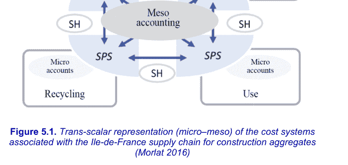

图 5.1. 建筑骨料 Ile-de-France 供应链相关成本系统的跨尺度表征（微观–中观）（Morlat 2016）

该练习的主要困难在于，会计和信息系统（ISs）总体上受估值实践所使用的方法支配。如果货币信息和非货币信息在合同化之前就被分离，就无法报告它们之间的关系。然而，它们共同构成经济信息。当它们被分离时，它们又变成了数据。

## 5.1.2. 无形资产与绩效合同
### 5.1.2.1. 僵化的财务估值传统

至少可以区分四种对无形资本进行财务估值的途径：历史成本、可比物、贴现现金流或实物期权。

- 历史成本法很少使用，因为公司对某一无形资产的投资记录很少（Fustec 等 2011）。我们所描述的 CARE® 方法是一种历史成本估值方法，旨在抵消这一趋势。由发言人（见第 4.2.2.1 节）操作化的资本及其管理的监控，涉及保持指标和元信息的库存。
- 可比法已就建筑物的价值进行了讨论（见第 4.2.1.1 节），它根据同类资产的当前交易来定义资产的价值。要可靠，这种方法需要一个非常活跃的市场（Fustec 等 2011）。就功能经济而言，这种方法完全无效。无形资产是根据其建立的服务来形式化的，而这些服务的确认程序取决于对地域化和详细的功能生产的表征。因此，无形资产彼此不可比较——无论市场是否活跃。
- 贴现现金流法（特许权使用费、超额利润、直接回报价值法）是最常用的。Fustec 等（2011）提出了两个根本性批评。一方面，几乎不可能证明将一笔现金流分配给某一资产或一组资产的合理性。另一方面，精算方法的特点是具有强烈的、任意的且按部门定义的假设。在功能经济的跨组织视角下，这些局限性被放大。虽然在 PSS 的背景下，将现金流与服务合同关联相对容易，但无形

支撑该服务可行性的功能性生产所需资产分布在功能生态系统内。这种生产资料的动态网络化，以及该网络的社会经济和生态系统属性，加剧了精算假设的不确定性。

-   *实物期权*方法有助于在不确定且非概率的环境中进行价值计算。将无形资产的可用性视为实物期权，可以建立取决于该资产相关风险演变的现金流。该方法提供了灵活性，并与贴现现金流方法更匹配，后者指的是预先设定的参数。然而，它仅被边缘使用：基于实物期权所依据的无形资产的净现值（NPV），它意味着知道该基础资产在排除不确定性情况下的价值（Fustec *et al.* 2011）。

从功能经济学的角度来看，这一方法并非毫无意义。资产风险方法可以被视为审议、共同表征构建和多标准评估的一部分（例如在 *ePLANETe.Blue portal.* 上）。

例如，可以考虑一个以市场认可的商业模式为基础并与已识别的无形资产相关联的核心 PSS 方案，然后将潜在贡献者的贡献³视为实物期权。实物期权的估值随后集中于失去永久业务连续性可能性的风险，或其发展的可能性。

在其 *Thesaurus Capital Immatériel* 的第一部分中，Fustec *et al.*（2011）提出了一种补充方法：将非财务评级整合到无形资本的财务增值方法中。

他们认为资产是一个复杂实体，其价值取决于其主要组成部分的状况，这些组成部分可由与非财务估值得出的指标相关的不同变量来表征。然后问题在于识别所考虑的无形资产的主要组成部分，然后识别并校准与表征其的变量相关的一组指标。然后算法汇总这些指标信息的成果，以便为所研究的资产分配绩效评分。

3 这些贡献可以以现金、实物或劳动形式作出，或由机构决定以促进 PSS 的实施，并可能与现金流的变化相关联。

这一提议目前完全符合我们的建议。所讨论的算法以及通过 *ad hoc* 指标按主要组成部分描述资产的工作，与 *ePLANETe.Blue* 门户的 K4U 工具所使用的方法相当相似。

一个区别是 Fustec *et al.*（2011）的方法完全是规范性的，而不是贡献性的，而后者是 *ePLANETe.Blue* 的使命。词典方法中资产的描述性指标由被评估无形资本的组织的参与者以专家方式确定。

另一个区别是 *ePLANETe.Blue* 门户上的绩效表征范围是多标准的：K4U 算法将始终至少提供系统沿多个轴的绩效表征。*Thesaurus Capital Immatériel* 将与该资产相关的非财务信息的多样性简化为单一的货币解读。

与我们的方法的根本分歧点当然与这种货币化没有直接关系：该词典提出的算法的目的是对无形资产进行财务估值。我们的分歧在于方法。

该词典第 V2 部分提出的财务估值（Fustec *et al.* 2015）基于 *重置成本* 方法。它是一种数学计算，基于基于资产所赋予利益寿命估计的耐久性系数，以及基于使用上述算法获得的评分的公式的资产状况系数。

资产的净重置价值随后通过公式 Vi = Cri × (1 − Cei) × Cpi 获得，分别表示资产 i 的重置成本、资产 i 的状况系数及其可持续性系数。因此这是一种增值因式分解和完全去地域化，与例如 *CARE®* 提出的维护和更新成本谈判逻辑无关。

更糟的是，Fustec et al.（2015）建议以这种方式计算公司的价值，该价值据称可从分配给其无形资产的价值之和中扣除，这忽略了对生产系统的考虑，即这些不同资产的影响如何在业务流程中结合。

另一种方法是 Bounfour（2000）的方法，基于 Edvinson 和 Malone（1997）的思想，区分静态价值和“智力资本动态价值”（IC-dVAL®）。该方法意味着无形资本的静态价值预先定义。为此，有三种方法可能：股票市场估值与资产负债表上资产之间的差异⁴、商誉分析⁵，或计算 Tobin（1969）⁶ Q 系数。然后公司的无形资本的动态价值通过将该静态价值按整体绩效指标（OVI）加权获得。

OVI 是一个综合指数⁷。它汇总部分绩效指标的结果：资源与技能（RSI⁸）、流程（IP⁹）和产出绩效（IOP¹⁰）。这些部分绩效指标通过行业基准提供，以评估 OVI 指数的改善如何在一定滞后后影响无形资本的估值（Bounfour and Epinette 2006, p. 176）。

4 Bounfour（2000）认为这种方法值得怀疑，因为存在股票市场高估或低估的可能性。

5 这可以使用 Fustec et al.（2011）提出的方法论来完成。

6 基于完全市场假设的投资选择理论，定义 Q 比率等于公司市场价值与固定资产重置价值之比。根据该理论，正比率表明公司有投资兴趣，因为市场价值的增加将超过投资金额。

7 “综合指数衡量作为一组基本数量聚合而定义的复杂数量价值的变化（例如，消费者价格指数（CPI）通过单一指数衡量 1,000 种产品的价格变化）。复杂数量的指数是基本数量指数的加权平均值；权重是基本数量的‘质量’（在价格指数的情况下，这些质量是支出）”（INSEE 2016）。最后访问于 15/01/2019：https://www.insee.fr/fr/metadonnees/definition/c1205.

8 在 ISD 的无形资本评估案例中开发的资源与技能框架例如提出了五个可从中开发指标的类别：人力资源（按档案、技术以及可能的关键性、稀缺性分布的人力资源）、技术资源（基础技术、关键技术、新技术）、物理资源（主要为处理能力）、信息资源（关于客户、合作伙伴竞争对手、技术和经理实践的最新信息）、“生态”资源（集团、供应商、上游和下游合作伙伴网络）（Bounfour and Epinette 2006, pp. 190–191）。

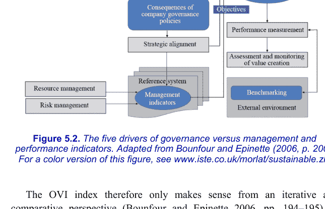

Figure 5.2. 治理与管理及绩效指标的五大驱动因素。改编自 Bounfour and Epinette（2006, p. 200）。彩色版本请参见 www.iste.co.uk/morlat/sustainable.zip

OVI 指数因此只有从迭代和比较的角度才有意义（Bounfour and Epinette 2006, pp. 194–195）。它

9 在 ISD 的无形资本评估案例中开发的流程框架提出了四个可从中开发指标的创新流程类别：技术创新、产品创新、组织流程创新、商业模式创新（ibid., p. 191）。

10 在 IT 部门的无形资本评估案例中开发的产出框架例如提出了三个可从中开发指标的组成部分：客户关系 — 业务关系 — 上游生产，下游生产，新解决方案项目（研究和维护活动）；新服务（售后服务、外包）；结构性产出（特定方法论、标准方法论、软件、可专利元素、声誉元素、品牌等）（ibid., p. 191）。

使之能够判断管理行为对活动组织的影响，以及这种组织对无形资本价值的影响¹¹。

应用此方法在功能经济背景下的一个明显局限在于，用于将公司与其外部环境进行定位的基准是部门性的。研究环境，即用于界定无形资产管理绩效的环境，随后在本质上仅限于市场经济的范围。这使得只能理解构成功能生态系统的部分实体。

此外，如果我们置身于功能经济模式中，通过基准逻辑评估企业绩效是悖论性的。这种逻辑与在同一部门内比较和竞争的想法相关，而 PSS 的协同实施不仅涉及竞争，还涉及合作，更重要的是协同专业化。这种专业化导致企业向特定的组织模式演进，这些模式偏离了部门的统一性，从而使基准的基础本身变得过时。

尽管两者关联不足，Thesaurus Intangible Capital 和 IC-dVAL® 两种方法仍可被视为互补的。Thesaurus Capital Immatériel 在一定程度上能够对公司融入功能生态系统的关键要素进行财务估值，即使公司并不拥有这些要素¹²。 “智力资本动态价值”分析方法（IC-dVAL®）有助于指出公司的管理选择如何促进其受益的部门整合绩效。

这两种方法虽然在灵感上属于新古典主义，但因此从参照该范式的公司角度出发，为在功能生态系统内协同实施 PSS 所支持的功能的创造和管理所做的贡献性投资提供了合法性。

我们认为，问题不在于系统地反对新古典和社会经济方法，而在于提出一种适当、即平衡的共存体系，从而避免领土政治辩论被去领土化的金融化市场所俘获。

为此，必须克服与微观经济资产概念不可分割的控制概念相关的无形资本估值的[content]
使之能够判断管理行为对活动组织的影响，以及这种组织对无形资本价值的影响¹¹。

应用此方法在功能经济背景下的一个明显局限在于，用于将公司与其外部环境进行定位的基准是部门性的。研究环境，即用于界定无形资产管理绩效的环境，随后在本质上仅限于市场经济的范围。这使得只能理解构成功能生态系统的部分实体。

此外，如果我们置身于功能经济模式中，通过基准逻辑评估企业绩效是悖论性的。这种逻辑与在同一部门内比较和竞争的想法相关，而 PSS 的协同实施不仅涉及竞争，还涉及合作，更重要的是协同专业化。这种专业化导致企业向特定的组织模式演进，这些模式偏离了部门的统一性，从而使基准的基础本身变得过时。

尽管两者关联不足，Thesaurus Intangible Capital 和 IC-dVAL® 两种方法仍可被视为互补的。Thesaurus Capital Immatériel 在一定程度上能够对公司融入功能生态系统的关键要素进行财务估值，即使公司并不拥有这些要素¹²。 “智力资本动态价值”分析方法（IC-dVAL®）有助于指出公司的管理选择如何促进其受益的部门整合绩效。

这两种方法虽然在灵感上属于新古典主义，但因此从参照该范式的公司角度出发，为在功能生态系统内协同实施 PSS 所支持的功能的创造和管理所做的贡献性投资提供了合法性。

我们认为，问题不在于系统地反对新古典和社会经济方法，而在于提出一种适当、即平衡的共存体系，从而避免领土政治辩论被去领土化的金融化市场所俘获。

为此，必须克服与微观经济资产概念不可分割的控制概念相关的无形资本估值的[content]
使之能够判断管理行为对活动组织的影响，以及这种组织对无形资本价值的影响¹¹。

应用此方法在功能经济背景下的一个明显局限在于，用于将公司与其外部环境进行定位的基准是部门性的。研究环境，即用于界定无形资产管理绩效的环境，随后在本质上仅限于市场经济的范围。这使得只能理解构成功能生态系统的部分实体。

此外，如果我们置身于功能经济模式中，通过基准逻辑评估企业绩效是悖论性的。这种逻辑与在同一部门内比较和竞争的想法相关，而 PSS 的协同实施不仅涉及竞争，还涉及合作，更重要的是协同专业化。这种专业化导致企业向特定的组织模式演进，这些模式偏离了部门的统一性，从而使基准的基础本身变得过时。

尽管两者关联不足，Thesaurus Intangible Capital 和 IC-dVAL® 两种方法仍可被视为互补的。Thesaurus Capital Immatériel 在一定程度上能够对公司融入功能生态系统的关键要素进行财务估值，即使公司并不拥有这些要素¹²。 “智力资本动态价值”分析方法（IC-dVAL®）有助于指出公司的管理选择如何促进其受益的部门整合绩效。

这两种方法虽然在灵感上属于新古典主义，但因此从参照该范式的公司角度出发，为在功能生态系统内协同实施 PSS 所支持的功能的创造和管理所做的贡献性投资提供了合法性。

我们认为，问题不在于系统地反对新古典和社会经济方法，而在于提出一种适当、即平衡的共存体系，从而避免领土政治辩论被去领土化的金融化市场所俘获。

为此，必须克服与微观经济资产概念不可分割的控制概念相关的无形资本估值的[content]
使之能够判断管理行为对活动组织的影响，以及这种组织对无形资本价值的影响¹¹。

应用此方法在功能经济背景下的一个明显局限在于，用于将公司与其外部环境进行定位的基准是部门性的。研究环境，即用于界定无形资产管理绩效的环境，随后在本质上仅限于市场经济的范围。这使得只能理解构成功能生态系统的部分实体。

此外，如果我们置身于功能经济模式中，通过基准逻辑评估企业绩效是悖论性的。这种逻辑与在同一部门内比较和竞争的想法相关，而 PSS 的协同实施不仅涉及竞争，还涉及合作，更重要的是协同专业化。这种专业化导致企业向特定的组织模式演进，这些模式偏离了部门的统一性，从而使基准的基础本身变得过时。

尽管两者关联不足，Thesaurus Intangible Capital 和 IC-dVAL® 两种方法仍可被视为互补的。Thesaurus Capital Immatériel 在一定程度上能够对公司融入功能生态系统的关键要素进行财务估值，即使公司并不拥有这些要素¹²。 “智力资本动态价值”分析方法（IC-dVAL®）有助于指出公司的管理选择如何促进其受益的部门整合绩效。

这两种方法虽然在灵感上属于新古典主义，但因此从参照该范式的公司角度出发，为在功能生态系统内协同实施 PSS 所支持的功能的创造和管理所做的贡献性投资提供了合法性。

我们认为，问题不在于系统地反对新古典和社会经济方法，而在于提出一种适当、即平衡的共存体系，从而避免领土政治辩论被去领土化的金融化市场所俘获。

为此，必须克服与微观经济资产概念不可分割的控制概念相关的无形资本估值的[content]
使之能够判断管理行为对活动组织的影响，以及这种组织对无形资本价值的影响¹¹。

应用此方法在功能经济背景下的一个明显局限在于，用于将公司与其外部环境进行定位的基准是部门性的。研究环境，即用于界定无形资产管理绩效的环境，随后在本质上仅限于市场经济的范围。这使得只能理解构成功能生态系统的部分实体。

此外，如果我们置身于功能经济模式中，通过基准逻辑评估企业绩效是悖论性的。这种逻辑与在同一部门内比较和竞争的想法相关，而 PSS 的协同实施不仅涉及竞争，还涉及合作，更重要的是协同专业化。这种专业化导致企业向特定的组织模式演进，这些模式偏离了部门的统一性，从而使基准的基础本身变得过时。

尽管两者关联不足，Thesaurus Intangible Capital 和 IC-dVAL® 两种方法仍可被视为互补的。Thesaurus Capital Immatériel 在一定程度上能够对公司融入功能生态系统的关键要素进行财务估值，即使公司并不拥有这些要素¹²。 “智力资本动态价值”分析方法（IC-dVAL®）有助于指出公司的管理选择如何促进其受益的部门整合绩效。

这两种方法虽然在灵感上属于新古典主义，但因此从参照该范式的公司角度出发，为在功能生态系统内协同实施 PSS 所支持的功能的创造和管理所做的贡献性投资提供了合法性。

我们认为，问题不在于系统地反对新古典和社会经济方法，而在于提出一种适当、即平衡的共存体系，从而避免领土政治辩论被去领土化的金融化市场所俘获。

为此，必须克服与微观经济资产概念不可分割的控制概念相关的无形资本估值的[content]
使之能够判断管理行为对活动组织的影响，以及这种组织对无形资本价值的影响¹¹。

应用此方法在功能经济背景下的一个明显局限在于，用于将公司与其外部环境进行定位的基准是部门性的。研究环境，即用于界定无形资产管理绩效的环境，随后在本质上仅限于市场经济的范围。这使得只能理解构成功能生态系统的部分实体。

此外，如果我们置身于功能经济模式中，通过基准逻辑评估企业绩效是悖论性的。这种逻辑与在同一部门内比较和竞争的想法相关，而 PSS 的协同实施不仅涉及竞争，还涉及合作，更重要的是协同专业化。这种专业化导致企业向特定的组织模式演进，这些模式偏离了部门的统一性，从而使基准的基础本身变得过时。

尽管两者关联不足，Thesaurus Intangible Capital 和 IC-dVAL® 两种方法仍可被视为互补的。Thesaurus Capital Immatériel 在一定程度上能够对公司融入功能生态系统的关键要素进行财务估值，即使公司并不拥有这些要素¹²。 “智力资本动态价值”分析方法（IC-dVAL®）有助于指出公司的管理选择如何促进其受益的部门整合绩效。

这两种方法虽然在灵感上属于新古典主义，但因此从参照该范式的公司角度出发，为在功能生态系统内协同实施 PSS 所支持的功能的创造和管理所做的贡献性投资提供了合法性。

我们认为，问题不在于系统地反对新古典和社会经济方法，而在于提出一种适当、即平衡的共存体系，从而避免领土政治辩论被去领土化的金融化市场所俘获。

为此，必须克服与微观经济资产概念不可分割的控制概念相关的无形资本估值的[content]
使之能够判断管理行为对活动组织的影响，以及这种组织对无形资本价值的影响11。

应用此方法在功能经济背景下的一个明显局限在于，用于将公司与其外部环境进行定位的基准是部门性的。研究环境，即用于界定无形资产管理绩效的环境，随后在本质上仅限于市场经济的范围。这使得只能理解构成功能生态系统的部分实体。

此外，如果我们置身于功能经济模式中，通过基准逻辑评估企业绩效是悖论性的。这种逻辑与在同一部门内比较和竞争的想法相关，而 PSS 的协同实施不仅涉及竞争，还涉及合作，更重要的是协同专业化。这种专业化导致企业向特定的组织模式演进，这些模式偏离了部门的统一性，从而使基准的基础本身变得过时。

尽管两者关联不足，Thesaurus Intangible Capital 和 IC-dVAL® 两种方法仍可被视为互补的。Thesaurus Capital Immatériel 在一定程度上能够对公司融入功能生态系统的关键要素进行财务估值，即使公司并不拥有这些要素12。 “智力资本动态价值”分析方法（IC-dVAL®）有助于指出公司的管理选择如何促进其受益的部门整合绩效。

这两种方法虽然在灵感上属于新古典主义，但因此从参照该范式的公司角度出发，为在功能生态系统内协同实施 PSS 所支持的功能的创造和管理所做的贡献性投资提供了合法性。

我们认为，问题不在于系统地反对新古典和社会经济方法，而在于提出一种适当、即平衡的共存体系，从而避免领土政治辩论被去领土化的金融化市场所俘获。

为此，必须克服与微观经济资产概念不可分割的控制概念相关的无形资本估值的[content]
使之能够判断管理行为对活动组织的影响，以及这种组织对无形资本价值的影响¹¹。

应用此方法在功能经济背景下的一个明显局限在于，用于将公司与其外部环境进行定位的基准是部门性的。研究环境，即用于界定无形资产管理绩效的环境，随后在本质上仅限于市场经济的范围。这使得只能理解构成功能生态系统的部分实体。

此外，如果我们置身于功能经济模式中，通过基准逻辑评估企业绩效是悖论性的。这种逻辑与在同一部门内比较和竞争的想法相关，而 PSS 的协同实施不仅涉及竞争，还涉及合作，更重要的是协同专业化。这种专业化导致企业向特定的组织模式演进，这些模式偏离了部门的统一性，从而使基准的基础本身变得过时。

尽管两者关联不足，Thesaurus Intangible Capital 和 IC-dVAL® 两种方法仍可被视为互补的。Thesaurus Capital Immatériel 在一定程度上能够对公司融入功能生态系统的关键要素进行财务估值，即使公司并不拥有这些要素¹²。 “智力资本动态价值”分析方法（IC-dVAL®）有助于指出公司的管理选择如何促进其受益的部门整合绩效。

这两种方法虽然在灵感上属于新古典主义，但因此从参照该范式的公司角度出发，为在功能生态系统内协同实施 PSS 所支持的功能的创造和管理所做的贡献性投资提供了合法性。

我们认为，问题不在于系统地反对新古典和社会经济方法，而在于提出一种适当、即平衡的共存体系，从而避免领土政治辩论被去领土化的金融化市场所俘获。

为此，必须克服与微观经济资产概念不可分割的控制概念相关的无形资本估值的主要局限——该局限也是 CARE® 因监管原因所面临的。

某些无形要素——在会计意义上——属于一个实体的直接和自主控制范围。然后将未记入资产负债表的无形资产与可以记入账并随后由传统会计流程进行估值的“有形”有形和无形资产之间建立功能主义相关性就变得有趣了。这正是我们所描述的所有方法从不同角度考虑的内容。

功能生态系统内其他无形资本要素处于共享控制之下。然后其估值是在对效用申请人、实物商品生产者、这些商品的供应商、市场中介、监管机构等之间功能互动的分析基础上进行的，因此是在 PSS 框架内进行的。当公司从会计角度将自己视为独立实体时，这种估值是困难的。然而，除了 CARE® 之外，我们刚刚描述的方法——聚合和集中——引发并由这种类型的视角产生。

因此，有必要加强经济信息的结构化，特别是在微观经济层面上比较 MD 和 NMD。这种结构化不能完全由会计创新驱动——或者至少我们不应等待其制度化来加强经济信息质量。因此，如果无形性在实体层面尚未得到充分考虑，它可以在领土层面、在多个实体之间进行契约化。我们在这里重申上述愿望：使实体之间的联系成为信息处理的中心，以便抵消从实体总账出发、行使对经济表征捕获权力的财务估值的独特性。

11 关于 ISD 价值的一个案例研究，Bounfour 和 Epinette（2006，第 195–196 页）指出，“管理行为应被考虑在对 OVI 与无形资本价值之间‘互动’关系的分析周围”。

12 特别是以下类别的无形资本的组成部分：客户资本、人力资本、合作伙伴资本、知识资本、组织资本、信息系统、自然资本、社会资本等。

## 5.1.2.2. 创新性合同实践

租赁合同的 *环境附录*，或“绿色租赁”，是提高私人商业建筑能源效率的工具。它由 Grenelle II 法律第 8 条规定，适用于 2012 年 1 月 1 日起签订或续签的租赁——随后适用于 2013 年 7 月 13 日生效的租赁。该附录涉及办公或零售面积超过 2,000 平方米的场所。

该制度的目的是帮助限制理论能源性能——在改造工作前契约化，因此内在地属于建筑改造——与实际结果之间的差异。

这些差异主要与业主和使用者之间沟通不畅有关。它们也可能源于设计选择与建筑使用策略之间的差异（*设施管理*失败、运营团队校准不当、建设与运营之间信息丢失等），或源于使用者行为的变化，取决于经济状况，即使建筑物的使用目的保持不变（Catarina 和 Illouz 2009；Newsham *et al.* 2009；Zgrabgen *et al.* 2006）。

对于 *世界可持续发展工商理事会*（WBCSD 2008），减少此类差距意味着考虑根据活动存在的风险、投资回报和能源强度方面的差异。这需要对使用者的业务进行系统性方法、对系统/用户界面进行具体审计¹⁴以及在业主和租户之间使用共享激励系统。

更一般地说，只有在伴随使用优化的情况下，对建筑物能源效率的改善方法才有意义。这正是我们通过参考“绿色价值”形成机制所说明的（见第 4.2.1.1 节）。

13 法律编号 2010-788，2010 年 7 月 12 日关于国家环境承诺。 
14 “逆向调试流程概述”，应在每次设备更换时进行，并在建筑物使用或甚至行为发生重大演变时进行。

实际上，环境附录制度旨在鼓励租用建筑物的使用者与拥有建筑物的业主之间共同努力。它通过租户和房东之间关于场所能源性能良好实现的条件的系统性沟通，为此问题提供合同回应15。租户和业主共同制定能源和环境绩效演变的评估，频率由他们共同确定。在此评估的基础上，双方承诺采取行动计划16。

这里应指出，这种沟通完全可以辅以 ePLANETe.Blue 等贡献性网络支持（见第 3.2 点）。租户和业主（知识所有者）讨论能源绩效的决定因素（问题），通过动员适合他们的方法（工具）进行盘点并制定行动计划（情景）。

除了严格意义上的沟通外，该制度还鼓励租户为业主的建筑和能源设备改善工程提供便利进入。它还使得租户在节省方面，例如在费用控制和其机构形象管理方面，任何利润分享的条件可以被预测。

环境附录是一个严格的激励制度，而非强制性的，但需要随着时间的推移进行对话17。

由此建立的框架的优势在一定程度上可以用委托代理理论来解释（Ross 1973；Jensen and Meckling 1976；Akerlof 1970）。环境附录使得

15 承租人和出租人应相互提供与租赁场所能源消耗有关的所有相关信息。环境法典第 L 125-9 条。双方应提供的信息在建筑和住房法典第 R 137 条中描述。

16 这些规定载于建筑和住房法典第 R. 136-3 条。建设和住房法典第一卷第三章，经 2011 年 12 月 30 日第 2011-2058 号法令修订，内容涉及环境法典第 L. 125-9 条所指的环境附录。

17 其期限也可能不同于 3-6-9 租赁。

为尽量减少 *信息不对称*¹⁸、*道德风险* 和 *逆向选择*¹⁹ 的情况。然而，我们仍将继续动员 *双重偶然性* 的概念（参见第 3.1.2.1 节），特别是因为围绕技术互联/用途的绩效协同实施使得委托人与代理人无法被区分。

无论如何，这一环境附件方案是三级租赁物业中绿色价值形成机制的“齿轮”之一。

我们希望重点介绍特征的另一个机制是 *能源绩效合同*（EPC）。

它是一项“受益人与节能改善措施提供者之间的合同协议，根据该协议，对该措施的投资是为了实现合同约定的节能改善水平”²⁰。

EPC 是一种在共同体层面定义的通用表述，适用于公共采购和公私合作伙伴关系（PPPs）²¹。

这种安排允许公共实体将设计、融资、建设、翻新和/或一项或多项工程或服务的管理的多种多样任务的责任委托给单一的私人合作伙伴，纳入一份整体合同中。

18 在代理理论下，道德风险是指委托人与代理人之间的规则和协议未得到充分遵守的情况。

19 在代理理论的背景下，逆向选择源于信息不对称，如果不对称过于严重，可能导致委托人做出盈利性选择，从而选择质量较低的商品或服务。代理人可能被引导采取“搭便车者”的行为。

20 2006 年 4 月 5 日的 2006/32/EC 指令，关于能源终端使用效率和能源服务，并废除理事会指令 93/76/EEC。

21 在共同体中，“公共采购”的定义包括公私合作伙伴关系（PPP）安排。因此，能源绩效合同是《公共采购法典》意义上 EPC 在法国法律中的译法，而能源合作伙伴合同则是 2004 年 6 月 16 日关于合作伙伴合同条例意义上 EPC 在法国法律中的译法。

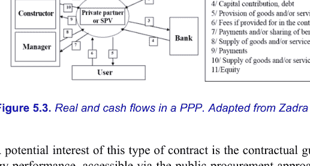

## 图 5.3. PPP 中的实际流和现金流。改编自 Zadra（2010）

这种合同的一种潜在利益是通过公共采购方式和 PPP 方式均可获得的能源绩效合同保证。

如果合同授予的选择与传统公共采购相同，则 EPC 细分为能源效率公共采购合同（EEPPC）。在这种情况下，“服务”、“COM”（建设、运营、维护）或“DCOM”（设计、建设、运营、维护）EEPPC 可以与某些绩效保证激励条款的使用相关联。这些保证对于 COM 或 DCOM EEPPC 可能是长期性的。

如果选择的是 PPP 形式，则 EPC 细分为能源效率合作伙伴合同（EEPC）。绩效保证的程度与 EEPPC 所能提供的相同，但与传统公共采购不同，投资可以由私人合作伙伴确保。然后，绩效的实现可能会影响公共实体部分偿还的条件，从而加强激励。

EPC 的另一个潜在利益在于将设计和/或融资的整体方法与一种特定程序——竞争性对话²²——相结合。

该程序允许公共实体与若干被准许参与对话的候选联合体一起定义或开发一种或多种可能满足其需求的解决方案。

22 由《公共采购法典》第 67 条规定的制度。

参与竞争的申请人联合体被邀请提交投标书，提出关于施工方法、价值分析、服务管理、融资以及提供适当合作伙伴服务的解决方案。

这种对话可以在几个连续阶段进行。根据第一阶段的提案，公共机构可以拒绝一名候选人，并构成对其他人提出的各种方案的筛选。例如，它可以选定由一名候选人提出的 技术方案，同时建议使用另一名候选人开发的金融工程解决方案来实施。这样，从一个阶段到下一个阶段，公共实体可以使候选人的研究和项目变得越来越精确和详细。

经过一个或多个阶段后，选择一个联合体（其他联合体可以获得补偿）。公共实体将与之合作制定功能和运营维护计划，以及合同草案，并提出将纳入绩效合同条款的风险分担矩阵提案。

这种方法具有显著的潜在优势，前提是它超越了某些限制，这些限制并非特有，但会阻碍任何合同方法以及任何共同生产方法。

第一个优势是通过竞争性对话程序，在公共实体与私人合作伙伴的设计团队之间建立密切关系。这可以减少事前的 信息不对称，促进绩效保证及其相关激励的平衡合同化，并改善对道德风险²³和逆向选择²⁴风险的控制。

其次，竞争性对话减少了私人合作伙伴对可能发生的不可预见变化的不确定性；避免了产生多个昂贵且有时无效的设计和财务评估研究；并允许在项目财务可行性的招标前确认技术兴趣。因此，这种对话有可能鼓励市场向新进入者开放。

23 因为如果合同规则未得到充分遵守，可以施加处罚。

24 当合同金额的最终支付部分取决于绩效的实现时，导致选择质量较低的商品或服务的盈利性选择就很少有存在的理由。

这种绩效合同化的方法的局限性“很简单”地取决于行为者真正进入对话的能力，以及随着时间的推移保持这种对话，以避免经济信息流失后成本错位。

绩效合同既不是好工具也不是坏工具，是它们被动员的交易宇宙决定了其范围。而正是这一范围、这一绩效的解读网格的边界决定了它们在法律上框定的项目的价值。

## 5.2. 衡量地域遗产

集体设计、实施和评估方法改变了对生产过程的表征，以及每个人对影响这些过程的其他行为者行为影响的理解。记忆的概念特定于每个共同生产场所，并且与承认和合同化合作伙伴在实现共同绩效中的作用密不可分。这是一种共享记忆，可以在未来的共同生产中再次激活并得到丰富。

通过参考能源绩效合同以及私人三级租赁的环境附件——被称为“绿色租赁”——我们的目标并不是专门强调这些机制的目的，而是强调其过程。它们所支持的节能改善行动基于真正的共同设计，作为一种对话的一部分，对话不是一种选择而是一个步骤，被制度化地置于这些系统的核心，即受监管，并为合同化提供支持。

我们对这些装置感兴趣的是它们存在性的证明。对话的制度化为合同过程带来了优势，即对能源绩效决定因素的表征的共同演化（建筑的技术特性、各自工作条件的执行等）——这种共同演化很难不与合作交易的特征相比较（参见第 3.1.2.1 节）。

乍一看出现的问题，与这种双重共同演化相关，涉及微观经济金融风险的概念。如果对话是基于

在共享表征和真实的共同设计、监测与评估能力的基础上，合同为双方提供了理解预期收益的相对可靠的框架。如果不是这样，交易性方法可能被其中一方为机会主义所俘获，或因其中一方的脱离和/或无能而被转移，导致负面或零和博弈。

一个更根本的问题，它是增值更大空间和时间的一部分，与微观经济交易被俘获或误用所诱发的经济信息耗散相关联。

交易可以是 *financialization singularity* 的过程，即导致 MD 与 NMD 分离的节点以及对其所基于的现象时空特异性认知可能性被湮灭，从而耗散经济信息。相反，它可以成为记录这些数据之间关系的地方，即保存赋予该交易客体的意义，如同制作一份能够体现与 *monetarization locality* 不可分割的指标和元信息库的合同所证明的那样。

换句话说，问题在于交易将生产还是摧毁地域遗产。

## 5.2.1. 绩效与盈利性之间不可还原的界面

### 5.2.1.1. 比较价格、成本和价值

将 Fustec 等人（2011、2015）*Thésaurus Capital Immatériel* 第一、二部分所述的无形资本财务估值方法应用于功能经济学的最明显局限在于，功能生态系统并不仅由私营企业组成。机构和利益相关者在做决策时，往往比企业更少重视财务标准。

这些方法的另一个不足与重要性概念相关。在管理意义上，信息的 *materiality* 取决于对价值创造跨组织过程的认知水平。基于实体内部管理趋向和过于强烈的财务理性，或诱导此类趋向的方法，会限制这种认知。

在这种情况下，企业认为具有战略意义的数据仍基于对跨组织空间的传递性而非功能主义的功利主义方法。而基于此方法进行的无形资本估值仅允许重建关于构成功能生态系统的实体之间关系的信息的一小部分。因此，各方所生产信息的汇集无法保证功能生态系统集体治理所需的信息质量水平。

这种情况源于地域经济信息系统的结构性不足，该系统无法使行为者摆脱价格、成本和价值之间无处不在的混淆。

在功能生态系统内部，与各种绩效目标相关并基于多元价值判断表达的交易中，与内部合作伙伴按合同提供的服务，与一笔欧元价格、即谈判价格相关联。这种价格在严格的市场交易框架内可以与交换价值相关联，但在将交易视为功能生态系统内部过程时，它不再“on its own”。

通过纳入比市场视野更广阔的财富视野，契约化服务的期望的货币表征整合了一个新的价值协商构成空间：即多功能生产的集体设计。与在微观经济层面提供契约化市场价格水平信息的货币指标相关的元信息随后被根本性地重组。它们必须与其他信息相联系，以便为功能生态系统的集体管理提供支持，即对其功能的综合维护和提升。

换句话说，价格信息在商业合同中尤其与描述合同绩效条件的元信息相关联。但当在功能生态系统层面进行分析时，它必须通过其他信息和元信息“enriched”，例如与合同绩效对被视为共享资源的功能的影响相关，后者的改变会影响地域内各实体的个体和集体绩效——包括合同各方——以及实现该绩效的成本。

与不将自己识别为功能生态系统成员的行为者所进行的交易相关的货币表征，因此并不与同一交易由评估其对该生态系统功能和过程影响的行为者所关联的货币表征具有相同的价值体系，也没有相同的 IS。

第一种货币表征在市场意义上是交换价值。第二种则不是，因为与其相关联的交易无法与行为者对对其活动有利的生产现象的集体管理的贡献相分离，而这种贡献的认可动员了社会表征系统和特定的增值领域。

两者——市场交换价值和实现主观和情境化功能收益所必需的交换价值——都不同于交易的第三种货币表征，即影响的货币表征，例如可能是在功能生态系统层面由其治理负责人之间的审议后集体制定的。

简而言之，我们在此参考第 1 章（第 1.2.2.2 节），如果在严格的市场经济中，交换价值倾向于在普遍视野（被市场捕获）中将自身强加为财富标准，并倾向于抹去在奇异与特殊之间的联系层面（由功能生态系统体现）的现实表征空间；那么在合同中组织信息——源于对话——的现象另一方面通过将市场所考虑的 MD 的起源重新定位到财富由 NMD 表示的地方性中，从而构建经济表征空间。

换句话说，在合同中结合 MD 和 NMD 使得能够重新定位并记录功能生态系统内部表达的经济信息的一部分，随后该信息被财务会计耗散。经济表征的地域不再是金融化奇点的简单原子化。它再次形成一个社会系统，而合同则是该地域社会系统与市场之间的“frontier objects”。

在市场交易之外谈论交换价值然后是一种语义捷径，如果货币表征的条件未被明确，就会导致重要陷阱。

与货币指标相关的元信息定义了地域经济组织的类型。它们在从一个组织转移到另一个组织时发生变化，例如从“market”组织到“functional ecosystem”组织，后两者相互交集但不重叠。

地域的集体治理意味着以“costs”为术语的反思，即维持和实现功能生态系统组织的成本，或更准确地说，通过集体选择和能力建设以实现可持续多功能生产（使用价值）而维持和更新该系统功能的成本。由于其属于市场经济，该组织的构成实体还必须反思资源服务获取的“price”术语（交换价值）。

通常被表征为同一经济客体——这里是服务——因此对应于多个表征系统，每个系统都由一个单一的货币指标组成，该指标对所有这些表征系统都是共同的，但在每个系统中都与各种非货币元信息相关联。

此外，在一个组织——微观经济或地域——内部，同一个货币指标会与多个 meta-ISs 结合，例如取决于是否将该货币指标单独但联合地定位在成本和价格分析中（这是会计的作用）。

因此，不仅两个行为者对他们刚刚共同签约的服务永远不会有相同的表征，而且为执行该合同而商定的货币价格，对于他们每个人来说，都与几种不同的 ISs 相关联。

### 5.2.1.2. 功能生态系统与复式记账

会计实务旨在协调实体内部交易所涉及的各方观点：其资本（负债）的维持与其承诺（资产）的估值之间的信息连续性。

复式记账逻辑比较资产与负债，区分与可动员能力构成相关的信息和与该能力得以存在且因此必须偿还相关的信息——同时确立了*会计恒等*原则：在财务年度结束时“就...而言”，描述资产负债表负债的货币指标的价值必须等于描述资产的货币指标的价值。

实体内部估值过程的完成因此导致为不同对象关联描述性 IS，其货币指标价值相同。

然而，这种将多个非货币记号符附加于同一 MD 的形式共存止于微观经济会计资产负债表。被弃置于账目附注和合同中的元信息，往往只提供低水平的细节，且在元信息的类别和类型方面不一定兼容。这一特征使得地域区域成为经济信息耗散的场所（见第 2.1.1.2 节）。

我们将提出方法来分析地域功能生态系统内部的估值过程，其结账导致为不同对象关联描述性 IS，其货币指标相同。

更具体地说，我们将建议将*复式记账*和*会计恒等*的概念应用于对地域能力的评估，以比较货币指标与源自不同地域层级所作表征的非货币信息。

让我们回到以欧元表示的翻新建筑的绿色价值的例子。在涉及 HQE（法国高环境质量）证书、房地产专家、出租方和承租方的交易结束时，其信息潜力并不相同，而一旦并入控股公司账目，其信息潜力就大为减少。类似的逻辑下，与骨料公路运输相关的能源支出，在承运商的微观账目中可能比在运输部门的国家账目中更具价值信息。在微观层面，例如，它可以与骨料运输特有的行驶距离和温室气体排放进行比较。这种信息潜力在宏观层面正在耗散，宏观层面将把货运整体考虑在内。

虽然评估的目的仅在于评估地域层面的经济附加值创造，当前的介观经济合并做法是令人满意的近似。认为所有微观交易情况相似，且由此产生的契约化估值水平因此可以完全汇总，并不会破坏分析的目的，即对生产系统效率进行即时的货币表征：GDP。

另一方面，如果按照*欧洲账户体系 ESA 2010*（Eurostat 2013）指南所建议的，国家账户也是服务于政治经济的工具，则必须保留对微观评估情况和对象的特殊性的了解。例如，公共采购机构可能希望联合监测支持翻新动力的微观经济努力以及区域骨料交通的演变，以便将这两个管理领域整合到综合规划中。

更一般地说，问题在于确保每个行为者都能更好地了解与导致货币表征产生的估值情况相关的文化、实践、参照系和假设。这种货币表征将从“信息黑洞”中浮现，在那里它被金融估值实践的优先性和微观与宏观层级之间的汇总所维持。金融化和汇总倾向于从货币信息所构建的多元社会价值体系中抽离货币信息，即从其货币化局部性中抽离。

换句话说，在我们看来，货币表征必须置于价值、空间和时间的连续体中，在此连续体中，信息耗散的总体水平将更接近于最初估值情况所特有的水平。这将减少当前金融化和去地域化的经济思维捕获的倾向。

在这里，对资产和负债概念应赋予何种意义？在财务会计中，负债是为资产融资的资源。

就地域功能生态系统的会计而言，记录在资产方的能力将是允许绝对解耦的能力。它将对应于基于解耦三个层级的 articulation 的生产和增值集体治理的有效性的信息和认知地域条件（见第 2.2.2.2 节）。我们认为，地域功能生态系统会计负债中描述的能力必须对应于地域各实体所动员的 IS 的适当性状态，以构成自身为功能生态系统，并在资产方所估值的条件下共同确保其治理。

我们将如下表述：

-   功能生态系统的资产将被视为使实体能够维持和改善地域的生态系统、技术经济和社会经济过程的信息和认知能力的集合；
-   功能生态系统的负债将被视为使实体能够共同维持和改善支持其自身活动的特定生态系统、技术经济和社会经济功能的信息和认知能力的集合。

将地域过程所需的信息和认知能力状态视为功能生态系统的资产，而将地域功能可用性所需的信息和认知能力状态视为其负债，这促使我们从“外部-内部”视角来看待这种地域会计。

这涉及评估实体是否以其活动相关的交易（功能生态系统负债）所使用的数据结构可能被地域治理动员的信息（功能生态系统资产）进行交易。

简而言之，这是一种认知失调的情况——一个人面对彼此不相容的认知（知识、意见或信念）时所感受到的紧张状态（Festinger 1957）——必须在功能生态系统的尺度上诊断，在个体与集体利益之间。

## 5.2.2. 地域信息与认知评估

### 5.2.2.1. 三重遗产身份

实体参与对集体项目表征的审议的方式（资产负债表上的资产）很大程度上取决于实体对其自身活动影响的表征（资产负债表上的负债）。

当我们谈论地域信息系统（IS）时，我们有广义的理解——包括流程、信息、目录、个体和集体表征。在我们看来，这一 IS 可以与资产负债表账户结合，以监测和评估其提供的解耦能力。并且根据我们刚刚描述的建议，这一共享地域遗产账户的资产必须在支撑解耦过程集体管理的地域审议实践层面进行评估，而负债必须在参与这些审议的实体领导者的个体认知层面得到解决。

为了提出适合这一资产账户的系统，我们将关注 Zacklad（2006、2007、2008）意义上的合作交易过程（见第 3.1.2.1 节），并将其与 Luhmann 的社会系统理论（1982、1988、1986、1991、1995）相接近。

在我们看来，地域 IS 内交易的转录（政治、契约或会计）体现了 Luhmann 意义上的沟通立场——即地域沟通的内容。地域中的行为者因此永久地、交替地或共同地是这一容器的“编码者”和“解码者”，即既处于信息发送者的位置，也处于等待成功的接收者的位置。

此外，成功预期——明确且共同地——是每个行为者特定活动的成功，以及在所涉地域层面开展的解耦战略的集体成功。

在合同缔结的微观经济交易中，缔约方不仅是彼此之间的发送者和接收者。合同也是地域沟通的沟通支撑，在此期间共同承包方共同处于发行者的位置。他们给出

对合同中结构化沟通内货币和非货币指标的组织赋予特定意义，这些指标分别描述其价格和条件，以绩效为衡量标准。

在此发行方的立场上，或可扩展至参与合同谈判的利益相关者，缔约方能够“理解”编码其所发布信息的指标，即赋予其社会意义。对他们而言，这些指标与一组元信息产生共鸣，该元信息规定了相关性范围、解释方式以及每个指标动员的目的。这种指标与其动员所遵循的元信息系统之间的共鸣，特定于发布合同的行动者群体的集体认知。这些行动者可以访问——正式或非正式的——在交易过程中他们参与创建的储备库，因此该储备库具有交易地方性特征，即特定的社会技术锚定。

合同作为沟通媒介的接收者，也会对接收到的信息中结构化指标的组织赋予特定意义。在此解码行动中，他/她以不一定与发送方希望传达的沟通意图相一致的方式“理解”这些指标。指标与另一组元信息产生共鸣，该元信息特定于接收者的认知和表征系统。因此，解码总是伴随着接收者的解释。

特别是各种非货币元信息与所关联的货币指标之间的这种关联，才使得价格、成本和价值——以及它们的共存——在地域表征空间中产生差异。

进而可以提出货币信息*同一性*的概念。为解决发行方编码的信息同一性与接收方解读的信息同一性之间的差异，我们将以*会计同一性原则*为指导。

我们对同一性概念的理解，并不仅仅指与*复式记账*形式相关的会计术语，该形式确保资产价值在财政年度结束与下一年度开始之间的连续性。它还指沟通过程在表征空间内的锚定。

因此，问题不在于动员同一性概念来表达所指的恒定性，而在于界定地域信息系统的一种能力，即以整合的方式反映沟通的三个位置。同一性概念因此描述了地域在解释沟通方面的能力的连续性，无论其接收和解码的层级如何。

衡量地域遗产——我们在此将其描述为*信息性和认知性*，以其赋予的解释能力为依据——首先意味着将一次沟通与其在时空中的发出层级相对定位。接近这一过程的一种方式是描述参与不同合作交易行动者所动员的目录如何得到更新。

与沟通相关的地域信息和认知遗产在行动者的*经验内容*和*中介物*共同向更好的集体解释能力演进时得以增加。例如，如果共同承包方以便于参与地域集体治理的其他行动者识别这些绩效的方式“编码”绩效合同，就会如此。

衡量地域遗产因此意味着至少考虑两种类型的合作交易：共同承包方之间的交易，以及涉及地域治理相关审议的利益相关者的交易。

现在让我们尝试将这些思考置于第二章引入的框架内；我们已将*合作交易*的概念与 (Holling 1995) 的*适应性循环*关联起来（参见第 3.1.2.2 节）。对开发 (r)、保育 (K)、释放 (Ω) 和重组 (α) 阶段的描述使我们能够共同接近功能经济的地域表征和契约化过程。

这种方法使得经济生产与*地域*表征的生产之间的关系得以凸显——地域在此被理解为一种有利于空间、组织和制度邻近性结合的协调状况，这些邻近性是地域潜力的体现（第 3.1.1.2 节）。

适应性循环描述了一个三维空间：*韧性*、支撑其的*连通性*以及其所赋予的能力 (Holling 1995)。

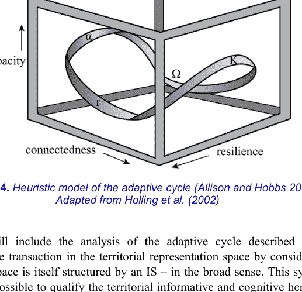

图 5.4. **适应性循环的启发式模型** (Allison and Hobbs 2004)。
改编自 Holling et al. (2002)

我们将通过认为该空间本身由一个信息系统——广义上——结构化，来将合作交易所描述的适应性循环的分析纳入地域表征空间。该系统使得能够以*韧性*、*连通性*和*能力*——后者结合了信息的*物质性*概念——来界定地域信息和认知遗产。当物质性的表征被共享时，它是利益趋同潜力的标志，是分裂的建设性结构化，因而是交易中合作的标志，有助于协调潜力的增强：遗产的丰富。

地域*信息和认知遗产评估*的目标，正如我们所回顾的，是描述地域沟通潜力的状态。它只有在会计同一性原则在三个维度上得到处理时才具有完全意义，这三个维度对应于地域信息系统在个体与集体储备库之间的*连通性*；信息处理实践的*韧性*；以及所沟通信息的*物质性*。

-   *连通性同一性*描述了地域信息系统如何使得能够比较地域审议所动员的指标和元信息（连通性资产），与在每个人自身活动框架内所动员的指标和元信息（连通性负债）。
-   *韧性同一性*描述了地域信息系统如何使得能够保持选择适合集体审议问题的信息处理方法和工具的能力（韧性资产），同时确保个体表征多样性的自由共存（韧性负债）。
-   *物质性同一性*描述了地域信息系统如何使得能够记录在地域审议中考虑的某种现象影响的感知（物质性资产）与在各自特定活动中对同一现象影响的感知之间的趋同或分歧（物质性负债）。

我们随后将谈论*三重财产同一性*——或三重遗产同一性——来描述地域功能生态系统信息和认知遗产账户中*资产*（在集体审议框架内动员的表征）与*负债*（在自身活动框架内由行动者动员的表征）之间的同一性。

## 5.2.2.2. 适应性循环与信息系统

财产负债表概念使得能够接近*共演化*——资产，即可在与地域治理相关的审议情境中集体动员的信息和认知能力；以及负债——个体信息和认知资源，必须由每个人自身的活动维持和再生，以确保资产的可用性和更新。

我们已明确指出，正是对地域信息系统的分析使得能够处理资产与负债之间的这种共演化。我们还指出，资产和负债各自在其层级上描述了合作交易，而我们已将这些交易与适应性循环关联。

我们认为，因此有必要认为地域信息系统的演化也描述了一个适应性循环，嵌入在共-

区域审议过程中所动员的表征以及各自特有的活动的发展。

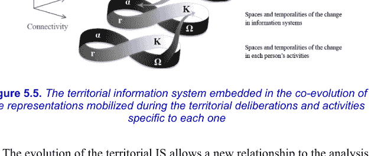

图 5.5. 嵌入于区域审议过程中所动员的表征与各自特有活动共演化中的区域信息系统

区域信息系统的演化使得对表征的空间和时间性的分析建立了新的关系。根据 Colletis 等人（2005）关于区域邻近性的术语（参见第 3.1.1.1 节），这种方法在循环基础上，分析更好地结合空间和组织邻近性（区域审议与各自特有活动的共演化）的条件，并在信息系统（IS）中调整制度邻近性。

因此，这是一个与区域信息系统的制度化相联系的整体、独特、自适应的循环——以最广义理解，包括每个个体审议和活动所需的资讯支持——我们将对其进行评估。

为此，让我们动员 ePLANETe.Blue 门户的 KerBabel™ 表示架（KRR），正如我们所见，它使得能够处理在区域审议情境中动员的指标相关元信息与在各自活动框架内动员这些相同指标时的元信息之间的一致性。

为区域审议情境所选指标的相关性是基于对这些指标的模拟进行评估的（参见第 3.2.1.2 节）。

这种模拟尤其导致对行为者动员这些指标的能力的诊断，因为他们在自身活动中使用的 方法。更具体地说，它描述了一个行为者如何报告审议中的情景对他/她自身活动可能对该审议中考虑的问题产生影响的效果。

*ePLANETe.Blue* 门户提出的表示架（KRR）因此构成了一个衡量区域信息与认知评估价值的装置，根据前一节所述的遗产身份的三重维度。

我们将从以下方面描述与审议情境相关的区域功能生态系统的信息与认知遗产评估：

-   *连通性* 在审议情境中使用的指标库之间，以及在每个人自身活动框架内。KRR 能够通过计算指标在 *方法和工具*（M）与 *知识载体*（C）维度之间的界面处的存在系数来确定这一身份水平。潜在假设是认为，如果行为者无法设想集体方法评估所需指标与用于评估其自身活动的方法和工具所需指标参考框架之间的桥梁，那么行为者参与集体方法就会很困难；
-   区域信息系统在面对个体和集体表征的潜在捕获时的 *韧性*。KRR 能够通过计算指标在 *问题*（I）与 *方法和工具*（M）维度之间的界面处的存在系数来确定这一身份水平。潜在假设是认为，非韧性的区域信息系统是一个无法处理区域行为者（无论是单独还是集体）所考虑的问题多样性的系统，或提供的信息数量不足和/或格式不适合满足与各自活动相关的分析需求；
-   信息系统构成的库所能处理问题的 *物质性*。KRR 能够通过计算指标在 *知识载体* 维度（C）与 *问题*（I）之间的界面处的存在系数来确定这一身份水平。潜在假设是认为，当行为者选择大量指标来描述其自身活动对这些问题的敏感性时，所考虑问题的物质性很强，并且可能有助于解决这些问题。

*区域功能生态系统的信息与认知平衡* 可以与 Douguet 等人（2015）所称的“KnoT”或“知识超立方体”相关联（参见第 3.1.2.2 节）。

图 5.6 中的中心立方体描述了一个三维“KnoT”，通过它我们可以处理指标在方法和工具轴、问题和知识载体之间的每个交叉点处的存在——每个立方体面一个轴。

这个 Knot 对应于 *信息与认知评估*。周围的立方体描述了需要预先使用 KRR，并针对遗产身份的每个维度，建立在审议情境中动员的指标的情况（区域功能生态系统的资产）以及在每个行为者类别特有活动框架内动员的指标的情况（区域功能生态系统的负债）。

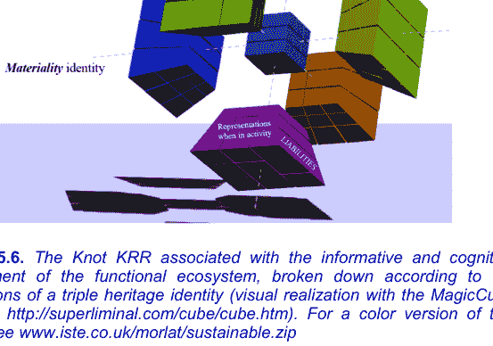

图 5.6. 与功能生态系统的信息与认知评估相关联的 Knot KRR，按三重遗产身份的维度分解（使用 MagicCube 4D 工具的视觉实现；http://superliminal.com/cube/cube.htm）。彩色版本请参见 www.iste.co.uk/morlat/sustainable.zip

因此，区域信息系统提供的 [指标 – 元信息] 对——即表征系统——一方面可以与表征子系统相关联，即在审议下时由该功能生态系统的构成实体动员的 [指标 – 元信息] 对，另一方面可以与其他表征子系统相关联，即由这些相同构成实体动员的 [指标 – 元信息] 对，但当它们关注自身活动时。

这种区分-结合使得能够在时间和空间上锚定区域信息系统的演化，并处理行为者面临认知冲突时可能出现的认知失调问题。

因此，问题在于系统化区域沟通潜力的映射。

## 5.3. 结论

前一章末尾描述的信息与认知评估意味着衡量在功能生态系统内特定审议情境所动员的区域遗产。这种平衡提供了该生态系统在特定时刻的信息与认知遗产水平的静态图景：即进行信息与认知遗产平衡的时刻。

我们认为，该评估的“尊重性闭合”意味着考虑到个体和集体表征之间的共演化。我们建议根据三个分析轴观察这一点：信息系统的韧性、库的连通性和信息的物质性。这种三重遗产身份特别旨在确保驱动个体和集体表征系统的自适应循环能够共演化并产生积极共鸣，而不会抑制表达或捕获解释的可能性。

信息系统必须使人们能够占有信息，以便在任何地方、在任何区域层级、在任何时间，都能产生具有相同潜力的内容，以产生对其“真实而公允的看法”。这正是我们通过表述以下兴趣所表达的

territorial informational continuum: 任何行为者都应能够通过了解信息产生的来源和情境来衡量信息质量，以便更好地动员利用它。

然而，这种信息质量并不体现在精确性或数量上，而体现在适当性上，即体现在关于其必须如何构成和呈现的报告上，以便被其他行为者在其他表征的空间和时间中动员利用。

回到*社会系统理论*，我们将封存领土项目的合同与*沟通*的三个位置之一联系起来：即沟通，即容器的位置——或支撑——它允许信息的传播，而信息将在对成功的期望中被解读。

这一位置——沟通——当由作为中介物的合同持有时，具有两个特点。它将沟通锚定在合同承诺的持续时间内，并在这一期间在领土项目的表征空间内稳定了一个理性之岛。它动员指标来表征绩效条款，这些条款反映了对该项目要求的雄心水平和适当性。

因此，合同具有强烈的结构性维度。它既语境化了在围绕领土绩效的生态、经济和社会维度进行政治审议期间所动员的信息，也语境化了在会计估值期间所动员的信息。因此，支撑新古典估值实践的*贴现*逻辑（见第5.1.2.1节）通过将“其他条件不变”未来所预期经济流的财务价值缩减到现在时间，在面对不断变化的合同格局的动态时被粉碎。

换句话说，新古典假设有效性的条件将在于理论上接受并在经验上观察政治审议对社会表征和合同实践影响的不存在。当然，我们拒绝这一假设，而相反将寻求界定这种影响的表达方式和手段。

第6章将提出通过领土信息与认知评估的遗产身份的三个程度（连通性、韧性和物质性）来分析与合同相关的表征系统。它随后将提出将这一分析整合到另一项分析中，该分析将根据与领土IS相关的表征的共演分化三个方向（微/中观、内部/跨实体和货币/非货币）进行。

这种方法将能够界定和衡量由领土IS制度化所赋予的*加速价值*：社会审议工作所具有的价值，它改变了社会技术系统中的利基、制度和景观之间的关系，在这方面具有解耦的潜力。

这将包括确定如何比较不仅社会、生态和经济绩效，而且这些维度之间系统性互动的绩效，因此表征能力的*传播*绩效以及社会技术治理*过程*所提出的Bosch等人（2013）（见第3.1.1.2节）。
