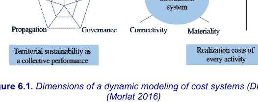
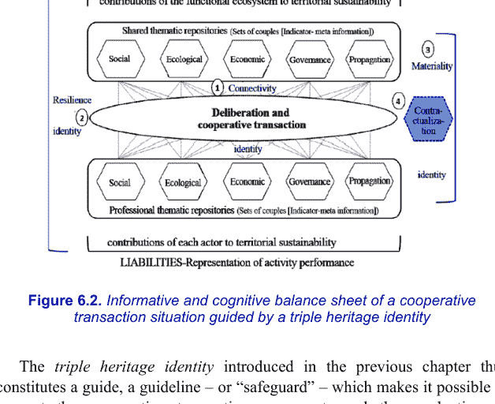
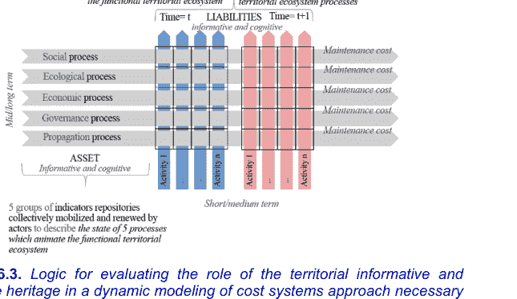
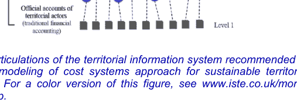
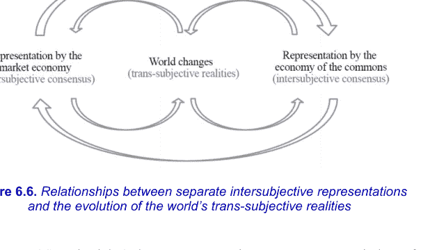
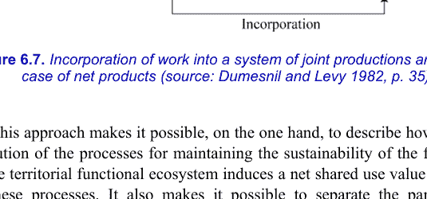
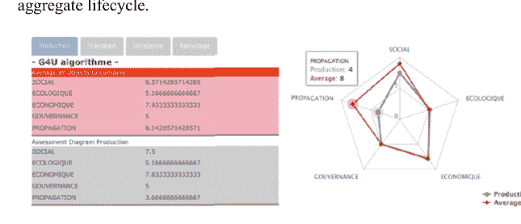
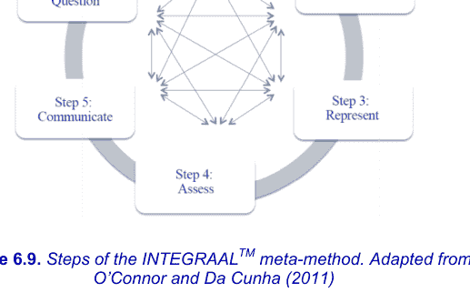
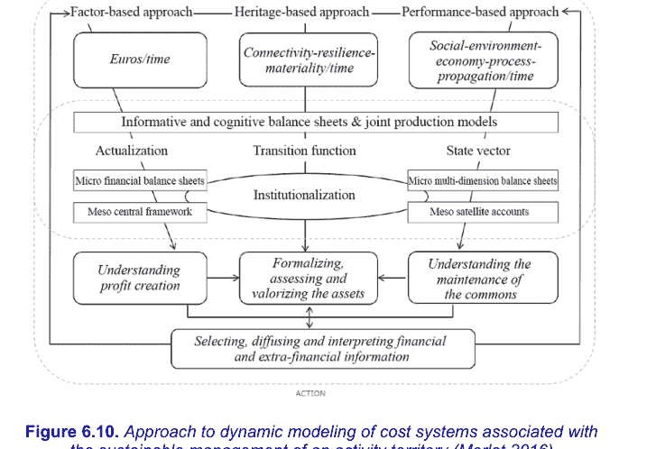

## 6. 发展，改变罗盘和地图

### 6.1. 成本系统的动态建模

与可持续发展雄心相兼容的经济评估不应止于在特定时间地点制度化框架内的数字工作。它必须考虑到制度可能性的演变以及它们如何与社会表征的变化交织在一起，而社会表征构成了微观、中观和宏观经济评估及其关系的基础。考虑到以GDP为经济质量单一表征的总体模型过于陈旧，目标不仅是制定在这些微观、中观和宏观评估层级之间进行“往返”的方法，而且还要将它们系统化。

我们所识别的单向信息处理的局限性超出了国家账户所动员的汇总方法破坏信息的问题。这种类型的处理与单独考虑的活动对它们可能构成的有组织的领土单位活动的影响无关（例如中观经济层面的一个功能生态系统）。事实上，即使这一约束被消除——这可以通过微观非财务评估与ESA 2010的更好连通性来促进——满足于简单的数据反馈将是一个根本性的错误。

这种方法意味着，一方面，信息系统（ISs）从业者用来描述特定分析层级问题的特定方法对其他从业者用来描述另一层级特定问题的特定方法没有任何影响——换句话说，领土IS是完全*韧性*的。

我们还必须假设从一个分析层级传到另一个分析层级的数据必然始终对应于在这些两个层级进行的分析相关的信息的本质，即它们使这些不同层级的行为者能够编码和解释信息，而他们各自赋予这些信息很高的*物质性*。

我们提议动员由*CARE®*会计系统化的生态经济逻辑。应回顾的是，这邀请我们考虑，虽然自然是*无价*的，但为保护、维护和更新自然资本而进行的集体领土行动具有*成本*，其承认必须导致经济资产的折旧（Richard 2012）。*CARE®*也将这一逻辑应用于人力资本，同时指出它可以应用于任何其他类型的资本。抓住这一机会，我们将选择更广泛地提及社会资本，并同时考虑社会技术治理资本，以及我们刚刚提到的表征能力传播的资本。*动态成本系统建模*（DMCS）方法因此将涉及生态系统、社会、经济、治理和传播资产的协同发展。

我们将阐述两个互补的建模原则。

第一个是，不同类型资本的联合摊销逻辑不应仅在微观经济层面考虑。它可以系统地纳入*ESA 2010*资产负债表进行的重新估值中。这种相关性将使能够——特别是通过治理和传播资本——考虑到推动领土发展可持续性集体维护的不同工作尺度的不可分割性。因此，对这种维护的设计和评估必须在这些两个尺度之间的区别与结合的逻辑中进行。

第二个是，这一联合折旧逻辑必须考虑到由领土信息与认知资产负债表所描述的功能遗产的状态。

### 6.1.1. 链接共享表征与活动成本

### 6.1.1.1. 过渡函数

不同表征层级之间沟通的质量是设计和实施促进功能领土生态系统可持续性的整体中的集成产品服务系统（PSS）时，个人利益与集体利益相遇的主要决定因素。至少这是我们所建议的。DMCS方法的雄心是提出验证这一假设的原则并衡量这些质量。

目标是描述将领土可持续性视为集体绩效与实体的活动成本之间的共演，然后通过对领土IS的分析来考虑共享信息与认知遗产的驱动作用——我们认为该系统的状态和制度化动态可以被视为该遗产状态和动态的指标。

图6.1. 成本系统动态建模（DMCS）的维度
(Morlat 2016)

在实践中，信息与认知评估使得能够接近合作交易所伴随的审议如何导致个人和集体绩效表征的共演（见图6.2）。这共同描述了合同内容的更新以及领土IS的形式或非正式制度化。

## 图 6.2. 由三重遗产身份指导的合作交易情境的信息与认知资产负债表

上一章引入的 *三重遗产身份* 因此构成了一个指南、一个指导方针——或“保障”——它使得能够支持合作交易过程，朝着生产“沟通型”合同的方向发展——指的是此类合同可以帮助领土内的其他行为者代表共同承包商所描述的绩效。

这种方法还使得能够将与 PSS 合同相关的非货币指标和元信息领土化，同时向领土开放其在功能绩效以及其他估值地方可能出现的服务合同方面的解释。

因此，合同不再仅仅是使用价值与交换价值之间的边界对象；它是一种 *媒介*，展示一种绩效。它是领土 IS 的一个组成部分，体现并传播其制度更新，既促进与其相关的多功能生产的认可，也促进承担这些生产的行动者的商业模式的偿付能力。合同构建了领土遗产。

对信息与认知遗产对集体领土可持续性目标的共同实现以及每个个体活动偿付能力目标的影响的分析应通过动态方法来完善。其目的是确保价值分析成为生产过程连续性的组成部分，即随时间推移，这也意味着超越信息与认知资产负债表的静态版本。

我们的方法将包括在一方建模领土系统可持续性维护过程的集体表征（社会、生态、经济、治理和传播功能的维护）与另一方对该维护做出贡献的活动的货币成本之间的关系。

### 6.1.1.1.1. 设计功能生态系统的过程

这种方法首先涉及集体思考领土系统维护过程所必需的条件：如果我们考虑模型的社会、生态、经济、治理和传播，那么就是五个过程，其维护条件将由五个绩效指标目录描述（每个过程一个目录）。

关键里程碑如下：

- 确定同一过程描述性指标之间的依赖关系，例如，“一个生态系统功能的维护如何影响另一个生态系统功能的状态？并且所选指标是否相关以描述这种影响？”
- 确定一个过程的描述性指标和另一个过程的描述性指标如何被用来捕捉所考虑的过程之间的关系，例如，“一个生态系统功能的维护如何受到经济能力维护的影响？并且所选指标是否相关以描述这种影响？”

指标的相关性不能仅通过阅读指标本身来确定；它始终是比较与每个指标相关联的表征系统的问题——即 [指标 – 元信息] 对。

### 6.1.1.1.2. 从集体表征转向个体表征

通过对维护过程、目标和绩效指标的集体界定而共同设想领土系统可持续性的行动者必须能够从这一表征情境中抽离出来。

这些行动者还正式或非正式地表征这种维护将如何影响他们自身的活动。这种投射由特定于其职业且与其活动的地方锚定相联系的指标形式化，会导致他们考虑与描述领土系统维护过程的指标大部分不同的指标和元信息。

为了在这两组指标和元信息之间建立关系，我们将认为行动者对领土系统维护过程的贡献可以通过特定指标来界定，这些指标描述了行动者自身活动如何影响这些过程的实现。

在此阶段，将制定一个分析合作情境信息与认知平衡的框架，以便维持领土功能生态系统的可持续性（见图 6.3）。

### 6.1.1.1.3. 将表征分析置于时间框架中

信息与认知评估提供了即时快照——固定在会计期间结束时——集体表征能力与个体表征能力之间关系的快照。长期视角是必要的，以反映每个行动者都是领土功能生态系统治理团体所推动的合作交易过程的一部分这一事实（见第 3.1.2.2.1 节）。

换句话说，在界定该功能生态系统的维护过程时，个体和集体表征共同演变。因此，为确保这种维护而组织和结构化的行动者集合必须与另一组行动者集合区分开来，后者由同一行动者组成，但组织和结构化以将这种维护纳入彼此职业的发展中。

### 6.1.1.1.4. 从对集体的贡献成本中确定集体成本

同一组行动者特定组织和结构之间的区别使得能够将每个行动者活动的成本与维持领土可持续性的过程的运营成本进行比较。事实上，这是一个单一且相同的动态：集体维护过程和每个行动者特定的活动只能因视角选择而区分——微观或中观经济¹。

微观经济成本的整合提供了领土过程总体成本水平的解释，其演变与领土信息与认知资产负债表的演变共同分析，在我们看来，必须推动政治经济学与地方创新之间关系的更新，以及由领土行动者生产的财富评估的重建。

图 6.3 描述了与维持领土功能生态系统可持续性的过程相关的个体和集体绩效表征的共同演变。

图 6.3. 评估领土信息与认知遗产在动态成本系统建模方法中作用的逻辑，该方法对于领土的可持续性是必要的。如需此图的彩色版本，请访问 www.iste.co.uk/morlat/sustainable.zip。

1 这正是为功能经济建立产品-服务系统以及社会经济活动的目标：通过多利益相关方商业模式的共同构建来组织微观经济偿付能力以及对领土可持续性的贡献。

图 6.3 中颜色的选择是一种生物学类比：在集体创新能力方面相对贫乏的活动的表征通过在关于维护过程绩效和应分配手段的谈判期间进行的合作交易而得到更新和丰富。

在不正式区分信息与认知资产在 t 时刻和 t + 1 时刻的两个状态的情况下，选择在 t 时刻和 t + 1 时刻的信息与认知负债之间显示区别，这是一种图形简化，旨在强调集体表征的演变比个体表征的演变花费更长时间。

这一逻辑引入了与领土功能生态系统动态建模相关联的 *转换函数*，即数学形式主义，通过该形式主义，系统 *状态向量* 在 t0 时刻的值在稍后的 t1 时刻被改变为同一状态向量的其他值。

## 6.1.1.2. 建模联合生产

动态系统可以使用状态向量和 *转换函数* 进行建模，因此必须建立系统“内部”与“外部”之间的 *边界*（Daucé 2002）。

状态向量的定义虽然复杂，但代表了 DMCS 方法中最不具问题性的部分 *a priori*。问题在于在给定时刻共同描述系统所拥有的信息与认知遗产的状态、该系统的绩效以及驱动它的过程的成本。至于系统内部与外部边界的问题，我们将以相当平凡的方式处理，将与分析对象相关的领土 IS 脱节的实体视为“外部”。

DMCS 将以新李嘉图方法来处理，被描述为 *联合生产*（Sraffa 1960；Pasinetti 1975）。

*联合生产* 模型使得能够数学地转录过程系统（领土功能生态系统维护过程）的共同演变如何动员和更新一组资源（界定和推动这些过程的行动者的表征）。

冯·诺依曼的（1945–1946）形式主义使我们能够考虑一对矩阵 [A(T); B(T)]，两者维度均为 M*N，其系数“分别代表所考虑资源的投入和产出比例，以便所考虑的过程能够生产一个活动单位。每一对行向量代表一个过程；每一对列向量代表一种资源”（Verger and O’Connor, 2013）。

A(T) = \begin{bmatrix} a_{11} & a_{12} & L & a_{1n} \\ a_{21} & a_{22} & L & a_{2n} \\ & & M & \\ a_{m1} & a_{m2} & L & a_{mn} \end{bmatrix} ; B(T) = \begin{bmatrix} b_{11} & b_{12} & L & b_{1n} \\ b_{21} & b_{22} & L & b_{2n} \\ & & M & \\ b_{m1} & b_{m2} & L & b_{mn} \end{bmatrix}

*图 6.4. 根据冯·诺依曼形式主义的联合生产系统矩阵建模。（来源：Verger and O’Connor, 2013）*

首先，应当指出，这两个矩阵指的是同一时间 t。因此，并不是在其中一个矩阵中报告系统状态，而该状态先于在另一个矩阵中报告的状态（正如在图 6.3 中呈现的教学性表示所示）。而是关于在时间上建模 t 时动员的个体表征与同样在 t 时更新的个体表征之间的关系。

也应指出，Verger 和 O’Connor（2013）提及的用于描述过程运作方式的活动单位，在我们看来，必须以共享使用价值为特征。

该价值源于在审议期间与必须由所考虑过程确保维护的领土功能相关的使用品质的描述。维护其中一个功能的流程不能用描述另一个流程所使用的同一组指标来描述。因此，共享使用价值中的活动单位特定于一个绩效领域（社会、生态、经济、治理、传播）。

因此，被视为描述维护领土社会功能过程有用性的共享社会使用价值单位，将与描述维护经济功能的有用性的共享经济使用价值单位不可通约。这两个单位所界定的共享用途之间的系统性联系，可以通过突出其各自描述所用指标之间的关系来描述。但这些共享使用价值中的每一个只能在基于审议的资格认定结束时，以自主、内在的方式表达，并产生地方性、独特且不断更新的协议。

联合生产的建模随后确保了与领土功能相联系的 *共享使用价值*；体现维护过程的贡献者活动所特有的 *使用价值*；以及执行这些活动、因此也是这些过程的 *成本* 之间的分析联系。

因此，前一页（图 6.4）上呈现的冯·诺依曼形式主义中的每个单元都对应一个 *特定使用价值* 指标。

在左侧框架中，当他/她参与集体形式化治理这些功能维护过程发展的领土功能的共享使用价值时，*特定使用价值* 滋养着行为者的表征（按列）。

在右侧框架中，当他/她形式化其从活动调整中获得的效用时，该调整旨在为领土功能的维护过程做出贡献（按行），*特定使用价值* 滋养着行为者的表征（按列）。

两者共同使得能够描述在某一给定时刻，合作交易情况的 *信息与认知资产负债表* 的状态，在此期间，一组行为者确定他们与领土可持续性相关联的共享使用价值单位的内容。

该资产负债表中两个框架中每个变量的估值应基于 *三重遗产身份* 方法，并应用于以下水平的计算：

- 关于专门用于表示一方面特定使用价值与活动成本之间、另一方面共享使用价值与集体成本之间的关系的信息系统之间的 *连通性*；
- 关于为集体应对共享使用价值而动员的方法和工具的 *韧性*，面对可能由某些特定活动动员的方法和工具所行使的捕获力量；
- 关于领土功能保护所提出问题的 *实质性*，这些问题构成了共享使用价值表达的基础，并由每一位行为者与特定使用价值相关联。

一旦该信息与认知资产负债表被“尊重地关闭”，就可以考虑按过程计算运营成本。换句话说，DMCS 意味着在任何时候，*三重遗产身份* 必须在与功能生态系统可持续性绩效实现相关的任何契约化之前被“认证合规”。这种合规性的认证可以基于 *ePLANETe.Blue*² 门户提供的类型数字工具。

在进入实践方式的描述之前，DMCS 的一些概念基础仍需澄清。例如，必须明确区分评估框架与被评估的目的。我们在这里试图评估的并不是基于既定标准（即使是集体）个体绩效对领土绩效的影响。这种建模的目的在于随时间描述个体和集体表征与建立绩效标准的集体生产情况之间的一致性改善所产生的效果。成本方法随后介入控制：集体层面所代表的成本系统与每个特定活动层面所代表的成本系统之间的一致性构成了领土信息与认知遗产质量的保证。

## 6.1.2. 相对增长与战略对齐

### 6.1.2.1. 社会经济生产的核算

我们提出的方法颠覆了通常的经济分析概念，后者将成本信息视为“产出产品”。

DMCS 的“产出产品”是与领土可持续性的个体和集体表征相关的信息。因此，它不提供任何关于活动成本和维护过程成本的指示。DMCS 伴随各方自身活动成本的分析

2 特别是通过共同构建 K4U 多准则和规范性评估算法来评估三重遗产身份的实现水平。

并促进识别与利益相关者为维护领土功能生态系统可持续性的过程顺利运行所做贡献相兼容或基于该贡献的绩效改进机会。

如果确定这些过程的执行成本仅仅是汇总各行为者为将其活动转向有利于这些过程的运作模式所做的贡献，那么这将是微不足道的。事实并非如此。

一方面，许多对维护过程的功能性贡献是以多元劳动的形式——正如我们在第一章末尾提及这一概念——或实物形式做出，这些并未货币化。因此，共享使用价值水平的实现仅部分取决于会计系统形式化的绩效活动。以会计活动范围为基础比较共享使用价值和特定使用价值将导致重大偏差。

另一方面，这些贡献之间功能性相互作用的分析需要基于审议和集体生产的地方绩效评估协议的系统性、特定性和更新性分析。

我们的方法将是建立贡献者为集体能力所做活动的货币成本与每个贡献者对维持该能力所做贡献效果的非货币表征之间的分析平衡。这将使得能够通过识别它们所允许观察到的集体成本降低，从而纳入未以货币价值衡量的工作和收益。

在此基础上，另一种分析视角将在于突出事实上可归因于其非市场活动有助于降低集体成本的行为者的财务生产力部分。

对每个过程相关成本的一致分析将涉及：

- 开发一个连接微观和中观绩效的算法，以便分析实体活动与领土功能生态系统维护过程之间的系统性关系；

-   为每个过程关联 [共享使用价值准则 – 绩效指标] 配对和 [特定使用价值准则 – 绩效指标] 配对；
-   对执行所有维护过程所涉及活动的正式记录成本进行汇总合并；
-   按其对所有维护过程的贡献程度比例，将该合并成本金额在正式或非正式的贡献活动之间进行分析性分配；
-   以汇总方式合并这些成本，但此次按过程分别进行，根据活动对每个单独考虑的过程的贡献程度；
-   为五个 [共享使用价值准则 – 绩效指标] 配对以及 [特定使用价值准则 – 绩效指标] 配对各自关联一个货币金额。

为支持对该方法的描述，有必要考虑对区域信息系统（IS）进行新的结构化。这必须促进对从微观和中观表征层面观察到的同一生产现象的联合但差异化的表征。

图 6.5 提出了适用于 DMCS 方法的区域信息系统的构建。

图 6.5. 推荐用于可持续区域管理成本系统动态建模方法的区域信息系统的构建。彩色版本请参见 www.iste.co.uk/morlat/sustainable.zip。

自下而上，图 6.5 应按如下方式解读：

-   区域行为者的正式账目（第 1 层）无法核算信息和认知遗产对认识区域功能（社会、生态、经济、治理、传播）所提供的共享用途倾向演变的影响。这些账目也无法检测共享用途的认可是否伴随着对新的特定用途机会的认可，即活动的适应，或这些适应是否可能与成本降低相关联。事实上，无形资产的正式化仅限于成本会计领域，这限制了集体区域表征的能力，因为它在微观层面锁定了管理者与会计人员之间的沟通（参见第 2.1.2.2 节）。
-   基于 CARE® 模型（参见第 4.2.2.1 节）的活动分析性账目与每个行为者的正式账目（第 2 层）相关联。这种与每个行为者正式账目接口的分析模块，能够报告其参与一个或多个 PSS（参见第 2.1.1.2 节）的情况，该 PSS 校准以同时加强区域功能生态系统的维护过程以及所涉及每个行为者的偿付能力。行为者为参与 PSS 而产生的成本在此被视为会计承诺，记录在负债方，使其能够偿还向区域功能生态系统非正式签订的“债务”。与此同时，维持该功能生态系统功能所需行动手段价值的货币表征——以及没有这些功能获取就无法存在的用途——被确认为资产。
-   受 Comptabilité Universelle®（通用会计）模型启发（参见第 4.2.2.1 节）的 PSS 分析性账目与每个 PSS（第 3 层）相关联。PSS 在区域信息系统内制度化地体现了一个增值的地方。它由一个多利益相关方法律和经济实体体现，其合同形式化是相互承认个人和共享利益以共同实现和提升多功能生产综合体的结果。与该多利益相关方实体相关联的账目，或更准确地说行为者之间的合同联系，使得能够建立指标和元信息的参考系统。该账目构成了个人和集体绩效以及特定和共享使用价值的局部表征系统。因此，每个审议性和合同性的 PSS 系统都是一个“分析实体”的组成部分，可以与其关联资产负债表和活动账目，目标是通过提高对彼此贡献影响的效果和利益之间区别的共享可见性，提供地方谈判支持³。

Comptabilité Universelle®（通用会计）随后可以成为灵感来源。其形式主义适用于历时性评估，这将使能够在区域功能生态系统的时间以及构成其的实体的经济平衡中考虑 PSS 的表征。我们提出一种改编⁴，旨在为我们刚刚描述的按过程进行的活动成本虚拟分配/合并的第一层级提供装备。

该改编共同允许：

-   在五份损益表中记录与特定使用价值的非货币定性与计量相关的货币费用和收入，每个 PSS 合同方将其与自身业务的劣势和优势相关联；
-   在五项资产负债表维度的资产和负债上记录共享使用价值——非货币——与对该 PSS 对区域功能生态系统维护的五个过程贡献的集体评估相关联。

此类会计将促进货币与非货币表征之间桥梁的建立。绩效指标的生产、其在 PSS 合同条款中的结构化以及区域沟通过程，该过程更新了相关元信息组织和解释，因此可以与存货和现金流动态进行比较。

3 在 PSS 层面区分“效果”和“利益”术语很重要。在 PSS 中，由多个活动相遇而产生的效果可以集体表征并导致主体间共识。这并不妨碍每个行为者为这些效果赋予单一价值，该价值取决于其自身的主观性，取决于这些效果是否促进其活动。

4 该改编旨在避免由 Comptabilité Universelle™（通用会计）方法原版提出的资产负债表货币化做法。

-   基于 CARE® 模型的区域功能生态系统账目，再次将多个 PSS 层面所代表的价值与内在区域估值所产生的价值相结合（第 4 层）。CARE® 在此被动员的方式与实体层面相同，但有两个区别。一方面，记录的价值是共享使用价值，即它们由非货币表征系统描述，该系统由 [共享使用价值准则 – 绩效指标] 配对组成。另一方面，该方法适用的实体对应于共同管理区域功能生态系统的集体行为者。并且如果构成功能生态系统的所有实体都参与此管理，那么该集体行为者的理性不仅受共识或综合的寻求滋养，而且受每个实体所做的表征的构建和结合的滋养。

正是这里出现了我们提到的认知失调问题：在审议中集体表达的共享使用价值不一定与每个人职业特定的价值相兼容。这也是信息和认知评估发挥作用的地方。

共享使用价值的非货币记录描述：

-   在负债方，集体行为者在区域功能维护方面的承诺。该承诺对应于由有生命和无生命行为者在五个维护过程中的贡献所投入的 plural 工作力度，每个过程均由共享使用价值描述。它记录在与五个过程相关的五个负债项目下。其水平是基于对 PSS 分析性账目的整合性（非汇总性）分析确定的。
-   在资产方，由区域功能可持续性赋予的集体行为者能力。该能力对应于共享使用价值，该价值是就每项功能所具有的特定用途所赋予的利益而集体分配——协商——的。它根据五个资产项目记录，水平为减少相应负债项目所需手段的价值。该价值可以根据信息和认知资产负债表的演变，在 CARE® 逻辑下进行折旧。

在每个 PSS 层面建立的共享使用价值、特定使用价值、优势和劣势之间的关系，一方面，

而存货和现金流另一方面将因此被重新组织，以反映集体领土理性。

-   *ESA 2010* 仪表板（见第 5.1.1.1 节）随后充当领土功能生态系统账户（第 5 级）与国民账户（第 6 级）之间的接口。

这涉及重构 *共享货币成本*（在每个 PSS 分析账户层面分为五个领域）与领土功能生态系统账户的五个资产项目各自相关的 *共享使用价值* 的 *非货币* 指标之间的关系。

此处的目标是将价值的功能分析转化为宏观经济决策者的语言，并根据即将要求他们使用的阅读框架，即以一种原创的方式在与欧洲账户体系 *ESA 2010*（见第 4.2.2.2 节）所述相近的一组卫星账户中比较货币和非货币数据。

## 6.1.2.2. 信息性与认知工作的纳入

区分共享使用价值的分析与特定使用价值的分析，也导致区分对有助于领土可持续性的活动绩效的分析（共享使用价值）与这些活动的成本分析（特定使用价值）。

但是，正如我们刚才所见，无法立即辨别一项活动的成本中可与对领土可持续性的贡献成本相关联的部分。也不可能确定一项支出或收入是否可归因于该实体的传统活动，或归因于旨在使其活动更可持续的改变。这种改变可归因于将该实体纳入领土功能生态系统的 *协同专业化* 方法（见第 2.1.1.2 节）。

解决这一问题的一种方法是认为该实体在至少两个现实层面共同且各自存在。它存在于主导的市场和超自由主义经济被客体化的现实层面，因此不仅是全球化的，而且是去领土化的。它还存在于奥斯特罗姆（2010）所定义的 *公共物品* 经济中——一种以集体治理物质⁵、环境⁶、知识（Hess and Ostrom 2007）以及所有有助于解决生态不可持续性和经济无偿付能力同时增加社会包容性的公地类型的出现和维护为特征的经济。

我们所倡导的功能经济，通过将社会技术创新的选择及其价值实现的条件建立在地方政治选择之上，在这两个世界之间架起桥梁并构成第三个世界。

这种功能经济最根本的特殊性在于 *工作被纳入* 生产过程的方式。

在功能生态系统内对共同生产进行估值不仅意味着各行为者工作的价值与集体工作的价值之间存在区分与结合，也意味着表征市场经济和公地经济的估值范式之间存在区分与结合。

例如，私人商业房地产中“绿色价值”的形成就显示了这一点（见第 4.1.1.2 节）。我们认为，翻新作业的市场价格的正确性不能仅仅理解为市场对其 *事后* 效果在对领土公地可持续性贡献方面的效用给予的公平报酬。事实上，促进这些翻新所必需的社会经济杠杆的成本也必须予以考虑。而同意投资于这些杠杆的社区——尤其是教育学杠杆（见第 4.1.1.2 节）——这样做是为了改善一种公地的质量：地方信息与认知遗产，通常简单地描述为 *集体智能*。

*更一般地说，共享使用和市场交换是发生在两个平行主体间现实中的现象，其对世界超主体间现实的唯一影响可以在其中找到，但其表征*

5 共享资源、基础设施和集体网络等。

6 积极的也可能是消极的：奥斯特罗姆所考虑的环境公地（河流、湿地、森林等）的考量可以伴随“负面”公地（污染活动场所、寿命终结的核电站）的考量，这些也必须得到照顾：http://www.socialter.fr/en/module/99999672/664/le_zro_dchet_et_and_lmergence_of_negative_communes.

可以通过一种框定其共同演化的政治经济使之保持一致。

图 6.6. 分离的主体间表征与世界超主体间现实演变之间的关系

我们提出的 DMCS 领土信息系统旨在为市场现实与公地现实之间的这种共同演化打开一个新的解释窗口，并通过它，为更新驱动两者的现象的非货币和货币估值方法提供一种途径，以便通过市场实践的转变来加强对公地的管理能力。

我们推理的起点是，对一组生产性现象的估值不仅仅意味着考虑个体工作与实现这些现象所必需的集体工作之间的区分-结合；这种估值必须首先通过区分该工作的个体和集体组成部分来界定一种表征工作，然后分别处理它们对生产过程的纳入。

如果我们参考马克思在古典经济学家工作基础上发展起来的价值概念的核心——纳入劳动的概念，我们的方法邀请我们区分一种被再生产资源的价值的两个组成部分。该价值的一个组成部分必须归因于对该资源及其动员和再生产过程的表征工作的纳入，即生产性现象的表征。价值的另一个组成部分必须归因于对实际执行这种动员和再生产的活动实施工作的纳入。

我们提出动员的联合生产建模（Sraffa 1960；Pasinetti 1975）是一种新李嘉图主义方法，描述了一个同时动员和再生产一组资源的流程系统的发展。

Dumesnil 和 Levy 认为，生产系统⁸的净产品⁷的劳动量分配是可能的，并提出以下定理：“作为系统净产品获得的任何商品向量数量都具有正价值，该价值定义为其净生产所需的劳动的纳入”（Dumesnil and Levy, 1982, p. 35）。

图 6.7. 工作在联合生产系统中的纳入以及在净产品情况下的纳入（来源：Dumesnil and Levy 1982, p. 35）

这种方法一方面能够描述维持领土功能生态系统功能可持续性的过程的共同演化如何为其中每个过程诱导出净共享使用价值。它也能够将部分

7 “一个过程的净产品是一组商品数量，对应于从过程产出向量中减去其投入向量的向量得到的向量（...）系统的净产品由同一类型的向量表示，该向量源于在某些活动水平 Zi 下同时实施不同的过程，Zi 按定义均为正。”（Dumesnil and Levy 1982, p. 33）。

8 在这种特殊情况下，“过程可以在活动水平上驱动，使得生产产生可分为两个部分分析的商品数量：所消耗投入的严格再生产；所考虑的商品”（Dumesnil and Levy 1982, p. 34）。

表示工作与由推动这些过程的活动所进行的实现工作相区别。

### 6.1.2.2.1. 实现工作的纳入

通过对领土 IS 的新制度化进行描述，DMCS 提出了一个纳入实现工作的体系。

采用类似 Comptabilité Universelle®（通用会计）的国家资产负债表进行调整，以及遵循 CARE® 逻辑的一般账户改革相结合，确实能够对实体的财务估值进行调节，以便对生态、社会、经济、治理和传播资产与负债进行估值。

在 ESA 2010 账户层面复制这一方法，以功能生态系统账户内联合生产的建模为基础，将在中观经济层面实现同样的整合过程，同时促进与宏观经济层面的对话。

这种对工作的个体和集体组成部分的纳入，使得能够确保对使用价值的特定和共享方面的联合且差异化的解读，而在我们看来，这些方面可以并且必须通过一体化的微观-中观共同摊销来关联。

### 6.1.2.2.2. 表示工作的纳入

该领土 IS 的这一提案还组织——而这正是我们研究的核心——一个纳入表示工作的体系。应用于实体、PSS 和功能生态系统治理之间沟通的信息与认知平衡，使得能够确定纳入领土 IS 的信息与认知遗产的水平（参见第 5.2.2 节）。

我们因此认为，表示工作的这一纳入：
- 是根据信息与认知遗产的水平进行的，该水平决定了在领土功能生态系统账户中作为资产记录的共享使用价值的折旧调节；
- 是针对参与 PSS 的每个实体共同校准的，通过对其相关联的 CARE® 模型中每一项资产线的折旧来实现（折旧始终基于领土信息与认知资产负债表，并且对每一项资产线采用相同的调节水平）。

这种方法可以被解释为对第 1 章中描述的预防原则的应用（参见第 1.1.1.2 节）。事实上，如果领土内各行为者共享的 IS 不能使他们获得足够质量的集体描述，以反映可持续性问题以及可能应对这些问题的微观经济策略，那么个体活动和维护过程的成本将会更高。

然而，一个技术上的困难固有地存在于联合生产的建模中，当涉及到在同一过程的产出之间分配工作量时就会出现。对于 Dumesnil 和 Levy（1982）而言，这种类型模型的特征是工作“不可分割地在同一生产行为中被纳入这些各种产品”。

我们是否要根据表示的集体能力，按照统一标准对领土内所有实体的资产进行折旧？还是有可能确定特定于 PSS 之一的折旧水平？

让我们回到骨料行业的案例研究。图 6.8 中展示的 KerBabel™ for You（K4U）评估算法反映了一种情况，其中一个“PSS 骨料生产”的表示能力的传播绩效低于其他 PSS。于是可以假设适用于该 PSS 实体 CARE® 折旧大于适用于骨料生命周期其他阶段的 PSS 的折旧。

Figure 6.8. ePLANETe.Blue 门户上多准则 G4U 分析的结果（虚构案例）。彩色版本请参见 www.iste.co.uk/morlat/sustainable.zip

更一般地，治理和传播绩效的分析将使得能够根据各行为者群体对中观经济表示的领土工作的贡献，建立微观经济折旧的调节关键。

## 6.2. 加速的社会价值

根据前一节提出的建议，在中观-宏观领土层面产生的*实现工作的纳入*，其产生了一个在该领土层面具有意义的共享使用价值单位，只能与相对于该层面构建的货币表征进行比较。*表示工作的纳入*所产生的唯一折旧率导致为不同微观和中观经济评估场所中的每一个构建特定的货币表征，该表征可以根据治理和传播绩效进行调整。

因此 DMCS 是一种微观-中观整合货币表征意义构建的方法。其目的是减少信息构成与解释之间的差距，从而减少这种信息的耗散——这种耗散是领土经济沟通固有的。

正如看似矛盾，生产成本和市场价格是不可通约的，或者至少它们仅在 Luhmann 的*沟通*位置（the Mitteilung）中可通约。一旦处于*信息*位置，或处于*等待成功*位置，一对[*领土化效用 – 指标 €*] 就不再可与一对[*金融化效用 – 指标 €*] 互换。另一方面，在审议、合作交易、合同或任何其他可能维持领土*沟通*三个位置之间联系的社会活动中，它可能仍可与另一对[*领土化效用 – 指标 €*] 互换。然后就诞生了一对新的[*领土化效用 – 指标 €*]，其表达并不意味着抹去孕育它的那些对。

我们方法的一个目标是确保这两种货币表征——成本和价格——的构建不仅能在平行现实中并存——*货币化场所* 和 *金融化奇点*——而且能够在不相互毁灭的情况下相遇。

Joël de Rosnay（1975）将概念*系统*定义为“根据目标组织起来的动态互动的元素集合”。评估发展的可持续性的过程具有系统的特征，是为科学研究目的而组织的。它动员“元素”——子系统——即个体和集体表征在围绕并通过分析生态、社会和经济*现实*的方法和工具的动态互动中组织起来。这三个现实是整体可持续性分析系统目的的子系统。它们在同一现实层面上共同演化：即对这些现象的或多或少共识的表征和解释，其超主观现实将永远超出分析者的 reach。

因此，可持续发展的经济是活知识实践的经济。这不仅涉及对生物的认知，作为工具，特别是 IS，使我们能够尽可能接近超主观现实。我们区分工具与实践，因为评估系统的内在相关性必须与其实践质量区分开来，因而与行为者的占有相关。因此，我们强烈地用社会经济分析来支撑我们的研究。

我们无法共同处理不同的主体间现实。但在能够使经济评估实践得以更新的共享知识遗产中，有一个既游牧又统一的概念：*熵*。

熵的概念是在热力学物理领域引入的（Carnot 1824；Clausius 1850），并被生物学、信息科学、控制论等领域所采纳。

在系统科学的应用中，这一概念提供了对经济信息耗散的更好理解。它将使得能够论证使用 DMCS 方法来建立接口之间的*货币化场所和金融化奇点*。

如果我们特别关注可持续发展的经济，熵就是生态、社会和经济现实之间的桥梁概念。这种桥梁的想法意味着熵不应在这些现实中被同等地应用，而应作为指导原则，为认识不可持续之物提供连贯且一体化的路径。熵的概念因此使得能够导航

通过对生态系统破坏的表征（生物物理熵）——由线性工业经济（热力学熵）造成——到社会系统在降低成本之前考量价值的能力丧失（社会经济熵）。

## 6.2.1. 熵、财富与时间

### 6.2.1.1. 静态结构与生命网络

对于 Capra（2003，第 178–179 页），“任何系统的组织模式，无论是有生命的还是无生命的，都是系统各组成部分之间关系的配置，它决定了系统的本质特征（……）。系统的结构是其组织模式的物理物化”。Capra 补充道，“如果对组织模式的描述意味着关系的抽象投射，那么对结构的描述则需要描述系统在现实中的物理组成部分——形式、化学组成等——以便描述结构”（同上）。

对 *功能生态系统* 模型的引用，该模型贯穿于之前的所有章节，促使我们继续进行生物类比，并通过比较生命系统和经济系统来调动 *组织* 和 *结构* 这些概念。

对生物物理系统的分析可以区分不同类型的结构：*静态结构*、*网络*、*耗散结构* 和 *生命网络*。

*静态结构* 是具有热力学平衡的物理化学排列，即处于其演化、结构化和生命终点的系统。它们可以被整合到 *网络* 中，在其中物质循环，能量耗散（Odum 1953）。这些网络促进了前生物分子组织和催化循环或闭环催化网络（Eigen 1971），它们是生命化学的基本过程。*耗散结构* 的概念（Prigogine 1969）指的是被物质和能量流穿越的开放系统，因而远离热力学平衡。对 Prigogine 来说，这使得讨论生命系统的运行成为可能。耗散结构会物化一种局部秩序，这种秩序不断被流经其中的 *过程* 所提供的电流所更新，并通过该过程实现该系统的 *组织闭合*。而此类系统与一组静态或耗散的网络和结构的相互作用，就构成了生态系统的 *生命网络*，其组织和结构反过来又制约着构成系统之间的相互作用。

对经济系统的分析也揭示了若干结构。例如，让我们考虑 *工业部门*、*企业网络*、*PSS* 和 *区域功能生态系统*。

*工业经济* 的 *线性结构* 必须被纳入 *工业生态* 和 *循环经济* 类型的 *企业网络* 中，其特征是闭环组织，旨在限制物质-能量流的耗散。功能经济能够控制这种耗散，尤其通过在审议过程中设立的 *PSSs*，从而减少社会经济信息流的耗散。对 *功能性区域生态系统* 的设想随后可以指向 *PSSs* 的“*生命*”网络，由具有同时减少能量、物质和信息耗散的特性的结构组成。而该网络的组织将同时制约 PSSs 之间的相互作用以及这些系统内部的相互作用。

例如，考虑引言中提到的法国生态转型行动的政治战略：它涉及对公共和私人投资的物质-能量流和信息的共同管理。该战略基于对共享使用价值（即共同物品的价值）的表征的集体组织，这些表征需由“负责任的企业”主导的区域进程来维持（这些企业可能是国家投资的受益者）。随后，这些企业被邀请更新其商业模式、使工业基础循环化并增加其功能性供给——从而重构 PSSs 之间的相互作用。

我们 DMCS 方法的灵感来自于需要与物理和契约结构的更新相并行地更新估值系统。而 *熵* 的概念——如果谨慎地应用于这些现实的各个层面——使得能够围绕一个度量单位将它们的表征汇聚起来：时间。

生物系统与经济系统之间的这种类比仅具有有限的说服力。然而，它有利于某些教学性提案，使得能够说明在一种现实中然后在另一种现实中调动 *熵* 概念。

在热力学物理领域，熵可以被视为对物质整体“无序”的一种贡献的度量，与无法动员已耗散的能量潜能的能力相关联。熵原理被称为热力学的第二原理⁹。任何开放热力学系统的转化都伴随着整体熵的增加，即系统的熵以及其环境的熵（Carnot 1824；Clausius 1850）。这种“无序”和耗散的不可逆性使物理现实置于时间性之中：从热力学观点看，熵因此指向“时间之箭”。

Georgescu-Roegen（1971）以熵的术语描述了工业生产单位规模上的客观化物质-能量流。低熵的材料和能量潜能，如石油或木材，被使用，然后以高熵废物的形式返回自然环境，即无序且不再提供相同的能量潜能。这种本质上是熵的流，也在全球生态系统中产生不可逆的转化。因此，工业过程的结果是局部和整体的熵，它不可逆地影响生物系统和整个生物圈。

正如我们所论证的，工业生产对物质-能量流的耗散在一定程度上可以减缓，或至少得到控制，例如在 PSS 的背景下。这是有条件的，需要一种沟通，使行为者重新组织其对用途的表征并重构生产装置的物理维度。

然而，物质-能量流的减少只有在与其它发展相联系时才具有意义，例如生态系统的发展，或使能够记录这种减少以鼓励实施该减少的活动的机制。

这种动态稳定状态，它源于“何为价值”表征的组织在生产物理结构再配置中的永久物化，可以被归类为社会经济负熵。

我们在此受到 Schrödinger（1944ab）在生物化学领域提出的负熵——或负熵——概念的启发，作为对

9 第一原理是，在热力学系统的任何转化过程中，都存在能量守恒。

生命特征状态的描述。这种负熵状态并不违背熵原理。生命有机体和生态系统是开放系统，它们与全球生态系统和宇宙交换能量和物质。它们的存在引发了能量和物质熵流转化的奇异性：局部地、暂时地，这些有机体和生态系统以此为食，以更新其组织和结构。

这种社会经济负熵的概念呼应了理性孤岛（Fourez 1994，第 57 页）的概念，我们在第三章中将其与审议过程和合作交易联系起来，这些过程和交易伴随着功能生态系统的出现。Fourez 比喻性地将这些孤岛描述为“在无知海洋中出现的知识”。从经济角度看，锚定货币表征于地方评估的能力——货币化地方——可以从非特异性金融系统化的海洋——金融化奇异性——中涌现。

因此，我们所描述的社会经济负熵并不违背金融系统的存在，同样，生物化学负熵也不违背热力学熵原理。由金融化奇异性产生的信息流整体上是一种社会经济信息的耗散流，是一种熵流。但某些从社会经济角度看“生命”的系统有可能以此流为食，并通过将金融工作锚定于货币化地方来转化它。

### 6.2.1.2. 信息在系统中的驻留时间

在控制论、系统科学和社会科学中，由信息处理产生的系统的组织及其物理结构化被视为负熵——负熵——与子系统的凝聚力强度同义（Wiener 1950；Morin 1977）。

负熵的概念可以根据第二章末尾提出的三个解耦层面进行展开（参见第 2.2.2.2 节）。它随后与区域经济信息的三个子系统的凝聚力强度同义。

区域与金融行为者之间关系的组织和结构化，通过鼓励维持锚定金融投资所必需的货币化地方，有助于社会经济系统的负熵（第三个解耦层面）。投资随后可以得到细化。它导向基于使用获取的服务

功能性的选择通过地方与工业行为者之间的对话进行，这导致了*社会技术系统的负熵*（解耦的第二层级）。能够实现所选功能性的有形商品的物理布局，其生产方法由地方与工业行为者之间确定，在关于工业化节奏、物质-能量流与*生物物理系统的负熵*（解耦的第一层级）兼容性的对话中确定。

因此，DMCS在三个解耦层级上的评估将与莫林（1977）的提议相对应，对他而言，“在负熵组织之外构想信息既是对其物理现实的不足认识，也是混淆和物化的来源。要在物理完整性上构想信息，不仅有必要考虑其与能量和熵的相互作用；不仅有必要将负熵和信息一起考虑，有必要将信息、负熵和组织一起考虑，包括信息在负熵中以及负熵在组织中”。

> > 在负熵组织之外构想信息既是对其物理现实的不足认识，也是混淆和物化的来源。要在物理完整性上构想信息，不仅有必要考虑其与能量和熵的相互作用；不仅有必要将负熵和信息一起考虑，有必要将信息、负熵和组织一起考虑，包括信息在负熵中以及负熵在组织中

这种*信息的物理完整性*导致了*将信息构想为具有三个位置的单位*，其中一个与其与能量和熵的相互作用相关，另一个与其对负熵组织的影响相关——以卢曼的*沟通*的三个位置为类比。

在工业与生物物理-化学过程的共同影响下，物质-能量流的节奏和强度的演变构成了一条单一的信息，由生态系统和社会系统同时且独立地构成和解释——各自同时是接收者也是发送者。

这正是*DMCS*资产负债表中的三个解耦层级所能描述的内容：围绕可持续发展问题的领土经济沟通过程。

从生态系统到社会系统，描述生态系统过程的*生物物理信息*（解耦的第一层级）可以被社会系统解释。通过更新其对世界物理极限以及满足表达效用需求的能力的表征，它构成*社会技术信息*（解耦的第二层级）。货币化场所与金融化奇点之间关系的组织，以及它们在世界的敏感现实中的结构化，即在做出价值判断的政治审议中，产生了*社会经济信息*（解耦的第三层级）。

从社会系统到生态系统，支配企业系统组织的*社会经济信息*（解耦的第三层级）以*社会技术信息*为基础并反馈至其上，而后者决定了工业系统的结构（解耦的第二层级）。这两个层级的结合诱导了物质-能量流的演变，其节奏和强度影响着改变生态系统过程的*生物物理信息*（解耦的第一层级）。

莫林提到的信息的物理完整性绝非一种心智的观点。通过动员其他研究可以获得类似的理解，例如 Wilden（1972）的研究，对他而言，生态系统的组织过程受信息控制并由能量驱动；Passet（1979）的研究，对他而言，*信息-结构*的概念对应于由信息结构化的能量层级；以及 O’Connor（1991）的研究，对他而言，能量由信息构成。

这些提议并不相互对立，并且与 Popp（1986、1989）的提议一致，后者从量子物理学的角度研究生物组织。Popp（1989）认为，表征生命有机体的产生秩序的能量耗散以生物光子¹⁰的形式存在，它们产生“时空中的相关性、结构、节奏”，并以此方式传递信息。

我们称之为生物物理信息的，正是此类信息，以及由生命有机体和生态系统结构和节奏变化产生的所有信息。它们可以并且必须与人类经济系统所动员的生产过程在时空中的相关性、结构和节奏进行比较。

上述提到的三个解耦层级各自都与一张会计资产负债表相关，即资产和负债（参见第2.2.2.2节）。生态系统与经济系统之间由负熵概念滋养的类比现在使我们能够支持这一方法。

10 这些生物光子的起源特别与氧化过程和自由基上的反应有关（Kobayashi et al. 2009），即与生命化学的基础有关。

根据 Capra（2003，第178–179页），“生命过程”是与组织和结构一起表征*生命系统*的标准。Capra 将这一过程描述为“由系统的组织模式持续物化所产生的活动。因此，过程标准使模式与结构之间建立了联系”（同上）。这一过程的质量使*生物物理-化学负熵*的存在成为可能，即经济视为资源的、有组织的和潜在的通量，是“自然资本”的核心，维持这一过程在其当前状态所需的任何承诺都应在解耦的第一层级中记为负债。

在此，我们再次触及前几章始终讨论的核心问题。增强*生产*价值所必需的信息连续性，在其本体论中考虑——在工作的五种现实的结合中（参见第1.2.2.2节）——要求在三个解耦层级的分析中保持一致性。

对第三层级解耦资产（服务合同）所作的交换价值判断取决于对第二层级资产（功能性）所作的使用价值判断，而后者又取决于对第一层级资产（有形资产）的内在存在价值和使用价值所作的判断。

这种依赖必须通过分析该资产负债表来系统化。在其三个层级的综合分析中寻求一致性必然导致我们处理测量及其统一性的问题。

在历史成本的逻辑中——即强可持续性——经济价值必须基于地球系统尺度上的初级生产，即生态系统的价值。解耦第一层级上的价值衡量单位可以是*生态系统*中能量的*驻留时间*，Proops（1983）将其视为该系统组织的衡量标准。

但让我们回到 Popp（1989）。他认为“不必想象任何能量的贡献足以从混沌中带来秩序。一个既不包含结构和/或其结构未被边界条件和能量供应类型所强加的系统，也无法构建时空结构”。这一方法呼应了上面提到的 Passet（1979）的方法：一种*结构信息*，对应于由信息结构化的能量层级。

生态系统中的能量耗散水平与组织信息如何驱动驱动其自身结构的进程有关；这就是 Capra（2003）所描述的“生命过程”。这一过程由能量流供给，同时这种结构化——由该过程诱导的系统构象变化——反过来决定了该流的水平。

参考卢曼的*沟通*，同一能量流，由影响生命系统结构化的过程的节奏和强度构成（*信息*的位置），即由生命负熵中物质的排列构成，被社会技术系统所解释（*成功预期*的位置）。

对这一能量流出现生化条件的解释，由一对[*热力学指标* – *生物物理元信息*]表示，然后有助于激发循环经济和工业生态策略，即更新组织信息。而这一更新的过程共同作用于工业系统的重构，从而在有形商品生产过程中物质的排列，进而调节社会技术系统中的能量流。

再次参考卢曼的*沟通*，由一对[*社会经济指标* – *生物物理元信息*]表示的这一其他能量流出现的条件（*信息*位置），必须在领土 IS 内部（*沟通*位置）伴随社会经济信息与财务信息在决策中的相遇（*等待成功*的位置）。

因此，将生命系统与经济系统进行比较，从而在不混淆它们的情况下，对信息的多种位置和现实产生理解，其解释决定了同一熵耗散能量的演变。

因此，当涉及处理社会经济估值与社会技术系统与生态系统之间功能耦合质量之间的一致性时，生态系统中能量驻留时间的衡量并非单独存在。它取决于社会技术系统固定能量并产生对其

利用价值，以及社会经济系统将货币化地点尽可能锚定在能源使用和由此产生的贸易所代表的地方的能力——通过将它们置于经济的负熵融资结构中来限制金融化奇点所施加的熵吸引力。

选择*信息性和认知性资产负债表评估*的原因在于，它能够衡量信息在社会群体内的潜在停留时长；因此，它衡量了空间、组织和制度邻近性之间的协调潜力，即 Colletis 等人（2005）意义上的*领土潜力*（见第 3.1.1.2 节），以及该潜在领土成为驱动其系统之间可持续共演化的组成部分的倾向——我们将*财富*的概念与之关联（见第 1.2.2.1 节）。

## 6.2.2. 面向可持续性

### 6.2.2.1. 生命体对经济一无所知

Morin（1977）区分了*生成性信息*和*循环性信息*，他认为它们是两种“时刻”而非两种信息。根据 Morin，生成性信息“恰好唤起事件以取消或挫败不断从外部发生或从内部产生的破坏性事件 [...]。信息产生一个事件，但将其转化为秩序和组织”（同上）。

我们认为，上面提出的三个负熵解耦层级描述了经济信息耗散的三个时刻，对应于该信息的生物物理、社会技术和社会经济组成部分，而经济分析的稳健性则以其考量的平衡为特征。例如，重要的是要知道生物物理信息是否有一天会在社会技术和社会经济层面产生事件，以及这些事件的性质及其对生物物理信息的反馈会是什么。

生物生态系统内功能能力的下降可能导致仅在该生态系统内发生的信息的发出。另一方面，如果社会系统检测到这一阈值，社会技术系统可以改变其配置，例如采用更节制的工业生产模式。信息随后成为负解耦前两个层级界面上的事件。

该事件可能受到严格的政治评估从而导致决策，并且可能完全独立于货币表征。它还可能触发与新生产模式产生的功能相关的社会技术信息的流通，进而在与社会经济系统的界面上诱发事件，例如服务合同。

货币表征因此只是更广泛、不可分割的信息的时刻之一，其流动和事件驱动着具有不可分割的组织结构和闭合过程的系统的共演化。

为了使社会经济层面上“具有价值”的表征和社会技术层面上“重要”的表征与生态系统层面上“有效”的表征保持一致，针对生态系统特有的组织和熵的空间和时间的分析必须基于表征经济的空间和组织与熵的时间，而非相反。

这正是新古典经济学家所不理解的。例如，对负外部性的考虑只能在超过某些生态系统功能的临界阈值导致市场参与者认为重要的生态系统服务减少时才开始（Godard 2011，第 51 页）。经济对生态系统的不可逆破坏与有价值服务可用性后果之间的这一时间滞后有时可以缩短，但始终不可避免。问题更严重的是，虽然一些外部性是静态的（特定、局部且有时可逆），但另一些是动态的，并诱发可能扩散并影响其他生态系统¹¹的长期生态效应（Pearce 1976）。

此外，外部性的内部化将涉及确定适当的产权分配，以便受害者能够识别发行者并索赔（Dales 1968）。对于此类分配而言，什么样的知识将构成对自然过程的适当知识的基础值得怀疑，尤其是当行为者受到他人最初对他们获取服务的生态系统以外的生态系统造成的损害传播的影响时。

11 当生态系统过程处于关键状态时，局部扰动可通过传播导致其他自然过程的扰动，并影响其他生态系统的组成部分和功能。

最后，对影响进行货币化意味着先前对这些影响的评估。出于生态系统与将它们客观化的行为者的社会技术经济理性共同但差异化演化的相同原因，外部性的内部化始终且将始终受到选择要内部化的各种成本分析方法可能性的偏差（Antheaume 1992，第 2004 页）。

超越外部性内部化理论与生物物理-化学现实之间的根本不相容性，通过使用市场作为工具来实现它因此只是一种虔诚的愿望。

此评论的目的是强调可持续发展总体控制或“绝对解耦”雄心的内在局限性，新古典主义者必须承认这一点。但它也适用于支持生态和社会经济的人。我们提出，三个解耦层级在某种程度上呼应了 Passet（1979）的三圈层模型（见第 1.2.1.1 节），该模型将经济活动描述为人类活动的一个子系统，而人类活动本身是全球生态系统的一个组成部分。

这三个层级不仅像“俄罗斯套娃”一样相互交织，而且在现实的表征中相互关联，这是一种动态而复杂的系统表征，充满假设因此具有主观性，并且具有从其描述的三个系统之一——社会系统——中产生的特殊性。此外，无论模型多么精细和严谨，它始终会以源自主体间共识的信息为养分——其中一个由定义相关信息的建模者的意识形态驱动，另一个由负责生产它的评估者的意识形态驱动。

因此，根本重要的是要接受并始终牢记，没有人会永远能够接触到驱动生命系统的超主体间现实，但我们可以始终改进我们生产组织主体间信息领土空间的概念和模型的方式。

从可持续发展的角度进行评估，就相当于“在雾中目视航行并尽可能靠近海岸”，以认知为驱动力，以对不确定性的相对控制为舵。

如果一方面，对于 Mathieu（2002）而言，“认知域（由系统结构决定的所有可能相互作用）随着生命系统的复杂性而增加，不言而喻，人类组织（非常复杂的生命系统）具有几乎无限的认知域”。另一方面，微观或环境层面的次要事件或变化可能对系统行为的所有模式具有决定性，因此不确定性是不可还原的（O’Connor 1991）。

与其谈论“绝对解耦”，我们将谈论一个“*操作余地*”，在该解释空间中，不可还原的不确定性与无限但可降解的认知潜力将始终共存。

一个可能与可持续发展相兼容的经济必须随后组织起对现实的不同表征。这正是促使我们提出使用一种可能将多种方法组织在一起的贡献式网络系统，以便支持支持它们的行动者在社会技术组织战略的集体构建中得到支持。

所提出的系统 *ePLANETe.Blue*（见第 3.2.1 节）使用 *KerBabel™* 工具套件。我们有机会描述其工作原理（审议矩阵、指标亭、表征网格和多准则绩效评估算法）。

该工具套件受 *INTEGRAAL™* 方法（O’Connor 2006）的启发，该方法专门致力于可持续性分析。*INTEGRAAL™* 一方面阐明复杂问题的情境的理解和表征，另一方面进行评估以赋予问题表征以意义。

因此它邀请进行一次话语之旅，“通过广泛的审议过程评估科学知识在高度且不可还原的不确定性情境中的适当性”（van der Sluijs *et al.* 2008a）。正如我们在介绍 *ePLANETe.Blue* 门户时所说明的，这次旅程导致了一定多样性的工具、方法、知识、观点、视角、尺度、时间性、挑战、待评估情境等的动员。

INTEGRAAL™随后不仅被界定为一种方法，而且被界定为一种元方法——元前缀指的是比直接把握田野研究对象更高的抽象层次。

INTEGRAAL™分为六个步骤：

- 识别问题（描述问题、地域、项目、尺度、受益者、合作伙伴等）；
- 结构化问题（通过对所研究问题的迭代性文件化和占有过程，特别基于相关行动者的咨询，界定行动者类别、绩效问题和备选方案）；
- 表征系统（识别并动员工具以表征问题产生的系统）；
- 评估与审议（从多标准、多利益相关者视角评估备选方案）；
- 分析与沟通（研究结果和建议的沟通）；
- 质疑结果并重新开始（识别剩余问题，并重新开始循环）。

图 6.9. INTEGRAAL™ 元方法的步骤。改编自 O'Connor and Da Cunha (2011)

## 6.2.2.2. 运动框架中的计数

为结束本章，我们建议将 INTEGRAAL™ 应用于我们感兴趣的情况：以可持续发展为目标的地域经济沟通。

### 6.2.2.2.1. 第 1 步：识别待描述的问题有助于避免对每个人目标、范围和期望的误解

我们的问题在于，没有任何经济模型，无论是资本主义还是其他，都不能或无法与生态极限内在相容，也不能与社会群体的极限相容。对 Box (1979) 而言，“所有模型都是错误的，但有些是有用的”。

在可持续发展的视角下，如同其他视角一样，经济现实对于建模者而言，仅通过他从价值的社会客体化地域过程中获取信息的行动而存在。经济学家所产生的错误模型的有用程度，将取决于他/她所理解的系统-客体的转录如何能够促进与利益相关者的对话。精确性和详尽性的问题是次要的，模型的绩效取决于其对使用者如何表征现实所提供的反馈。

Laville (1998)，例如，认为市场经济“之所以有吸引力，是因为其所特有的监管方法的简便性，这使其获得了日益突出的地位”。让我们稍稍扩展这一讨论。如果法国可持续发展战略基于“负责任企业”的融资（见导言），而不是同时以加强公共经济与大众经济之间的关系为目标；在此之前，如果生态发展的[content]
INTEGRAAL™随后不仅被界定为一种方法，而且被界定为一种元方法——元前缀指的是比直接把握田野研究对象更高的抽象层次。

INTEGRAAL™分为六个步骤：

- 识别问题（描述问题、地域、项目、尺度、受益者、合作伙伴等）；
- 结构化问题（通过对所研究问题的迭代性文件化和占有过程，特别基于相关行动者的咨询，界定行动者类别、绩效问题和备选方案）；
- 表征系统（识别并动员工具以表征问题产生的系统）；
- 评估与审议（从多标准、多利益相关者视角评估备选方案）；
- 分析与沟通（研究结果和建议的沟通）；
- 质疑结果并重新开始（识别剩余问题，并重新开始循环）。

图 6.9. INTEGRAAL™ 元方法的步骤。改编自 O'Connor and Da Cunha (2011)

## 6.2.2.2. 运动框架中的计数

为结束本章，我们建议将 INTEGRAAL™ 应用于我们感兴趣的情况：以可持续发展为目标的地域经济沟通。

### 6.2.2.2.1. 第 1 步：识别待描述的问题有助于避免对每个人目标、范围和期望的误解

我们的问题在于，没有任何经济模型，无论是资本主义还是其他，都不能或无法与生态极限内在相容，也不能与社会群体的极限相容。对 Box (1979) 而言，“所有模型都是错误的，但有些是有用的”。

在可持续发展的视角下，如同其他视角一样，经济现实对于建模者而言，仅通过他从价值的社会客体化地域过程中获取信息的行动而存在。经济学家所产生的错误模型的有用程度，将取决于他/她所理解的系统-客体的转录如何能够促进与利益相关者的对话。精确性和详尽性的问题是次要的，模型的绩效取决于其对使用者如何表征现实所提供的反馈。

Laville (1998)，例如，认为市场经济“之所以有吸引力，是因为其所特有的监管方法的简便性，这使其获得了日益突出的地位”。让我们稍稍扩展这一讨论。如果法国可持续发展战略基于“负责任企业”的融资（见导言），而不是同时以加强公共经济与大众经济之间的关系为目标；在此之前，如果生态发展的捕获是以有利于可持续发展“容器”概念的方式进行的（见第 1.1.1 节），是否因为“成功”的模型与可持续性问题相匹配？

那么让我们具体说明我们的问题：模型没有固定的效用和价值，而是有一种与可能动员它的社会系统相关的效用和价值，从而取决于既定、详细且不断演变的地域信息和认知遗产。

### 6.2.2.2.2. 第 2 步：通过描述相关系统的三个组成部分来结构化问题（行动者类别、问题和待评估的情况）

以这种方式细化问题的识别使我们认为，其结构化意味着处理“科学知识的有效性和相关性以应对复杂问题”的问题（van der Sluijs et al. 2008a, 2008b）。在此将支配这一结构化的目标将是，通过一套可称为“知识质量控制”（同上）的反思和形式化来支持行动者。

我们所描述的问题涉及具有多样理性、各自表达多种且特定问题的实践者。然而，很容易识别出三个类别——政治经济、市场经济和金融经济的实践者——我们将通过强行夸张一点，以其所特有的评估实践来加以区分。

| 评估实践的特征 | 政治经济 | 市场经济 | 金融经济 |
|---|---|---|---|
| 立场 | 行动者 | 代理人 | 实体 |
| 目的 | 可持续性 | 可偿付性 | 盈利能力 |
| 评估目的 | 地域功能 | 有用功能 | 重组效用 |
| 备受重视的联系 | 系统性 | 贸易 | 风险 |
| 方法和工具 | 多种且可适应 | 数量少且相当标准化 | 因全球化而标准化 |
| 时间性 | 多元 | 特定 | 单一 |
| 地域锚定（邻近性） | 空间、组织和制度 | 组织和制度 | 制度 |

表 6.1. 估值实践与经济理性（Morlat 2018）

将这三个实践者类别置于评估在可持续发展地域沟通中动员的知识质量时所处的焦点，指向了社会经济负熵的概念。

这种负熵是我们在此唯一考虑的问题：DMCS 解耦三个层级之间凝聚力的强度，即将金融工作锚定于地域可持续性条件的社会表达的能力，而不损害行动者表达能力，以及这种表达的可读性。

换句话说，我们所指的社会经济负熵问题涉及能够共同但分别进行共同资产的估值以及源自私有财产产品资产的估值的能力。估值一词在此源于一种实用主义逻辑，特别参考估值理论，该理论标志着“在定价与评估、目的与手段之间有明确区分”（Dewey 1939）。

通过动员它，我们说明了如何应对社会经济负熵问题意味着在动员[指标 € – 元信息]对偶来描述价格、成本和价值时需要采取预防措施。并且我们由此来描述在行动者和问题之后对我们问题结构化的第三个轴，即待分析的情况。

为了以简单的方式尝试表征事物，我们将考虑同一情况但受两种分析约束。

所讨论的情况是产生市场经济合同的合作交易（例如多功能 PSS 共生产）。我们将考虑其嵌入在一组矛盾的指令中：一方面，基于决定成本的选择所必需的价值判断表达的多标准分析。另一方面，精算视角与市场价格动态相结合，形成财务预测的基础。

为了总结所讨论问题的结构化，三个行动者类别（政治、市场和金融）被共同引导去articulate——甚至结合——两种评估情景（一种更偏向社会功能，另一种偏向技术金融），以便对负熵经济沟通的地域合同进行制裁。

### 6.2.2.2.3. 第 3 步：通过识别和动员适当工具来表征系统

我们将迅速进入此步骤，认为本书中描述的所有工具都可用于描述系统，因此我们在此仅以综合方式表征它。

DMCS 因此导致将实体的资本价值与支撑一个地域活动生态系统、社会技术和社会经济功能的共同体状态挂钩。

为了总结该方法，是要根据为在增值过程的各个阶段对同一组绩效指标的看法提供养分的元信息的一致性，来调节精算假设和会计折旧做法。

图 6.10. 与可持续管理活动地域相关的成本系统动态建模方法（Morlat 2016）

## 6.2.2.2.4. 第 4 步：从多标准、多利益相关者视角进行评估与审议

Three sessions are generally necessary to complete this step: (1) the preliminary session, (2) the evaluation session and (3) the deliberation session.

一般需要三个环节来完成此步骤：（1）初步环节，（2）评估环节和（3）审议环节。

Let us consider that Chapters 1–3 and 4–6 of this book constituted the preliminary session and the evaluation session, respectively. The deliberation, whose purpose is, it should be recalled, the quality of the knowledge mobilized by economic Communications for sustainable development, would probably give rise to a controversy between neoclassicals and socioeconomists. A coalition of the latter could then build an argument based on Luhmann’s Communication, and effectively engage in deliberation.

让我们假设本书第 1–3 章和第 4–6 章分别构成了初步环节和评估环节。审议环节，其目的如前所述，是可持续发展经济传播所动员的知识质量，很可能会在新古典主义者和社会经济学家之间引发争议。后者组成的联盟随后可以基于卢曼的《沟通》构建论证，并有效参与审议。

Socioeconomic analysis proceeds by a description of reality by a system of actors organized and structured in such a way as to take into account the effects of multifunctional productions and the meanings given to them.

社会经济分析通过一个由行动者组成的系统对现实进行描述，该系统被组织和结构化，以便考虑到多功能生产的效应及其所赋予的意义。

Within this system, the actor can associate the position of information and the position of expectation of success with meta-information relating to qualitative and quantitative non-monetary value judgments. And the support of a territorial informative and cognitive heritage, embodied in an IS, allows it to ensure its communication to other actors who will be able to learn about it at other times, in other spaces, and to take an interest in it in relation to other scales and other levels of economic analysis. In other words, the local characteristics – the localities – of monetarization communicate with each other in a social environment, and need this environment, just as a sound wave needs a physical environment to propagate.

在此系统中，行动者可以将信息的位置和成功预期位置与有关定性定量非货币价值判断的元信息联系起来。而以信息系统为载体的地域信息与认知遗产的支持，使其能够将其传达给其他行动者，后者在其他时间、其他空间能够了解它，并将其与经济分析的其他尺度和其他层面联系起来产生兴趣。换句话说，货币化的地方特征——地方性——在社会环境中相互沟通，并需要这种环境，就像声波需要物理环境来传播一样。

Neoclassical economic analysis, on the other hand, precedes not only the description but also the apprehension of reality itself, on which it is imposed by fragmenting it according to the data format necessary for its equation.

相反，新古典经济分析不仅先于对现实的描述，也先于对现实本身的把握，它通过按照方程所需的数据格式对其进行碎片化来强加于现实。

Its financialized applications smooth the specificities of monetarization localities in order to dissipate qualitative and quantitative non-monetary information in a singularity that opens the way to the parallel reality of digital markets. Without falling into the caricature of suggesting that the actors then disappear from the social group, the postures – so agentive and devoid of particularism – that they adopt make it difficult to separate their interests from those of the entities that pay them. They are now only a system with a small social group, increasingly subordinated to a system of non-living actors (algorithms) to whom they concede an ever-increasing share of the intangible activities to which they devote themselves.

其金融化应用平滑了货币化地方的特殊性，以便在一种奇点中消散定性定量非货币信息，从而为数字市场的平行现实打开道路。没有落入这样的漫画式说法，即行动者随后从社会群体中消失，他们所采取的——如此具能动性且缺乏特殊性——的姿态使得难以区分他们的利益与支付他们的实体的利益。他们现在只是一个规模很小的社会群体，越来越从属于一个非生命行动者（算法）的系统，向其让渡了他们所从事的无形活动的越来越大份额。

More precisely, the ultra-liberal neoclassical financial actor cannot describe his/her reality to other categories of actors. In the position of *information*, he/she composes a message made of couples [*indicator € – meta-information/bet*] about risks that, in the overwhelming majority of cases, are related to other couples [*€ – bet*]. And, in the position of *expectation of success*, he/she seeks to extract couples from his/her social group and other groups [*indicator € – meta-information/risk*] often on the sole basis here too of a recomposition of pre-existing couples [*€ – risk*].

更确切地说，极端自由的新古典金融行动者无法向其他类别的行动者描述其现实。在*信息*的位置上，他/她构建的消息由关于风险的二元组[*指标 € – 元信息/赌注*]组成，在绝大多数情况下，这些二元组与另一些二元组[*€ – 赌注*]相关。而在*成功预期*的位置上，他/她试图从其社会群体和其他群体中提取二元组[*指标 € – 元信息/风险*]，通常也仅基于既有二元组[*€ – 风险*]的重组。

In short, the position of *communication* in the social group of neoclassical financial actors is embodied in couples [*indicator € – meta-information/speculation*]. We argue that this group of financial actors cannot communicate with the other groups, those who carry out localized and territorially embodied activities, for the simple reason that the actor in a territory does not have the reading skills of this couple. On the other hand, the financial actor has full access to the metadata “bet/rice harvest” and “risk/famine”, for example. By mobilizing them, he/she structures systems of representations [*indicator € – macro-economic meta-information/speculation*] of extreme speed and power, which merge with systems of representations [*indicator € – micro- and mesoeconomic meta-information/contractualization*] whose formation is slower and takes place on the basis of a sometimes fragile deliberative local anchoring.

简而言之，新古典金融行动者社会群体中*沟通*的位置体现为二元组[*指标 € – 元信息/投机*]。我们认为，这一金融行动者群体无法与从事本地化且具地域性的活动的其他群体沟通，原因很简单，地域中的行动者不具备解读这一二元组的能力。另一方面，金融行动者完全可以获取元数据，例如“赌注/水稻收获”和“风险/饥荒”。通过动员这些元数据，他/她构建了极具速度和力量的表征系统[*指标 € – 宏观经济元信息/投机*]，这些系统与表征系统[*指标 € – 微观和中观经济元信息/契约化*]融合，后者的形成较慢，并以有时脆弱的审议性地方锚定为基础。

But let us return to our deliberation, the one that closes this book, and therefore to the point of view of a hypothetical “coalition” of socioeconomists whose potential argument we have just imagined: a neoclassical “counter-alliance” could counterbalance, for example, that the *blockchain* changes the situation. Neoclassicals would then perhaps argue that the DMCS proposal, through the desire to permanently compare an *exchange value*, a *shared use value* and a *specific use value* (see section 6.1.1.2) could be deployed; an integrated public/private micro–meso–macro blockchain system would allow financiers to connect the territory’s actors to achieve the fantasy of optimal performance through smart contracts and both virtual and local currencies.

但让我们回到我们的审议，即结束本书的审议，因此回到我们刚刚设想的假想社会经济学家“联盟”的观点：新古典主义“反联盟”可以例如反驳说*区块链*改变了局面。新古典主义者随后或许会争辩说，DMCS 提案可以通过永久比较*交换价值*、*共享使用价值*和*特定使用价值*（参见第 6.1.1.2 节）得以部署；一个集成的公私微观-中观-宏观区块链系统将使金融家能够连接地域的行动者，通过智能合约以及虚拟和地方货币实现最优绩效的幻想。

Neoclassicals would not get away with it so cheaply. Socioeconomists would probably answer them that structure is not everything, that the very organization of the financial social group bases value on risk and thus assumes that the entropic dissipation of information is necessary for the existence of their economic advantage. Their argument would then certainly be to affirm that it is through institutions – particularly through accounting institutionalization – that the exchange value will be anchored in the realities of territorial uses and ecosystem existence dynamics. They could also argue that the blockchain currently raises environmental issues (Englebert 2018).

新古典主义者不会这么轻易脱身。社会经济学家很可能会回应他们，结构并非一切，金融社会群体本身的组织以风险为基础建立价值，因而假定信息的熵耗散对于其经济优势的存在是必要的。他们的论点随后肯定会断言，正是通过制度——特别是通过会计制度化——交换价值才会被锚定在地域用途的现实和生态系统存在动态之中。他们还可以争辩说，区块链目前引发了环境问题（Englebert 2018）。

## 6.2.2.2.5. 第 5 步：解读评估与审议结果并提出建议

Based on this dialogue between socioeconomists and neoclassicals on the quality of knowledge in an economic Communication for sustainable development, we would be invited to make recommendations. They would first consist of highlighting the existence of the two keys – actuarial and accounting – to be operated in perfect coherence to open the door to an economy that is potentially compatible with sustainable development.

基于社会经济学家与新古典主义者之间关于可持续发展经济传播中知识质量的对话，我们将被邀请提出建议。它们首先将在于强调存在两种需要以完美一致性运作的关键——精算和会计——以打开通向可能与可持续发展相容的经济的大门。

Coordinated depreciation at the level of micro-reformed accounts in a CARE® logic, and at the level of meso–macro accounts resulting from a bold national transposition of the ESA 2010, would initiate a systematic control of the quality of accounting information.

在 CARE® 逻辑下的微观改革账户层面以及源自大胆国家转译 ESA 2010 的中观-宏观账户层面的协调折旧，将启动对会计信息质量的系统性控制。

Then actualizing, this bet on the future, so fundamental and yet so blind today, must also be refined and systematically controlled. The proposed illustration in Figure 6.10 indicates a desire to modulate the preference rate for the present associated with the financial flows expected from an activity. This actuarial modulation must be based on the sustainability of the territorial registration of this activity (its social, ecological, economic, governance and propagation performance). It must also be carried out according to the measurement of the territorial informative and cognitive heritage.

然后，贴现，这一对未来如此根本却又如此盲目的赌注，也必须得到细化和系统控制。图 6.10 中提出的示例表明希望调节与某项活动预期金融流量相关的现时偏好率。这种精算调节必须基于该活动地域登记的可持续性（其社会、生态、经济、治理和传播绩效）。它还必须根据地域信息与认知遗产的衡量来进行。

The financial discounting assumptions are, by their very nature, speculative. This is how the social group of the territorialized economy and the social group of globalized finance come together. The validity of these hypotheses, if they exist, cannot depend solely on an alleged “knowledge” of the effects of an activity on the ecosystemic, socioeconomic and technico-economic realities of the territory. A well-founded potential for actuarial practice would imply that preference rates for the present reflect the state of territorial “collective intelligence” – an informative and cognitive assessment. Otherwise, what else should be used as a basis for valuation?

金融贴现假设本质上是投机的。这就是地域化经济的社会群体与全球化金融的社会群体相遇的方式。这些假设的有效性，如果存在的话，不能仅仅依赖于对某项活动对地域生态、社会经济和技术经济现实影响的所谓“知识”。一个有根据的精算实践潜力意味着对现在的偏好率反映地域“集体智能”的状态——一种信息与认知评估。否则，估值应以什么为基础？

Before concluding, let us make two more recommendations:

在结论之前，让我们再提出两项建议：

A precautionary margin must be systematically taken with regard to the uncertainty of scientific knowledge about the state of ecosystems. It is therefore a question of combining the political application of the precautionary principle with the accounting application of the principle of prudence proposed by the French General Accounting System. The latter assumes that the valuation practices of the entities’ assets avoid transferring current uncertainties that may affect their assets and results to future accounting periods.

必须系统性地针对关于生态系统状态的科学知识的不确定性采取预防性余地。因此问题在于将预防原则的政治应用与法国通用会计制度提出的审慎原则的会计应用相结合。后者假定实体的资产估值做法避免将可能影响其资产和成果的当前不确定性转移到未来会计期间。

The contribution of entities to the territorial informative and cognitive heritage must be taken into account when valorizing their activities.

在对实体的活动进行价值化时，必须考虑其对地域信息与认知遗产的贡献。

The aim is to develop a systemic territorial accounting system that can account for the co-evolution between the territorial performance of activities, collective informative and cognitive capacities, and valorization.

目标是发展一个系统性的地域会计系统，能够说明活动地域绩效、集体信息与认知能力以及价值化之间的共演化。

## 6.3. 结论

Without the capacity conferred by a shared representation of the criticality level of social, economic and ecological systems, and without contributory governance of territorial activity, the financial valuation of the entities’ capital has no significance in terms of sustainable development. It does not have, or rather does not give meaning – does not allow guidance – does not confer the power to make a judgment on the quality of descriptive information of an absolute decoupling between “economic growth” and “social and ecological damage”.

如果没有由对社会、经济和生态系统关键性水平的共同表征所赋予的能力，以及没有对地域活动的贡献性治理，实体的资本的金融价值化在可持续发展方面没有任何意义。它没有，或者更确切地说不赋予意义——不允许指导——不赋予对“经济增长”与“社会和生态损害”之间绝对脱钩的描述性信息质量作出判断的能力。

The practice of financial valorization of the entities’ capital does not currently make it possible to issue any opinion concerning the cohesion between the subsystems described by the three levels of the DMCS decoupling negentropic balance sheet. This extra-financial emptiness would

实体资本的金融价值化实践目前无法对 DMCS 脱钩负熵资产负债表三个层面所描述的子系统之间的凝聚力发表任何意见。这种财务外的空虚将

如果没有导致对“什么是值得的”这一表征的平滑化，以及因此必须在该评估的三个层面（生态系统、社会技术和社会经济）中计量的内容，就不是好也不是坏。

这种状况并非不可避免。经济与信息和货币实践之间存在其他可能的关联。有些人可能会对我们在分析生产现象价值时采用的马克思主义方法——*纳入集体表征工作*——感到恐惧，或对制度主义的观点感到不安，即*货币是一种社会关系*。让我们邀请他们使用更*主流*、更“正统”的启发工具进行类似的过程。

组织管理通常提及一致性，即信息系统的*战略对齐*（Liavari 1992；Henderson 和 Venkatraman 1993；Bergeron 等 2001, 2004）。而信息系统治理与活动治理的*协同对齐*概念（Bergeron 等 2004）因此会影响绩效、商业模式与信息系统之间的*协同变化*（Venkatraman 1989；Bergeron 等 2001）。对于 Henderson 和 Venkatraman（1999）而言，应在技术数量、能力与类型之间建立联系；支持实体战略的系统性技能；以及可用性治理与信息系统能力（Bounfour 和 Epinette 2006）。

我们的 DMCS 方法说明了如何衡量维持领土可持续性过程的集体绩效、为此维护做出贡献的商业模式与信息系统之间的协同变化。为此，我们在将它们与治理和信息系统能力进行比较时，并非指技术的数量、能力与类型。而是驱动领土治理——即对可持续性的追求——的是行为者所动员的表征的多样性、重要性与一致性——既在各自职业的实践中，也在他们与共同视野的关系中。

对领土信息系统提供的表征能力的评估是通过建立*信息与认知资产负债表*来进行的，该表基于对*三重遗产身份*的测量，后者是该信息系统地方锚定的“签名”。这种方法非常直接地滋养战略对齐，同时也是确定*微–中观–宏观共摊销*水平的前提，该水平在*负熵解耦资产负债表*中体现。

基于 Parker 和 Benson（1988）提出的方法，Bounfour 和 Epinette（2006，第 27 页）建议评估新信息系统的（财务）*价值*。

*新信息系统的价值 =*

*传统优势 – 传统成本 + 链接价值 + 加速价值 + 重组价值 + 创新价值。*

他们的方法是将*折现成本-效益*分析扩展到“*价值链接*或加速价值，例如源于活动或职能之间资源组合所带来的收益；重组价值，例如与部门、部门或职能中的组织模式变化相关；创新价值，源于新系统引入后活动开展程序和方法的变化”（Bounfour 和 Epinette 2006，第 27 页）。

这个*价值链接*是什么？如果我们以 DMCS 方法为基础，将会把这些连接、重组、创新和加速的价值与什么联系起来？它肯定在 Colletis *et al.*（2005）的*领土邻近性*中。

我们认为，*链接价值*表达了新信息系统赋予的*制度邻近性*状态的衡量——无论是组织内部还是组织间的领土。它被考虑在*连通性*维度中——即分析空间的一个维度，在该空间内，我们用来描述*合作交易*的*适应性循环*演进。

*重组价值*将表达在该新信息系统内，*组织邻近性*关系更新的衡量，该更新源于合作交易后指标和元信息库的适应。它应在适应性循环空间的*韧性*维度中表达。

*创新价值*被考虑在我们与适应性循环关联的演化空间的第三个维度中——即信息*物质性*之间关系的分析维度。该价值与信息系统在以下方面的绩效相关：转变解释*同质生产单元*领土锚定的能力，涉及它们所代表的实体参与的贡献、非市场用途和契约化服务。

正是在这里，*空间邻近性*与价值承认空间的关系被重新构建。

我们随后很自然地将*加速价值*视为相对于 Colletis 等（2005）意义上的*领土*具体化而言。空间、组织和制度邻近性只是该领土的一种潜力，正如应回顾的那样，它必须“在协调情境中显现，从位于时空中的行为者所遇问题的解决，到汇集参与这种三重邻近性的行为者时间视野的领土发展项目”(*ibid.*)。

行为者之间的*制度邻近性*既是驱动信息与认知“资源”释放的*政治审议*的结果，也是其条件，这些资源对于行为者的*协同专业化*是必要的。因此，这些审议在功能上与伴随*PSS型*供给协同实施的*合作交易*相联系，并指导领土的*工业结构化*——从而同时更新了与*组织邻近性*和*空间邻近性*的关系。它们使得需求地理与活动产品之间的关系得以建立，即一方面是*物质-能量流物理锚定*的*测绘*，另一方面是与该流的影响和控制相关的*争议图*的*领土铭刻*。

政治与经济活动之间的这种*领土协调情境*，即经济在社会和政治领域的再嵌入——因此在 Polanyi 意义上的*政治经济学*——可能有也可能没有正式合同覆盖。在所有情况下，它都导致对被确定为可持续发展战略的新行为者、对象和生产现象的描述。我们认为，Bounfour 和 Epinette 将其与新信息系统的创新价值联系起来的活动开展程序和方法的变化，更广泛地属于*制度化价值*的一部分。它们反映了实践微观、中观和宏观会计及非财务系统新整合的能力，即领土的经济*沟通*能力。

## Conclusion

我们的简单、基本问题是，当前对 GDP 增长与生态系统和社会群体退化之间*解耦*的评估，基于经济信息的结构性、制度化耗散，以及社会和生态信息在政治媒体上的抑制。

我们博士论文（Morlat 2016）中提出的、并在本书中完善的可持续领土管理*动态成本系统建模*（DMCS）方法，旨在衡量由新领土信息系统*使用*所赋予的链接、重组和创新价值。这些衡量促进了对领土系统生态、社会技术和社会经济组成部分之间凝聚力强度的评估，即与领土情境相关的*负熵*水平，与领土的*状态*。

然而，这些静态衡量——涉及领土的状态——是不够的。让我们不要有任何幻想。社会经济评估不断受到质疑——并非像新古典主义评估那样出于职业偏见，而是天性波动、带有情境色彩，并且显然也不免于解释偏见。这就是为什么我们如此强调设计和实施问题的集体解决方案——在这种情况下是维持领土可持续性的集体活动——是一项位于时间与领土中的*定位*活动。

让我们回到我们借鉴 Luhmann 所提及的经济*沟通*的三个立场——政治、契约和会计。把集体活动视为位于

time and territory implies to design at each moment a network of *monetarization localities*, which are each the place of the formalization of couples [*indicator € – meta-information*].

Let us now consider the co-evolution of the actors of the territorial social group in the three proximities (institutional, organizational and spatial) to which we have associated the values of liaison, restructuring and innovation. Each monetarization locality must be considered as a three-dimensional analytical space, at each unit of time, in order not to confuse spatial, institutional and organizational meta-information.

Within this space, each monetarization locality is an extravagant theatre on the scene where the three political, contractual and accounting positions “compete” for the right to represent, to “decorate” the monetary indicator, which they do not associate with the same interpretations, the same meta-information.

To describe this crazy race, a succession of compositions and recompositions of couples [*indicator € – meta-information*], we have mobilized the *adaptive cycle*. We have thus placed the evolution of these couples in a three-dimensional space (of connectivity, resilience and materiality) in which it would be possible to measure the values (of connection, restructuring and innovation) of the advantages conferred by the coordination situation (institutional, organizational and spatial) to which a new territorial information system gives access.

The play becomes more complicated when it comes to criticism: the performance of the actors on the political, contractual and accounting scene is observed jointly by the first-row spectator who perceives the vibration of the orchestra’s strings, and by the institution’s funder who will read, perhaps, the morning papers. The actors, one by one, will receive varied and evolving rewards throughout their careers, depending on the value judgments made separately on each other’s activities. The director and a few amateurs will make a judgment about their interactions.

It is to this judgment of the “theater director” that the formalization of couples [*indicator € – meso-economic meta-information*] corresponds, at the level of a meso-monetary locality that anchors the *informative and cognitive balance sheet* associated with the territorial information system in a common horizon. This judgment is supported by the deliberation on territorial sustainability. Such a deliberation influences the construction of the *meso-economic dashboard* by which we proposed that monetary and non-monetary data from certain *ESA 2010 satellite accounts* be compared in a cross-sectoral manner.

It is precisely at this level that the *evolution of the informative and cognitive balance sheet* must be monitored, by measuring the *triple heritage identity*, i.e. by the compatibility of the representations of the values expressed by the collective and those that are integrated into the representation that each person makes of his own activity.

To take up the image of the theater, this approach implies no longer simply equating a willingness of the public to pay with a propensity of the owner to invest in a profitable activity, part of the financing of which will go to a “well-rated” actor. Rather, it would be a matter of co-producing a show, from the folding seat and the executive chair, by determining how much each contribution to this activity would cost – a measure of quality that would be over time, differentiated according to points of view but satisfactory to all.

At some point, of course, the balance may be the same, but over a longer period of time, the specificity of the second method may lead to other performances, other cost systems and... other audiences!

To sum up, the *acceleration value* conferred by the institutionalization of a new territorial IS is assessed in terms of a co-evolution between micro- and macroeconomic representation systems, i.e. between couples [*indicator € – micro meta-information*] and couples [*indicator € – macro meta information*], and the joint but differentiated monitoring of these couples is carried out according to three analytical dimensions (connectivity, resilience and materiality), which make the “signature” of their registration within the territorial information system.

This *acceleration value* is expressed in relation to a particular productive phenomenon, the one that results from the collective activity of institutionalizing a territorial information system. And it is this collective activity that constitutes the coordination situation in which the actors could stage the coincidence of the spatial, institutional and organizational proximities that constitute the potential of the territory, and thus reveal this territory.

Many macroeconomic applications can be considered.

The first, which does not involve calculating the acceleration value, would be to *correct the GDP assessment*. The integrated micro–meso amortization, based on the static, instantaneous measurement of the level of the *DMSC triple heritage identity*, reveals a *socioeconomic component of growth* at the macro level.

The second request is to include GDP in a reference framework of synthetic indicators that makes it possible to identify an approach of absolute and multi-criteria decoupling between the economy, and the impact of human activities on ecosystems and social groups. This is not currently the case. A natural disaster, a traffic jam, or a disease contributes to the increase in GDP. Not only are “cabbages and carrots” mixed in this GDP, but the products of the social economy and those of drug trafficking.

The use of new government indicators of wealth, UN sustainable development goals, or any other alternative indicator (HDI, GINI, etc.) would make it possible to apply our old and oversized national compass to the reading of an updated map. But that would still be insufficient.

In July 2015, an *INSEE* survey (2015b) asked practitioners of the future national accounts framework about their needs for the future establishment of the new national accounts framework. Its preamble referred to signs of a global and impending discussion on the priorities of the next national accounts standards that are likely to be established in the mid-2020s. The aim was, of course, to clarify the application of the *ESA 2010*, this framework which, as we have seen, has the specificity of proposing “satellite accounts” linked to issues such as energy, health, the environment or research, and in which non-monetary data are compared with monetary data extracted from the “central framework”. The *INSEE* survey then specified that these satellite accounts do not have an impact on the monetary aggregates of the central framework.

This is both rigorously accurate and completely false. Considered at the present time, these satellite accounts do offer an analytical capacity that, although innovative, does not retroact with the calculations made on the monetary data of the central framework. But over time, having this collective capacity, this method, favors a maturation of economic representations.

Three degrees of ownership of the *ESA 2010* can be anticipated. A strictly sectoral comparison of monetary and non-monetary data would be a relatively non-innovative approach. On the other hand, an intersectoral crossover during this comparison would make it possible to record *characteristic* and *connected products* by which to report on the transversal productive phenomena addressed by the *functional economy*. The *ESA 2010* also mentions the possibility of producing complementary and different concepts that could lead to a reconsideration of the process of assessing productivity and growth, or to focus as closely as possible on the territories, by producing dashboards dedicated to subregional analysis.

The discourse held by the actors – INSEE in particular – responsible for orchestrating the institutionalization of this system of accounts influences the possibilities offered to practitioners, their propensity to exploit them and thus their representations and the choices of economic actors.

This discourse can therefore be decisive for productive choices, and in this way influence the content considered by the future central framework. It can also influence future institutional processes, and therefore the framework itself. A *discourse* can feed the *organizational phenomenon* by which the *relationships that form the system* are woven, not only of the central framework and meso-economic satellite accounts, but also of the micro-economic accounting and reporting systems that shape the value judgments made by the actors in the territory.

These measures accompany on a daily basis the decisions that determine whether or not it is economically strategic to undertake action to maintain the ecological and social sustainability of the territory; whether or not the rigor of actualizing an information flow relating to a parallel reality allows for action to preserve life, in all its forms.

However, even if we were able to modulate or adjust everything we want in GDP measurement process, to improve as much as possible the integration of economic growth into an ecological and social landscape; the map is bad and so is the compass, even slightly oiled by our first proposal. What is most incredible is that high European institutions, *Eurostat* in particular, are formulating proposals whose spirit and letter lead to this irrevocable conclusion.

The text of the *ESA 2010* discusses the relative reliability of the figures in the central framework and those in the satellite accounts. On the one hand,

卫星账户使用了新的评估概念，“卫星账户中的数据随后比核心账户中的数据可靠性更低”（Eurostat 2013，第 22.45 项）。然而，“编制核心账户也涉及使用计量经济学或数学模型以及纳入实验结果。因此，这并不是核心账户框架与卫星账户之间的根本差异”（Eurostat 2013，第 22.45 项）。

有社会经济对国家核算实践的挪用余地。这一切都关乎表征、概念的传播、对这些概念的捕获、权力游戏，因而关乎政治。

我们所指的地图的特殊之处在于其动态性，由社会表达和数字网络构成，即一个永续演进的信息系统。对于 Maurice 和 Reineix（2011）而言，“复杂性的动态方面要求一种并非僵化的拓扑思想，而是可以在时空中演进、转化自身。在此图示中，网络表现为简单的初级物理载体，其排列可以导致一个更为复杂且不断演进的层级系统。涌现的概念、具有网络中不存在的抽象维度的信息传递，导致了将这些网络封装在一个空间中的想法，该空间更好地将这一信息层表征为一个连接点”。

这一信息层不仅在行动者之间共享，它不仅确保它们之间用于传播 *流通信息* 的连接，也不是 Morin 意义上 *组织性事件* 涌现的唯一支撑。它是 Luhmann（1978）意义上的 *沟通*，对于他而言，“不是人类，而是沟通系统选择性地整合了人类的物理、化学、有机和心理潜能，并且在这种选择性的视角下，作为一个系统具有自身实在性和自主性”。

那么如何导航？系统的终极特征在于其不断被结构化并重构，遵循其特有的环境之分化（Bertalanffy 1968；Luhmann 1984；Le Moigne 1977），我们就可以将信息系统的制度化视为一种自创生，这将引导我们考虑一个由适应性循环在领土争议地图的拓扑空间中进行的生产 *中介物* 的过程网络。并且我们将选择该网络的基本不变量为领土表征的 *组织模式*，其简化的理解引导我们区分三个“演化分化”的轴，即行动者对系统的微/中观表征、实体内/间以及货币/非货币表征。

领土信息系统随后可被视为相互渗透的载体，通过以下方式：
- 一个地方功能生态系统将领土功能生态系统的自创生视为其自身系统的一部分，从而将领土动态视为自身绩效的决定因素；
- 一个领土功能生态系统将具有自创生行为的各个地方功能生态系统的共演化感知为自身的一部分，然后据此调整领土估值过程；
- 一个估值过程的货币表征系统将非货币表征系统视为其自身系统的一部分（微观核算 / 多维度分析资产负债表；核心中观账户 / 卫星账户）；
- 一个非货币表征系统将货币表征系统视为其自身系统的一部分（需要为支撑功能的维护/更新提供融资）。

领土信息系统的制度化因此将指向自创生的一个特征：自我指涉，这从社会学角度看对 Luhmann（1981）而言是“系统的演化分化的结果”。

然而，我们将拒绝从自创生概念中保留那些指向机器愿景的最初认知主义表述，即确保其自身组分在某一给定时刻的同一性再生产。认为功能经济中服务存在而无功能遗产，即忘记系统组分之间关系的历史，这将是同样的错误。

这种方法确实会使我们难以接近领土遗产，我们已将其定性为信息性和认知性的，但也是功能性的，并且我们经常将 Colletis 和 Pecqueur（2004）的提议与之关联，该提议邀请我们在超越联系并与联系并存的同时整合时间维度，即关系及其历史性。

*关系* 一词比 *联系* 一词包含更多内容，超越了临时性和 compartmentalized 的功利性承诺。关系邀请我们思考凝聚与约束二者；它邀请我们不再将界限的观念视为边界，而是视为吸引与脆弱性的场域，不再将界限视为 *状态* 而是视为功能依赖的 *体制*。

如果 *社会经济负熵* 然后描述了社会、生态和经济子系统凝聚的 *状态*，那么即使衡量一个将增长锚定于一组互补指标的“另类 GDP”系统的状态，也只会提供一幅图景、一张快照，因此不足以评估可持续性。

Montévil 和 Matteo（2015）通过强调有机体各部分之间的相互依存及其历史性，对自创生进行了重新诠释。历史性随后成为一种因果体制，其结构性与这些部分组分的更新过程一样。这些思想指向由 Longo 和 Montévil（2012，2014）构建的 *反熵* 概念。

通过功能依赖的历史性来考虑系统的封闭性允许我们另辟蹊径。应回顾货币指标是 *DMCS* 方法的一部分，具有非常特定的功能：作为监测经济信息质量的工具。它用于判断与其在不同 *货币化场所* 关联的元信息系统的连贯性；识别其中是否一个被 *金融化奇点* 的吸引力所捕获，该奇点通过驱散元信息及其表征能力来扭曲领土时空；并制作社会经济负熵的图谱——当涉及为可持续性投资合作机制时，需要在争议图谱之上构建的新层。

货币指标不是 *DMCS* 评估的“产出产品”。它是输入之一。这种颠覆并非“哥白尼式”。*DMCS* 的产出产品是对领土可持续性的个体和集体表征的信息。它为经济重新嵌入社会和民主关系提供工具，即政治经济学。

*DMCS* 评估的产品更应与诸如 *贡献经济* 等方法的期望相比较——该方法催生了在 Seine Saint-Denis 由 *EPA Plaine-Commune* 和蓬皮杜中心 *研究与创新研究所*（*Institut de recherche et d’innovation – IRI*）开展的 *贡献学习领地* 实验。

该研究所由 Bernard Stiegler 主持，对于他而言，“财富是知识，正如它使得能够产生分岔，以一种不可还原为简单决定论或概率论计算的方式丰富现实——这就是赋予价值的基础，基于对亚里士多德所称 τιμιώτατα（‘诚实’）的考量和具体化，它指称在认识生活中无价之物：即最珍贵之物，且无价正因为它构成了价格得以评估的标准”（Stiegler 2018）。

## 后记

经济信息系统的组织、结构和使用方式取决于对价值的心理表征。18世纪下半叶，*重农学派*为经济价值赋予了客观基础，即土地的承载能力，它是农业生产过程的起点，也是所有财富创造的源头。工业和商业将土地的财富加以转化，只有在*古典*经济学家那里才被视为生产性活动，他们将商品交换的价值置于生产它们所必需的*劳动成本*之上。其中一些人将注意力集中在所生产商品的*有用性*上。劳动一旦“耗费”便会消失，永远丧失，不再对赋予该商品的未来价值产生任何影响——该商品仍可继续交换和使用，因而仍被估值。*新古典学派*随后接过了这一逻辑，寻求*优化*所生产商品的有用性，并通过数学系统化来计入劳动成本，力求使经济学成为一门精确科学。

从以客观且物理锚定的基础到价值的表象非物质化，这一转变——特别是金本位的放弃，随后投机金融的兴起以及如今的加密货币——似乎推动着经济实践的演变。然而，可持续发展所要求的*绝对解耦*意味着，如果不逆转这一趋势，至少要确保对主观效用价值增长的追求不会对财富的客观基础——生态系统和社会群体——产生影响。

信息系统的战略对齐必须使这种解耦得以核算。这是一个极其微妙的过程。在受表征冲突和权力博弈制约的世界中，制定共同视野是一项挑战，也只是第一步。随后需要比较不同的逻辑，界定其相关领域并确保由此产生的实践的兼容性。最后，需要为某些表征而倡导，在政治上推广它们，但不能忽视其他表征的存在甚至其主导地位——否则将构成对现实的否认和战略上的错误。

向可持续发展的转型必须让最不愿改变的人与已经信服的先锋一起参与。它不能仅由致力于新意识形态的创新者来承担，并且确信自己能在转型后的世界中找到位置。可持续发展概念的传播还必须受益于那些不认同当前所呈现的这种替代生活方式的人的推动和长期支持。换句话说，如果某些行为者的价值体系在转型前演变并促进经济模式的转变，那么这种演变的结果应使其他行为者能够在不立即改变其价值体系的情况下考虑新的利润前景。另一方面，在极短的期限内，每个人对利润创造过程决定因素的看法发生变化是至关重要的。

“资本主义”是否与可持续发展相容，以及市场金融是否本质上有毒，都必须进行讨论。这些问题无法回避。我们回应它们的方式不是对虚无缥缈的范式做出判断，而是描述一种与可持续发展相容的估值方法，然后检验资本主义和金融实践。为此，我们表达了对一种解读框架的需求，该框架能够容纳不同甚至对立的经济表征，同时尊重其特殊性并将其纳入整体分析。

*成本系统动态建模 (DMCS)* 方法提出了一种基于生态经济、社会经济和功能经济逻辑的信息与估值系统。这三股思潮的共同点在于，它们在处理价值时既考虑生产过程的客观基础，也考虑在商品交易时决定商品价值的效用的主观认可。

更确切地说，这也是我们感兴趣的，它们将效用的估值建立在对生产基础可持续性的保障之上。

在某种程度上，这一方法相当于弥合重农学派与新古典主义观点之间的“大鸿沟”，并考虑这些观点共存的领域，同时不损害可持续性的需求。这涉及识别关键阈值，超过该阈值后，效用的估值不再尊重生产过程的基础，因此仅对与可持续性不相容的短期逻辑有意义。我们的方法是将我们所描述的*多元工作*整体考虑，并在分析价值时结合其生态系统、社会、经济、工业和金融组成部分。

这不正是萨克斯自1978年以来所理论化的*生态发展*的主题吗？这是一种对社会、生态系统和经济之间关系的系统性方法，但以目标层级为框架：“首先是社会，然后是环境，最后才是经济可行性的追求，没有它一切都不可能。增长不应成为首要目标，而应始终作为服务于当代与后代团结的工具存在”（Sachs 2002，第7页）。

这也是要弥合一个领土行为者的个体观点与为协调行动以维持该领土可持续性所必需的集体视角之间的“大鸿沟”。我们的贡献更具体地体现在此：一种假设，即行为者在职业情境中与多行为者审议情境中调动的表征并不相同。利用*ePLANETe.Blue*平台，我们描述了如何通过一种既具贡献性又具诠释性的新网络来评估信息系统对沟通情境的适用性。

领土经济沟通不应是耗散的。行为者应能够解读另一行为者的观点、对价值的判断，即使后者介入的是另一个活动部门，并且他/她关注的是在其他时空尺度上被客观化的现象。我们的建议可以描述为一种跨尺度领土核算系统（提出整合的微观-中观-宏观解读）与一种用于绘制与领土行为者所用分析方法适用性相关的争议的机制的耦合。

当行为者被要求体现领土可持续性战略时可能出现的冲突或阻滞潜力，可以在审议中得到解决。这些共同导致方法论争议的识别以及共享表征的产生，从而可以克服它们，特别是通过改善领土信息系统。

所有这些工作的目的在于引导对劳动社会组成部分的投资，正如我们在引言中所指出的，这比引导对工业生产改进的投资更为微妙。更确切地说，这是投资于领土信息与认知遗产的形成的问题，我们认为它是财富生产过程的基础之一。这种投资是正当的：对生产性现象价值的表征冲突导致合作潜力的最小化，并降低领土可持续性的前景以及实体的偿付能力。

最后，我们建议根据领土信息与认知遗产的质量对金融资本进行摊销，以便通过将其锚定在集体代表重要事物的能力这一现实中来调节估值。这种方法并不奇怪：通过折旧，工业经济传统上根据领土遗产的技术和物质经济组成部分的质量来调节估值。而生态经济则邀请我们根据该遗产的生态系统组成部分的质量来考虑同样的逻辑。我们的方法只是将这一逻辑转用于无形资产的问题，通过反对认知资本主义——即知识经济的新古典主义——而主张一种基于贡献性网络并以集体管理知识共享为导向的功能经济，其含义见 Hess 和 Ostrom（2010）。

## 参考文献
ADEME (2006). 生态技术与创新：欧洲动态。环境与能源管理署。参考编号 6089。法国昂热。
ADEME (2010). 关于正能量建筑和岛屿及最低碳足迹的路线图，战略路线图。环境与能源管理署。参考编号 6909。法国昂热。
ADEME (2011). 建筑关键数据。环境与能源管理署。系列 关键数据。参考编号 7487。法国昂热。
ADEME (2012). 第三产业园区能源测绘的启示。环境与能源管理署。研究。法兰西岛大区办事处，普图。
ADEME (2016). 2050年100%可再生能源电力组合。宏观经济评估。环境与能源管理署。参考编号 8891。
Akerlof, G. (1970). 柠檬市场：定性不确定性与市场机制。Quarterly Journal of Economics (QJE), 84, 488-500。
Allison, H.E. and Hobbs, R.J. (2004). 韧性、适应能力与西澳大利亚农业区的锁定陷阱。Ecology and Society 9(1):3. 可获取于： http://www.ecologyandsociety.org/vol9/iss1/art3/
Alpe, Y. (1999). 社会学识的合法性（们）：社会性活问题、知识关系与教学策略。艾克斯-马赛高等师范师范学院。工作文件。
Antheaume, N. (1992). 外部成本评估。从理论到实践。博士论文，尼斯索菲亚-安提波利斯大学。
Baines, T.S., Lightfoot, H.W., Evans, S., Neely, A., Greenough, R., Peppard, J. and Alcock, J.R. (2007). 产品-服务系统现状。*机械工程师学会会刊 – B 部分 – 工程制造* 221(10), 1543–1552。
Barbier, E.B. and Markandya, A. (1990). 实现环境可持续发展的条件。*欧洲经济评论*, 34(2-3), 659–669。
Barthélemy, D., Nieddu, M. and Vivien, F.-D. (2003). 遗产：正外部性的积累还是市场关系的规制？农业与环境近期研究的启示。*监管论坛论文集*, Paris, October 9–10。
Barthélemy, D., Nieddu, M. and Vivien, F.-D. (2004). 外部性还是遗产生产？——农业与环境近期研究的启示。*地理、经济、社会*, 6(3), 331–352。
Bergeron, F., Raymond, L. and Rivard, S. (2001). 战略信息技术管理研究中的契合：视角的实证比较。*Omega*, 29(2), 125–142。
Bergeron, F., Raymond, L. and Rivard, S. (2004). 信息技术的战略对齐与中小企业绩效。*第13届AIMS会议，诺曼底*, 2(3), Normandy, Seine Valley。
Bernard de Raymond, A. B. and Goulet, F. (2014). *大田作物社会学：农业工业模式的核心*. Quae出版社。
Berr, E. (2013). 生态发展作为可持续发展政治经济学的基石。*法语区可持续发展评论*, 2, 8–21。
Bertalanffy, L. von (1968). *系统总论*. 译：Jean Benoist Chabrol. Dunod, Paris, 1973。
Biojo, I., Harribey, M., Hernandez, C., Hotellier, E., Milesi, F. and Noisette, P. (2012). 格勒内尔与税收：企业房地产的演变与行动杠杆。ESSEC商学院 – 城市环境与服务管理专业硕士。
Bisault, L. (2011). 第三部门，一个重要的经济行为者。*Insee Première*, no. 1342。
Bishop, R. (1978). 受威胁物种与不确定性：安全最低标准的经济学。*美国农业经济学杂志*, 60, 10–18。
Boisvert, V., Rakoto, H., Pinton, F. and Aubertin, C. (2009). 南方地区的可持续发展：从表象到现实。GRES发展日，波尔多第四大学。
Boons, F. and Roome, N. (2000). 工业生态作为文化现象：客观性作为规范立场。Journal of Industrial Ecology. 4(2), 49–54。
Bosch, P., Toussaint, R., Jongeneel, S. and Rovers, V. (2014). Eurbanlab指标选集。版本 3.3。
Boulanger, P.M. (2004). 可持续发展指标：科学挑战，民主议题。Iddri研讨会, 12, 1–34。
Boulding, K.E., (1966). 来临的太空船地球经济学。载于 Environmental Quality in a Growing Economy, Jarrett, H. (ed.). Johns Hopkins University Press, Baltimore, 3–14。
Bounfour, A. (1998). 无形资源管理：掌握竞争优势的新杠杆。Dunod, Paris。
Bounfour, A. (2000). 无形资本的动态价值。Revue française de gestion, 130, 111–124。
Bounfour, A. and Epinette, G. (2006). 信息系统的价值与绩效：企业无形资本的新方法。Dunod, Paris。
Bourg, D. (2009). 当前实施的可持续发展形式中仍存在哪些价值冲突？载于 Ethique et développement durable, Ifre (ed.), L'Harmattan, Paris, 79–86。
Bourg, D. and Cohn-Bendit, D. (2013). 可持续发展。参与批判与跨学科词典。GIS Démocratie et Participation, Paris. 可获取于： http://www.dicopart.fr/fr/dico/developpement-durable-0。
Bouteloup, G., Bullier, A., Carassus, J., Ernest, D., Pancrazio, L. and Sanchez, T. (2010). 评估与保障房地产绿色价值。IEIF Réflexions Immobilières, no. 53, 2010年第三季度, 39–46。
Box, G.E. (1979). 科学模型构建策略中的稳健性。Robustness in Statistics, 1, 201–236。
Bronfenbrenner, U. (1979). 人类发展生态学：设计与自然的实验。Harvard University, Cambridge, Massachusetts。
Bronfenbrenner, U. (2001). 人类发展理论。载于 International Encyclopedia of the Social and Behavioral Sciences, Smelser, N., Baltes, P. (eds). Vol. 10, 6963–6970, Elsevier, New York。
Brundtland, G. H., Khalid, M., Agnelli, S., Al-Athel, S. and Chidzero, B. (1987). 我们共同的未来。布伦特兰报告。New York。
Cappelletti, L. and Khouatra, D. (2002). 组织价值创造的衡量：资产管理行业企业的案例。信息技术与管理：会计、控制与审计中的挑战与影响。(pp. CD-Rom)。
Capra, F. (2003). 生命之网：活系统科学新诠释。Editions du Rocher, Monaco。
Carnot, S. (1824). 论火的推动力。Bachelier, Paris。
Caron, M.A. (2012). 环境会计对企业转型的贡献。社会责任与可持续发展讲席，ESG，UQAM。
Catarina, O. and Illouz, S. (2009). HQE®认证建筑经验反馈：提升私营资产管理者能源效率。PREBAT-ADEME-ICADE-CSTB。
CGDD (2010). 为环境赋予价值：货币化，一项微妙但必要的练习。La Revue du Commissariat général au développement durable。
Chamaret, A. (2015). 理解并构建“法兰西岛地区骨料供应”体系：其行为者、挑战与可能情景——与行为者访谈综述。AGREGA任务 no. 3.3。Adret et territoires 为 Reeds – UVSQ 撰写的报告。
Chazel, A. (2009). 理解并量化“绿色价值”。GESIIC硕士。论文。巴黎第一泛神学院。
Ciriacy-Wantrup, S.V. (1952). *资源保护、经济学与政策*, University of California Press, Berkeley。
Clausius, R. (1850). 论热的推动力及其对热学本身可推导的定律。Annalen der Physik, 155(3), 368–397。
CNCC (1989). *国家审计师委员会公报*, 1989年3月。Compagnie nationale des commissaires aux comptes. Conseil national. France。
Coase, R.H. (1960). 社会成本问题。*法律与经济学杂志*, 3, 87–137。

Colletis, G. and Pecqueur, B. (2004). 特定资源揭示与情境协调. 第四届邻近性研讨会.

Colletis, G., Gianfaldoni, P. and Richez-Battesti, N. (2005). 社会与团结经济、领土与邻近性. *RECMA–国际社会经济评论*, (296), 8–25.

Coméliau, C. (1999). *规划发展：幻象还是现实？* Academia-Bruylant.

Commons, J.R. (1934). *制度经济学 – 其在政治经济学中的地位*. Macmillan, New York.

Coraggio, J.L. (2007). 另一种经济是否可能没有（另一种）政治？来自拉丁美洲的教训. *第三世界评论*, 2, 401–416.

Costanza, R., Daly, H.E. and Bartholomew, J.A. (1991). 生态经济的目标、议程和政策建议. *生态经济学：可持续性的科学与管理*, 1–20, Columbia University Press, New York.

Costanza, R. and Daly, H.E. (1992). 自然资本与可持续发展. *保护生物学*, 6, 37–46.

Costanza, R., d’Arge, R., de Groot, R., Farber, S., Grasso, M., Hannon, B. and Raskin, R.G. (1997). 世界生态系统服务和自然资本的价值. *自然*, 387, 253–260.

Crozet, Y. (2004). 经济计算与民主：从技术官僚的确定性到政治试探. *政治经济学笔记/政治经济学论文*, 2, 155–172.

Daily, G.C. (1997). *自然的服务：社会对自然生态系统的依赖*. Island Press, Washington, DC.

Dales, J.H. (1968). *污染、产权与价格：政策制定与经济学的论述*. University of Toronto Press, Toronto.

Daly, H.E. (1968). 作为生命科学的经济学. *政治经济学杂志*, 76, 392–406.

Daly, H.E. (1974). 稳态经济的经济学. *美国经济评论*, 64(2), 15–21.

Daly, H.E. (1977). *稳态经济学*. W. H. Freeman, San Francisco.

Daly, H.E. (1991). *稳态经济学. 第二版，附新论文*. Island Press, Washington, DC.

Damian, M. and Graz, J.C. (2001). *国际贸易与可持续发展*. Economica, Paris.

Dasgupta, P.S. and Heal, G.M. (1979). *经济理论与耗竭资源*. Cambridge University Press, Cambridge.

Daucé, E. (2002). 动态系统与认知科学. In *认知科学论著：人工智能认知的动态方法*, 33–44. Guillot, A., Daucé, E. (eds). Hermes/Lavoisier, Cachan.

De Courcelles, D. (2009). 可持续发展：概念起源中的伦理考量？ In *伦理与可持续发展*. 由 Ifre（环境部可持续发展部环境培训学院）主编, 系列 伦理在情境中. L'Harmattan, Paris.

De Rosnay, J. (1975). *巨观透镜. 朝向整体视野*. Le Seuil, Paris.

Denison, E.F. (1967). *欧洲经济增长与美国战后记录：增长率差异的原因概述：九个西方国家的战后经验*. J.P. Poullier (ed.). Brookings Institution, Washington.

Dewey, J. (1939). 价值论. *统一科学国际百科全书*, vol. II, 1–67, The University of Chicago Press, Chicago.

Dewey, J. and Bentley, A.F. (1949). 认知与已知. In *约翰·杜威：后期著作，1925-1953*, vol. 16, 2–294, Boydston, J.A. (ed.). Southern Illinois University Press, Carbondale.

Diemer, A. (2013). 可持续发展而非生态发展：西方的新“意识形态小玩意”？, *法语区可持续发展评论*, 2, 21–45.

Diemer, A. (2014). EDD，复杂性、跨学科性和批判性教学法的入门. *可持续发展教育：议题与争议*. 99–118, Diemer A. & Marquat C. (eds), de Boeck, Louvain-la-Neuve.

Djellal, F. and Gallouz, F. (2012). *生产率经受服务考验*. Collection “Business & Innovation” no. 2. P.I.E. Peter Lang, Berne.

Douguet, J.M., Van der Sluijs, J.P., O’Connor, M., Pereira, Â.G., Quintana, S.C. and Ravetz, J.R. (2006). 知识质量保证于扩展的审议过程中. 从 NUSAP 到 KerBabel™ 审议辅助工具. Notebook no. 6, 03.

Douguet, J-M., O’Connor, M. and Lanceleur, P. (2015). 创建 KerBabel™ 表示网格的元素. Cahier de recherche Reeds – Université de Versailles-Saint-Quentin-en-Yvelines.

Douguet, J.M., Morlat, C., Lanceleur, P. and Andriamasinoro, F. (2018). 从循环经济视角对法兰西岛大区骨料供应情景的主观评估. Congrès 2018 de l'Association française d'économie politique. Reims.

DRIEE IDF (2012). 大巴黎材料供应 – 问题说明备忘录. Service nature, paysage et ressource, Paris.

Dron, D. (2013). 生态转型融资白皮书. Ministère des finances et ministère de l'écologie.

Du Tertre, C. (2006). 将绩效评估领域扩展至外部性登记. 企业/地方政府合作的条件. In 可持续发展，这终于是一种幸福, 104–120, Heurgon, E. (ed.). Aube, La Tour-d'Aigues.

Dumenil, G. and Levy, D. (1982). 价值与生产价格：联合生产案例. 经济评论, n°1, 30–70.

Dupouët, O., Cohendet, P. and Creplet, F. (2006). 知识管理：企业与知识社区. Economica, Paris.

Eddington, D.A. (1990). 迈向无形资产会计原则. 会计与商业研究, 29(79), 193–205.

Edvinsson, L. and Malone, M.S. (1997). 智力资本：通过发现其隐藏的智力实现公司真实价值. Harper Business, New York.

Eichholtz, P., Kok, N. and Quigley, J.M. (2010). 行善致富？绿色办公楼. 美国经济评论, 100(5), 2492–2509.

Eigen, M. (1971). 物质自组织与生物大分子的演化. 自然科学, 58(10), 465–523.

Ekins, P. (2000). 超越绿色GNP：国家环境经济核算近期发展概述. Forum for the Future, London.

Ekins, P. and Simon, S. (2000). 估算英国的可持续性差距. Forum for the Future, London.

Englebert, J-C. (2018). 区块链技术：应用与环境影响. Université Libre de Bruxelles. Institut de Gestion de l’Environnement et d’Amménagement du Territoire. Science and Environmental Management Thesis, M-ENVIG.

Erkman, S. (1997). 工业生态学：历史视角. 清洁生产杂志, 5 (1–2), 1–10.

EUROSTAT (2013). 欧洲账户体系 – SEC 2010. Commission européenne, Manuels et instructions, Economie et finance.

Evers, A. and Laville, J.L. (2004). 欧洲第三部门. Edward Elgar Publishing, Cheltenham.

Faucheux, S. and Noël, J.F. (1995). 自然资源与环境经济学. Armand Colin, Paris.

Festinger, L. (1957). *认知失调理论（第2卷）*. Stanford University Press, Redwood City.

Fleischaker, G.R. (1992). 系统分析中的自创生：一次辩论. 国际通用系统杂志, 21(2), 2.

Flipo, F. (2015). 能源与可持续发展. 经济、社会和环境维度. 节俭与公平的挑战. Ecole thématique CNRS Développement durable et transdisciplinarité. Penser la transition énergétique. 24–28 August 2015. ESPE Clermont Auvergne.

FONDATERRA (2012). 如何推动私营第三产业园区改造.

Fourez, G. (1994). 为 A.S.T. [科学技术扫盲] 和理性岛屿制定操作目标. In 科学技术扫盲. 关于科学教学目标的论述, 49–67, Fourez, G. (ed.) (with V. Englebert-Lecomte, D. Grootaers, P. Mathy & F. Tilman). De Boeck, Brussels.

Fourez, G. (1997). 跨学科理性岛屿. 护理研究, 50, 131–136.

Frame, B. and O’Connor, M. (2011). 整合估值与审议：可持续性评估的目的. 环境科学与政策, 14(1), 1–10.

Freeman, R.E. (1984). 战略管理：利益相关者方法. Pitman, London.

Freeman, R.E. and Phillips, R.A. (2002). 利益相关者理论：自由主义辩护. 商业伦理季刊, 12(03), 331–349.

Friedberg, E. (1993). 权力与规则，有组织的行动动态. Le Seuil, Paris.

Fustec, A. and Marois, F. (2006). 提升企业无形资本价值. Edition d’Organisation, Paris.

Fustec, A., Bejar, Y., Gounel, T., Zambon, S. and Thevoux, S. (2011). Thésaurus-bercy v1 企业无形资本财务外价值与财务价值衡量法国参考标准. Ministère de l’économie de l’industrie et de l’emploi.

Gaudin, J.P. (2001). 行为者。社会科学中一个备受质疑的概念。欧洲社会科学评论。欧洲社会科学期刊, (XXXIX-121), 7–14.

Geels, F.W. (2002). 技术转型作为演化性重构过程：多层次视角与案例研究。研究政策, 31(8), 1257–1274.

Gendron, C. (2010). 社会责任作为企业现代化的症状。政治经济学, 1, 70–82.

Gendron, C., Revérêt, J.P. (2000). 可持续发展。经济与社会, 37(91), 111–124.

Georgescu-Roegen, N. (1971). 熵定律与经济过程。哈佛大学出版社, Cambridge, Massachusetts.

Georgescu-Roegen, N. (1979). 明日衰退：熵-生态-经济，由 Ivo Rens 和 Jacques Grinevald 作序并翻译。Pierre-Marcel Favre, Lausanne.

Georgescu-Roegen, N. (1995). 衰退：熵-生态-经济，新版，由 Jacques Grinevald 和 Ivo Rens 整理并翻译。Editions Sang de la terre, Paris.

Giraud, G. (2015). 经济科学危机？(2/2)。Mediapart, Edition Au coeur de la recherche.

Giraud, G., Renouard, C. (2010). 衡量资源开采企业对地方发展的贡献。法国管理评论, 9, 101–115.

Girault, M. (2001). 第三产业房地产。SES 综合报告.

Godard, O. (2005). 可持续发展，一种幻想，一种迷惑？。Mouvements, (4), 14–23.

Godard, O. (2011). 经济学科面对环境危机, 19–65。收录于 J.-P. Touffut (编), 气候变化，经济变化？ Albin Michel, Paris.

Goedkoop, M.J., Van Halen, C.J., Te Riele, H.R. and Rommens, P.J. (1999). 产品服务系统，生态与经济基础。荷兰环境部 (VROM) 和经济事务部 (EZ) 报告, 36(1), 1–122.

Greimas, A.J. (1966). 结构语义学。方法研究。Larousse, Paris.

Guitouni, A., Martel, J.M. (1998). 选择合适 MCDA 方法的初步指南。运筹学欧洲期刊, 109(2), 501–521.

Gunderson, L.H. and Holling, C.S. (2002). *泛层：理解人类和自然系统中的转变。* Island Press, Washington, DC.

Hartwick, J.M. (1977). 代际公平与耗竭资源租金的投资。*美国经济评论* 67(5), 972–974.

Haverals, J. (2006). “真实公允”或忠实反映概念。Working papers CEB, no. 6.

Henderson, J.C. and Venkatraman, N. (1993). 战略对齐：利用信息技术改造组织。*IBM 系统期刊*, 32(1), 4–16.

Henderson, J.C. and Venkatraman, N. (1999). 战略对齐：利用信息技术改造组织。*IBM 系统期刊*, 38(2/3), 472–484.

Hess, C. and Ostrom, E. (2007). *理解知识作为公共资源。* MIT Press, Cambridge, Massachusetts and London.

Hildebrand, B. (1848). 当代与未来的国民经济学, (第 1 卷)。Frankfurt/Main: Literarische Anstalt (Rütten).

Hill, M. (1997). 现代国家中的政策过程。Prentice Hall, Englewood Cliffs.

Hockerts, K., and Weaver, N. (2002). 迈向可持续产品服务系统理论——S-PSS 的因变量和自变量是什么？收录于 *INSEAD-CMER 研究研讨会 可持续产品服务系统——关键定义和概念*, 第 9 卷.

Hodgson, G.M. (2010). 组织与环境的达尔文共演化。*生态经济学*, 69(4), 700–706.

Holling, C.S. (1973). 生态系统的韧性与稳定性。*生态学与系统学年度评论*, 4(1), 1–23.

Holling, C.S. (1995). 什么障碍？什么桥梁？收录于 *生态系统与机构更新的障碍与桥梁*, Light, S.S. (编)。Columbia University Press, New York.

Holling, C.S., Gunderson, L.H. and Ludwig, D. (2002). 寻求适应性变化理论。收录于 *泛层：理解人类和自然系统中的转变*, 3–22, Gunderson, L.H. and Holling, C.S. (编)。Island Press, Washington, DC.

Honoré, A. (1994). “真实公允”国际概念在罗马法国家中的不良适应（忠实反映）：对法国概念框架的影响。*国际会计研究。*

Hua, A., Laratte, B. and Guillaume, B. (2014). 最终报告。Fondation 2019。循环增值税 (TVAC)。Université de technologie de Troyes.

Hueting, R. (1980). 新稀缺与经济增长：通过减少生产获得更多福利？North-Holland Publishing Company, Amsterdam.

Hueting, R., Bosch, P. and De Boer, B. (1992). 可持续国民收入计算方法。Statistical Essays M44, Central Bureau of Statistics, Voorburg.

INSEE (2013). 法国经济，2013 年版，账户与档案，Institut National de la Statistique et des Etudes Economiques (编)，Insee References Collection.

INSEE (2014). 国家账户转为 2010 年基准.

INSEE (2015a). 关于未来 SNA/ESA 国家账户数据用户需求的问卷。Division Concepts, méthodes et évaluation des comptes nationaux.

INSEE (2015b). 法国活动与产品 nomenclature NAF 修订版 2 – CPF 修订版 2.1.

Institut de la Monétarisation (2013). 案例研究。住房货币化因子 4。Ateliers de la Monétarisation。Working paper.

Isckia, T. (2011). 商业生态系统、平台战略与开放创新：迈向创新动态的综合方法。Management & Avenir, 46(6), 157–176.

Jaudet, N., Bensadon, D., Collette, C. and Richard, J. (2011). 财务会计：IFRS 准则 vs 法国准则 (No. 123456789/7653)。Paris Dauphine University, Paris.

Jensen, M.C. and Meckling, W.H. (1976). 企业理论：管理行为、代理成本与所有权结构。金融经济学期刊, 3(4), 305–360.

Jevons, W.S. (2005). 关于煤炭问题 (1865)。Futuribles, 305, 77–86.

Jodelet, D. (2009). 社会的部分，在社区心理学中。CEED, 14.

Jonas, H. (1995). 责任原则：技术文明的伦理 (1979)。Flammarion, Paris.

Jovchelovitch, S. (2007). 情境中的知识：表征、社区与文化。Routledge, London.

Kaminski, P. (2009). 社会经济在 GDP 中的权重：介于 6% 与 7% 之间？Colloque de l’ADDÉS.

Kobayashi, M., Kikuchi, D. and Okamura, H. (2009). 人体超弱自发光子发射的成像显示昼夜节律。*PLoS One*, 4(7), e6256.

Landel, P.A. and Senil, N. (2009). 遗产与领土，发展的新的资源。*可持续发展与领土*。[Online], Dossier 12, 2009.

Laperche, B. and Picard, F. (2013). 环境约束、产品服务系统发展及其对创新管理的影响：从法国制造业企业中学习。*清洁生产期刊*, 53, 118–128.

Latouche, S. (1994). 可持续发展：一个借口概念。看不见的手与对自然的控制。*第三世界评论*, 137, 77–94.

Latouche, S. (2003). 可持续发展的欺骗或发展的全新面貌。*发展中的世界*, 121, 23–30.

Latour, B. (1987). *行动中的科学：如何跟随科学家和工程师穿行社会*。Harvard University Press, Cambridge, Massachusetts.

Latour, B. (2001). *潘多拉的希望：科学活动的现实版本*。La Découverte, Paris.

Lauriol, J. (2007). 企业战略、可持续发展与功能经济：迈向服务生态系统。收录于 *服务经济促进可持续发展：新的财富，新的团结*。Cerisy 2006 国际研讨会论文集, 257–271.

Lauriol, J. (2008). 可持续发展与功能经济：为新挑战而更新的战略。*功能经济：协调经济动态与可持续发展的途径：挑战与辩论*, 11–28.

Laville, J.L. (1998). 论多元经济，*经济替代*, 159, 60–63.

Le Moigne, J.L. (1977). *一般系统理论，建模理论*。Presses Universitaires de France, Paris.

Lefebvre, E.F. (2009). *Francis Lefebvre 实用手册 欧洲联盟 2010–2011：法律、财政、社会*。Francis Lefebvre, Levallois Perret.

Legardez, A. and Simonneaux, L. (2011). *可持续发展及其他时事问题：教学与培训中的社会性活问题*. Educagri Editions, Dijon.

Levin, S.A. (1992). 生态学中模式与尺度问题. *生态学*, 73, 1943–1967.

Lewin, K. (1951). *社会科学中的场论：选集理论论文*. Harper, New York.

Likert, R. (1932). 态度测量的技术. *心理学档案*, 140, 1932, 1–55.

Longo, G. and Montévil, M. (2014). *关于有机体的视角：生物时间、对称性与奇点*. 形态发生讲义. Springer, Berlin.

Lorenz, D. (2010). 房地产估值与投资评估中的可持续性. *房地产市场绿化——多利益相关方视角*, UNECE/GFEA.

Louradour, F., Mery, M.G., Morlat, C., Pinto-Silva, K. and Santhalingam, R. (2013). 如何推动私营第三产业房地产的翻新？地方政府的作用. 载于 *政治生态学 vs 工业生态学，可持续发展的哪些策略*, Diemer, A., Iguïère, C.F., Pradel, M. (编). Oeconomia, Clermont Ferrand.

Luhmann, N. (1978). *道德社会学*. 载于 *理论技术与道德*, Luhmann, N., Pfürtner, S.P. (编), Suhrkamp, Frankfurt.

Luhmann, N. (1981). *福利国家中的政治理论*. Olzog, München/Wien.

Luhmann, N. (1982). 世界社会作为社会系统. *国际通用系统期刊*, 8(3), 131–138.

Luhmann, N. (1984). *社会系统*. Suhrkamp, Frankfurt.

Luhmann, N. (1988). 法律作为社会系统. *西北大学法律评论*, 83, 136.

Luhmann, N. (1990). 社会系统的自创生. *关于自指的论文集*. Columbia University Press, New York.

Luhmann, N. (1991). 沟通与行动. *网络*, 50, 131–156.

Luhmann, N. (1995). *社会系统*. Stanford University Press, Redwood City.

Martinez-Alier, J. and Dufumier, M. (2014). 穷人的生态主义：世界环境冲突研究. Les petits matins, Paris.

Martuccelli, D. (1999). 现代性社会学. Gallimard, Paris.

Marx, K. (1876). 资本——第一卷. Quadrige. Presses Universitaires de France, Paris (法译本：1993).

Mathieu A. (2002). 可持续变革. Agora 百科全书. 可在以下网址获取： http://agora.qc.ca/documents/le_changement_durable.

Maturana, H. (1988). 观察本体论：自我意识的生物学基础与存在的物理领域. 载于 会议工作手册：控制论文本 (第 1 卷). American Society for Cybernetics Conference, Felton.

Maturana, H. and Varela, F. (1994). 知识之树. Addison-Wesley France, Paris.

Maurice, O. and Reineix, A. (2011). 作为系统理论研究支持的形式主义提案. Systemica, Brussels.

MEEM/CGDD/SEEI. (2009). 全生命周期成本计算：目标、方法论及根据 ISO/DIS 15686-5 标准的应用原则. Ministère de l’environnement, de l’énergie et de la mer, Commissariat général au développement durable, Service de l’économie, de l’évaluation et de l’intégration du développement durable.

Millennium Ecosystem Assessment. (2005). 生态系统与人类福祉, 第 5 卷. Island Press, Washington, DC.

Miller, N., Spivey, J. and Florance, A. (2008). 绿色是否划算？ Journal of Real Estate Portfolio Management, 14(4), 385–400.

Mingers, J. (1995). 自生产系统。自创生的含义与应用. Plenum Press, New York.

MIQCP. (2006). 公共工程与全生命周期成本. Mission interministérielle pour la qualité de la construction publique.

Montévil, M. and Mossio, M. (2015). 生物组织作为约束的闭合. Journal of Theoretical Biology, 372, 179–191.

Moore, J.F. (1993). 捕食者与猎物：竞争的新生态学. Harvard Business Review, 71(3), 75–83.

Moore, J.F. (1996). 竞争之死——商业生态系统时代的领导力与战略. Harper Business, New York.

Morelli, N. (2006). 开发新型产品服务系统（PSS）：方法论与操作工具. Journal of Cleaner Production, 14(17), 1495–1501.

Morin, E. (1977). 方法，第一卷：自然的本性. Le Seuil, Paris.

Morin, E. (1990). 复杂思维导论. Le Seuil, Paris.

Morlat, C. (2016). 用于可持续领土管理的成本系统动态建模. 博士论文, Paris Saclay.

Morlat, C. and Douguet, J.M. (2018). 产品-服务系统之间的结构耦合。法兰西岛大区建筑混凝土回收案例. Congrès RRI – 8th Forum Innovation, May 5.

Morlat, C. and Lusson, J-M. (2015). 能源转型与跨学科，从区域分析到源自 SEC 2010 的新国民核算体系. 载于 CNRS 主题学校 可持续发展与跨学科。思考能源转型. ESPE Clermont Auvergne, August 24–28.

Morlat, C. (2018). 社会经济熵与反熵的审议实践。ePLANETe.Blue 协作网络工具的案例. NextLeap 研讨会，熵与信息，巴黎，6 月 20 日.

Newsham, G.R., Mancini, S. and Birt, B.J. (2009). LEED 认证建筑是否节能？是的，但…. Energy and Buildings, 41(8), 897–905.

Nicolescu, B. (2011). 从跨学科到跨学科：人文科学与精确科学之间对话的方法论基础. 社会科学新视角：复杂系统与关系研究国际评论, 7(1), 89–103.

Nordhaus, W. (2011). 设计有利于技术变革以减缓全球变暖的友好空间. Energy Economics, 33(4), 665–673.

Nordhaus, W.D., Houthakker, H. and Solow, R. (1973). 能源资源的配置. Brookings Papers on Economic Activity, 529–576.

Norgaard, R.B. (1984). 共演化发展潜力. Land Economics, 60(2), 160–173.

Norgaard, R.B. (1988). 可持续发展：共演化视角. Futures, 20(6), 606–620.

Norgaard, R.B. (1992). 经济、社会与环境的共演化. 载于 现实生活经济学——理解财富创造, Ekins, P., Max-Neef, M. (编). 76–88, Routledge, London.

Norris, G.A. (2006). 产品生命周期中的社会影响——迈向生命周期属性评估. The International Journal of Life Cycle Assessment, 11(1), 97–104.

North, D.S. and Houstoun, M.F. (1976). 美国劳动力市场中非法外籍人士的特征与作用：探索性研究. Linton, Washington, DC.

O’Connor, M. (2004). KerBabel 指标对话框： “指标对话框”通用设计规范——第 3 版. C3ED Research Report, Université de Versailles St-Quentin-en-Yvelines, Guyancourt.

OCDE. (2001). 区域展望. OCDE, Paris.

O’Connor, M. (2006). 审议性可持续性评估：多尺度、多利益相关方、多学科和多底线——SRDTOOLS 项目工作包 WP6 的方法学研究“评估凝聚力政策对可持续发展影响的方法与工具”. Guyancourt, C3ED, UVSQ: 72.

O’Connor, M. (2007). 使用在线 kerDST 审议支持工具进行审议性可持续性评估. Cahier du C3ED, 07-03, January.

O’Connor, M. (1993). 价值体系竞争与生态资本的占有. The Manchester School, LXI(4), 398–424.

O’Connor, M., Douguet, J.M. and Morlat, C. (2014). “G4U”：法兰西岛大区骨料行业绩效评估系统。绩效议题与目标交叉尝试. AGREGA Report v1.2, REEDS Research Report, Rambouillet, REEDS - UVSQ, 2014-42.

O’Connor, M., Douguet, J.M. and Morlat, C. (2015). G4U 的原则与运作，法兰西岛大区建筑骨料行业资源预见与管理解决方案的多标准评估工具. REEDS Research Report Rambouillet, REEDS - UVSQ.

O’Connor, M. (1991). 熵、结构与组织变革. Ecological Economics, 3(2), 95–122.

O’Connor, M. (1999). 科学后常态实践中的对话与辩论：反思. Futures, 31(7), 671–687.

O’Connor, M. and Da Cunha, C. (2011). D2SOU 项目 INTEGRAAL 方法介绍. REEDS Research Report, Technical Report, 2011-05.

Odum, H.T. (1953). 控制海洋入侵佛罗里达淡水的水因. Bulletin of Marine Science, 3(2), 134–156.

Ollivier, G., Magda, D., Mazé, A., Plumecocq, G. and Lamine, C. (2018). 农业生态转型：可持续转型框架能教会我们什么？本体论与实证分析。 *生态与社会*, 23(2). 可获取于: https://www.ecologyandsociety.org/vol23/iss2/art5/.

ONU. (2000). 千年宣言. United Nations.

Östlin, J., Lindahl, M. and Sundin, E. (2006). 管理功能性销售系统——使功能性销售成为有效商业系统的关键要素。 *可持续创新国际会议*, Farnham, UK.

Ostrom, E. (2010). 超越市场与国家：复杂经济系统的多中心治理。 *跨国公司评论*, 2(2), 1–12.

Parker, M.M., Benson, R.J. and Trainor, H.E. (1988). *信息经济学：信息技术与企业绩效的联系*. Prentice-Hall, Englewood Cliffs.

Parsons, T. (1951). *社会系统*. The Free Press, New York.

Parsons, T. (1968). 互动：I. 社会互动。载于 *社会科学国际百科全书*, 第 7 卷, 429–441。Sills, D.L. (编)。McGraw-Hill, New York.

Pasinetti, L.L. (1975). *增长与收入分配：经济理论论文集*. Cambridge University Press, Cambridge.

Passet, R. (1979). *经济学与生命*, 第 23 卷。Payot, Paris.

Passet, R. (1985). 经济学：从死物到生命。 *环球百科全书*, 831–841.

Pearce, D. (1976). 成本效益分析作为环境政策指南的局限性。 *Kyklos*, 29(1), 97–112.

Pearce, D.W. and Warford, J.J. (1993). 无尽的世界，经济学、环境与可持续发展。报告编号 11709, The World Bank, Washington/ Oxford University Press, New York.

Pesqueux, Y. (2008). 组织科学中的知识-认知二元性。 *想象人类学研究研讨会*.

Pigou, A.C. (1920). *福利经济学*. Macmillan & Co., London.

Plant, R., Roche, P. and Barnaud, C. (2016). 生态系统服务与人类对生态系统依赖性的表征。载于 *生物多样性价值与生态系统服务：跨学科视角*。113–130, Editions Quae, Versailles.

Polanyi, K. and Arensberg, C. (eds) (1957). 早期帝国的贸易与市场。历史与理论中的经济。The Free Press, New York.

Popp, F.A. (1986). 关于活体组织超弱光子发射的相干性。载于 *非平衡与自组织*。207–230, Springer, Dordrecht.

Pottier, A. (2016). 经济学家如何让地球变暖。Le Seuil, Paris.

Prigogine, I. (1969). 结构、耗散与生命。载于 *理论物理与生物学*, Marois, M. (编)。23–52。North Holland Publishing Company, Amsterdam.

Prigogine, I. and Lefever, R. (1968). 耗散系统中对称破缺的不稳定性。II。 *化学物理学报*, 48(4), 1695–1700.

Proops, J.L. (1983). 经济系统中的组织与耗散。 *社会与生物结构学报*, 6(4), 353–366.

Rambaud, A. and Richard, J. (2015). 用“三大折旧线”取代“三大底线”：迈向真正的综合报告。 *会计批判视角*, 33, 92–116.

Ramirez R., (2009). 价值共创：智力渊源及对实践与研究的启示。 *战略管理学报*, 20, 49–65.

Rawls, J. (1987). *正义论*, 译者 Catherine Audard。Le Seuil, Paris.

Rawls, J. (1971). *正义论*. Harvard University Press, Cambridge, Massachusetts.

Revault, P. (2009). 会计中的公允价值，会计规范化的核心。Centre de Ressources en Économie Gestion (CREG) de l’Académie de Versailles.

Richard, J. (1976). 会计与会计实务。Dalloz, Paris.

Richard, J. (2012). 会计与可持续发展。Economica, Paris.

Richard, J. (2009). 环境会计。载于 *会计、管理控制与审计百科全书*, 第 2 版。Colasse, B. (编), 489–501, Economica, Paris.

Ridker, R.G. and Henning, J.A. (1967). 住宅物业价值的决定因素——特别参考空气污染。 *经济学与统计评论*, 49(2), 246–257.

Rosen, S. (1974). 享乐价格与隐含市场：纯竞争中的产品差异化。 *政治经济学杂志*, 82(1), 34–55.

Ross, S.A. (1973). 代理的经济理论：委托人的问题。 *美国经济评论*, 63(2), 134-139.

Rostow, W.W. (1957). 理论与经济史的相互关系。 *经济史杂志*, 17(04), 509–523.

Roy, B. (1991). 超越法及其在 ELECTRE 方法中的基础。 *理论与决策*, 31(1), 49–73.

Roy, B. (1985). *多准则决策方法学*. Economica, Paris.

Roy, B. and Vincke, P. (1981). 多准则分析：综述与新方向。 *欧洲运筹学杂志*, 8(3), 207–218.

Sachs, I. (1976). 经济与生态。载于 *人类与环境：从人口学到生态学*, Samuel, P., Gautier, Y., Sachs I. (编)。185–199, CEPL, Retz.

Sachs I. (1978). 生态发展：一种规划方法。 *农村经济*, 124, 16–22.

Sachs, I. (1997). *生态发展：二十一世纪的战略*. Syros, Paris.

Sachs, I. (2002). 与 Ignacy Sachs 的访谈, *地球通讯*.

Sachs, I. (2007). *第三岸：寻找生态发展*. Bourin éditeurs, Paris.

Saias, T. (2011). *社区心理学导论*. Dunod, Paris.

Schmoller, G. (1884). 关于腓特烈大帝及普鲁士总体经济政策的研究，1680–1786。 *德意志帝国立法、行政与国民经济年鉴*, 8, 1–61.

Schoun, G., De St-Front, J., De St-Front, P. and Veillar, D.M. (2012). *通用会计宣言*. L'Harmattan, Paris.

Schrödinger, E. (1944). 自然中的统计规律。 *自然*, 153(3893), 704–705.

Schrödinger, E. (1944). *生命是什么？* Cambridge University Press, Cambridge.

Schumacher, E.F. (1973). 小即是美：把人放在首位的经济学研究。Blond & Briggs, London.

Sen, A. (1992). *重新思考不平等*. Le Seuil, Paris.

Servet, J.M. (2007). 卡尔·波兰尼的互惠原则，对团结经济定义的贡献。 *第三世界评论*, 2, 255–273.

Shmelev, S.E. (2012). *生态经济学：实践中的可持续性*. Springer, Heidelberg, New York.

Solow, R.M. (1972). 交通中的拥堵、密度与土地利用。 *瑞典经济学杂志*, 74, 161–173.

Sraffa, P. (1960). *商品由商品生产*. (译者 S. Latouche, 第二版，由 G. Deleplace 撰写导言, 1999)。Dunod, Paris.

Stahel, W.R. and Reday-Mulvey, G. (1981). *明日的就业：用人力替代能源的潜力*. Vantage Press, New York.

Stahel, W.R. (1986). 功能经济：文化与组织变革。载于 *隐藏的财富*, Giarini, O., Stahel, W.R. (编)。 *科学与公共政策*, 特别刊, 13(4).

Stengers, I. (1989). 概念的传播。载于 *从一门科学到另一门科学，游牧概念*, Stengers, I. (编)。Le Seuil, Paris.

Stevens, C. (2006). 衡量可持续发展。 *经合组织统计手册*, 10.

Stiegler, B. (2006). 坠落与提升。 *法国及外国哲学评论*, 131(3), 325–341.

Stiegler, B. (2015). *自动社会：1. 工作的未来*. Fayard, Paris.

Stiegler, B. (2018). 国际化的财富。会议, Lyon.

Stiglitz, J.E. (1974). 具有耗竭性自然资源的增长：有效与最优增长路径。 *经济研究评论*, 41, 123–137.

Stiglitz, J.E., Sen A. and Fitoussi J.P. (2009). 关于经济绩效与社会进步衡量问题的委员会报告。经济、工业与就业部.

Tobin, J. (1969). 货币理论的一般均衡方法。 *货币、信贷与银行杂志*, 1(1), 15–29.

Touraine, A. (2003). 社会学方法。载于 *人文科学方法*, Moscovici, S., Buschini, F. (编)。112–138, Presses universitaires de France, Paris.

Tukker, A. and Tischner, U. (2004). 旧欧洲的新业务：产品服务开发作为提升竞争力和生态效率的手段。SusProNet (可持续产品服务协同设计网络) European Union。最终报告。

UNPG. (2011). 展望2030的采石场与骨料，为可持续区域供应提出的22项建议。白皮书。Union nationale des producteurs de granulats.

UTOPIES. (2014). 物质性分析，从感知到现实。立场说明。

Vaileanu-Paun, I. (2009). 全球化背景下嵌入于领土中的制度建构的创业价值。载于《全球化中的劳动、资本与知识》，格勒诺布尔。

Van der Sluijs, J., Douguet, J.M., O’Connor, M. and Ravetz, J. (2008). 审议视角下的知识质量评估。VertigO – 环境科学电子期刊, 8(2)。

Van Der Sluijs, J., Douguet, J.M., O’Connor, M., Pereira, Â.G., Quintana, S.C., Maxim, L. and Ravetz, J.R. (2008). 审议过程中的知识质量。Natures Sciences Sociétés, 16(3), 265–273。

Varela, F.J. (1981). 自主性与自创生。载于《自组织系统：跨学科方法》，Roth, G. and Schwegler, H. (编)。14–24, Campus Verlag, 法兰克福/纽约。

Varela, F.J. (1989). 自主性与知识。关于生命的论述。Le Seuil, 巴黎。

Veillard, M. and Auclair, P. (2015). 为能源转型项目提供额外融资。载于国际研讨会《实现能源转型，变革的动力是什么？》，里尔。

Venkatraman, N. (1989). 策略研究中的契合概念：迈向言语与统计对应。Academy of Management Review, 14(3), 423–444。

Venturini, T. (2008). 争议制图。载于研讨会 CARTO 2.0。巴黎。

Verger, Y. and O’Connor, M. (2013). 从联合生产角度看的稳态经济：生物能源案例。载于《政治生态学 vs 工业生态学，可持续发展的哪些策略？》，Diemer, A., Figuière, C., Pradel, M. (编)。212–231, Oeconomia, 克莱蒙费朗。

Vivien, F.D. (2009). 为自然资源与环境的遗产经济。Mondes en développement, 1(145), 17–28。

Von Neumann, J.V. (1945–1946). 一般经济均衡模型。The Review of Economic Studies, 13, 1–9。

Walker, B., Holling, C.S., Carpenter, S.R. and Kinzig, A. (2004). 社会-生态系统中的韧性、适应性和可转型性。Ecology and Society, 9(2), 5。

WBCSD. (2008). 建筑物的能源效率。EEB 2.0 报告第 1 号。世界可持续发展工商理事会。

Wiener, N. (1971). *控制论与社会*。Union Générale d'Editions, 巴黎。

Wilden, A. (1972). *系统与结构：沟通与交换论文集*。Tavistock Publications, 伦敦。

Zacklad, M. (2006). 信息与通信技术在交易流协调与调控中的传播与文献方法。

Zacklad, M. (2007). 嵌入于合作交易社会经济中的功能经济：服务动态与可持续忠诚。载于 *2006 年塞里齐研讨会论文集，服务经济与可持续发展*，Prospective VIII。

Zacklad, M. (2008). 话语秩序：组织变革与创新过程中沟通交易的框架与再框架。载于 *研讨会“什么是组织？物质性、行动与话语”*，加拿大蒙特利尔，5 月 21–22 日。

Zadra, C.D. (2010). 中欧的公私伙伴关系。博士论文，巴黎第八大学。

Zelem, M-C. and Beslay, C. (eds). (2015). *能源社会学。治理与社会实践*。CNRS, 巴黎。

Zgraggen, J.M., Barthassat, M., Haefeli, P., Lachal, B.M., Schmid, B. and Weber, W. (2006). 瑞士低能耗（Minergie®）多户住宅综合体的案例研究。投入使用两年后的初步评估。PLEA。
