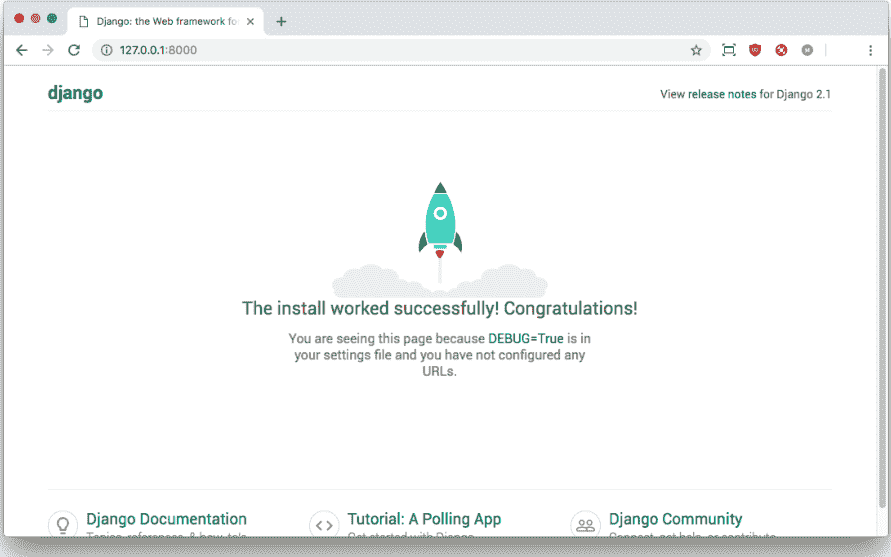
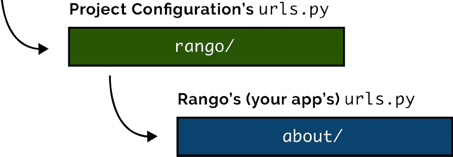
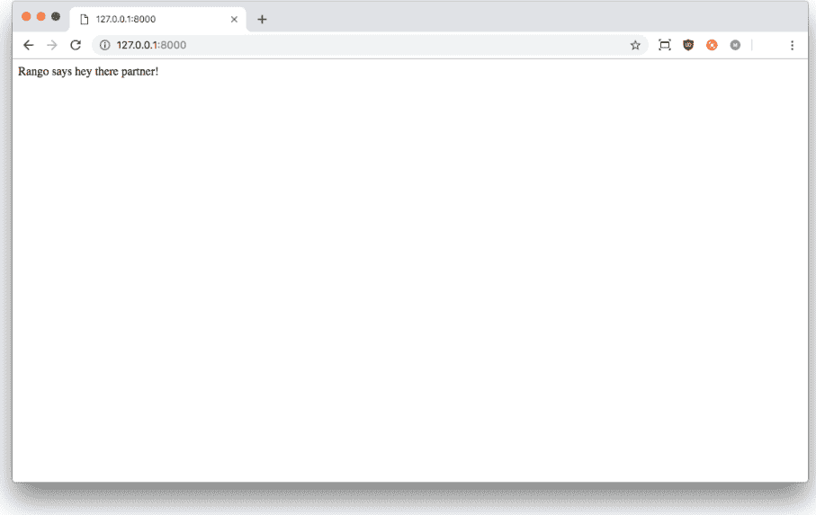

# 3. Django 基础

让我们开始 Django 吧！在本章中，我们将为你概述创建过程。你将建立一个新项目和一个新的 Web 应用程序。到本章结束时，你将拥有一个由 Django 驱动的简单网站！

## 3.1 测试你的环境设置

首先，让我们检查你的 Python 和 Django 安装是否适合本教程。为此，请打开一个新的终端/命令提示符窗口，并激活你的 `rangoenv` 虚拟环境。

激活后，执行以下命令。输出将告诉你当前的 Python 版本。

```
$ python --version
```

响应应该类似于 3.7.2，但 Python 3.5+ 的任意版本都可以正常工作。如果你需要升级或安装 Python，请参阅[设置系统](#)章节。

如果你使用虚拟环境，请确保已激活它——如果你忘记了如何激活，请参阅我们关于[虚拟环境](#)的章节。

验证完 Python 安装后，再检查你的 Django 安装。在终端窗口中，通过执行以下命令运行 Python 解释器。

```
$ python
Python 3.7.2 (default, Mar 30 2019, 05:40:15)
[Clang 9.0.0 (clang-900.0.39.2)] on darwin
Type "help", "copyright", "credits" or "license" for more information.
>>>
```

在提示符下，输入以下命令：

```
>>> import django
>>> django.get_version()
'2.1.5'
>>> exit()
```

一切顺利的话，你应该会看到正确版本的 Django，然后可以使用 `exit()` 退出 Python 解释器。如果 `import django` 导入失败，请检查你是否处于虚拟环境中，并在终端窗口中使用 `pip list` 查看已安装的包。

如果你在安装包时遇到问题，或者安装了不同版本，请参阅“系统设置”章节，或查阅 Django 官方文档中关于安装 Django 的内容¹。

> ¹ https://docs.djangoproject.com/en/2.1/topics/install/


我们建议你在主目录中创建一个工作区目录。这样，`/Users/maxwelld90/Workspace/` 对于 Mac 上的用户 maxwelld90 来说就是一个有效的目录。

## 找不到 `django-admin.py`？

请尝试输入 `django-admin`。根据你的设置，有些系统可能无法识别 `django-admin.py`。在 Windows 计算机上尤其如此——你可能必须使用 `django-admin.py` 脚本的完整路径，例如：

```
python c:\Users\maxwelld90\.virtualenvs\rangeonv\bin\django-admin.py
        startproject tango_with_django_project
```

正如 [StackOverflow](http://stackoverflow.com/questions/8112630/cant-create-django-project-using-command-prompt) 上所建议的那样。请注意，该路径在你自己的计算机上很可能会有所不同。

此命令将调用 `django-admin.py` 脚本，为你创建一个名为 `tango_with_django_project` 的新 Django 项目。命名约定要求我们通常会在 Django 项目目录末尾附加 `_project`，以便我们确切知道其中包含什么——但实际上，命名完全由你决定。

现在你会注意到，工作区内有一个目录，其名称与你的新项目 `tango_with_django_project` 相同。在这个新创建的目录中，你应该会看到两项内容：

- `tango_with_django_project`，另一个与你的主项目目录同名（哎呀！）的*嵌套目录*；以及
- 一个名为 `manage.py` 的 Python 脚本。

在本教程中，我们将这个 `tango_with_django_project` 嵌套目录称为*项目配置目录*。在这个目录中，你会发现四个 Python 脚本。稍后我们会详细讨论这些脚本，但现在你应该可以看到：

- `__init__.py`，一个空白的 Python 脚本，它的存在向 Python 解释器表明该目录是一个 Python 包；
- `settings.py`，用于存储 Django 项目所有设置的地方；
- `urls.py`，一个用于存储项目 URL 模式的 Python 脚本；以及
- `wsgi.py`，一个用于帮助运行开发服务器并将项目部署到生产环境的 Python 脚本。

在项目目录中，你会看到一个名为 `manage.py` 的文件。在开发项目的过程中，我们会一次又一次地调用这个脚本。它为你提供了一系列可运行的命令，用于维护你的 Django 项目。例如，`manage.py` 允许你运行内置的 Django 开发服务器、测试你的应用程序，以及运行各种数据库命令。几乎我们想要运行的每个 Django 命令，都会用到这个脚本。

## Django Admin 与 Manage 脚本

有关 Django admin 脚本的更多信息，请参阅 Django 文档，了解 [Admin 和 Manage 脚本](https://docs.djangoproject.com/en/2.1/ref/django-admin/#django-admin-py-and-manage-py) 的更多细节。

请注意，如果运行 `python manage.py help`，你可以看到可用命令的列表。

你现在可以尝试使用 `manage.py` 脚本，方法是执行下面的命令。

```bash
$ python manage.py runserver
```

执行此命令会启动 Python，并指示 Django 启用其轻量级开发服务器。你应该会在终端窗口中看到类似下面示例的输出：

```text
$ python manage.py runserver

Performing system checks...

System check identified no issues (0 silenced).

You have 14 unapplied migration(s).
Your project may not work properly until you apply the migrations for app(s):
admin, auth, contenttypes, sessions.

Run 'python manage.py migrate' to apply them.

July 23, 2019 - 17:12:34
Django version 2.1.5, using settings 'tango_with_django_project.settings'
Starting development server at http://127.0.0.1:8000/
Quit the server with CONTROL-C.
```

在输出中，你可以看到几件事。首先，没有任何问题阻止应用程序运行。然而，你会注意到一个警告——存在未应用的迁移。当我们设置数据库时会更详细地讨论这个问题，但现在我们可以忽略它。第三，也是最重要的一点，你会看到一个 URL 已被指定：http://127.0.0.1:8000/，这是 Django 开发服务器正在运行的地址。

现在打开你的 Web 浏览器，将上述 URL 输入到浏览器的地址栏中——[http://127.0.0.1:8000/](http://127.0.0.1:8000/)。你应该会看到一个类似于[下图所示](http://127.0.0.1:8000/)的网页。



**首次运行开发服务器时，你将看到的初始 Django 页面截图。**

你可以随时在终端或命令提示符窗口中按 CTRL + C 来停止开发服务器。这对 Mac 和 PC 都适用！如果你希望在不同端口上运行开发服务器，或者允许其他机器上的用户访问它，可以通过提供可选参数来实现。请看下面的命令。

```bash
$ python manage.py runserver <your_machines_ip_address>:5555
```

执行此命令将强制开发服务器在 TCP 端口 5555 上响应传入请求。你需要将 `<your_machines_ip_address>` 替换为你计算机的 IP 地址或 127.0.0.1。

## 不知道你的 IP 地址？

如果你使用 0.0.0.0，Django 会自行识别你的 IP 地址。尽管试试：

```bash
python manage.py runserver 0.0.0.0:5555
```

在设置端口时，你很可能无法使用 TCP 端口 80 或 8080，因为这些端口传统上是为 HTTP 流量保留的。此外，任何低于 1024 的端口都会被你的操作系统视为[特权端口](http://www.w3.org/Daemon/User/Installation/PrivilegedPorts.html)。

虽然你不会使用轻量级开发服务器来部署应用程序，但能够在你网络中的另一台机器上演示你的应用程序还是不错的。使用你机器的 IP 地址运行服务器，其他人就可以输入 `http://<your_machines_ip_address>:<port>/` 来查看你的 Web 应用程序。**当然，这取决于你的网络配置方式。中间可能会有代理服务器或防火墙，需要先进行配置才能正常工作。如果你无法远程查看开发服务器，请向你所用网络的管理员咨询。**

## 3.3 创建一个 Django 应用

Django 项目是*配置*和*应用*的集合，它们共同构成一个给定的 Web 应用或网站。使用这种方法的目的之一是促进良好的软件工程实践。通过开发一系列小型应用，理论上，你可以将一个现有应用放入另一个不同的 Django 项目，并以最小的代价让其正常工作。

Django 应用的存在是为了执行特定任务。你需要创建专门的应用，负责为你的网站提供特定类型的功能。例如，我们可以想象一个项目可能由多个应用组成，包括一个投票应用、一个注册应用，以及一个与特定内容相关的应用。在另一个项目中，我们可能希望重用投票应用和注册应用，因此可以将它们包含在其他项目中。我们稍后会讨论这一点。现在，我们将创建 *Rango* 应用。

要实现这一点，你需要确保你位于 Django 项目目录中（例如 `<workspace>/tango_with_django_project`）。然后在该目录下运行以下命令。

```bash
$ python manage.py startapp rango
```

`startapp` 命令会在项目根目录中创建一个新目录。不出所料，这个目录名为 `rango`——其中包含几个 Python 脚本：

- 另一个 `__init__.py`，其用途与之前讨论的相同；
- `admin.py`，你可以在其中注册模型，从而受益于一些 Django 机制，这些机制会为你创建管理界面；
- `apps.py`，为任何应用特定的配置提供位置；
- `models.py`，用于存储应用的数据模型——你可以在其中指定数据实体及数据之间的关系；
- `tests.py`，用于存放一系列函数来测试你的实现；
- `views.py`，用于存放一系列处理请求并返回响应的函数；以及
- `migrations` 目录，用于存储与你的模型相关的数据库特定信息。

`views.py` 和 `models.py` 是你在任何给定应用中都会使用的两个文件，它们构成了 Django 采用的主要架构设计模式的一部分，即*模型-视图-模板*模式。你可以查阅[官方 Django 文档](https://docs.djangoproject.com/en/2.1/intro/overview/)来更详细地了解模型、视图和模板之间如何相互关联。

在开始创建模型和视图之前，你必须先让 Django 项目知道你新应用的存在。为此，你需要修改项目配置目录中的 `settings.py` 文件。打开该文件，找到 `INSTALLED_APPS` 列表。将 `rango` 应用添加到元组的末尾，之后它应该类似下面的示例。


```python
from django.http import HttpResponse

def index(request):
    return HttpResponse("Rango says hey there partner!")
```

逐行分析这三行代码，我们可以观察到创建这个简单视图的以下几点。

- 我们首先从 `django.http` 模块中导入 `HttpResponse` 对象。
- 每个视图都以一系列独立函数的形式存在于 `views.py` 文件中。在这个例子中，我们只创建了一个视图——名为 `index`。
- 每个视图至少接受一个参数——一个 `HttpRequest` 对象，它也位于 `django.http` 模块中。按照惯例，这个参数命名为 `request`，但如果你愿意，也可以随意重命名。
- 每个视图必须返回一个 `HttpResponse` 对象。一个简单的 `HttpResponse` 对象接受一个字符串参数，该参数代表我们希望发送给请求该视图的客户端的页面内容。

创建好视图后，只是让用户可以访问它的一部分工作。要让用户看到你的视图，你必须将一个统一资源定位符（URL）映射到该视图。

要创建初始映射，请打开位于项目配置目录中的 `urls.py`（即 `<workspace>/tango_with_django_project/tango_with_django_project`——注意是第二个 `tango_with_django_project` 目录！），并在文件顶部 `from django.urls import path` 下方添加以下导入语句。

```python
from rango import views
```

接下来，将 urlpatterns 列表修改为如下示例所示。

```python
urlpatterns = [
    path('', views.index, name='index'),
    path('admin/', admin.site.urls),
]
```

这会将基本 URL 映射到 `rango` 应用中的 `index` 视图。运行开发服务器（例如 `python manage.py runserver`），然后访问 http://127.0.0.1:8000 或你的开发服务器所运行的任何地址，你就会看到 `index` 视图渲染后的输出。

## 3.5 URL 映射

与其将 URL 直接从项目映射到应用，我们可以通过改变将传入 URL 路由到视图的方式，使应用更加模块化（从而也更可复用）。要做到这一点，我们首先需要修改项目的 `urls.py`，让它指向应用来处理任何特定的 Rango 应用请求，然后我们需要指定 Rango 如何处理这些请求。

首先，打开位于项目配置目录中的 `urls.py`。相对于工作区目录的路径是 `<workspace>/tango_with_django_project/tango_with_django_project/urls.py`。将模块更新为如下示例所示。

```python
from django.contrib import admin
from django.urls import path
from django.urls import include
from rango import views

urlpatterns = [
    path('', views.index, name='index'),
    path('rango/', include('rango.urls')),
    # The above maps any URLs starting with rango/ to be handled by rango.
    path('admin/', admin.site.urls),
]
```

你会看到 urlpatterns 是一个 Python 列表，这正是 Django 框架所期望的。新增的映射会查找与模式 `rango/` 匹配的 URL 字符串。一旦匹配，URL 字符串的其余部分就会通过 django.urls 包中的 include() 函数被传递给 rango.urls 并由其处理。


**协议与域名**




**一幅以链条形式展示 URL 的插图，显示了域名之后的不同 URL 部分分别由不同的 `urls.py` 文件负责处理。**

可以把它想象成一条处理 URL 字符串的链——如 [URL 链图] 所示。在这条链中，域名被剥离，URL 字符串的剩余部分（`rango/`）被传递给 `tango_with_django` 项目，在该项目中找到匹配项并剥离 `rango/`，留下一个空字符串传递给 rango 应用进行处理。

因此，我们需要在 rango 应用目录中创建一个名为 `urls.py` 的新文件，来处理剩余的 URL 字符串（并将空字符串映射到 index 视图）：

```python
from django.urls import path
from rango import views

app_name = 'rango'

urlpatterns = [
    path('', views.index, name='index'),
]
```

这段代码从 `rango` 中导入了 URL 映射所需的 Django 机制以及 `views` 模块。这让我们能够调用 `url` 函数，并在 `urlpatterns` 中指向 index 视图进行映射。

当我们谈论 URL 字符串时，我们假设给定 URL 的主机部分*已经被剥离*。URL 的主机部分表示映射到 Web 服务器的主机地址或域名，例如 `http://127.0.0.1:8000` 或 `http://www.tangowithdjango.com`。剥离主机部分意味着 Django 机制只需要处理 URL 字符串的其余部分。例如，给定 URL `http://127.0.0.1:8000/rango/about/`，Django 将处理 URL 字符串的 `/rango/about/` 部分。

我们上面创建的 URL 映射调用了 Django 的 `path()` 函数，其中第一个参数是要匹配的字符串。由于我们使用了空字符串 `''`，Django 只在 `http://127.0.0.1:8000/` 之后没有任何内容时才会匹配。第二个参数告诉 Django 在模式 `''` 被匹配时调用哪个视图。在这种情况下，将调用 `views.index()`。第三个可选参数名为 `name`。它提供了一种便捷的方式来引用视图，并且通过命名 URL 映射，我们可以采用*反向 URL 匹配*。也就是说，我们可以通过名称而不是 URL 来引用 URL 映射。[稍后，我们将解释并展示为什么这非常有用。](#) 随着应用变得越来越复杂，它可以为你节省时间和麻烦。这与我们同样放在新 `urls.py` 模块中的 `app_name` 变量密切相关。

现在重启 Django 开发服务器并访问 `http://127.0.0.1:8000/rango/`。如果一切顺利，你应该会看到文本 “Rango says hey there partner!”。它看起来应该与下面的截图一样。



**一个网页浏览器显示我们第一个由 Django 驱动的网页的截图。你好，Rango！**

在每个应用中，你都会创建几个 URL 映射。最初的映射非常简单，但随着本书内容的推进，我们将创建更复杂、带参数的 URL 映射。

对 Django 中 URL 的处理方式有一个良好的理解也很重要。现在可能看起来有些令人困惑，但随着本书内容的阅读，我们会创建越来越多的 URL 映射，你很快就会成为专家。要了解更多信息，可以查阅 [Django 官方 URL 文档](https://docs.djangoproject.com/en/2.1/topics/http/urls/)，获取更多细节和示例。

如果你正在使用版本控制，现在是提交你工作区中所做更改的好时机。如果你不记得相关命令和步骤，请参阅提供 Git 速成课程的章节。

## 练习

现在，你已经让 Django 和新应用成功运行，请尝试以下练习来巩固所学内容。达到这个阶段是 Django 开发中的一个重要里程碑。创建视图并将 URL 映射到视图，是迈向开发更复杂、更实用的 Web 应用的第一步。

- 复习这个过程，确保你理解了 URL 是如何映射到视图的。
- 创建一个名为 `about` 的新视图方法，它返回以下 `HttpResponse`：`'Rango says here is the about page.'`
- 将此视图映射到 `/rango/about/`。在此步骤中，你只需要编辑 Rango 应用的 `urls.py`。请记住，`/rango/` 部分由项目的 `urls.py` 处理。这个新映射的名称为 `about`。
- 修改 `index()` 视图中的 `HttpResponse`，使其包含一个指向 about 页面的超链接（或 *锚点*）。**这是响应的一部分——意味着它也与 “Rango says hey there partner!” 位于同一个字符串中。**
- 在 about 视图的响应中包含一个返回 index 页面的链接。
- 既然你已经开始阅读本书，如果你有 Twitter，可以关注我们——我们的账号是 [@tangowithdjango](https://twitter.com/tangowithdjango)。让我们知道你的进展如何！


## 提示

如果你在完成练习时遇到困难，以下提示将为你提供一些灵感，帮助你推进。

- 在你的 `views.py` 中，创建一个名为 `def about(request)` 的函数，并让该函数返回一个 `HttpResponse()`。在此 `HttpResponse()` 中，插入你想要返回的消息。
- 用于匹配第二个视图的表达式是 `'/about/'`。这意味着在 `rango/urls.py` 中，你需要添加一条新的路径映射到 `about()` 视图。
- 在 `index()` 视图中，你需要包含一个 HTML [超链接](https://en.wikipedia.org/wiki/Hyperlink) 来提供指向关于页面的链接。一个完整的 `<a>` 标签，带有 `href` 属性（`<a href='/rango/about/'>About</a>`）就足够了。
- 同样的链接也会添加到 `about()` 视图中，不过这次它指向 `/rango/`，即首页——而不是 `/rango/about/`。一个示例看起来像：`<a href='/rango/'>Index</a>`。
- 如果你还没有完成，现在是去完成官方 [Django 教程](https://docs.djangoproject.com/en/2.1/intro/tutorial01/) 第一部分的好时机。

## 测试你的实现

如果你已完成本章到练习为止的所有内容，你可以测试目前的实现。 [按照我们之前提供的指南](#)，使用测试模块 `tests_chapter3.py`。运行这些测试时，它们能通过你的实现吗？
