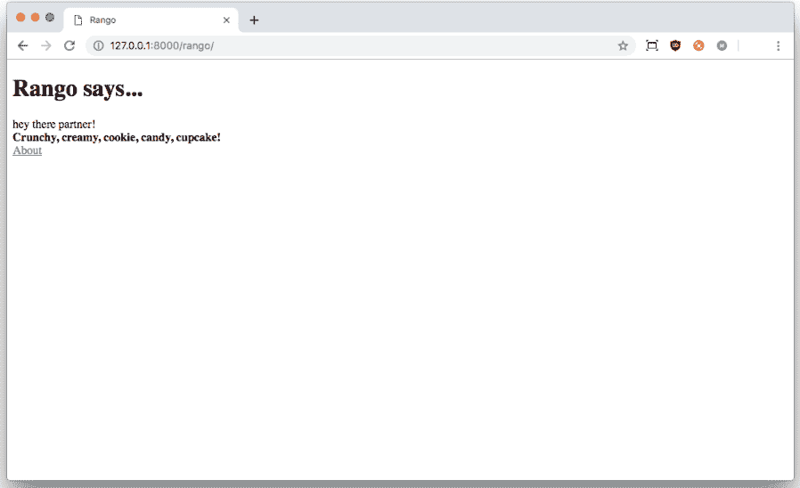
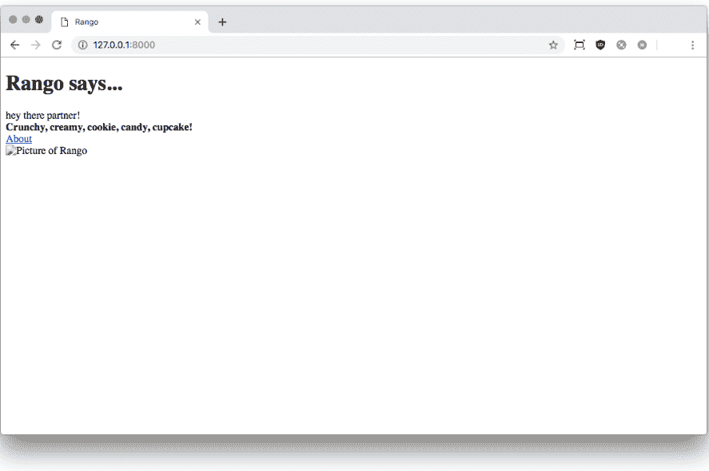
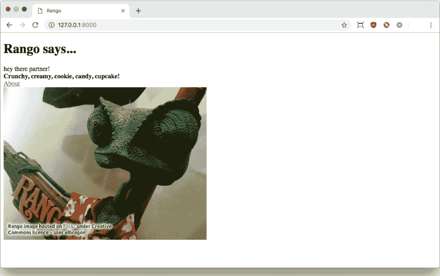

# 4. 模板和媒体文件

在本章中，我们将介绍 Django 模板引擎，并展示如何同时提供 *静态* 文件和 *媒体* 文件。与其通过返回字符串来手工制作每个页面作为响应，我们可以使用 *模板* 来提供页面骨架结构的文件。从生成响应的视图中，我们可以向模板提供必要的數據来完整渲染该页面。为了整合 JavaScript 和 CSS（以及图像和其他媒体内容），我们将使用 Django 提供的机制来包含并分发此类文件给客户端，这将反过来允许我们提供附加功能（在 JavaScript 的情况下），或为页面提供样式。

## 4.1 使用模板

到目前为止，我们只将 URL 映射连接到一个视图。然而，Django 框架基于 *模型-视图-模板* 架构。在本节中，我们将介绍 *模板* 如何与 *视图* 协同工作。在后续章节中，我们将把这些与 *模型* 结合起来。

为什么需要模板？网站页面之间的布局通常是相同的。无论你在网站的页面上看到共同的页眉或页脚，[页面布局的重复](https://www.techrepublic.com/blog/web-designer/effective-design-principles-for-web-designers-repetition/)都有助于用户导航并强化连续感。 [Django 提供模板](https://docs.djangoproject.com/en/2.1/ref/templates/) 使开发人员更容易实现这一设计目标，同时将应用程序逻辑（视图中的代码）与展示层关注点（应用的外观和感觉）分离。

在本章中，你将创建一个基本模板，用于生成 HTML 页面。然后该模板将通过 Django 视图分发。在 [有关数据库和模型的章节](https://docs.djangoproject.com/en/2.1/topics/db/models/) 中，我们将更进一步，使用模板结合模型来分发动态生成的数据。

### 摘要：什么是模板？

在 Django 的世界里，将 *模板* 视为构建完整 HTML 网页所需的脚手架。模板包含网页的 *静态部分*（即永不改变的部分），其中包含特殊语法（或 *模板标签*），可以被覆盖并替换为 *动态内容*，你的 Django 应用的视图可以替换这些内容以生成最终的 HTML 响应。

### 配置模板目录

要让模板与你的 Django 应用一起运行，你需要创建两个存储模板文件的目录。

在你的 Django 项目目录中（例如 `<workspace>/tango_with_django_project/`），创建一个名为 `templates` 的新目录。需要说明的是，这应该与项目中的 `manage.py` 脚本处于同一层级。在新的 templates 目录中，你还需要创建一个名为 `rango` 的进一步目录。这意味着路径 `<workspace>/tango_with_django_project/templates/rango/` 是我们存储与 rango 应用相关模板的位置。

### 保持模板有序

将模板按每个应用的目录分开是良好的实践。这就是为什么我们在 templates 目录内创建了 rango 目录。如果你将应用打包分发给其他开发者，这样就能更轻松地知道哪些模板属于哪个应用！

要告诉 Django 项目模板存储在哪里，请打开项目的 `settings.py` 文件。接下来，定位 `TEMPLATES` 数据结构。默认情况下，当你创建一个新的 Django 项目时，它看起来如下。

```python
TEMPLATES = [
    {
        'BACKEND': 'django.template.backends.django.DjangoTemplates',
        'DIRS': [],
        'APP_DIRS': True,
        'OPTIONS': {
            'context_processors': [
                'django.template.context_processors.debug',
                'django.template.context_processors.request',
                'django.contrib.auth.context_processors.auth',
                'django.contrib.messages.context_processors.messages',
            ],
        },
    },
]
```

我们需要做的是通过修改 `DIRS` 列表来告诉 Django 我们的模板存储位置，默认情况下它是一个空列表。将字典键/值对更改为如下所示。

```python
'DIRS': ['<workspace>/tango_with_django_project/templates']
```

请注意，你*必须使用绝对路径*来定位模板目录。如果你与团队成员协作或在不同的计算机上工作，这就会成为一个问题。你会有不同的用户名和不同的驱动结构，这意味着 `<workspace>` 目录的路径会不同。一个解决方案是为每个不同的配置添加路径。例如：

```python
'DIRS': [ '/Users/leifos/templates',
           '/Users/maxwelld90/templates',
           '/Users/davidm/templates', ]
```

然而，这有几个问题。首先，你每次都要为每个设置添加路径。其次，如果你在不同的操作系统上运行应用，反斜杠需要以不同的方式构造。

### 不要硬编码路径！

通往地狱的路是用硬编码路径铺成的。硬编码路径[^3]是一种软件工程反模式[^4]，会使你的项目可移植性更差[^5]——意味着当你在另一台计算机上运行时，它可能无法工作！（或者能工作，只是需要很多努力！）

### 动态路径

更好的解决方案是利用内置的 Python 函数自动计算模板目录的路径。这样，无论你将 Django 项目代码放在何处，都可以获得绝对路径。这反过来意味着你的项目更具可移植性。

在你的 settings.py 文件顶部，有一个名为 BASE_DIR 的变量。该变量存储包含你的项目 settings.py 模块的目录的路径。这是通过使用特殊的 Python __file__ 属性获得的，该属性设置为 settings 模块的路径[^6]。使用它作为 os.path.abspath() 的参数可保证 settings.py 模块的绝对路径。调用 os.path.dirname() 然后提供 settings.py 模块所在目录的绝对路径的引用。再次调用 os.path.dirname() 去除另一个目录层级，因此 BASE_DIR 指向你的项目目录，即 `<workspace>/tango_with_django_project/`。如果你好奇，可以通过在 settings.py 文件中添加以下行来查看其工作原理。

```
print(__file__)
print(os.path.dirname(__file__))
print(os.path.dirname(os.path.dirname(os.path.abspath(__file__))))
```

能够访问 BASE_DIR 的值使你很容易引用 Django 项目的其他方面。使用 BASE_DIR 变量，我们现在可以创建一个名为 TEMPLATE_DIR 的新变量来引用你的新模板目录。我们可以利用 os.path.join() 函数连接多个路径，从而

[^3]: http://en.wikipedia.org/wiki/Hard_coding
[^4]: http://sourcemaking.com/antipatterns
[^5]: http://en.wikipedia.org/wiki/Software_portability
[^6]: http://stackoverflow.com/a/9271479


to a variable definition like the example below. Make sure you put this underneath the definition of `BASE_DIR`!

### Delete those Lines!

If you included the three `print()` statements above to see what’s going on, make sure you remove them once you understand. Don’t just leave them lying there. They will clutter your settings module, and clutter the output of the Django development server!

```python
TEMPLATE_DIR = os.path.join(BASE_DIR, 'templates')
```

Here, we make use of the `os.path.join()` function to join together (or *concatenate*) the value of the `BASE_DIR` variable, and the string `'templates'`. Upon completion, this concatenation yields `<workspace>/tango_with_django_project/templates/`. From here, we can then use our new `TEMPLATE_DIR` variable to replace the hard-coded path we defined earlier in `TEMPLATES`. Update the DIRS key/value pairing to look like the following code snippet.

```python
'DIRS': [TEMPLATE_DIR, ]
```

### Why `TEMPLATE_DIR`?

You’ve created a new variable called `TEMPLATE_DIR` at the top of your `settings.py` file because it’s easier to access should you ever need to change it. For more complex Django projects, the DIRS list allow you to specify more than one template directory to draw templates from. For this book however, one location is sufficient to get everything working.

### Concatenating Paths

**When concatenating system paths together, always use `os.path.join()`.** Using this built-in function ensures that the correct path separators are used. On a UNIX operating system (or derivative of), forward slashes (`/`) would be used to separate directories, whereas a Windows operating system would use backward slashes (`\`). If you manually append slashes to paths, you may end up with path errors when attempting to run your code on a different operating system, thus reducing your project’s portability.

### Adding a Template

With your template directory and path now set up, create a file called index.html and place it in the templates/rango/ directory. Within this new file, add the following HTML markup and Django template code.

```html
<!DOCTYPE html>
<html>

<head>
<title>Rango</title>
</head>

<body>
<h1>Rango says...</h1>
<div>
hey there partner! <br />
<strong>{{ boldmessage }}</strong><br />
</div>
<div>
<a href="/rango/about/">About</a><br />
</div>
</body>

</html>
```

From this HTML code, it should be clear that a simple HTML page is going to be generated that greets a user with a hello world message. You might also notice some non-HTML in the form of `{{ boldmessage }}`. This is a Django template variable. We can set values to these variables so they are replaced with whatever we want when the template is rendered. We’ll get to that in a moment.

To use this template, we need to reconfigure the `index()` view that we created earlier. Instead of dispatching a simple response, we will change the view to dispatch our template.

In `rango/views.py`, check to see if the following import statement exists at the top of the file. Django should have added it for you when you created the Rango app. If it is not present, add it, but you should have kept it from earlier.

```python
from django.shortcuts import render
```

You can then update the `index()` view function as follows. Check out the inline commentary to see what each line does.

```python
def index(request):
    # Construct a dictionary to pass to the template engine as its context.
    # Note the key boldmessage matches to {{ boldmessage }} in the template!
    context_dict = {'boldmessage': 'Crunchy, creamy, cookie, candy, cupcake!'}

    # Return a rendered response to send to the client.
    # We make use of the shortcut function to make our lives easier.
    # Note that the first parameter is the template we wish to use.
    return render(request, 'rango/index.html', context=context_dict)
```

First, we construct a dictionary of key/value pairs that we want to use within the template. Then, we call the `render()` helper function. This function takes as input the user’s request, the template filename, and the context dictionary. The `render()` function will take this data and mash it together with the template to produce a complete HTML page that is returned with a `HttpResponse`. This response is then returned and dispatched to the user’s web browser.

### What is the Template Context?


When a template file is loaded with the Django templating system, a *template context* is created. In simple terms, a template context is a Python dictionary that maps template variable names with Python variables. In the template we created above, we included a template variable name called `boldmessage`. In our updated `index(request)` view example, the string `Crunchy, creamy, cookie, candy, cupcake!` is mapped to template variable `boldmessage`. The string `Crunchy, creamy, cookie, candy, cupcake!` therefore replaces *any* instance of `{{ boldmessage }}` within the template.

Now that you have updated the view to employ the use of your template, start the Django development server and visit `http://127.0.0.1:8000/rango/`. You should see your simple HTML template rendered in your browser – and it should look just like the [example screenshot shown below](#). If you don’t, read the error message presented to see what the problem is, and then double-check all the changes that you have made. One of the most common issues people have with templates is that the path is set incorrectly in `settings.py`. Sometimes it’s worth adding a print statement to `settings.py` to report the `BASE_DIR` and `TEMPLATE_DIR` to make sure everything is correct.

This example demonstrates how to use templates within your views. However, we have only touched on a fraction of the functionality provided by the Django templating engine. We will use templates in more sophisticated ways as you progress through this book. In the meantime, you can find out more about [templates from the official Django documentation](https://docs.djangoproject.com/en/2.1/ref/templates/).



**What you should see when your first template is working correctly. Note the bold text – Crunchy, creamy, cookie, candy, cupcake! – which originates from the view, but is rendered in the template.**

## 4.2 Serving Static Media Files

While you’ve got templates working, your Rango app is admittedly looking a bit plain right now – there’s no styling or imagery. We can add references to other files in our HTML template such as *Cascading Style Sheets (CSS)*⁸, *JavaScript*⁹ and images to improve the presentation. These are called *static files*, because they are not generated dynamically by a web server; they are simply sent as is to a client’s web browser. This section shows you how to set Django up to serve static files, and shows you how to include an image within your simple template.

### Configuring the Static Media Directory

To start, you will need to set up a directory in which static media files are stored. In your project directory (e.g. `<workspace>/tango_with_django_project/`), create a new directory called `static` and a new directory called `images` inside `static`. Check that the new static directory is at the same level as the templates directory you created earlier in this chapter.

Next, place an image inside the `images` directory. As shown in below, we chose a picture of [the chameleon Rango](https://www.imdb.com/title/tt1192628/)¹⁰ — a fitting mascot, if ever there was one.

> ⁸ http://en.wikipedia.org/wiki/Cascading_Style_Sheets  
> ⁹ https://en.wikipedia.org/wiki/JavaScript  
> ¹⁰ http://www.imdb.com/title/tt1192628/

### Test your Configuration

As a small exercise, test to see if everything is working correctly. Try and view the `rango.jpg` image in your browser when the Django development server is running. If your `STATIC_URL` is set to `/static/` and `rango.jpg` can be found at `images/rango.jpg`, what is the complete URL that you would enter into your web browser’s window to access this resource?

**Try to figure this out before you move on! It’ll help you understand how to interpret static URLs.** The answer is coming up if you are struggling to figure it out.

### Don’t Forget the Slashes!

When setting `STATIC_URL`, check that you end the URL you specify with a forward slash (e.g. `/static/`, not `/static`). As per the [official Django documentation](https://docs.djangoproject.com/en/2.1/ref/settings/#std:setting-STATIC_URL), not doing so can open you up to a world of pain. The extra slash at the end ensures that the root of the URL (e.g. `/static/`) is separated from the static content you want to serve (e.g. `images/rango.jpg`).

### Serving Static Content

While using the Django development server to serve your static media files is fine for a development environment, it’s highly unsuitable for a production environment. The [official Django documentation on deployment](https://docs.djangoproject.com/en/2.1/howto/static-files/deployment/) provides further information about deploying static files in a production environment. We’ll look at this issue in more detail however when we [deploy Rango].

If you haven’t managed to figure out where the image should be accessible from, point your web browser to `http://127.0.0.1:8000/static/images/rango.jpg`.

### Static Media Files and Templates

Now that you have your Django project set up to handle static files, you can now make use of these files within your templates to improve their appearance and add additional functionality.


```html

```

如果由于某种原因图片无法加载，指定一段替代文本是个好主意。这就是 `alt` 属性在 `img` 标签内所提供的作用。你可以在下图中看到会发生什么。



**如果找不到 Rango 的图片，就会用包含 img 标签 alt 属性文本的占位符代替。**

经过这些小幅修改之后，再次启动 Django 开发服务器，并访问 http://127.0.0.1:8000/rango。如果一切操作正确，你将看到一个与下面截图类似的网页。



**我们的第一个 Rango 模板，配有一张变色龙 Rango 的图片。**

## 始终把 `<!DOCTYPE>` 放在最前面！

在创建 HTML 模板时，务必确保 `DOCTYPE` 声明¹⁴出现在**第一行**。如果你先把 `` 模板命令放在前面，那么渲染后的模板中会在 DOCTYPE 声明之前添加空白字符。这些空白字符会导致你的 HTML 标记无法通过验证¹⁵。

¹⁴http://www.w3schools.com/tags/tag_doctype.asp  
¹⁵https://validator.w3.org/

## 加载其他静态文件

只要你希望在模板中引用静态文件，就可以使用  模板标签。下面的代码示例演示了如何使用正确的 HTML 标记在模板中包含 JavaScript、CSS 和图片。

```
<!DOCTYPE html>


<html>

    <head>
        <title>Rango</title>
        <!-- CSS -->
        <link rel="stylesheet" href="" />
        <!-- JavaScript -->
        <script src=""></script>
    </head>

    <body>
        <!-- Image -->
        
    </body>

</html>
```

在这里不要更新 index.html 模板——这仅仅是为了演示  模板函数如何工作的示例。在本教程后面，你将添加 CSS 和 JavaScript。

你引用的静态文件显然必须存在于你的静态目录中。如果请求的文件不存在，或者你引用的方式不正确，Django 开发服务器的控制台输出会显示 HTTP 404 错误¹⁶。试着引用一个不存在的文件，看看会发生什么。请看下面的输出片段，注意最后一条的 HTTP 状态码是 404。

```
[24/Mar/2019 17:05:54] "GET /rango/ HTTP/1.1" 200 366
[24/Mar/2019 17:05:55] "GET /static/images/rango.jpg HTTP/1.1" 200 0
[24/Mar/2019 17:05:55] "GET /static/images/not-here.jpg HTTP/1.1" 404 0
```

关于包含静态媒体的更多信息，你可以阅读 Django 官方文档中关于在模板中使用静态文件的说明¹⁷。

## 4.3 提供媒体文件服务

静态媒体文件可以被认为是那些不会改变且对你的应用程序至关重要的文件。然而，你通常还需要存储动态的*媒体文件*。这些文件可以由你的用户或管理员上传，因此它们可能会发生变化。例如，一个媒体文件就是用户的个人资料图片。如果你运营一个电子商务网站，一系列媒体文件将被用作网店不同产品的图片。

要成功提供媒体文件服务，我们需要更新 Django 项目的设置。本节详细介绍了你需要添加的内容——[但我们要到后面才会进行完整测试](#)，届时我们将实现让用户上传个人资料图片的功能。

### 提供媒体文件服务


与提供静态内容一样，Django 提供了在开发环境中提供媒体文件服务的能力。这使你能够进行测试并确保一切正常。Django 用于提供这些内容的方法非常不适合生产环境，因此你应该考虑通过其他方式（例如像 Apache 这样的生产级 Web 服务器）来托管应用程序的媒体文件。[部署章节](#)将更详细地讨论这一点。

## 修改 `settings.py`

首先，打开你的 Django 项目的 `settings.py` 模块。在这里，我们将再添加一些内容。与静态文件一样，媒体文件会上传到你的文件系统中的一个指定目录。我们需要告诉 Django 将这些文件存储在哪里。

在 `settings.py` 模块的顶部，找到现有的 `BASE_DIR`、`TEMPLATE_DIR` 和 `STATIC_DIR` 变量——它们应该在靠近顶部的位置。在它们下面，再添加一个变量 `MEDIA_DIR`。

```
MEDIA_DIR = os.path.join(BASE_DIR, 'media')
```

这行代码告诉 Django，媒体文件将被上传到你的 Django 项目根目录下的‘/media’目录中——即 <workspace>/tango_with_django_project/media/。正如我们之前提到的，将这些路径变量放在 settings.py 模块的顶部，可以在以后必要时轻松更改路径。

现在，在 settings.py 中找一个空白位置，再添加两个变量。Django 会读取并使用变量 MEDIA_ROOT 和 MEDIA_URL 来设置媒体文件托管¹⁸。

```
MEDIA_ROOT = MEDIA_DIR
MEDIA_URL = '/media/'
```

## 再次强调：不要忘记正斜杠！

与 STATIC_URL 变量一样，确保 MEDIA_URL 以正斜杠结尾。请务必使用类似 /media/ 的形式，而不是 /media。末尾多出的斜杠可以确保 URL 的根（例如 /media/）与你的应用用户上传内容的文件名分开。

这两个变量告诉 Django 在文件系统中的哪个位置查找已上传和存储的媒体文件（MEDIA_ROOT），以及使用什么 URL 来提供它们（MEDIA_URL）。根据我们上面定义的配置，例如，用户上传文件 sample.pdf 后，该文件将通过 URL http://localhost:8000/media/sample.pdf 在你的 Django 开发服务器上提供。

在本书后面处理模板时，当我们需要引用上传的内容时，获取对 MEDIA_URL 路径的引用会非常方便。Django 提供了一个模板上下文处理器¹⁹，使我们能够轻松做到这一点。虽然我们现在并不是严格需要设置这个，但现在添加它是一个好时机。

¹⁸https://docs.djangoproject.com/en/2.1/howto/static-files/#serving-files-uploaded-by-a-user-during-development  
¹⁹https://docs.djangoproject.com/en/2.1/ref/templates/api/#django-template-context-processors-media

要做到这一点，请找到项目 settings.py 模块中的 TEMPLATES 列表。该列表包含一个字典；请在嵌套字典中找到 context_processors 列表。在 context_processors 列表中，添加一个新字符串以包含一个额外的上下文处理器：`'django.template.context_processors.media'`。你的 context_processors 列表应该类似下面的示例。

```
'context_processors': [
    'django.template.context_processors.debug',
    'django.template.context_processors.request',
    'django.contrib.auth.context_processors.auth',
    'django.contrib.messages.context_processors.messages',
    'django.template.context_processors.media',  # Check/add this line!
],
```

## 调整你的 URL

在开发环境中设置提供媒体服务的最后一步，是告诉 Django 从 MEDIA_URL 提供静态内容。这可以通过打开项目的 urls.py 模块来实现。请记住，项目的 urls.py 模块位于 tango_with_django_project/tango_with_django_project 目录中——而不是 tango_with_django_project/rango/urls.py 模块！

在 urls.py 模块中，首先在顶部添加以下导入语句。如果你发现其中一行已经存在，则无需再次输入。

```
from django.conf import settings
from django.conf.urls.static import static
```

一旦导入了这些内容，你就需要修改下面的 urlpatterns 列表。修改的方法是附加一个对你刚刚导入的 static() 函数的调用，并传入相关设置，告诉该函数你的文件系统中文件存储在哪里（MEDIA_ROOT），以及它们应该通过什么 URL 提供（MEDIA_URL）。

```
urlpatterns = [
    ...
    ...
] + static(settings.MEDIA_URL, document_root=settings.MEDIA_ROOT)
```

完成这些更改后，你应该能够通过 /media/ URL 从项目的 media 目录提供内容。


## 练习

尝试完成以下练习，以巩固你从本章学到的知识。

- 将关于页面也改为使用模板。为此，请使用名为 `about.html` 的模板，并将该文件的内容基于 `index.html`。在新模板的 `<h1>` 元素中，保留 `Rango says...` —— 但在其下方的一行中，添加文本 `'here is the about page.'`。
- 记得更新 `views.py` 中的 `about()` 视图！你认为这个视图需要上下文（context）字典吗？
- 你的新 `about.html` 必须包含一个返回首页的链接。如果你复制了现有的 `index.html` 模板，则需要做一处小修改才能实现这一点。
- 在新的 `about.html` 模板中，添加一张存储在你项目静态文件中的图片。请复用你在 `index()` 视图中用过的 `rango.jpg` 图片。确保使用与之前相同的替代文本（alt text）！
- 在关于页面上，添加一行文字，内容为 `This tutorial has been put together by <your-name>`。如果你是从 `index.html` 复制过来的，那么替换 `{{ boldmessage }}` 的位置正是放置这句话的理想之处。
- 在你的 Django 项目目录中，创建一个名为 `media` 的新目录（如果尚未创建）。下载一张猫咪的 JPEG 图片，并将其保存到 media 目录下，命名为 `cat.jpg`。
- 在你的 `about.html` 模板中，添加一个 `` 标签来显示猫咪图片，以确保你的媒体文件能被正确提供。**在首页中保留 Rango 的静态图片**，这样你的关于页面就能同时展示静态文件和媒体文件的工作示例。猫咪图片的替代文本应为 `Picture of a Cat`。**这意味着在你渲染出的关于页面中，你应该同时看到 Rango（来自静态文件）和猫咪（来自媒体文件）两张图片。** 对于这最后一个任务，你不需要修改 `about()` 视图 —— 只需要修改 `about.html`。

## 静态文件和媒体文件

请记住，**静态文件，顾名思义，是不会变化的。** 这些文件构成了你网站的核心组件。**媒体文件则是由用户定义的，因此它们可能经常变化！**

静态文件的一个例子可以是样式表文件（CSS），它决定了你的应用网页的外观。媒体文件的一个例子可以是用户个人资料图片，当用户在你的应用上创建账户时上传。

## 测试你的实现

如果你已经完成了本章中包括练习在内的所有内容，你就可以测试目前所实现的成果了。[按照我们之前提供的指南](), 使用测试模块 `tests_chapter4.py` 来测试。你的实现能通过我们的测试吗？
