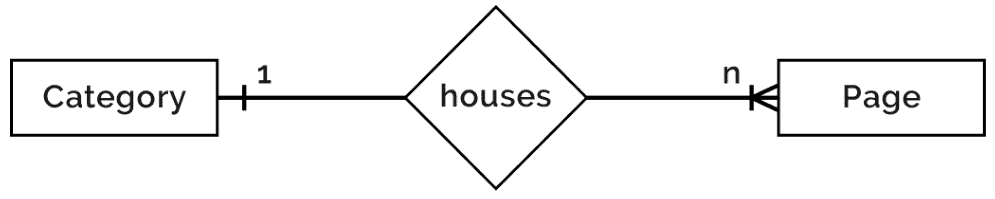
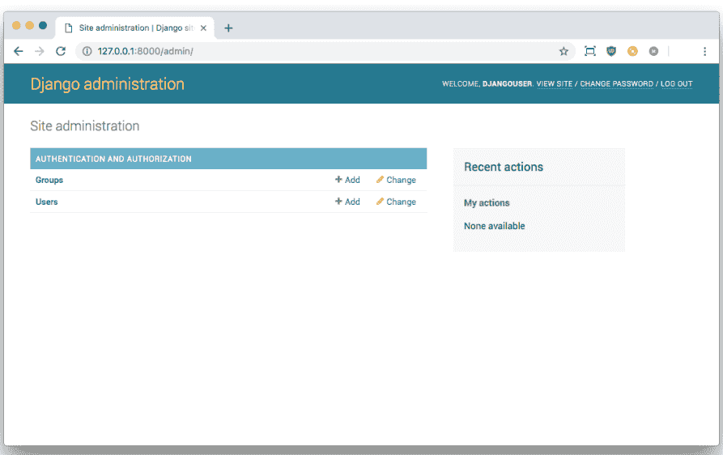
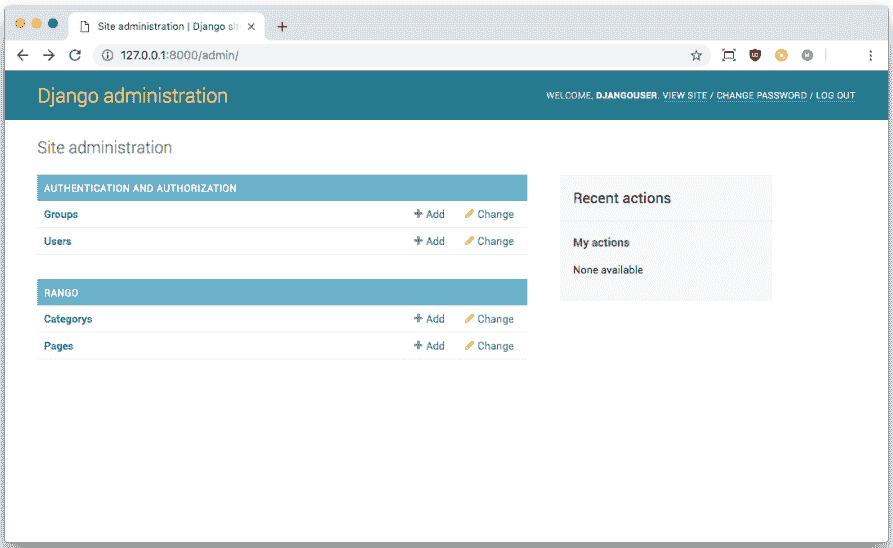
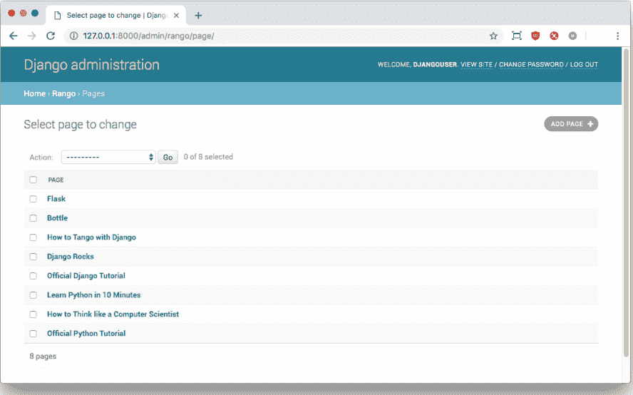
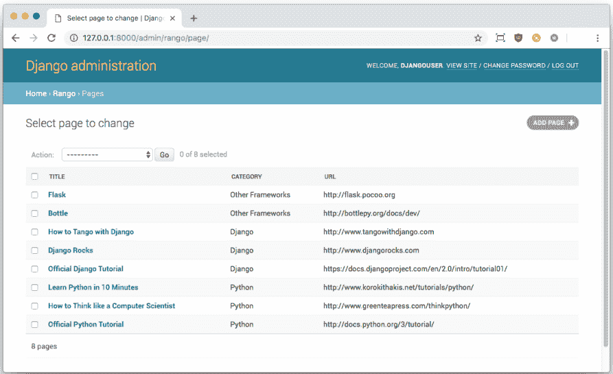

# 5. 模型与数据库

通常，Web 应用需要一个后端来存储应用网页上出现的动态内容。对于 Rango，我们需要存储创建的页面和分类，以及其他详细信息。最方便的方法是使用关系型数据库的服务。这些数据库很可能使用 *结构化查询语言（SQL）* 来让你查询数据存储。

然而，Django 提供了一种便捷的方式来访问存储在数据库中的数据，即通过使用 *对象关系映射器（ORM）*¹。本质上，存储在数据库表中的数据是通过 Django *模型* 封装的。模型是一个 Python 对象，用于描述数据库表中的数据。Django 不会让你直接通过 SQL 操作数据库，而是提供了一些方法，让你可以通过相应的 Python 模型对象来操作数据。你向 ORM 发出的任何命令都会自动转换为对应的 SQL 语句，并由系统代为执行。

本章将带你了解使用 Django 及其 ORM 进行数据管理的基础知识。你会发现，在你的应用底层数据库中添加、修改和删除数据非常容易，并且你会看到将数据从数据库传递到用户 Web 浏览器是多么简单。

## 5.1 Rango 的数据需求

在开始之前，让我们先梳理一下正在开发的 Rango 应用的数据需求。前文已经详细提供了完整的应用需求。我们在这里再次回顾一下数据库需求。

- Rango 本质上是一个 *网页目录* —— 它是一个存放指向其他外部网站链接的网站。

¹ https://en.wikipedia.org/wiki/Object-relational_mapping

- 有几种不同的 *网页分类*，每个分类包含零个、一个或多个链接。我们在概览章节中假设这是一种一对多的关系。请查看下面的实体关系图。
- 一个分类有一个名称、若干访问量和若干点赞数。
- 一个页面属于特定的分类，它有一个标题、一个 URL 和若干浏览量。



Rango 两个主要实体的实体关系图。

## 5.2 告诉 Django 你的数据库

在创建任何模型之前，我们需要先设置好用于 Django 的数据库。在 Django 中，当你建立新项目时，`settings.py` 模块中会自动创建一个 `DATABASES` 变量。除非你更改过它，否则它应该类似下面的示例。

```
DATABASES = {
    'default': {
        'ENGINE': 'django.db.backends.sqlite3',
        'NAME': os.path.join(BASE_DIR, 'db.sqlite3'),
    }
}
```

对于我们的 Rango 应用，这部分基本上可以保持原样。你可以看到一个由轻量级数据库引擎 SQLite² 提供支持的默认数据库（参见 `ENGINE` 选项）。这个数据库的 `NAME` 条目是数据库文件的路径，默认是 `<workspace>/tango_with_django_project/db.sqlite3` —— 也就是位于你的 Django 项目根目录下的 `db.sqlite3` 文件。

> ² https://www.sqlite.org/

### 不要把数据库推送到 Git！

如果你在使用 Git，你可能会想把数据库文件添加并提交。但我们认为这不是一个好主意。如果你和其他人一起开发应用会怎样？他们很可能会在测试功能时更改数据库。不同版本的数据库文件（在开发过程中最终并不重要）**会**导致无休止的冲突。

相反，请将 `db.sqlite3` 添加到你的 `.gitignore` 文件中，这样当你执行 `git commit` 和 `git push` 时它就不会被添加。你也可以对 `*.pyc` 等文件或机器特定文件执行同样的操作。关于如何设置 `.gitignore` 文件的更多信息，你可以参考附录中的 [Git 熟悉章节](#)。


### 使用其他数据库引擎

Django 数据库框架的创建是为了适配各种不同的数据库后端，例如 [PostgreSQL](http://www.postgresql.org/)³、[MySQL](https://www.mysql.com/)⁴ 和 [微软的 SQL Server](https://en.wikipedia.org/wiki/Microsoft_SQL_Server)⁵。对于其他数据库引擎，还存在像 `USER`、`PASSWORD`、`HOST` 和 `PORT` 这样的键，供你配置 Django 与数据库的连接。

虽然本书不涉及如何使用其他数据库引擎，但在线有相关指南展示如何操作。一个好的起点是 [Django 官方文档](https://docs.djangoproject.com/en/2.1/ref/databases/#storage-engines)⁶。

请注意，SQLite 足以演示 Django ORM 的功能。当你发现应用爆红并积累了成千上万的用户时，你可能需要考虑 [将数据库后端切换为更强大的引擎](http://www.sqlite.org/whentouse.html)⁷。


## 5.3 创建模型

在 `settings.py` 中配置好数据库后，让我们为 Rango 应用创建两个初始数据模型。Django 应用的模型存储在

³ http://www.postgresql.org/  
⁴ https://www.mysql.com/  
⁵ https://en.wikipedia.org/wiki/Microsoft_SQL_Server  
⁶ https://docs.djangoproject.com/en/2.1/ref/databases/#storage-engines  
⁷ http://www.sqlite.org/whentouse.html


各自的 `models.py` 模块。这意味着对于 Rango 来说，模型存储在 `<workspace>/tango_with_django_project/rango/models.py` 中。

对于模型本身，我们将创建两个类——每个模型对应一个类。这两个类都必须从 Model 基类 `django.db.models.Model` [继承](https://en.wikipedia.org/wiki/Inheritance_(object-oriented_programming))。这两个 Python 类将是代表 *类别* 和 *页面* 的模型定义。定义 `Category` 和 `Page` 模型如下。

```python
class Category(models.Model):
    name = models.CharField(max_length=128, unique=True)

    def __str__(self):
        return self.name

class Page(models.Model):
    category = models.ForeignKey(Category, on_delete=models.CASCADE)
    title = models.CharField(max_length=128)
    url = models.URLField()
    views = models.IntegerField(default=0)

    def __str__(self):
        return self.title
```

### 检查导入语句

在 `models.py` 模块的顶部，你应该会看到 `from django.db import models`。如果没有看到，请添加进去。

定义模型时，你需要指定字段列表及其关联类型，以及任何必需或可选参数。默认情况下，所有模型都有一个名为 `id` 的自增整数字段，该字段被自动分配并充当主键。

Django 提供了[一系列全面的内置字段类型](https://docs.djangoproject.com/en/2.1/ref/models/fields/#model-field-types)。下面详细介绍了其中一些最常用的字段类型。

- `CharField`，用于存储字符数据（例如字符串）的字段。指定 `max_length` 以提供 `CharField` 字段可以存储的最大字符数。
- `URLField`，很像 `CharField`，但设计用于存储资源 URL。你也可以指定 `max_length` 参数。
- `IntegerField`，用于存储整数。
- `DateField`，用于存储 Python `datetime.date` 对象。

### 其他字段类型

查阅 Django 文档中关于模型字段¹⁰的内容，以获取你可以使用的 Django 字段类型的完整列表，以及每种字段所拥有的必需和可选参数的详细信息。

对于每个字段，你可以指定 `unique` 属性。如果设置为 `True`，则给定字段的值在与关联模型映射的底层数据库表中必须是唯一的。例如，看看我们上面定义的 `Category` 模型。字段 `name` 已被设置为唯一，这意味着每个类别名称都必须是唯一的。这意味着你可以将该字段用作主键。

你还可以为每个字段指定其他属性，例如使用语法 `default='value'` 声明默认值，以及字段的值是否可以为空（或 NULL¹¹）（`null=True`）或不能为空（`null=False`）。

Django 提供了三种字段类型来在数据库中的模型之间建立关系。这些是：

- `ForeignKey`，一种允许我们创建一对多关系¹²的字段类型；
- `OneToOneField`，一种允许我们定义严格的一对一关系¹³的字段类型；以及
- `ManyToManyField`，一种允许我们定义多对多关系¹⁴的字段类型。

从上面的模型示例中，模型 `Page` 中的字段 `category` 是一个 `ForeignKey`。这允许我们与模型/表 `Category` 建立一对多关系，该关系作为参数传递给字段的构造函数。在指定外键时，我们还需要向 Django 提供如何处理页面所属类别被删除这一情况的指令。`CASCADE` 指示 Django 在类别被删除时删除与该类别关联的页面。但是，还有其他设置可以为 Django 提供如何处理这种情况的其他指令。有关更多详细信息，请参阅 [Django 文档中的外键](https://docs.djangoproject.com/en/2.1/ref/models/fields/#django.db.models.ForeignKey)。

最后，实现 `__str__()` 方法是一个好习惯。如果不实现这个方法，当你 `print()` 该对象时（也许在 Django shell 中，我们将在本章后面讨论），它会显示为 `<Category: Category object>`。这在调试或访问对象时不太有用。你怎么知道显示的是哪个类别？当像上面那样包含 `__str__()` 时，你会看到 Python 类别的 `<Category: Python>`（例如）。这在我们稍后使用管理界面时也很有帮助，因为 Django 将显示源自 `__str__()` 的对象的字符串表示。


### 始终在你的类中实现 `__str__()` 方法

在类中实现 `__str__()` 方法将使调试变得容易得多，并且还允许你利用 Django 的其他内置功能（例如管理界面）。如果你使用过像 Java 这样的编程语言，那么 `__str__()` 是 `toString()` 方法在 Python 中的对应物！

## 5.4 创建并迁移数据库

现在我们的模型定义在 `models.py` 中，我们可以让 Django 施展魔法，在底层数据库中创建表。Django 提供了一个所谓的[迁移工具](https://en.wikipedia.org/wiki/Data_migration)来帮助我们设置和更新数据库，以反映对模型所做的任何更改。例如，如果你要添加一个新字段，那么你可以使用迁移工具来更新数据库。

### 设置

首先，数据库必须*初始化*。这意味着创建数据库及其所有相关表，以便随后将数据存储在其中。为此，你必须打开终端或命令提示符，并导航到项目的根目录——即 `manage.py` 模块所在的位置。运行以下命令，*请注意，输出可能会与下方看到的内容略有不同。*

```text
$ python manage.py migrate
```

```text
Operations to perform:
              Apply all migrations: admin, auth, contenttypes, sessions
Running migrations:
              Applying contenttypes.0001_initial... OK
              Applying auth.0001_initial... OK
              Applying admin.0001_initial... OK
              Applying admin.0002_logentry_remove_auto_add... OK
              Applying contenttypes.0002_remove_content_type_name... OK
              Applying auth.0002_alter_permission_name_max_length... OK
              Applying auth.0003_alter_user_email_max_length... OK
              Applying auth.0004_alter_user_username_opts... OK
              Applying auth.0005_alter_user_last_login_null... OK
              Applying auth.0006_require_contenttypes_0002... OK
              Applying auth.0007_alter_validators_add_error_messages... OK
              Applying auth.0008_alter_user_username_max_length... OK
              Applying auth.0009_alter_user_last_name_max_length... OK
              Applying sessions.0001_initial... OK
```

当执行此命令时，Django 项目中安装的所有应用（请检查 `settings.py` 中的 `INSTALLED_APPS`）都将被调用来更新其数据库表示。此命令执行后，你应该会在 Django 项目的根目录中看到一个 `db.sqlite3` 文件。

接下来，创建一个超级用户来管理数据库。运行以下命令。

```text
$ python manage.py createsuperuser
```

超级用户帐户将用于访问 Django 管理界面，该界面将在本章后面使用。输入帐户的用户名、电子邮件地址，并在提示时提供密码。完成后，脚本应成功结束。请确保记下超级用户帐户的用户名和密码。

### 创建和更新模型/表

每当你对应用的模型进行更改时，都需要通过 `manage.py` 中的 `makemigrations` 命令来*登记*更改。将 `rango` 应用指定为我们的目标，然后从 Django 项目的根目录发出以下命令。

```text
$ python manage.py makemigrations rango

Migrations for 'rango':
    rango/migrations/0001_initial.py
    - Create model Category
    - Create model Page
```

此命令完成后，检查 `rango/migrations` 目录，可以看到已创建一个 Python 脚本。它名为 `0001_initial.py`，其中包含为该特定迁移创建数据库模式所需的全部详细信息。

### 检查底层 SQL

如果你想检查 Django ORM 为给定迁移向数据库引擎发出的底层 SQL，可以发出以下命令。

```text
$ python manage.py sqlmigrate rango 0001
```

在此示例中，`rango` 是你的应用的名称，`0001` 是你想要查看其 SQL 代码的迁移。这样做可以让你更好地理解数据库层到底发生了什么，例如创建了哪些表。对于包含多对多关系的复杂数据库模式，你会发现会为你创建额外的表。

为应用创建迁移后，需要将其提交到数据库。为此，请再次发出 `migrate` 命令。


```text
$ python manage.py migrate

Operations to perform:
        Apply all migrations: admin, auth, contenttypes, rango, sessions
Running migrations:
        Applying rango.0001_initial... OK
```

此输出确认数据库表已在你的数据库中创建完成，随后你便可以开始使用新的模型和表了。

然而，你可能已经注意到，我们的 `Category` 模型目前还缺少 Rango 需求中规定的一些字段。**别担心，这些字段稍后会被添加，届时你将再次经历一次迁移过程。**

## 5.5 Django 模型与 Shell

在我们转向演示 Django 管理界面之前，值得注意的是，你可以直接在 Django Shell 中与 Django 模型交互——这是一个非常有用的调试工具。我们将演示如何使用这种方法创建一个 Category 实例。

要进入 Shell，我们需要再次在 Django 项目的根目录下调用 `manage.py`。运行以下命令。

```text
$ python manage.py shell
```

这会启动一个 Python 解释器实例，并为你加载项目的设置。然后你就可以与模型交互了，下面的终端会话演示了这一功能。请查看我们添加的内联注释，了解每条命令的作用。

```text
# Import the Category model from the Rango application
>>> from rango.models import Category

# Show all the current categories
>>> print(Category.objects.all())
# Since no categories have been defined we get an empty QuerySet object.
<QuerySet []>

# Create a new category object, and save it to the database.
>>> c = Category(name='Test')
>>> c.save()

# Now list all the category objects stored once more.
>>> print(Category.objects.all())
# You'll now see a 'Test' category.
<QuerySet [<Category: Test>]>

# Quit the Django shell.
>>> quit()
```

在示例中，我们首先导入要操作的模型。然后打印出所有现有的类别。由于底层的 Category 表是空的，因此返回了一个空列表。接着我们创建并保存一个 Category，然后再次打印出所有类别。第二次打印显示了刚刚添加的新 Category。注意，第二次打印中出现了名字 Test——这是 `__str__()` 的输出，它很好地说明了为什么包含这些方法很重要！

### 完成官方教程

上面的示例只是让你初步体验了在 Django Shell 中可以执行的数据库相关操作。如果你还没有完成，现在是完成[官方 Django 教程第二部分](https://docs.djangoproject.com/en/2.1/intro/tutorial02/)的好时机，以了解更多关于模型交互的知识。此外，还可以查看[官方 Django 文档中关于可用命令列表](https://docs.djangoproject.com/en/2.1/ref/django-admin/#available-commands)的部分，用于处理模型。



Django 管理界面，未包含 Rango 模型。

虽然看起来不错，但我们缺少为 Rango 应用定义的 Category 和 Page 模型。要包含这些模型，我们需要告知 Django 我们想包含它们。

为此，请打开文件 rango/admin.py。文件中已有一条 import 语句，请修改该模块，以便注册你想要包含的每个类。下面的示例将 Category 和 Page 类都注册到了管理界面。

```python
from django.contrib import admin
from rango.models import Category, Page

admin.site.register(Category)
admin.site.register(Page)
```

未来要添加其他的类，只需再调用一次 admin.site.register() 方法，并确保在模块顶部导入该模型即可。

保存这些更改后，重新启动 Django 开发服务器，并再次访问管理界面 http://127.0.0.1:8000/admin/。你将看到 Category 和 Page 模型，如下所示。



Django 管理界面，已包含 Rango 模型。

尝试点击 Rango 部分中的 Categorys 链接。在这里，你应该会看到我们之前通过 Django Shell 创建的 Test 类别。

### 尝试使用管理界面

随着你继续推进 Rango 的开发，你将大量使用管理界面来验证数据是否存储正确。请尝试使用它，了解它的运作方式。这个界面不言自明，容易理解。

删除之前创建的 Test 类别。我们很快会用示例数据填充数据库。你可以从管理界面删除 Test 类别：点击它旁边的复选框，然后从页面顶部的下拉菜单中选择 Delete selected categorys。最后点击出现的红色大按钮来确认你的操作！

### 用户管理

Django 管理界面也是你进行用户管理的首选之地，通过“认证和授权”部分即可实现。在这里，你可以创建、修改和删除用户账户，并调整权限级别。稍后会有更多介绍。

### 复数与单数拼写

注意管理界面中的拼写错误（Categorys，而不是 Categories）。这个拼写错误可以通过在模型定义中添加一个带有 `verbose_name_plural` 属性的嵌套 Meta 类来修复。下面是一个修改后的 Category 模型示例，更多关于 Meta 类中可以存储什么的信息，请参阅 [Django 官方模型文档](https://docs.djangoproject.com/en/2.1/topics/db/models/#meta-options)。

```python
class Category(models.Model):
    name = models.CharField(max_length=128, unique=True)

    class Meta:
        verbose_name_plural = 'Categories'

    def __str__(self):
        return self.name
```

### 扩展 `admin.py`

需要说明的是，Rango 应用中的示例 `admin.py` 模块是目前最简单、最实用的示例。但是，你可以通过多种方式自定义管理界面。如果你感兴趣，可以查看 [官方 Django 管理界面文档](https://docs.djangoproject.com/en/2.1/ref/contrib/admin/) 了解更多信息。在教程的后续部分，我们将探讨如何操作 admin.py 模块。

## 5.7 创建填充脚本

手动向数据库输入测试数据很麻烦。许多开发者会通过随机敲击键盘来添加一些虚假的测试数据，比如 wTFzmN00bz7。与其这样做，不如编写一个脚本来自动用**真实且可信的数据**填充数据库。这是因为当你演示或测试应用时，你需要在数据库中看到一些可信的示例。如果你在团队中工作，自动化脚本意味着每个协作者都可以直接在他们的电脑上运行该脚本，使用与你相同的示例数据初始化数据库。因此，创建一个我们称之为*填充脚本*的东西是一个好习惯。

要创建填充脚本，请新建一个名为 `populate_rango.py` 的文件。将该文件放在 `<workspace>/tango_with_django_project/` 中，也就是你的 Django 项目的根目录下。创建文件后，添加以下代码。

```python
import os
os.environ.setdefault('DJANGO_SETTINGS_MODULE',
    'tango_with_django_project.settings')

import django
django.setup()
from rango.models import Category, Page

def populate():
    # First, we will create lists of dictionaries containing the pages
    # we want to add into each category.
    # Then we will create a dictionary of dictionaries for our categories.
    # This might seem a little bit confusing, but it allows us to iterate
    # through each data structure, and add the data to our models.

    python_pages = [
        {'title': 'Official Python Tutorial',
        'url':'http://docs.python.org/3/tutorial/'},
        {'title':'How to Think like a Computer Scientist',
        'url':'http://www.greenteapress.com/thinkpython/'},
        {'title':'Learn Python in 10 Minutes',
        'url':'http://www.korokithakis.net/tutorials/python/'} ]

    django_pages = [

```


```python
{'title': 'Official Django Tutorial',
 'url': 'https://docs.djangoproject.com/en/2.1/intro/tutorial01/'},
{'title': 'Django Rocks',
 'url': 'http://www.djangorocks.com/'},
{'title': 'How to Tango with Django',
 'url': 'http://www.tangowithdjango.com'} ]

other_pages = [
    {'title': 'Bottle',
     'url': 'http://bottlepy.org/docs/dev/'},
    {'title': 'Flask',
     'url': 'http://flask.pocoo.org'} ]

cats = {'Python': {'pages': python_pages},
        'Django': {'pages': django_pages},
        'Other Frameworks': {'pages': other_pages} }

# If you want to add more categories or pages,
# add them to the dictionaries above.

# The code below goes through the cats dictionary, then adds each category,
# and then adds all the associated pages for that category.
for cat, cat_data in cats.items():
    c = add_cat(cat)
    for p in cat_data['pages']:
        add_page(c, p['title'], p['url'])

# Print out the categories we have added.
for c in Category.objects.all():
    for p in Page.objects.filter(category=c):
        print(f'- {c}: {p}')

def add_page(cat, title, url, views=0):
    p = Page.objects.get_or_create(category=cat, title=title)[0]
    p.url=url
    p.views=views
    p.save()
    return p

def add_cat(name):
    c = Category.objects.get_or_create(name=name)[0]
    c.save()
    return c
```

```python
# Start execution here!
if __name__ == '__main__':
    print('Starting Rango population script...')
    populate()
```

## 理解这段代码！

**再次强调，不要简单地复制、粘贴然后就不管了。** 把代码添加到你的新模块中，然后逐行阅读，弄清楚每行代码在做什么。这将有助于你的理解！

我们在下面提供了解释，帮助你从我们的代码中学习！

你还应该注意代码旁边的行号。我们加上行号是为了让复制粘贴变成一件麻烦事——为什么不自己动手敲一遍，同时思考每一行代码呢？

虽然这段代码看起来很多，但本质上只是对两个小函数 `add_page()` 和 `add_cat()` 的一系列调用，这两个函数都定义在模块末尾。通读代码，我们会发现执行是从模块的*底部*开始的——请看第 71 和 72 行。这是因为在此之上，我们定义了一些函数；除非我们调用它们，否则这些函数不会被执行。当解释器执行到 `if __name__ == '__main__'` 时，我们调用 `populate()` 函数并开始执行它。

## `__name__ == '__main__'` 代表什么？

`__name__ == '__main__'` 这个技巧非常有用，它可以让一个 Python 模块既可以作为可复用模块，也可以作为独立的 Python 脚本使用。可复用模块是指可以被其他模块导入的模块（例如通过 `import` 语句），而独立 Python 脚本则是通过在终端/命令提示符中输入 `python module.py` 来执行的。

因此，只有当模块作为独立的 Python 脚本运行时，`if __name__ == '__main__'` 条件语句中的代码才会被执行。导入该模块时不会运行这些代码；但其中定义的任何类或函数对你来说都是完全可用的。

## 导入模型

在导入 Django 模型时，请确保你已经导入了项目的设置：导入 `django` 并设置环境变量 `DJANGO_SETTINGS_MODULE` 为你的项目设置文件，如上文第 1 到 6 行所示。然后调用 `django.setup()` 来导入你的 Django 项目设置。

如果你不执行这一关键步骤，**在尝试导入模型时将会出现异常。这是因为必要的 Django 基础设施尚未初始化。** 这就是为什么我们在第 7 行加载设置*之后*才导入 `Category` 和 `Page`。

第 47-50 行的 `for` 循环负责反复调用 `add_cat()` 和 `add_page()` 函数。这些函数又负责创建新的分类和页面。`populate()` 会跟踪所创建的分类。例如，新分类的引用存储在局部变量 `c` 中——请查看上文第 48 行。之所以要存储它，是因为 `Page` 需要一个 `Category` 引用。在 `populate()` 中调用 `add_cat()` 和 `add_page()` 之后，函数最后会遍历所有新建的 `Category` 及其关联的 `Page` 对象，并在终端上显示它们的名称。

```text
$ python populate_rango.py

Starting Rango population script...
- Python: Official Python Tutorial
- Python: How to Think Like a Computer Scientist
- Python: Learn Python in 10 Minutes
- Django: Official Django Tutorial
- Django: Django Rocks
- Django: How to Tango with Django
- Other Frameworks: Bottle
- Other Frameworks: Flask
```

接下来，验证填充脚本是否按预期工作并填充了数据库。为此，请重启 Django 开发服务器，然后导航到管理界面（`http://127.0.0.1:8000/admin/`）。到达那里后，检查你是否看到一些新的分类和页面。如果你点击 Pages，是否能看到所有页面，如下图所示？



**Django 管理界面，显示了通过新的填充脚本填充的 Page 模型。成功了！**

虽然编写填充脚本最初可能会花费一些时间，但从长远来看，它会为你节省大量时间。当你在其他地方部署应用时，完成所有设置后运行填充脚本，意味着你可以立即开始演示应用。在你对代码进行单元测试时，它也会非常方便。

## 5.8 工作流：模型设置

既然我们已经介绍了处理 Django ORM 的核心原则，那么现在是总结所有设置过程的好时机。我们将核心任务分成了几个独立的部分。当你需要快速回顾不同步骤时，请查看本节。

### 设置数据库

对于一个新的 Django 项目，你应该首先告诉 Django 你打算使用的数据库（即在 `settings.py` 中配置 `DATABASES`）。你还可以在应用的 `admin.py` 模块中注册任何模型，以便通过基于 Web 的管理界面访问它们。

### 添加模型

添加模型的工作流可以分为五个步骤。

- 1. 首先，在你的 Django 应用的 `models.py` 文件中创建新模型。
- 2. 如果你希望新模型可以在管理界面中访问，请更新 `admin.py` 以包含并注册它们。
- 3. 执行迁移 `$ python manage.py makemigrations <app_name>`。
- 4. 应用更改 `$ python manage.py migrate`。这将在数据库中为新模型创建必要的基础设施（表）。
- 5. 为新模型创建/编辑填充脚本。

有时候你不得不删除数据库。有时重新开始会更容易。也许当你想进行更多迁移时，可能会陷入循环，导致出现问题。

当你需要刷新数据库时，可以按照以下步骤操作。请注意，在本教程中，你使用的是 SQLite 数据库——Django 确实支持[其他各种数据库引擎](https://docs.djangoproject.com/en/2.1/ref/databases/)。

- 1. 如果服务器正在运行，请停止你的 Django 开发服务器。
- 2. 对于 SQLite 数据库，请删除 Django 项目目录中的 `db.sqlite3` 文件。它与 `manage.py` 文件位于同一目录中。
- 3. 如果你更改了应用的模型，你需要运行 `$ python manage.py makemigrations <app_name>` 命令，将 `<app_name>` 替换为你的 Django 应用的名称（例如 rango）。如果你的模型没有更改，请跳过此步骤。
- 4. 运行 `$ python manage.py migrate` 命令，以创建新的数据库文件（如果你使用的是 SQLite），并将数据库表迁移到数据库中。
- 5. 使用 `$ python manage.py createsuperuser` 命令创建新的管理员账户。
- 6. 最后，再次运行填充脚本，将可信的测试数据插入到新数据库中。




更新后的管理界面 Page 视图，包含类别和 URL 列。

### 练习提示

如果你需要一些帮助或灵感来完成这些练习，这里有一些提示。

- 修改 `Category` 模型，添加两个 `IntegerField`：`views` 和 `likes`。两者都应设置参数 `default` 为 `0`。
- 在填充脚本中，你可以随后修改 `add_cat()` 函数，使其接收 views 和 likes 的值。
  - 你需要在 `add_cat()` 的定义中添加两个参数，以便将 views 和 likes 的值以及类别名称传递给函数。为它们设置默认值 0（即 `views=0`）。
  - 然后，你可以使用这些参数，在 `add_cat()` 函数中创建的新 `Category` 模型实例里设置 views 和 likes 字段。该模型实例在填充脚本中被赋值给变量 `c`，正如本章前面所定义的那样。例如，你可以使用 `c.likes` 表示法访问 likes 字段。别忘了对实例调用 `save()`！
  - 然后，你需要更新填充脚本中 `populate()` 函数里的 `cats` 字典。查看该字典，每个键/值对都表示：类别 *名称* 作为键，以及一个包含与该类别相关附加信息的附加字典作为 *值*。你需要修改这第二个嵌套字典，使其包含每个类别的 views 和 likes。
  - 最后一步涉及修改你调用 `add_cat()` 函数的方式。现在你需要传递三个参数（name、views 和 likes）；而你的代码目前只提供了 name。你需要在函数调用中添加另外两个参数。如果你不确定 `for` 循环如何遍历字典，请查看[这个在线 Python 教程](https://www.tutorialspoint.com/python/python_dictionary.htm)。从那里，你可以弄清楚如何从字典中访问 `views` 和 `likes` 值（提示：`cat_data`）。
- 填充脚本更新完毕后，你可以继续自定义管理界面。你需要编辑 `rango/admin.py`，并创建一个继承自 `admin.ModelAdmin` 的 `PageAdmin` 类。
  - 在新的 `PageAdmin` 类中，添加 `list_display = ('title', 'category', 'url')`。
  - 最后，在 Django 的管理界面中注册 `PageAdmin` 类。你应该修改 `admin.site.register(Page)` 这一行。在 Rango 的 `admin.py` 文件中，将其改为 `admin.site.register(Page, PageAdmin)`。


### 测试你的实现

与前一章一样，我们实现了一系列单元测试，让你可以检查到目前为止的实现。按照[我们之前提供的指南](https://www.tutorialspoint.com/python/python_dictionary.htm)，使用测试模块 `tests_chapter5.py`。你的实现与我们的测试相比表现如何？

28 https://www.tutorialspoint.com/python/python_dictionary.htm
