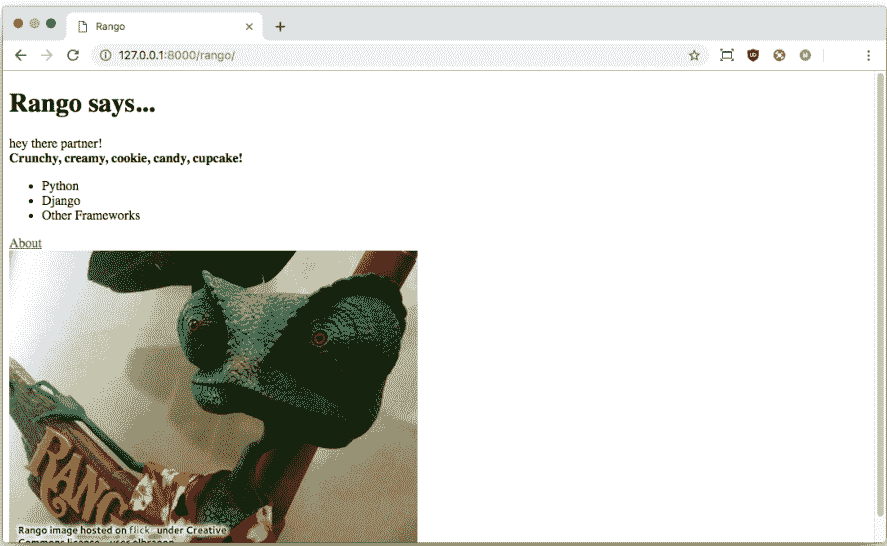

# 6. 模型、模板和视图

既然我们已经设置了模型，并用一些示例数据填充了数据库，现在可以开始连接模型、视图和模板，以提供动态内容。在本章中，我们将逐步完成在主页面显示类别的过程，然后创建专门的类别页面，用于显示相关的链接列表。

## 6.1 工作流：数据驱动页面

要做到这一点，在 Django 中创建数据驱动的网页有五个主要步骤。

1. 在 `views.py` 模块中，`import` 你想要使用的模型。
2. 在视图函数中，查询模型以获取你想要展示的数据。
3. 同样在视图中，将模型的结果传递到模板的 context（上下文）中。
4. 创建/修改模板，使其显示来自 context 的数据。
5. 如果你还没有这样做，请将一个 URL 映射到你的视图。

这些步骤强调了我们需要如何在 Django 框架内将模型、视图和模板绑定在一起。

## 6.2 在 Rango 主页面上显示类别

关于主页面的要求之一是在应用的数据库内显示前五个类别。为了满足这一要求，我们将逐一完成上述步骤。

#### 导入所需的模型

首先，我们需要完成第一步。打开 `rango/views.py`，在文件顶部、其他导入语句之后，从 Rango 的 `models.py` 文件中导入 `Category` 模型。

```python
# Import the Category model
from rango.models import Category
```

#### 修改索引视图

在这里，我们将完成第二步和第三步，需要修改 `index()` 视图函数。记住，`index()` 函数负责主页面视图。按如下方式修改 `index()`：

```python
def index(request):
    # Query the database for a list of ALL categories currently stored.
    # Order the categories by the number of likes in descending order.
    # Retrieve the top 5 only -- or all if less than 5.
    # Place the list in our context_dict dictionary (with our boldmessage!)
    # that will be passed to the template engine.
    category_list = Category.objects.order_by('-likes')[:5]

    context_dict = {}
    context_dict['boldmessage'] = 'Crunchy, creamy, cookie, candy, cupcake!'
    context_dict['categories'] = category_list

    # Render the response and send it back!
    return render(request, 'rango/index.html', context=context_dict)
```

这里，表达式 `Category.objects.order_by('-likes')[:5]` 查询 `Category` 模型以获取前五个类别。可以看到，它使用 `order_by()` 方法按点赞数降序排序。`-likes` 中的 `-` 表示我们希望按降序排列（如果去掉 `-`，结果将按升序返回）。由于返回的是一个 `Category` 对象列表，我们使用了 Python 的列表运算符¹ 从列表中取出前五个对象（`[:5]`），以返回 `Category` 对象的子集。

查询完成后，我们将列表的引用（存储为变量 `category_list`）传递给了字典 `context_dict`。然后，这个字典会作为 context 的一部分，在 `render()` 调用中传递给模板引擎。注意，在上面的代码中，我们仍然在 `context_dict` 中包含了 `boldmessage` —— 现有模板仍然需要它！这意味着我们的 context 字典现在包含两个键/值对：`boldmessage`，代表我们的 `Crunchy, creamy, cookie, candy, cupcake!` 消息；以及 `categories`，代表从数据库中提取的前五个类别。


### 警告

要想实现这一点，你必须完成前一章中的练习，即需要将 `likes` 字段添加到 `Category` 模型。正如我们之前所说，我们假定你会随着本书的进度完成所有练习。

#### 修改索引模板

视图更新后，我们可以完成第四步，更新位于项目 `templates` 目录中的模板 `rango/index.html`。修改 HTML 和 Django 模板代码，使其看起来像下面所示的示例。请注意，主要更改从第 15 行开始。

```html
<!DOCTYPE html>



<html>

    <head>
        <title>Rango</title>
    </head>

    <body>
        <h1>Rango says...</h1>
        <div>
            hey there partner! <br/>
            <strong>{{ boldmessage }}</strong>
```

标签和括号在将完整响应发送回客户端之前，会由 Django 模板引擎解释。

现在，保存模板文件，然后打开你的 Web 浏览器。刷新 http://127.0.0.1:8000/rango/ 上的 Rango 主页，你应该会在页面标题和粗体消息下方看到类别列表，如下图所示。干得好，这是你的第一个 *数据驱动网页！*



Rango 主页——现在是动态生成的——显示类别列表。

## 6.3 创建详情页面

根据 Rango 的规格说明，我们还需要显示与每个类别相关联的页面列表。要实现这一点，我们需要克服几个不同的挑战。首先，必须创建一个新的视图。*这个新视图必须参数化。* 我们还需要创建对类别名称进行编码的 URL 模式和 URL 字符串。


## URL 设计与映射

让我们先从 URL 问题开始考虑。处理这个问题的一种方法是在 URL 中使用每个类别的唯一 ID。例如，我们可以创建像 `/rango/category/1/` 或 `/rango/category/2/` 这样的 URL，其中数字分别对应唯一 ID 为 1 和 2 的类别。然而，仅从 ID 无法推断出该类别是关于什么的。

相反，我们可以将类别名称作为 URL 的一部分。例如，我们可以想象 URL `/rango/category/python/` 会引导我们到与 Python 相关的页面列表。这是一个简单、可读且有意义的 URL。如果采用这种方法，我们还需要处理包含多个单词的类别，比如 `Other Frameworks`。**在 URL 中使用空格通常被认为是不好的做法**（如下所述）。空格需要进行 *百分号编码*²。例如，`Other Frameworks` 的百分号编码字符串将是 `Other%20Frameworks`。这看起来杂乱且令人困惑！


### 清理你的 URL

设计干净且可读的 URL 是网页设计的一个重要方面。更多详情请参阅[维基百科关于 Clean URLs 的文章](https://en.wikipedia.org/wiki/Clean_URL)³。

为了解决这个问题，我们将使用 Django 提供的所谓 `slugify()` 函数。

### 使用 Slug 字段更新类别表

为了创建可读的 URL，我们需要在 `Category` 模型中添加一个 [slug](https://prettylinks.com/2018/03/url-slugs/)⁴ 字段。首先，我们需要从 Django 导入 `slugify` 函数，该函数会将空白字符替换为连字符，从而避开百分号编码问题。例如，“how do i create a slug in django” 会变成 “how-do-i-create-a-slug-in-django”。

### 不安全的 URL

虽然你可以在 URL 中使用空格，但使用它们被认为是不安全的。请查阅互联网工程任务组关于 URL 的备忘录⁵以了解更多信息。

接下来，我们需要重写 `Category` 模型的 `save()` 方法。这个重写的函数将调用 `slugify()` 函数并用其结果更新新的 slug 字段。请注意，每次类别名称改变时，slug 也会随之改变——在创建或更新 Django 模型实例时，`save()` 方法总会被调用。如下所示更新你的 `Category` 模型。

```python
class Category(models.Model):
    name = models.CharField(max_length=128, unique=True)
    views = models.IntegerField(default=0)
    likes = models.IntegerField(default=0)
    slug = models.SlugField()

    def save(self, *args, **kwargs):
        self.slug = slugify(self.name)
        super(Category, self).save(*args, **kwargs)

    class Meta:
        verbose_name_plural = 'categories'

    def __str__(self):
        return self.name
```

另外，不要忘记在模块顶部添加以下导入语句。

```python
from django.template.defaultfilters import slugify
```

重写的 `save()` 方法相对容易理解。当被调用时，slug 字段通过将 `slugify()` 函数的输出作为新字段值来设置。一旦设置完成，重写的 `save()` 方法就会调用在基础 `django.db.models.Model` 类中定义的父类（或超类）`save()` 方法。正是这个调用执行了必要的逻辑，获取你的更改并将这些更改保存到正确的数据库表中。

既然模型已经更新，这些更改现在必须传播到数据库。然而，由于前面章节中数据库里已存在数据，我们需要考虑这一更改的影响。本质上，对于所有现有的类别名称，我们想把它们转换成 slug（这会在记录最初保存时执行）。当我们通过迁移工具更新模型时，它会添加 slug 字段，并提供以默认值填充该字段的选项。当然，我们希望每个条目都有一个特定的值——因此我们需要先执行迁移，然后重新运行填充脚本。这是因为填充脚本会显式调用每个条目的 `save()` 方法，触发上面实现的 `save()`，从而相应地为每个条目更新 slug。

要执行迁移，请运行以下命令（详见 [模型与数据库工作流](#)）。

```bash
$ python manage.py makemigrations rango
```

由于我们没有为 slug 提供默认值，并且模型中已有既有数据，`makemigrations` 命令会给你两个选项。选择提供默认值的选项（选项 1），然后输入一个空字符串——用两个引号表示（即 `''`）。

随后你会看到确认迁移已创建的输出。

```text
You are trying to add a non-nullable field 'slug' to category without a default;
    we can't do that (the database needs something to populate existing rows).
Please select a fix:
1) Provide a one-off default now (will be set on all existing rows with a null
       value for this column)
2) Quit, and let me add a default in models.py
Select an option: 1
Please enter the default value now, as valid Python
The datetime and django.utils.timezone modules are available, so you can do
    e.g. timezone.now
Type 'exit' to exit this prompt
>>> ''
Migrations for 'rango':
    rango/migrations/0003_category_slug.py
    - Add field slug to category
```

从那里，你可以迁移更改，并重新运行填充脚本以更新新的 slug 字段。

```bash
$ python manage.py migrate
$ python populate_rango.py
```

现在运行命令 `$ python manage.py runserver` 启动开发服务器，并通过管理界面检查模型中的数据。请记住，通过将浏览器指向 `http://127.0.0.1:8000/admin/` 即可访问管理界面。

如果你通过管理界面添加新类别，你可能会遇到一个问题——或者两个！

- 1. 假设我们添加了类别 `Python User Groups`。如果你尝试保存记录，除非你也填写 slug 字段，否则 Django 不会允许你保存。虽然我们可以输入 `python-user-groups`，但依赖用户填写字段总是容易出错，而且无法提供良好的用户体验。最好让 slug 自动生成。

- 2. 下一个问题出现在当我们有一个名为 `Django` 的类别和一个名为 `django` 的类别时。由于 `slugify()` 会将 slug 转换为小写，因此无法识别哪个类别对应 `django` 这个 slug。

要解决第一个问题，有两种可能的方案。最简单的方案是更新我们的模型，使 slug 字段允许空白条目，即：

```python
slug = models.SlugField(blank=True)
```

然而，这并非理想之选。空白的 slug 可能毫无意义，而且那样的话，你可以定义多个空白的 slug！那我们如何识别用户指的是哪个类别呢？**一个更好的解决方案**是自定义管理界面，使它在您输入类别名称时自动预填 slug 字段。要做到这一点，请用以下代码更新 `rango/admin.py`。

```python
def show_category(request, category_name_slug):
    # Create a context dictionary which we can pass
    # to the template rendering engine.
    context_dict = {}

    try:
        # Can we find a category name slug with the given name?
        # If we can't, the .get() method raises a DoesNotExist exception.
        # The .get() method returns one model instance or raises an exception.
        category = Category.objects.get(slug=category_name_slug)

        # Retrieve all of the associated pages.
        # The filter() will return a list of page objects or an empty list.
        pages = Page.objects.filter(category=category)

        # Adds our results list to the template context under name pages.
        context_dict['pages'] = pages
        # We also add the category object from
        # the database to the context dictionary.
        # We'll use this in the template to verify that the category exists.
        context_dict['category'] = category
    except Category.DoesNotExist:
        # We get here if we didn't find the specified category.
        # Don't do anything -
        # the template will display the "no category" message for us.
        context_dict['category'] = None
        context_dict['pages'] = None

    # Go render the response and return it to the client.
    return render(request, 'rango/category.html', context=context_dict)
```

我们的新视图遵循与 `index()` 视图相同的基本步骤。我们首先定义一个上下文字典。然后，我们尝试从模型中提取数据，并将相关数据添加到上下文字典中。我们通过传递给 `show_category()` 视图函数的 `category_name_slug` 值（除了 `request` 参数之外）来确定请求了哪个类别。

如果在 `Category` 模型中找到了该类别 slug，我们就可以提取关联的页面，并将其添加到上下文字典 `context_dict` 中。如果请求的类别未找到，我们将相关的上下文字典值设为 `None`。最后，我们使用一个新的 `category.html` 模板将所有内容一起 `render()` 出来。


## 类别模板

在你的 `<workspace>/tango_with_django_project/templates/rango/` 目录中，创建一个名为 `category.html` 的新模板。在新文件中，添加以下代码。

```
<!DOCTYPE html>

<html>

    <head>
        <title>Rango</title>
    </head>

    <body>
        <div>
            
                <h1>{{ category.name }}</h1>
                
                    <ul>
                        
                            <li><a href="{{ page.url }}">{{ page.title }}</a></li>
                        
                    </ul>
                    
                        <strong>No pages currently in category.</strong>
                    
            
                The specified category does not exist.
            
        </div>
    </body>

</html>
```

上面的 HTML 代码示例再次演示了如何通过标签 `{{ }}` 访问经上下文传递给模板的数据。我们访问 `category` 和 `pages` 对象及其字段——例如 `category.name` 和 `page.url`。

如果该类别存在，那么我们检查该类别中是否有任何页面。如果有，我们使用 `` 模板标签遍历返回的页面。对于 `pages` 列表中的每个页面，我们将它们的 `title` 和 `url` 属性作为超链接呈现（例如，放在 `<li>` 和 `<a>` 元素中）。这些内容显示在一个无序 HTML 列表（由 `<ul>` 标签表示）中。如果你对 HTML 不太熟悉，可以查看 [W3Schools.com 的 HTML 教程](http://www.w3schools.com/html/)⁶ 以了解更多关于不同标签的信息。


## 关于条件模板标签的说明

Django 模板条件标签——用 `` 表示——是判断模板上下文中对象是否存在的一种非常简洁的方法。请务必检查对象是否存在，以避免渲染模板时出错，尤其是当你的关联视图逻辑并非在所有可能场景下都会填充上下文字典时。

在模板中放置条件检查——比如上面示例中的 ``——在语义上也很合理。条件检查的结果直接影响渲染后页面如何呈现给用户。请记住，Django 应用的表现层方面应该封装在模板中。

## 参数化 URL 映射

现在，让我们看看如何将 `category_name_slug` 参数的值传递给我们的 `show_category()` 函数。为此，我们需要修改 Rango 的 `urls.py` 文件（请记住，该文件位于 `<workspace>/tango_with_django_project/rango/`），并按如下方式更新 `urlpatterns` 元组。

```python
urlpatterns = [
    path('', views.index, name='index'),
    path('about/', views.about, name='about'),
    path('category/<slug:category_name_slug>/',
         views.show_category, name='show_category'),
]
```

一个由 `<slug:category_name_slug>` 表示的参数被添加到了新的映射中。这向 Django 表明，我们想要匹配一个作为 slug 的字符串，并将其赋值给变量 `category_name_slug`。你会注意到，这个变量名正是我们传递给视图 `show_category()` 的。如果这两个名字不完全匹配，Django 就会混淆并引发错误。除了 slug，你还可以提取字符串和整数等其他变量。更多细节请参阅 [Django 文档中有关 URL 路径的部分](https://docs.djangoproject.com/en/2.1/ref/urls/)。如果你需要解析更复杂的表达式，可以使用 `re_path()` 而不是 `path()`。这将允许你匹配各种正则（及非正则）表达式。幸运的是，Django 为最常见的模式提供了匹配。

作为 Django 应用的一部分定义的所有视图函数*必须*至少接受一个参数。该参数通常被称为 `request`——它提供对用户发出的给定 HTTP 请求相关信息的访问。在对 URL 进行参数化时，你需要为给定视图的函数签名提供额外的命名参数。这就是为什么 `show_category()` 被定义为 `def show_category(request, category_name_slug)`。

> #### 正则表达式地狱
>
> > “有些人在遇到问题时，会想：*‘我知道了，我会用正则表达式。’* 现在他们有两个问题了。”——[Jamie Zawinski](http://blog.codinghorror.com/regular-expressions-now-you-have-two-problems/)
>
> Django 的 `path()` 方法通常能让你避免正则表达式地狱——但如果你确实需要使用正则表达式（例如使用 `re_path()` 函数），这份[速查表](http://cheatography.com/davechild/cheat-sheets/regular-expressions/)会非常有用。

## 修改首页模板

我们的新视图已经设置好并可以使用了——但我们还需要做一件事。我们的首页模板需要更新，使其能够链接到列出的类别页面。我们可以更新 `index.html` 模板，让它通过 slug 包含指向类别页面的链接。

找到模板代码 ``，并将 `<li>` 元素调整为与下面的示例一致。

Django 页面的链接。注意鼠标正悬停在第一个链接上——你可以在 Google Chrome 窗口的左下角看到该链接对应的 URL。

## 练习

巩固你在本章学到的知识！

- 更新填充脚本，为每个**页面**的 `views` 计数添加一些值。你可以选择任何整数——只要每个页面获得一个大于零的整数即可。
- 修改首页，使其也包含浏览量最高的五个页面。当没有页面时，你应该用一条友好的消息代替列表，内容为：`There are no pages present`。这条消息应加粗——用 `<strong>...</strong>` 标签包裹。然后，整个“浏览量最高的五个页面”区块应该用其自己的 `<div>...</div>` 标签包裹。
- 承接上面的练习，为 `Most Liked Categories` 和 `Most Viewed Pages` 添加标题。它们必须使用 `<h2>` 标签作为二级标题。把每个标题放在其各自列表的上方。
- 从类别页面添加一个返回首页的链接。
- 如果你还没有完成官方 Django 教程的第三部分¹⁰，请完成它，以巩固你在这里学到的知识。


### Rango 说……

嘿，搭档！

脆脆的、奶油味的、饼干、糖果、纸杯蛋糕！

### 最受欢迎的类别

- Python
- Django
- 其他框架

### 最多浏览的页面

- 官方 Python 教程
- 10 分钟学会 Python
- 如何与 Django 共舞
- Flask
- 如何像计算机科学家一样思考

关于


完成练习后的首页。你的输出可能会略有不同。

## 提示

- 更新填充脚本时，你基本上会遵循上一章练习中的相同过程。你需要更新每个页面的数据结构，并更新使用它们的代码。
  - 更新 `python_pages`、`django_pages` 和 `other_pages` 数据结构。每个页面都有 `title` 和 `url`——现在它们也都需要一个 `views` 浏览量计数。
  - 查看填充脚本中 `add_page()` 函数是如何定义的。它是否允许你传入 `views` 计数？你是否需要修改这个函数？
  - 最后，更新调用 `add_page()` 函数的行。如果你在数据结构中将浏览量计数命名为 `views`，并且在调用 `add_page()` 的上下文中表示页面的字典被命名为 `p`，你如何将浏览量计数传入函数？
  - 记得重新运行填充脚本，以便使用新的计数更新数据库。
- 你将需要同时编辑 `index` 视图和 `index.html` 模板，才能将浏览量最高的页面放到首页上。
  - 你需要向 `Page` 模型请求浏览量最高的页面，而不是访问 `Category` 模型。
  - 记得将页面列表传递给上下文。
  - 如果你不确定要使用什么 HTML 模板代码，可以从 `category.html` 模板标记中汲取灵感。你需要编写的标记本质上是一样的。不过，请记住，`Page url` 就是完整的 URL！


## 模型提示

有关使用模型的更多提示，你可以查看以下博客文章：

- 1. 使用模型时的最佳实践¹¹，作者 Alexander Stepanov。在这篇文章中，你将找到一系列使用模型时的技巧和诀窍。
- 2. 如何让你的 Django 模型更 DRY¹²，作者 Robert Roskam。在这篇文章中，你可以看到如何使用类的 `property` 方法减少访问相关模型时所需的代码量。

## 测试你的实现

与上一章一样，我们实现了一系列单元测试，让你可以检查到目前为止的实现。按照我们之前提供的指南，使用测试模块 `tests_chapter6.py`。你的实现与我们的测试相比表现如何？请记住，你的实现应该完整完成上述练习，测试才能通过。

其中一些测试可能看起来过于苛刻——但请记住，这本书是我们希望你开发的产品的规范。如果你没有*严格地*按照规范开发软件，当你的代码被插入到更大的框架中时，可能会产生不理想的结果。通过一字不差地遵循规范，你将学到宝贵的一课，这可以在未来的开发职业生涯中继续受益。
