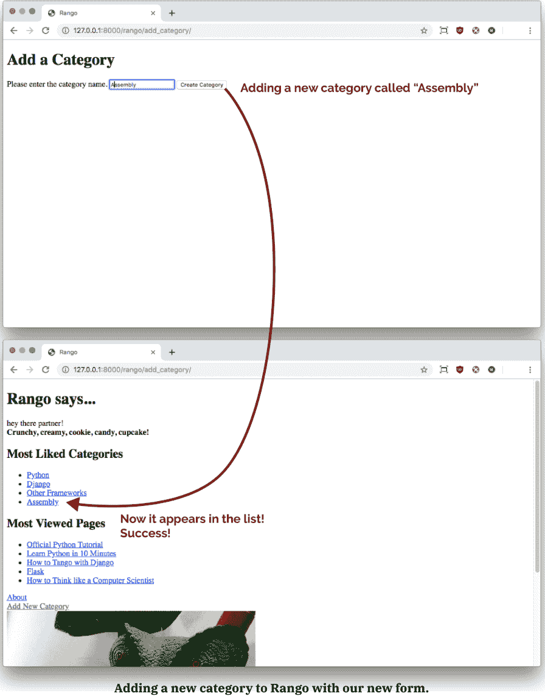

# 7. 表单

作为 Rango 应用的一部分，我们需要从用户那里获取新的分类和新的页面。在本章中，我们将介绍如何通过 Web 表单捕获数据。Django 自带一些出色的表单处理功能，使得从用户那里收集信息并通过模型保存到数据库变得相当直接。根据 Django 关于表单¹的文档，表单处理功能允许你：

- 1. 显示一个带有自动生成的*表单组件*的 HTML 表单（例如文本字段或日期选择器）；
- 2. 根据一组验证规则检查提交的数据；
- 3. 在验证错误时重新显示表单；以及
- 4. 将提交的表单数据转换为相应的 Python 数据类型。

使用 Django 表单功能的一大优势是它可以为你节省大量创建 HTML 表单的时间和麻烦。

## 7.1 基本工作流程

创建表单和处理用户输入所涉及的基本步骤如下。

- 1. 如果你还没有创建，就在你的 Django 应用目录（`rango`）中创建一个 `forms.py` 模块，用于存放与表单相关的类。
- 2. 为你希望表示为表单的每个模型创建一个 `ModelForm` 类。
- 3. 根据需要自定义表单。
- 4. 创建或更新一个视图来处理表单……
  - 包括*显示*表单，
  - *保存*表单数据，以及
  - *标记错误*，这些错误可能在用户在表单中输入不正确的数据（或根本没有输入数据）时发生。
- 5. 创建或更新一个模板来显示表单。
- 6. 添加一个 `urlpattern` 映射到新视图（如果你创建了一个新视图）。

这个工作流程比我们之前看到的要复杂一些，我们必须构造的视图也要复杂得多。然而，一旦你多次执行这个过程，你就会更清楚地理解各个部分是如何组合在一起的。相信我们。

## 7.2 页面与分类表单

在这里，我们将实现必要的基础设施，允许用户通过表单向数据库添加分类和页面。

首先，在 `rango` 应用目录中创建一个名为 `forms.py` 的文件。虽然这一步不是必须的（你可以把表单放在 `models.py` 中），但这会让你的代码库更整洁、更容易处理。

### 创建 ModelForm 类

在 Rango 的 `forms.py` 模块中，我们将创建几个继承自 Django 的 `ModelForm` 的类。本质上，`ModelForm` 是一个*辅助*类，它允许你根据已有的模型创建 Django 表单。既然我们已经为 Rango 定义了两个模型（`Category` 和 `Page`），我们将为这两个模型创建 ModelForms。

在 `rango/forms.py` 中添加以下代码。

```python
from django import forms
from rango.models import Page, Category

class CategoryForm(forms.ModelForm):
    name = forms.CharField(max_length=128,
                           help_text="Please enter the category name.")
    views = forms.IntegerField(widget=forms.HiddenInput(), initial=0)
    likes = forms.IntegerField(widget=forms.HiddenInput(), initial=0)
    slug = forms.CharField(widget=forms.HiddenInput(), required=False)

    # An inline class to provide additional information on the form.
    class Meta:
        # Provide an association between the ModelForm and a model
        model = Category
        fields = ('name',)

class PageForm(forms.ModelForm):
    title = forms.CharField(max_length=128,
                            help_text="Please enter the title of the page.")
    url = forms.URLField(max_length=200,
                         help_text="Please enter the URL of the page.")
    views = forms.IntegerField(widget=forms.HiddenInput(), initial=0)

    class Meta:
        # Provide an association between the ModelForm and a model
        model = Page

        # What fields do we want to include in our form?
        # This way we don't need every field in the model present.
        # Some fields may allow NULL values; we may not want to include them.
        # Here, we are hiding the foreign key.
        # we can either exclude the category field from the form,
        exclude = ('category',)
        # or specify the fields to include (don't include the category field).
        #fields = ('title', 'url', 'views')
```

我们需要通过 `fields` 指定表单中包含哪些字段，或通过 `exclude` 指定要排除哪些字段。

Django 为我们提供了几种自定义表单的方式，这些表单是代表我们创建的。在上面的代码示例中，我们指定了希望用于显示每个字段的组件。例如，在 PageForm 类中，我们为 `title` 字段定义了 `forms.CharField`，为 `url` 字段定义了 `forms.URLField`。这两个字段都为用户提供文本输入。注意我们提供给字段的 `max_length` 参数——我们指定的长度与我们在底层数据模型中为每个字段指定的最大长度相同。回到模型章节自己检查一下，或者查看 Rango 的 `models.py` 模块。

你还会注意到，在每个表单中，我们为 views 和 likes 字段包含了几个 `IntegerField` 条目。注意，我们通过参数设置 `widget=forms.HiddenInput()` 将组件设置为隐藏，然后通过 `initial=0` 将值设置为零。这是默认将字段设为零的一种方法。由于这些字段是隐藏的，用户将无法为这些字段输入值。

然而，即使我们在 `PageForm` 中有一个 `hidden` 字段，我们仍然需要在表单中包含该字段。如果在 `fields` 中排除了 `views`，那么表单将不包含该字段（尽管它被指定了）。这意味着表单不会为该字段返回零值。这可能会引发错误，具体取决于模型是如何设置的。如果在模型中我们为这些字段指定了 `default=0`，那么我们可以依赖模型自动用默认值填充该字段——从而避免 `not null` 错误。在这种情况下，就不需要这些隐藏字段了。我们还在 `CategoryForm` 中包含了 `slug` 字段，并将其设置为使用 `widget=forms.HiddenInput()`。

然而，我们没有指定初始值或默认值，而是声明该字段不是表单必填的。这是因为当表单最终保存时，我们的模型将负责填充该字段。本质上，在定义模型和表单时，你需要小心，确保表单将包含并传递所有必需的数据，以便正确填充模型。

除了 `CharField` 和 `IntegerField` 组件之外，还有更多组件可供使用。例如，Django 提供了 `EmailField`（用于输入电子邮件地址）、`ChoiceField`（用于单选输入按钮）和 `DateField`（用于日期/时间输入）。还有许多其他字段类型可供使用，它们会为你执行错误检查（例如，*提供的值是否是有效的整数？*）。

也许继承自 `ModelForm` 的类最重要的方面是需要定义*我们想为哪个模型提供表单*：我们通过

```python
# just print them to the terminal.
print(form.errors)

# Will handle the bad form, new form, or no form supplied cases.
# Render the form with error messages (if any).
return render(request, 'rango/add_category.html', {'form': form})
```

你还需要在模块顶部添加以下两条导入语句。

```python
from rango.forms import CategoryForm
from django.shortcuts import redirect
```

新的 `add_category()` 视图增加了几个处理表单的关键功能。首先，我们创建一个 `CategoryForm()`，然后检查 HTTP 请求是否为 POST（用户是否通过表单提交了数据？）。随后，我们可以通过同一个 URL 处理该 POST 请求。`add_category()` 视图函数可以处理三种不同的场景：

- 显示一个用于添加类别的新空白表单；
- 将用户提供的表单数据保存到关联模型，并重定向到 Rango 首页；以及
- 如果有错误，则重新显示带有错误消息的表单。

## GET 与 POST

我们所说的 GET 和 POST 是什么意思？它们是 HTTP 请求。

- HTTP GET 用于请求指定资源的表示。换句话说，我们使用 HTTP GET 来获取特定资源，无论是网页、图像还是其他文件。
- 相比之下，HTTP POST 会从客户端浏览器提交数据以进行处理。例如，在提交 HTML 表单内容时，就会使用这种类型的请求。
- 最终，HTTP POST 可能被编程为在服务器上创建新资源（例如新的数据库条目）。之后可以通过 HTTP GET 请求访问该资源。
- 有关更多细节，请查看 w3schools 上关于 GET 与 POST 的页面⁴。

Django 的表单处理机制会通过 HTTP POST 请求处理来自用户浏览器返回的数据。它不仅能将表单数据保存到所选模型，还会自动为每个表单字段生成错误消息（如果需要）。这意味着 Django 不会存储任何缺少信息的已提交表单，因为这些缺失信息可能会对你的数据库的[参照完整性](https://en.wikipedia.org/wiki/Referential_integrity)造成问题。例如，如果类别名称字段中没有提供值，就会返回错误，因为该字段不能为空白。

从 `render()` 调用中，你会看到我们引用了 `add_category.html` —— 一个新模板（我们将在下面定义它！）。该模板将包含表单和页面的相关 Django 模板代码及 HTML。

## 创建 *添加类别* 模板

创建文件 `templates/rango/add_category.html`。在该文件中，添加以下 HTML 标记和 Django 模板代码。

```html
<!DOCTYPE html>
<html>
    <head>
        <title>Rango</title>
    </head>

    <body>
        <h1>Add a Category</h1>
        <div>
            <form id="category_form" method="post" action="/rango/add_category/">
                
                
                    {{ hidden }}
                
                
                    {{ field.errors }}
                    {{ field.help_text }}
                    {{ field }}
                
                <input type="submit" name="submit" value="Create Category" />
            </form>
        </div>
    </body>
</html>
```

## 跨站请求伪造令牌

你还应该注意代码片段 ``。这是一个*跨站请求伪造（CSRF）令牌*，有助于保护后续提交表单时发起的 HTTP POST 请求的安全。*Django 框架要求必须存在 CSRF 令牌。如果你忘记在表单中包含 CSRF 令牌，用户在提交表单时可能会遇到错误。* 有关此内容的更多信息，请查看 Django 官方文档中关于 CSRF 令牌的说明⁶。

## 映射 *添加类别* 视图

现在我们需要将 `add_category()` 视图映射到 URL。在模板中，我们在表单的 action 属性中使用了 URL `/rango/add_category/`。现在我们需要创建从 URL 到视图的映射。在 `rango/urls.py` 中，修改 `urlpatterns` 列表，使其看起来如下所示。

```python
urlpatterns = [
    path('', views.index, name='index'),
    path('about/', views.about, name='about'),
    path('category/<slug:category_name_slug>/', views.show_category,
        name='show_category'),
    path('add_category/', views.add_category, name='add_category'),
]
```

在这种情况下，顺序并不一定重要。不过，有关更多信息，请查看 Django 官方文档中关于 Django 如何处理请求的说明⁷。添加类别的 URL 是 `/rango/add_category/`，名称为 `add_category`。

## 修改首页视图

最后一步，我们可以在首页上放置一个链接，以便用户可以轻松导航到允许他们添加类别的页面。编辑模板 `rango/index.html`，并在包含关于链接的 `<div>` 元素中添加以下 HTML 超链接。

```html
<a href="/rango/add_category/">Add a New Category</a><br />
```

## 演示

现在让我们试试吧！启动或重新启动你的 Django 开发服务器，然后将你的 Web 浏览器指向 `http://127.0.0.1:8000/rango/` 的 Rango。使用你的新链接跳转到“添加类别”页面，并尝试添加一个类别。下面的[图](#)显示了*添加类别*和*首页*页面的截图。在截图中，我们添加了名为*Assembly*的类别。



*使用我们的新表单向 Rango 添加新类别。*

## 类别缺失？

如果你尝试这个新功能并添加了几个不同的类别，请记住它们并不总是出现在首页上。这是因为我们编写的首页视图只显示收到的点赞数最多的*前五个类别*。如果你登录管理界面，你应该能够查看所有已输入的类别。

为了确认类别已成功添加，你可以更新 `rango/views.py` 中的 `add_category()` 方法，并将 `form.save(commit=True)` 这一行改为 `cat = form.save(commit=True)`。这将为你提供对所创建的 Category 对象实例的引用。然后你可以打印该类别（例如 `print(cat, cat.slug)`）。

## 更简洁的表单

回想一下，我们的 Page 模型有一个 url 属性，设置为 URLField 类型的实例。在相应的 HTML 表单中，Django 会合理地期望输入到 url 字段中的任何文本都是格式正确的完整 URL。然而，用户可能会觉得输入类似 `http://www.url.com` 的内容很麻烦——事实上，用户甚至可能不知道正确 URL 的形式⁸！

### URL 检查

现在大多数现代浏览器都会为你检查 URL 格式是否正确，因此这个示例只适用于较旧的浏览器。然而，它确实向你展示了如何在尝试将数据保存到数据库之前清理数据。如果你没有旧浏览器来尝试这个示例（以防你不相信），试着将 URLField 改为 CharField。渲染后的 HTML 将不会指示浏览器替你执行检查，你实现的代码将会被执行。

在用户输入可能不完全正确的场景中，我们可以*覆盖* `ModelForm` 中实现的 `clean()` 方法。该方法在将表单数据保存到新模型实例之前被调用，因此为我们提供了一个合理的位置来插入代码，以验证甚至修复用户输入的任何表单数据。我们可以检查用户输入的 url 字段值是否以 http:// 开头——如果不是，我们可以在用户输入前添加 http://。

```python
class PageForm(forms.ModelForm):
    ...
    def clean(self):
        cleaned_data = self.cleaned_data
        url = cleaned_data.get('url')

        # If url is not empty and doesn't start with 'http://',
        # then prepend 'http://'.
        if url and not url.startswith('http://'):
            url = f'http://{url}'
            cleaned_data['url'] = url

        return cleaned_data
```

在 `clean()` 方法中，你可以看到一个简单的模式，你可以在自己的 Django 表单处理代码中复制这个模式。

1. 从 ModelForm 的字典属性 `cleaned_data` 中获取表单数据。
2. 然后可以从 `cleaned_data` 字典中取出你想要检查的表单字段。使用字典对象提供的 `.get()` 方法获取表单的值。如果用户没有在表单字段中输入值，则其条目不会存在于 `cleaned_data` 字典中。在这种情况下，`.get()` 会返回 `None`，而不是引发 `KeyError` 异常。这会让你的代码看起来更简洁！
3. 对于你想要处理的每个表单字段，检查是否取到了值。如果输入了内容，检查该值是什么。如果它不是你所期望的，你可以在 `cleaned_data` 字典中重新赋值之前，添加一些逻辑来修复这个问题。
4. 你必须在 `clean()` 方法结束时返回 `cleaned_data` 字典的引用。否则，更改将不会生效。

这个简单的例子展示了我们如何在数据通过表单传递并在存储之前进行清理。这非常方便，尤其是在特定字段

⁶ https://docs.djangoproject.com/en/2.1/ref/csrf/
⁷ https://docs.djangoproject.com/en/2.1/topics/http/urls/#how-django-processes-a-request
⁸ https://support.google.com/webmasters/answer/76329?hl=en


## 练习

读完本章后，思考以下问题，以及你如何解决它们。

- 如果在添加分类表单中没有输入分类名称，会发生什么？
- 当你尝试添加一个已经存在的分类时，会发生什么？
- 在上面我们实现`ModelForm`类的部分，我们重复了之前在模型章节中定义的字段的`max_length`值。这是不好的实践，因为我们在*重复自己*！你如何重构代码，使你不会*不*重复相同的`max_length`值？
- 如果你还没有完成官方Django教程¹⁰的第四部分，请完成它以巩固你在这里学到的内容。
- 现在，实现功能，让用户向每个分类添加页面。有关说明（和提示！）请参见下文。

## 创建*添加页面*视图、模板和URL映射

下一个合乎逻辑的步骤是允许用户向给定分类添加页面。为此，重复上述相同的工作流程，但针对的是添加页面。

- 创建一个新视图 `add_page()`。
- 创建一个新模板 `rango/add_page.html`。
- 在 `/rango/category/<category_name_slug>/add_page/` 与新视图之间创建映射。
- 更新分类页面/视图，从分类添加页面功能提供一个链接。

为了让你上手，这里是 `add_page()` 视图函数的代码。

¹⁰ https://docs.djangoproject.com/en/2.1/intro/tutorial04/

```python
from rango.forms import PageForm

def add_page(request, category_name_slug):
    try:
        category = Category.objects.get(slug=category_name_slug)
    except Category.DoesNotExist:
        category = None

    # You cannot add a page to a Category that does not exist...
    if category is None:
        return redirect('/rango/')

    form = PageForm()

    if request.method == 'POST':
        form = PageForm(request.POST)

        if form.is_valid():
            if category:
                page = form.save(commit=False)
                page.category = category
                page.views = 0
                page.save()

                return redirect(reverse('rango:show_category',
                                        kwargs={'category_name_slug':
                                                category_name_slug}))
        else:
            print(form.errors)

    context_dict = {'form': form, 'category': category}
    return render(request, 'rango/add_page.html', context=context_dict)
```

注意，在上面的例子中，页面创建后我们需要将用户重定向到 `show_category()` 视图。这涉及到使用 `redirect()` 和 `reverse()` 辅助函数，分别用于重定向用户和查找适当的URL。因此，在Rango的 `views.py` 模块顶部需要以下导入才能让此代码工作——但你应该已经有 `redirect` 了。

```python
from django.shortcuts import redirect
from django.urls import reverse
```

这里调用了 `redirect()` 函数，它又调用了 `reverse()` 函数。`reverse()` 在你的 `urls.py` 模块中查找URL名称——在此例中为 `rango:show_category`。如果找到与提供的名称匹配的内容，则返回完整的URL。这里增加的复杂性在于 `show_category()` 视图接受一个额外的参数 `category_name_slug`。通过将这个值作为kwargs以字典形式提供给 `reverse()` 函数，它就拥有了构造完整URL所需的全部信息。这个完整的URL随后被用作 `redirect()` 方法的参数，响应就完成了！

**另请注意，在这个新视图中，当尝试向一个不存在的分类添加新页面时，我们只是将用户重定向回索引页。** 这免除了你在模板中实现覆盖此场景的需求。你的模板只需要专注于显示表单。


### 更多关于 `reverse()`

这是我们第一次接触 `reverse()` 辅助函数。它是一个极其有用且强大的函数，我们将在本书的[下一章]中广泛使用它，以使我们的视图更易于维护。


### 测试你的实现

我们已经实现了一系列单元测试，让你可以在此刻检查你的实现。按照我们之前提供的指南，使用测试模块 `tests_chapter7.py`。你的实现与我们的测试相比如何？请记住，你的实现应该完全完成上面列出的练习，测试才能通过。
