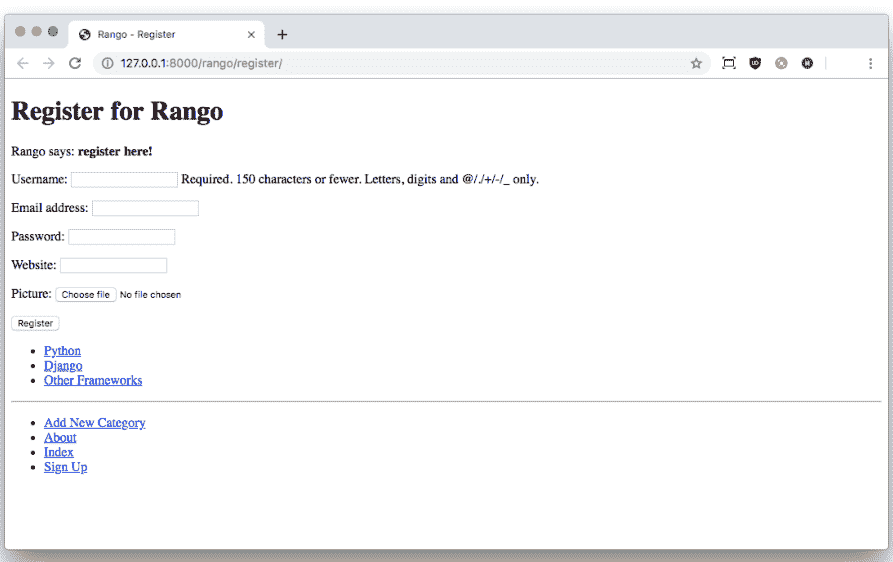
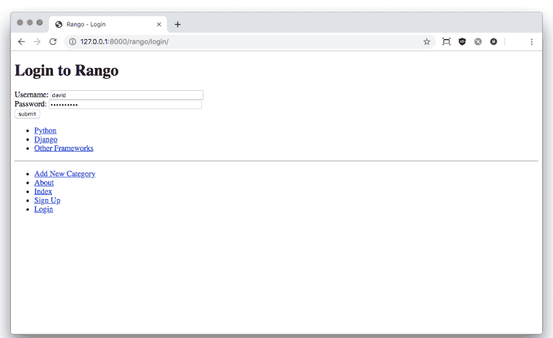
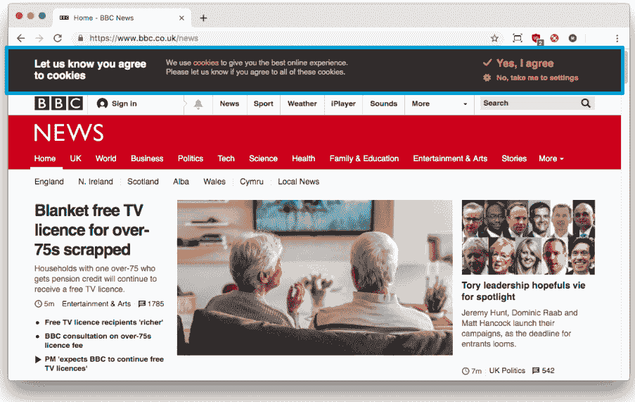
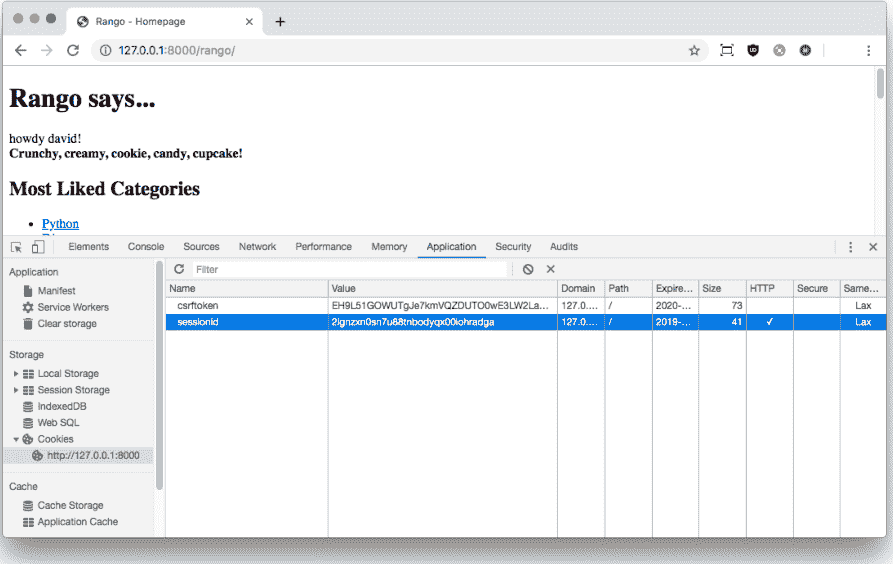

# 9. 用户认证

大多数 Web 应用都会要求用户注册和登记，以便他们管理自己的账户并访问特殊功能。对于 Rango，我们希望控制不同用户可用的操作。因此，本教程的下一部分旨在让你熟悉 Django 提供的基本用户认证机制。我们将使用标准 Django 安装中附带的 auth 应用，它位于 `django.contrib.auth` 包中。根据 Django 关于认证的文档¹，该应用提供了以下概念和功能。

- *用户（User）* 和 *用户模型（User Model）* 的概念。
- *权限（Permissions）*，一系列二进制标志（如是/否），决定用户可以做什么或不能做什么。
- *组（Groups）*，一种将权限应用于多个用户的方法。
- 可配置的 *密码哈希系统（password hashing system）*，是确保数据安全的必备条件。
- *用于用户登录或限制内容的表单和视图工具（Forms and view tools for logging in users）*。

在用户认证方面，Django 可以为你做很多事情。在本章中，我们将介绍一些基础知识，帮助你入门。这将帮助你建立对现有工具及其底层概念的信心。请注意，我们将从第一性原则出发，使用 Django 手动设置用户认证，但在后面的章节中，我们将向你展示如何使用一个预先制作的应用来处理注册过程。

## 9.1 设置认证

在开始使用 Django 提供的认证功能之前，你需要确保 Rango 项目的 `settings.py` 文件中有相关设置。

在 `settings.py` 文件中找到 `INSTALLED_APPS` 列表。找到后，检查其中是否列出了 `django.contrib.auth` 和 `django.contrib.contenttypes`，使得列表与下面的示例类似。

```python
INSTALLED_APPS = [
    'django.contrib.admin',
    'django.contrib.auth',
    'django.contrib.contenttypes',
    'django.contrib.sessions',
    'django.contrib.messages',
    'django.contrib.staticfiles',
    'rango',
]
```

`django.contrib.auth` 为 Django 提供对内置认证系统的访问，而 `django.contrib.contenttypes` 包则被认证应用用来跟踪数据库中安装的模型。

#### 如有必要，请进行迁移！

如果你必须将 `django.contrib.auth` 和 `django.contrib.contenttypes` 应用添加到 `INSTALLED_APPS` 元组中，则需要使用 `$ python manage.py migrate` 命令更新数据库。这将向数据库添加底层表，例如 User 模型的表。

通常，每当你向 Django 项目添加新应用时，运行 `migrate` 命令是一个好习惯——该应用可能包含需要同步到底层数据库的模型。

## 9.2 密码哈希

*在任何情况下，都不应该将密码以明文形式存储在数据库中。*² 如果心怀不轨的人获取了包含你应用全部用户账户的数据库，他们可能会造成严重破坏。幸运的是，Django 的 auth 应用默认会

² http://stackoverflow.com/questions/1197417/why-are-plain-text-passwords-bad-and-how-do-i-convince-my-boss-that-his-treasur

User 模型有五个关键属性。它们是：

- 用户账户的 *用户名（username）*；
- 账户的 *密码（password）*；
- 用户的 *电子邮件地址（email address）*；
- 用户的 *名字（first name）*；以及
- 用户的 *姓氏（surname）*。

User 模型还带有其他属性，如 `is_active`、`is_staff` 和 `is_superuser`。这些布尔字段分别用于表示账户是否激活、是否属于员工，以及是否具有超级用户权限。查看 Django 关于用户模型的文档¹⁰，了解基础 User 模型提供的完整属性列表。

## 9.5 附加用户属性

如果你希望包含 User 模型以外的其他与用户相关的属性，你需要创建一个与 User 模型 *关联（associated）* 的模型。在我们的 Rango 应用中，我们希望为每个用户账户增加两个附加属性。具体来说，我们希望包括：

- `URLField`，允许 Rango 用户指定其个人网站的 URL；以及
- `ImageField`，允许用户为其个人资料指定一张图片。

这可以通过在 Rango 的 `models.py` 文件中创建额外的模型来实现。让我们添加一个名为 `UserProfile` 的新模型：

```python
class UserProfile(models.Model):
    # This line is required. Links UserProfile to a User model instance.
    user = models.OneToOneField(User, on_delete=models.CASCADE)

    # The additional attributes we wish to include.
    website = models.URLField(blank=True)
    picture = models.ImageField(upload_to='profile_images', blank=True)

    def __str__(self):
        return self.user.username
```

注意，我们使用一对一关系引用 User 模型。由于我们引用默认的 User 模型，需要在 `models.py` 文件中导入它：

```python
from django.contrib.auth.models import User
```

对于 Rango，我们添加了两个字段来完成用户资料。我们还提供了 `__str__()` 方法，以便在请求 `UserProfile` 模型实例的字符串表示时返回一个有意义的数值。

对于 `website` 和 `picture` 两个字段，我们都设置了 `blank=True`。这使得每个字段在必要时都可以为空，也就是说用户不必为这些属性提供值。

此外，应注意 `ImageField` 字段有一个 `upload_to` 属性。该属性的值会与项目的 `MEDIA_ROOT` 设置拼接起来，为上传的个人资料图片提供存储路径。例如，`MEDIA_ROOT` 为 `<workspace>/tango_with_django_project/media/`，`upload_to` 属性为 `profile_images`，则所有个人资料图片将存储在目录 `<workspace>/tango_with_django_project/media/profile_images/` 中。回想一下，在关于模板和媒体文件的章节中，我们就在那里设置了媒体根目录。

#### 那么通过继承来扩展呢？

也许有人会想通过直接继承 User 模型来添加上面定义的附加字段。然而，由于其他应用可能也需要访问 User 模型，不建议使用继承——而应该在你的数据库中使用一对一关系。


## Django 用户注册应用

值得注意的是，市面上有一些现成的用户注册应用，能够减少很多自行构建注册和登录表单的麻烦。

然而，在使用这些应用之前，最好先对底层机制有所了解。这能确保你对幕后发生的一切有一定感知。*一分耕耘，一分收获。* 这也会加深你对表单处理、如何扩展 User 模型以及如何上传媒体文件的理解。

为了提供用户注册功能，我们现在将逐步完成以下四个步骤：

- 创建 `UserForm` 和 `UserProfileForm`；
- 添加一个视图来处理新用户的创建；
- 创建一个显示 `UserForm` 和 `UserProfileForm` 的模板；以及
- 将 URL 映射到所创建的视图。

作为整合新注册功能的最后一步，我们还将：

- 将首页链接到注册页面。

## 创建 UserForm 和 UserProfileForm

在 `rango/forms.py` 中，我们需要创建两个继承自 `forms.ModelForm` 的类。我们将为基本的 User 类创建一个，也为刚创建的新 UserProfile 模型创建一个。这两个继承自 `ModelForm` 的类允许我们显示一个 HTML 表单，展示特定模型所需的表单字段，从而为我们省去大量工作。

让我们在 `rango/forms.py` 中创建这两个继承自 `forms.ModelForm` 的类。请将以下代码添加到模块中。

```
# until we're ready to avoid integrity problems.
profile = profile_form.save(commit=False)
profile.user = user

# Did the user provide a profile picture?
# If so, we need to get it from the input form and
#put it in the UserProfile model.
if 'picture' in request.FILES:
    profile.picture = request.FILES['picture']

# Now we save the UserProfile model instance.
profile.save()

# Update our variable to indicate that the template
# registration was successful.
registered = True
else:
    # Invalid form or forms - mistakes or something else?
    # Print problems to the terminal.
    print(user_form.errors, profile_form.errors)
else:
    # Not a HTTP POST, so we render our form using two ModelForm instances.
    # These forms will be blank, ready for user input.
    user_form = UserForm()
    profile_form = UserProfileForm()

# Render the template depending on the context.
return render(request,
    'rango/register.html',
    context = {'user_form': user_form,
               'profile_form': profile_form,
               'registered': registered})
```

虽然这个视图看起来相当复杂，但它实际上与我们实现 add_category 和 add_page 视图的方式非常相似。不过，这里的关键区别在于我们必须处理两个不同的 ModelForm 实例——一个用于 User 模型，一个用于 UserProfile 模型。此外，如果用户选择上传个人资料图片，我们还需要处理它。

我们在这里使用的一个技巧（过去曾让很多人栽过跟头）是在保存 UserProfile 表单时使用 `commit=False`。这会让 Django 在第一次保存时不会将数据写入数据库。为什么要这样做？请记住，来自 `UserProfileForm` 表单的信息会被传递到 `UserProfile` 模型的新实例上。`UserProfile` 包含一个对标准 Django `User` 模型的外键引用——但 `UserProfile` 本身并不提供这个信息！试图以不完整的状态保存新的实例会引发引用完整性错误。*两个模型之间的关联是必需的。*

为了解决这个问题，我们让 `UserProfileForm` *不要*立即保存，如上文第 29 行所示。这样我们就可以通过第 30 行的 `profile.user=user` 来添加 `User` 引用。完成后，我们可以在第 39 行调用 `profile.save()` 方法，手动将新实例保存到数据库。此时引用完整性得到保证，一切都会按预期工作。

## 创建*注册*模板

现在我们需要创建新 `register()` 视图将要使用的模板。请创建一个新的模板文件 `rango/register.html`，并添加以下代码。

```
1 
2 
3 
4 
5     Register
6 
7 
8 
9 <h1>Register for Rango</h1>
10 
11 Rango says: <strong>thank you for registering!</strong>
12 <a href="">Return to the homepage.</a><br />
13 
14 Rango says: <strong>register here!</strong><br />
15 <form id="user_form" method="post" action=""
16     enctype="multipart/form-data">
17 
18     
19 
20     <!-- Display each form  -->
21    {{ user_form.as_p }}
22    {{ profile_form.as_p }}
23
24    <!-- Provide a button to click to submit the form. -->
25    <input type="submit" name="submit" value="Register" />
26 </form>
27 
28 
```

## 使用 url 模板标签

请注意，在上述模板代码中我们使用了 url 模板标签，例如 。这意味着我们在映射 URL 时必须将其命名为 register。

这里需要注意的第一点是，该模板使用了我们在视图中用来表示注册是否成功的 registered 变量。请注意，模板必须将 registered 设为 False 才会显示注册表单——否则会显示成功消息。

接下来，我们对 user_form 和 profile_form 使用了 as_p 模板方法。这会将表单中的每个元素包裹在一个段落中（由 <p> HTML 标签表示）。这样可以确保每个元素都出现在新的一行上。

最后，在 <form> 元素中，我们包含了 enctype 属性。这是因为如果用户尝试上传图片，表单的响应可能包含二进制数据。这与从用户输入表单字段中得到的文本数据不同。因此，响应必须分成多个部分才能传回服务器。因此，我们需要用 enctype="multipart/form-data" 来标明这一点。这告诉 HTTP 客户端（Web 浏览器）相应地打包并发送数据。否则，服务器将无法收到用户提交的所有数据。

## 多部分消息与二进制文件

你应该了解 <form> 元素的 enctype 属性。当你希望用户通过表单上传文件时——无论是图片还是其他文档——绝对必须将 enctype 设置为 multipart/form-data。这种属性和值的组合会指示浏览器以特殊方式将表单数据发送回服务器。本质上，代表文件的数据会被拆分成一系列数据块并发送。有关更多信息，请查看这个很棒的 Stack Overflow 回答¹³。

此外，请务必在 <form> 元素中包含 CSRF 令牌，即 ！如果你不这样做，Django 的跨站伪造¹⁴ 保护中间件层将拒绝接受表单内容并返回错误。这提供了一层安全保护，防止来自伪造网站的提交通信成功。这通常被称为网络钓鱼。

## register() URL 映射

创建好新的视图和关联模板后，我们现在可以添加 URL 映射。在 Rango 的 URLs 模块 rango/urls.py 中，按如下所示修改 urlpatterns 元组。

```
urlpatterns = [
    path('', views.index, name='index'),
    path('about/', views.about, name='about'),
    path('category/<slug:category_name_slug>/add_page/', views.add_page,
        name='add_page'),
    path('category/<slug:category_name_slug>/', views.show_category,
        name='show_category'),
    path('add_category/', views.add_category, name='add_category'),
    path('register/', views.register, name='register'),  # New mapping!
]
```

新添加的模式（位于列表底部）将 URL /rango/register/ 指向 register() 视图。另请注意，我们为新的 URL 指定了名称 register。




这张截图展示了你在本教程中创建的基础注册表单。

看到提示表明你的详细信息已成功注册后，数据库中的 User 和 UserProfile 模型中应该会有新条目。进入 Django Admin 界面来确认这一点。

## 9.7 实现登录功能

完成注册账户的功能后，我们现在需要为 Rango 的用户提供登录能力。为此，我们需要完成下面概述的工作流程。

- 创建一个登录视图来处理用户凭据。
- 创建一个登录模板来显示登录表单。
- 将登录视图映射到 URL。
- 在首页提供登录链接。

### 创建 `login()` 视图

首先，打开 Rango 的视图模块 `rango/views.py`，创建一个名为 `user_login()` 的新视图。这个视图将处理后续登录表单提交的数据，并尝试使用给定的详细信息登录用户。

```python
def user_login(request):
    # If the request is a HTTP POST, try to pull out the relevant information.
    if request.method == 'POST':
        # Gather the username and password provided by the user.
        # This information is obtained from the login form.
        # We use request.POST.get('<variable>') as opposed
        # to request.POST['<variable>'], because the
        # request.POST.get('<variable>') returns None if the
        # value does not exist, while request.POST['<variable>']
        # will raise a KeyError exception.
        username = request.POST.get('username')
        password = request.POST.get('password')

        # Use Django's machinery to attempt to see if the username/password
        # combination is valid - a User object is returned if it is.
        user = authenticate(username=username, password=password)

        # If we have a User object, the details are correct.
        # If None (Python's way of representing the absence of a value), no user
        # with matching credentials was found.
        if user:
            # Is the account active? It could have been disabled.
            if user.is_active:
                # If the account is valid and active, we can log the user in.
                # We'll send the user back to the homepage.
                login(request, user)
                return redirect(reverse('rango:index'))
            else:
                # An inactive account was used - no logging in!
                return HttpResponse("Your Rango account is disabled.")
        else:
            # Bad login details were provided. So we can't log the user in.
            print(f"Invalid login details: {username}, {password}")
            return HttpResponse("Invalid login details supplied.")

    # The request is not a HTTP POST, so display the login form.
    return render(request, 'rango/login.html', {})
```

Django 提供了所有这些函数和类。因此，你需要将其导入。现在必须在 `rango/views.py` 的顶部添加以下导入语句。

```python
from django.contrib.auth import authenticate, login
from django.http import HttpResponse
from django.urls import reverse
from django.shortcuts import redirect
```

你会发现其中一些导入语句在之前的 Rango `views.py` 模块中已经存在——请检查避免重复！例如，`HttpResponse` 应该已经从前面就有了。

### 创建*登录*模板

创建好新视图后，我们需要创建一个新模板 `login.html`，让用户输入凭据。我们知道模板将位于 `templates/rango/` 目录中，但文件名留给你自己确定。查看上面的代码示例，根据新的 `user_login()` 视图的代码来确定文件名。在新的模板文件中，添加以下代码。

```html




    Login



<h1>Login to Rango</h1>
<form id="login_form" method="post" action="">
    
    Username: <input type="text" name="username" value="" size="50" />
    <br />
    Password: <input type="password" name="password" value="" size="50" />
    <br />
    <input type="submit" value="submit" />
</form>

```

```html

    howdy {{ user.username }}!

    hey there partner!

```

如你所见，我们使用了 Django 模板语言通过 `` 来检查用户是否已认证。如果用户已登录，Django 会让我们访问 user 对象。我们可以从这个对象判断用户是否已登录（已认证）。如果他或她已登录，我们还可以获取其详细信息。在上面的示例中，如果用户已登录，则会显示其用户名——否则会显示通用的 `hey there partner!` 消息。

### 演示

启动 Django 开发服务器并尝试登录应用。下图显示了登录页面的截图，应符合预期效果。



登录页面截图，包含用户名和密码输入框。

### 使用装饰器限制访问

Django 提供了一个名为 `login_required()` 的装饰器，我们可以将其附加到任何需要用户登录的视图上。如果用户未登录并尝试访问带有 `login_required()` 装饰器的视图，他们将被重定向到另一个页面（[你可以自行设置](https://docs.djangoproject.com/en/2.1/ref/settings/#login-url)）——通常是登录页面。

要尝试这个功能，在 Rango 的 `views.py` 模块中创建一个名为 `restricted()` 的视图，并添加以下代码。

```python
@login_required
def restricted(request):
    return HttpResponse("Since you're logged in, you can see this text!")
```

注意，要使用装饰器，你需要将它放在函数签名的*正上方*，并在装饰器名称前加上 `@`。Python 会在执行函数/方法代码之前先执行装饰器。由于装饰器本质上也是一个函数，如果它位于外部模块中，你仍然需要导入它。因为 `login_required()` 在其他地方定义，所以需要在 `views.py` 顶部添加以下导入语句。

```python
from django.contrib.auth.decorators import login_required
```

我们还需要在 `urls.py` 文件的 Rango `urlpatterns` 列表中添加另一个 URL 映射。添加以下代码行。

```python
path('restricted/', views.restricted, name='restricted'),
```

为了使新的受限页面可访问，你还可以在 Rango 的 `base.html` 模板中添加另一个链接。

```html
<ul>
    ...
    <li><a href="">Restricted Page</a></li>
</ul>
```

我们还需要稳健地处理用户尝试访问 `restricted()` 视图但未登录的情况。我们应该如何处理该用户？最简单的方法是将其重定向到他们可以访问的页面，例如注册页面。Django 允许我们在项目配置目录中的 `settings.py` 模块里进行指定。在 `settings.py` 中，定义变量 `LOGIN_URL`，指定你希望将未登录用户重定向到的 URL。对于 Rango，我们可以重定向到位于 `/rango/login/` 的登录页面：

```python
LOGIN_URL = '/rango/login/'
```

然而，像这样硬编码 URL，无论放在哪里，都是不好的做法。我们要不惜一切代价避免这种情况！幸运的是，你可以使用在 Rango 的 `urls.py` 模块中定义的 URL 映射来重写它，如下所示。

```python
LOGIN_URL = 'rango:login'
```

好多了！Django 在这里同样支持 URL 名称。通过输入 URL 名称，Django 会将用户引导到正确的位置，即使登录 URL 发生更改也没关系。

无论你为 `LOGIN_URL` 设置什么值，只要提供了值，就能确保 `login_required()` 装饰器会将任何未登录的用户重定向到你指定的 URL。

## 9.9 退出登录

为了让用户能够优雅地退出登录，提供一个退出选项会很好。Django 自带一个方便的 `logout()` 函数，它可以确保用户能够正确、安全地退出登录。`logout()` 函数会结束用户的会话，如果之后他们尝试访问需要认证的视图，将无法访问，除非他们随后决定重新登录。


要为 `rango/views.py` 提供注销功能，请添加名为 `user_logout()` 的视图，并使用以下代码。

```python
# Use the login_required() decorator to ensure only those logged in can
# access the view.
@login_required
def user_logout(request):
    # Since we know the user is logged in, we can now just log them out.
    logout(request)
    # Take the user back to the homepage.
    return redirect(reverse('rango:index'))
```

你还需要在 `views.py` 顶部导入 logout 函数。

```python
from django.contrib.auth import logout
```

如果你愿意，也可以将 logout 导入追加到你现有的同一模块导入语句末尾，如以下示例所示。

```python
from django.contrib.auth import authenticate, login, logout
```

创建视图后，通过修改 Rango 的 `urls.py` 中的 urlpatterns 列表，将 URL `/rango/logout/` 映射到 `user_logout()` 视图。

```python
path('logout/', views.user_logout, name='logout'),
```

最后，我们可以在 `base.html` 模板中添加进一步的链接。

```html
<ul>
    ...
    <li><a href="">Logout</a></li>
    ...
</ul>
```

## 9.10 整理 `base.html` 中的超链接

现在注销用户的全部机制已经完成，我们可以添加一些收尾工作。像上面那样提供注销链接是好的，但明智吗？如果用户未登录，提供注销链接有什么意义呢？反之，如果用户已登录，提供登录链接是否合理？也许不合理——可以认为 `base.html` 中向用户展示的链接应 *根据其情况而变化*。我们需要做更多工作，以确保我们的 Rango 应用满足我们最初设定的要求。

让我们修改 `base.html` 模板中的链接。我们将使用模板上下文中的 `user` 对象来确定要向特定用户展示哪些链接。找到页面底部的链接列表，并将其替换为以下代码。随意在此处复制粘贴，因为你所做的只是添加一些条件语句，并移动现有链接。

```html
<ul>

    <!-- Show these links when the user is logged in -->
    <li><a href="">Restricted Page</a></li>
    <li><a href="">Logout</a></li>

    <!-- Show these links when the user is NOT logged in -->
    <li><a href="">Sign Up</a></li>
    <li><a href="">Login</a></li>

<!-- Outside the conditional statements, ALWAYS show -->
<li><a href="">Add New Category</a></li>
<li><a href="">About</a></li>
<li><a href="">Index</a></li>
</ul>
```

此标记和模板代码表示当用户已通过身份验证并登录时，他或她可以看到 `Restricted Page` 和 `Logout` 链接。如果他或她未登录，则会显示 `Login` 和 `Sign Up`。由于 `Add New Category`、`About` 和 `Index` 不在

## 练习

现在，练习以下两个练习以巩固本章所学内容。

- 自定义 Rango，使只有注册用户可以添加分类和页面，而未注册用户只能查看或使用分类和页面。记住，你需要在 `views.py` 中添加一些代码，并且还需要更新 `base.html` 中关于链接的模板代码——以及 `category.html` 中的添加页面链接！
- 通过将受限页面视图转换为使用模板来保持你的模板知识新鲜。将模板命名为 `restricted.html`，并确保它也扩展自 Rango 的 `base.html` 模板。确保为此页面提供标题块值为 `Restricted Page`。

## 测试你的实现

我们实现了一系列单元测试，让你检查到目前为止的实现。按照我们之前提供的指南，使用测试模块 `tests_chapter9.py`。你的实现与我们的测试相比如何？本章的测试相当广泛！请记住，只有在完全完成上述练习后，测试才能通过。



BBC News 网站的屏幕截图（托管于英国），页面顶部显示了 cookie 警告消息。

## 欧盟的 Cookies

2011 年，欧盟引入了全欧盟的 *“cookie 法”*，要求欧盟境内托管的所有网站在用户首次访问网站时应显示 cookie 警告消息。上图展示了 BBC News 网站上的此类警告。你可以在 [这里](https://ico.org.uk/for-organisations/guide-to-pecr/cookies-and-similar-technologies/) 阅读关于该法律的内容。

如果你正在开发一个网站，你需要了解该法律，以及关于可访问性和更近期的可解释性等其他法律。

> https://ico.org.uk/for-organisations/guide-to-pecr/cookies-and-similar-technologies/

现在亲自看看——查看 [下面的屏幕截图]。对于 Google Chrome，你可以通过访问 Chrome 的开发者工具来查看当前打开网站的 cookies，具体路径为 *Chrome 设置 > 更多工具 > 开发者工具*。当开发者工具面板打开时，点击 *Application* 选项卡，并在左侧的 *Storage* 子类别下查找 *Cookies*。如果你在 [你的电脑上] 打开了一个 Rango 页面，你将看到一个名为 *sessionid* 的 cookie。sessionid cookie 包含 Django 用于唯一标识你的计算机与给定会话的一串字母和数字。有了此会话 ID，所有你的会话详情都可以访问——但它们仅存储在 *服务器端*。



**Google Chrome 开发者工具的屏幕截图，其中突出显示了 sessionid cookie。**

[^9]: http://127.0.0.1:8000/rango/

## 无 Cookie

在 *不使用 cookies* 的情况下持久化状态信息的一种替代方法是，将会话 ID 编码在 URL 中。例如，你可能见过像这样的 PHP 页面 URL：`http://www.site.com/index.php?sessid=some seemingly random and long string.` 这意味着你不需要在客户端机器上存储 cookies，但 URL 会变得相当难看。这些 URL 违背了 Django 的原则，即提供简洁、简单且对人类友好的 URL。

## 10.3 在 Django 中设置会话

虽然这应该已经设置好并正常工作，但了解哪些 Django 模块提供哪些功能仍然是良好的实践。在会话的情况下，Django 提供了实现会话功能的中间件¹⁰。

为了检查一切是否正常，打开你的 Django 项目的 `settings.py` 文件。在文件中找到 `MIDDLEWARE` 列表。你应该在此列表中找到由字符串 `django.contrib.sessions.middleware.SessionMiddleware` 表示的模块。如果看不到它，现在将其添加到列表中。正是 `SessionMiddleware` 中间件使创建唯一的 `sessionid` cookies 成为可能。

`SessionMiddleware` 设计为可灵活地与不同的会话信息存储方式配合使用。可以采用多种方法——你可以将所有内容存储在文件中、数据库中，甚至是内存缓存中。最直接的方法是使用 `django.contrib.sessions` 应用将会话信息存储在 Django 模型/数据库中。具体来说，我们指的是 Django 模型 `django.contrib.sessions.models.Session`。要使用此方法，你还需要确保 `django.contrib.sessions` 在你的 Django 项目 `settings.py` 文件的 `INSTALLED_APPS` 元组中。记住，如果你现在添加该应用，你需要使用通常的迁移命令更新数据库。

¹⁰ https://docs.djangoproject.com/en/2.1/topics/http/middleware/


## 缓存会话

如果你希望获得更快的性能，不妨考虑使用缓存方式来存储会话信息。你可以查阅 [Django 文档中关于缓存会话的建议](https://docs.djangoproject.com/en/2.1/topics/http/sessions/#using-cached-sessions)。

## 10.4 Cookie 品尝会话

虽然所有现代 Web 浏览器都支持 Cookie，但根据浏览器的安全级别，某些 Cookie 可能会被阻止。在继续之前，请确保你已启用对 Cookie 的支持。不过，很可能你已经准备好了。

### 测试 Cookie 功能

要测试 Cookie，可以使用 Django 的 request 对象提供的一些便捷方法。我们特别感兴趣的有三个：`set_test_cookie()`、`test_cookie_worked()` 和 `delete_test_cookie()`。在其中一个视图中，你需要设置测试 Cookie。在另一个视图中，你需要测试 Cookie 是否存在。测试 Cookie 需要两个不同的视图，因为你需要等待查看客户端是否接受了来自服务器的 Cookie。

我们将使用两个已有的视图来完成这个简单练习：`index()` 和 `about()`。我们不会在页面本身上显示任何内容，而是利用 Django 开发服务器的终端输出，来验证 Cookie 是否正常工作。

在 Rango 的 `views.py` 文件中，找到你的 `index()` 视图。在视图中添加下面这一行。为了确保该行被执行，请确保将它放在 return 语句之前。

```python
request.session.set_test_cookie()
```

在 `about()` 视图中，添加下面三行。同样，请确保这些代码放在 `return` 语句*之前*，以确保它们被执行。return 语句会在该处终止执行。

用户访问 Rango 应用的次数，另一个则用于追踪他们最近一次访问网站的时间。跟踪最近一次访问的日期和时间，可以让我们（例如）每天只递增一次网站计数器，从而避免人们通过频繁刷新网站来增加计数器。

合理的假设是，用户进入 Rango 网站的入口是首页。打开 Rango 的 `views.py` 文件。我们首先创建一个函数——它接收 request 和 response 对象的句柄——用于处理 Cookie（`visitor_cookie_handler()`）。然后我们可以在 Rango 的 `index()` 视图中使用这个函数。在 `views.py` 中添加以下函数。请注意，从技术上讲它并不是一个视图，因为它不返回 response 对象——它只是一个辅助函数¹²。

```python
def visitor_cookie_handler(request, response):
    # Get the number of visits to the site.
    # We use the COOKIES.get() function to obtain the visits cookie.
    # If the cookie exists, the value returned is casted to an integer.
    # If the cookie doesn't exist, then the default value of 1 is used.
    visits = int(request.COOKIES.get('visits', '1'))

    last_visit_cookie = request.COOKIES.get('last_visit', str(datetime.now()))
    last_visit_time = datetime.strptime(last_visit_cookie[:-7],
        '%Y-%m-%d %H:%M:%S')

    # If it's been more than a day since the last visit...
    if (datetime.now() - last_visit_time).days > 0:
        visits = visits + 1
        # Update the last visit cookie now that we have updated the count
        response.set_cookie('last_visit', str(datetime.now()))
    else:
        # Set the last visit cookie
        response.set_cookie('last_visit', last_visit_cookie)

    # Update/set the visits cookie
    response.set_cookie('visits', visits)
```

这个辅助函数接收 request 和 response 对象——因为我们希望从 request 中访问传入的 Cookie，并在 response 中添加或更新 Cookie。在函数中，你会看到我们调用了 `request.COOKIES.get()` 函数，这是 Django 提供的另一个辅助函数。如果 Cookie 存在，它会返回该值。如果不存在，我们可以提供一个默认值。一旦我们获取了每个 Cookie 的值，就可以计算自上次访问以来是否已经过去了一天（`.days`）。

如果你想测试这段代码而不用等上一天，可以把 `days` 改成 `seconds`。这样，访问计数器就可以每秒钟更新一次，而不是每天更新一次。

**请注意，所有 Cookie 值都以字符串形式返回；** *不要以为存储整数的 Cookie 会返回整数。* 你必须自己手动将其转换为正确的类型，因为 Cookie 中没有任何位置可以存储关于值类型的附加信息。

如果某个 Cookie 不存在，你可以使用所创建的 response 对象的 `set_cookie()` 方法来创建 Cookie。该方法接受两个值：你想创建的 Cookie 的名称（作为字符串）和 Cookie 的值。在这种情况下，你传入的值是什么类型并不重要——Django 会自动将该值转换为字符串。

由于我们使用了 datetime 对象，需要在 `views.py` 模块顶部将其导入。导入语句如下所示。

```python
from datetime import datetime
```

接下来，更新 `index()` 视图以调用 `visitor_cookie_handler()` 辅助函数。为此，我们需要先获取 response。注意，我们还要移除 `set_test_cookie()` 方法调用。此时，你也应该移除 `about()` 视图中的测试 Cookie 代码。

```python
def index(request):
    category_list = Category.objects.order_by('-likes')[:5]
    page_list = Page.objects.order_by('-views')[:5]

    context_dict = {}
    context_dict['boldmessage'] = 'Crunchy, creamy, cookie, candy, cupcake!'
    context_dict['categories'] = category_list
    context_dict['pages'] = page_list

    # Obtain our Response object early so we can add cookie information.
    response = render(request, 'rango/index.html', context=context_dict)
```

## 10.6 会话数据

前面的示例展示了如何存储和操作客户端 Cookie——即存储在客户端的数据。然而，一种更安全的保存会话信息的方式是，将这些数据存储在服务器端。然后，我们可以使用存储在客户端（但实际上是无记名的）的会话 ID Cookie 作为访问数据的密钥。

要使用基于会话的 Cookie，你需要执行以下步骤。

1. 确保 `settings.py` 模块中的 `MIDDLEWARE_CLASSES` 列表包含 `django.contrib.sessions.middleware.SessionMiddleware`。
2. 配置你的会话后端。确保 `settings.py` 中的 `INSTALLED_APPS` 里有 `django.contrib.sessions`。如果没有，请添加它，并运行数据库迁移命令 `python manage.py migrate`。
3. 默认情况下，会假定使用数据库后端，但你可能想使用不同的设置（例如缓存）。请参阅 [Django 会话文档，了解其他后端配置](https://docs.djangoproject.com/en/2.1/topics/http/sessions/)。

你可以通过 `request.session.get()` 方法访问服务器端数据，并用 `request.session[]` 存储它们，而不是直接将 Cookie 存储在 request 中（因而存储在客户端机器上）。请注意，仍然会使用会话 ID Cookie 来记住客户端的机器（所以从技术上讲，浏览器端 Cookie 是存在的）。然而，所有用户/会话数据都存储在服务器端。Django 的会话中间件负责处理客户端 Cookie 以及用户/会话数据的存储。

要使用服务器端数据，我们需要重构 `views.py`。首先，我们需要更新 `visitor_cookie_handler()` 函数，使其访问服务器端的 Cookie。我们可以通过调用 `request.session.get()` 来实现这一点，并通过将它们放入字典 `request.session[]` 来存储。为了帮助我们，我们编写了一个名为 `get_server_side_cookie()` 的辅助函数，它向 request 请求一个 Cookie。如果该 Cookie 在会话数据中，则返回其值。否则，返回默认值。


下面。注意方法调用的顺序不同，因为我们不再需要在响应中操作 cookie。

```python
def index(request):
    category_list = Category.objects.order_by('-likes')[:5]
    page_list = Page.objects.order_by('-views')[:5]

    context_dict = {}
    context_dict['boldmessage'] = 'Crunchy, creamy, cookie, candy, cupcake!'
    context_dict['categories'] = category_list
    context_dict['pages'] = page_list

    visitor_cookie_handler(request)
    context_dict['visits'] = request.session['visits']

    response = render(request, 'rango/index.html', context=context_dict)
    return response
```

在重新启动 Django 开发服务器之前，删除现有的客户端 cookie 以重新开始。**混用来自之前实现的 cookie 可能会导致奇怪、令人沮丧的行为。**


### 避免 Cookie 混淆

强烈建议你在开始使用基于会话的数据之前删除 Rango 的所有客户端 cookie。你可以在浏览器 cookie 检查器中逐个删除每个 cookie，或者直接清空浏览器缓存——确保在此过程中删除了 cookie。


### 数据类型和 Cookie

将会话数据存储在服务器端的额外优势在于其能够将数据从字符串转换为所需类型。然而，这仅适用于内置类型¹⁴，例如 int、float、long、complex 和 boolean。如果你想存储字典或其他复杂类型，就不要指望它能工作。在这种情况下，你可能需要考虑 pickle 你的对象¹⁵。

¹⁴ http://docs.python.org/3/library/stdtypes.html  
¹⁵ https://wiki.python.org/main/UsingPickle

## 10.7 浏览器长度和持久会话

使用 cookie 时，你可以使用 Django 的会话框架将 cookie 设置为 *浏览器长度会话* 或 *持久会话*。正如这两种会话类型的名称可能暗示的那样，

- **浏览器长度** 会话在用户关闭浏览器时过期；并且
- **持久会话** 可以跨多个浏览器实例持续存在——在你选择的时间过期。这可能是半小时，甚至是未来一个月的时间。

默认情况下，浏览器长度会话是禁用的。你可以通过修改 Django 项目的 `settings.py` 模块来启用它们。添加新的布尔变量 `SESSION_EXPIRE_AT_BROWSER_CLOSE`，将其设置为 `True`。

或者，持久会话默认启用，设置变量 `SESSION_EXPIRE_AT_BROWSER_CLOSE` 设置为 `False`，或在项目 `settings.py` 文件中不存在该变量（默认为 `False`）。持久会话还有一个额外的设置，`SESSION_COOKIE_AGE`，它允许你指定 cookie 可以存活多长时间。该值应为整数，表示 cookie 可以存活的秒数。例如，指定值为 1209600 意味着你的网站 cookie 在两周（14 天）后过期。

查看 [官方 Django 文档关于 cookie](https://docs.djangoproject.com/en/2.1/ref/settings/#session-cookie-age) 上可用的设置以获取更多详细信息。你也可以查看 [Eli Bendersky 的博客](http://eli.thegreenplace.net/2011/06/24/django-sessions-part-i-cookies/) 以获取关于 cookie 和 Django 的优秀教程。

## 10.8 清除会话数据库

会话很容易累积，包含会话信息的存储也会累积。如果你使用 Django 会话的数据库后端，你将需要定期清除存储 cookie 的数据库。这可以使用以下命令完成

```
$ python manage.py clearsessions
```

[Django 文档](https://docs.djangoproject.com/en/2.1/topics/http/sessions/#clearing-the-session-store) 建议运行

在方括号之间。记住，cookie 全部以字符串形式返回，无论它们包含什么内容。因此，你必须准备好将其转换为正确的类型（例如使用 `int()` 或 `float()`）。

3. 如果 cookie 不存在，或你希望更新 cookie，将你希望保存的值传递给生成的响应。你将调用的用于创建或更新 cookie 的函数是 `response.set_cookie('<cookie_name>', value)`。提供两个参数：cookie 的名称，以及你希望设置的值。

如果你需要更安全的 cookie，则使用基于会话的 cookie。

1. 首先，确保项目 `settings.py` 模块中的 `MIDDLEWARE_CLASSES` 列表包含 `django.contrib.sessions.middleware.SessionMiddleware`。如果没有，请将其添加到列表中。
2. 配置你的会话后端 `SESSION_ENGINE`。请参阅 [Django 文档关于会话](https://docs.djangoproject.com/en/2.1/topics/http/sessions/) 以了解各种后端配置。
3. 通过 `request.session.get()` 检查 cookie 是否存在。
4. 通过会话字典更新或设置 cookie。你可以在视图中使用以下语法访问 cookie：`request.session['<cookie_name>']`。将 `<cookie_name>` 替换为你希望访问的 cookie 的名称。
