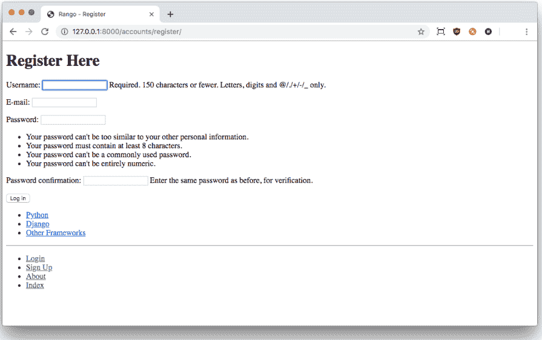

# 11. 使用 Django-Registration-Redux 进行用户身份验证

在前一章中，我们通过手动编写 URL、视图和模板添加了登录和注册功能。然而，此类功能对许多 Web 应用程序来说都很常见。正因为如此，开发人员创建了许多可添加到 Django 项目中的附加应用，以减少提供用户相关功能所需的代码量，例如登录、注册、一步和两步身份验证、密码更改、密码恢复等。在本章中，我们将更改 Rango 的登录和注册功能，使其使用名为 `django-registration-redux` 的包。

这意味着我们需要重构代码以删除我们之前创建的登录和注册功能。从那里开始，我们将逐步设置和配置 Rango 以及更广泛的 `tango_with_django_project` 代码库以使用 `django-registration-redux` 应用程序。本章还将为你提供使用外部 Django 应用的经验，并展示将其集成到项目中是多么容易。

## 11.1 设置 Django Registration Redux

首先，我们需要使用 pip 将 `django-registration-redux` 版本 2.2 安装到你的开发环境中。在终端/命令提示符下执行以下命令。确保你的虚拟环境已激活！

```bash
$ pip install -U django-registration-redux==2.2
```

安装包后，我们接下来需要告诉 Django 框架我们将使用 `django-registration-redux` Python 包中提供的注册应用。打开项目 `settings.py` 模块，并滚动直到



如上图所示，注意注册表单包含新用户密码的两个字段。这在如今几乎每个网站上都是标准做法，并为验证用户输入的密码提供了一种方式。尝试注册，但输入不同的密码。

注意注册应用如何为你处理所有逻辑。该应用还能够在成功注册后将你重定向到 Rango 的主页，正如它根据项目 settings.py 模块中指定的 `LOGIN_REDIRECT_URL` 设置所指示的那样。此时你是登录还是注销？

### 重构现有项目

现在你对注册代码感到满意，我们需要更新现有的 Rango 代码库以指向新的 django-registration-redux URL。

在 `rango/base.html` 模板中，更新以下 URL。


## 提示

为了帮助你完成上面的练习，以下提示可能会派上用场。

- 看看 [Anders Hofstee 的模板](https://github.com/macdhuiibh/django-registration-templates/tree/master/registration) 来入门。特别是，查看这个仓库将非常有助于弄清楚你在此练习中需要的两个新模板应该如何命名。
- 参考 [我们本章前面提供的表格]，来确定此练习所需的 URL 和名称映射。

## 12.1 模板

### ⚠️ 复制和粘贴

在入门章节中，我们说过不要复制粘贴——但这是一个例外。然而，如果你直接剪切和粘贴，最终会带入你不想要的额外文本。为了快速开始，请访问我们的 GitHub 页面，获取下面显示的[基础模板](http://bit.ly/twd2-bootstrap-base-template)。

如果你不明白特定的 Bootstrap 类有什么作用，请查阅 [Bootstrap 文档](https://getbootstrap.com/docs/4.3/getting-started/introduction/) 以加深理解。

```html
<!DOCTYPE html>




<html lang="en">
<head>
    <meta charset="utf-8">
    <meta name="viewport"
          content="width=device-width, initial-scale=1, shrink-to-fit=no">
    <meta name="description" content="">
    <meta name="author"
          content="Mark Otto, Jacob Thornton, and Bootstrap contributors">
    <meta name="generator"
          content="Jekyll v3.8.5">
    <link rel="icon" href="">
    <title>
        Rango - How to Tango with Django!
    </title>
    <!-- Bootstrap core CSS -->
    <link href="https://getbootstrap.com/docs/4.2/dist/css/bootstrap.min.css"
          rel="stylesheet">
    <!-- Custom styles for this template -->
    <link href="https://getbootstrap.com/docs/4.2/examples/dashboard/dashboard.css"
          rel="stylesheet">
```

如果你仔细查看修改后的 Bootstrap dashboard HTML 源代码，你会注意到其中包含大量由一系列 `<div>` 标签创建的结构。本质上，页面分为两部分：由 `<header>` 标签包含的顶部导航栏，以及由 `<main ...>` 标签表示的主内容窗格。在主内容窗格中，有一个 `<div>` 容纳另外两个 `<div>`，分别用于 `sidebar_block` 和 `body_block`。

上面的代码假定你已经完成了有关用户身份验证的章节，并按照前一章的说明使用了 `django-registration-redux`。如果你还没有完成这两项操作，则需要更新模板，并删除/修改页头导航栏中这些链接的引用。

另外需要注意的是，HTML 模板引用了外部网站来请求所需的 css 和 js 文件。为了使其全部正常工作，你需要连接到互联网，这样在运行 Rango 时样式和 JavaScript 文件才能被加载。

### 离线工作？

与其在 css 和 js 文件中包含外部引用，你可以下载所有相关文件并将它们存储在项目的静态目录中。我们建议将 CSS 文件存储在 `static/css/` 中，将 JavaScript 文件存储在 `static/js/` 中。如果这样做，你需要更新 `bootstrap-base.html`，使用 `` 模板函数在本地指向正确的文件。

## 12.2 快速更改样式

为了让 Rango 进行一次急需的改头换面，我们需要更新基础模板，以使用新的 `bootstrap-base.html` 模板。它现在已经可以开始使用了！实现这一目标的方法有很多，其中一种选择是在所有其他模板中将 `base.html` 重命名为 `bootstrap-base.html`。不过，更快捷的解决方案是执行以下操作。

1. 将 `templates/rango/` 中的 `base.html` 模板重命名为 `base-old.html`。
2. 将 `templates/rango/` 中的 `bootstrap-base.html` 模板重命名为 `base.html`。
