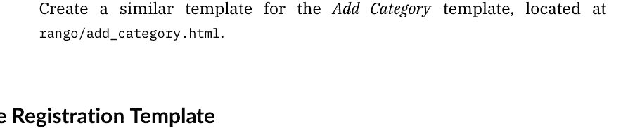
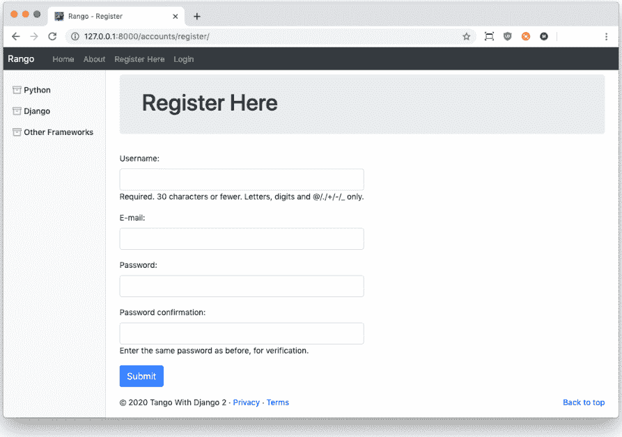

## 编目/分类理论

目录是图书馆或信息中心中资料的系统性编排，旨在让用户能够高效地识别、定位和访问资源。现代目录已从简单的手稿清单演变为支持远程访问和互操作的复杂数字数据库。

### 1. 编目原则

- 目录的功能是说明图书馆拥有哪些作品以及它们在哪里可以找到。
- 编目规则必须一致地应用，以确保统一性和可预测性。
- 书目记录应同时描述项目的知识内容和物理载体。
- 规范控制确保名称、题名和主题标准化。

### 2. 分类方案

| 方案 | 基础 | 侧重 | 用途 |
|--------|------|-------|-----|
| 杜威十进分类法 | 数字 | 按学科组织的知识 | 公共图书馆 |
| 国际十进分类法 | 数字 + 符号 | 分面知识 | 专业图书馆 |
| 美国国会图书馆分类法 | 字母数字 | 广泛的知识类别 | 学术图书馆 |

### 3. 目录条目的结构框架

每个目录条目通常包含一个标目（主要款目）、对项目的描述以及根查。标目可以是个人作者、团体机构或题名。描述遵循标准的区域顺序：题名与责任说明、版本、出版、物理描述、丛编和附注。

### 4. 维护与保存

目录需要持续维护，以反映新增、撤销和更正。目录本身的保存是持续访问的基础。在数字环境中，这包括备份、数据迁移和格式迁移，以防止技术过时。

### 5. 结论

编目和分类的理论基础仍然是知识组织的核心。一个健壮的目录不仅提供物理访问，还提供对世界记录知识的知识访问。

使用自定义 Bootstrap 样式的注册表单页面截图。

### 另一个样式练习

虽然本教程使用 Bootstrap，但还有一个可选的附加练习，即使用其他响应式 CSS 工具包之一为 Rango 设置样式。如果你确实创建了你的样式，请告诉我们，我们可以链接到它，向其他人展示你是如何改进 Rango 的样式的！

使用 Bing 搜索 API，你需要注册一个 *API 密钥*。该密钥目前为订阅者提供每月 1000 次查询的访问权限，这应该足够我们的实验目的。
