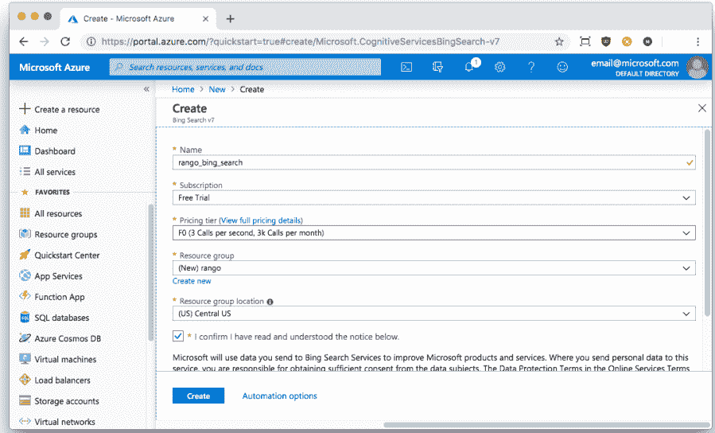
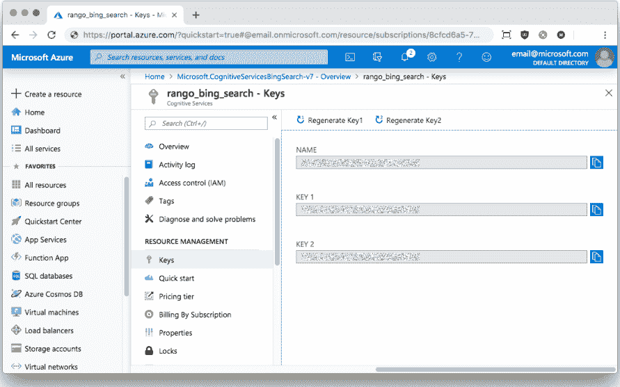
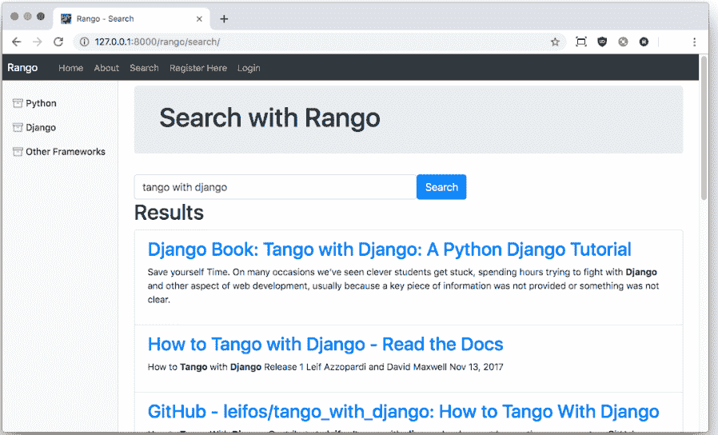

## 应用程序编程接口（API）


一个 [应用程序编程接口](https://en.wikipedia.org/wiki/Application_programming_interface)⁵ 规定了软件组件之间如何相互交互。在 Web 应用程序的上下文中，API 被视为一组 HTTP 请求，以及每个请求可以返回的响应消息结构的定义。任何可以通过互联网提供的有意义的服务都可以有自己的 API。我们并不局限于网络搜索！有关 Web API 的更多信息，[Luis Rei 提供了一个关于 API 的优秀教程](http://blog.luisrei.com/articles/rest.html)⁶。

## 注册 Bing API 密钥

要获取 Bing API 密钥，你必须先注册一个 Microsoft Azure 账户。该账户让你可以访问广泛的 Microsoft 服务。如果你已经拥有 Microsoft 账户，则无需注册——只需输入你的详细信息，使用现有账户详情登录即可。否则，你可以上网在 https://account.windowsazure.com⁷ 创建一个免费的 Microsoft 账户。

登录后，转到门户。链接位于页面右上角。

门户加载后，你应该会在视口顶部看到选项列表（或根据屏幕大小显示在侧边）。找到名为 `Create a resource` 的顶部选项并单击它。页面右侧随后会填充更多列表。在其中找到 `AI + Machine Learning` 选项并选择它。滚动随后出现的菜单上的选项，然后选择 `Bing Search` 选项。

⁵http://en.wikipedia.org/wiki/Application_programming_interface
⁶http://blog.luisrei.com/articles/rest.html
⁷https://account.windowsazure.com

## 输入个人信息


在此阶段，你可能会被重定向到一个页面，在那里你必须提供地址和支付卡等详细信息。Microsoft 表示，需要这些信息以确保垃圾邮件发送者和机器人不会渗透其服务——请放心，如果你需要提供付款详细信息，除非你特别授权，否则不会从你的银行账户中扣除任何款项。我们将使用免费的 Bing 搜索 API 配额，因此无需转账。如果你确实需要提供此信息，则需要返回门户，再次查找 Bing Search v7 选项。

然后你会看到一个与下面类似的页面。在这里，你需要为你的 Bing 搜索服务提供一个名称——像 `rango_bing_search` 这样的名称就很合适。确保为订阅选择 `Free Trial`，并为定价层选择 `F0` 或 `F1`（每月允许 1000 次免费请求）。选择这些选项将确保你不会因访问 API 而被收费。你还需要创建一个新组——我们创建了一个名为 `rango` 的组。资源位置无关紧要，因为我们不会担心响应时间之类的问题。满意后，单击页面底部的 Create。



在 Microsoft Azure Web 应用程序中创建免费的 Bing 搜索 API 资源。

然后你需要等待资源创建——这将花费几分钟。创建完成后，你应该会看到一个屏幕，确认你的新资源已创建。在该屏幕上，单击 Go to resource 按钮。

然后会加载一个新页面。在这里，你应该在 Resource Management 标题下查找密钥选项。你应该会看到如下所示的屏幕。此图中的密钥被故意遮挡。记下此页面上的三项内容——名称、密钥1和密钥2。将 key1 的值复制到文本文件中，因为我们稍后会用到它！你在此处保存的密钥将在稍后尝试访问 Bing 搜索 API 时需要。



**Bing 搜索 API 资源的密钥屏幕。请务必记下密钥1的值！你稍后将需要它们。**

### 13.2 添加搜索功能

拿到密钥后，现在是时候开始编码了。下面，我们提供了必要的代码，以便我们可以通过编程方式向 Bing 搜索 API 发出搜索查询。在你的 rango 应用目录内创建一个名为 `bing_search.py` 的文件——与 `views.py` 和 `models.py` 等模块相同的目录。将代码添加到该模块中，如下所示。

#### requests 包

为了让这段代码正常工作，你需要将 requests 包添加到 Rango 的环境中。你可以通过在终端或命令提示符中运行命令 `$ pip install requests` 来完成此操作。如果你不这样做，代码将无法工作。


```python
import json
import requests

# Add your Microsoft Account Key to a file called bing.key
def read_bing_key():
    """
    reads the BING API key from a file called 'bing.key'
    returns: a string which is either None, i.e. no key found, or with a key
    remember to put bing.key in your .gitignore file to avoid committing it.

    See Python Anti-Patterns - it is an awesome resource to improve your python code
    Here we using "with" when opening documents
    http://bit.ly/twd-antipattern-open-files
    """
    bing_api_key = None
    try:
        with open('bing.key','r') as f:
            bing_api_key = f.readline().strip()
    except:
        try:
            with open('../bing.key') as f:
                bing_api_key = f.readline().strip()
        except:
            raise IOError('bing.key file not found')

    if not bing_api_key:
        raise KeyError('Bing key not found')

    return bing_api_key

def run_query(search_terms):
    """
    See the Microsoft's documentation on other parameters that you can set.
    http://bit.ly/twd-bing-api
    """
    bing_key = read_bing_key()
    search_url = 'https://api.cognitive.microsoft.com/bing/v7.0/search'
    headers = {'Ocp-Apim-Subscription-Key': bing_key}
    params = {'q': search_terms, 'textDecorations': True, 'textFormat': 'HTML'}

    # Issue the request, given the details above.
    response = requests.get(search_url, headers=headers, params=params)
```

```html




    Search



<div class="jumbotron p-4">
    <div class="container">
        <h1 class="jumbotron-heading">Search with Rango</h1>
    </div>
</div>
<div>
    <form class="form-inline"
          id="user-form"
          method="post"
          action="">
        

        <div class="form-group">
            <input class="form-control"
                   type="text"
                   size="50"
                   name="query"
                   id="query" />
        </div>

        <button class="btn btn-primary"
                type="submit"
                name="submit">Search</button>
    </form>
</div>
<div>
    
        <h2>Results</h2>

        <div class="list-group">
            
                <div class="list-group-item">
                    <h3 class="list-group-item-heading">
                        <a href="{{ result.link }}">
                            {{ result.title|safe|escape }}
                        </a>
                    </h3>
```

完成前面三个步骤后，你现在应该能够在浏览器中导航到你的 Rango 应用并进行搜索！结果应该看起来像[下面你所看到的](#)。



**完成的 Bing 搜索页面，显示查询 Tango with Django 的结果。**

做得好！你已成功将搜索添加到 Rango，从而学会了如何将你的应用与外部 API 集成。集成其他 API 大致相同——你可能会发现其中一些提供了 Python 包装器，因此你可以直接导入模块并使用 Python 命令查询 API。

### 搜索框练习

你可能已经注意到，当你发出查询时，查询会在显示结果时消失。这并不友好，因为研究表明人们喜欢*重新表述他们的查询*（或者用不同的词来说，*调整原始查询*）。你的练习是弄清楚如何更新视图和模板，以便在返回结果时用户的查询会显示在搜索框中。
