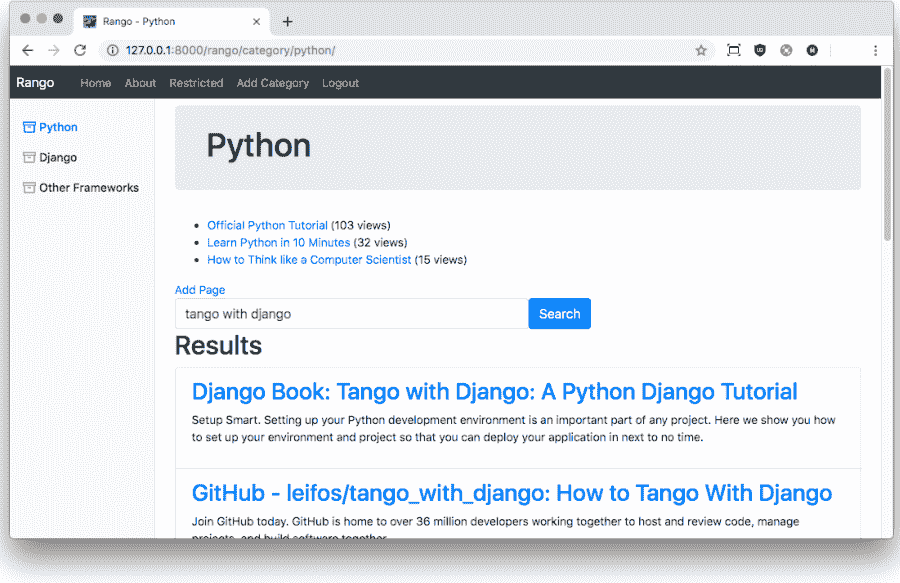
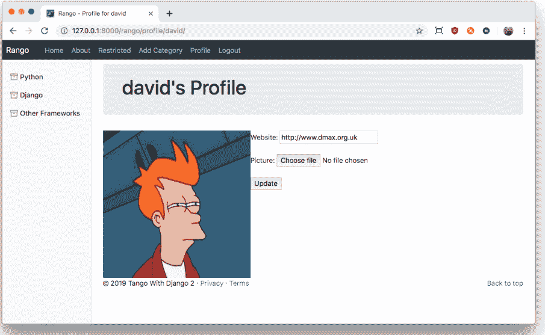
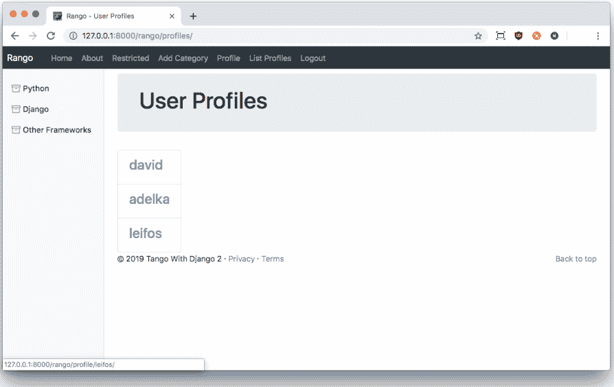

## 15. Rango Tango 提示

希望你能仅凭我们提供的工作流程完成前一章的练习。如果没有，或者你需要一点正确的方向指引，本章就是为你准备的。我们为每个练习提供了模型解决方案，如果你需要帮助，可以将它们整合到你自己的 Rango 版本中。

> **有更好的解决方案吗？**
>
> 本章提供的解决方案只是解决每个问题的一种方式。你可以用许多不同的方法来处理每个问题，也可以使用仅包含目前已学技巧的解决方案。然而，如果你成功采用了不同的实现方式，请随时与我们分享你的解决方案——并在推特上分享链接给 [@tangowithdjango](https://www.twitter.com/tangowithdjango)¹，供其他人参考！

### 15.1 跟踪页面点击量

正如我们之前介绍这个问题时所说，Rango 仅提供指向每个分类中保存的外部页面的直接链接。这种方法限制了我们跟踪（或简单计数）特定链接被点击次数的能力。为了能够跟踪点击量，我们需要完成以下步骤。我们在此提供的小节对应该工作流程中先前概述的四个主要步骤。

### 创建 URL 跟踪视图

首先，在 Rango 的 `views.py` 模块中创建一个名为 `goto_url()` 的新视图。该视图接受带参数的 HTTP GET 请求（即 `rango/goto/?page_id=1`），更新页面的浏览计数。然后该视图应重定向到实际的 URL。

```python
pages = Page.objects.filter(category=category).order_by('-views')
```

完成所有这些操作后，通过点击分类然后点击页面来确认一切正常。返回分类页面并刷新页面，查看点击次数是否增加。记得刷新浏览器；更新后的计数可能不会立即显示！

### 15.2 在分类页面内搜索

Rango 的主要目标是为应用程序用户提供有用的页面链接目录。目前，搜索功能基本上与分类无关。更好的做法是将搜索功能集成到实际的分类页面中。

让我们假设用户首先会导航并浏览他们感兴趣的分类。如果他们找不到想要的页面，他们就能进行搜索。当他们查看搜索结果并找到所需页面后，就能够将该页面添加到他们正在浏览的分类中。

我们将在这里处理描述的第一部分——将搜索功能添加到分类页面。要实现这一点，我们首先需要移除前一章中添加到[搜索功能](#)的代码。这基本上意味着停用当前的搜索页面及相关基础设施（包括视图和 URL 映射）。之后，我们还需要完成几项任务。这里列出的小节同样对应前一章中概述的五个主要步骤。


### 不要删除代码！

在停用现有搜索功能时，不要删除它。只需在适当位置注释掉相关内容（例如在 `urls.py` 模块中）。稍后你会将某些代码复制到新的位置。

### 停用通用搜索

此练习的第一步是停用你在前一章中实现的现有搜索功能。

1. 首先，打开 Rango 的 `base.html` 模板，找到导航栏标记（位于页面顶部）。找到你之前添加的用于 `Search` 链接的 `<li>` 元素并删除它。之所以需要删除，是因为你即将注释掉 URL 映射，这意味着对 `rango:search` 的反向 URL 查找将不再有效。用 HTML 注释标签（`<!-- ... -->`）包裹它也不行，因为 Django 模板引擎仍会处理其中的内容！
2. 其次，打开 Rango 的 `urls.py` 模块，找到 `/rango/search/` 的 URL 映射。在行首添加一个 `#` 将该行注释掉。这将阻止用户访问 `search` URL。
3. 最后，打开 Rango 的 `views.py` 模块，找到你之前实现的 `search()` 视图。同样地，通过在该函数的每一行前面加上 `#` 将其注释掉。

Rango 的模板目录中仍会保留 `search.html` 模板；不要删除它，因为我们将使用该模板的内容作为在分类模板中集成搜索功能的基础。

### 将 search.html 迁移到 category.html

由于我们希望为浏览分类的用户提供搜索功能，因此需要将搜索展示功能（例如显示搜索表单和结果区域）添加到 `category.html` 模板中。这基本上就是一个简单的复制粘贴工作！

让我们将其分为两个主要步骤。首先，打开你已停用的 `search.html` 模板，找到包含整个搜索表单的 `<div>` 元素。这是一个子元素为 `<form>` 元素的 `<div>`。选择并复制该 `<div>` 及其内容，然后打开 Rango 的 `category.html` 文件。

现在我们需要将 `search.html` 中的代码粘贴到 `category.html` 中。由于此问题的要求是将搜索功能添加到分类页面页面列表的*下方*，请找到 `` 内用于添加页面的链接。将 `search.html` 中的内容粘贴到该链接下方。

然后你可以回到 `search.html`，重复此过程，这次选择用于显示结果列表的 `<div>`。你可以通过查找包含遍历 `result_list` 列表的 Django 模板代码的 `<div>` 来识别它。复制该内容，然后返回到 `category.html`。将其粘贴到之前粘贴的包含表单的 `<div>` 下方。

### 更新 category.html 搜索表单

现在所需的标记已添加到 `category.html` 中，我们需要做一个简单的更改。不再将搜索表单的内容提交到 `/rango/search/` URL，而是将提交的响应直接指向分类 URL（`/rango/category/<slug:category_name_slug>`）。只需在 `category.html` 中找到 `<form>` 定义，并将 `action` 属性改为 Rango 的 `show_category()` URL 映射即可。

```html
<form class="form-inline"
      id="user-form"
      method="post"
      action="">
```

### 更新 show_category() 视图

你应该已经注意到，由于我们现在将搜索请求重定向到 `show_category()` 视图，我们需要对该视图进行一些修改，使其能够处理搜索请求的处理，同时也能处理为给定分类生成页面列表的功能。

这又是一个相对直接的过程，我们根据已停用的 `search()` 视图中的代码来更新该视图。我们在下面提供了 `show_category()` 视图模型的完整代码清单。请注意标注我们取自现有 `search()` 视图的代码起始位置的注释。


```python
def show_category(request, category_name_slug):
    context_dict = {}

    try:
        category = Category.objects.get(slug=category_name_slug)
        pages = Page.objects.filter(category=category).order_by('-views')

        context_dict['pages'] = pages
        context_dict['category'] = category
    except Category.DoesNotExist:
        context_dict['category'] = None
        context_dict['pages'] = None

    # Start new search functionality code.
    if request.method == 'POST':
        query = request.POST['query'].strip()

        if query:
            context_dict['result_list'] = run_query(query)
    # End new search functionality code.

    return render(request, 'rango/category.html', context_dict)
```

我们保持顶部的 `show_category()` 视图不变，并在末尾添加一段额外的代码来处理搜索请求。如果发出 POST 请求，我们尝试从请求中获取查询，并将其提交给我们之前在 [Bing 搜索章节](#) 中定义的 `run_query()` 函数。然后该函数返回一个结果列表，我们将其放入 `context_dict` 中，键为 `result_list`——这正是更新后的 `category.html` 模板中所期望的变量名。

搜索功能应该就能如预期般工作了。试一试！导航到一个分类页面，你应该会看到一个搜索框。输入搜索查询，提交，看看会发生什么。

一旦你感到满意，就可以安全地从代码库中删除现有的 `search.html` 模板，以及已停用的 `search()` 视图。

## 限制对搜索功能的访问

我们的最终要求是仅将迁移过来的搜索功能限制为已登录 Rango 的用户。这一步很简单——只需将添加到 `category.html` 中的搜索处理模板代码用条件模板检查包裹起来，以确定用户是否已通过身份验证。

```django

<div>
    ....
</div>

```

太简单了！你还可以更进一步，在 `show_category()` 视图中添加检查，以确保当前用户未登录时不执行搜索功能部分。不过要注意——不要倾向于给该视图添加 `login_required()` 装饰器。这样做会将所有分类浏览功能限制为仅登录用户可用——而你只想限制*搜索*功能！

## 搜索框练习

在 Bing 搜索 API 章节的末尾，我们设置了一个练习。我们注意到，在当前状态下，用户发出查询后会看到结果。但是，查询框随后又会清空——这使得*重新构造查询*更加费力。

在我们上面的代码示例中，我们故意没有给出这个特定练习的模型解决方案。你能如何让结果页面‘*记住*’输入的查询，并将其放回搜索框中呢？

解决这个问题最简单的方法是将查询变量放入 `show_category()` 的 `context_dict` 中，然后在 `category.html` 模板中使用该变量，将其值指定为搜索框 `<input>` 元素的 value 属性。

在 Rango 的 `show_category()` 视图中，找到处理搜索功能的代码块，并将查询添加到 `context_dict` 中，如下所示。

```python
# Start new search functionality code.
if request.method == 'POST':
    query = request.POST['query'].strip()

    if query:
        context_dict['result_list'] = run_query(query)
        context_dict['query'] = query
# End new search functionality code.
```

完成此操作后，打开 Rango 的 `category.html` 模板，并像这样修改查询 `<input>` 字段。

```html
<input class="form-control"
    type="text"
    size="50"
    name="query"
    value="{{ query }}"
    id="query" />
```

模板变量 `{{ query }}` 将被用户的查询替换，从而在页面加载时将其设置为 `<input>` 字段的默认值。

一旦所有工作完成，你应该会得到一个与下面示例类似的分类页面。干得好！



Rango 更新后的分类视图，集成了 Bing 搜索 API 的搜索功能。还要注意搜索框中包含了搜索词——它们仍然被保留！

## 15.3 创建 UserProfile 实例

本部分提供了一种与 django-registration-redux 包结合创建 Rango UserProfile 账户的解决方案。回想一下，标准的 `django.contrib.auth.models.User` 模型包含几个与用户账户相关的标准字段，例如用户名和密码。然而，我们选择在 Rango 中实现一个额外的 `UserProfile` 模型，以存储额外信息，例如用户的网站 URL 和个人资料图片。在这里，我们将逐步介绍实现此功能所需的步骤。我们将处理的步骤列在下面，每一步都对应下面的一个小节。

1. 我们首先将创建一个新的 `profile_registration.html` 模板，该模板将是我们现有的 `UserProfileForm` Django 表单。
2. 然后我们将创建一个新的 `register_profile()` 视图，以捕获新 `UserProfile` 实例的详细信息。
3. 之后，应用标准流程。我们首先将新视图映射到一个新的 URL——在本例中，该 URL 是 `/rango/register_profile/`。尽管这涉及用户账户，但它是 *Rango 特有* 的，因此将其放在 `/rango/` URL 模式中是有意义的。
4. 然后我们需要为 `django-registration-redux` 包编写一些代码，告诉它在创建 User 对象时重定向到另一个地方——换句话说，将用户重定向到新的 `/rango/register_profile/` URL。

第四步需要一些额外的代码，这些代码需要一些 `django-registration-redux` 包的专业知识。我们已经为你处理好了，但我们会指出相关文档的相关部分，向你展示我们是如何弄清楚一切的。

完成后，用户注册 Rango 的基本流程/体验如下。

1. 用户将跳转到 Rango 网站。
2. 然后他们会点击导航栏上的 `Register Here` 链接。
3. 然后他们会被重定向到 `django-registration-redux` 注册表单。该表单位于 `/accounts/register` URL。
4. 一旦此表单填写完成，表单将被提交并处理。如果成功，他们将被重定向到新的 `/rango/register_profile/` 页面，允许他们创建 `UserProfile` 实例。
5. 完成并提交后，用户将被重定向到主页。注册随即完成。

这里的顺序很重要，因为我们实现新 `register_profile()` 视图的方式将假定用户事先已创建了标准 User 实例。这将用于关联他们的新 UserProfile 实例并确保保持引用完整性！

### 创建个人资料注册模板

首先，让我们专注于创建一个简单的模板，该模板将提供必要的 HTML 标记来显示 UserProfileForm 表单字段。如前所述，我们将 django-registration-redux 表单与新的个人资料注册表单分开——这个新模板将属于 rango 模板目录。请记住，我们在这里处理的不是内置的 Django 模型——我们处理的是自定义模型实例的创建。

在 `templates/rango/` 中创建一个名为 `profile_registration.html` 的新模板。在此新模板中，添加以下 HTML 标记和 Django 模板代码。

```html




    Register - Step 2



<div class="jumbotron p-4">
    <div class="container">
        <h1 class="jumbotron-heading">Register Here - Step 2</h1>
    </div>
</div>

<div class="container">
    <div class="row">
        <form method="post"
              action=""
              enctype="multipart/form-data">
            
            {{ form.as_p }}
            <input type="submit" value="Create Profile" />
        </form>
    </div>
</div>

```

与我们之前创建的 django-registration-redux 表单（此处有示例）一样，此模板继承自 Rango 的 base.html 模板。回想一下


此模板包含了我们 Rango 应用的基本布局。我们还在 `body_block` 块中创建了一个 HTML `<form>`。该表单将填充来自表单对象的字段，这些字段将由相应的视图传递给模板——我们下一步就来处理这件事。你还应该注意我们使用的新 URL 映射 `register_profile`。我们将在第三步中定义它。


## 别忘了 `multipart/form-data`！

在创建表单时，别忘了在 `<form>` 标签中包含 `enctype="multipart/form-data"` 属性。我们需要设置该属性，以[告知 Web 浏览器和服务器不使用任何字符编码](https://stackoverflow.com/questions/4526273/what-does-enctype-multipart-form-data-mean)。为什么？因为在这里，我们可能会执行文件*上传*（用户头像图片）。如果你不包含此属性，使用此表单上传图片将无法工作。

## 创建个人资料注册视图

此过程的第二步是为我们新的 `profile_registration.html` 模板创建相应的视图。这个新视图将处理我们在[用户认证章节](#)中创建的 `UserProfileForm` 表单，并指示 Django 使用我们的新模板渲染任何响应。

到目前为止，你应该能够很直接地实现这一系列操作。处理表单意味着能够处理渲染表单的请求（通过 HTTP GET 请求），并能够处理任何输入的信息（通过 HTTP POST 请求）。下面展示了该视图的一种可能实现。你可以将其添加到 Rango 的 `views.py` 模块中。

```python
@login_required
def register_profile(request):
    form = UserProfileForm()

    if request.method == 'POST':
        form = UserProfileForm(request.POST, request.FILES)

        if form.is_valid():
            user_profile = form.save(commit=False)
            user_profile.user = request.user
            user_profile.save()

            return redirect(reverse('rango:index'))
        else:
            print(form.errors)

    context_dict = {'form': form}
    return render(request, 'rango/profile_registration.html', context_dict)
```

请记住，还要检查 `views.py` 模块顶部是否有相关的导入语句。到目前你应该已经从前面的章节中拥有了所有这些语句，但无论如何检查一下是好的！

```python
from django.contrib.auth.decorators import login_required
from rango.forms import UserProfileForm
from django.shortcuts import render, redirect
```

在创建新的 `UserProfileForm` 实例后，我们检查请求对象以确定发出的是 GET 还是 POST 请求。如果请求是 POST，我们将重新创建 `UserProfileForm`，这次使用从 POST 请求（`request.POST`）收集的数据。由于我们还处理文件图片上传（用户头像图片），我们还需要从 `request.FILES` 中提取上传的文件。然后我们检查提交的表单是否有效——这意味着表单字段是否正确填写。在这种情况下，我们实际上只需要检查提供的 URL 是否有效——因为 URL 和头像字段是可选的（我们在 `UserProfile` 模型中为网站和图片字段都指定了 `blank=True` 属性）。

有了有效的 `UserProfileForm`，我们就可以通过 `user_profile = form.save(commit=False)` 这行代码创建 `UserProfile` 模型的新实例。设置 `commit=False` 让我们有时间在将新的 `UserProfile` 实例提交到数据库之前对其进行操作。这时我们可以添加必要的步骤，将新的 `UserProfile` 实例与关联的 `User` 实例关联起来（请参考[本部分顶部](#)的用户流程/体验列表以刷新记忆）。在保存新的 `UserProfile` 实例后，我们使用 `reverse()` URL 查找将拥有新账户的用户重定向到 Rango 的索引视图。如果表单验证因任何原因失败，错误将简单地打印到控制台。你很可能希望以更好的方式处理这种情况，使错误处理更健壮，从而对用户更直观。

如果请求是以 HTTP GET 方式发送的，那么用户只是想要一个空表单来填写。在这种情况下，我们通过简单地渲染上面创建的 `rango/profile_registration.html` 模板来响应，并传入一个空白的 `UserProfileForm` 实例，作为 `form` 传递给渲染上下文字典。这样做满足了我们在新模板中先前创建的要求。

因此，这个解决方案应该处理所有需要的场景，用于创建、解析和保存来自 `UserProfileForm` 表单的数据。

### 为什么使用 `login_required`？

请记住，一旦新注册的用户访问此视图，他们就已经被创建了新账户。这意味着我们可以安全地假设他或她现在已登录 Rango。这就是为什么我们在视图顶部使用 `@login_required` 装饰器，以防止未经授权的个人访问该视图。

有关身份验证的更多详细信息，请参阅 [Django 文档](https://docs.djangoproject.com/en/2.1/topics/auth/default/)³。

### 将 `register_profile()` 视图映射到 URL

既然我们的模板和相应的视图已经实现，一位经验丰富的 Django 开发者应该会想到：*映射它！* 我们需要将新视图映射到一个 URL，以便用户可以访问新创建的内容。打开 Rango 的 `urls.py` 模块，并将以下行添加到 `urlpatterns` 列表中即可实现这一点。**位于 accounts/ URL 的现有条目之后——不是之前！** 为了确保你将其放在正确的位置，我们提供了你的 `urlpatterns` 列表应该是什么样子的完整副本。

```python
urlpatterns = [
    path('', views.index, name='index'),
    path('rango/', include('rango.urls')),
    path('admin/', admin.site.urls),

    # New line below - don't forget the slash after register!
    path('accounts/register/',
         MyRegistrationView.as_view(),
         name='registration_register'),

    path('accounts/', include('registration.backends.simple.urls')),
] + static(settings.MEDIA_URL, document_root=settings.MEDIA_ROOT)
```

这会覆盖标准的开箱即用的 django-registration-redux urls.py 模块中现有的 `registration_register` URL 映射，并将我们跳转到的 URL 替换为指向我们新的基于类的视图的映射。

## 15.4 基于类的视图

那么，什么是基于类的视图？在上面示例解决方案中，我们到底实现了什么？基于类的视图是一种更复杂、更优雅的处理请求的机制。我们目前在本教程中一直采用函数式方法——即在 Rango 的 `views.py` 模块中创建*函数*来服务请求——而基于类的方法则是创建继承并实现一系列方法来处理应用请求的类。

例如，基于类的视图不是检查请求是否为 HTTP GET 或 HTTP POST，而是允许你在处理给定视图请求的类中实现 `get()` 和 `post()` 方法。当你的项目和处理器变得更加复杂时，使用基于类的方法是更可取的解决方案。你可以查看 [Django 文档了解更多关于基于类的视图的信息](https://docs.djangoproject.com/en/2.1/topics/class-based-views/)。

为了让你更了解基于类的视图是如何工作的，让我们尝试将 `about()` 视图从基于函数的方法转换为基于类的方法。首先，在 Rango 的 `views.py` 模块中，定义一个名为 `AboutView` 的类，该类继承自 `View` 基类。这个基类需要从 `django.views` 导入，如下面的示例代码所示。

```python
from django.views import View

class AboutView(View):
    def get(self, request):
        context_dict = {}

        visitor_cookie_handler(request)
        context_dict['visits'] = request.session['visits']

        return render(request,
                      'rango/about.html',
                      context_dict)
```

请注意，我们只是将现有 `about()` 基于函数的视图中的代码，添加到新基于类的 `AboutView` 方法的 `get()` 方法中。

### 在类中定义方法

在 Python 的类中定义方法时，该方法必须始终至少接受一个参数 `self`。`self` 表示正在使用的类实例，你可以通过它访问实例中的其他方法，或使用 `self.object_name` 定义的实例变量。这与使用 `this.` 方法在 Java 中访问特定于实例的项目是相同的技术。

你可以在 Python 类中创建静态方法，这意味着无需传递 `self` 参数——但你应该使用 `staticmethod` 装饰器。这更高级，我们这里不使用静态方法。不过，你可以[在线阅读更多相关信息](https://docs.python.org/3/library/functions.html#staticmethod)。

接下来，你需要更新 Rango 的 `urls.py` 模块。找到并更新 `urlpatterns` 列表中处理 about 映射的条目，以使用新的 `AboutView`。


```python
urlpatterns = [
    ...

    # Updated path that points to the new about class-based view.
    path('about/', views.AboutView.as_view(), name='about')

    ...
]
```

由于我们现有的导入语句只是导入了 Rango 的 `views.py`，因此我们必须指定 `views.AboutView`，以精确告诉 Python 新类的位置。当然，你始终可以单独导入 `AboutView`，如下面的示例所示。

```python
from rango.views import AboutView

urlpatterns = [
    ...

    # Updated path that points to the new about class-based view.
    path('about/', AboutView.as_view(), name='about')

    ...
]
```

注意，我们还调用了 `as_view()` 函数。这是基础 `View` 类的一部分，它提供了必要的代码，让 Django 能够使用你在 `get()` 方法中定义的逻辑来处理视图。

对于这样一个简单的视图，你可能会觉得改用基于类的方法并不会节省多少时间或空间。不过，现在你应该已经明白其中的思路了——而且你应该能够开始重构更复杂的视图，使其使用基于类的方法。

一个同时考虑 HTTP GET 和 HTTP POST 的较复杂视图可以是 `add_category()` 视图。要将其从基于函数的视图转换为基于类的视图，我们可以在 Rango 的 `views.py` 中创建一个新的 `AddCategoryView` 类。然后，我们就可以开始将代码从函数迁移到新类中，如下所示。仔细看看 `get()` 和 `post()` 方法中的代码——它们来自哪里呢？

```python
class AddCategoryView(View):
    @method_decorator(login_required)
    def get(self, request):
        form = CategoryForm()
        return render(request, 'rango/add_category.html', {'form': form})

    @method_decorator(login_required)
    def post(self, request):
        form = CategoryForm(request.POST)

        if form.is_valid():
            form.save(commit=True)
            return redirect(reverse('rango:index'))
        else:
            print(form.errors)

        return render(request, 'rango/add_category.html', {'form': form})
```

将你目前在 `add_category()` 函数式视图中编写的代码与上面的代码进行比较——HTTP `get()` 请求的逻辑镜像到了 `get()` 方法中，HTTP POST 请求的逻辑同样镜像到了 `post()` 方法中。你还会注意到，我们使用了一个名为 `method_decorator` 的新装饰器函数。这需要导入，因此请在 `views.py` 模块顶部添加以下导入语句。

```python
from django.utils.decorators import method_decorator
```

通过将 `@method_decorator(login_required)` 同时关联到 `get()` 和 `post()` 方法，我们可以确保未登录 Rango 的用户无法访问这两个方法。如果我们从 `get()` 方法中移除装饰器，你觉得会发生什么？用户将看到添加新类别的表单，但由于 `post()` 方法仍然受保护，未登录的用户将无法创建新类别！

## 为什么需要 @method_decorator？

我们需要 `@method_decorator`，因为函数装饰器需要被转换为方法装饰器⁶——`method_decorator()` 可以为我们实现这一点。

> ⁶ https://docs.djangoproject.com/en/2.2/topics/class-based-views/intro/#decorating-the-class

最后一件事——我们还需要更新 Rango 的 `urls.py` 模块，以反映我们现在要使用基于类的视图这一事实。在 `urlpatterns` 列表中，找到 `add_category` 映射，并将该条目修改为如下示例所示。

```python
path('add_category/', views.AddCategoryView.as_view(), name='add_category'),
```

仔细观察这个示例，我们只是更改了目标视图。我们不再指向 `add_category()` 视图，而是指向新的 `AddCategoryView` 类——并调用 Django 提供的 `as_view()` 方法，该方法会根据收到的请求将控制权传递给我们相应的某个方法（我是要执行 `get()` 还是 `post()` 呢？）。

## 类视图练习

既然你已经了解了在 Django 中实现类视图的基础知识，现在正是动手实践的好时机。

- 查看 [Django 文档](https://docs.djangoproject.com/en/2.1/topics/class-based-views/)，寻找更多关于如何创建类视图的示例。
- 更新你的 Rango 应用，确保 Rango 的 `views.py` 模块中的*所有*视图都使用类视图！
  - 有一个节省时间的提示：请记住，你一直在使用的两个 `urls.py` 模块都引用了当前的 `index()` 视图！当你实现一个基于类的替代方案时，务必记住这一点。

这不会像你想的那么耗时。最难的部分在于那些同时具有 HTTP GET 和 HTTP POST 功能的较复杂视图。能够区分每种请求类型的流程，并将必要的代码放入不同的方法中，这将检验你对代码的理解！

在你完成这个练习时，我们还有几点希望你思考一下。我们将其作为单独的小贴士列在下面。

### 命名约定

确保你的新类视图符合 [Python 命名约定](https://www.python.org/dev/peps/pep-0008/)是一种良好的实践。对于类，请使用 CamelCase（驼峰命名法）。将类名的开头大写，然后每个后续单词的首字母也大写——单词之间不留空格。因此，新的添加类别视图变为 `AddCategoryView`。在末尾加上 `View`，以确保以后查看你代码的人知道他们正在处理的是一个基于类的视图。

类中的方法应遵循与命名函数相同的约定。使用小写名称，并用下划线分隔各个单词——例如 `some_method_name()`。

### 映射 IndexView

当你为旧的 `index()` 视图创建基于类的视图时，请注意你已经在 Rango 的 `urls.py` 模块*以及*项目的 `urls.py` 模块中对其进行了映射！

### 传递 URL 参数

之前你创建了一个 `show_category()` 视图。除了必需的 `request` 对象之外，它还接受一个 `category_name_slug`——这是一个*参数化视图*，参数来自 URL。对于所有以这种方式实现的视图，你需要确保它们基于类的等效视图不仅包含 `self` 和 `request` 作为参数，还要包含一个或多个 URL 参数。在上面的示例中，`get()` 方法的定义可能如下所示。

```python
class ShowCategoryView(View):
    def get(self, request, category_name_slug):
        ...
```

如果你要处理同时具有 `get()` 和 `post()` 方法的视图，那么这两个方法都需要这个（或这些）参数！

### 🔑 类和辅助方法

你可能会发现，在实现基于类的视图时，你会重复自己的代码。例如，在基于函数的 `show_category()` 视图中，我们有一些相当冗长的代码，用于填充一个字典，作为传递给 `render()` 的上下文字典。这段代码对于 HTTP GET 和 HTTP POST 请求都会执行。在基于类的实现中，一种解决方案是将这些代码简单地添加到 `get()` 和 `post()` 方法中……但请记住，[不要重复自己（DRY）](https://en.wikipedia.org/wiki/Don%E2%80%99t_repeat_yourself)！你如何设计一种解决方案，使得只需要一份生成上下文字典的代码实例？

一个可能的解决方案是在你的基于类的实现中创建一个*辅助方法*。你可以随意命名——但要成功为 `show_category()` 视图生成上下文字典的基础内容，你还需要 `category_name_slug`。你该如何实现这一点？我们在上面的提示中给了你一个暗示。一旦你弄明白了，你还可以将同样的技术应用到你代码中的其他类视图上。

## 15.5 查看你的个人资料

现在，恢复使用 `UserProfile` 模型的代码已经就位，我们可以实现功能，允许用户查看自己的个人资料——并进行编辑。这个过程同样与我们之前多次完成的操作类似。我们需要考虑以下三步。

1. 首先，我们需要创建一个新模板，这次名为 `profile.html`。它将位于 `rango` 模板目录中。
2. 我们必须创建一个新的视图来渲染这个新模板。我们这次从一开始就将其作为基于类的视图来创建！
3. 最后，新视图必须映射到一个 URL——在本例中，即 `/rango/profile`。

当然，为了让新页面可访问，我们还需要在 Rango 的 `base.html` 模板中提供一个额外的超链接，以便轻松访问。对于这个解决方案，


我们将创建一个通用视图，使你能访问 Rango 任何用户的信息。该代码还将允许已登录应用的用户编辑自己的个人资料——*但也仅限于本人的资料*——从而满足[本练习的要求](https://example.org)。

## 创建模板

首先，我们来创建一个用于显示用户个人资料的简单模板。以下 HTML 标记和 Django 模板代码应放置在 Rango 模板目录下新建的 `profile.html` 文件中。

```django




    Profile for {{ selected_user.username }}



<div class="jumbotron p-4">
    <div class="container">
        <h1 class="jumbotron-heading">{{ selected_user.username }}'s Profile</h1>
    </div>
</div>

<div class="container">
    <div class="row">
        
        <br />
        <div>
            
                <form method="post" action="." enctype="multipart/form-data">
                    
                    {{ form.as_p }}

                    <input type="submit" value="Update" />
                </form>
            
                <p>
<strong>Website:</strong>
<a href="{{ user_profile.website }}">{{ user_profile.website }}</a>
</p>

</div>
</div>
</div>

```

请注意，在模板中我们使用了几个变量（即 `selected_user`、`user_profile` 和 `form`），需要确保这些变量在模板的上下文中已定义。在此模板中，我们假定：

- `selected_user` 代表一个 Django User 实例，即我们要显示其个人资料的用户；
- `user_profile` 代表 Rango UserProfile 实例，即与我们要显示的关联用户对应的个人资料；
- `form` 代表一个 UserProfileForm 实例，用于显示必要的字段，允许用户编辑自己的个人资料（即网站和/或个人头像），并在必要时预填网站字段。

我们将在下一节中确保该模板的上下文获得所需变量。

此处值得关注的模板块当然是 `body_block` 块。在顶部，我们显示所选用户的个人头像，尺寸设为 300x300 像素。同时，我们还提供了替代文本，以便在无法找到图片时显示。

然而，这个模板的妙处在于其下方的内容。我们使用条件语句来判断当前正在查看某个个人资料的用户是否为该资料所属的用户（`selected_user == user`）——如果是，则显示一个表单，允许该用户编辑自己的资料。如果用户不匹配，我们就不希望提供编辑表单——因此，此时我们只是简单地显示个人资料。

另外请注意，在定义 `<form>` 时，我们再次使用了 `enctype="multipart/form-data"`，因为用户可以上传新的个人头像——请记住，只要涉及文件上传，**必须**指定此属性。

## 创建 `profile()` 视图

基于上面创建的模板，我们可以实现一个简单的视图来处理用户个人资料的查看和表单数据的提交。在 Rango 的 `views.py` 模块中，创建一个名为 `ProfileView` 的新类视图。将如下代码添加到新视图中。

```python
class ProfileView(View):
    def get_user_details(self, username):
        try:
            user = User.objects.get(username=username)
        except User.DoesNotExist:
            return None

        user_profile = UserProfile.objects.get_or_create(user=user)[0]
        form = UserProfileForm({'website': user_profile.website,
                                'picture': user_profile.picture})

        return (user, user_profile, form)

    @method_decorator(login_required)
    def get(self, request, username):
        try:
            (user, user_profile, form) = self.get_user_details(username)
        except TypeError:
            return redirect(reverse('rango:index'))

        context_dict = {'user_profile': user_profile,
                        'selected_user': user,
                        'form': form}

        return render(request, 'rango/profile.html', context_dict)

    @method_decorator(login_required)
    def post(self, request, username):
        try:
            (user, user_profile, form) = self.get_user_details(username)
        except TypeError:
            return redirect(reverse('rango:index'))

        form = UserProfileForm(request.POST, request.FILES, instance=user_profile)

        if form.is_valid():
            form.save(commit=True)
            return redirect('rango:profile', user.username)
        else:
            print(form.errors)

        context_dict = {'user_profile': user_profile,
                        'selected_user': user,
                        'form': form}

        return render(request, 'rango/profile.html', context_dict)
```

我们还需要导入两个此前尚未使用过的类。一个是标准的 Django User 模型，另一个是 Rango 的 UserProfile 模型。请注意，我们之前确实导入过 UserProfileForm——那是不同的东西！

```python
from django.contrib.auth.models import User
from rango.models import UserProfile
```

我们新的类视图要求用户必须登录——因此在对 `get()` 和 `post()` 方法都使用了 `@method_decorator(login_required)` 装饰器。

在 `ProfileView` 类中，我们还创建了一个 `get_user_details()` 辅助方法，以确保代码不重复。该方法首先从数据库中查找 `django.contrib.auth.User` 实例——如果该用户存在的话。如果用户不存在，该方法直接返回 `None`，这向 `get()` 和 `post()` 方法发出信号，让它们简单地重定向到 Rango 的主页，而不是向用户展示一条定制错误消息。毕竟我们无法显示一个不存在用户的信息！如果用户确实存在，`get_user_details()` 方法则会获取 UserProfile 实例（如果不存在，则创建一个空白的实例）。然后，我们获取所选用户的详细信息，并利用这些信息来填充一个 UserProfileForm 实例。最后，用户、user_profile 和已填充的表单对象以元组形式返回，并由调用该辅助方法的 `get()` 和 `post()` 方法解包¹⁰。

在 `post()` 方法中，我们处理用户希望更新其个人资料信息的情况。为此，我们从表单中提取信息到一个 UserProfileForm 实例中，该实例可以引用它正在保存到的 UserProfile 实例——而不是每次都创建一个新的 UserProfile 实例。请记住，我们是*更新*，不是创建！随后保存有效的表单。无效的表单（或 HTTP GET 请求）则会触发 `profile.html` 模板的渲染，并将相关变量通过其上下文传递到模板中。

## 认证练习

我们如何修改上面的代码，以防止未授权用户更改不属于自己的用户账户信息？需要添加什么条件语句来强制执行这一额外检查？

## 将视图映射到 URL

然后，我们需要将新的 `ProfileView` 映射到 URL。这涉及编辑 Rango 的 `urls.py` 模块。我们需要在 urlpatterns 列表中添加一行代码，如下所示。

```
path('profile/<username>/', views.ProfileView.as_view(), name='profile'),
```

注意其中包含一个 `username` 变量——它会匹配 `/profile/` 之后的任何内容。这意味着 URL `/rango/profile/maxwelld90/` 的 username 就是 `maxwelld90`。该值随即作为参数 `username` 传递给类视图中的 `get()` 或 `post()` 方法。正是通过这种方式，我们能够确定所请求的用户是谁。

## 调整基础模板

现在一切应该按预期工作了——但用户如何访问新功能呢？我们可以通过修改 Rango 的 `base.html` 模板来提供一个链接。找到前面在书中创建的构成导航栏的一组 `<li>` 元素。添加一个新链接，允许用户跳转到自己的个人资料——确保该链接*仅在用户登录（已认证）时可见*。如果是这种情况，下面的链接需要放在哪个模板条件语句中？


```
```html
<li class="nav-item">
    <a class="nav-link" href="">Profile</a>
</li>
```
```

一切顺利的话，你应该能看到如下示例。



**一个完成的 Rango 个人资料页面，显示 david 的资料。请注意，这是从同一账户查看的——编辑网站和个人资料图片的功能都可用。**

## 15.6 列出所有用户

我们的最后一个挑战是创建一个进一步的页面，允许用户查看在 Rango 应用上注册的所有用户列表。这相对直接——再次需要实现一个模板、视图和 URL 映射——但此视图中的代码与我们上面添加的代码相比很简单。我们将创建一个 Rango 注册用户的列表——并提供一个超链接来查看他们的个人资料，使用我们在上一节中实现的代码。*请注意，此新视图只能由已登录的用户访问。*

## 创建用户资料列表模板

你现在应该很熟悉流程了。创建一个新模板！再次，这属于 Rango，但这次我们将把它命名为 `list_profiles.html`。在文件中，添加以下 HTML 标记和 Django 模板代码。

```
```django




    User Profiles



<div class="jumbotron p-4">
    <div class="container">
        <h1 class="jumbotron-heading">User Profiles</h1>
    </div>
</div>

<div class="container">
    <div class="row">
        
            <div class="panel-body">
                <div class="list-group">
                    
                        <div class="list-group-item">
                            <h4 class="list-group-item-heading">
                                <a href="">
                                    {{ list_user.user.username }}
                                </a>
                            </h4>
                        </div>
                    
                </div>
            </div>
        
            <p>There are no users present on Rango.</p>
        
    </div>
</div>
```
```

```html
</div>

```

如前所述，与我们最近所做的相比，这个模板相当直接！使用各种 Bootstrap 类创建了一系列 `<div>` 标签来设置列表样式。对于每个用户，我们显示其用户名并提供一个链接到其个人资料页面。请注意，由于我们传递的是 `UserProfile` 对象列表，因此我们需要传递 `user` 属性来指向用户的用户名！

## 创建用户资料列表视图

模板创建完成后，我们现在可以创建相应的视图来从 `UserProfile` 模型中选择所有用户。我们还假设当前用户必须登录才能查看 Rango 的其他用户，如上所述。

以下简单的基于类的视图应该能很好地满足这些要求。同样，这是一个直接的视图——通过 ORM 查询选择所有 `UserProfile` 实例可能是这里最棘手的部分。请记住，列表在上下文字典中的名称必须是 `userprofile_list`，以便与我们上面定义的模板匹配。此代码应位于 `views.py` 中。

```
```python
class ListProfilesView(View):
    @method_decorator(login_required)
    def get(self, request):
        profiles = UserProfile.objects.all()

        return render(request,
                      'rango/list_profiles.html',
                      {'userprofile_list': profiles})
```
```

## 映射和链接视图

我们的最后一步是将 URL 映射到新的 `ListProfilesView` 基于类的视图。将以下模式添加到 Rango `urls.py` 中提供的 `urlpatterns` 列表中。



完成的个人资料列表功能。在此示例中，有三个用户注册使用 Rango：david、adelka 和 leifos。

## 个人资料页面练习

完成以上内容后，请查看以下附加练习以进一步测试你的知识和理解。

- 更新个人资料列表以包含用户个人资料图片的缩略图。
- 如果用户没有个人资料图片，则使用 LoremPixel 提供的服务插入替代图片，该服务可让你自动生成图片。
- 更新负责渲染 `profile.html` 的用户个人资料视图，如果未提供个人资料图片，也使用占位符图片。

> https://lorempixel.com/
