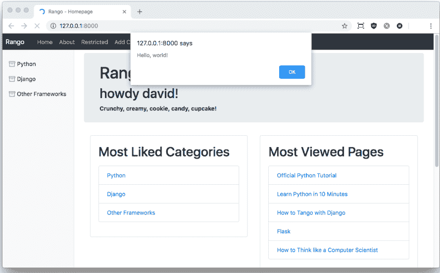
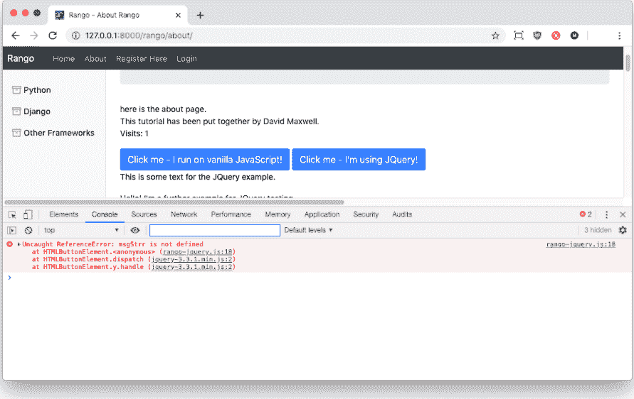
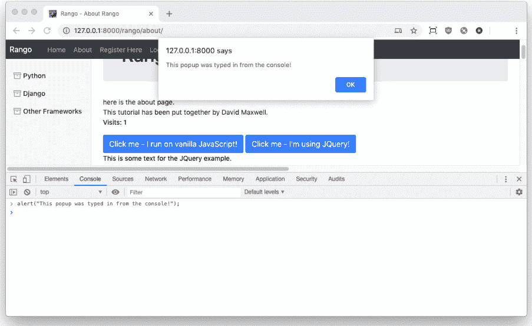
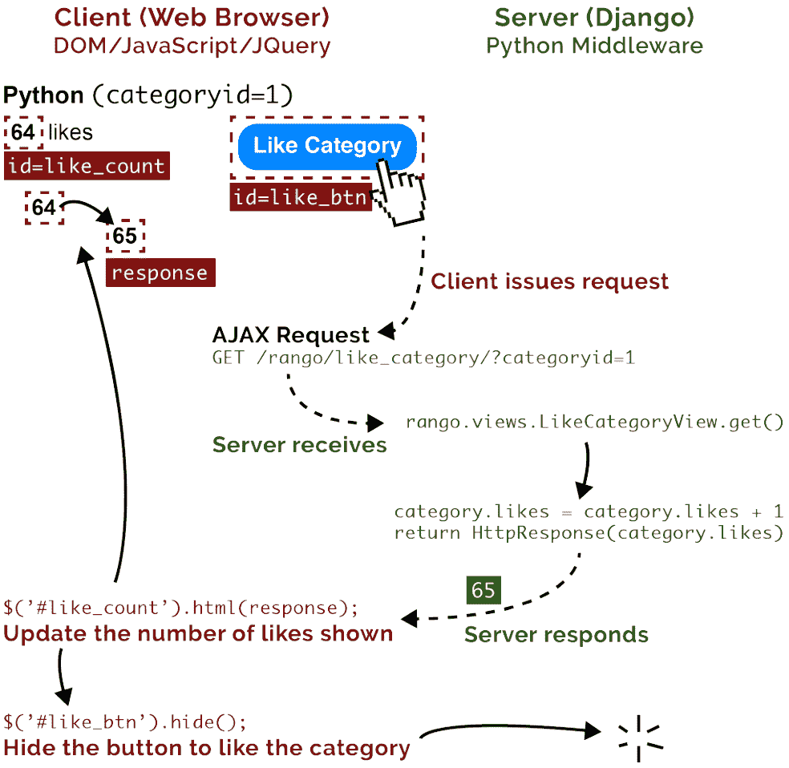
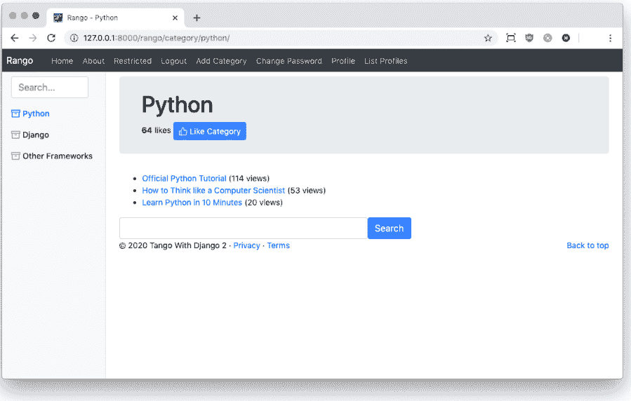
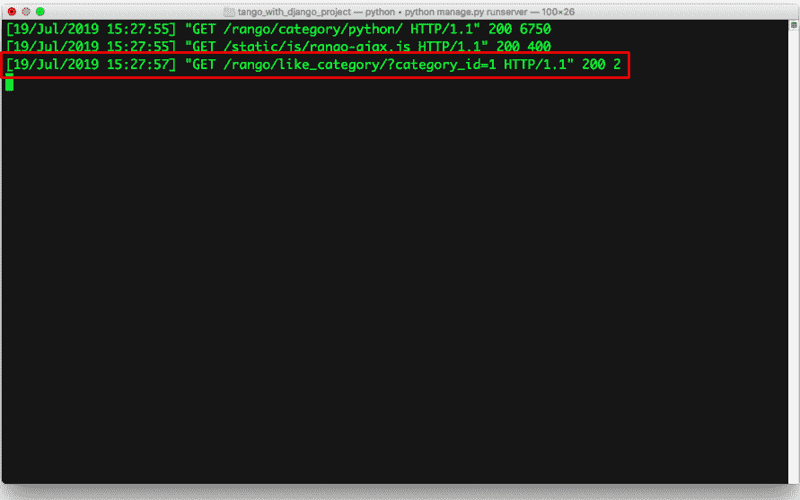
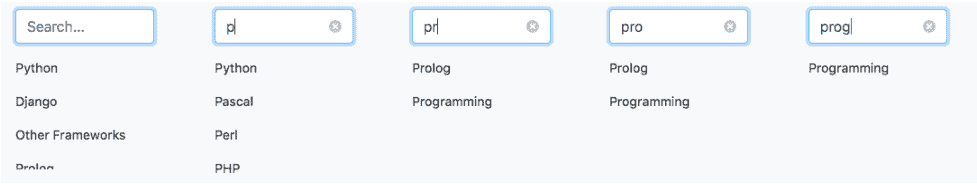
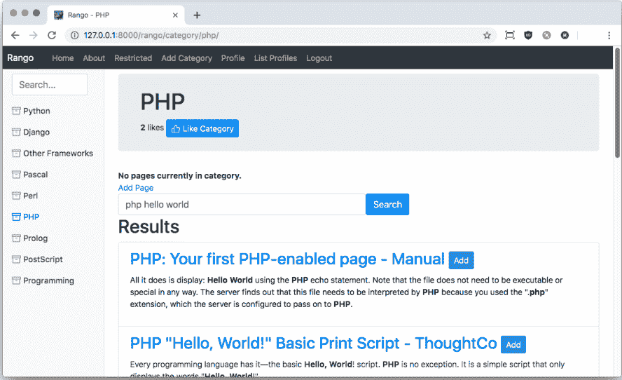
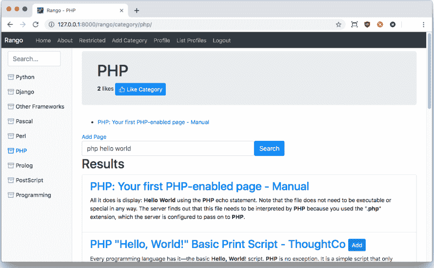

## 16. JQuery 速成课程

到目前为止，本教程主要集中在 *服务器端* 编程上。换句话说，我们花费了大量精力来弄清编写 Python 代码以使 Django 在 *服务器上* 执行操作的机制。我们还编写了 HTML 标记并使用了 Twitter Bootstrap 工具包用于 *客户端*，即你的网络浏览器。

然而，你是否知道客户端可以做更多的事情？你可以使用 JavaScript¹ 在客户端为你的 Web 应用程序添加功能，从改变呈现方式到从服务器获取额外信息 *而无需* 重新加载整个网页。

在本章中，我们将向你介绍 JavaScript 的基础知识，同时使用 JQuery² 框架。JQuery 使编写 JavaScript 代码变得更容易——也更有趣！几行 JQuery 代码可以封装数百行纯 JavaScript。JQuery 还提供了一套主要专注于操作 HTML 元素的 API。我们将介绍：

- 如何在 Rango 中集成 JQuery；
- 如何解释基本的 JQuery 代码；以及
- 提供几个小示例来展示一切是如何工作的。

### 16.1 包含 JQuery

要包含 JQuery 或任何其他 JavaScript 文件，你需要告诉 *客户端* 在哪里找到 JQuery。最终，网络浏览器将是利用 JavaScript 代码为用户提供额外功能的链条的一部分。考虑到 Rango，我们如何做到这一点？我们需要修改你的 *模板*，因为当

这现在指示浏览器在你的 `static/js` 目录中查找 JQuery，而不是直接从 JQuery 服务器获取。一旦你完成了此操作，你还需要在 `js` 目录中创建一个新的空白文件，命名为 `rango-query.js`。我们将添加一些使用 JQuery 为 Rango 应用添加功能的 JavaScript 代码。当然，我们还需要在 `base.html` 模板中添加对这个新文件的引用。在你刚刚调整的那行下方，添加以下内容。

```
```html
<script src="" crossorigin="anonymous"></script>
```
```

确保此新标记 *在* 包含 JQuery 框架的那行 *下方*。作为健全性检查，确保你的静态文件已正确设置，请参阅 Templates and Media Files，并且 `base.html` 顶部有 ``。

### 16.2 测试你的设置

完成上述步骤后，你现在应该准备好尝试了！打开新的 `rango-jquery.js` 文件，并添加以下代码行。

```
```javascript
$(document).ready(function() {
    alert('Hello, world!');
});
```
```

这段小代码使用了 JQuery。但它是如何工作的？我们将其分解为一系列不同的步骤，以向你展示正在发生的事情。

- 1. 我们首先通过 `$(document)` 选择文档对象。 `$()` 是你用来访问 JQuery 框架的快捷方式——所有使用 JQuery 的内容都将以 $ 开头的命令。命令 `$(document)` 告诉 JQuery 框架 *选择* HTML 文档对象³——当网络浏览器将完整的 HTML 页面加载到内存中时，页面变成的对象。此对象封装了整个页面。当我们选择类似的东西时，我们称该机制为 *选择器*。


2. 选中文档后，我们再将一个函数*链式*调用到选择器上。在此例中，我们链式调用了 `ready()` 函数。正如 [JQuery 文档](https://api.jquery.com/ready/) 所述，该函数会在 *DOM/页面完全加载到内存并准备就绪时* 由 JQuery 执行。通常情况下，我们都希望等到页面上的所有内容（包括外部资源）都加载完毕后再执行代码，这样才能确保代码开始执行时所有内容都已就绪。如果不等，代码可能会在预期存在的内容准备好之前就开始执行——从而导致网站异常。

3. 在 `ready()` 内部，我们定义了一个*匿名函数*，它会在 DOM 准备就绪时执行。与 JavaScript 中的其他函数一样，它可以接受参数，并用花括号（如 `{` 和 `}`）包裹。这与 Python 不同，Python 仅依赖缩进来决定执行哪些代码行以及何时执行。而对于 C 风格语言（如 JavaScript 和 Java），则使用花括号来实现这一目的。

4. 在函数内部，我们有一行代码 `alert("Hello, world!");`。注意，每一行/命令的末尾都要加上分号（`;`）。`alert()` 函数接收一个字符串，并在浏览器中以弹出框的形式显示它。在此例中，它将显示字符串 `Hello, world!`。

总而言之，这段代码会显示消息 `Hello, world!`，就像我们在[下面的截图](#)中看到的那样。但关键在于，浏览器会等待所有内容加载完毕，然后才显示消息。我们强烈建议你在单独的标签页中保持打开 [JQuery API 文档](https://api.jquery.com/)，以帮助你更好地理解我们在这里演示的不同概念。

> [^4]: https://api.jquery.com/ready/
> [^5]: https://www.w3.org/TR/WD-DOM/introduction.html
> [^6]: https://api.jquery.com/



**上面我们展示的代码运行结果——页面加载时显示一个弹出小框，内容为 `Hello, world!`。这个弹窗应该在 Rango 的每个页面上都能看到。**

当然，当你亲眼看到它工作正常之后，就应该移除 `alert()` 函数调用——这也许是我们能实现的最简单的演示了。每个页面都弹出这个弹窗是非常烦人的！

## 选择并操作模式

JQuery 要求你以更*函数式*的编程风格来思考，而不是典型 JavaScript 那种更*过程式*的写法。所有 JQuery 命令都遵循一个相似的模式：**选择并操作**——先选择一个元素，然后对该元素执行某种操作。

## 响应鼠标点击

在前面的示例中，我们在页面加载完成、一切准备就绪时执行了 `alert()` 函数调用。这依赖于浏览器内部触发的*事件*——但如果尝试不同的事件呢？在本节中，我们将通过一个更具体的示例来使用用户交互。

这个简单练习的目标是向 Rango 的 `about.html` 模板中添加一个按钮，并向你展示事件如何绑定到页面的不同元素。当用户点击按钮时，会弹出一个提示框。当然，我们需要处理 `about.html` 模板和新的 `rango-jquery.js` 静态 JavaScript 文件。

在 `about.html` 模板中，我们首先使用原生 JavaScript 添加一个按钮来实现我们的目标。这演示了一种将*代码绑定到事件*的非常简单的方式。将代码添加到闭合的 `</div>` 下方，但要在 `body_block` 模板块结束之前。如果你还保留着之前 Rango 和猫的图片，请将此标记放在图片*之前*，以便按钮易于看到。你可能还想添加一个换行符（`<br />`）来将按钮与图片分开。

```html
<button class="btn btn-primary"
        onclick="alert('You clicked the button using inline JavaScript.');">
    Click me - I run on vanilla JavaScript!
</button>
```

添加这段代码后，在浏览器中打开 about 页面。你应该会在图片下方看到一个蓝色按钮。点击它，就会出现一个弹出框，显示消息 'You clicked the button using inline JavaScript.'。此标记的作用是，我们使用了 HTML 元素自带的 `onclick` 属性——并在其中添加了一些简单的 JavaScript 代码。这会将你提供的代码绑定到用户点击 DOM 中该元素（此处即按钮）时触发的事件。当用户点击时，代码就会执行。[HTML 有大量不同的属性](https://www.w3schools.com/tags/ref_eventattributes.asp)⁷，可用于将代码分配到不同的事件。

然而，将代码嵌入模板是否是一个整洁的解决方案？我们认为不是。通过将代码合并到标记中，实际上是在以*内联*方式添加代码。这违反了关注点分离的原则。模板应该只包含呈现方面的内容。代码应放在单独的位置，例如 `rango-jquery.js` 文件中。

为了迈向更优雅的解决方案，请在 `about.html` 模板中添加另一个按钮。

```html
<button class="btn btn-primary" id="about-btn">
    Click me - I'm using JQuery!
</button>
```

这一次，我们有另一个按钮，但没有任何与其关联的代码。相反，我们用唯一标识符（或称 id）替换了 `onclick` 属性，这样我们就能够在外部 JavaScript 文件中引用该按钮。如果我们再把以下代码添加到 `rango-jquery.js` 中，就会开始看到效果了。

```javascript
$(document).ready(function() {

    $('#about-btn').click(function() {
        alert('You clicked the button using JQuery!');
    });

});
```

重新加载页面，然后试一试。希望你会看到，当你点击这两个按钮时，两者都会弹出消息，尽管消息不同。

与我们之前尝试的 JQuery 代码一样，上面的代码示例首先选择 document 对象，并包含一个只在页面加载完成后才会执行的函数（即 `ready()`）。在这个匿名函数内部，我们然后*选择* `about-btn` 元素（通过唯一标识符，根据指示在 ID 前加上 #）。另一个匿名函数绑定到 ID 为 `about-btn` 的元素被*点击*（`click()`）时的事件——该函数内部又调用了 `alert()` 函数，向用户显示一个弹出框。

对于更复杂的函数，这种方法更可取。为什么？因为 JavaScript/JQuery 代码与模板分离，维护在单独的文件中。在这里，我们以编程方式将事件在*运行时*分配给处理程序，而不是在 HTML 标记中*静态*分配。因此，这实现了 JavaScript/JQuery 代码与 HTML 标记之间的关注点分离。

```javascript
$('p').hover(
    function() {
        $(this).css('color', 'red');
    },
    function() {
        $(this).css('color', 'black');
    }
);
```

将此 JavaScript 添加到你的 `rango-jquery.js` 中。然后，在 `about.html` 模板中，你应该在按钮下方添加一个段落——类似 `<p>This is some text for the JQuery example.</p>` 就可以了。看看代码，想一想会发生什么...然后试一试！它是否如你所预期的那样？

在这里，我们选择了所有的 p HTML 元素。我们为这些元素分配了一个 `hover()` 事件。`hover()` 需要两个函数——一个在你*悬停*在某个元素上时执行（第一个函数），另一个在你离开时执行（第二个函数）。这意味着当用户悬停在一个 p 元素上时，元素内的文本颜色将变为红色。当用户的光标离开该元素时，它又变为黑色。有关更多信息，请查看 `hover()` 事件的[文档](https://api.jquery.com/hover/)。

请注意，我们可以使用 `this` 变量来引用*正在被悬停的元素*，并使用 `css()` 函数（属于 JQuery 的一部分）将该元素的颜色属性设置为我们想要的任何值（在第二个参数中指定）。

## 🔑 记住——`ready()`！

请记住，将你的 JQuery 代码放在 `$(document).ready()` 函数调用中是很好的实践。这样做可以确保代码仅在页面完全加载到内存后才会执行，从而降低代码以非常奇怪的方式出错的可能性。

内容下载到客户端计算机需要时间；请确保你的代码有耐心！


### 动手实践

动手试一试你刚刚编写的代码。查看 [jQuery 文档](https://api.jquery.com/category/events/mouse-events/) 看看还能做些什么。另外还有一个小问题：你觉得如果把上面两处 `$(this)` 改成 `$('p')` 会发生什么？先想一想，等你得出答案后，再动手实验，看看你是否想对了！

## 16.3 更多 DOM 操作示例

在上面的例子中，我们使用了 `hover()` 函数为鼠标悬停进入和悬停离开事件分配了事件处理程序。对于每个事件，我们又使用 `css()` 函数来改变被悬停元素的文字颜色。`css()` 函数是 *DOM 操作* 的一个例子——或者说，是对动态加载的页面进行修改。然而，`css()` 并不是操作页面的唯一方式。jQuery 还提供了其他操作页面的方法！

例如，我们可以使用 `removeClass()` 函数从元素中移除一个类，并使用 `addClass()` 函数向元素添加类。

```javascript
$("#about-btn").removeClass('btn-primary').addClass('btn-success');
```

这是一个 *链式调用* 的例子。这段代码选中了 `about-btn` 元素（通过其唯一 ID），并从该元素中移除 `btn-primary` 类，然后添加一个新类 `btn-success`。这样做的效果是让按钮从蓝色变为绿色。为什么？Bootstrap 工具包实现了这些类——`btn-success` 恰好将元素的背景颜色设置为绿色。

我们还可以访问指定元素的 *内部 HTML*——换句话说，就是嵌套在指定元素中的标记。例如，让我们在 Rango 的 `about.html` 模板中，在我们的示例 `<p>` 元素下方放置一个新的 `<div>` 元素。

```html
<div id="msg">Hello! I'm a further example for jQuery testing.</div>
```

添加完这个新元素后，进入 `rango-jquery.js` 文件并添加以下代码。记得一定要把这段代码添加在 `$(document).ready()` 调用 *内部*！

```javascript
$('#about-btn').click(function() {
    msgStr = $('#msg').html();
    msgStr = msgStr + ' ooo, fancy!';

    $('#msg').html(msgStr);
});
```

当匹配 `#about-btn` 选择器的元素（也就是你的第二个按钮）被点击时，我们首先使用 `html()` 函数调用获取 `#msg` 所选元素内部的 HTML 标记。由于这只是一个字符串，我们可以在末尾追加 `' ooo, fancy!'`，然后将 `msg` 元素的 `html()` 设置为存储在 `msgStr` 中的新值。

## 16.4 调试提示

有一件常常让初学者头疼的事情，就是如何弄明白你的 JavaScript 代码哪里出了问题！你很可能遇到了错误，但你的浏览器很擅长把错误隐藏起来！这是有意设计的——难道一个普通用户希望在打开网页时看到一大堆 JavaScript 错误吗？我们很怀疑这一点！

大多数现代浏览器内部都有一系列 *开发者工具*，可以让你查看客户端 JavaScript 代码的运行情况。如何访问这些工具取决于你使用的浏览器。在 Chrome 中，你可以点击选项菜单（三个点），选择 `更多工具`，然后点击 `开发者工具` 来访问开发者工具。

当工具加载后，你可以点击 `控制台` 选项卡，查看 JavaScript 解释器的输出——包括任何错误消息！在下面的 [示例截图](#) 中，你可以看到一个错误阻止了代码运行。简单看一下错误消息，会发现我们在 `msgStr` 变量中多写了一个 r，这为我们找出问题提供了重要线索。



**Google Chrome 中的开发者工具，显示控制台输出。查看控制台输出，找出代码未按预期运行时的错误所在。**

控制台的另一个功能是，你 *也可以输入命令！* 下面的截图展示了这一点——调用了 `alert()` 函数，输出结果显示为一个弹窗。你可以在这个控制台中执行 jQuery 命令、检查数组、哈希映射的内容，或者做任何你需要做的事情。这是调试现代高代码量应用的必备工具。



Google Chrome 中的开发者工具，显示控制台输出。查看控制台输出，找出代码未按预期运行时的错误所在。

### 始终使用开发者工具

在编写客户端 JavaScript 时，始终保持浏览器的开发者工具处于打开状态。当事情不按预期运行时，这会让你更容易查明原因！

本章提供了一个非常基础的 jQuery 使用指南，以及如何将其整合到你的 Web 应用中。从现在开始，你应该能够理解 jQuery 的工作方式，并尝试使用 jQuery 框架提供的各种函数——甚至包括第三方开发者提供的函数。在下一章中，我们将使用 jQuery 为 Rango 提供简单的 AJAX¹ 功能。

> ¹https://en.wikipedia.org/wiki/Ajax_(programming)

某个类别收到的点赞数。我们没有实现让用户增加这个计数的功能！这正是我们本章要做的。具体来说，我们将：

- 添加一个 *点赞按钮*，让注册用户可以对特定类别“点赞”；
- 添加内联类别建议，让用户在输入时可以快速找到特定类别；以及
- 添加一个 *添加按钮*，让注册用户在执行搜索时可以快速轻松地向类别中添加新页面。

所有这些功能都将使用 AJAX 技术来实现，从而使用户体验更加流畅。不过，在我们深入之前，先创建一个名为 `rango-ajax.js` 的新 JavaScript 文件。这个文件将存放我们本章实现功能所需的所有 AJAX 代码。与现有的 JavaScript 文件一样，请在你的项目的 `static/js/` 目录下创建该文件。你还需要在 Rango 的 `base.html` 模板中添加对该文件的引用，放在上一章中我们处理的现有引用下方。提醒一下，这些引用位于模板的底部附近。

### jQuery 前提假设

我们假设你已经完成了上一章关于 jQuery 的内容——并且本次练习使用的是 jQuery 3.3.1 版本。如果 *至少* 你还没有完成该章节的设置步骤，我们强烈建议你现在就去完成。

现在一切都已经设置好并准备就绪，让我们开始工作吧。

## 17.2 添加“点赞”按钮

按点赞数排序类别的功能在之前的一章中已经实现。查看 Rango 的主页，类别是按收到的点赞数（降序）排列的。然而，如果能让 Rango 的注册用户通过 *点赞* 来表达他们对某个类别的喜爱，那就更好了！

为了直观地展示我们想要实现的效果，请看下面的图表。



**我们打算使用 AJAX 和 jQuery 实现的事件序列。** 左侧是客户端事件，由用户点击 Python 类别的“点赞类别”按钮触发。沿着箭头，你可以推算出接下来发生的事件。

仔细研究这张图表，以帮助你理解将要实现的内容。左侧是发生在客户端（浏览器内）的事件，右侧是发生在服务器端（Django 中间件）的事件。一切都从用户点击 `点赞类别` 按钮开始。我们将实现的 jQuery 代码会向服务器发送一个 AJAX GET 请求。Django 中间件接收请求，执行相应的视图，并发送一个简单的响应。在本练习中，响应将只是给定类别的新点赞数——仅此而已。这个响应随后被我们的 jQuery 代码接收，返回的值被放入包含计数的元素中（使用 `.html()` 方法）。最后，我们将“点赞类别”按钮从视图中隐藏！

### 更新类别模板

我们的第一步是为新的 AJAX 功能准备 Rango 的 `category.html` 模板。我们需要添加一个“点赞类别”按钮，并为其赋予唯一 ID `like_btn`，同时添加一个新元素来显示类别收到的点赞数。

为此，请打开 `category.html` 模板，找到显示 `{{ category.name }}` 的 `<h1>` 标签。在 `<h1>` 标签关闭后，换行，并添加以下标记和模板代码。

```html
<div>
    <strong id="like_count">{{ category.likes }}</strong> likes
    
    <button id="like_btn"
            data-categoryid="{{ category.id }}"
            class="btn btn-primary btn-sm"
            type="button">
        <span data-feather="thumbs-up"></span>
        Like Category
    </button>
    
</div>
```

添加完成后，已登录 Rango 的用户应该会看到一个类似于下面所示的页面。这个标记添加了一个 `<div>`，其中包含了所需的所有基础设施——从专门显示给定类别点赞数的 `<strong>` 标签，到一个允许人们增加点赞数的新 `<button>` 元素。请注意，在按钮内部，我们还添加了一个小的竖起大拇指图标（由 `<span>` 元素表示）。这个图标由


由 Feather²（https://feathericons.com/）提供，并作为 Bootstrap 框架的一部分被包含在内。另请注意，`<strong>` 和 `<button>` 元素都包含了 `id` 属性。我们赋予的 `id` 值非常重要，因为我们的 jQuery 代码会用到它们。



更新 `category.html` 模板后的结果。注意“点赞分类”按钮，其旁边有点赞数——所有这些都位于分类标题的正下方。如果你在未登录状态下查看同一页面，该按钮将不可见。

## 创建点赞分类视图

现在，既然已经在 Rango 的 `category.html` 中打下了基础，让我们把注意力转向服务器端，集中实现处理点赞分类请求的视图。回想一下，在我们的概述中，我们提到将使用 GET 请求来点赞分类。这些请求将通过形如 `/rango/like_category/?category_id=1` 的 URL 来服务。根据这两个需求，我们的基于类的视图只需要实现 `get()` 方法，该方法从 GET 对象中提取 `category_id` 查询字符串。

我们的实现如下所示，将位于 Rango 的 `views.py` 模块中。

```python
class LikeCategoryView(View):
    @method_decorator(login_required)
    def get(self, request):
        category_id = request.GET['category_id']

        try:
            category = Category.objects.get(id=int(category_id))
        except Category.DoesNotExist:
            return HttpResponse(-1)
        except ValueError:
            return HttpResponse(-1)

        category.likes = category.likes + 1
        category.save()

        return HttpResponse(category.likes)
```

检查上面的代码，你可以看到我们只允许已登录用户访问此视图——因此使用了 `@method_decorator(login_required)` 装饰器。我们还实现了一些基本的错误处理。如果用户提供的分类 ID 不存在，或者提供的分类 ID 无法转换为整数，则会在响应中返回 -1。否则，给定分类的 likes 属性会增加 1。更新后的值随后会被单独返回。

你应该已经拥有了所有必要的 import 语句——但请再次确认以下内容存在。这个语句在本书开头就使用过——你在前几章清理代码时可能把它删掉了。你现在绝对需要它！

```python
from django.http import HttpResponse
```

当然，如果没有对应的 URL 映射，这个视图将毫无用处。为了满足需求，让我们添加一个映射。将以下内容添加到 Rango 的 `urls.py` 模块的 `urlpatterns` 列表中。

```python
path('like_category/', views.LikeCategoryView.as_view(), name='like_category'),
```

现在，你应该可以进入下一步了——发出 AJAX 请求。

## 发出 AJAX 请求

为了实现 AJAX 功能，请打开位于项目 `static` 目录下的空白 `rango-ajax.js` 文件，并添加以下 JavaScript 代码。

```javascript
$(document).ready(function() {
    $('#like_btn').click(function() {
        var categoryIdVar;
        categoryIdVar = $(this).attr('data-categoryid');

        $.get('/rango/like_category/',
            { 'category_id': categoryIdVar},
            function(data) {
                $('#like_count').html(data);
                $('#like_btn').hide();
            }
        );
    });
});
```

这段 JavaScript/jQuery 代码会在页面加载完成后触发，然后将代码绑定到“点赞分类”按钮（通过唯一标识符 `like_btn` 识别）的事件处理程序上。当用户点击此按钮时，`category_id` 会从按钮的 `data-categoryid` 属性中提取。如果你仔细查看本章前面定义的模板代码，`data-categoryid` 属性是由 Django 模板引擎在服务器端渲染页面时，用分类的唯一 ID 填充的！一旦获得 `category_id`，我们就调用 `$.get()`。

`$.get()` 是一个 jQuery 函数，用于处理 AJAX GET 请求。我们首先指定要访问的 URL（在此实例中是硬编码的，这并不理想！），然后传入一个类似字典的对象作为第二个参数。根据提供的键/值对，会构造出一个查询字符串。这意味着 jQuery 构建的最终请求将类似于 `GET /rango/like_category/?category_id=<category_id_var>`。实际的 ID 值当然会被插入到 URL 末尾的相应位置。

我们提供的最后一个参数是另一个匿名函数，这次它接收一个 `data` 参数。当服务器对请求作出响应时，该函数会被调用，`data` 包含服务器的响应。在我们的例子中，其中将包含该分类的点赞数。



Django 开发服务器的输出，显示了正在进行的 AJAX 请求（以红色突出显示）。该请求显示传递的 `category_id` 被设置为 1——从上面的日志（显示初始分类页面加载）可以看出，该请求是针对 Python 分类的。

## 17.3 添加内联分类建议

在实现了一个简单的 AJAX 示例之后，让我们尝试一些更复杂的东西。假设 Rango 中已经填充了几十个分类。如果用户想查找一个特定的分类，他们目前需要浏览一长串分类。这太烦人了！

要让用户更快地找到他们想要的分类，一种方法是提供一个建议组件。用户可以开始输入他们正在搜索的分类名称，Rango 会返回一个建议分类列表，供用户选择。本质上，此功能将提供一种*过滤*形式，让用户能够缩小可用的选项范围。

当然，我们可以通过 AJAX 实现这一点。每当用户从键盘输入一个字母时，我们就可以向 Django 服务器发送一个请求，要求它返回一个潜在过滤后的分类匹配列表。然后，这个分类列表可以在已加载的页面中渲染。为了确保这一功能在 Rango 应用中都能使用，我们将把它实现在左侧的分类列表部分。

### 工作流程

要实现这一点，我们需要执行以下步骤。

1. 首先，我们需要创建一个带参数的函数 `get_category_list()`。此函数将接受两个参数，即 `max_results`（默认为 0）和 `starts_with`（默认为空字符串 `''`）。该函数将返回一个匹配用户查找条件的分类列表。
   - `max_results` 将限制返回的结果数量。如果指定为 0，则对返回多少分类不设限制。
   - `starts_with` 表示用户到目前为止输入的内容。想象一下，如果用户正在查找 `python`，那么这里可能传入的字符串是 `pyt`——意味着用户已经输入了他们要查找内容的前三个字符。
2. 还需要创建一个进一步的视图。我们将其命名为 `CategorySuggestionView`。这同样将是基于类的视图，并通过 URL 映射 `/rango/suggest/`（名称为 `suggest`）进行访问。该视图将接收用户的建议，并返回用户输入内容的前八条建议列表。
   - 我们假设这是通过 HTTP GET 请求实现的。
   - 我们将检查提供给视图的查询字符串是否为空。如果其中包含内容，我们将调用 `get_category_list()` 来获取所提供字符串的前八个结果。
   - 来自 `get_category_list()` 的结果将在现有模板 `categories.html` 中组合呈现。我们之前就是通过自定义模板标签，用这个模板来显示 Rango 页面左侧的分类列表。


```html
<div class="w-75 ml-3">
    <input type="search"
           id="search-input"
           class="form-control ds-input"
           placeholder="Search..." />
</div>

<div class="sidebar-sticky" id="categories-listing">
    
        
    
</div>
```

我们新的输入元素是 `search` 类型（允许字符串输入），并被分配了一个 `search-input` 的 id。我们还使用了 `Search...` 作为占位提示信息，以告知用户可以使用此框在提供的列表中搜索类别。请注意其中包含的几个 Bootstrap 类，它们有助于样式设置。

稍后我们会回到如何将这些组件与服务器端代码结合起来的问题。

## 填充练习

更新 Rango 的填充脚本。添加以下类别：Pascal、Perl、PHP、Prolog、PostScript 和 Programming。运行填充脚本，将这些新类别添加到你的数据库中。你不需要为每个新类别添加页面，当然如果你愿意也可以添加。如果你不想这样做，只需为 `pages` 的值传入一个空列表（`[]`）。通过添加这些附加类别，稍后体验新的内联类别建议功能时，效果会更令人印象深刻。

## `get_category_list()` 辅助函数

回想一下，这个辅助函数的作用是返回名称与用户提供字符串紧密匹配的类别列表。我们可以使用 Django ORM 中的筛选操作来查找所有名称以给定字符串开头的类别。这个筛选器叫做 `istartswith`，顾名思义，它会筛选出 *以* 给定字符串 *开头* 的类别。它是大小写不敏感的，所以即使数据库中有首字母大写的 Python，而用户开始输入 `pyt`——这仍然会匹配到 Python。

这个函数可以添加到 Rango 的 `views.py` 模块中。如果你愿意，也可以创建一个新模块——比如 `helpers.py`——并将其放在那里。目前我们暂时把它放在 `views.py` 中。但如果你确实选择创建一个新模块，你需要导入所有必需的内容！

```python
def get_category_list(max_results=0, starts_with=''):
    category_list = []

    if starts_with:
        category_list = Category.objects.filter(name__istartswith=starts_with)

    if max_results > 0:
        if len(category_list) > max_results:
            category_list = category_list[:max_results]

    return category_list
```

请注意，这个函数满足我们上面定义的要求：它接受两个参数——`max_results`，允许指定返回多少项；以及 `starts_with`，即用户的输入字符串。注意我们如何使用 `filter` 方法执行 `__istartswith` 筛选，查找与 `starts_with` 匹配的项。如果 `max_results=0`，我们假设返回所有结果；否则，我们使用标准的 Python 列表子索引操作来截断列表。

## CategorySuggestionView 视图

定义好辅助函数后，我们可以创建一个新的基于类的视图来使用它。记住，这里我们只处理 GET 请求——所以，和之前的例子一样，我们的视图只会实现一个 `get()` 方法。该方法也将对所有用户开放，因此无需将其限制为仅登录用户。

## 提示

这只是一个普通的 HTTP GET 请求，就像*你在浏览器中输入网址或点击链接时发出的任何请求*一样。当你将浏览器指向 `http://127.0.0.1:8000/rango/suggest/?suggestion=pro` 时会发生什么？

## 为请求建议添加 AJAX

如果你已经测试了服务器端功能并对其满意，那么现在是时候将 Rango 页面左侧组件与服务器粘合起来。我们将通过向 `static rango-ajax.js` 文件添加更多代码来实现这一点。请注意，你应该 *在* `$(document).ready(function() { ... }` 块 *内* 添加此代码，以确保页面的所有部分在代码执行之前都已加载完成。

```javascript
$('#search-input').keyup(function() {
    var query;
    query = $(this).val();

    $.get('/rango/suggest/',
          {'suggestion': query},
          function(data) {
              $('#categories-listing').html(data);
          }
    );
});
```

当 `search-input` 元素获得焦点时，这段代码会绑定一个按键事件（当用户在键盘或智能手机屏幕上按下某个键时）。换句话说，当用户在搜索框中输入一个字母时，该代码被触发。然后提取输入框的值（`$(this).val()`），并将其传递到 AJAX GET 请求中。我们将用户提供的字符串包装在一个类似字典的对象中，再次帮助构造正确的 URL 和查询字符串。

一旦服务器响应，匿名函数就会被调用，其中 `data` 包含响应内容——即与用户查询匹配的类别列表。然后，这个列表会被简单地放置在我们之前更新的 `categories-listing` `<div>` 元素内——替换掉 `<div>` 中的任何现有内容。查看下面的截图，看看新功能的实际效果。



内联类别建议的示例。注意，当用户键入每个字符时，建议是如何填充和变化的。

## 17.4 进一步的 AJAX 实践

我们已经看了两个如何将 AJAX 集成到 Rango 应用中的示例，为什么不尝试再多一个呢？这一次，*把它当作一个练习*。我们将为你列出规格说明，并提供有助于你找到解决方案的代码片段。然而，我们恳请你自行解决。如果需要帮助，试着上网搜索解决方案。弄清楚要在搜索引擎中输入什么查询，有时是获得所需帮助的一半关键。

## 规格说明

我们之前添加了几个新类别来测试类别建议功能。如果你没有为这些类别添加页面，它们就会是空白的。随着 Bing 搜索功能集成到类别页面中，我们尚未涉及的一个缺失环节是让用户能够*从搜索结果中添加页面*。

也就是说，当注册用户发起查询并获取结果时，我们能否在搜索结果旁边提供一个“添加”按钮，让用户将此页面添加到他们正在查看的类别中？此外，能否通过使用 AJAX 来实现这一点？

下面是一个粗略的工作流程，帮助你找到解决这个问题的方法。

1. 首先，更新 Rango 的 `category.html` 模板。
   - 在每个搜索结果旁边添加一个小按钮。在 `<button>` 元素中，你需要添加 `data` 属性，提供页面标题和页面 URL。这样做会让 jQuery 更容易提取这些信息。
   - 在页面列表的位置，你需要用带有唯一 ID 的 `<div>` 包裹那一块标记和模板代码。同样，这是为了让 jQuery 能够轻松选择该元素并更新其中的内容。
   - 移除指向现有“添加页面”视图的链接——现在它基本上多余了。
2. 模板修改完成后，你需要创建一个新视图来处理新页面的添加。
   - 该视图将接受一个 GET 请求，其中包含新页面的标题和 URL，以及页面所属类别的 `category_id`。然后，此视图应将新页面添加到给定类别中。
   - 将新视图映射到 URL – `/rango/search_add_page/`。
   - 新视图应返回该类别的更新页面列表。这可能涉及添加一个新模板来生成此列表。
3. 将新视图与更新后的 `category.html` 基础结构粘合起来。当“添加”按钮被点击时，应执行 jQuery 代码，向你的新视图发出 AJAX GET 请求。然后，新视图返回的数据应放置在你的 `<div>` 容器中，用于显示页面列表。

## 🔑 为“添加”按钮使用类！

到目前为止，我们一直在 jQuery 中使用唯一的 id 来选择按钮。这是因为到目前为止，页面上只存在一个这样的按钮。

然而，为 Bing 搜索 API 返回的*每个页面*都提供一个“添加”按钮会带来一个问题。如何让 jQuery 能够将代码绑定到所有这些按钮？使用类选择器（`.`）而不是 ID 选择器（`#`）！你可以创建一个新类，将其应用到每个按钮，然后使用该类在 jQuery 中选择元素。

## 代码片段

我们提供了几个代码片段来帮助你完成这个练习。下面显示了我们的示例标记和模板代码，它提供了一个用于从搜索结果中添加新页面的 `<button>`。


```html
<button class="btn btn-info btn-sm rango-page-add"
        type="button"
        data-categoryid="{{ category.id }}"
        data-title="{{ result.title }}"
        data-url="{{ result.link }}">
    Add
</button>
```

注意以 `data-` 开头的三个属性，它们提供了要添加页面的类别 ID，以及我们要添加页面的 `title` 和 `url` 值。你还应该注意到我们分配给按钮的额外类名——`rango-page-add`——这将帮助我们编写 jQuery 代码，用于在按钮被点击时选择和绑定代码。

请记得通过在其周围包裹一个 `<div>` 元素来更新你的页面列表组件。对于下面的示例，我们假设你给这个 `<div>` 一个 id 为 `page-listing`。

鉴于我们为上面每个页面添加的按钮，我们还需要一些 jQuery 代码来请求添加新页面，并处理从初始请求返回的、更新后的页面列表。下面是一个模型解决方案。

```javascript
$('.rango-page-add').click(function() {
    var categoryid = $(this).attr('data-categoryid');
    var title = $(this).attr('data-title');
    var url = $(this).attr('data-url');
    var clickedButton = $(this);

    $.get('/rango/search_add_page/',
          {'category_id': categoryid, 'title': title, 'url': url},
          function(data) {
              $('#page-listing').html(data);
              clickedButton.hide();
          }
    );
});
```

到现在为止，这段代码应当相对不言自明，而且你也应该知道要将此代码放在 `$(document).ready` 块中！我们从被点击按钮的属性（例如 `title`、`url`、`categoryid`）中提取所需信息，然后发起一个 AJAX GET 请求。我们将所需信息传递到 URL `/rango/search_add_page/`。

在给定适当的 URL 映射（我们将留给你去实现）之后，我们将控制权交给新的视图。在这个示例解决方案中，我们调用视图 `SearchAddPageView`。它实现了所需的单个 `get()` 方法。

```python
class SearchAddPageView(View):
    @method_decorator(login_required)
    def get(self, request):
        category_id = request.GET['category_id']
        title = request.GET['title']
        url = request.GET['url']

        try:
            category = Category.objects.get(id=int(category_id))
        except Category.DoesNotExist:
            return HttpResponse('Error - category not found.')
        except ValueError:
            return HttpResponse('Error - bad category ID.')

        p = Page.objects.get_or_create(category=category,
                                       title=title,
                                       url=url)

        pages = Page.objects.filter(category=category).order_by('-views')
        return render(request, 'rango/page_listing.html', {'pages': pages})
```

这个基于类的示例视图符合所有要求——它只允许那些已登录的人添加页面，并且它期望来自客户端的输入，其键名与我们之前实现的 jQuery AJAX 调用一致。虽然错误处理非常简单（看看 `except` 块），但它至少能捕获基本的错误情况。通过了所有这些之后，代码会创建（如果已存在则获取）一个包含传递信息的页面，获取与该类别关联的所有页面列表，并使用新的 `page_listing.html` 模板调用 `render()`。

在这个新的 `rango/page_listing.html` 模板中，我们只需复制并粘贴 Rango 的 `category.html` 模板中处理页面列表的标记和模板代码。

```django

<ul>
    
    <li>
        <a href="?page_id={{ page.id }}">{{ page.title }}</a>
        
            ({{ page.views }} views)
        
            ({{ page.views }} view)
        
    </li>
    
</ul>

<strong>No pages currently in category.</strong>

```

这与现有模板*完全相同*。不要剪切它——你需要原始的标记和模板代码来进行首次渲染，当类别视图页面第一次被请求时！

一旦你添加了 URL 映射，你就应该能看到一切正常工作。在你选择的类别中发起一个查询，然后点击其中一个搜索结果旁边的 Add 按钮。按钮应该消失，类别视图顶部的页面列表应该更新，以包含你添加的页面。看看下面的两张截图——[第一张截图](#)展示了 PHP 类别，没有任何页面。我们输入了搜索词 `php hello world`，并想把第一个结果添加到 PHP 类别中。点击结果旁边的 Add 按钮会触发 jQuery 代码，向服务器发出 AJAX GET 请求，服务器添加页面并返回该类别的页面列表——在本例中只有一个！然后页面会使用这个新列表进行更新，Add 按钮被隐藏——如[第二张截图](#)所示。



类别页面，显示 PHP 类别且未添加任何页面。我们向搜索功能发出了查询 php hello world，并希望将第一个结果添加到该类别。



**更新后的 PHP 类别页面，AJAX 功能已添加第一个结果。注意现在有一个页面列表（虽然只有一项），并且 Add 按钮已经消失。**

实现了这个功能后，你就快大功告成了！期待着你能够将项目在线部署，让全世界的人都能看到你的成果！

### 完全卡住了？

我们已经在我们模型解决方案的 Git 仓库中实现了本书中的所有内容。本次练习有一个提交，你可以[在此](https://github.com/maxwelld90/tango_with_django_2_code/tree/073f876e461333b6f03100499758bc59260e574d)查看。然而，我们再次恳请你**不要**使用此资源，除非你绝对、确实不确定该怎么做。

- 2. 测试应有*明确的目的*。
- 3. 测试应与*你现有的代码库独立*。
- 4. 在编写代码之前运行测试。确保在你开始之前一切都能运行。
- 5. 在编写代码之后、提交和推送之前运行测试。确保你没有破坏任何东西。
  - 为什么不写一个钩子，让你每次提交时执行测试？
- 6. 你给测试起的名字越长、越具有描述性，越好。
