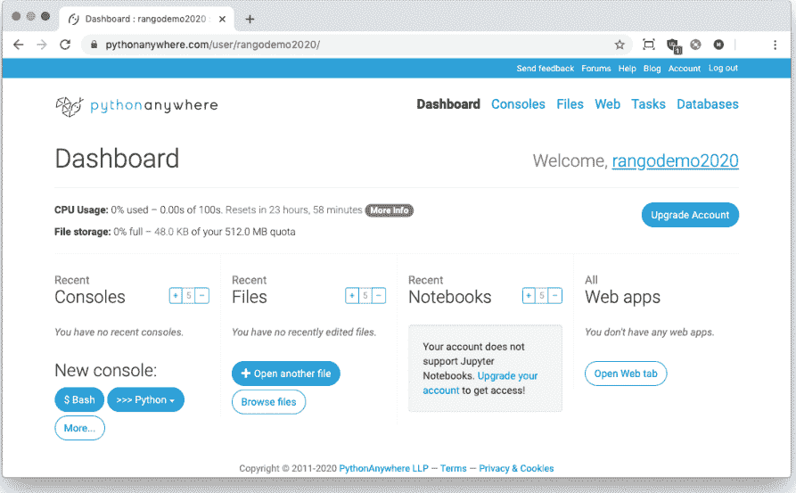
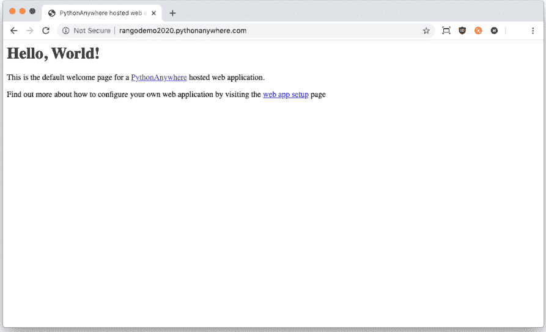
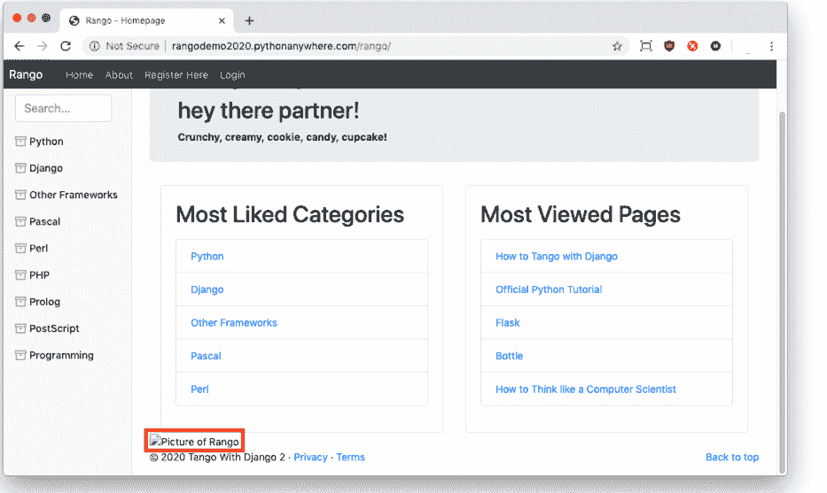

## 19. 部署你的项目

本章提供关于如何在 PythonAnywhere¹ 上部署你的 Django 应用的分步指南。PythonAnywhere 是一个在线 IDE 和 Web 托管服务，专为托管 Python 应用而设计。该服务允许你通过浏览器访问服务器端的 Python 和 Bash 命令行接口，这意味着你可以像操作自己电脑上的常规终端实例一样与 PythonAnywhere 的服务器进行交互。目前，PythonAnywhere 提供免费的入门级账户，非常适合上手。它为你提供足够的存储空间和 CPU 时间，让单个 Django 项目能够启动并运行起来。

> **你在使用 Git 吗？**
>
> 你可以独立完成本章，因为我们已经实现了 Rango——我们的实现可在 GitHub² 上获取。如果你之前没有使用过 Git/GitHub，可以查看我们关于使用 Git 的章节。

### 19.1 创建 PythonAnywhere 账户

首先，注册一个 PythonAnywhere 入门级账户³。我们建议你体验七步导览，以熟悉 PythonAnywhere 的界面。如果你的应用取得成功并开始流行，你随时可以在日后升级账户，以获得更多存储空间和 CPU 时间，以及多项其他好处，例如托管特定域名和 SSH⁴ 登录等。

一旦你创建了账户并确认了电子邮件，你就在万维网上拥有了一小块天地：`http://<username>.pythonanywhere.com`，其中 `<username>` 是你的 PythonAnywhere 用户名。你托管的应用将通过该 URL 进行访问。

> **你的用户名**
>
> 你的用户名会与我们用于演示 PythonAnywhere 功能的用户名不同。我们选择了 `rangodemo2020`，你会在本章的截图和代码片段中看到它。必要时，只需将 `rangodemo2020` 替换为你的用户名即可。

### 19.2 PythonAnywhere Web 界面

PythonAnywhere Web 界面包含一个 *仪表板*（dashboard），它提供了一系列不同的组件，让你能够管理自己的应用。如下图所示，这些组件包括：

- *控制台*（Consoles），允许你创建并操作 Python 和 Bash 控制台实例；
- *文件*（Files），允许你在磁盘配额内上传和组织文件；
- *Web 应用*（Web apps），允许你配置托管 Web 应用的设置。

还存在着其他组件，例如 *笔记本*（Notebooks），但我们在这里不会使用它们——我们主要使用 *控制台* 和 *Web 应用* 组件。[PythonAnywhere Wiki](https://www.pythonanywhere.com/wiki/) 提供了关于如何使用其他组件的详细说明，如果你有兴趣进一步了解，可以前往查看。



*PythonAnywhere 仪表板，展示了你可以使用的主要组件。这里我们以 rangodemo2020 登录。你可以看到 Consoles、Files、Notebooks（我们这里不使用）以及 web apps（或 web apps 设置）的链接。*

### 19.3 创建虚拟环境

作为其标准默认 Bash 环境的一部分，PythonAnywhere 自带 Python 2.7+ 和几个预装的 Python 包（包括 *Django*）。由于我们使用的是不同的环境配置，因此需要通过创建虚拟环境来手动设置 Python 3 版本。

首先，在 New console 标题下方点击 `$ Bash`，打开一个 Bash 控制台。如果你运行 `python --version`，你会看到 Python 是 2.7+。要设置我们的 Python 3.7+ 环境，需要执行以下命令。

```text
$ mkvirtualenv -p python3.7 rangoenv
Running virtualenv with interpreter /usr/bin/python3.7
Using base prefix '/usr'
New python executable in /home/rangodemo2020/.virtualenvs/rangoenv/bin/python3.7
Also creating executable in /home/rangodemo2020/.virtualenvs/rangoenv/bin/python
Installing setuptools, pip, wheel...done.
virtualenvwrapper.user_scripts creating
    /home/rangodemo2020/.virtualenvs/rangoenv/bin/predeactivate
virtualenvwrapper.user_scripts creating
    /home/rangodemo2020/.virtualenvs/rangoenv/bin/postdeactivate
virtualenvwrapper.user_scripts creating
    /home/rangodemo2020/.virtualenvs/rangoenv/bin/preactivate
virtualenvwrapper.user_scripts creating
    /home/rangodemo2020/.virtualenvs/rangoenv/bin/postactivate
virtualenvwrapper.user_scripts creating
    /home/rangodemo2020/.virtualenvs/rangoenv/bin/get_env_details
```

上面我们使用了 Python 3.7，但你可以检查自己正在使用的 Python 版本，并使用该版本。请记住，`rangodemo2020` 将被替换为你的用户名。创建虚拟环境的过程需要一些时间才能完成（因为你使用的是与他人共享的主机）。环境创建完成后，你会看到一个略有不同的提示符。令人兴奋吧！

```text
(rangoenv) ~ $
```

注意与之前的提示符相比，现在多了 `(rangoenv)`。这表示 `rangoenv` 虚拟环境已被激活，因此所有包的安装都将在该虚拟环境中进行，而不会影响更广泛的系统环境。如果你执行命令 `ls -la`，你会看到一个名为 `.virtualenvs` 的目录已被创建。这个目录用于存放你所有的虚拟环境及关联的包。为了确认设置，执行命令 `which pip`。这会打印当前激活的 pip 可执行文件所在的位置——希望是在 `.virtualenvs` 和 `rangoenv` 内，如下例所示。

```text
/home/rangodemo2020/.virtualenvs/rangoenv/bin/pip
```

要查看已安装的包，请输入 `pip list`。现在我们可以通过为 Rango 应用安装所需的包来定制虚拟环境。执行以下命令来安装所有必需的包。

```bash
$ pip install django==2.1.5
$ pip install pillow==5.4.1
$ pip install django-registration-redux==2.2
$ pip install requests
$ pip install coverage
```

如果你决定使用可选的 Bcrypt 密码哈希器，还需要安装 Bcrypt 库。

```bash
$ pip install bcrypt
```

**请确保将上面指定的 Django 版本替换为你开发时使用的版本。** 这里我们使用的是 2.1.5 版本。请记住，本书支持 2.0 到 2.2 的一系列版本。如果不使用与开发机器相同的版本，可能会导致一些奇怪的错误，至少会让人非常沮丧。为了确保你拥有相同的设置，我们建议在本地开发机器上使用 `pip freeze > requirements.txt`。这会记录下你当前开发环境中的所有包。然后在 PythonAnywhere 上，你可以运行 `pip install -r requirements.txt` 一次性安装所有包。


> **使用 `requirements.txt`？**
>
> 如果你在计算机上使用 `pip freeze` 创建了包含所有包的 `requirements.txt` 文件，那么该文件应该已经添加到你的 Git 仓库中。
>
> 在这种情况下，请先跳到克隆仓库的部分，然后再回到这里。当你克隆仓库后，就可以访问你的 requirements 文件，这意味着你可以使用命令 `pip install -r requirements.txt` 在 PythonAnywhere 的 `rangoenv` 虚拟环境中安装所有包。

> **等待下载...**
>
> 由于你使用的是共享主机，下载和安装这些包所需的时间将比在你自己电脑上长得多。如果你觉得它好像崩溃了，别担心——给它一点时间！

安装完成后，检查 Django 是否已正确安装。你可以使用命令 `which django-admin.py` 进行检查。你应该会看到类似下面的输出。

```text
/home/rangodemo2020/.virtualenvs/rangoenv/bin/django-admin.py
```

> **PythonAnywhere 上的虚拟环境**
>
> PythonAnywhere 还提供了如何设置虚拟环境的说明。[查看他们的 Wiki 文档了解更多信息](https://help.pythonanywhere.com/pages/VirtualEnvForNewerDjango)。

> **虚拟环境切换**
>
> 在虚拟环境之间切换非常容易。PythonAnywhere 应该已经为你考虑到了这一点。下面我们提供一个关于如何在虚拟环境之间切换的快速教程。
>
> 你可以使用 `workon` 命令进入一个已有的虚拟环境。例如，使用以下命令加载 `rangoenv` 环境。
>
> ```shell
> ~ $ workon rangoenv
> ```
>
> 在这里，`rangoenv` 可以替换为你想要使用的虚拟环境的名称。之后，你的提示符应该会发生变化，以表示你正在虚拟环境中工作。这体现为提示符中增加了 `(rangoenv)`。
>
> ```shell
> (rangoenv) ~ $
> ```
>
> 然后，你可以使用 `deactivate` 命令退出虚拟环境。之后，你的提示符应该不再包含 `(rangoenv)` 前缀，如下例所示。这确认了环境已成功停用。


```shell
(rangoenv) ~ $ deactivate
~ $
```

## 克隆你的 Git 仓库

现在，你的 Rango 虚拟环境已经全部设置好了，你可以克隆 Git 仓库来获取项目文件的副本。在 PythonAnywhere 上，从你的主目录发出以下命令来克隆仓库。

```shell
$ git clone https://github.com/<OWNER>/<REPO_NAME>
```

当然，你需要将 `<OWNER>` 替换为仓库所有者的用户名，将 `<REPO_NAME>` 替换为项目仓库的名称。例如，一个由 `djangolearner` 托管的仓库 `tango_with_django_project` 对应的命令如下。

```shell
$ git clone https://github.com/djangolearner/tango_with_django_project
```

你会看到以下输出，表明仓库克隆成功。

```text
$ git clone https://github.com/djangolearner/tango_with_django_project/
Cloning into 'tango_with_django_project'...
remote: Enumerating objects: 335, done.
remote: Counting objects: 100% (335/335), done.
remote: Compressing objects: 100% (239/239), done.
remote: Total 335 (delta 203), reused 213 (delta 81), pack-reused 0
Receiving objects: 100% (335/335), 1.11 MiB | 484.00 KiB/s, done.
Resolving deltas: 100% (203/203), done.
Checking connectivity... done.
Checking out files: 100% (54/54), done.
```

## 设置数据库

克隆仓库后，你需要准备数据库。如果仓库中已经提交了数据库，请删除该副本。我们将从头开始。

我们还会使用本书前面创建的 `populate_rango.py` 模块，用示例数据填充数据库。由于我们要运行该模块，你必须确保正在使用 rangoenv 虚拟环境（即提示符中能看到 `(rangoenv)`——如果没有，请执行 `workon rangoenv`）。

从你的主目录（提示符中的 `~` 表示）开始，导航到包含 `manage.py` 和 `populate_rango.py` 脚本的目录。按照我们之前提供的说明，这个目录是 `~/tango_with_django_project/`——也就是你刚刚克隆的目录。如果你选择了不同的结构，请导航到这些文件存储的位置。


### 如何导航？

在 Bash 终端中，你可以使用 `cd` 命令来切换目录，后面跟上你想切换到的路径。在这个例子中，你应该发出命令 `cd ~/tango_with_django_project/`。

请注意，当你切换目录时，提示符会随之改变，以反映你的*当前工作目录*。例如，`~ $` 会变成 `~/tango_with_django_project $`。

切换目录后，发出以下命令。这些命令现在对你来说应该已经是家常便饭了！

```bash
$ python manage.py makemigrations rango
$ python manage.py migrate
$ python populate_rango.py
$ python manage.py createsuperuser
```

你应该完全清楚这些命令各自的作用。当然，最后一条命令需要你进行一些交互操作，为你的 Django 项目创建管理员账户。

## 19.4 设置你的 Web 应用程序

现在数据库已经设置好了，我们需要配置 PythonAnywhere 的 *NGINX* Web 服务器来提供你的应用程序。为此，请返回 PythonAnywhere 仪表盘，找到 *Web 应用* 部分，点击 *打开 Web 标签页* 按钮。在出现的页面左侧，点击 *添加新的 Web 应用*。

随后会弹出一个对话框。按照屏幕上的说明操作，当需要时，选择 *手动配置* 选项并完成向导。确保你选择的 Python 版本与之前选择的相同。点击 *下一步*，PythonAnywhere 将设置你的 Web 应用，并将你重定向到更新后的 *Web 应用* 页面，页面带有一个绿色的重新加载应用按钮。

在 Web 浏览器的新标签页或新窗口中，访问你的 PythonAnywhere 子域名地址 `http://<username>.pythonanywhere.com`。你应该会看到默认的 *Hello, World!* 网页，如下所示。这是因为当前的 WSGI 脚本正在提供这个简单页面，而不是你的 Django 应用程序。这是接下来我们需要处理的事情——更新 WSGI，让它提供你的 Django 应用！



默认的 PythonAnywhere 你好世界网页。

WSGI 脚本是服务器与应用之间的链接，它将发送到你的子域名的传入请求映射到你的 Web 应用程序。

要配置 WSGI 脚本，请导航到 PythonAnywhere 界面中的 *Web* 标签页。在 *代码* 标题下，你可以看到代码部分中指向 WSGI 配置文件的链接：例如 `/var/www/rangodemo2020_pythonanywhere_com_wsgi.py`。当然，`rangodemo2020` 部分将替换为你的用户名。

PythonAnywhere 的人员为我们设置了一个示例 WSGI 文件，其中包含几种可能的配置。对于你的 Web 应用程序，你需要通过点击链接打开一个简单的编辑器，来配置文件的 Django 部分。下面的例子可以作为你的应用程序的 WSGI 配置。

```python
import os
import sys

# Add your project’s directory to the PYTHONPATH
path = '/home/rangodemo2020/tango_with_django_project/'
if path not in sys.path:
    sys.path.append(path)

# Move to the project directory
os.chdir(path)

# Tell Django where the settings.py module is located
os.environ.setdefault('DJANGO_SETTINGS_MODULE',
                      'tango_with_django_project.settings')

# Set up Django -- let it instantiate everything!
import django
django.setup()

# Import the Django WSGI to handle requests
import django.core.handlers.wsgi
application = django.core.handlers.wsgi.WSGIHandler()
```

再次强调，请确保将 `rangodemo2020` 替换为你的 PythonAnywhere 用户名，并根据你的应用程序调整其他路径设置。`path` 变量应包含包含你的 `manage.py` 脚本的目录的绝对路径。你还应该从 WSGI 配置脚本中删除所有其他代码，确保不会发生冲突，只留下我们在上面提供的代码。

```python
ALLOWED_HOSTS = ['rangodemo2020.pythonanywhere.com']
```

如果你在计算机上编辑了文件，现在可以执行（希望你已经熟悉的）`git add settings.py`、`git commit` 和 `git push` 命令流程，将更改提交到你的 Git 仓库。完成后，你应该通过控制台在你的 PythonAnywhere 账户上运行 `git pull` 命令来获取更改。如果你直接在 PythonAnywhere 上编辑了文件，只需保存文件即可。


### 无比怀念 `127.0.0.1`

在调试时，你可能还想将主机 `127.0.0.1` 添加到你的 `ALLOWED_HOSTS` 列表中，这样你就可以继续在本地开发你的应用。当然，这应该在生产环境中删除。

接下来剩下的事情就是重新加载你的 PythonAnywhere 应用。这可以通过点击 PythonAnywhere *Web* 页面上的 *重新加载* 按钮来完成。完成此操作后，访问你的应用 URL，你应该能看到[你的应用可以运行，但没有静态媒体](#)。我们稍后会解决这个问题。



Rango 的索引页面，几乎成功部署。静态文件没有生效，红框标出。Rango 的图片没有显示！

### 网关错误

在部署过程中，有时你可能会收到 `HTTP 502 - Bad Gateway` 错误，而不是看到你的应用程序。尝试再次重新加载你的应用，然后多等一会儿。如果问题仍然存在，请再试一次重新加载。如果问题持续存在，请在联系 PythonAnywhere 支持之前，检查你的日志文件，看看是否有任何错误发生。

### 设置密钥

明智的做法是不要将你的密钥提交到 Git 仓库中——而是从一个单独的、未提交的文件中加载密钥。为此，请打开项目的 `settings.py` 文件，要么更改你在生产环境中使用的密钥（这是一种粗糙的解决方案），要么从一个文件中加载它，如下面的例子所示。


path 应该看起来像 `/home/rangodemo2020/tango_with_django_project/static`。本质上，你应该将此路径指向项目中 static 目录的位置。对于我们的示例，此路径有效 – rangodemo2020 是我们的 PythonAnywhere 用户名，而 tango_with_django_project 是我们克隆 Git 仓库所在的目录。

完成后，你的应用将能够访问其样式表、图像和 JavaScript 文件。Django 管理界面同样适用。不要忘记在应用了这些路径后 *Reload* 你的应用！

### Enabling HTTPS

PythonAnywhere 还为启用 [HTTPS](https://en.wikipedia.org/wiki/HTTPS) 功能提供了非常直接的支持，在客户端和服务器之间增加了一层加密。PythonAnywhere 可以为你提供安全证书，证明你的应用是真实的。操作超级简单，绝对值得做！

要启用 HTTPS，请进入 PythonAnywhere 界面的 *Web* 选项卡，并查找 *Security* 部分。找到 *Force HTTPS* 的开关，并打开此功能。完成后，滚动到页面顶部并再次 *Reload* 你的应用。如果你随后导航到你的应用 URL，你应该会注意到你被重定向到 `https://rangodemo2020.pythonanywhere.com`（当然，用你的用户名替换 rangodemo2020！）——表示你正在使用 HTTPS 使用你的应用。

¹² https://en.wikipedia.org/wiki/HTTPS
