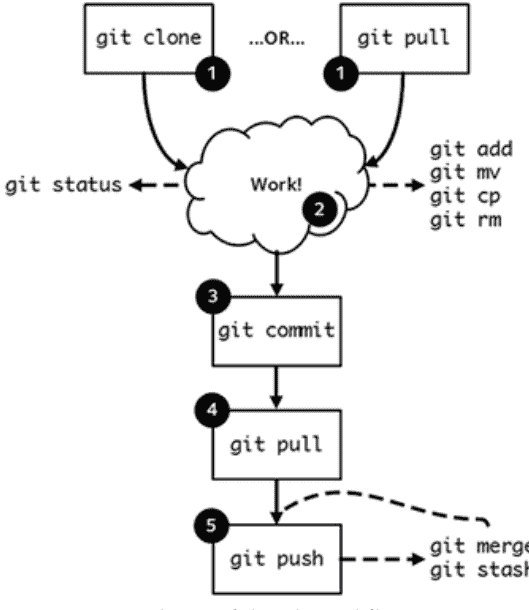

## Appendices

### Setting up your System

本补充章节提供了补充 [initial setup chapter](#) 的额外设置指南。我们提供了安装和配置你在 Tango with Django 教程中将使用的各种技术的设置指南。参考与你相关的部分；如果你已经一切正常，则无需通读本章的全部内容。


#### Common Guides

本章提供了有关如何设置你在整个 Tango with Django 中将使用的各种技术的说明，我们 *认为* 这些技术在最大数量的系统上都能正常工作。然而，每台计算机的设置都不同。存在不同版本的软件，其中包含细微差异。这些差异使得提供通用设置指南变得非常困难。

如果你将本书作为课程的一部分使用，你可能会获得针对你的实验室计算机的独特设置说明。请遵循这些说明——大部分设置工作可能已经为你完成。

然而，如果你独自在自己的计算机上工作，并且按照本章提供的说明操作未成功，我们建议你前往你喜欢的搜索引擎并输入你遇到的问题。通常，这涉及复制并粘贴你在遇到困难的步骤中看到的错误消息。通过逐字粘贴消息，很可能你会找到有人遇到与你相同的问题——从那时起，你希望能找到解决问题的方案。

#### Installing Python 3 and pip

如何在你的计算机上安装 Python 3.7？本节回答了这个问题。正如我们 [之前讨论的](#)，你可能会发现你已经


确保你的计算机上安装了 Python。如果你使用的是 Linux 发行版或 macOS，那么系统已经自带了 Python。你的操作系统的某些功能是用 Python⁴⁷ 实现的，因此需要解释器！遗憾的是，大多数预装 Python 的现代操作系统，其版本都比我们所需的版本旧得多。但也有一些例外，比如 Ubuntu 自带 3.6.5 版本，应该足以满足你的需求。如果你确实需要安装 3.7，那么必须将此版本的 Python 与旧版本*并排*安装。

安装 Python 的方法有很多种。我们将在这里演示最常用的方法，适用于 Apple 的 macOS、各种 Linux 发行版和 Windows 10。请选择与你的操作系统对应的部分继续阅读。请注意，我们倾向于在适当的情况下使用包管理器⁴⁸，以确保你能够轻松地维护和更新软件（在需要时）。

## Apple macOS

在 macOS 上获取 Python 3 的最简单方法是从 Python 官方网站⁴⁹ 下载 .dmg 镜像文件。它会为你提供分步安装界面，使一切设置变得非常简单。如果你的开发环境会保持轻量化（即只使用 Python），那么这个选项就很合理。只需下载安装程序，Python 3 就应该可以在你的 Mac 终端中使用了！

然而，当开发升级并涉及更多软件工具时，包管理器会让事情变得更容易⁵⁰。安装包管理器可以轻松维护和更新计算机上的软件，甚至还可以安装新软件。macOS 没有预装包管理器，因此你需要自行下载并安装一个。如果你想走这条路，我们将向你介绍 *MacPorts*，一个出色的包管理器，提供了大量工具⁵¹ 供你下载和使用。我们建议你遵循这条路线。虽然更复杂，但最终结果将是一个完整的开发环境，让你准备好编写代码并处理任何交给你的项目（或未来的你！）。

⁴⁷ http://en.wikipedia.org/wiki/Yellowdog_Updater,_Modified
⁴⁸ https://en.wikipedia.org/wiki/Package_manager
⁴⁹ https://www.python.org/downloads/mac-osx/
⁵⁰ https://softwareengineering.stackexchange.com/questions/372444/why-prefer-a-package-manager-over-a-library-folder
⁵¹ https://www.macports.org/ports.php

使用 MacPorts 的前提是已安装 Apple 的 *Xcode* 环境。该下载大小为数 GB。获取它的最简单方法是通过你 macOS 上的 App Store。你需要使用 Apple 账户下载该软件。安装 Xcode 后，请按照以下步骤设置 MacPorts。

1. 启动 Xcode 以确认其已安装。你应该会看到一个欢迎屏幕。如果看到，说明一切就绪，然后可以退出应用。
2. 打开“终端”窗口。输入以下命令安装 Xcode 命令行工具：

   ```bash
   $ xcode-select --install
   ```

   这将下载 Xcode 和你稍后安装的其他开发软件所需的附加软件工具。

3. 如果你尚未同意 Xcode 许可，请同意。你可以通过输入以下命令来执行此操作：

   ```bash
   $ sudo xcodebuild -license
   ```

   从头到尾阅读条款，然后输入 Y 完成——但前提是你同意这些条款！

4. 从 [MacPorts 安装页面](https://www.macports.org/install.php) 下载适用于你的 macOS 版本的 MacPorts 安装程序。
5. 在 Mac 的“访达”中，打开你下载安装程序的目录，然后双击该文件以启动安装过程。
6. 按照步骤操作，并提供你的密码以安装软件。
7. 完成后，删除安装程序文件——你不再需要它。关闭所有仍然打开的终端窗口。

MacPorts 安装完成后，安装 Python 就很简单了。

1. 打开一个新的终端窗口。务必在 MacPorts 安装后启动一个新窗口，以确保安装程序所做的所有更改生效！
2. 输入以下命令：

   ```bash
   $ sudo port install python37
   ```

   输入密码后，这将需要几分钟。需要安装一些依赖项——输入 Y 同意安装这些依赖项。

3. 安装完成后，激活你新安装的 Python。输入命令：

   ```bash
   $ sudo port select --set python python37
   ```

4. 通过输入命令 `$ python` 测试命令是否成功。然后你应该会看到 Python 3.7.2 的解释器（或你刚安装的任何版本——只要以 3.7 开头，就没问题）。

完成后，Python 已成功安装并可以使用。但是，我们仍然需要设置虚拟环境以配合你的安装。

1. 输入以下命令安装 `virtualenv` 以及用户友好包装器中提供的辅助函数。

   ```bash
   $ sudo port install py37-virtualenv
   $ sudo port install py37-virtualenvwrapper
   ```

2. 使用以下命令激活 `py37-virtualenv`。

   ```bash
   $ sudo port select --set virtualenv virtualenv37
   ```

3. 编辑你的 `~/.profile` 文件。在 macOS 中，可以通过输入命令 `$ open ~/.profile` 使用 *TextEdit* 应用完成此操作。在文件末尾添加以下四行。

   ```bash
   export VIRTUALENVWRAPPER_PYTHON='/opt/local/bin/python3.7'
   export VIRTUALENVWRAPPER_VIRTUALENV='/opt/local/bin/virtualenv-3.7'
   export VIRTUALENVWRAPPER_VIRTUALENV_CLONE='/opt/local/bin/virtualenv-clone-3.7'
   source /opt/local/bin/virtualenvwrapper.sh-3.7
   ```

4. 保存文件并关闭所有打开的终端。完成后，打开一个新终端。现在一切应该都能正常工作并可供你使用。使用以下命令测试。你**不应**看到 `command not found` 错误。

   ```bash
   $ mkvirtualenv
   ```

### 使用 MacPorts 安装附加软件

MacPorts 提供了一个广泛的、预配置的开源软件库，特别适用于开发环境。当你需要新软件时，安装起来非常容易。**例如**，你想安装 *LaTeX* 排版系统，搜索 [MacPorts 软件包列表](https://www.macports.org/ports.php)——生成的包名为 `texlive-latex`。然后可以使用命令 `$ sudo port install texlive-latex` 安装它。LaTeX 所依赖的所有软件也会一并安装。这为你节省了大量时间，无需再费力寻找所有正确的软件来使一切正常工作。

要查看 MacPorts 已在你的系统上安装的软件包，请输入命令 `$ port list installed`。你会看到 python37 已被列出！

## Linux 发行版

在 Linux 发行版上，有很多不同的方法可以下载、安装和运行更新版本的 Python。遗憾的是，不同发行版的方法各不相同。更复杂的是，几乎所有 Linux 发行版都没有预编译的 Python 3.7 版本可供你直接下载使用（在撰写本文时），尽管最新版本的 Ubuntu 使用 Python 3.6（这已经足够了）。

如果你确实选择安装新版本的 Python，我们整理了一系列步骤供你参考。这些步骤将允许你从零开始安装 Python 3.7.2。

这些步骤已在 Ubuntu 18.04 LTS 上进行了全面测试；其他发行版经过微小调整后也应该可以工作，特别是步骤 1 中使用的包管理器。在你喜欢的搜索引擎上粗略搜索一下，就能找到正确的命令。例如，在 *Red Hat Enterprise Linux* 安装中，系统包管理器是 yum 而不是 apt。

### 知识假设

要完成这些步骤，我们假设你了解 Bash 交互的基础知识，例如波浪号（~）的含义。请小心使用 sudo 命令，除下面列出的需要 sudo 的步骤外，不要执行它。

1. 安装成功构建 Python 所需的软件包。这些包在下面逐行列出。可以直接将它们输入到 Ubuntu 终端中；其他 Linux 发行版可能需要进行细微修改。

   ```bash
   $ sudo apt install wget
   $ sudo apt install build-essential
   $ sudo apt install libssl-dev
   $ sudo apt install libffi-dev
   $ sudo apt install python-dev
   $ sudo apt install zlib1g-dev
   $ sudo apt install libbz2-dev
   $ sudo apt install libreadline-dev
   $ sudo apt install libsqlite3-dev
   ```

2. 安装完上述软件包后，下载 Python 3.7.2 的源代码。我们创建一个 pytemp 目录用于下载文件。所有操作完成后，我们将删除该目录。

   ```bash
   $ mkdir ~/pytemp
   $ cd ~/pytemp
   $ wget https://www.python.org/ftp/python/3.7.2/Python-3.7.2.tgz
   ```

3. 解压 .tgz 文件。


这种设置下可能会发生。[本书前面](#)我们讨论过一个场景：两个软件需要*同一个依赖*的两个不同版本。这很令人头疼；你通常无法在 Python 环境中安装同一软件的两个不同版本！

解决方案是使用*虚拟环境*。使用虚拟环境时，每个你想要运行的软件都可以拥有自己的环境，并随之拥有其已安装的依赖集合。如果你有需要 Django 1.11 的 `ProjectA` 和需要 Django 2.1 的 `ProjectB`，你可以为它们各自创建虚拟环境并安装相应的包。

下面列出了用于管理虚拟环境的五个基本命令。

- `mkvirtualenv <name>` 创建并激活名为 `<name>` 的新虚拟环境。
- `workon <name>` 切换到名为 `<name>` 的虚拟环境。
- `deactivate` 关闭你当前正在使用的虚拟环境。
- `rmvirtualenv <name>` 删除名为 `<name>` 的虚拟环境。
- `lsvirtualenv` 列出所有用户创建的虚拟环境。

以上面的示例为基础，我们可以为每个项目创建一个环境，并在相应环境中安装所需软件。对于 `ProjectA`，环境名为 `projAENV`，而 `ProjectB` 使用 `projBENV`。请注意，要向相应环境安装软件，我们使用 `pip`。用于 `pip` 的命令[下面讨论](#)。

```bash
$ mkvirtualenv projAENV
(projAENV) $ pip install Django==1.11
(projAENV) $ pip freeze
Django==1.11

(projAENV) $ deactivate
$ pip
<Command not found>

$ workon projAENV
(projAENV) $ pip freeze
Django==1.11

(projAENV) $ cd ProjectA/
(projAENV) $ python manage.py runserver
...

(projAENV) $ deactivate
$
```

上面的代码块创建了新虚拟环境 `projAENV`。然后我们将 Django 1.11 安装到该虚拟环境，再执行 `pip freeze` 列出已安装的包——从而确认 Django 已安装。接着我们停用虚拟环境。此时 `pip` 命令找不到了，因为我们已不在虚拟环境中！通过 `workon` 重新启用该虚拟环境后，我们的 Django 包就能再次被找到。最后两条命令为 `ProjectA` 启动了 Django 开发服务器。

然后我们可以创建第二个虚拟环境 `projBENV`。

## 多个 Python 版本

如果你安装了多个 Python 版本，你可以在创建虚拟环境时选择使用哪个版本的 Python。如果你安装了 `python`（启动 2.7.15）和 `python3`（启动 3.7.2），可以执行以下命令来创建 Python 3 虚拟环境。

```shell
$ mkvirtualenv -p python3 someenv
$ python
Python 3.7.2
>>>
```

注意，启用虚拟环境后，启动 Python 时输入的命令就是 `python`。`pip` 也是一样——如果你在虚拟环境外使用 `pip3`，那么在虚拟环境内应使用 `pip`。

### 使用 pip

Python 包管理器使用起来非常直接，可以让你跟踪已安装的各种 Python 包（软件）。我们强烈建议你将 `pip` 与虚拟环境配合使用，因为使用 `pip` 安装的包只会出现在该虚拟环境中。

当你找到想要安装的包时，需要使用的命令是 `$ pip install <packagename>==<version>`。注意版本部分是可选的；省略特定包的版本将意味着会安装最新的可用版本。

你可以通过查阅 [PyPi 包索引](https://pypi.org/)⁵⁹ 来找到包名称，`pip` 会从该索引下载软件。只需搜索或浏览索引即可找到所需内容。一旦了解了包名，就可以在终端或命令提示符中执行安装命令。

`pip` 在列出环境中已安装的包时也非常有用。

> ⁵⁹ https://pypi.org/

这可以通过 `pip freeze` 命令实现。示例输出如下。

```text
(rangeenv) $ pip freeze
Django==2.1.5
Pillow==5.4.1
pytz==2018.9
```

这显示在给定环境中安装了三个包：Django、Pillow 和 pytz。该命令的输出通常保存到名为 `requirements.txt` 的文件中，并存储在 Python 项目的根目录。如果有人想使用你的软件，他们可以连同 `requirements.txt` 文件一起下载你的软件。利用该文件，他们可以创建一个新的虚拟环境，其中安装好所需包，从而使软件正常工作。

创建你自己的 `requirements.txt` 文件的推荐方法是，将 `pip freeze` 命令的输出通过管道重定向到该文件。导航到想要创建文件的目录，并执行以下命令。

```text
$ cd awesome_python_project
$ pip freeze > requirements.txt
```

这样就会创建你的 `requirements.txt` 文件。然后你可以将其添加到项目的版本控制中。看到 `requirements.txt` 文件的 Python 开发者应该很清楚该怎么使用它！

如果你遇到这种情况，可以带 `-r` 开关运行 `pip`。假设在 `downloaded_project` 目录中有一个 `requirements.txt`，其中只列有 `pytz==2018.9`，那么一个示例 CLI 会话大致如下。

```text
$ git
usage: git [--version] [--help] [-C <path>] [-c name=value]
                         [--exec-path[=<path>]] [--html-path] [--man-path] [--info-path]
                         [-p | --paginate | -P | --no-pager] [--no-replace-objects] [--bare]
                         [--git-dir=<path>] [--work-tree=<path>] [--namespace=<name>]
                         <command> [<args>]
```

## UNIX 命令快速入门

根据你的计算背景，你可能见过也可能没见过 UNIX 系统——或其衍生系统。这门小型速成课程重点帮助你快速上手*终端*，即你向计算机发出命令来执行的应用。这与点击式的*图形用户界面（GUI）*不同，后者大大降低了计算的使用门槛。基于终端的界面使用起来可能更复杂，但使用这种界面的好处包括更快、更准确地完成任务。

> **不适用于 Windows！**
> 
> 请注意，我们关注的是 Bash shell，一种用于 UNIX 操作系统及其衍生系统（包括 macOS 和 Linux 发行版）的 shell。如果你是 Windows 用户，可以使用 [Windows 命令提示符](http://www.ai.uga.edu/mc/winforunix.html) 或 [Windows PowerShell](https://msdn.microsoft.com/en-us/powershell/mt173057.aspx)。Windows 10 用户现在可以[直接从 Microsoft 安装](https://docs.microsoft.com/en-us/windows/wsl/install-win10)必要的基础设施，从而在 Windows 安装中使用 Bash！你也可以尝试[安装 Cygwin](https://www.cygwin.com/) 将 Bash 命令带到 Windows。

### 使用终端

UNIX 操作系统及其衍生系统——如 macOS 和 Linux 发行版——都使用外观相似的终端应用，通常采用 [Bash shell](https://en.wikipedia.org/wiki/Bash_(Unix_shell))。它们都拥有一套核心命令，使你能够浏览计算机的文件系统并启动程序——整个过程都无需任何图形界面。

使用终端时，知道自己在文件系统中的位置非常重要。要查看当前位置，可以执行 `pwd` 命令。这会显示你的*当前工作目录*（即 pwd）。例如，请看下面的终端交互示例。

```text
Last login: Sun Jul 21 15:47:24 2019
sibu:~ david$ pwd
/users/grad/david
sibu:~ david$
```

你可以看到，本示例中的当前工作目录是 `/users/grad/david`。

你还会注意到，提示符显示当前工作目录为波浪号 `~`。波浪号是代表你的*主目录*的特殊符号。任何 UNIX 文件系统中的基础目录是*根目录*。根目录的路径用单个正斜杠 `/` 表示。由于文件夹（或目录）在 UNIX 路径中用 `/` 分隔，因此单个 `/` 就表示根目录！

如果你不在主目录中，可以执行以下命令来*更改目录*（`cd`）：

```text
sibu:/ david$ cd ~
sibu:~ david$
```

注意执行 `cd ~` 命令后，当前工作目录如何从 `/` 切换到 `~`。


## 路径快捷方式

UNIX shell 提供了多种简写方式，方便你在计算机的文件系统中移动。你已经看到，正斜杠 (/) 表示根目录⁷⁰，波浪号 (~) 表示存储所有文件的主目录。不过，还有一些特殊字符可以与 `cd` 命令结合使用，帮助你在文件系统中移动。

- 执行 `cd ~` 将始终返回你的主目录。在某些 UNIX 或 UNIX 衍生系统中，直接执行 `cd` 也会返回主目录。
- 执行 `cd ..` 会将当前工作目录在文件系统层级中**上移一级**。例如，如果你当前位于 `/users/grad/david/code/`，执行 `cd ..` 将移动到 `/users/grad/david/`。
- 执行 `cd -` 将移动到**你之前所在的工作目录**。你的 shell 会记住之前的位置，所以如果你曾在 `/var/tmp/` 并移动到了 `/users/grad/david/`，执行 `cd -` 将直接返回 `/var/tmp/`。此命令仅在当前终端会话中至少切换过一次目录时才有效。

现在，让我们在主目录中创建一个名为 `code` 的目录。为此，你可以使用*创建目录*命令 `mkdir`。

```text
sibu:~ david$ mkdir code
sibu:~ david$
```

没有命令成功的确认信息。我们可以使用 `cd` 命令将当前工作目录切换到 `code`。如果切换成功，我们就知道目录已成功创建。

```text
sibu:~ david$ cd code
sibu:code david$
```

再执行一次 `pwd` 命令来确认当前工作目录，返回的输出是 `/users/grad/david/code`。这是我们的主目录，末尾附加了 `code`。你也可以从上面的示例提示符中看到，当前工作目录从 `~` 变为了 `code`。

### 返回主目录

现在执行命令返回主目录。你输入什么命令？

从主目录开始，让我们尝试另一个命令，看看存在哪些文件和目录。这个新命令叫做 `ls`，是 *list*（列表）的缩写。在主目录中执行 `ls` 会得到类似下面的输出。

```text
sibu:~ david$ ls
code
```

这显示主目录中有一个名为 `code` 的条目，正如我们预期的那样。我们可以通过在 `ls` 命令末尾添加 `l` 开关来获取更详细的信息——其中 `l` 代表 *list*（列表）。

```text
sibu:~ david$ ls -l
drwxr-xr-x  2 david  grad  68 21 Jul 15:00 code
```

这为我们提供了额外的信息，例如修改日期（4月2日 11:07）、条目所有者（用户 david，组 grad）、条目大小（68 字节）以及文件权限（`drwxr-xr-x`）。虽然这里不深入讨论文件权限，但需要注意的关键点是字符串开头的 `d` 表示该条目是一个目录。如果我们在主目录中添加一些文件并重新执行 `ls -l` 命令，就能观察到文件与目录显示方式的差异。

```text
sibu:~ david$ ls -l
drwxr-xr-x  2 david  grad       68 21 Jul 15:00 code
-rw-r--r--@ 1 david  grad   303844  2 Apr 16:16 document.pdf
-rw-r--r--  1 david  grad       14  2 Apr 11:14 readme.md
```

`ls` 命令最后一个有用的开关是 `a` 开关，它会显示*所有*文件和目录。这很有用，因为某些目录和文件可能被操作系统*隐藏*，以保持界面整洁。执行该命令会显示更多的文件和目录！

```text
sibu:~ david$ ls -la
-rw-r--r--  1 david  grad      463 20 Feb 19:58 .profile
drwxr-xr-x 16 david  grad      544 25 Mar 11:39 .virtualenvs
drwxr-xr-x  2 david  grad       68 21 Jul 15:00 code
-rw-r--r--@ 1 david  grad   303844  1 Apr 16:16 document.pdf
-rw-r--r--  1 david  grad       14  2 Apr 11:14 readme.md
```

这个命令显示了一个隐藏目录 `.virtualenvs` 和一个隐藏文件 `.profile`。请注意，在 UNIX 基础（或衍生）计算机上，隐藏文件以句点 (`.`) 开头。与 Windows 计算机不同，这里没有可以应用的特殊隐藏文件属性。


### 组合 ls 开关

你可能已经注意到，在上面的 `ls` 示例中，我们组合了 `l` 和 `a` 开关，以强制命令输出显示所有隐藏文件的列表。这是一个有效的命令——而且还有**更多可以使用的开关**[^71] 来自定义 `ls` 的输出。

直接从终端创建文件也非常简单。`touch` 命令可以创建一个新的空白文件。如果我们想创建一个名为 `new.txt` 的文件，执行 `touch new.txt`。然后如果我们列出目录，就会看到该文件已被添加。

[^71]: http://man7.org/linux/man-pages/man1/ls.1.html

```text
sibu:~ david$ ls -l
drwxr-xr-x  2 david  grad       68 21 Jul 15:00 code
-rw-r--r--@ 1 david  grad   303844  1 Apr 16:16 document.pdf
-rw-r--r--  1 david  grad        0  2 Apr 11:35 new.txt
-rw-r--r--  1 david  grad       14  2 Apr 11:14 readme.md
```

注意 `new.txt` 的文件大小——它是 0 字节，表示这是一个空文件。我们可以使用终端中可用的众多文本编辑器之一来开始编辑文件，例如 nano⁷² 或 vi⁷³。虽然这里不介绍如何使用这些编辑器，但你可以在网上查找简单的教程⁷⁴。我们建议从 nano 开始——虽然与其他编辑器相比功能较少，但使用 nano 要简单得多。

### 核心命令

在上述简短教程中，你已经了解了 `pwd`、`ls` 和 `cd` 等核心命令。不过，在真正开始工作之前，你还需要熟悉一些其他的标准 UNIX 命令。下面列出这些命令供你参考，其中大部分侧重于文件管理。列表中包含每个命令的说明和使用示例。

- **pwd：** 如前所述，此命令会在终端中显示你的*当前工作目录*。它会显示你当前所在位置的完整路径。
- **ls：** 在终端中显示当前工作目录中的文件列表。
- **cd：** 结合路径使用，`cd` 允许你更改当前工作目录。例如，命令 `cd /users/grad/david/` 将当前工作目录更改为 `/users/grad/david/`。你也可以使用两个点向上移动一个目录层级，而无需提供*绝对路径*⁷⁵，例如 `cd ..`。
- **cp：** 复制文件和/或目录。你必须提供*源*和*目标*。例如，要在同一目录中复制文件 `input.py`，可以执行命令 `cp input.py input_backup.py`。

## Git 速成课程

我们强烈建议你花一些时间熟悉用于应用程序代码库的版本控制⁸⁰系统。本章为你提供如何使用 Git⁸¹ 的速成课程，Git 是众多可用版本控制系统之一。Git 最初由 Linus Torvalds⁸² 开发，如今已成为使用最广泛的版本控制系统之一⁸³，开源和闭源项目均在使用它。

本教程在高层次上演示了 Git 的工作原理，解释了你可以使用的基本命令，并讲解了 Git 的工作流程。学完本章后，你将能够对 Git 仓库做出贡献，从而支持你独立工作或团队协作。

### 为什么使用版本控制？

随着软件工程技能的发展，你会发现自己能够规划和实现越来越复杂问题的解决方案。通常来说，问题规格越大，需要编写的代码就越多。编写的代码越多，就越应重视软件工程实践。这些实践包括设计模式的使用以及 DRY（Don't Repeat Yourself，不要重复自己）⁸⁴ 原则。

想想你迄今为止的编程经历。你是否遇到过以下任何一种情况？

- 代码写错了，意识到错误后想回退？
- 丢失了代码（由于驱动器故障），或者备份太旧？


## 什么是仓库？

我们不断重复使用 *repository* 这个词，但它到底是什么意思？在考虑版本控制时，仓库是一个数据结构，其中包含有关你在版本控制系统中存储的文件的元数据（一种描述其他数据的*元*数据）。所存储的元数据种类可能包括诸如给定文件中发生的历史变更等内容，以便你记录所有发生的变更。

如果你想了解更多 Git 存储的元数据，可以阅读这篇 [技术教程](http://www.sbf5.com/~cduan/technical/git/git-1.shtml)。

现在，让我们先概述 Git 系统的各个不同方面。我们会回顾一些我们已经提到过的内容，只是为了确保你能理解。

- 如前所述，**远程仓库** 是存储在某个远程服务器上的项目仓库的副本。对于拥有多个贡献者的 Git 项目来说，这一点尤其重要——你需要一个中央位置来存储团队成员产生的所有工作。你可以在一台具有互联网访问权限且防火墙配置良好的计算机上设置 Git 服务器（例如查看 [这个 Server Fault 问题](https://serverfault.com/questions/189070/what-firewall-ports-need-to-be-open-to-allow-access-to-external-git-repositories)），或简单地使用众多提供免费 Git 仓库的服务之一。今天最广泛使用的服务之一是 [GitHub](https://github.com/)。事实上，本书在 GitHub 上也有一个 [Git 仓库](https://github.com/maxwelld90/tango_with_django_2_code/)！
- **本地仓库** 是存储在你计算机（本地）上的远程仓库的副本。这是你进行所有添加、更改和删除操作的仓库。当你达到某个里程碑时，你可以将所有本地更改 *push* 到远程仓库。从那里，你可以指示团队成员检索你的更改。这个概念被称为从远程仓库 *pull*。我们随后会更详细地解释推送和拉取。

## 如何克隆远程仓库

克隆你的仓库使用 `git clone` 命令是一个直接的过程。用你的远程仓库的 URL 补充此命令——如果需要，还包括身份验证详细信息。你的仓库的 URL 根据你使用的提供商而有所不同。如果你不确定要输入的 URL，可以尝试用搜索引擎查询或向知情人士询问。

对于 GitHub，请尝试以下命令，并根据需要替换以下部分：

```bash
$ git clone https://github.com/<OWNER>/<REPO_NAME> <workspace>
```

其中你将

- `<OWNER>` 替换为拥有该仓库的人的用户名；
- `<REPO_NAME>` 替换为你项目仓库的名称；以及
- `<workspace>` 替换为你的工作区目录的名称。这是可选的；省略此选项将简单地创建一个与仓库同名的目录。

如果一切成功，你会看到如下示例所示的文本。

```text
$ git clone https://github.com/maxwelld90/tango_with_django_2_code/ twd2code
Cloning into 'twd2code'...
remote: Enumerating objects: 354, done.
remote: Counting objects: 100% (354/354), done.
remote: Compressing objects: 100% (253/253), done.
remote: Total 354 (delta 217), reused 223 (delta 86), pack-reused 0
Receiving objects: 100% (354/354), 1.11 MiB | 1.78 MiB/s, done.
Resolving deltas: 100% (217/217), done.
```

如果输出行以 `done` 结尾，一切应该都已正常工作。检查你的文件系统，看看目录是否已创建，运行 `$ ls` ——目录现在是否列出？

## 不使用 GitHub？

许多网站提供 Git 仓库——有些免费，有些付费。虽然本章使用 GitHub，但你可以使用任何你喜欢的服务。其他提供商包括 Atlassian Bitbucket⁹⁵ 和 Unfuddle⁹⁶。如果你使用除 GitHub 之外的服务，你将需要更改克隆仓库的 URL。

> ⁹⁵ https://bitbucket.org/
> ⁹⁶ https://unfuddle.com/

## 目录结构

一旦你将远程仓库克隆到你的本地计算机，使用终端、命令提示符或 GUI 文件浏览器导航到该目录。如果你克隆的是一个空仓库，工作区目录看起来应该为空。这个目录是你开始添加项目文件的空白工作区。

然而，该目录并非完全空白！仔细检查，你会注意到一个名为 `.git` 的隐藏目录。存储在此目录中的是本地仓库和本地索引。**请勿更改 .git 目录的内容。** 这样做可能会损坏你的 Git 设置并破坏版本控制功能。*因此，你新建的工作区实际上在其内部包含了本地仓库和索引。*

## 最后的调整

工作区设置好后，现在是进行一些最后调整的好时机。在这里，我们讨论两个有用的功能，你可以尝试一下，这可能会让你的生活（以及你的团队成员的生活）变得更轻松一些。

在使用 Git 仓库作为团队的一部分时，你所做的任何更改都将与你用于访问远程 Git 仓库的用户名相关联。然而，你也可以指定你的全名和电子邮件地址，以便包含在你在远程仓库上所做的更改中。只需打开命令提示符或终端并导航到你的工作区。从那里，发出两个命令：一个告诉 Git 你的全名，另一个告诉 Git 你的电子邮件地址。

```bash
$ git config user.name "Ivan Petrov"
$ git config user.email "ivanpetrov123@me.bg"
```

将示例姓名和电子邮件地址替换为你自己的——除非你的名字是 John Doe！

## .gitignore 文件

Git 还为你提供了停止——或忽略——特定文件不被添加到版本控制的能力。例如，你可能不希望包含用于访问网络服务的唯一密钥的文件被添加到版本控制中。如果该文件被添加到远程仓库，任何人理论上都可以通过克隆仓库来访问该文件。在 Git 中，文件可以通过包含在 `.gitignore` 文件中来忽略，该文件位于 `<workspace>` 的根目录。当添加文件到版本控制时，Git 会解析此文件。如果要添加到版本控制的文件在 .gitignore 中列出，则该文件将被忽略。 .gitignore 的每一行都应是一个单独的文件条目。

查看以下 .gitignore 文件的示例：

```gitignore
.pyc
.DS_Store
__pycache__/
db.sqlite3
*.key
thumbs.db
```

在此示例 .gitignore 文件中，有六个条目——每行一个。我们在下面详细说明每个条目。

- 第一个条目提示 Git 忽略任何扩展名为 `.pyc` 的文件——通配符 `*` 表示任何内容。 .pyc 文件是 Python 模块的字节码表示⁹⁷，Python 为模块创建它以加快执行速度。在提交到版本控制时，这些文件可以安全地忽略。
- 第二个条目 `.DS_Store` 是 macOS 系统创建的隐藏文件。这些文件包含你在 Finder 中浏览文件系统时设置自定义属性。自定义属性可能例如表示图标的位置，或你在给定目录中显示文件时使用的视图。
- 第三个条目表示名称为 `__pycache__` 的任何目录。此目录是 Python 3 的新功能，是你的模块字节码表示⁹⁸ 的存放位置。同样，这些目录可以安全地忽略。
- `db.sqlite3` 是你的数据库。请阅读下面的注释，了解为什么它应始终从你的仓库中排除的详细解释。
- `*.key` 是第五个条目。这表示任何扩展名为 `key` 的文件，这是我们使用的约定，其中扩展名为此的文件包含敏感信息——如 API 身份验证的密钥。这些文件永远不应被提交——这样做相当于公开分享你的密码！
- 最后一个条目是 `thumbs.db`。与 macOS 创建的 `.DS_Store` 文件一样，这是 Windows 的等效文件。

> ⁹⁷ https://stackoverflow.com/a/2998228
> ⁹⁸ https://stackoverflow.com/a/16869074

记住，通配符在这里是一个很棒的功能。如果你有任何你不希望提交的文件类型，只需使用 `*.abc` 来表示任何文件名，扩展名为 `.abc`。

## .gitignore – 我还应该忽略什么？

有许多种文件可以安全地从 Git 仓库中忽略提交和推送。示例包括临时文件、数据库（可以轻松重新创建）和特定于操作系统的文件。特定于操作系统的文件包括在给定文件浏览器中查看目录时外观的配置。Windows 计算机创建 `thumbs.db` 文件，而 macOS 创建 `.DS_Store` 文件。


## （不）提交你的数据库

你还应该采取措施忽略存储库中其他会频繁变化的基于二进制的文件。以本书为例，你需要考虑忽略数据库（正如我们在上面演示的那样）。为什么？在团队中工作时，每个人对数据库的副本可能都会有所不同。不同的团队成员可能会添加与其他成员不同的示例数据。如果所有团队成员都不停地推送不同版本的数据库，产生冲突的可能性就会增加。这也是我们鼓励开发一个填充脚本来快速用示例数据填充新数据库的原因！这里的经验法则是：不要将数据库提交到项目存储库中。要提交从头创建数据库所需的基础设施，并且作为额外福利，提供用示例数据填充这个空白数据库的功能。

## 基本命令与工作流程

当你已将存储库克隆到本地计算机并准备就绪后，就可以开始掌握 Git 工作流程了。本节将向你展示基本的 Git 工作流程，以及你可以发出的相关 Git 命令。



Git 工作流程图。

我们在上面提供了基本 Git 工作流程的示意图。将黑色圆圈中的每个编号与下方的编号描述对应起来，以了解更多关于每个阶段的信息。**当你对下一步应该做什么不确定时，请参考此图——它非常有用！**

### 1. 起步

在开始项目工作之前，你必须先准备好 Git。如果你还没有整理好项目的 Git 工作区，则需要**克隆你的存储库来进行设置**。

如果你已经克隆了存储库，养成使用 `git pull` 命令更新本地副本的习惯是一个好做法。这会*拉取*远程存储库中的最新更改到你的计算机上。通过这样做，你将使用存储库的最新版本。这将减少文件版本冲突的可能性，而冲突真的会让你的生活变得有些糟糕。

要执行 `git pull`，首先在命令提示符或终端中导航到你的存储库目录，然后发出 `git pull` 命令。查看下面来自 Bash 终端的片段，了解你需要做什么，以及应该看到什么输出。

```
$ cd somerepository/
$ git pull
remote: Counting objects: 3, done.
remote: Compressing objects: 100% (2/2), done.
remote: Total 3 (delta 0), reused 0 (delta 0), pack-reused 0
Unpacking objects: 100% (3/3), done.
From https://github.com/someuser/somerepository
    86a0b3b..a7cec3d  master     -> origin/master
Updating 86a0b3b..a7cec3d
Fast-forward
    README.md | 1 +
 1 file changed, 1 insertion(+)
 create mode 100644 README.md
```

此示例显示，通过最新一次拉取，README.md 文件已被更新或创建。

### 遇到错误？

如果你收到 `fatal: Not a git repository (or any of the parent directories): .git`，说明你不在正确的目录中。你需要 `cd` 到你的本地存储库目录——即你克隆存储库的那个目录。大多数 Git 命令只有在 Git 存储库中才能正常工作。

### 先拉取再推送！

在开始工作之前，始终在你的存储库本地副本上执行 `git pull`。务必如此！在你即将推送之前，再执行一次拉取，以确保你拥有最新的更改。

记住要与团队沟通以协调你的活动，这样你们就不会处理相同的文件，或者使用分支⁹⁹来保持内容独立。分支在某个时候会涉及合并回单个分支。

### 2. 开始工作！

一旦你的工作区已克隆或更新为最新更改，就是时候开始干活了！在你的工作区目录中，你可以修改现有文件。你也可以删除它们，或添加新文件以进行版本控制。

当你以任何方式修改存储库时，都需要让 Git 了解你所做的任何更改——这不会自动发生。告诉 Git 发生了什么变化，可以让你保持本地索引更新。本地索引中存储的文件列表随后将用于执行你的下一次*提交（commit）*，我们将在下一步中讨论。为了让 Git 保持同步，有几个 Git 命令可以让你更新本地索引。其中三个命令与 Unix 速成课程中讨论的命令（例如 cp、mv）几乎相同，只是多了个 git 前缀。

- 第一个命令 `git add` 允许你请求 Git 将某个特定文件添加到*暂存区（staging）*，以供下一次提交使用。对于任何你想要纳入版本控制的文件——无论它是新文件还是已更新的文件，你都必须 `git add` 它。通过输入 `git add <filename>` 来调用该命令，其中 `<filename>` 是你希望添加到下一次提交中的文件的名称。可以使用 `git add .` 命令一次添加多个文件和目录——**但请务必小心**¹⁰⁰。
- `git mv` 的功能与 Unix 的 `mv` 命令相同——它用于移动文件。两者唯一的区别在于，`git mv` 会在移动文件之前为你更新本地索引。使用语法 `git mv <current_filename> <new_filename>` 指定文件名。例如，使用此命令，你可以将文件移动到存储库中的另一个目录。这将在你的下一次提交中体现出来。该命令也用于重命名文件——从当前文件名改为新文件名。
- `git cp` 允许你复制文件或目录，同时为你把新文件的引用添加到本地索引中。语法与上面的 `git mv` 相同，指定文件名或目录名的方式如下：`git cp <current_filename> <copied_filename>`。
- `git rm` 命令将文件或目录的删除请求添加到本地索引中。虽然 `git rm` 命令不会立即删除文件，但在下一次提交时，所请求的文件或目录会从你的文件系统和 Git 存储库中移除。语法与 `git add` 命令类似，可以这样指定文件名：`git rm <filename>`。请注意，你可以一次性向本地索引添加大量请求，而不是手动逐个删除文件。例如，`git rm -rf media/` 会在本地索引中为 `media/` 目录创建删除请求。`r` 开关使 Git 能够*递归地*删除 `media/` 目录中的每个文件，而 `f` 则允许 Git *强制*删除这些文件。有关 `rm` 命令的更多信息，请查看 [Wikipedia 页面](http://en.wikipedia.org/wiki/Rm_(Unix))。

提交之间的大量更改可能会让事情变得相当混乱。例如，你可能会轻易忘记已经指示 Git 删除哪些文件。幸运的是，你可以运行 `git status` 命令查看已从当前工作目录修改但尚未添加到本地索引进行处理的文件列表。看看下面命令的典型输出，以便了解你可以看到什么。


### 使用 `.gitignore` 文件

如果你已经[正确设置了 `.gitignore` 文件](#)，你会注意到，当你 `git add` 时，与 `.gitignore` 文件中指定模式匹配的文件会被忽略。这是预期行为——这些文件不应该被提交到版本控制中！然而，如果你确实需要包含一个位于 `.gitignore` 中的文件，你可以在必要时使用 `git add -f <filename>` 命令*强制* Git 包含它。

```
On branch master
Your branch is up-to-date with 'origin/master'.

Changes not staged for commit:
  (use "git add <file>..." to update what will be committed)
  (use "git checkout -- <file>..." to discard changes in working directory)

        modified:   chapter-git.md
        modified:   chapter-system-setup.md

Untracked files:
  (use "git add <file>..." to include in what will be committed)

        images/screenshot_template.ai

no changes added to commit (use "git add" and/or "git commit -a")
```

文件 `chapter-git.md`、`chapter-system-setup.md` 和 `images/screenshot_template.ai` 都列在上面的示例输出中。所有路径都是相对于你当前工作目录的，因此最后一个文件添加了 `images/` 前缀——它位于一个 images 子目录中。

仔细阅读 `git status` 命令的输出，我们可以看到 `chapter-git.md` 和 `chapter-system-setup.md` 文件已被你的 Git 存储库知晓，但它们与上一次提交相比已被*修改*。命令的输出告诉你，为了让这些更改反映在下一次提交中，你必须 `git add` 这些文件。与上一次提交相关的已删除或移动的文件也会出现在这里。

还有一个*未跟踪文件（untracked files）*部分。这些文件从未被提交到版本控制中——因此不会出现在任何 Git 提交中。你刚刚创建的文件会出现在这个部分。要提交它们，你只需依次 `git add` 每个文件。如果你再次运行 `git status`，你会看到它们移到了第一个部分。

### 检查状态

有关 `git status` 命令的更多信息，请查看 [官方 Git 文档](https://git-scm.com/docs/git-status)。


## 3. 提交你的更改

在前面的步骤中，我们已经多次提到*提交*——但这到底是什么意思呢？提交就是保存你在工作区内所做的更改，这些更改会列在本地索引中。你提交得越频繁，在代码出错时，你能够回退到旧版本的机会就越多。这就像游戏中的检查点——到达检查点后你可以保存当前状态，也许还能在将来需要时回滚。

请务必经常提交，**但不要提交某个模块或功能的不完整或损坏版本，你的同事会因此恨你的。** 关于什么时候是理想的提交时机，有很多讨论。[看看这个 Stack Overflow 页面](http://stackoverflow.com/questions/1480723/dvcs-how-often-and-when-to-commit-changes)了解几位开发者的看法。不过，只有在一切正常工作时才提交确实是合理的做法。再次强调，设身处地想一想：如果你发现同事提交了一个损坏的版本，你会作何感想？

要提交更改，需要执行 `git commit` 命令。此时，你在索引中已有的对现有文件的任何更改都会被保存到版本控制中。此外，你通过本地索引请求复制、删除、移动或添加到版本控制中的任何文件，也会在这一步得到处理。当你提交时，你是在更新本地仓库的 *HEAD*。

### 提交要求


要成功提交，你需要在仓库中至少修改一个文件，并通过 `git add` 命令指示 Git 提交它。有关如何执行此操作的更多信息，请参阅上一步。

在提交时，向未来的自己和其他人解释你提交的原因是非常有用的。如果你愿意，可以在提交时附上一条可选的消息。不要只是简单地运行 `git commit`，而是运行下面修改后的命令。

> 103 http://stackoverflow.com/questions/1480723/dvcs-how-often-and-when-to-commit-changes
> 104 http://stackoverflow.com/questions/2304087/what-is-git-head-exactly

```bash
$ git commit -m "Chapter 5 exercises completed"
```

从上面的示例可以看出，使用 -m 开关并在其后跟一个字符串，可以让你在提交时附加一条消息。消息要尽可能明确，但也不要写得太多。人们希望一眼就能看出你做了什么，不想被一篇冗长的文章弄得无聊或困惑。同时，也不要太含糊。仅仅写上 `Updated models.py` 可能能告诉开发者你修改了哪个文件，但他们需要进一步调查才能确切知道你改了些什么。

### 合理的提交

虽然频繁提交可能是好事，但你应该确保在提交之前，你所写的内容是可用的。这听起来可能有些愚蠢，但这确实是一个非常容易忽略的问题。再次强调（这是第三次了），提交无法工作的代码可能会让你的团队成员非常恼火，因为如果他们回滚到你的项目代码库中一个损坏的版本，那可就麻烦了！

## 4. 同步你的仓库

### 协作时的要点

在做出更改之前同步你的本地仓库至关重要，这能确保你最大限度地减少冲突发生的可能性。请务必养成在推送之前先拉取的习惯。

在你提交了本地仓库并完成更改之后，你差不多就可以通过推送更改将提交发送到远程仓库了。但是，如果你的团队中有人在你之前推送了他们的更改怎么办？这意味着你的本地仓库将与远程仓库失去同步，你执行任何 `git push` 命令都会失败。

因此，在更新远程仓库之前，检查远程仓库是否已有更改总是一个好主意。运行 `git pull` 命令会拉取下更新。团队中每个人都在自己的本地工作区执行拉取命令。`git push` 命令不像提交那样频繁使用——*你需要一次或多次提交才能执行推送。* 你可以争取每天推送一次，或者在某个特定功能完成时推送，也可以在需要你更新后的代码的团队成员提出请求时推送。

要推送你的更改，最简单的命令是：

```bash
$ git push origin master
```

正如[这个 Stack Overflow 问答页面](http://stackoverflow.com/questions/7311995/what-is-git-push-origin-master-help-with-gits-refs-heads-and-remotes)中所解释的，这个命令指示 `git push` 命令将你的本地 master 分支（你的更改保存在那里）推送到 *origin*（你最初克隆的远程服务器）。如果你使用的是涉及[分支和合并](http://git-scm.com/book/en/Git-Branching-Basic-Branching-and-Merging)的更复杂设置，请将 master 改为你想要推送的分支名称。


### 重要的推送？

如果你的 git 推送特别重要，你也可以通过发出*拉取请求*来提醒其他团队成员应该拉取你的更改以更新他们的本地仓库。在你推送最新更改后，执行 `git request-pull master` 命令即可，其中 master 是你的分支名称（这是默认值）。如果你使用的是 GitHub 之类的服务，Web 界面允许你无需输入命令即可生成请求。查看[官方 GitHub 网站的教程](https://help.github.com/articles/using-pull-requests)以了解更多信息。

## 从错误中恢复

本节将介绍一个程序员最糟糕的噩梦的解决方案：如果你发现代码不再工作了怎么办？也许是重构出了问题，或者是另一个团队成员未经讨论就修改了某些内容。无论什么原因，使用某种形式的版本控制总能给你最后的办法：回滚到之前的提交。本节将详细介绍如何做到这一点。我们遵循这个 Stack Overflow¹¹¹问答页面提供的信息。

### 更改可能会丢失！

你应该知道，本指南会将你的工作区回滚到以前的某个迭代版本。你所做的任何未提交的更改都将丢失，而且找回的可能性微乎其微！请务必小心。如果你只是某个文件有问题，你总可以查看这些文件的不同版本进行比较。看看这个 Stack Overflow 页面¹¹²了解如何做到这一点。

将工作区回滚到之前的提交包括两个步骤：确定要回滚到哪个提交，以及执行回滚。要确定回滚到哪个提交，可以使用 `git log` 命令。在工作区目录下执行此命令，将显示你最近提交的列表、你的姓名以及提交日期。此外，每次提交时保存的消息也会显示出来。这就是为什么提供包含足够信息的提交消息是非常有益的，它能解释你在每次提交时做了什么！看看下面从 `git log` 调用中得到的输出来自己验证一下。

```text
commit 88f41317640a2b62c2c63ca8d755feb9f17cf16e                     <- 提交哈希
Author: John Doe <someaddress@domain.com>                           <- 作者
Date:   Mon Jul 8 19:56:21 2019 +0100                               <- 日期/时间
    Nearly finished initial version of the requirements chapter <- 提交消息
commit f910b7d557bf09783b43647f02dd6519fa593b9f
Author: John Doe <someaddress@domain.com>
Date:   Wed Jul 3 11:35:01 2019 +0100
    Added in the Git figures to the requirements chapter.
commit c97bb329259ee392767b87cfe7750ce3712a8bdf
Author: John Doe <someaddress@domain.com>
Date:   Tue Jul 2 10:45:29 2019 +0100
    Added initial copy of Sphinx documentation and tutorial code.
commit 2952efa9a24dbf16a7f32679315473b66e3ae6ad
Author: John Doe <someaddress@domain.com>
Date:   Mon Jul 1 03:56:53 2019 -0700
    Initial commit
```


## 练习

如果你还没有完成本章所讨论的内容，现在就应该全部过一遍，以确保你的 Git 仓库准备就绪。为了尝试所有内容，你可以在你的 `<workspace>` 目录根目录下创建一个新文件 `README.md`。GitHub¹¹³ 将使用该文件在你项目的 GitHub 主页上提供信息。

- 创建该文件，并为你的项目写入一些介绍性文本。
- 在完成编写后，将文件添加到本地暂存区并提交你的更改。
- 将新文件推送到远程仓库，并在 GitHub 网站上观察更改。

完成这些基本步骤后，你可以返回并进一步编辑 readme 文件。进行 add、commit 和 push——然后尝试恢复到初始版本，看看一切是否按预期工作。

¹¹³ https://help.github.com/articles/github-flavored-markdown

## 还有更多！

Git 还有其他一些本章未涉及的高级功能。例如，**分支（branching）**和**合并（merging）**，它们对于有不同发布版本的项目非常有用。如果你有兴趣将你的超强版本控制技能进一步提升，网上有很多很棒的教程。关于这些功能的更多细节，请查看这个 [Git 入门教程](https://veerasundar.com/blog/2011/06/git-tutorial-getting-started/)、[Git 指南](https://rogerdudler.github.io/git-guide/)或[学习 Git 分支](https://pcottle.github.io/learnGitBranching/)。

然而，如果你只是把本章作为掌握 Git 的简单指南，那么我们已经涵盖的内容应该足够了。祝你好运！


