## CSS 快速入门

在 Web 开发中，我们使用*层叠样式表（CSS）*来描述 HTML 文档的呈现方式（即其外观和感觉）。HTML 文档中的每个元素都可以被*设置样式*。给定 HTML 元素的 CSS 描述了它在屏幕上的渲染方式。这是通过为与元素关联的不同*属性*赋予*值*来改变其外观。在本章中，我们将向你介绍 CSS 的基础知识——以及如何操作出现在网页上的元素。请将本章内容视为本书的补充材料；我们在[前面的章节](#)中使用 Twitter 的 [Bootstrap CSS](https://getbootstrap.com/) 工具包来完成大部分样式设计。


### CSS 属性

你可以在样式表中使用许多许多不同的 CSS 属性。每个属性都提供不同的功能。查看 [W3C 网站](https://www.w3.org/Style/CSS/all-properties.en.html)以获得可用属性的完整列表。[pageresource.com](http://www.pageresource.com/dhtml/cssprops.htm) 也有一个简洁的属性列表，并附有每个属性作用的描述。请查看 css-course-reading-label 一节以获取更全面的链接列表。

CSS 遵循*选择并应用*模式工作。对于指定元素，将应用一组样式属性。请看下面的[图示](#)中的示例，其中有一些包含 `<h1>` 标签的 HTML。在 CSS 代码示例中，我们指定所有 h1 都将被设置样式。在本章后面，我们将再次讨论[选择器](#)。不过，目前你可以假设所定义的 CSS 样式将应用于我们的 `<h1>` 标签。该样式包含四个属性：

- `font-size`，将字体大小设置为 16pt；
- `font-style`，当设置为 *italic* 时，会将文档中所有 `<h1>` 标签的内容变为斜体；
- `text-align`，将 `<h1>` 标签的文本居中（当设置为 `center` 时）；以及
- `color`，通过[十六进制颜色代码](https://htmlcolorcodes.com/) `#FF0000` 将文本颜色设置为红色。

应用所有这些属性后，可以在浏览器中看到最终的页面渲染效果，如下面的图所示。

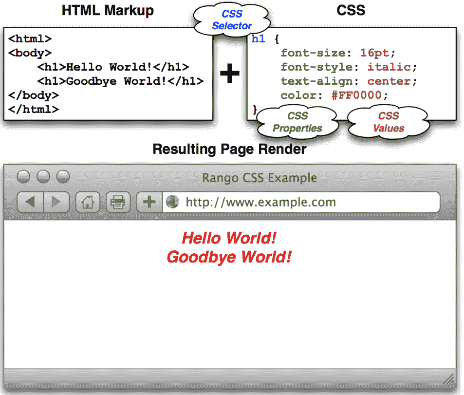

- `rel`，用于指定 HTML 文档与所链接资源（即样式表）之间的关系；
- `type`，用于指定 CSS 的 [MIME 类型](http://en.wikipedia.org/wiki/Internet_media_type)；以及
- `href`，应指向你要包含的样式表 URL 的属性。

添加此标签后，你的样式表将与 HTML 页面一起包含在内，并且样式表中的样式将应用于页面中的元素。你应该知道，CSS 样式表被视为一种**静态媒体**，因此应将它们放在项目的静态目录中。

### 内联 CSS


你也可以*内联*地将 CSS 添加到 HTML 文档中，也就是说，CSS 作为 HTML 页面的一部分包含在内。但通常不建议这样做，因为它消除了表现语义（CSS）与内容（HTML）之间的抽象。

### 基础 CSS 选择器

CSS 选择器用于将特定样式映射到特定的 HTML 元素。本质上，CSS 选择器是一种*模式*。在这里，我们介绍三种基本的 CSS 选择器形式：*元素选择器*、*id 选择器*和*类选择器*。在本章后面，我们还会涉及所谓的*伪选择器*。

### 元素选择器

以上面的[渲染示例](#)中的 CSS 示例为例，我们可以看到选择器 h1 匹配任何 `<h1>` 标签。任何引用此类标签的选择器都可以称为*元素选择器*。我们可以将元素选择器应用于任何 HTML 元素，例如 `<body>`、`<h1>`、`<h2>`、`<h3>`、`<p>` 和 `<div>`。这些元素都可以进行类似的样式设置。但是，使用元素选择器相当粗糙——样式会应用于特定标签的*所有*实例。我们通常需要更精细的方法来选择要设置样式的元素，这时就轮到 *id 选择器*和*类选择器*登场了。

### ID 选择器

*id 选择器*用于映射到网页上的唯一元素。网页上的每个元素都可以通过 `id` 属性分配一个唯一的 id，CSS 正是利用这个标识符将样式应用到元素上。这种选择器以井号（#）开头，后面紧跟你要匹配的元素的标识符。请看下面的图示例。

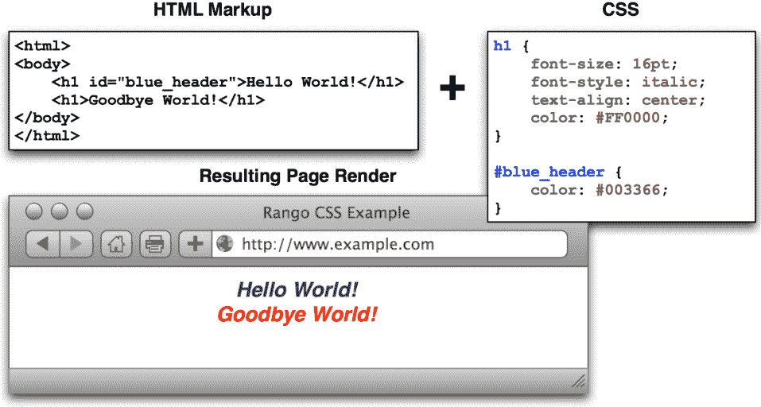

一幅演示如何在 CSS 中使用 id 选择器的插图。请注意，蓝色标题的标识符与 CSS 属性 #blue_header 相匹配。

### 类选择器

另一种选择是使用*类选择器*。这种方法与 *id 选择器*类似，区别在于你可以合法地将多个元素作为同一类的目标。如果你有一组希望应用相同样式的 HTML 元素，请使用基于类的方法。使用此方法的选择器是


在类名前面加上句点（.），然后用花括号（{ }）打开样式。请看下面的图例。

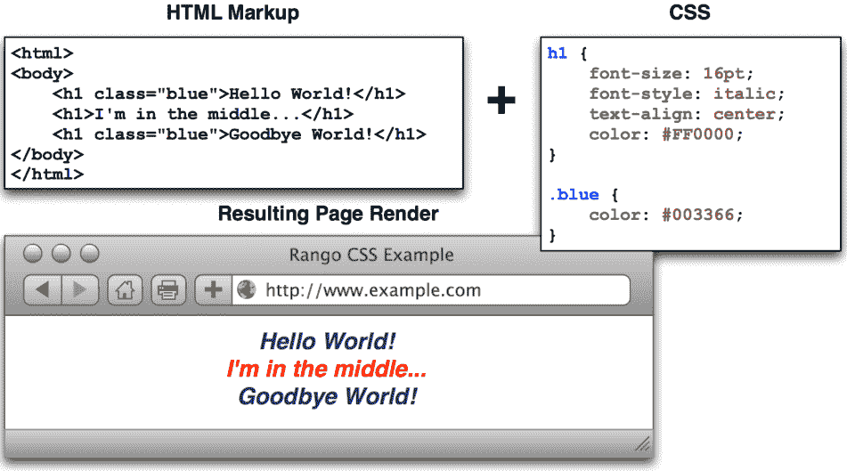

**该图演示了 CSS 中类选择器的使用。蓝色标题通过使用 `.blue` CSS 样式来覆盖 `h1` 样式的红色文本。**

## 确保 id 是唯一的

尽量少用 id 选择器。[问问自己：](https://net.tutsplus.com/tutorials/html-css-techniques/the-30-css-selectors-you-must-memorize/) *我是否需要为此元素应用标识符才能定位它？* 如果你需要将一组给定的样式应用于多个元素，答案永远是**否**。在这种情况下，你应该使用类或元素选择器。

## 字体

由于可用的字体数量庞大，在 Web 开发中使用字体历来是一个陷阱。设想这样一个场景：一位 Web 开发人员在其网页上安装并使用了一种特定字体。这种字体相当晦涩——因此该字体出现在其他计算机上的概率相对较小。

访问开发者网页的用户随后会因为其系统中没有该字体而看到页面渲染不正确。CSS 通过 `font-family` 属性解决了这个特定问题。

你为 `font-family` 指定的值可以是一个*可能的字体列表*——你的计算机或其他设备安装的第一个字体就是用于渲染网页的字体。随后，指定 HTML 元素内的文本将应用所选字体。下面显示的示例 CSS 在存在 *Arial* 字体时应用它。如果没有，则查找 *Helvetica*。如果该字体不存在，则应用任何可用的**无衬线字体**。

```css
h1 {
    font-family: 'Arial', 'Helvetica', sans-serif;
}
```

1996 年，微软发起了[核心网页字体](http://en.wikipedia.org/wiki/Core_fonts_for_the_Web)计划，以保证所有计算机上都存在一组特定的字体。然而，如今你几乎可以使用任何你喜欢的字体——查看 [Google Fonts](http://www.google.com/fonts) 了解你可以使用的字体示例，以及[这篇 W3Schools 文章](https://www.w3schools.com/howto/howto_google_fonts.asp)了解如何使用此类字体。使用字体时，请务必遵守许可协议！

## 颜色和背景

颜色对于定义网站的外观和感觉非常重要。你可以更改网页中任何元素的颜色，从背景颜色到边框和文本。在本书中，我们使用单词和*十六进制颜色代码*来选择我们想要的颜色。正如你从下图所示的基本颜色列表中所看到的，你可以为你想要使用的颜色提供*十六进制*或*RGB（红-绿-蓝）*值。你也可以[指定描述颜色的单词](https://www.w3schools.com/colors/colors_names.asp)，例如绿色、黄色或蓝色，以及它们对应的六字符十六进制代码。你也可以尝试诸如 color-hex.com¹³² 之类的网站，它可以让你对可选择的颜色进行精细控制。

- ¹²⁵ http://en.wikipedia.org/wiki/Sans-serif
- ¹²⁶ http://en.wikipedia.org/wiki/Core_fonts_for_the_Web
- ¹²⁷ http://www.google.com/fonts
- ¹²⁸ https://www.w3schools.com/howto/howto_google_fonts.asp
- ¹²⁹ https://www.w3schools.com/colors/colors_names.asp

### 十六进制颜色代码

有关如何使用十六进制对颜色进行编码的更多信息，请查看这份详细的教程¹³³。

### 注意你的英语！

你可能已经注意到，CSS 使用美式英语拼写单词。因此，有一些单词与英式拼写略有不同，比如 color 和 center。如果你是在英国或澳大利亚长大的，请仔细检查你的拼写，并准备好拼成那种“错误”的方式！

### 文本颜色

要更改元素内文本的颜色，必须将 color 属性应用于包含要更改文本的元素。例如，以下 CSS 将使用类 `red` 的元素中的所有文本改为红色。

```css
.red {
  color: #FF0000;
}
```

你可以通过将文本包裹在 `<span>` 标签内来更改网页中一小部分文本的呈现方式。为元素分配一个类或唯一标识符，然后你就可以在样式表中引用该 `<span>` 标签并应用 color 属性。在下面的示例标记中，使用上面定义的 `red` 类，文本 `fire engine` 将以红色显示。

```html
<span>
    I saw a police car and <span class="red">fire engine</span> drive past me.
</span>
```

### 边框

你也可以更改元素*边框*的颜色。我们将在 [CSS 盒模型](#) 中讨论什么是边框。现在，我们将向你展示如何为它们应用颜色，使一切看起来更漂亮。

边框颜色可以使用 `border-color` 属性指定。你可以为边框的四边提供一种颜色，也可以为每一边指定不同的颜色。要实现这一点，你需要提供不同的颜色，每个颜色之间用空格分隔。

```css
.some-element {
    border-color: #000000 #FF0000 #00FF00;
}
```

在上面的示例中，我们使用多种颜色为三个边指定不同的颜色。从顶部开始，顺时针旋转。因此，每条边的颜色顺序应为 `top right bottom left`。

我们的示例为任何具有类 `some-element` 的元素应用黑色顶部边框、红色右侧边框和绿色底部边框。未提供左侧边框值，这意味着左侧边框保持透明。若要仅为元素边框的一侧指定颜色，请考虑在适当情况下使用 `border-top-color`、`border-right-color`、`border-bottom-color` 和 `border-left-color` 属性。

### 背景颜色

你也可以通过使用 CSS `background-color` 属性来更改元素背景的颜色。与上面描述的 `color` 属性一样，`background-color` 属性可以通过指定单个颜色作为其值来轻松应用。看看下面的示例，它为整个网页应用了亮绿色背景。不是很漂亮！

```css
body {
  background-color: #00FF00;
}
```

### 背景图像

当然，指定颜色并不是更改背景的唯一方法。你也可以将背景图像应用于元素。我们可以通过 `background-image` 属性来实现这一点。

```css
#some-unique-element {
  background-image: url('../images/filename.png');
  background-color: #000000;
}
```

上面的示例使用 filename.png 作为标识符 `some-unique-element` 的元素的背景图像。图像的路径是相对于你的 CSS 样式表的路径指定的，而不是相对于网页本身。我们上面的示例使用双点表示法来指定图像的相对路径¹³⁴。我们还应用了黑色背景颜色来填充背景图像留下的空隙——它可能不会填满元素的整个大小。


### 背景图像定位

默认情况下，背景图像位于相关元素的左上角，并在水平和垂直轴上重复。你可以通过使用 `background-repeat` 属性更改图像的重复方式¹³⁵来自定义此功能。你也可以使用 `background-position` 属性指定图像放置的位置¹³⁶。

## 容器、块级元素和内联元素

到目前为止，在整个速成课程中，我们已经向你介绍了 `<span>` 元素，但一直没有告诉你它是什么。在本节中，当我们解释*内联*和*块级*元素时，一切都会变得清晰。

`<span>` 被认为是所谓的*容器元素*。与 `<div>` 标签一样，这些元素本身没有意义，只是为了让你以逻辑方式包含和分隔页面内容。例如，你可以使用 `<div>` 包含与导航栏相关的标记，再用另一个 `<div>` 包含与网页页脚相关的标记。或者，你可以使用 `<nav>` 和 `<footer>` 容器元素！由于容器本身没有意义，通常应用样式来帮助控制网页的呈现语义。

容器有两种：*块级元素*和*内联元素*。请查看下图了解这两种元素的实际效果，并继续阅读每种元素的简短描述。

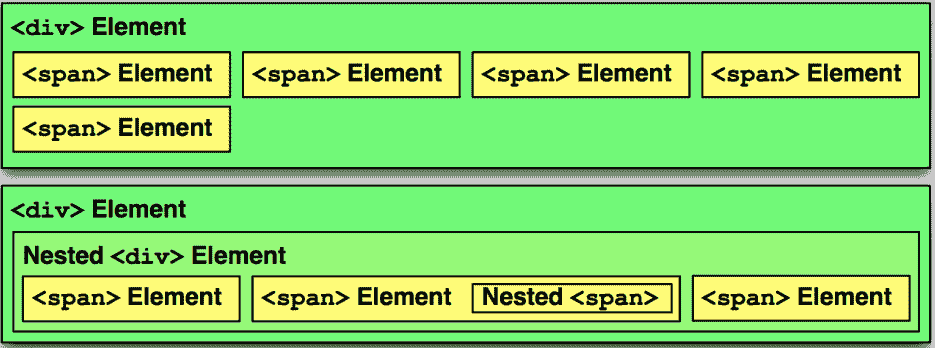

**该图演示了块级元素和内联元素默认的渲染方式。** 在图中，块级元素以绿色显示，注意每个元素之间是如何换行的。相反，内联元素可以出现在同一行上并彼此相邻。你也可以将块级元素和内联元素相互嵌套，但块级元素不能嵌套在内联元素中。


## 基本定位

在本 CSS 速成课程中，我们尚未涉及的一个重要概念是网页中元素的位置。大多数情况下，你会满意内联元素并排出现，而块级元素在下方依次出现。这些元素被称为 *静态定位*。

然而，会有需要对所有内容放置位置进行更多控制的场景。在本节中，我们将简要介绍在网页上定位元素的三种重要技术：*浮动、相对定位* 和 *绝对定位*。

### 浮动

CSS *浮动* 是在网页中定位元素的最直接技术之一。使用浮动可以让我们将元素定位到特定容器 – 或页面 – 的左侧或右侧。

让我们通过一个示例来说明。考虑以下 HTML 标记和 CSS 代码。

```html
<div class="container">
    <span class="yellow">Span 1</span>
    <span class="red">Span 2</span>
</div>
```

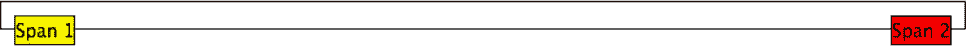

这将使 `.yellow` 元素浮动，使其脱离网页的自然流。实际上，它现在不再位于 `.container` 容器内。这就解释了为什么父容器现在不会随着 `<span>` 元素向下填充，就像你期望的那样。你可以如下面所示将 `overflow: hidden;` 属性应用于父容器来修复此问题。有关此技巧的工作原理的更多信息，请查看 [这篇 QuirksMode.org 在线文章](http://www.quirksmode.org/css/clearing.html)。

```css
.container {
    border: 1px solid black;
    overflow: hidden;
}
```

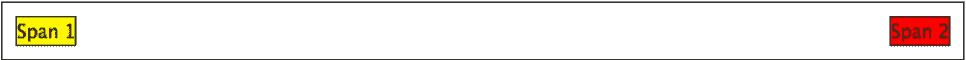

应用 `overflow: hidden` 可确保我们的 `.container` 延伸到适当的高度。

### 相对定位

如果需要在网页上对元素的位置进行更大程度的控制，可以使用 *相对定位*。正如名称可能暗示的那样，相对定位允许你将元素 *相对于它原本所在的位置* 进行定位。我们使用 `position: relative;` 属性和值配对来实现相对定位。然而，这只是故事的一部分。

让我们解释一下其工作原理。考虑我们之前的示例，其中两个 `<span>` 元素位于其容器内。

```
<div class="container">
    <span class="yellow">Span 1</span>
    <span class="red">Span 2</span>
</div>

.container {
    border: 1px solid black;
    height: 200px;
}

.yellow {
    background-color: yellow;
    border: 1px solid black;
}

.red {
    background-color: red;
    border: 1px solid black;
}
```

这会产生以下结果 – 正如我们所期望的那样。请注意，我们人为地将容器元素的高度增加到 200 像素。这将为我们提供更多可操作的空间。

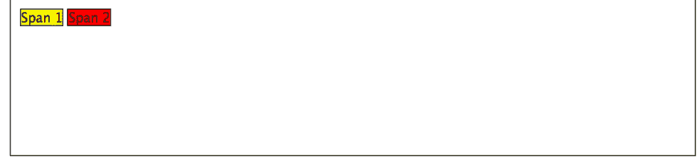

现在让我们尝试相对定位我们的 `.red` `<span>` 元素。首先，我们将 `position: relative` 应用于我们的 `.red` 类，如下所示。

```css
.red {
    background-color: red;
    border: 1px solid black;
    float: right;
    position: relative;
    right: 100px;
}
```

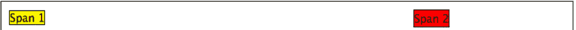

这意味着相对定位的工作基准是元素原本所在的位置 – 无论是否应用了其他改变位置的属性。

### 绝对定位

我们的最后一种定位技术是 *绝对定位*。虽然我们仍然修改样式的 `position` 参数，但我们使用 `absolute` 作为值而不是 `relative`。与相对定位不同，绝对定位将元素放置 *相对于其第一个位置值不为 static 的父元素*。这听起来可能有点令人困惑，但让我们逐步进行，以弄清楚到底发生了什么。

首先，我们可以再次采用两个彩色 `<span>` 元素位于 `<div>` 容器内的早期示例。两个 `<span>` 元素像自然那样并排放置。

```html
<div class="container">
    <span class="yellow">Span 1</span>
    <span class="red">Span 2</span>
</div>
```

```css
.container {
    border: 1px solid black;
    height: 70px;
}

.yellow {
    background-color: yellow;
    border: 1px solid black;
}

.red {
    background-color: red;
    border: 1px solid black;
}
```

这会产生下面所示的输出。请注意，我们再次将 `.container` 高度设置为人为值 70 像素，以给我们更多空间。

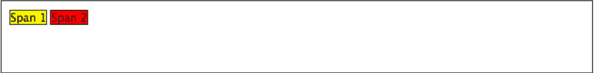

我们现在对 `.red` 元素应用绝对定位。

```css
.red {
    background-color: red;
    border: 1px solid black;
    position: absolute;
}
```

与相对定位一样，这对网页中红色元素的位置没有总体影响。我们必须应用 `top`、`bottom`、`left` 或 `right` 中的一个或多个，新的位置才会生效。作为演示，我们可以像下面的示例中那样将 `top` 和 `left` 属性应用于红色元素。

```css
.red {
    background-color: red;
    border: 1px solid black;
    position: absolute;
    top: 0;
    left: 0;
}
```

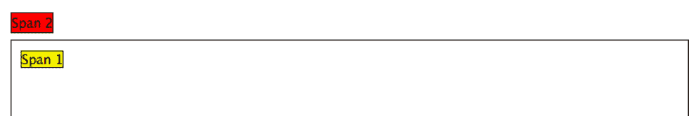

哇，这里发生了什么？我们的红色元素现在位于容器之外！你会注意到，如果在浏览器窗口中运行此代码，红色元素会出现在视口的左上角。这因此意味着，当对具有绝对定位的元素应用 `top`、`bottom`、`left` 和 `right` 属性时，它是相对于视口绝对定位的 – (0,0) 在左上角。

由于我们的容器元素的默认位置设置为 `position: static`，红色和黄色元素分别移动到屏幕的左上角和右下角。让我们现在修改我们的 `.yellow` 类，将黄色 `<span>` 移动到页面右下角的 5 像素处。`.yellow` 类现在看起来像下面的示例。

```css
.yellow {
    background-color: yellow;
    border: 1px solid black;
    position: absolute;
    bottom: 5px;
    right: 5px;
}
```

这会产生以下结果。

但如果我们不想让元素相对于整个页面绝对定位怎么办？更常见的是，我们希望根据容器调整元素的位置。如果我们回顾绝对定位的定义，我们会注意到绝对位置是 *相对于第一个位置值不为 static 的父元素* 计算的。由于我们的容器是两个 `<span>` 元素的唯一父元素，因此绝对定位元素相对的容器因此是 HTML 页面的 `<body>`。我们可以通过向 `.container` 类添加 `position: relative` 来更改此设置，就像下面的示例中一样。

```css
.container {
  border: 1px solid black;
  height: 70px;
  position: relative;
}
```

这会产生以下结果。`.container` 成为第一个位置值不为 `static` 的父元素，这意味着我们的 `<span>` 元素会附着其上！

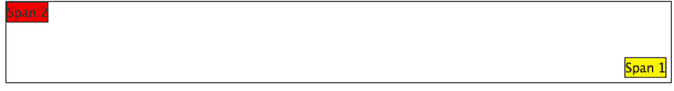

我们的元素现在相对于 `.container` 绝对定位。太好了！现在，让我们调整两个 `<span>` 元素的位置值以移动它们。

你创建的元素或框，以及它们在浏览器视口中的呈现方式。每个元素或框由 *四个独立区域* 组成，所有这些区域都在下图中说明。元素的周围框可以分为三个部分，从内到外分别是：*填充区域*、*边框区域* 和 *外边距区域*。元素本身（无论是文本还是图像）位于中间作为 *内容区域*。

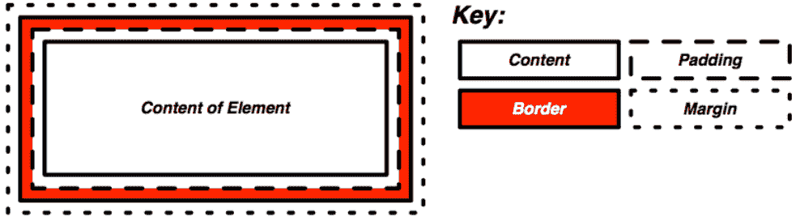

展示 CSS 盒模型的插图，附带图例显示模型四个区域。

对于网页中的每个元素，你可以使用相应的属性 `margin`、`padding` 和 `border` 创建外边距、应用填充或边框。外边距在元素边框周围清除一个透明区域；这意味着外边距对于在元素之间创建间隙非常有用。相比之下，填充在元素的内容与其边框之间创建间隙。这给人一种元素显得更宽的感觉。如果你为元素提供背景颜色，背景颜色会随元素的填充一起扩展。最后，边框就是你所期望的 – 它们在元素的内容和填充周围提供边框。

有关 CSS 盒模型的更多信息，请查看 Mozilla 对该模型的优秀解释¹⁴¹。为什么不甚至订购一件印有盒模型的 T 恤¹⁴²？

¹⁴¹ https://developer.mozilla.org/en-US/docs/Learn/CSS/Introduction_to_CSS/Box_model
¹⁴² http://cssboxmodel.com/


## 注意宽度！

正如你可能从盒模型插图中了解到的那样，元素的宽度并不是简单地由你为元素宽度输入的值来定义的。相反，你应该始终考虑元素两侧边框和内边距的宽度。这可以用数学公式表示为：

```
total_width = content_width + left padding + right padding + left border
              + right border + left margin + right margin
```

别忘了这一点。记住它，你将省去很多麻烦！

## 边框与内边距

如果你发现自己正在处理带有边框和/或内边距的元素，那么计算出精确的宽度可能会很困难。在宽度至关重要的情况下，你可能想要探索 `box-sizing` 属性¹⁴³，以更好地控制宽度和高度。请阅读链接的 W3Schools 文章了解更多信息。这个属性已经在很多情况下帮了我们大忙！

## 样式化列表

列表无处不在。无论你是在阅读课程的学习成果列表，还是阅读火车的时刻表列表，你都知道列表是什么样子，并且欣赏它的简洁性。如果你的网页上有一组项目，为什么不使用 HTML 列表呢？在网页中使用列表有助于形成良好的 HTML 文档结构，使基于文本的浏览器、屏幕阅读器和其他不支持 CSS 的浏览器能够合理地呈现你的页面。

然而，默认情况下，列表对最终用户来说并不是特别吸引人。以下面的 HTML 列表为例，我们将一边尝试不同的事物，一边对其进行样式设置。

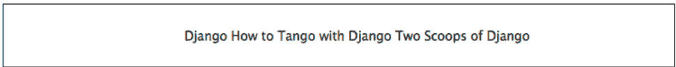

虽然我们可能有正确的方向，但现在我们的列表看起来很糟糕。一个元素从哪里开始，另一个从哪里结束？完全是一团糟！让我们调整列表元素的样式，并添加一些对比度和内边距，使其看起来更美观。

```
.example-list li {
    display: inline;
    background-color: #333333;
    color: #FFFFFF;
    padding: 10px;
}
```

应用之后，我们的列表看起来好多了——而且相当专业！

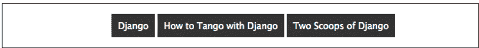

从这个示例中，希望可以清楚地看出，列表可以很容易地定制，以满足你网页的需求。关于如何样式化列表的更多信息和灵感，你可以查看下面的一些精选链接。

- 看看这篇关于在 A List Apart¹⁴⁴ 上样式化列表的优秀教程。
- 查看来自 Web Designer Wall¹⁴⁵ 的高级教程，该教程使用图形制作出令人惊叹的列表。在教程中，作者使用了 Photoshop——如果你对 Photoshop 不自信，你可以尝试使用更简单的图形软件包。
- 这个网站¹⁴⁶ 提供了一些关于如何样式化列表的很好的灵感和技巧。

列表样式化的可能性是无穷无尽的！你可以说这是一个永无止境的列表……

¹⁴⁴ https://alistapart.com/article/taminglists/
¹⁴⁵ https://webdesignerwall.com/tutorials/advanced-css-menu
¹⁴⁶ https://learn.shayhowe.com/html-css/creating-lists/

## 样式化链接

CSS 使你能够轻松地以你希望的任何方式设置超链接的样式。你可以更改它们的颜色、字体或任何其他你想要的方面——甚至可以在鼠标悬停在它们上方时更改它们的外观！

超链接在 HTML 页面中通过 `<a>` 标签表示，`<a>` 是 anchor（锚）的缩写。我们可以按照以下示例，对网页中的所有超链接应用样式。

```
a {
  color: red;
  text-decoration: none;
}
```

每个超链接的文本颜色都变为红色，并且移除了文本默认的下划线。如果我们随后想在用户悬停在链接上时再次更改 color 和 text-decoration 属性，我们可以使用所谓的伪选择器 `:hover` 来创建另一个样式。我们的两个样式现在如下面的示例所示。

```
a {
  color: red;
  text-decoration: none;
}

a:hover {
  color: blue;
  text-decoration: underline;
}
```

这将产生如下所示的链接。注意第二个链接的颜色变化——它正被鼠标悬停。

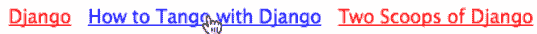

然而，你可能不希望整个网页上的链接样式都相同。例如，你的导航栏可能有深色背景，而你的其余部分

```html
<div id="dark">
    <a href="http://www.google.co.uk/">Google Search</a>
</div>

<div class="light">
    <a href="http://www.bing.co.uk/">Bing Search</a>
</div>
```

最终输出类似于下面显示的示例。将上面的示例编码，然后在浏览器中悬停在这些链接上，查看文本颜色的变化！

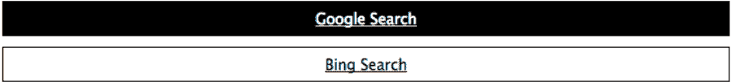

只需少量的 CSS，你就能在网页呈现给用户的方式上做出一些重大改变。

## 层叠

值得指出的是*层叠样式表*中的*层叠*是如何发挥作用的。回顾本章开头处的 CSS 渲染示例，你会注意到显示的红色文本是**粗体**，但我们的 `h1` 样式中并没有定义这样的属性。这就是我们所说的*层叠样式*的一个完美示例。大多数 HTML 元素都有与之关联的*默认样式*，由 Web 浏览器应用。对于 `<h1>` 元素，W3C 网站提供了一个会被应用的典型样式¹⁴⁸。如果你检查这个典型样式，你会注意到它包含一个 `font-weight: bold;` 属性和值配对，这就解释了**粗体**文本的来源。当我们为 `<h1>` 元素定义进一步的样式时，典型的属性/值配对会*层叠*到我们的样式中。如果我们为现有的属性/值配对定义一个新值（例如我们为 `font-size` 所做的），我们就会*覆盖*现有的值。这个过程可以重复多次——过程结束时得到的属性/值配对将应用于相关元素。查看下图以了解层叠过程的图形表示。

