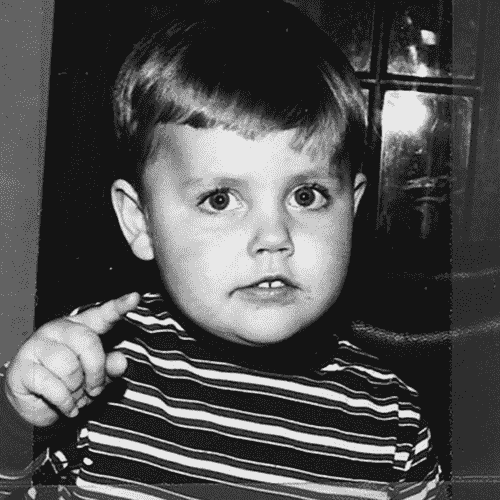

# 后记

- 致谢
- 注释
- 参考文献
- 索引

# 透镜一览表

- #1 情感透镜
- #2 核心体验透镜
- #3 场地透镜
- #4 惊喜透镜
- #5 趣味透镜
- #6 好奇心透镜
- #7 内生价值透镜
- #8 解决问题透镜
- #9 四元素透镜
- #10 全息设计透镜
- #11 统一透镜
- #12 共鸣透镜
- #13 无限灵感透镜
- #14 问题陈述透镜
- #15 八大过滤器透镜
- #16 风险缓解透镜
- #17 玩具透镜
- #18 激情透镜
- #19 玩家透镜
- #20 愉悦透镜
- #21 心流透镜
- #22 需求透镜
- #23 动机透镜
- #24 新颖性透镜
- #25 判断透镜
- #26 功能空间透镜
- #27 时间透镜
- #28 状态机透镜
- #29 秘密透镜
- #30 涌现透镜
- #31 行动透镜
- #32 目标透镜
- #33 规则透镜
- #34 技巧透镜
- #35 期望值透镜
- #36 机会透镜
- #37 公平透镜
- #38 挑战透镜
- #39 有意义的选择透镜
- #40 三角性透镜
- #41 技巧与运气透镜
- #42 脑与手透镜

- #43 竞争之透镜
- #44 合作之透镜
- #45 竞争与合作之透镜
- #46 奖励之透镜
- #47 惩罚之透镜
- #48 简洁/复杂之透镜
- #49 优雅之透镜
- #50 角色之透镜
- #51 想象力之透镜
- #52 经济之透镜
- #53 平衡之透镜
- #54 易用性之透镜
- #55 可见进度之透镜
- #56 并行性之透镜
- #57 金字塔之透镜
- #58 谜题之透镜
- #59 控制之透镜
- #60 物理界面之透镜
- #61 虚拟界面之透镜
- #62 透明度之透镜
- #63 反馈之透镜
- #64 丰富反馈之透镜
- #65 本质之透镜
- #66 通道与维度之透镜
- #67 模式之透镜
- #67½ 隐喻之透镜
- #68 瞬间之透镜
- #69 兴趣曲线之透镜
- #70 内在兴趣之透镜
- #71 美感之透镜
- #72 投射之透镜
- #73 故事机器之透镜
- #74 障碍之透镜
- #75 简洁与超越之透镜
- #76 英雄之旅之透镜
- #77 最怪异之事之透镜
- #78 故事之透镜
- #79 自由之透镜
- #80 帮助之透镜
- #81 间接控制之透镜
- #82 勾结之透镜
- #83 幻想之透镜
- #84 世界之透镜
- #85 化身之透镜
- #86 角色功能之透镜
- #87 角色特质之透镜
- #88 人际周向模型之透镜
- #89 角色网之透镜
- #90 地位之透镜
- #91 角色蜕变之透镜
- #92 内在矛盾之透镜
- #93 无名之质之透镜
- #93½ 临场感之透镜
- #94 氛围之透镜
- #95 观赏性之透镜
- #95½ 可作弊性之透镜
- #96 友谊之透镜
- #97 表达之透镜
- #98 社区之透镜
- #99 搞破坏之透镜
- #100 爱之透镜
- #101 团队之透镜
- #102 文档之透镜
- #103 测试之透镜
- #104 技术之透镜
- #105 水晶球之透镜
- #106 乌托邦之透镜
- #107 客户之透镜
- #108 推销之透镜
- #109 利润之透镜
- #110 蜕变之透镜
- #111 责任之透镜
- #112 乌鸦之透镜
- #∞ 你的秘密目的之透镜

> *我将与你谈论艺术，*
>
> *因为别无他事可谈，*
>
> *因为别无他物。*
>
> *生活是个晦涩的流浪汉，*
>
> *搭乘艺术的公共汽车免费兜风。*
>
> ——Maxwell H. Brock

## 你好

你好！进来，进来！真惊喜——我完全没想到你今天会来访。如果这儿有点乱请见谅，我正在写作。请——随意坐。好，好。现在让我想想……从哪开始呢？哦——我该做个自我介绍！

我叫 Jesse Schell，我一直热爱游戏设计。这是我的一张照片：

那时我比较矮。自从拍了那张照片后，我做了很多不同的事。我曾在马戏团当专业杂技演员。我当过作家、喜剧演员和魔术师助手。我曾在 IBM 和贝尔通信研究公司担任软件工程师。我为华特迪士尼公司设计并开发过互动主题公园设施和大型多人在线游戏。我创办了自己的游戏工作室，并成为卡内基梅隆大学的教授。但当人们问我是做什么的，我会告诉他们我是一名游戏设计师。

我提这些只是因为在本书的各个章节中，我会从这些经历中引用案例，因为每一段经历都教会了我关于游戏设计艺术的宝贵教训。这听起来或许令人惊讶，但希望当你读完这本书时，它能帮你看出游戏设计是如何有意义地连接你生活中的诸多经历的。

有件事我得澄清一下：虽然本书的目标主要是教你如何成为一名更优秀的**电子游戏设计师**，但我们探讨的许多原则与电子游戏本身关系不大——你会发现它们的适用范围比那广泛得多。好消息是，无论你在设计什么类型的游戏——数字、模拟或其他——此处的大部分内容都同样适用。

### 什么是游戏设计？

开始之前，我们必须绝对清楚“游戏设计”的含畢。毕竟这是全书的主题，且有些人对它似乎有点困惑。

*   **游戏设计是决定游戏应成何物的行为。**

就这。表面上听起来太简单了。

*   **“你是说设计游戏只需做一个决定？”**

不。要决定游戏是什么，你必须做出成百上千个决定，通常是数千个。

*   **“我难道不需要特殊设备来设计游戏吗？”**

不需要。既然游戏设计只是决策制定，你其实可以在脑海中设计游戏。不过通常你会想把这些决定记下来，因为我们的记忆力薄弱，不写下来容易遗漏重要细节。此外，如果你想让别人帮你做决定，或帮你构建游戏，你需要以某种方式将这些决定传达给他们，写下来是个好办法。

*   **“编程呢？游戏设计师不得是程序员吗？”**

## 简介

不，他们不需要。首先，许多游戏无需电脑或技术即可进行；例如桌游、纸牌游戏和体育游戏。其次，即使是电脑游戏或电子游戏，在不了解将这些决策付诸实施的所有技术细节的情况下，也可以决定这些游戏应该是什么样的。当然，如果你确实了解这些细节，那将有很大帮助，就像成为一名熟练的作家或艺术家会有帮助一样。这能让你更快地做出更好的决策，但这并非绝对必要。这类似于建筑师与木匠的关系：建筑师不需要知道木匠知道的一切，但建筑师必须知道木匠能做什么。

### “那么，你的意思是游戏设计师只是想出游戏的故事？”

不。故事决策只是游戏设计的一个方面，但还有许多许多其他方面。关于规则、外观与手感、时机、节奏、冒险、奖励、惩罚，以及玩家体验到的其他一切，做出决策都是游戏设计师的责任。

### “那么游戏设计师决定游戏应该是什么样，写下来，然后就去忙别的了？”

几乎从不。我们没有人拥有完美的想象力，我们在脑海中和纸上设计的游戏，几乎从不会完全按照我们预期的方式呈现出来。在设计师看到游戏实际运行之前，许多决策是无法做出的。因此，设计师通常会从头到尾参与游戏的开发，一路上不断决定游戏应该是什么样子。

区分“游戏开发者”和“游戏设计师”很重要。游戏开发者是指任何参与游戏创作的人。工程师、动画师、建模师、音乐家、作家、制作人以及从事游戏工作的设计师，都是游戏开发者。游戏设计师只是游戏开发者的一种。

### “那么，游戏设计师是唯一被允许对游戏做决策的人吗？”

让我们反过来说：任何对游戏应该是什么样子做出决策的人，都是游戏设计师。设计师是一个角色，而不是一个人。团队中几乎每个开发者都会通过为游戏创作内容的行为，对游戏将会是什么样子做出一些决策。这些决策就是游戏设计决策，当你做出这些决策时，你就是一名游戏设计师。因此，无论你在游戏开发团队中担任什么角色，了解游戏设计原则都会让你在自己的工作上做得更好。

## 等待门捷列夫

> *发现之旅不在于寻找新大陆，而在于拥有新眼睛。*
>
> —马塞尔·普鲁斯特

本书的目标是让你成为最优秀的游戏设计师。

不幸的是，目前还没有“游戏设计统一理论”，没有能告诉我们如何制作好游戏的简单公式。那我们能做什么呢？

我们的处境有点像古代的炼金术士。在门捷列夫（men-duh-lay-uv）发现元素周期表（展示了所有基本元素如何相互关联）之前，炼金术士们依赖一套拼凑而成的经验法则，来了解不同化学品如何结合。这些法则必然是不完整的、有时是错误的、且常带有半神秘色彩，但通过使用这些法则，炼金术士们能够完成令人惊讶的事情，他们对真理的追求最终通向了现代化学。

游戏设计师们正等待着他们的门捷列夫。此时我们还没有元素周期表。我们有自己拼凑的原则和规则，虽然不完美，但能让我们完成工作。我试图将其中最好的汇集在一起，以便你能研究它们、思考它们、运用它们，并看看其他人是如何运用它们的。

当你从尽可能多的视角审视你的游戏时，好的游戏设计就会发生。我将这些视角称为**透镜**，因为每一个都是审视你设计的一种方式。透镜是一小组你应该向自己询问关于设计的问题。它们不是蓝图或食谱，而是审视设计的工具。它们将在全书中逐一介绍。我们创建了一副卡牌，每张卡牌总结一个透镜，以配合本书使用。它提供免费智能手机应用（在 iOS 或 Android 上搜索 `deck of lenses`），也可以作为实体卡牌购买（在 Amazon 上搜索 `deck of lenses`），方便你在设计时使用透镜。访问 `artofgamedesign.com` 了解更多信息，并获取免费的第三版补充包。

没有一个透镜是完美的，也没有一个是完整的，但每一个在某些情境下都有用，因为每一个都能给你的设计提供独特的视角。思路是：尽管我们无法拥有一幅完整的图景，但通过采用所有这些微小的不完美透镜，从许多不同视角审视你的问题，你将能运用自己的判断力，找出最佳设计。我希望我们有一个全视透镜。但我们没有。因此，与其丢弃我们拥有的许多不完美透镜，不如收集并使用尽可能多种类的透镜，因为正如我们将看到的，游戏设计更像是艺术而非科学，更像烹饪而非化学，我们必须承认我们的门捷列夫可能永远不会到来。

## 专注于基础

许多人认为，要最好地研究游戏设计原则，自然应该研究现有的最现代、最复杂、最高科技的游戏。这种方法完全错误。电子游戏只是传统游戏向新媒介的自然延伸。支配它们的规则依然相同。建筑师必须先懂得如何设计棚屋，才能设计摩天大楼，因此我们将经常研究一些最简单的游戏。其中一些是电子游戏，但有些要简单得多：骰子游戏。纸牌游戏。桌游。操场游戏。如果我们无法理解这些游戏的原则，怎么可能指望理解更复杂的游戏？有人会争辩说这些游戏古老，因此不值得研究，但正如梭罗所说：“我们不妨因为自然古老就不去研究它了。”游戏就是游戏就是游戏。让经典游戏好玩的原则，和让最现代游戏好玩的原则是一样的。经典游戏有额外的优势：它们经受住了时间的考验。它们的成功并非源于技术的新颖性，这在许多现代游戏中却是常见情况。这些经典游戏拥有更深层的品质，作为游戏设计师，我们必须学会理解它们。

除了关注经典游戏，本书还将致力于提供最深层、最基础的游戏设计原则，而非特定类型的原则（`Fifteen tips for a better story-based first-person shooter!`），因为类型来来去去，但游戏设计的基本原则是人类心理学原则，亘古长存，未来也将长存。精通这些基础，你将能驾驭任何出现的类型，甚至创造出属于你自己的新类型。与其他游戏设计书籍不同，后者的目标似乎往往是覆盖尽可能多的领域，本书不追求面面俱到，而是教你在最肥沃的地方深耕。

虽然本书将教导您创作传统棋类与卡牌游戏的原则，但其重心非常偏向电子游戏行业。为什么？因为游戏设计师的工作是创造新游戏。计算机技术的爆发式发展，带来了游戏设计领域前所未有的创新。当今在世的游戏设计师数量，超过了人类历史上所有时期的总和。如果您想创作游戏，大概率将在这项新技术的前沿进行创作，而本书将指导您如何做到这一点——尽管此处的大多数原则同样适用于更传统的游戏类型。

## 与陌生人对话

> **切记款待陌生人，因为有人无意中款待了天使。**
>
> ——《希伯来书》13:2

游戏开发者以“排外”著称，即恐惧陌生事物。这里的“陌生”并非指生面孔，而是指陌生的技术、实践与原则。他们似乎认为：若非源自游戏行业，便不值一提。真相是，游戏开发者通常太过忙碌，无暇顾及眼前之外的世界。制作好游戏很难，因此开发者低头苦干、全神贯注、务求有成。他们往往没有时间去发掘新技术、研究如何融入游戏、承担新技术可能失败的风险。于是他们求稳，固守已知，遗憾的是这导致市场上充斥大量“千篇一律”的游戏。

但要成功、创造伟大且创新的作品，就必须与众不同。本书不教您制作千篇一律的游戏，而教您如何创造伟大的新设计。若您对本书聚焦非数字游戏感到惊讶，更会惊讶于它如何引用并非游戏的事物的原则、方法与案例。音乐、建筑、电影、科学、绘画、文学、日月星辰万物皆将被引入。为何不呢？他人领域辛勤耕耘数百上千年的成果可供我们借用，为何要从零开始自行开发所有原则？设计原则源自四面八方，因为设计无处不在，**设计在任何地方都是相同的**。本书不仅将从四面八方汲取设计灵感，更将说服您也这样做。您所知所历，皆可成为游戏设计桌上的素材。

## 地图

> **一个人研究什么并不太重要。所有知识互有关联，若孜孜不倦钻研任何一门，终将博学多识。**
>
> ——希帕蒂亚

游戏设计非易写之题。透镜与基础是有用的工具，但真正理解游戏设计，意味着理解一个由创造力、心理学、艺术、技术与商业编织的极其复杂的网络。网络中万物相连。改变一元素将影响所有其他元素，理解一元素将影响对所有其他元素的理解。大多数资深设计师历经多年、通过反复试错，在脑海中慢慢构建起这个网络。这正是游戏设计难以著书的原因。书籍天然是线性的，一次只能呈现一个观点。因此许多游戏设计书籍给人一种不完整感——如同夜间手持手电筒的导览，读者虽见诸多有趣之物，却难以领会它们如何契合成整体。

游戏设计是一场冒险，冒险需要地图。为此书，我绘制了一张展示游戏设计关系网络的地图。书末附有完整地图，但一次性看全图会令人困惑不已。毕加索曾说：“欲创造，必先毁灭。”所以我们将一切搁置，从一张白纸开始绘制地图。在此过程中，我也鼓励您搁置对游戏设计的成见，以开放心态拥抱这个艰难而迷人的主题。

`Chapter 1`将从增加单一元素——设计师——开始。后续章节将逐一增加其他元素，逐步构建设计师、玩家、游戏、团队与客户之间复杂的关系系统，让您看清它们如何契合、为何如此契合。读完本书，您将在纸面与脑海中同时拥有这张关系地图。当然，纸面地图非关键——关键的是脑海中的那张。地图非疆域，必有不完美之处。但愿本书助您在脑海中建立关系地图后，您能以现实检验心智地图，在发现可改进之处时不断修正与增补。每位设计师都要经历构建个人关系地图的旅程。若您是游戏设计新手，本书将为您提供地图的雏形；若您已是资深设计师，希望本书能为您改进现有地图提供一些思路。

## 学会思考

> **真理有四个角：作为教师我给你一个角，其余三个角由你自己去寻找。**
>
> ——孔子

孔子何意？好教师难道不该把四个角全指给你看、讲得明明白白吗？不。要真正学会、记住、理解，您的心智必须处于探求状态、渴望寻获知识的状态。若非这种真正渴望深度理解的状态，最睿智的原则也会像水滴鸭背般滑过。本书中将有时不把事情讲透——故意留有模糊地带，以便当您揭开真相时，它对您才有意义。

采取这种有时晦涩的手法，还有另一原因。如前所述，游戏设计非精确科学，充满奥秘与矛盾。我们的透镜体系将不完美且不完备。要成为伟大的游戏设计师，仅熟悉本书提供的原则是不够的。您必须准备好独立思考，弄清为何某些原则在特定情况下失效，并创造属于您自己的新原则。我们期待我们的门捷列夫。或许那就是您。

## 我为何厌恶书籍

> **我厌恶书籍，因为它们只教人谈论自己不懂的东西。**
>
> ——让-雅克·卢梭

> **学习与实践保持平衡至关重要。**
>
> ——达赖喇嘛

