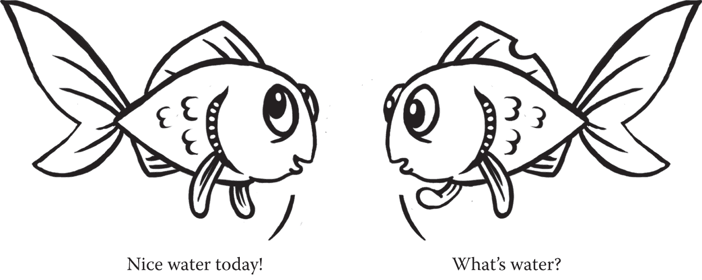

# 第二章

# 设计师创造*体验*

**图 2.1**

> *我已经知道结局了*
>
> *那是让你面目全非的部分*
>
> *我不知道是什么让你面目全非*
>
> *但电影就是这样结束的。*
>
> —They Might Be Giants, *实验电影*
>
> *在心灵、理智或灵魂所能承受的无数效果或印象中，我该在此时选择哪一个？*
>
> —Edgar Allen Poe, *作法哲学*

在第 1 章中，我们确立了一切始于游戏设计师，且游戏设计师需要具备特定技能。现在是时候谈谈游戏设计师用这些技能做什么了。换句话说，我们需要问：“游戏设计师的目标是什么？”乍一看，答案显而易见：游戏设计师的目标是设计游戏。

但这是错的。

归根结底，游戏设计师不关心游戏本身。游戏只是达到目的的手段。游戏本身只是人造物——一堆纸板或一包比特。除非有人玩，否则游戏毫无价值。为什么会这样？当游戏被玩时，发生了什么魔法？

当人们玩游戏时，他们获得了一种体验。正是这种体验是设计师所关心的。没有体验，游戏就毫无价值。

我现在就警告你：我们即将进入一个很难用语言描述的领域，不是因为它陌生——事实上，恰恰相反。它难以言说是因为它太熟悉了。我们所见过的一切（看那日落！）、做过的一切（你坐过飞机吗？）、想过的一切（天为什么是蓝的？）、感受过的一切（这雪真冷！），都是一种体验。根据定义，我们无法体验任何非体验的事物。体验是我们的一部分，以至于难以思考（甚至思考体验本身也是一种体验）。但尽管我们对体验再熟悉不过，它们却很难描述。你无法看到、触摸、抓住它们——甚至无法真正分享它们。没有两个人能对同一事物拥有完全相同的体验——每个人对某事物的体验都是完全独特的。

这就是体验的悖论。在某种层面上，它们影影绰绰、模糊不清；在另一层面上，它们却是我们所知的一切。但无论体验多么棘手，创造体验才是游戏设计师真正关心的全部。我们不能躲避它们，退缩到实体游戏的具体性中去。我们必须动用一切可用的手段去领会、理解并掌握人类体验的本质。

## 游戏不是体验

**图 2.2**

在继续之前，我们必须对这一点绝对清醒。游戏不是体验。游戏使体验成为可能，但它不是体验。这是一个有些人难以领会的概念。古老的禅宗公案直接指出了这一点：“如果一棵树在森林里倒下，旁边没人听到，它会发出声音吗？”这句话被重复太多次了，听起来老生常谈，但它正是我们在讨论的内容。如果我们把“声音”定义为空气分子的振动，那么是的，树发出了声音。如果我们把声音定义为听到声音的体验，那么答案是不，当没人在场时，树不会发出声音。作为设计师，我们不真正关心那棵树以及它怎么倒下——我们只关心听到它倒下的体验。那棵树只是达到目的的手段。如果没人在那里听，好吧，我们根本不在乎。

游戏设计师只关心看似存在的事物。玩家和游戏是真实的。体验是虚构的——但游戏设计师正是凭借这虚构事物的质量来被评判的，因为它是人们玩游戏的理由。

如果我们能通过某种高科技魔法，直接为人们创造体验，而无需任何底层媒介——没有游戏板、没有电脑、没有屏幕——我们一定会这么做。从某种意义上说，这就是“人工现实”的梦想——能够创造出完全不受传递体验的媒介约束的体验。这是一个美好的梦想，但终究只是梦想。我们无法直接创造体验。也许在遥远的未来，利用难以想象的技术，这种事情可能会发生。时间会给出答案。就目前而言，我们生活在当下，所能做的只是创造制品（规则集、游戏板、计算机程序），当玩家与它们互动时，这些制品有可能创造出特定类型的体验。

正是这一点让游戏设计变得如此困难。这就像在瓶子里造船，我们离真正想要创造的东西相去甚远。我们创造一个供玩家互动的制品，然后祈祷（cross our fingers）在互动过程中发生的体验是玩家会喜欢的。我们永远无法真正看到工作的成果，因为那是别人拥有的体验，归根结底，是无法分享的。

这就是为什么深度倾听对游戏设计至关重要。

### 这是游戏独有的吗？

你可能会问，游戏与其他类型的体验相比有什么特别之处，以至于要求我们深入研究这些敏感的体验问题。实际上，从某种层面来看，游戏在这方面并没有什么特别之处。所有类型娱乐的设计师——书籍、电影、戏剧、音乐、游乐设施，等等——都必须应对同一个问题：你如何创造出一种东西，当人与它互动时，能产生某种特定的体验？

但制品与体验之间的鸿沟，在游戏设计中比在其他娱乐类型中明显得多，原因并不显而见。游戏设计师必须应对比线性体验设计师多得多的互动。书籍或剧本的作者设计的是线性体验。他们创作的东西与读者或观众体验的东西之间，有着相当直接的映射关系。游戏设计师没那么轻松。我们给予玩家极大的控制权，让他们掌控体验中事件的节奏和顺序。我们甚至还加入随机事件！这使得制品与体验之间的区别比线性娱乐中更加明显。但同时，这也让我们更难确定，究竟什么样的体验会真正在玩家心中产生。

那么，我们为什么要这么做？游戏体验有什么特别之处，让我们愿意放弃线性娱乐创作者所享有的控制权这一奢侈品？我们仅仅是受虐狂吗？我们只是为了挑战而做吗？不。正如游戏设计师所做的其他一切一样，我们这么做是为了它所创造的体验。有些感觉：选择的感觉、自由的感觉、责任的感觉、成就的感觉、友谊的感觉，以及许多其他感觉，似乎只有基于游戏的体验才能提供。这就是我们历经麻烦的原因——为了创造无法通过其他方式获得的体验。

### 追逐彩虹的三种实用方法

> *这里没有规则！我们是在试图完成某件事！*
>
> ——托马斯·爱迪生

好了——我们已经确定了需要做什么：创造游戏，以某种方式产生美妙、引人入胜、令人难忘的体验。为此，我们必须踏上一项艰巨的任务：揭开人类心智的奥秘和人类内心的秘密。没有任何单一学科完美地绘制出这片领域的地图（门捷列夫，你在哪里？），但有几个不同的学科已经绘制出了部分地图。其中有三个尤为突出：心理学、人类学和设计学。心理学家想了解让人运转的机制，人类学家想在人性层面上了解人，设计师只想让人快乐。我们将借用这三个领域的方法，所以让我们看看每个领域能为我们提供什么。

#### 心理学

除了心理学家——研究支配人类心智机制的科学家——还有谁更适合让我们了解人类体验的本质？确实，他们发现了一些关于心智的极其有用的知识，其中一些将在本书中介绍。事实上，你可能会期望，我们对如何创造伟大人类体验的探索可能就此结束，心理学家应该拥有所有答案。遗憾的是，情况并非如此。因为他们是科学家，被迫只能在真实且可证明的领域工作。20 世纪初，心理学出现了分裂。战场的一方是行为主义者，他们只关注可测量的行为，采用“黑箱”方法研究心智。他们的主要工具是客观、受控的实验。另一方是现象学家，他们研究游戏设计师最关心的东西——人类体验的本质和“发生的感觉”。他们的主要工具是内省——在体验发生时审视体验的行为。

不幸的是，行为主义者出于非常充分的理由获胜了。行为主义对客观、可重复实验的关注造就了非常好的科学。一位行为主义者可以做一个实验，发表一篇论文，其他行为主义者可以在相同条件下重复实验，几乎肯定能得到相同的结果。另一方面，现象学方法必然是主观的。体验本身无法直接测量——只能描述，而且是不完美地描述。当实验发生在你的脑海中，你怎么可能确定实验条件受到控制？研究我们自己的内心思想和感受虽然迷人且有用，但无法构建严谨的科学。结果，尽管现代心理学取得了诸多进展，但它通常感到有义务避开我们最关心的东西——人类体验的本质。

虽然心理学没有我们需要的所有答案，但它确实提供了一些非常有用的答案，我们将会看到。不仅如此，它还提供了我们可以非常有效地使用的方法。游戏设计师不受良好科学的严格责任约束，可以同时利用行为主义实验和现象学内省来了解我们需要知道的东西，因为归根结底，作为设计师，我们不关心客观现实世界中什么是绝对真实的，而只关心主观体验世界中什么*似乎*是真实的。

但也许还有另一种科学方法，介于行为主义和现象学这两个极端之间？

#### 人类学

> *人类学是科学中最人文的，是人文中最科学的。*
>
> ——阿尔弗雷德·L·克罗伯

人类学是另一门关于人类及其思想和行为的主要学科。它采取比心理学更整体的方法，审视人的一切方面，包括身体、心理和文化层面。它非常关注研究世界各地不同民族的异同，不仅是今天，还贯穿历史。

对于游戏设计师来说，文化人类学的研究方法尤为引人关注。文化人类学是对活着的人们的生活方式进行研究，主要通过实地考察。文化人类学家与研究对象共同生活，并试图完全沉浸在他们试图了解的人们的世界中。他们力求对文化和实践进行客观观察，但同时，他们也进行内省，并竭尽所能将自己置于研究对象的位置。这有助于人类学家更好地想象成为他们的研究对象“是什么感觉”。

我们可以从人类学家的工作中了解到许多关于人性的重要知识——但更重要的是，通过采用文化人类学家的方法对待我们的玩家，采访他们，尽可能多地了解他们，并将自己置于他们的位置，我们可以获得从更客观的视角无法获得的洞见。

### 设计

毫不奇怪，对人类体验进行重要研究的第三个领域是设计领域。我们几乎能从各类设计师那里学到有用的东西：音乐家、建筑师、作家、电影制作人、工业设计师、网页设计师、编舞家、视觉设计师等等。源自这些不同学科的令人难以置信的各种设计“经验法则”，出色地阐释了关于人类体验的有用原则。但遗憾的是，这些原则往往很难为我们所用。与科学家不同，设计师很少发表论文来阐述他们的发现。各个领域最优秀的设计师往往对其他设计领域的运作知之甚少。音乐家可能对节奏知之甚深，但很少思考节奏原则如何应用于非音乐事物，如小说或舞台剧，尽管它们在那里可能有意义的实际应用，因为它们最终植根于同一个地方——人类的思维。因此，要利用其他设计领域的原则，我们需要广撒网。任何创造供人们体验和享受的事物的人都有东西可以教给我们，所以我们将从各行各业的设计师那里汲取规则和案例，做到尽可能“亲外”。

理想情况下，我们会找到方法，通过心理学和人类学的共同基础，将所有多样的设计原则联系起来，因为归根结底，所有设计原则都植根于此。在某些小方面，我们将在本书中做到这一点。也许有一天，这三个领域会找到统一其所有原则的方法。目前，我们只能满足于在此处和彼处搭建一些桥梁——这并非微不足道的成就，因为这三个领域很少有太多的交叉授粉。此外，其中一些桥梁将被证明出奇地有用！我们面前的任务——游戏设计——非常艰巨，以至于我们无法在获取知识的来源上表现得势利。这些方法单独都无法解决我们所有的问题，所以我们将混合搭配使用它们，试图像使用工具箱里的工具一样恰当地使用它们。我们必须既开放又务实——好主意可以来自任何地方，但只有当它们帮助我们创造更好的体验时，它们对我们才是好的。

## 内省：力量、危险与实践

> *一位献身的科学家从不犹豫以身试验。*
>
> ——芬顿·克莱普尔

我们已经讨论了一些寻找掌握人类体验有用工具的地方。现在让我们专注于一个被这三个学科共同使用的工具：内省。这是一个看似简单的行为，即审视你自己的思想和感受——也就是你自己的体验。虽然你永远无法真正了解他人的体验，但你当然可以了解自己的。从某种意义上说，这就是你所能知道的一切。通过深入倾听你自己的内心，即观察、评估和描述你自己的体验，你可以对游戏中什么有效、什么无效以及为什么有效或无效做出快速、果断的判断。

“但是等等，”你可能会说。“内省真的是个好主意吗？如果它对科学家来说不够好，为什么对我们就够了？”这是一个公平的问题。使用内省主要存在两大危险。

### 危险 #1：内省可能导致对现实的错误结论

这是科学家拒绝将内省作为一种有效探究方法的主要原因。多年来，许多伪科学家主要基于内省提出了怪诞的理论。之所以经常发生这种情况，是因为在我们个人体验中看似真实的东西，不一定真的是真实的。例如，苏格拉底指出，当我们学到新东西时，往往感觉好像早就知道了，而在学习它的过程中，感觉好像只是被提醒起了早已知道但遗忘的东西。这是一个有趣的观察，大多数人都能回忆起这种感觉的学习经历。但苏格拉底随后走得太远，构建了一个精细的论证：既然学习感觉像回忆，那么我们一定是转世的灵魂，正在回忆前世学到的东西。

这就是基于内省得出关于现实结论的问题——仅仅因为某事感觉是真的，并不意味着它就是真的。人们很容易陷入构建可疑逻辑结构来支持某种感觉上必须为真的观点的陷阱。科学家学会约束自己以避免这一陷阱。内省当然在科学中有其地位——它允许人们从单纯逻辑无法企及的角度审视问题。优秀的科学家一直在使用内省——但他们不从中得出科学结论。

幸运的是，游戏设计不是科学！虽然“关于现实的客观真理”对我们来说有趣且有时有用，但我们主要关心的是“感觉上是什么样的真理”。亚里士多德给了我们另一个完美阐释这一点的经典例子。他撰写了大量涉及逻辑、物理学、自然历史和哲学等主题的著作。他以深刻的个人内省而闻名，当我们审视他的作品时，会发现一些有趣的东西。他关于物理学和自然历史的观点在今天基本被推翻。为什么？因为他过度依赖感觉为真的东西，而缺乏足够的控制实验。他的内省将他引向了各种我们现在知道是错误的结论，例如：

* 重物比轻物下落得快。
* 意识的所在地在心脏。
* 生命源于自然发生。

那么为什么我们记住他是天才而不是怪人？因为他的其他著作，关于形而上学、戏剧、伦理学和心智的著作，至今仍有用处。在这些领域，感觉为真的东西比客观上、可证实为真的东西更重要，他通过深度内省得出的大多数结论，经受住了数千年的审视。

这里的教训很简单：在处理人类的心智和情感、试图理解体验和事物的感受时，内省是一个极其强大且值得信赖的工具。作为游戏设计师，我们不必过多担心第一个危险。我们更关心事物感觉如何，而较少关心什么是真实的。因此，在对体验质量做出结论时，我们通常可以自信地信任自己的感觉和直觉。

### 危险 #2：对我真实的体验可能对他人并不真实

## 主观性的危险

内省的第二个危险是我们必须严肃对待的。对于第一个危险，我们因为是设计师而非科学家，获得了一张“免死金牌”。但我们无法如此轻易地摆脱这个危险。这个危险是主观性的危险，也是许多设计师掉入的陷阱：“我喜欢玩这个游戏；因此，它一定很好。”有时，这是对的。但其他时候，如果受众的喜好与你不同，那就非常、非常错误了。一些设计师在这个问题上采取极端立场，从“我只为像我这样的人设计，因为这是我确信我的游戏好的唯一途径”到“内省和主观观点不可信。只有试玩才可信。”这些立场各自都是“安全”的，但也都有其局限性和问题：

### “我只为像我这样的人设计”

*   游戏设计师往往品味独特。外面可能没有足够多像你这样的人，来让你的游戏成为一项值得的投资。
*   你不会独自设计或开发。如果不同团队成员对什么是最好的有不同想法，它们将难以调和。
*   许多种类的游戏和受众将完全超出你的涉猎范围。

### “个人观点不可信”

*   你不能把每个决定都交给试玩，尤其是在流程早期，此时还没有游戏可供试玩。此时，必须有人对什么是好、什么是坏发表个人意见。
*   在游戏完全完成前，试玩者可能会拒绝一个非同寻常的想法。他们有时需要看到成品才能真正欣赏它。如果你不信任自己对好坏的感受，你可能会听从试玩者的建议，扔掉一只本可以长成美丽天鹅的“丑小鸭”。
*   试玩只能偶尔进行。重要的游戏设计决策必须每天做出。

不诉诸这种限制性极端而走出此危险的方法，依然是倾听。游戏设计的内省不仅是倾听自己，也是倾听他人的过程。通过观察自己的经历，再观察他人，并试图设身处地为他们着想，你开始形成一幅图景，了解你的经历与他们的区别。一旦你清晰地掌握了这些差异，你就能像文化人类学家一样，设身处地为受众着想，预测他们会享受什么样的体验，不会享受什么样的体验。这是一门需要练习的微妙艺术——通过练习，你在这方面的技巧会提高。

### 剖析你的感受

> *在无形世界中耕耘，至少要像在有形世界中那样努力。*
>
> ——鲁米

了解自己的感受并非易事。设计师仅仅对某事物喜不喜欢有个大概感觉是不够的。你必须能清楚地说出你喜欢什么、不喜欢什么，以及为什么。我大学有个朋友在这方面出了名地糟糕。我们经常被类似下面的对话搞得抓狂：

我：你今天在食堂吃了什么？

他：披萨。难吃。

我：难吃？哪里难吃？

他：就是……难吃。

我：是太凉了？太硬了？太湿软了？太苦了？酱太多？酱太少？芝士太多？到底哪里难吃？

他：我不知道——就是难吃！

他就是无法清晰地剖析自己的体验。就披萨这事而言，他知道自己不喜欢，却无法（或懒得）分析体验，以便提出改进披萨的有用建议。这种体验剖析是你内省的主要目标——这是设计师必须做的事。当你玩游戏时，你必须能分析它让你感觉如何、让你想到了什么、让你做了什么。你必须能清晰地陈述这一分析。你必须用语言表达出来，因为感受是抽象的，但语言是具体的，你需要这种具体性来向他人描述你希望游戏产生的体验。你不仅在设计和试玩自己的游戏时需要做这种分析，在玩别人创作的游戏时也需要。事实上，你应该能分析你可能拥有的任何体验。你越分析自己的体验，就越能清晰地思考你的游戏该创造什么样的体验。

我们有个专门的词来形容从我们内心升起的感受：情绪。我们的逻辑思维很容易将情绪视为无关紧要，但它们是所有难忘体验的基础。为让我们永远铭记情绪对体验设计的重要性，让我们把它作为第一枚透镜。

### 击败海森堡

但内省仍有一个更大的挑战。既然观察行为本身就是一种体验，我们如何在不玷污自身体验的前提下观察它？我们经常面临这个问题。试着观察你在电脑键盘上打字时手指在做什么，你会很快发现自己打字变慢、错误百出，甚至完全打不了字。试着观察自己享受电影或游戏，享受感会迅速消失。有人称之为“分析瘫痪”，也有人称之为海森堡原理。该原理引用了量子力学中的海森堡测不准原理，意指粒子的属性无法在不影响这些属性的情况下被观察。同样，体验的本质也无法在不影响该体验本质的情况下被观察。这让内省听起来毫无希望。虽然这是个棘手的问题，但有一些相当有效的绕过方法，尽管其中一些需要练习。我们大多数人不习惯公开讨论思维过程的本质，所以以下内容听起来可能有点奇怪。

#### 分析记忆

体验的一大好处是我们会记住它们。在体验发生时分析它很难，因为你用于分析的那部分思维通常专注于体验本身。分析你对某体验的记忆要容易得多。记忆不完美，但分析记忆总比不分析强。当然，记得越多越好，所以要么处理强烈体验的记忆（这些往往也是最好的灵感来源），要么处理新鲜记忆效果最好。如果你有这种心智自律，带着“不在玩的过程中分析，而是在玩完后立即分析其记忆”的意图去体验（如玩游戏），也非常有用。仅有这个意图就能帮你在不干扰体验的情况下记住更多体验细节。这要求你记住自己要去分析，又不让这个念头干扰体验。很棘手！

#### 两遍法

一种建立在分析记忆基础上的方法是体验两遍。第一遍，不要停下来分析任何东西——只管体验。然后，回头再来一遍，这次分析一切——甚至暂停做笔记。你脑海中留存着未受污染的新鲜体验，第二遍让你“重温”它，但给了你停下来思考的机会，考虑它让你感觉如何以及为什么。

#### 偷瞄

# 观察你的体验

不破坏体验地观察它，这可能吗？这是可能的，但需要一些练习。这么说听起来很奇怪，但如果你在体验发生时“对其偷瞄几眼”，你往往能在不显著降低或打断体验的情况下对其进行很好的观察。这有点像试图在公共场合仔细打量一个陌生人。朝他们瞥几眼，他们不会察觉你在观察他们。但盯着看太久，就会引起他们的注意，他们会发现你在盯着看。幸运的是，你只需几次简短的“心理瞥视”就能了解很多关于体验的信息。同样，这需要一些心理自律，否则你会陷入分析的漩涡。如果你能让这些“心理瞥视”成为习惯，只是一直不假思索地做，它们对体验的打断会更少。大多数人发现，真正打断他们思路或体验流的是内心的独白。当你开始在脑海中问太多问题并自我回答时，你的体验就完了。“快速瞥视”更像是“够刺激吗？是的。”然后，你立刻停止分析，回到体验中，直到下一次瞥视。

## 默默观察

理想情况下，你想在体验发生时观察正在发生的事情，而不仅仅是通过几次快速瞥视，而是通过持续的观察。你希望这就像你坐在自己体外，看着自己，只不过你看到的比普通观察者多。你能听到所有的想法，感受到所有的感受。当你进入这种状态时，几乎就像你拥有两个大脑：一个在运动，投入到体验中；另一个静止，默默地观察着前者。这听起来可能完全不可思议，但它完全可能，而且非常有用。这是一种难以达到的状态，但可以达到。它似乎类似于禅宗的自我观察修行，也不像冥想练习中试图观察自己的呼吸周期。通常我们不假思索地呼吸，但在任何时刻，我们都可以有意识地控制呼吸过程——从而干扰它。然而，通过练习，你可以观察自己自然的、无意识的呼吸而不打扰它。但这需要练习，就像观察你的体验需要练习一样。观察体验可以在任何地方练习——看电视时、工作时、玩耍时，或做任何事情时。一开始你做不好，但如果你坚持尝试和练习，你就会开始掌握诀窍。这需要大量的练习。但如果你真想倾听内心的声音，理解人类体验的本质，你会发现这种练习是值得的。

## 核心体验

但所有这些关于体验和观察的讨论究竟如何与游戏契合？如果我想制作一个关于打雪仗的游戏，分析我对真实打雪仗的记忆，对我想制作的打雪仗游戏有任何影响吗？如果没有真雪、真朋友和户外的真实世界，我就无法完美复刻真实打雪仗的体验——那么这样做有什么意义呢？

意义在于，你不需要完美复刻真实体验就能制作出好游戏。你需要做的是捕捉那些体验的**精髓**并将其融入你的游戏。“体验的精髓”到底意味着什么？每一次难忘的体验都有一些定义它并使其独特的关键特征。当你回顾打雪仗的体验记忆时，例如，你可能会想到很多事情。有些你甚至会认为是该体验的核心：“雪太大了，停课了。”“我们就在这条街上玩。”“雪湿干刚好，适合捏雪球。”“天很冷，但阳光明媚——天空湛蓝。”“到处都是孩子。”“我们堭了个巨大的雪堡。”“弗雷德把雪球扔得老高——当我抬头看时，他朝我脑袋砸过来一个！”“我们笑个不停。”也有一些部分你不认为是核心：“我穿着灯芯绒裤子。”“我兜里有几颗薄荷糖。”“一个遛狗的男人看着我们。”

作为试图设计体验的游戏设计师，你的目标是弄清真正定义你想创造的体验的核心要素，并找到方法将它们融入你的游戏设计中。这样，你的游戏玩家就能体验到那些核心要素。本书的大部分内容将探讨你可以用来打造游戏、向玩家传达你想要他们获得的体验的多种方法。这里的关键思想是，核心体验通常可以用一种与真实体验截然不同的形式来传达。继续以打雪仗为例，通过打雪仗游戏有哪些方式能传达“天很冷”这个体验？如果是电子游戏，你当然可以用美术表现：角色能呼出一小团白气，并拥有发抖的动画。你可以用音效——也许呼啸的风声能传达寒冷。也许你想象的那天并没有冷风，但音效可能捕捉到了精髓，传递出一种让玩家感觉寒冷的体验。如果你觉得寒冷真的很重要，你也可以利用游戏规则。也许玩家不戴手套能捏出更好的雪球，但当手太冷时，他们必须戴上手套。同样，这在现实中可能没发生过，但这条游戏规则有助于传递寒冷的体验，使其成为你游戏中不可或缺的一部分。

有些人觉得这种方法很奇怪——他们说：“直接设计个游戏，看看能产生什么体验！”我想这没错——如果你不知道自己想要什么，你可能就不在乎得到什么。但如果你确实知道想要什么——如果你对游戏给玩家的感觉有一个愿景——你就需要考虑如何传递核心体验。这引出了我们下一个透镜。

如果你想创造的体验和你实际创造的体验之间有巨大差距，你的游戏就需要改变：你需要清晰地陈述你渴望的核心体验，并找到尽可能多的方法将这种精髓注入你的游戏。

Wii Sports 中那款非常成功的棒球游戏的设计，是“核心体验透镜”应用的绝佳例子。最初，设计师们打算让它尽可能像真实的棒球，外加你可以像挥棒一样挥动控制器这一额外福利。随着开发推进，他们意识到没有时间像他们想的那样模拟棒球的方方面面。于是他们做了一个重大决定——既然挥动控制器是这款游戏最独特的部分，他们就会把所有注意力集中在把棒球体验的这部分做好——他们觉得这是核心部分。他们决定其他细节（九局制、盗垒等）并非他们试图创造的核心体验的一部分。

### 真实的只有你所感受的

设计师克里斯·克鲁格在创作桌面角色扮演游戏 *James Bond 007* 时，巧妙地运用了**核心体验透镜**。克鲁格对之前创作特工角色扮演游戏的尝试感到沮丧，例如 TSR 的 *Top Secret*，因为它们玩起来太像战争游戏了——让间谍电影令人兴奋的核心要素根本不存在。对于这款邦德游戏，克鲁格竭力设计机制，使其在各方面都能让人感受到詹姆斯·邦德电影的刺激感。一个杰出的例子是创造了一种叫做“英雄点数”的东西。在传统 RPG 中，当玩家进行冒险动作时，比如说从窗户跳到一架移动的直升机上，游戏主持人会计算成功的概率，玩家掷骰子，就这样定了。这给游戏主持人带来了一个棘手的平衡问题：如果危险动作成功的概率太低，玩家就不会冒险。但如果机会太高，玩家就会都表现得像超级英雄，尝试并成功完成各种不可能的壮举。克鲁格的解决方案是给玩家一份英雄点数预算，他们可以在冒险情境中使用这些点数来让骰子结果向有利于自己的方向偏移。因为每位玩家在每次冒险中只能获得少量点数，玩家必须非常谨慎地决定何时使用——但当他们确实使用时，是为了演绎壮观的事件，真正捕捉到了詹姆斯·邦德小说和电影的精髓。

确实，许多设计师并不使用核心体验透镜。他们只是凭直觉行事，碰巧撞到了一些能让人获得愉悦体验的游戏结构。这种方法的危险在于，它在很大程度上依赖运气。能够将体验与游戏分离开来非常有用：如果你脑海中清晰地描绘出玩家正在经历的体验，以及游戏的哪些部分支撑了这种体验，你就会更清楚如何让游戏变得更好，因为你会知道游戏的哪些元素可以安全修改，哪些不能。游戏设计师的终极目标是提供一种体验。当你对理想体验及其核心要素有清晰的认识时，你的设计就有了追求的目标。没有这个目标，你就是在黑暗中摸索。
