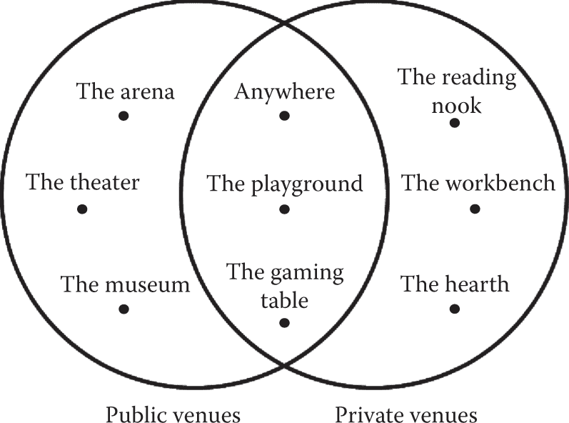

# 第三章

## 体验发生在场所中

*Figure 3.1*

### 平台的流动性

在数字游戏领域，关于平台的讨论多得惊人。玩家和设计师们不断争论 PC 对主机、对移动端、对平板、对网页、对掌机、对街机、对等等、对等等。哪个最好？最赚钱？最好玩？哪个最有可能在三年后依然存在？人的本性会假设一旦某样东西成功了，它就会永远保持那样。但事实并非如此。有些东西留下来了，有些则消失了。电视在很大程度上取代了收音机，但它没取代电影。街机游戏被 PC 游戏取代，PC 游戏又被主机游戏取代，但随后 PC 游戏回归了，移动和平板游戏兴起了。这是随机的吗？绝对不是。让特定技术走进或走出我们生活的东西，和人类历史一样古老且持久。我们反复犯的错误是过分关注现有技术（尽管它们新颖闪亮，却是短暂的），而忘记了关注某种太熟悉以至于被忽视的东西：我们生活中使用这些技术的场所。我喜欢称这些为“场所”。

这需要一点思维转变，去超越我们使用的技术，转而看到我们使用它们的模式，但这是个很好的练习，因为它能帮助我们洞察游戏玩法的过去、现在和未来。我在这里将与你分享我用来思考游戏玩法的场所体系。这不是一个完美的体系——它既有空白也有重叠——但我一次又一次地发现，在思考什么样的玩法最适合哪里以及为什么时，它很有用。

*Figure 3.2*

### 私人场所

游戏玩法往往得益于隐私。为了冒险沉浸在幻想世界中，我们喜欢身处安全的地方，要么独自一人，要么被认识并信任的人包围。自然地，一些最重要的游戏空间就在家里。

#### 壁炉旁

人类物种的一个决定性特征是我们与火的关系。在我们懂得使用火之前，我们的生活更像动物。一旦我们掌握并驯服了火，它在文化、心理和生理上改变了我们。它给了我们光亮、温暖和安全。它让我们烹饪食物，使得消化系统更简单、大脑更大。看火是一项全天候的责任，使得家庭和大型社会群体比以往任何时候都更重要。今天，明火已过时，但房子依然建有壁炉，因为没有壁炉就是“感觉不对劲”。一些人类学家推测，我们盯着火发呆时进入的恍惚状态可能是一种进化行为——如果你的大脑觉得盯着火看上几个小时平静安详，你就比那些分心让火熄灭的人拥有巨大的生存优势。

在大多数现代家庭中，电视屏幕取代了壁炉。它是个相当不错的替代品。尺寸合适，在黑暗中发光，以相似的方式闪烁，而且不再依赖家庭成员讲故事来互相娱乐，这团现代之火自己讲自己的故事。

不出所料，壁炉旁也是游戏的好场所。它似乎最适合那些能娱乐多人的游戏，无论是让他们一起玩，还是单纯看也很有趣。任天堂 Wii 被证明是壁炉旁游戏的绝佳系统，其游戏合集不仅全家人都能玩，光看也很有趣，因为玩家在虚拟世界中有大量的身体参与。从壁炉旁的视角来看，任天堂的后续系统 Wii U 大失所望也就不足为奇了，它专注于一个无法离开壁炉旁的独立手持屏幕，只有单个玩家能看到并享受。同样，像 *SingStar* 和 *Dance Central* 这样流行的唱歌跳舞游戏，天然适合壁炉旁，因为我们在火边唱歌跳舞已经有一百多万年了。

## 壁炉旁

当新技术出现时，人们总急于宣称壁炉旁的时代结束了。“电视的终结”或“游戏机的终结”常在媒体上高声叫嚣。确实，我们在家庭核心区域享受故事、歌曲和游戏的方式将持续变化和演进，但壁炉旁自人类诞生之初就伴随我们左右——别指望它会在短期内消失。

## 工作台

大多数家庭都会留出某种私人空间，用于钻研棘手的问题。无论是地下室里用于木工和维修项目的实体工作台、用于制作和修补衣物的缝纫机，还是安静角落里用于做作业或写作的书桌，我将这些统称为“工作台”。这些地方往往独处且安静，通常还有点乱，因为工作本身就乱，客人也通常不去这些地方。当计算机进入家庭时，它们很快就找到了通往“工作台”区域的路径，因为无论是在电脑上工作还是玩耍，都倾向于高强度且独自进行。值得注意的是“工作台”游戏与“壁炉旁”游戏的区别。*英雄联盟*这类 MOBA 游戏和*魔兽世界*这类 MMO 游戏，尽管广受欢迎，却倾向于留在“工作台”，而未进入壁炉旁。Valve 的 Steam 平台之所以大获成功，很大程度上因为其他游戏网络（如索尼、微软、任天堂和苹果）主要专注于其他场景，从而让 Steam 占据了工作台。

工作台游戏往往困难且紧张，可能一次需要数小时的游玩时间。它们通常不涉及家庭成员，但可能涉及与志同道合者的在线游戏，这些人同样看重游戏所提供挑战的重要性。截至 2019 年，头戴式虚拟现实显示系统因偏好强度和隐私，似乎更适合工作台，而非壁炉旁。

## 阅读角

阅读对人类而言是相对较新的消遣，仅在过去几千年才流行起来，但它已扎下深根。独自坐着阅读文字，让思绪随其飘向一个充满激动人心且有趣的人物和地点的不同世界，这其中有种魔力。书籍便于携带——我们可以随处阅读，但我们非常偏爱特定的阅读场所。除非独自在家，大多数人不喜欢在壁炉旁阅读，因为那里往往嘈杂且充满打扰。在工作台阅读也不太合适，因为虽然它私密安静，但通常不太舒适。工作台是一个非常“前倾”的地方，而阅读更多是一种“后仰”的活动。典型的阅读角在卧室，或是屋里任何有安静椅子或沙发、且远离电视的房间。

但阅读与玩游戏有什么关系？这种联系并不明显。PC 游戏和游戏机不适合阅读角。当苹果发布 iPad 时，游戏业并不买账。它没有手机那种随时随地玩游戏的便利性，也没有能让玩家体验壁炉旁和工作台流行玩法的控制系统，因此游戏业很大程度上将其摒弃了。但 iPad 却作为阅读和观看视频的平台流行起来，随后成为游戏领域的一股重要力量。为什么？因为它是阅读角游戏体验的完美平台。躺在床上、坐在沙发上或蜷缩在安静的角落里玩平板游戏，非常平静放松，很像读书。而在平板上成功的游戏，与主机或 PC 上成功的游戏截然不同。它们更容易、更简单、更放松——是适合阅读角的正确玩法类型。

## 公共场所

当然，并非所有游戏都发生在家中。世界精彩纷呈，充满了令人兴奋的人、地点和可探访的事物。基于位置的娱乐（LBE）的秘诀已为人所知数千年。无论你经营的是酒馆、剧院、餐厅、妓院、主题公园还是电玩城，法则都是一样的：给他们一些在家里得不到的东西。

### 剧院

剧院有种魔力。它们形态各异、规模不一、用途多样。无论是用于话剧、电影、音乐表演、体育赛事，甚至天文馆演示，它们有一个共同点：大量人群聚集在一起共同见证某事。当人群同时专注于一系列事件时，会发生某种神奇的事情。不知为何，我们能从观众席上的其他人那里获得某种东西。我有时认为我们能潜意识地感知他人对表演的感受，这有助于聚焦我们自己的情绪。这或许就是为什么这么多电视节目配有笑声轨道——共同欣赏一种体验让人感到非常满足。

但正是这种人群让在剧院玩游戏成为一个问题。游戏具有互动性，渴望成为每个玩家独特的体验。人们一次次尝试制作让全体观众都参与的戏剧体验，但迄今尚无长期成功案例。互动的乐趣会按座位数成比例地被稀释，导致体验要么很快让人厌倦，要么剧院太小而无利可图。有人或许能找到利用技术克服这一困难的方法——但任何能做到这一点的方案都必须极其巧妙。

### 竞技场

数千年来，竞技游戏都在专门的比赛场地进行。从战车竞赛、拳击，到各类团队运动，都在竞技场进行。大多数时候，竞技场宽敞且在室外，位于专为该类游戏设计的场所。棒球场、高尔夫球场、足球场、网球场、赛马场，甚至法庭——所有这些都是一种竞技场。除了专门针对这类游戏外，大多数时候竞技场位于公共场所，使他人能见证其中发生的一切——换言之，谁赢谁输不是私事，而是公共记录。而且既然人们看这些比赛会很兴奋，在许多情况下，剧院会围绕竞技场形成，创造出两合一的场所！

到目前为止，数字游戏对传统户外体育竞技场影响甚微。但这并未阻止数字游戏呈现出竞技场游戏的特征。多人第一人称射击游戏非常像一种竞技场游戏：虽然玩家身体在工作台或壁炉旁，但他们的思维在竞技场。而且，越来越多的虚拟剧院正围绕这种游戏涌现，因为越来越多的人在观看他人玩数字游戏，无论是直播（电竞赛事有时由数百万玩家同时观看）还是录播，通过 YouTube 或 [twitch.tv](http://twitch.tv)。虽然界限确实在模糊，但我怀疑随着时间的推移，随着新的移动和增强现实技术，我们将看到传统体育竞技场变得越来越数字化。

### 博物馆

有时我们需要暂别日常生活中的琐事，直觉告诉我们，通过审视异域风情的事物与场所，我们能获得急需的多样性体验，拓展对世界的认知，或许最重要的是，我们将带着全新的视角回家，赋予身边寻常事物以新的生机。当然，各类博物馆都属于我所谓的“博物馆”范畴，但许多其他事物亦是如此。动物园和水族馆是博物馆的一种；当我们去观光时，所到之城亦可视为一种博物馆。甚至逛一些非同寻常的商店，也是一种博物馆之旅，因为我们在观看、想象拥有各式各样新奇的物品。

游戏玩法与博物馆看似是不搭调的搭档，但许多游戏在那里却如鱼得水。越来越多的实体博物馆引入游戏体验，作为向参观者介绍展品信息的一种方式。逛电子游戏厅也极具博物馆般的质感，你在游戏机之间穿梭，试玩每一款，思考哪些最合你心意。

## 半私密/半公共场所

其他场所介于家庭的私密性与公共场所的开放性之间，或能同时兼具二者特性。这些处于公私边界的空间之所以有趣且重要，正在于其灵活性。

### 游戏桌

围桌而玩的游戏别具一格。玩家如众神般端坐桌前，俯瞰掌控着的玩具世界，彼此间形成一种特殊的面对面亲密感。诚然，我们可以在家中进行，但多半只在客人来访时才这么做，使家庭比平时更具公共性。但桌面游戏也存在于更公开的场所，如酒吧的台球桌或赌场的扑克桌。桌面游戏能在玩家身上激发一种特殊的专注强度。有趣的是，三明治和寿司卷大致发明于同一时期（十八世纪），虽地域迥异，发明者皆为痴迷桌面游戏的玩家，他们需要一种无需中断游戏即可进食的方式。

棋盘、卡牌和骰子游戏长期以来一直是游戏桌的主流。迄今为止，除一些实验性棋盘游戏外，数字游戏鲜有涉足此领域，很可能是因为它们依赖垂直屏幕。随着触控屏变得更廉价、更大尺寸，以及增强现实眼镜进入市场，数字游戏完全有可能开启游戏桌领域的全新天地。

### 游乐场

作为对游戏充满热情的成年人，我们有时会忘记游戏主要是儿童的天地。孩子们虽也喜欢在家以不同方式玩耍，有时也享受在竞技场般场所进行正式体育运动的乐趣，但他们同样热衷于户外与伙伴嬉戏。听到“游乐场”，我们首先联想到的往往是公园里的游乐设施。那只是游乐场的一种；任何孩子们聚集进行即兴游戏的空间——无论是后院、街道、空地，还是树林中的山洞——都是一种游乐场。

成年人容易忽视游乐场式的游戏，因为我们大多不再以那种方式玩耍。但孩子们始终会、也必须如此——这是他们成长的重要组成部分。迄今电子游戏产业大多忽略了游乐场游戏，因为在那里创建可行的游戏对他们而言不可行——但随着技术变得更坚固、更移动化，这种情况恐将改变。

### 随处可玩

有些游戏不在乎在哪里玩。填字游戏、数独和找单词游戏是“随处可玩”游戏的经典纸质范例，在公交车上或工作、学习间隙的几分钟里大有裨益。当然，智能手机游戏的爆发永远改变了“随处可玩”这一场所，创造出规模大得多、丰富得多的随时随地可玩的游戏库。然而值得注意的是，这些游戏因其可中断性和小屏幕尺寸，具有鲜明特质。它们往往可在碎片时间游玩，界面和故事极简。此外，因为只是填补一天中零星的几分钟，玩家通常不愿为此预付太多费用，最好能免费游玩。在第 32 章：《利润》中，我们将详细探讨这些游戏的细节及其独特的商业模式。

## 场所的混合与匹配

在这套场所体系中，很容易发现空白与重叠。在餐厅玩弹球机算哪个场所？保龄球馆算哪个？赌场是博物馆、竞技场、桌面游戏的集合，还是完全不同的东西？Nintendo Switch 是一个非凡的平台，因为它在“壁炉旁”、“阅读角”、“游戏桌”甚至“随处可玩”场景下都表现出色。重要的是不建立一套完美的场所分类学；重要的是透过游戏和平台看到场所及其属性，因为游戏和技术在不断变化，而场所变化甚微。为此，这里提供一把透视真相的透镜。

既然我们已探讨了体验及其发生地，现在需要直面一个更棘手的问题：究竟是什么让游戏成为游戏？

## 延伸阅读推荐

*   **《模式语言》** —— 克里斯托弗·亚历山大 等著。这是一本发人深省的著作，探讨人类与其栖居空间的关系。我们将在第 21 章：《空间》中再次提及此书。
