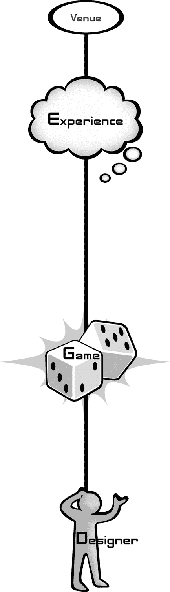

# 第四章

## 体验源于*游戏*

**图 4.1**

谈论体验设计固然美好。创造卓越体验确实是我们的目标。但我们无法触摸体验，无法直接操控它。游戏设计师能掌控、能亲手雕琢的，是游戏本身。游戏是你的黏土，你将塑造它、捏合它，创造出各式各样精彩的游戏体验。

那么，我们讨论的是何种游戏？本书涵盖所有类型：棋盘游戏、卡牌游戏、竞技游戏、游乐场游戏、聚会游戏、博弈游戏、益智游戏、街机游戏、电子游戏、计算机游戏、视频游戏，以及你能想到的几乎任何其他游戏。因为正如我们将看到的，设计原则适用于它们所有。令人略感惊讶的是，尽管这些游戏种类繁多、差异巨大，我们却直觉地将它们归为一类；即尽管它们迥然不同，我们本能地都认出它们是游戏。

这些事物共有何种特质？或者说，我们该如何定义“游戏”？

### 关于定义的牢骚

# 那么什么是游戏？

> *智慧的开端在于对术语的定义。*
>
> —苏格拉底

既然我们已经讨论了为什么要定义这些事物，那就试着定义一下吧，先从一些我们可以确定的关于游戏的事情说起。这是个开端：

**游戏是你玩的东西。**

我想没人会不同意这一点。但这并没有告诉我们太多信息。例如，游戏和玩具有区别吗？有的。游戏比玩具更复杂，涉及另一种类型的玩法。我们甚至用不同的语言来描述：

**玩具是你拿来*玩*的东西。**

好吧，很有意思。既然玩具比游戏简单，也许我们应该先试着定义玩具。看看能不能给出更好的玩具定义。你可以和朋友一起玩，但朋友不是玩具。玩具是物体。

**玩具是供你玩耍的物体。**

这算有点眉目了。但我打电话时可能会把胶带卷在手里把玩。这能让它成为玩具吗？从技术上讲，是的，但可能不是个好玩具。事实上，任何你拿来玩的东西都可以被归类为玩具。也许我们应该开始考虑什么造就了一个好的玩具。"有趣" 是联想到好玩具时浮现的一个词。事实上，你可能会说：

**好的玩具是玩起来有趣的物体。**

不错。但我们说"有趣"是什么意思？仅仅指愉悦或享受吗？愉悦是有趣的一部分，但有趣仅仅是愉悦吗？有很多体验是愉悦的，例如吃三明治或躺在阳光下，但称那些体验为"有趣"似乎很奇怪。不，有趣的事物有一种特别的光彩，一种特别的刺激。一般来说，有趣的事物涉及惊喜。所以有趣的定义可能是：

**有趣是带有惊喜的愉悦。**

这对吗？会这么简单吗？真奇怪，你可以用一个词一辈子，确定知道它的意思，但被问到时却无法清晰地表达出来。测试定义的一个好方法是举反例。你能想出有趣但不愉悦的事物，或者有趣但不涉及任何惊喜感的事物吗？反过来，你能想出既愉悦又有惊喜但不有趣的事物吗？惊喜和有趣是每个游戏设计中如此重要的部分，以至于它们成为了我们接下来的两个透镜。

# 玩具与游戏的定义

回到玩具这个话题。我们说玩具是供人玩耍的物品，而好的玩具是让人玩得开心的物品。但“玩耍”究竟意味着什么？这是个棘手的问题。我们看到玩耍时都知道它是什么，但很难用语言表达。许多人试图给“玩耍”一个可靠的定义，但大多数似乎都以这样或那样的方式失败了。让我们来看几个例子。

## 多余能量说（席勒）

> *Play is the aimless expenditure of exuberant energy.*
>
> —Friedrich Schiller

这是已过时的“多余能量”游戏理论的表达，该理论认为游戏的目的是消耗多余的能量。在心理学史中，一直倾向于过度简化复杂行为，这是一个早期的例子。它还使用了“aimless”（无目的）一词，仿佛游戏没有目标，但游戏肯定是有目标的。我们肯定能做得比这更好。

## 愉悦与自我主动说（吉尔摩）

> *Play refers to those activities which are accompanied by a state of comparative pleasure, exhilaration, power, and the feeling of self-initiative.*
>
> —J. Barnard Gilmore

这确实涵盖了一部分领域。这些确实是常与游戏联系在一起的事物。但不知为何，这似乎不完整。其他事物也与游戏相关，比如想象力、竞争和解决问题。同时，这个定义又太宽泛了。例如，一位高管可能努力争取一份合同，并在此过程中体验到“比较的愉悦、兴奋、力量和自我主动的感觉”，但称之为游戏行为似乎很奇怪。让我们尝试别的定义。

## 严格结构中的自由移动（萨伦与齐默尔曼）

> *Play is free movement within a more rigid structure.*
>
> —Katie Salen and Eric Zimmerman

这个出自《*Rules of Play*》的非同寻常的定义，试图创建一个足够开放的游戏定义，以便包含“墙上的光影游戏”和“汽车方向盘的游隙”等现象。虽然很难找到一个我们称之为游戏的东西不被这个定义涵盖，但人们很容易举出一些看似非游戏活动却符合该定义的例子。例如，如果一个孩子被迫擦厨房地板，孩子在更严格的结构（地板）中享受（享受可能用词不当）自由移动（可以自由滑动刷子），但将这种活动归类为游戏听起来很奇怪。尽管如此，从这个定义的角度思考你的游戏可能很有趣。也许另一个定义能更好地捕捉游戏的精神。

## 自发性与为自身而为（桑塔亚纳）

> *Play is whatever is done spontaneously and for its own sake.*
>
> —George Santayana

这个定义很有趣。首先，让我们考虑自发性。游戏通常是自发的。当我们说某人“爱玩”时，这正是我们的意思之一。但所有游戏都是自发的吗？不是。例如，有人可能提前几个月计划一场垒球赛，但当比赛最终发生时，它仍然是“游戏”。所以自发性有时是游戏的一部分，但并非总是如此。有些人认为自发性对游戏定义至关重要，任何削弱它的尝试都会使活动不再是游戏。Bernard Mergen 陈述了他的观点：“游戏，竞技游戏，有赢家或输家的，按我的定义，不是游戏。”这种观点极端到荒谬——按这个逻辑，游戏（按我们通常的理解）就不是你能玩的东西了。撇开这种极端观点，自发性确实似乎是游戏的重要组成部分。

但桑塔亚纳定义的第二部分“为自身而为”又如何呢？他的意思是“我们玩是因为我们喜欢”。听起来微不足道，但这是游戏的一个重要特征。如果我们不喜欢做某事，它大概就不是游戏。也就是说，活动本身不能被归类为“工作活动”或“游戏活动”。重要的是一个人对该活动的态度。正如玛丽·波平斯在谢尔曼兄弟的精彩歌曲《*A Spoonful of Sugar*》中告诉我们的：

> *In ev’ry job that must be done*
>
> *There is an element of fun.*
>
> *You find the fun and snap!*
>
> *The job’s a game.*

但我们如何找到乐趣？请看心理学家 Mihaly Csikszentmihalyi（发音“Chick sent me high”）讲述的工厂工人 Rico Medellin 如何将工作变成游戏的故事：

> *The task he has to perform on each unit that passes in front of his station should take forty-three seconds to perform—the same exact operation almost six hundred times in a working day. Most people would grow tired of such work very soon. But Rico has been at this job for over five years, and he still enjoys it. The reason is that he approaches his task in the same way an Olympic athlete approaches his event: How can I beat my record?*

这种态度的转变将 Rico 的工作从劳动变成了游戏。这对他的工作表现有何影响？“五年后，他一天的最好平均成绩是每件二十八秒。”他依然热爱这份工作：“‘这比任何事都好，’Rico 说。‘比看电视强多了。’”

这是怎么回事？简单的目标设定如何突然将我们通常归类为工作的活动重新定义为明显属于游戏的一种？答案似乎在于做这项活动的理由变了。他不再是为别人做，而是为自己的个人理由做。桑塔亚纳实际上详细阐述了他的定义，指出经进一步审视：

> *Work and play … become equivalent to servitude and freedom.*

当我们工作时，是因为我们有义务。我们为食物工作，因为我们是肚子的奴隶。我们为房租工作，因为我们是安全和舒适的奴隶。其中一些奴役是自愿的，比如愿意为养家赚钱，但这仍然是奴役。我们做是因为我们不得不做，而不是因为“我们想做”。你越有义务做某事，它越让人感觉像工作。你越没有义务做某事，它越让人感觉像游戏。换种说法：“一切游戏的一个不变原则是……玩的人，是自由地玩。必须玩的人，是玩不了的。”

基于此，我想分享我自己的游戏定义，它虽像其他定义一样不完美，但有其有趣的视角。我发现，在试图定义人类活动相关事物时，少关注活动本身，多关注驱动活动的思想和感受，往往很有用。我不禁注意到，大多数游戏活动似乎都是在试图回答以下问题：

*   “转动这个旋钮会发生什么？”
*   “我们能打败这支队伍吗？”
*   “我能用这泥巴做出什么？”
*   “我能跳多少次绳？”
*   “通关后会发生什么？”

当你自由地、出于自愿地、而非出于义务地寻求答案时，我们说你好奇。但好奇心并不立即意味着你会玩。不，游戏还涉及别的东西——游戏涉及故意的行动，通常是触摸或改变某物的故意行动——你可以说是操纵某物。所以一个可能的定义是：

> *Play is manipulation that indulges curiosity.*

当 Rico 试图打破流水线目标时，他在试图回答：“我能打破我的记录吗？”突然，他活动的理由不再是赚钱付房租，而是满足他对一个个人问题的好奇心。

这个定义将某些事物称为游戏，而我们通常可能不会将它们视为游戏，例如艺术家在画布上的实验。另一方面，他可能会说他在“玩弄色彩”。一位化学家尝试实验来验证一个心爱的理论——她是在玩吗？她可能会说她在“玩弄一个想法”。这个定义有缺陷（你能找到它们吗？），但我确实发现它是一个有用的视角，就我个人而言，这是我最喜欢的游戏定义。它还引出了透镜 #6。

## 说真的，到底什么是游戏？

我们已经为玩具和乐趣想出了一些定义，甚至对游戏也进行了相当扎实的尝试。让我们再次尝试回答最初的问题：我们该如何定义“游戏”？

前面我们说过“游戏是你玩的东西”，这似乎是对的，但不够具体。正如玩耍一样，许多人都试图定义“游戏”。让我们看看其中的几个。

> **游戏是自愿控制系统的一种运作，其中存在力量之间的竞争，受规则限制以产生非平衡结果。**
>
> —埃利奥特·阿维登和布莱恩·萨顿-史密斯

哇。真科学！让我们把它拆解一下。

首先，“自愿控制系统的一种运作”：也就是说，像玩耍一样，游戏是自愿参与的。

其次，“力量的竞争”：这确实似乎是大多数游戏的一部分。两个或更多事物争夺主导权。一些单人游戏并不总是给人这种感觉（你真的会称《俄罗斯方块》为力量的竞争吗？），但这句话传达了两点：游戏有目标，游戏有冲突。

第三，“受规则限制”：一个非常重要的观点！游戏有规则。玩具没有规则。规则绝对是游戏的一个决定性特征。

第四，“非平衡结果”：非平衡是个有趣的词。它不仅仅意味着“不相等”；相反，它暗示曾经一度存在平衡，但随后平衡被打破。换句话说，事情开始时是均势，但后来有人赢了。这在大多数游戏中肯定是成立的——如果你玩，你要么赢，要么输。

所以这个定义指出了游戏的一些关键特质：

*   Q1. 游戏是自愿参与的。
*   Q2. 游戏有目标。
*   Q3. 游戏有冲突。
*   Q4. 游戏有规则。
*   Q5. 游戏有输赢。

让我们考虑另一个定义——这次不是来自学术界，而是来自设计界：

> **[游戏是]一种内生意义的互动结构，要求玩家为目标而奋斗。**
>
> —格雷格·科斯蒂基安

其中有些很清楚，但“内生”到底是什么鬼？我们马上就会讲到。让我们像拆解上一个那样拆解这个定义。

首先，“一种互动结构”：科斯蒂基安想非常清楚地说明玩家是主动的，而非被动的，并且玩家和游戏相互作用。这绝对符合游戏——它们有一个结构（由规则定义），你可以与之互动，它也可以与你互动。

其次，“为目标而奋斗”：我们再次看到了目标的概念，奋斗暗示着某种冲突。但它暗示的更多——它暗示挑战。在某种程度上，科斯蒂基安似乎试图不仅定义是什么构成了游戏，还定义是什么构成了好游戏。坏游戏挑战太少或太多。好游戏挑战刚刚好。

第三，“内生意义”：内生是一个极好的术语，科斯蒂基安将其从生物学领域引入游戏设计，意思是“由生物体或系统内部因素引起的”，或“内部产生的”。那么什么是“内生意义”？科斯蒂基安提出了一个非常重要的观点：在游戏内部有价值的东西，只有在游戏内部才有价值。大富翁货币只有在大富翁游戏的语境下才有意义。正是游戏本身赋予了它这种意义。当我们玩游戏时，这笔钱对我们非常重要。游戏之外，它完全不重要。内生价值对我们是个非常有用的概念，因为它是衡量游戏真正有多大吸引力的绝佳指标。轮盘赌不一定要用真钱玩——可以用筹码或游戏币。但游戏本身产生的内生价值很少。只有当真钱在桌上时，人们才会玩它，因为它本身不是那么有吸引力。游戏越有吸引力，游戏内部产生的内生价值就越大。一些大型多人在线角色扮演游戏已被证明极具吸引力，以至于虚构的游戏物品实际上在游戏外用真钱买卖。内生价值是如此有用的视角，以至于它成为了透镜 #7。

### 示例：内生价值透镜

超任和世嘉 Mega Drive（Genesis）上的游戏《Bubsy》是一款相当标准的平台游戏。你扮演一只猫，试图通过关卡到达终点，打败敌人、躲避障碍并收集毛线球获取额外分数。然而，分数除了衡量你收集了多少东西之外毫无用处。获得分数不会给予任何其他游戏内奖励。大多数玩家一开始会收集毛线球，期望它们有价值，但玩了一会儿后，他们完全忽略它们，只专注于打败敌人、躲避障碍和到达关卡终点。为什么？因为玩家的动机（见透镜 #6：*好奇心*）仅仅是通关。更高的分数对此无帮助，因此毛线球没有内生价值。理论上，通关的玩家可能会有新动机：再通一遍，但这次争取最高分。实际上，游戏本身太难了，真正通关的玩家寥寥无几。

世嘉 Mega Drive 上的《索尼克 2》是一款类似的平台游戏，但没有这个问题。在《索尼克 2》中，你收集金环而不是毛线球，收集的金环数量对玩家非常重要——金环拥有大量内生价值。为什么？因为携带金环能保护你免受敌人伤害，每收集一百个金环，你就获得一条额外生命，这增加了你通关的机会。最终，《索尼克 2》比《Bubsy》吸引人得多，原因之一就是这个机制，它通过内生价值清楚地展示了其重要性。

科斯蒂基安的定义给了我们三个新特质，可以加入我们的列表：

*   Q6. 游戏是互动的。
*   Q7. 游戏有挑战。
*   Q8. 游戏能创造自己的内部价值。

让我们再看一个游戏定义：

> **游戏是一个封闭的形式系统，让玩家参与结构化冲突，并以不平等的结果告终。**
>
> —特雷西·富勒顿、克里斯·斯韦因和史蒂文·霍夫曼

大部分内容已被前面的定义涵盖，但有两点我想单独挑出来：

首先，“让玩家参与”：玩家觉得游戏有吸引力，即让玩家感到“精神沉浸”，这是个好观点。从技术上讲，我们可能会争辩说这是好游戏的特质，而非所有游戏，但这是个重要观点。

## “一个封闭的形式系统”

其次，“一个封闭的形式系统”：这包含了很多含义。“系统”意味着游戏由相互关联、协同工作的元素组成。“形式”只是说该系统定义明确，即它有规则。“封闭”才是这里有趣的部分。它意味着系统有边界。这一点在其他定义中尚未明确提及，尽管内生价值的概念确实暗示了这一点。人们对游戏边缘这一边界进行了大量阐释。约翰·休伊 zinga 称之为“魔法圈”，它确实有一种神奇的感觉。当我们在精神上“入游”时，我们的思想、感受和价值观与“出游”时截然不同。游戏不过是一套规则，怎么会对我们产生这种神奇的效果？要理解这一点，我们必须深入人类的思维。

让我们回顾一下从这些不同定义中提炼出的游戏特质清单：

*   **Q1.** 游戏是自愿参与的。
*   **Q2.** 游戏有目标。
*   **Q3.** 游戏有冲突。
*   **Q4.** 游戏有规则。
*   **Q5.** 游戏有输赢。
*   **Q6.** 游戏是互动的。
*   **Q7.** 游戏有挑战。
*   **Q8.** 游戏能创造自己的内部价值。
*   **Q9.** 游戏让玩家投入其中。
*   **Q10.** 游戏是封闭的形式系统。

这清单挺长的，不是吗？计算机研究员艾伦·凯曾建议我：“如果你写了一个需要十个以上参数的软件子程序，再检查一下。你大概漏掉了一些东西。” 他的意思是，如果你需要一个长长的清单来表达你的意思，你应该找到一种更好的方式来重新组织你的想法。确实，这十条清单看起来并不完整。我们很可能还漏掉了几条。

游戏这种事物如此简单、迷人且与生俱来，却需要如此笨拙的定义，这似乎很奇怪。但也许我们的切入点不对。我们一直是从外到内切入游戏体验，即关注游戏如何与人相关；或许我们应该从另一个方向看：人如何与游戏相关？

人们到底喜欢游戏的什么？人们给出很多答案，这些答案对某些游戏成立，但并非对所有游戏都成立：“我喜欢和朋友一起玩”，“我喜欢身体活动”，“我喜欢沉浸在另一个世界的感觉”，等等。但当人们谈论玩游戏时，经常给出的一个答案似乎适用于所有游戏：“我喜欢解决问题。”

这有点怪，不是吗？通常我们把问题视为负面事物。但我们确实从解决问题中获得乐趣。而且，作为人类，我们非常擅长解决问题。我们庞大复杂的大脑解决问题的能力胜过其他任何动物，这是我们作为物种的主要优势。所以我们享受解决问题并不奇怪。享受解决问题似乎是一种进化出的生存机制。喜欢解决问题的人会解决更多问题，可能变得更擅长解决问题，从而更有可能生存。

但大多数游戏真的都涉及解决问题吗？很难找到一个不涉及的游戏。任何有目标的游戏实际上都向你提出了一个待解决的问题。例如：

*   找到比对方队伍获得更多分数的方法。
*   找到比其他玩家更早到达终点的方法。
*   找到通关的方法。
*   找到在对方摧毁你之前摧毁对方的方法。

赌博游戏乍看似乎可能是个例外。玩*骰宝*的人真的在试图解决问题吗？是的。问题是如何承担正确的计算风险并尽可能多地赚钱。另一个棘手的例子是结果完全随机的游戏，比如儿童纸牌游戏*比大小*。在*比大小*中，两名玩家各有一叠牌。他们齐声翻开自己堆顶的牌，看谁的牌大。牌大的玩家赢得该轮，保留两张牌。如果平局，则翻更多牌，赢家拿走更多牌。游戏持续直到一方拥有所有牌。

这种游戏怎么可能涉及任何解决问题？结果是预先决定的——玩家不做任何选择；他们只是逐渐揭晓谁将是赢家。尽管如此，孩子们玩这个游戏就像玩其他游戏一样开心，并不觉得这个游戏有什么特别不同。这困扰了我一段时间，所以我采取了文化人类学的视角。我和一些孩子一起玩这个游戏，努力回忆小时候玩*比大小*的感觉。答案很快变得显而易见。对孩子们来说，这是一个解决问题的游戏。他们试图解决的问题是“我能控制命运并赢下这场游戏吗？”他们尝试各种方法。他们祈祷，向命运恳求，用各种疯狂的方式翻牌——所有这些迷信行为都是为了尝试赢得游戏而进行的实验。最终，他们领悟了*比大小*的教训：你无法控制命运。他们意识到这个问题无解，此时它不再是游戏，只是一个活动，他们很快就会转向有新问题待解的游戏。

有人可能会提出另一个异议：并非所有与游戏相关的活动都是解决问题的活动。人们最享受的游戏方面，如社交互动或体育锻炼，往往与解决问题无关。但虽然这些其他活动可能改善游戏，它们并非游戏的本质。当解决问题从游戏中被移除时，它就不再是游戏，而只是一个活动。

所以，如果所有游戏都涉及某种形式的解决问题，而解决问题正是定义我们物种的特质之一，也许我们应该更仔细地审视我们用于解决问题的心理机制，看看它们是否与游戏的特性有关。

### 解决问题入门

让我们思考一下我们解决问题时会做什么，以及这如何与我们编号的游戏特质清单相关。

我们做的第一件事之一是陈述我们试图解决的问题，即定义一个清晰的目标（`Q2`）。接下来，我们界定问题。我们确定它的边界和问题空间的性质。我们还确定允许使用什么方法来解决问题；即我们确定问题的规则（`Q4`）。我们如何做到这一点很难描述。这不是一个完全语言化的过程。这几乎就像我们的大脑配备了建立一个内部的、最小化的、简化的现实版本的能力，它只包含解决问题所需的必要相互关系。这就像真实世界情境的一个更清晰、更小的版本，我们可以更容易地考虑、操作或与之互动（`Q6`）。从某种意义上说，我们正在建立一个带有目标的封闭形式系统（`Q10`）。然后我们努力达到那个目标，这通常具有挑战性（`Q7`)，因为它涉及某种冲突（`Q3`）。如果我们在乎这个问题，我们会迅速投入（`Q9`）去解决它。当我们专注于此时，我们有点忘记了现实世界，因为我们专注于内部问题空间。既然这个问题空间不是现实世界，而只是它的简化版本，且解决问题对我们很重要，那么问题空间中的元素如果能让我们更接近解决问题的目标，就会迅速获得内在重要性，这种重要性不需要在问题语境之外具有相关性（`Q8`）。最终，我们战胜问题或被问题打败，从而赢或输（`Q5`）。

现在我们看清了魔法圈的真面目：它是我们内部的问题解决系统。这并不减损它的神奇之处。不知为何，我们的大脑拥有基于现实世界创造微型现实的能力。这些微现实为特定问题提炼出了现实世界中如此有效的核心要素，以至于对这个内部世界的操作，以及从中得出的结论，在现实世界中依然有效且有意义。我们几乎不知道这究竟是如何运作的——但它确实运作得非常、非常好。

游戏的定义会不会就这么简单？

> *游戏是一种解决问题的活动。*

这不可能是对的。这或许是个真命题，但范围太宽泛了。有很多解决问题的活动不是游戏。其中许多感觉更像是工作。许多（“我们如何能将这些零件的生产成本降低 8%？”) 简直就是工作。但我们已经确定，游戏活动与工作活动的区别与活动本身无关，而取决于从事该活动的动机。敏锐的读者会注意到，在我们的问题解决分析中，十大特质只涵盖了九个。关键特质“游戏是自愿参与的”（Q1）被遗漏了。不，游戏不能简单地被定义为解决问题的活动。参与者还必须拥有那种我们视为游戏本质所必需的、特殊的、难以定义的态度。因此，一个能完美涵盖所有十大特质的定义可能是：

> *游戏是一种以玩乐态度参与的问题解决活动。*

这是一个简单、优雅的定义，其优势在于没有花哨的术语。无论你是否接受这个定义，将你的游戏视为一个待解决的问题都是一个有用的视角，而这个视角就是透镜 #8。

## 我们的劳动成果

所以我们已经踏上了一段漫长的定义术语之旅。让我们回顾一下我们得出了什么：

*   **乐趣是带有惊喜的愉悦。**
*   **游戏是满足好奇心的操控。**
*   **玩具是你玩耍的对象。**
*   **好的玩具是让人玩起来有趣的对象。**
*   **游戏是一种以玩乐态度参与的问题解决活动。**

这些是宇宙奥秘的钥匙吗？不是。只有当它们能让你对如何制作更好的游戏有所启发时，它们才有价值。如果能做到，那太棒了！如果不能，那我们最好继续前行，寻找能做到的东西。你甚至可能不同意这些定义——如果是这样，那对你来说是好事！这意味着你在思考。所以继续思考！看看你能否想出比我这里更好的例子。定义这些术语的全部意义在于获得新的洞见——洞见才是我们劳动的成果，而非定义本身。也许你的新定义将带来新的、更好的洞见，帮助我们所有人。有一点我深信不疑：

> *在彻底了解生命真相之前，无法彻底了解游戏的真相。*
>
> ——莱曼和维蒂

所以让我们别在这里磨蹭了。我们花在思考“什么是游戏”上的时间已经够多了。现在让我们去看看游戏是由什么构成的。

## 延伸阅读推荐

*   ***《人、游戏与游戏》作者：罗杰·凯洛瓦**。这本 1961 年的著作长期以来一直是研究游戏的学者们的最爱。尽管如此，它读起来依然令人愉悦，并包含许多关于游戏本质的深刻见解。
*   ***《有限与无限的游戏》作者：詹姆斯·P·卡斯**。这本简短而鼓舞人心的书是关于游戏与生活关系的迷人哲学宣言。
*   ***《我们为什么玩游戏：没有故事的四把情感钥匙》作者：妮可·拉扎罗**。一次对“乐趣”维度的挑衅性探索。
*   ***《游戏设计艺术》作者：凯蒂·萨伦和埃里克·齐默尔曼，第 7 章和第 8 章**。这两章包含了一些关于游戏定义的深思熟虑的考量。
*   ***《蚱蜢：游戏、生活与乌托邦》作者：伯纳德·苏伊茨（发音为“sweets”）**。一本令人难以置信的、发人深省的关于游戏本质的哲学考察。苏伊茨对“游戏”的定义让我恼火，但我从未能反驳它。
